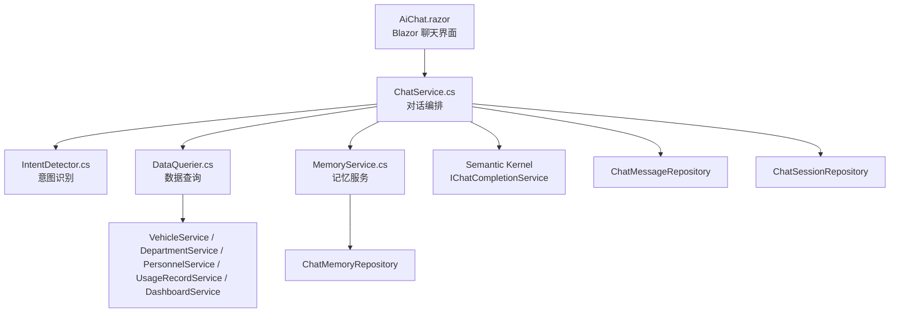
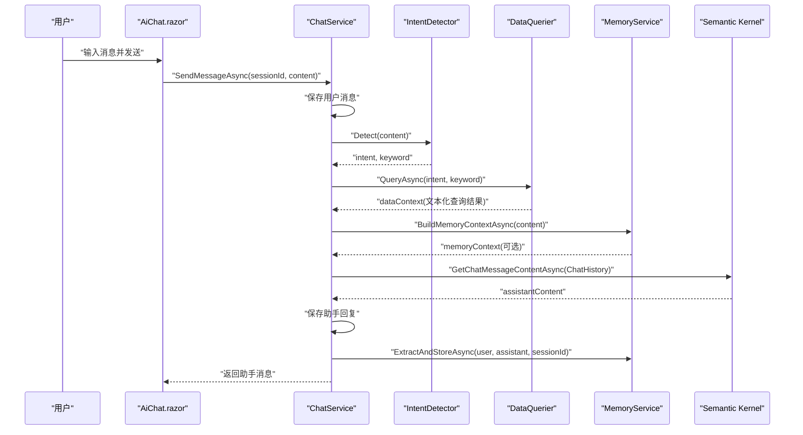
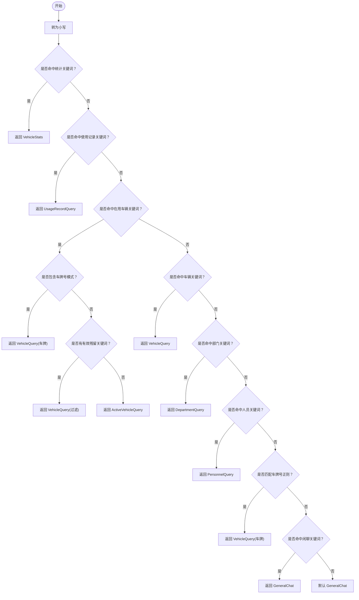
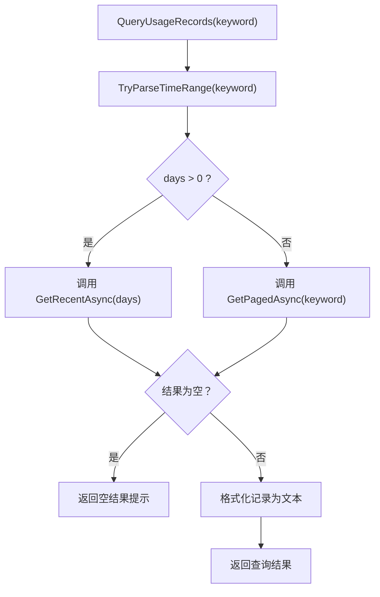
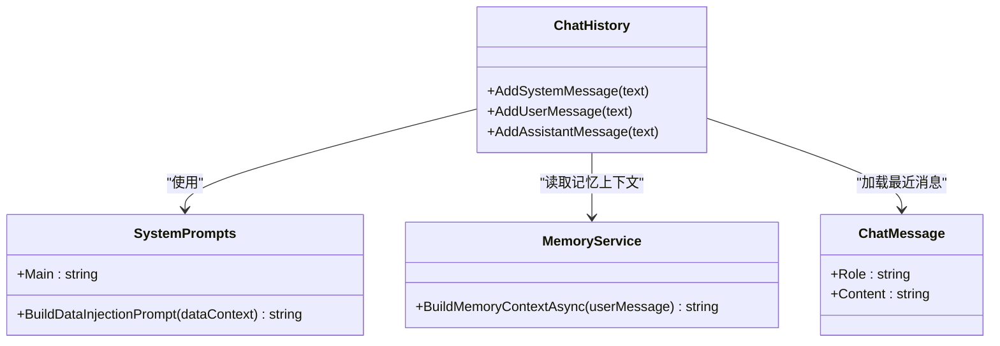
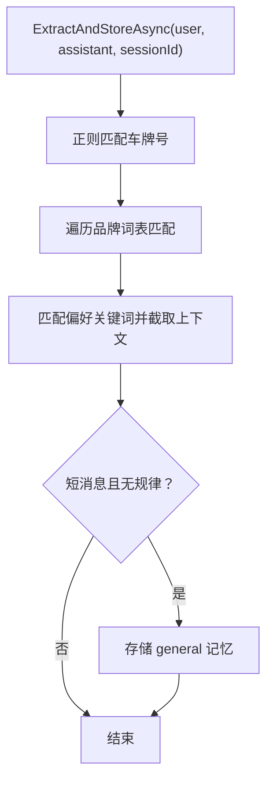
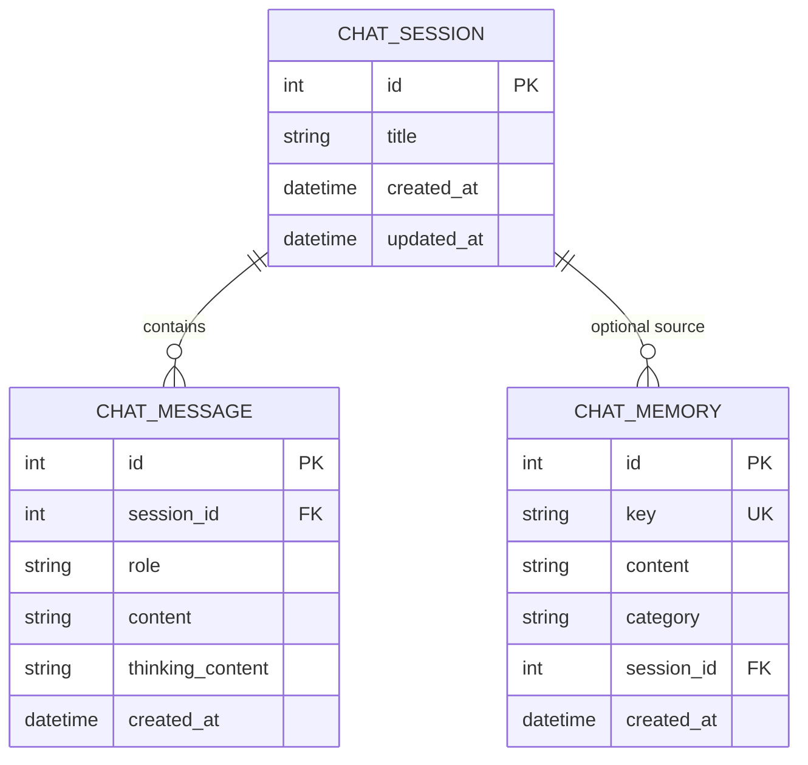
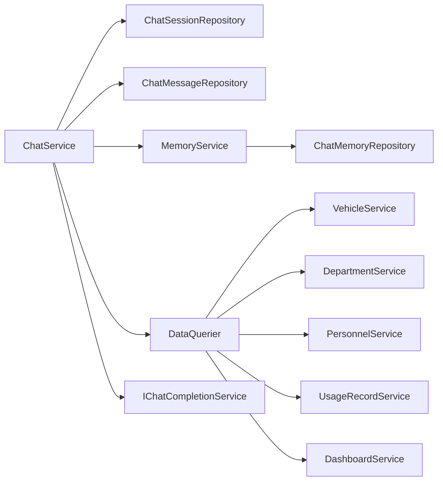

# AI 智能功能

<cite>
**本文引用的文件**   
- [ChatService.cs](file://aiServer/BLL/ChatService.cs)
- [IntentDetector.cs](file://aiServer/BLL/IntentDetector.cs)
- [DataQuerier.cs](file://aiServer/BLL/DataQuerier.cs)
- [MemoryService.cs](file://aiServer/BLL/MemoryService.cs)
- [SystemPrompts.cs](file://aiServer/BLL/Prompts/SystemPrompts.cs)
- [UserIntent.cs](file://aiServer/BLL/Enums/UserIntent.cs)
- [ChatSession.cs](file://aiServer/DAL/Model/ChatSession.cs)
- [ChatMessage.cs](file://aiServer/DAL/Model/ChatMessage.cs)
- [ChatMemory.cs](file://aiServer/DAL/Model/ChatMemory.cs)
- [AiChat.razor](file://aiServer/Pages/AiChat.razor)
</cite>

## 目录
1. [引言](#引言)
2. [项目结构](#项目结构)
3. [核心组件](#核心组件)
4. [架构总览](#架构总览)
5. [详细组件分析](#详细组件分析)
6. [依赖关系分析](#依赖关系分析)
7. [性能与稳定性](#性能与稳定性)
8. [故障排查指南](#故障排查指南)
9. [扩展与优化实践](#扩展与优化实践)
10. [结论](#结论)

## 引言
本技术文档面向 vehicleManagement 系统的 AI 智能功能，重点说明以下方面：
- 整体架构：Semantic Kernel + Ollama 本地推理、意图识别机制、上下文工程、记忆系统。
- 一次问答的完整链路：用户输入 → 意图检测 → 数据查询 → 结果注入 → 模型生成 → 记忆更新。
- 七类意图识别：统计查询、使用记录查询、在用车辆查询、车辆查询、部门查询、人员查询、闲聊对话。
- 四层上下文工程：系统提示词、数据注入、历史记忆、会话窗口。
- 记忆子系统：车牌正则匹配、品牌词表、用户偏好提取、LIKE 检索。
- 中文时间表达解析、稳定性兜底机制、数据隔离设计。
- 意图扩展、提示词优化、性能调优的实践指南。

## 项目结构
AI 智能功能位于 aiServer 子模块中，采用 Blazor 页面 + 业务服务 + 领域模型的三层组织方式：
- 页面层：AiChat.razor 负责会话管理、消息展示、记忆面板、交互状态。
- 业务层：ChatService 编排对话流程；IntentDetector 做意图识别；DataQuerier 将意图映射到数据库查询；MemoryService 负责记忆抽取与检索。
- 数据层：ChatSession、ChatMessage、ChatMemory 三个实体分别表示会话、消息和语义记忆。

图表来源
- [AiChat.razor:1-555](file://aiServer/Pages/AiChat.razor#L1-L555)
- [ChatService.cs:1-202](file://aiServer/BLL/ChatService.cs#L1-L202)
- [IntentDetector.cs:1-152](file://aiServer/BLL/IntentDetector.cs#L1-L152)
- [DataQuerier.cs:1-333](file://aiServer/BLL/DataQuerier.cs#L1-L333)
- [MemoryService.cs:1-224](file://aiServer/BLL/MemoryService.cs#L1-L224)

章节来源
- [AiChat.razor:1-555](file://aiServer/Pages/AiChat.razor#L1-L555)
- [ChatService.cs:1-202](file://aiServer/BLL/ChatService.cs#L1-L202)

## 核心组件
- ChatService：对话编排中心，负责保存消息、调用意图识别、触发数据查询、构建 Semantic Kernel 上下文、调用 LLM、保存回复、异步提取记忆。
- IntentDetector：基于关键词与正则的轻量意图分类器，支持七类意图及关键词提取。
- DataQuerier：根据意图分发查询，返回结构化文本供 LLM 消费，内置中文时间范围解析。
- MemoryService：从对话中提取车牌、品牌、偏好等记忆，提供 LIKE 检索与上下文拼接。
- SystemPrompts：定义系统提示词和数据注入模板，约束 LLM 严格基于真实数据回答。
- AiChat.razor：Blazor 聊天界面，封装会话、消息、记忆、滚动、诊断等前端逻辑。

章节来源
- [ChatService.cs:14-42](file://aiServer/BLL/ChatService.cs#L14-L42)
- [IntentDetector.cs:12-150](file://aiServer/BLL/IntentDetector.cs#L12-L150)
- [DataQuerier.cs:18-67](file://aiServer/BLL/DataQuerier.cs#L18-L67)
- [MemoryService.cs:15-40](file://aiServer/BLL/MemoryService.cs#L15-L40)
- [SystemPrompts.cs:6-36](file://aiServer/BLL/Prompts/SystemPrompts.cs#L6-L36)
- [AiChat.razor:235-555](file://aiServer/Pages/AiChat.razor#L235-L555)

## 架构总览
AI 智能功能的端到端流程如下：
- 用户在 AiChat.razor 中输入消息并发送。
- ChatService.SendMessageAsync 保存用户消息，自动更新会话标题。
- IntentDetector.Detect 识别意图与关键词。
- DataQuerier.QueryAsync 根据意图查询业务服务并格式化结果。
- ChatService.BuildChatHistory 组装四层上下文：系统提示词、数据注入、历史记忆、最近消息。
- CallLlmAsync 通过 Semantic Kernel 调用 Ollama 模型生成回复。
- 保存助手回复，并异步执行 MemoryService.ExtractAndStoreAsync 更新记忆。

图表来源
- [ChatService.cs:94-139](file://aiServer/BLL/ChatService.cs#L94-L139)
- [IntentDetector.cs:17-111](file://aiServer/BLL/IntentDetector.cs#L17-L111)
- [DataQuerier.cs:48-67](file://aiServer/BLL/DataQuerier.cs#L48-L67)
- [MemoryService.cs:45-113](file://aiServer/BLL/MemoryService.cs#L45-L113)
- [AiChat.razor:376-419](file://aiServer/Pages/AiChat.razor#L376-L419)

## 详细组件分析

### 意图识别机制（七类意图）
IntentDetector 通过关键词优先级与正则匹配实现意图分类：
- 统计查询：命中“统计”“汇总”“多少辆”“占比”“分布”“排行”等关键词时返回 VehicleStats。
- 使用记录查询：命中“使用记录”“出车”“用车”“行程”等关键词时返回 UsageRecordQuery，并尝试提取关键词。
- 在用车辆查询：命中“在用车辆”“当前可用”“有哪些车”“所有车辆”“全部车辆”“车辆列表”时优先于普通车辆查询；若包含车牌号模式则降级为 VehicleQuery。
- 车辆查询：命中“车辆”“车牌”“品牌”“型号”“状态”“维修”“退役”“公里”“颜色”等关键词时返回 VehicleQuery。
- 部门查询：命中“部门”“单位”“科室”等关键词时返回 DepartmentQuery。
- 人员查询：命中“人员”“员工”“司机”“姓名”“电话”“手机”等关键词时返回 PersonnelQuery。
- 闲聊对话：当未命中任何数据查询意图且包含“你好”“谢谢”“再见”“帮助”“功能”“版本”等关键词时返回 GeneralChat；否则默认通用问答。

图表来源
- [IntentDetector.cs:17-111](file://aiServer/BLL/IntentDetector.cs#L17-L111)

章节来源
- [IntentDetector.cs:17-150](file://aiServer/BLL/IntentDetector.cs#L17-L150)
- [UserIntent.cs:6-22](file://aiServer/BLL/Enums/UserIntent.cs#L6-L22)

### 数据查询与中文时间解析
DataQuerier 根据意图分发查询，并将业务对象格式化为 LLM 可读文本：
- 车辆查询：分页查询车辆，按状态映射中文文本，限制最多 20 条。
- 在用车辆查询：获取在用车辆列表。
- 车辆统计：聚合总数、在用、维修、退役数量，以及部门分布与近 6 个月趋势。
- 部门查询：分页查询部门，并在关键词暗示查询人员时交叉查询人员。
- 人员查询：分页查询人员，并在关键词暗示查询用车时交叉查询使用记录。
- 使用记录查询：优先解析中文时间范围（天/周/月/季度/年），再决定调用近期接口或全文搜索。

中文时间解析规则包括：
- 精确数字：如“X天”“X个月”。
- 常见中文表达：“今天/昨天/前天”“一周/两周/三周”“上个月/一个月/两个月/三个月”“一季度/二季度/三季度”“去年/一年/两年”“最近/近期”。

图表来源
- [DataQuerier.cs:230-330](file://aiServer/BLL/DataQuerier.cs#L230-L330)

章节来源
- [DataQuerier.cs:48-330](file://aiServer/BLL/DataQuerier.cs#L48-L330)

### 上下文工程（四层结构）
ChatService.BuildChatHistory 构建 Semantic Kernel 的 ChatHistory，顺序如下：
- 第一层：系统提示词（SystemPrompts.Main），定义角色、数据库结构、重要规则与行为约束。
- 第二层：数据注入（SystemPrompts.BuildDataInjectionPrompt），将 DataQuerier 返回的真实查询结果作为 system message 注入。
- 第三层：历史记忆（MemoryService.BuildMemoryContextAsync），拼接相关记忆片段，增强个性化与连续性。
- 第四层：会话窗口（最近 N 条消息），默认 MaxRecentMessages = 20，避免上下文过长导致性能下降。

图表来源
- [ChatService.cs:161-183](file://aiServer/BLL/ChatService.cs#L161-L183)
- [SystemPrompts.cs:11-36](file://aiServer/BLL/Prompts/SystemPrompts.cs#L11-L36)
- [MemoryService.cs:144-153](file://aiServer/BLL/MemoryService.cs#L144-L153)
- [ChatMessage.cs:10-49](file://aiServer/DAL/Model/ChatMessage.cs#L10-L49)

章节来源
- [ChatService.cs:158-183](file://aiServer/BLL/ChatService.cs#L158-L183)
- [SystemPrompts.cs:11-36](file://aiServer/BLL/Prompts/SystemPrompts.cs#L11-L36)

### 记忆子系统
MemoryService 负责记忆抽取、存储与检索：
- 车牌正则匹配：从用户消息中提取车牌号，生成 Key 如 “vehicle_plate_京A12345”，内容描述“用户提及了车牌号为...”。
- 品牌词表：预置常见汽车品牌，命中后生成 “vehicle_brand_品牌名” 的记忆条目。
- 用户偏好提取：当用户消息包含“喜欢”“常用”“习惯”“我的”“我想”等偏好关键词时，截取前后文作为 preference 类别记忆。
- 通用记忆：如果用户消息较短（≤20字）且无明确规律，则作为 general 类别记忆存储。
- LIKE 检索：SearchRelevantMemoriesAsync 提取关键词（车牌、品牌、≥2个中文字符的词），调用 Repository.SearchAsync 进行模糊匹配，去重并按创建时间倒序取前 5 条。
- Upsert 策略：相同 Key 则更新内容，否则新增。

图表来源
- [MemoryService.cs:45-113](file://aiServer/BLL/MemoryService.cs#L45-L113)

章节来源
- [MemoryService.cs:45-224](file://aiServer/BLL/MemoryService.cs#L45-L224)

### 会话与消息模型
- ChatSession：会话元数据（标题、创建时间、更新时间），与 ChatMessage 一对多。
- ChatMessage：消息体（角色 user/assistant/system、内容、思考过程 ThinkingContent、时间），外键关联会话。
- ChatMemory：语义记忆（Key、Content、Category、SessionId、CreatedAt），用于跨会话持久化关键信息。

图表来源
- [ChatSession.cs:11-37](file://aiServer/DAL/Model/ChatSession.cs#L11-L37)
- [ChatMessage.cs:10-49](file://aiServer/DAL/Model/ChatMessage.cs#L10-L49)
- [ChatMemory.cs:10-49](file://aiServer/DAL/Model/ChatMemory.cs#L10-L49)

章节来源
- [ChatSession.cs:11-37](file://aiServer/DAL/Model/ChatSession.cs#L11-L37)
- [ChatMessage.cs:10-49](file://aiServer/DAL/Model/ChatMessage.cs#L10-L49)
- [ChatMemory.cs:10-49](file://aiServer/DAL/Model/ChatMemory.cs#L10-L49)

### 前端交互与状态管理
AiChat.razor 负责：
- 会话列表：新建、选择、删除、自动刷新。
- 消息列表：用户消息即时显示，等待 AI 响应时显示“思考中”，完成后拉取最新消息。
- 记忆面板：展开/收起，查看与删除记忆。
- 滚动控制：JS 监听滚动事件，距离底部 < 50px 恢复自动滚动，> 200px 显示回到底部按钮。
- 键盘交互：Enter 发送，Shift+Enter 换行，F12 打开布局诊断。
- 渲染内容：对换行、加粗、代码块进行基础 HTML 转义与标记处理。

章节来源
- [AiChat.razor:1-555](file://aiServer/Pages/AiChat.razor#L1-L555)

## 依赖关系分析
- ChatService 依赖：
  - ChatSessionRepository、ChatMessageRepository：会话与消息持久化。
  - MemoryService：记忆抽取与检索。
  - DataQuerier：意图到数据的映射。
  - Kernel/IChatCompletionService：Semantic Kernel 抽象，实际由 Ollama 提供推理能力。
- DataQuerier 依赖：
  - VehicleService、DepartmentService、PersonnelService、UsageRecordService、DashboardService：业务查询与聚合。
- MemoryService 依赖：
  - ChatMemoryRepository：记忆 CRUD。
  - ILogger：日志记录。

图表来源
- [ChatService.cs:19-42](file://aiServer/BLL/ChatService.cs#L19-L42)
- [DataQuerier.cs:23-43](file://aiServer/BLL/DataQuerier.cs#L23-L43)
- [MemoryService.cs:17-40](file://aiServer/BLL/MemoryService.cs#L17-L40)

章节来源
- [ChatService.cs:19-42](file://aiServer/BLL/ChatService.cs#L19-L42)
- [DataQuerier.cs:23-43](file://aiServer/BLL/DataQuerier.cs#L23-L43)
- [MemoryService.cs:17-40](file://aiServer/BLL/MemoryService.cs#L17-L40)

## 性能与稳定性
- 上下文窗口控制：MaxRecentMessages = 20，避免历史消息过多导致 Token 膨胀与延迟上升。
- 查询结果上限：MaxQueryResults = 20，防止单次查询返回过多数据影响 LLM 生成质量。
- 异步记忆提取：ExtractAndStoreAsync 在独立 Task 中运行，异常被捕获不影响主对话路径。
- 错误兜底：
  - DataQuerier 查询异常时返回错误文本，避免中断对话。
  - CallLlmAsync 捕获异常并返回友好提示。
  - MemoryService 抽取失败仅记录警告日志。
- 数据隔离设计：
  - 记忆可关联 SessionId，便于按会话维度清理或审计。
  - 记忆 Key 具有唯一性（如 vehicle_plate_车牌、vehicle_brand_品牌），避免重复污染。
  - 系统提示词强制 LLM 基于真实数据回答，禁止编造。

章节来源
- [ChatService.cs:27-42](file://aiServer/BLL/ChatService.cs#L27-L42)
- [ChatService.cs:131-139](file://aiServer/BLL/ChatService.cs#L131-L139)
- [ChatService.cs:188-199](file://aiServer/BLL/ChatService.cs#L188-L199)
- [DataQuerier.cs:29-67](file://aiServer/BLL/DataQuerier.cs#L29-L67)
- [MemoryService.cs:109-113](file://aiServer/BLL/MemoryService.cs#L109-L113)
- [SystemPrompts.cs:20-28](file://aiServer/BLL/Prompts/SystemPrompts.cs#L20-L28)

## 故障排查指南
- 无法获取 AI 回复：
  - 检查 IChatCompletionService 配置是否正确指向 Ollama。
  - 查看 CallLlmAsync 的错误消息，确认网络或服务可用性。
- 意图识别不准确：
  - 检查 IntentDetector 关键词优先级与残留关键词过滤逻辑。
  - 对于含车牌号的“在用车辆”问题，确认正则匹配是否优先降级为 VehicleQuery。
- 数据为空或结果不完整：
  - 检查 DataQuerier 各分支查询是否成功，确认业务服务返回是否为空。
  - 注意 MaxQueryResults 限制，必要时调整分页参数。
- 记忆不生效：
  - 检查 MemoryService 的正则与品牌词表是否覆盖用户输入。
  - 确认 Repository.SearchAsync 的 LIKE 检索是否正常工作。
- 前端滚动异常：
  - 检查 JS 滚动监听函数是否注册成功，OnChatScroll 回调是否正常触发。
  - 确认 _shouldAutoScroll 与 showScrollBtn 的状态切换逻辑。

章节来源
- [ChatService.cs:188-199](file://aiServer/BLL/ChatService.cs#L188-L199)
- [IntentDetector.cs:40-58](file://aiServer/BLL/IntentDetector.cs#L40-L58)
- [DataQuerier.cs:69-267](file://aiServer/BLL/DataQuerier.cs#L69-L267)
- [MemoryService.cs:118-153](file://aiServer/BLL/MemoryService.cs#L118-L153)
- [AiChat.razor:279-327](file://aiServer/Pages/AiChat.razor#L279-L327)

## 扩展与优化实践
- 意图扩展：
  - 在 UserIntent 枚举中添加新意图，并在 IntentDetector.Detect 中增加关键词匹配分支。
  - 在 DataQuerier.QueryAsync 中增加对应分支，调用新的业务服务方法。
- 提示词优化：
  - 在 SystemPrompts.Main 中补充更多业务规则与输出格式要求，提升 LLM 回答一致性。
  - 针对特定场景（如统计解释、趋势分析）增加示例与约束，减少歧义。
- 性能调优：
  - 调整 MaxRecentMessages 与 MaxQueryResults，平衡上下文长度与响应速度。
  - 对高频查询结果引入缓存层（如内存缓存或 Redis），降低数据库压力。
  - 对 MemoryService 的 LIKE 检索增加索引或向量检索方案，提高召回效率。
- 稳定性增强：
  - 为 DataQuerier 增加重试与熔断机制，避免瞬时数据库抖动影响对话。
  - 为 CallLlmAsync 增加超时控制与降级策略（如返回模板化答案）。
  - 对 MemoryService 抽取逻辑增加白名单与噪声过滤，减少无效记忆增长。

章节来源
- [UserIntent.cs:6-22](file://aiServer/BLL/Enums/UserIntent.cs#L6-L22)
- [IntentDetector.cs:17-111](file://aiServer/BLL/IntentDetector.cs#L17-L111)
- [DataQuerier.cs:48-67](file://aiServer/BLL/DataQuerier.cs#L48-L67)
- [SystemPrompts.cs:11-36](file://aiServer/BLL/Prompts/SystemPrompts.cs#L11-L36)
- [ChatService.cs:27-42](file://aiServer/BLL/ChatService.cs#L27-L42)

## 结论
vehicleManagement 的 AI 智能功能以 ChatService 为核心编排点，结合 IntentDetector、DataQuerier、MemoryService 与 Semantic Kernel，形成“意图识别 → 数据查询 → 上下文工程 → 模型生成 → 记忆更新”的闭环。通过四层上下文工程与严格的系统提示词约束，确保 LLM 回答基于真实数据；通过记忆子系统增强个性化与连续性；通过前端交互与稳定性兜底机制提升用户体验与系统健壮性。未来可在意图扩展、提示词优化、性能调优等方面持续迭代，以满足更复杂的业务需求。