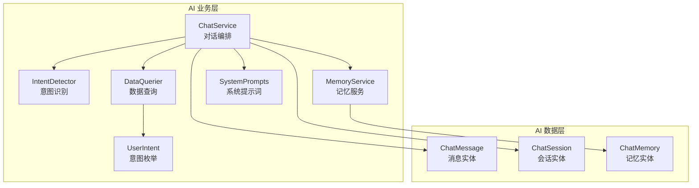
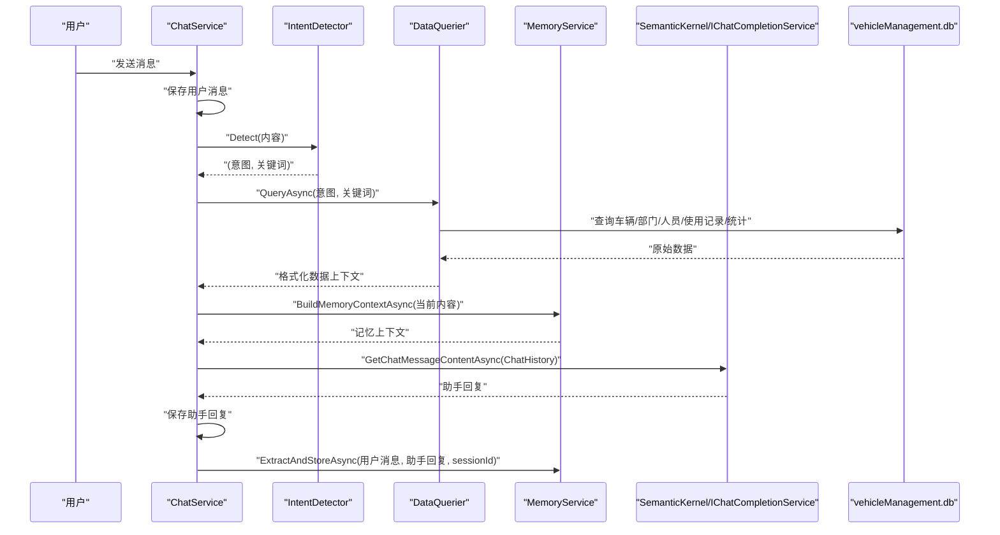
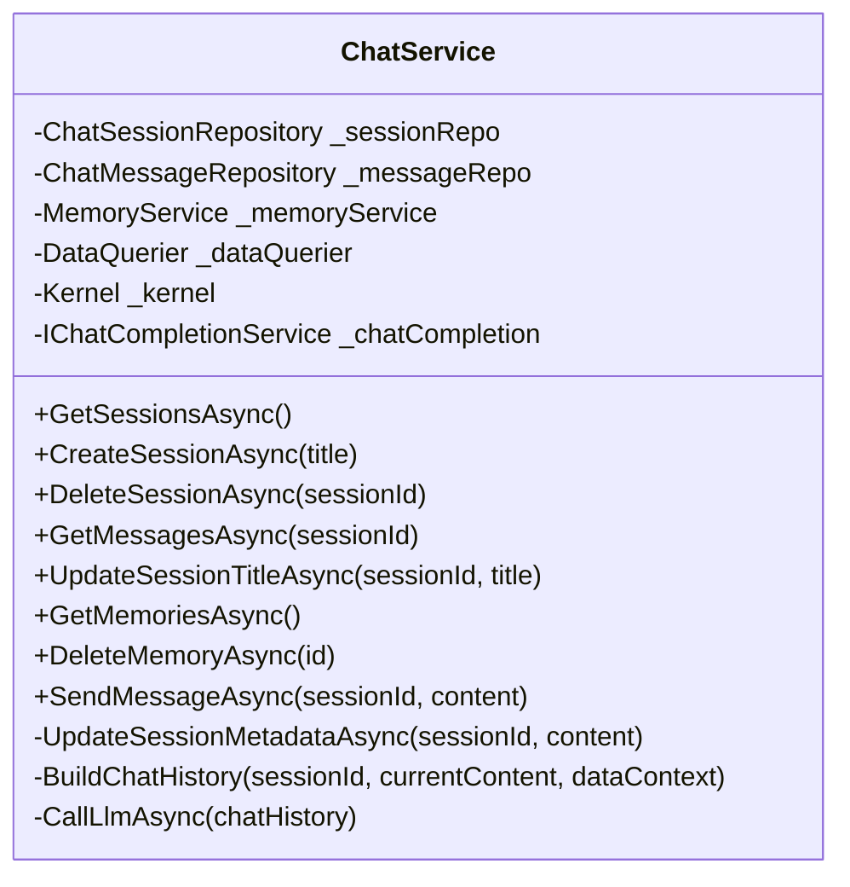
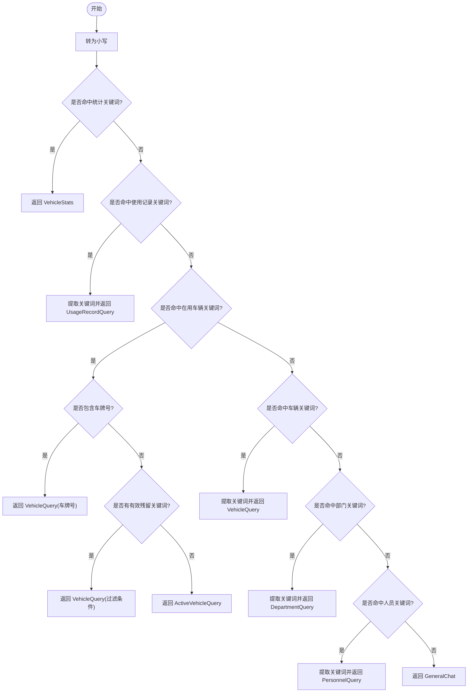
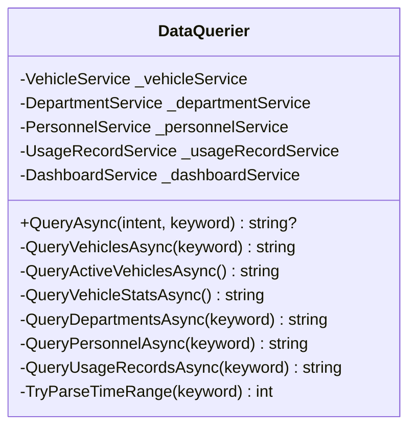
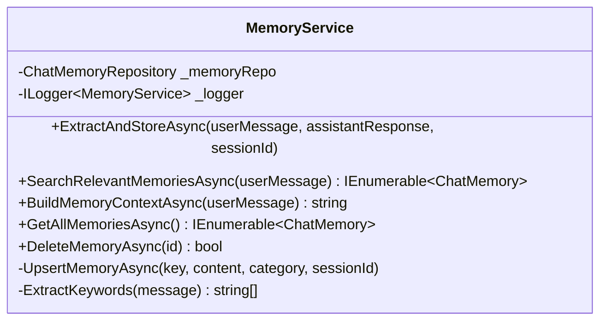
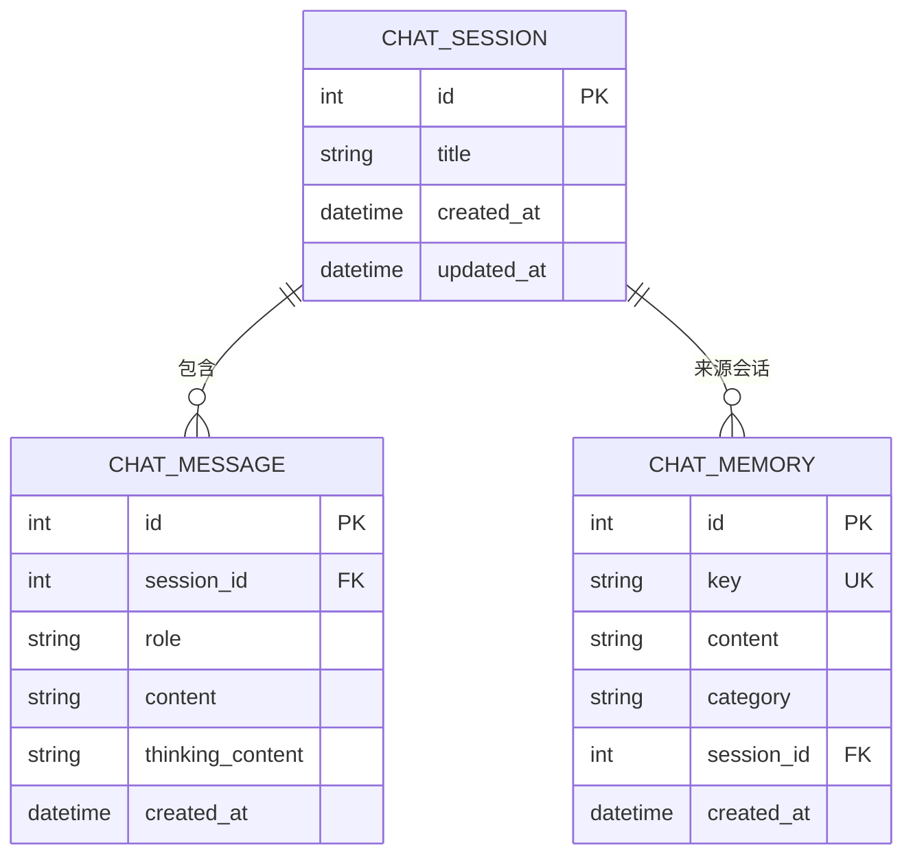
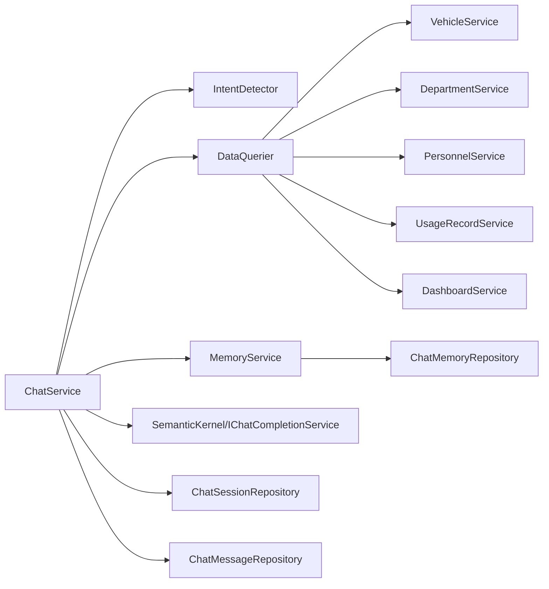

# AI 架构设计

<cite>
**本文引用的文件**   
- [ChatService.cs](file://aiServer/BLL/ChatService.cs)
- [IntentDetector.cs](file://aiServer/BLL/IntentDetector.cs)
- [DataQuerier.cs](file://aiServer/BLL/DataQuerier.cs)
- [MemoryService.cs](file://aiServer/BLL/MemoryService.cs)
- [UserIntent.cs](file://aiServer/BLL/Enums/UserIntent.cs)
- [SystemPrompts.cs](file://aiServer/BLL/Prompts/SystemPrompts.cs)
- [ChatMessage.cs](file://aiServer/DAL/Model/ChatMessage.cs)
- [ChatSession.cs](file://aiServer/DAL/Model/ChatSession.cs)
- [ChatMemory.cs](file://aiServer/DAL/Model/ChatMemory.cs)
</cite>

## 目录
1. [引言](#引言)
2. [项目结构](#项目结构)
3. [核心组件](#核心组件)
4. [架构总览](#架构总览)
5. [详细组件分析](#详细组件分析)
6. [依赖关系分析](#依赖关系分析)
7. [性能与可扩展性](#性能与可扩展性)
8. [故障排查指南](#故障排查指南)
9. [结论](#结论)

## 引言
本技术文档面向 vehicleManagement 系统的 AI 子系统，目标是清晰说明其整体架构、关键组件职责、意图识别机制、上下文工程、记忆系统以及一次完整问答的数据流。该 AI 子系统采用 Semantic Kernel + Ollama 本地推理引擎，结合基于关键词的意图识别、结构化数据查询注入和轻量级语义记忆，形成“用户输入 → 意图检测 → 数据查询 → 结果注入 → 模型生成 → 记忆更新”的闭环链路。

## 项目结构
AI 子系统位于 aiServer 目录下，分为业务逻辑层（BLL）、数据访问层（DAL）与页面层（Pages）。本次文档聚焦 BLL 与 DAL 中的核心类与模型：

- BLL
  - ChatService：对话编排、会话管理、消息持久化、意图路由、LLM 调用、记忆提取调度。
  - IntentDetector：基于关键词和用户输入模式识别七类意图。
  - DataQuerier：根据意图调用领域服务查询车辆、部门、人员、使用记录与统计数据，并格式化为 LLM 可读文本。
  - MemoryService：从对话中提取车牌、品牌、偏好等记忆，支持模糊搜索与上下文构建。
  - Enums/UserIntent：七类意图枚举。
  - Prompts/SystemPrompts：系统提示词与数据注入模板。
- DAL
  - Model：ChatSession、ChatMessage、ChatMemory 三个实体。
  - Repository：会话、消息、记忆的仓储接口实现（由 EF Core 驱动）。

图表来源
- [ChatService.cs:18-42](file://aiServer/BLL/ChatService.cs#L18-L42)
- [IntentDetector.cs:12-17](file://aiServer/BLL/IntentDetector.cs#L12-L17)
- [DataQuerier.cs:21-43](file://aiServer/BLL/DataQuerier.cs#L21-L43)
- [MemoryService.cs:15-40](file://aiServer/BLL/MemoryService.cs#L15-L40)
- [UserIntent.cs:6-22](file://aiServer/BLL/Enums/UserIntent.cs#L6-L22)
- [SystemPrompts.cs:6-36](file://aiServer/BLL/Prompts/SystemPrompts.cs#L6-L36)
- [ChatMessage.cs:10-49](file://aiServer/DAL/Model/ChatMessage.cs#L10-L49)
- [ChatSession.cs:11-36](file://aiServer/DAL/Model/ChatSession.cs#L11-L36)
- [ChatMemory.cs:10-49](file://aiServer/DAL/Model/ChatMemory.cs#L10-L49)

章节来源
- [ChatService.cs:18-42](file://aiServer/BLL/ChatService.cs#L18-L42)
- [DataQuerier.cs:21-43](file://aiServer/BLL/DataQuerier.cs#L21-L43)
- [MemoryService.cs:15-40](file://aiServer/BLL/MemoryService.cs#L15-L40)
- [UserIntent.cs:6-22](file://aiServer/BLL/Enums/UserIntent.cs#L6-L22)
- [SystemPrompts.cs:6-36](file://aiServer/BLL/Prompts/SystemPrompts.cs#L6-L36)
- [ChatMessage.cs:10-49](file://aiServer/DAL/Model/ChatMessage.cs#L10-L49)
- [ChatSession.cs:11-36](file://aiServer/DAL/Model/ChatSession.cs#L11-L36)
- [ChatMemory.cs:10-49](file://aiServer/DAL/Model/ChatMemory.cs#L10-L49)

## 核心组件
- ChatService：负责一次对话的完整编排，包括保存用户消息、自动更新会话标题、意图识别、数据查询、构建聊天历史、调用 LLM、保存助手回复、异步提取记忆。
- IntentDetector：纯函数式意图识别器，通过关键词匹配、正则表达式与停用词过滤，将自然语言映射到七类意图，并尽可能提取有效关键词。
- DataQuerier：按意图分发查询，调用领域服务获取车辆、部门、人员、使用记录与统计信息，并将结果格式化为人类可读且适合 LLM 消费的文本。
- MemoryService：从用户消息中抽取车牌号、品牌、偏好等记忆，提供相关记忆检索与上下文构建能力，用于增强后续对话的个性化与连贯性。
- UserIntent：定义七类意图，作为意图识别与数据查询之间的契约。
- SystemPrompts：定义系统主提示词和数据注入模板，约束 LLM 严格基于真实数据回答。
- DAL 模型：会话、消息、记忆三类实体，支撑会话管理、消息持久化与记忆存储。

章节来源
- [ChatService.cs:18-139](file://aiServer/BLL/ChatService.cs#L18-L139)
- [IntentDetector.cs:12-111](file://aiServer/BLL/IntentDetector.cs#L12-L111)
- [DataQuerier.cs:21-67](file://aiServer/BLL/DataQuerier.cs#L21-L67)
- [MemoryService.cs:15-153](file://aiServer/BLL/MemoryService.cs#L15-L153)
- [UserIntent.cs:6-22](file://aiServer/BLL/Enums/UserIntent.cs#L6-L22)
- [SystemPrompts.cs:6-36](file://aiServer/BLL/Prompts/SystemPrompts.cs#L6-L36)
- [ChatMessage.cs:10-49](file://aiServer/DAL/Model/ChatMessage.cs#L10-L49)
- [ChatSession.cs:11-36](file://aiServer/DAL/Model/ChatSession.cs#L11-L36)
- [ChatMemory.cs:10-49](file://aiServer/DAL/Model/ChatMemory.cs#L10-L49)

## 架构总览
下图展示一次问答的端到端流程：用户输入进入 ChatService，先持久化用户消息；随后 IntentDetector 识别意图；DataQuerier 根据意图查询数据库并格式化结果；ChatService 构建包含系统提示词、数据注入、记忆上下文与最近历史消息的 ChatHistory；最后通过 Semantic Kernel 的 IChatCompletionService 调用 Ollama 模型生成回复，并持久化助手回复；同时异步触发 MemoryService 提取记忆。

图表来源
- [ChatService.cs:94-139](file://aiServer/BLL/ChatService.cs#L94-L139)
- [IntentDetector.cs:17-111](file://aiServer/BLL/IntentDetector.cs#L17-L111)
- [DataQuerier.cs:48-67](file://aiServer/BLL/DataQuerier.cs#L48-L67)
- [MemoryService.cs:45-113](file://aiServer/BLL/MemoryService.cs#L45-L113)
- [SystemPrompts.cs:11-36](file://aiServer/BLL/Prompts/SystemPrompts.cs#L11-L36)

## 详细组件分析

### ChatService：对话编排与核心职责
ChatService 是 AI 子系统的中枢，承担以下职责：
- 会话管理：创建、删除、更新标题、列出会话。
- 消息持久化：保存用户与助手消息，加载最近历史消息。
- 意图路由：调用 IntentDetector 识别意图并传递关键词。
- 数据查询：调用 DataQuerier 获取结构化数据上下文。
- 上下文工程：组合系统提示词、数据注入、记忆上下文与最近历史消息，构建 ChatHistory。
- LLM 调用：通过 Semantic Kernel 的 IChatCompletionService 调用 Ollama 模型。
- 记忆提取：异步调用 MemoryService 提取并存储记忆，不影响主流程。

图表来源
- [ChatService.cs:18-42](file://aiServer/BLL/ChatService.cs#L18-L42)
- [ChatService.cs:44-139](file://aiServer/BLL/ChatService.cs#L44-L139)
- [ChatService.cs:141-199](file://aiServer/BLL/ChatService.cs#L141-L199)

章节来源
- [ChatService.cs:18-199](file://aiServer/BLL/ChatService.cs#L18-L199)

### IntentDetector：意图识别机制
IntentDetector 通过关键词匹配、正则表达式与停用词过滤，将用户输入映射为七类意图：
- 统计查询：统计、汇总、多少辆、占比、分布、趋势、排行等。
- 使用记录查询：使用记录、出车、用车、行程等。
- 在用车辆查询：在用车辆、当前可用、正在使用、有哪些车、所有车辆、全部车辆、车辆列表等。
- 车辆查询：车辆、车牌、品牌、型号、状态、维修、退役、公里、颜色等。
- 部门查询：部门、单位、科室等。
- 人员查询：人员、员工、司机、姓名、电话、手机等。
- 闲聊对话：你好、谢谢、再见、帮助、功能、版本等。

此外，它还处理车牌号正则匹配、残留关键词有效性判断与停用词清理，确保关键词质量。

图表来源
- [IntentDetector.cs:17-111](file://aiServer/BLL/IntentDetector.cs#L17-L111)
- [IntentDetector.cs:113-149](file://aiServer/BLL/IntentDetector.cs#L113-L149)

章节来源
- [IntentDetector.cs:17-149](file://aiServer/BLL/IntentDetector.cs#L17-L149)
- [UserIntent.cs:6-22](file://aiServer/BLL/Enums/UserIntent.cs#L6-L22)

### DataQuerier：数据查询与结果注入
DataQuerier 根据意图分发查询，调用领域服务获取数据并格式化为 LLM 可读文本：
- 车辆查询：分页查询车辆，格式化字段如车牌号、品牌、型号、颜色、年份、状态、所属部门。
- 在用车辆查询：获取在用车辆列表。
- 车辆统计：聚合车辆总数、在用/维修/退役数量、部门车辆分布、近6个月用车趋势。
- 部门查询：分页查询部门，并在关键词暗示时交叉查询部门下的人员。
- 人员查询：分页查询人员，并在关键词暗示时交叉查询人员的用车记录。
- 使用记录查询：解析时间范围关键词（天/周/月/季度/年），查询近期或全文搜索结果。

图表来源
- [DataQuerier.cs:21-43](file://aiServer/BLL/DataQuerier.cs#L21-L43)
- [DataQuerier.cs:48-67](file://aiServer/BLL/DataQuerier.cs#L48-L67)
- [DataQuerier.cs:69-330](file://aiServer/BLL/DataQuerier.cs#L69-L330)

章节来源
- [DataQuerier.cs:21-330](file://aiServer/BLL/DataQuerier.cs#L21-L330)

### MemoryService：记忆系统与上下文工程
MemoryService 负责从对话中提取关键信息并存储为记忆，支持相关记忆检索与上下文构建：
- 记忆提取：识别车牌号、车辆品牌、用户偏好/习惯，以及短消息通用记忆。
- 记忆检索：基于关键词（车牌、品牌、中文词汇）搜索历史记忆，去重并按时间排序限制数量。
- 上下文构建：将相关记忆以分类+内容的形式拼接为系统提示的一部分，增强 LLM 对用户偏好的理解。
- 记忆管理：提供获取全部记忆、删除记忆、插入或更新记忆的能力。

图表来源
- [MemoryService.cs:15-40](file://aiServer/BLL/MemoryService.cs#L15-L40)
- [MemoryService.cs:45-113](file://aiServer/BLL/MemoryService.cs#L45-L113)
- [MemoryService.cs:115-153](file://aiServer/BLL/MemoryService.cs#L115-L153)
- [MemoryService.cs:155-221](file://aiServer/BLL/MemoryService.cs#L155-L221)

章节来源
- [MemoryService.cs:15-221](file://aiServer/BLL/MemoryService.cs#L15-L221)

### 系统提示词与数据注入
SystemPrompts 定义了引导 LLM 严格基于真实数据回答的系统提示词，并提供数据注入模板，将 DataQuerier 的结果包装为 system message，确保 LLM 不编造数据。

章节来源
- [SystemPrompts.cs:6-36](file://aiServer/BLL/Prompts/SystemPrompts.cs#L6-L36)

### 数据模型与会话、消息、记忆
- ChatSession：会话实体，包含标题、创建时间、更新时间与消息集合导航属性。
- ChatMessage：消息实体，包含角色（user/assistant/system）、内容、思考过程、时间与会话外键。
- ChatMemory：记忆实体，包含记忆键、内容、分类、来源会话与创建时间。

图表来源
- [ChatSession.cs:11-36](file://aiServer/DAL/Model/ChatSession.cs#L11-L36)
- [ChatMessage.cs:10-49](file://aiServer/DAL/Model/ChatMessage.cs#L10-L49)
- [ChatMemory.cs:10-49](file://aiServer/DAL/Model/ChatMemory.cs#L10-L49)

章节来源
- [ChatSession.cs:11-36](file://aiServer/DAL/Model/ChatSession.cs#L11-L36)
- [ChatMessage.cs:10-49](file://aiServer/DAL/Model/ChatMessage.cs#L10-L49)
- [ChatMemory.cs:10-49](file://aiServer/DAL/Model/ChatMemory.cs#L10-L49)

## 依赖关系分析
- ChatService 依赖：
  - IntentDetector：意图识别。
  - DataQuerier：数据查询与格式化。
  - MemoryService：记忆提取与上下文构建。
  - Kernel 与 IChatCompletionService：Semantic Kernel 抽象，实际对接 Ollama。
  - ChatSessionRepository 与 ChatMessageRepository：会话与消息持久化。
- DataQuerier 依赖：
  - VehicleService、DepartmentService、PersonnelService、UsageRecordService、DashboardService：领域服务，最终访问 vehicleManagement.db。
- MemoryService 依赖：
  - ChatMemoryRepository：记忆持久化。
  - ILogger：日志记录。

图表来源
- [ChatService.cs:18-42](file://aiServer/BLL/ChatService.cs#L18-L42)
- [DataQuerier.cs:21-43](file://aiServer/BLL/DataQuerier.cs#L21-L43)
- [MemoryService.cs:15-40](file://aiServer/BLL/MemoryService.cs#L15-L40)

章节来源
- [ChatService.cs:18-42](file://aiServer/BLL/ChatService.cs#L18-L42)
- [DataQuerier.cs:21-43](file://aiServer/BLL/DataQuerier.cs#L21-L43)
- [MemoryService.cs:15-40](file://aiServer/BLL/MemoryService.cs#L15-L40)

## 性能与可扩展性
- 意图识别：关键词匹配与正则表达式均为轻量操作，时间复杂度近似 O(n) 与 O(m)，对长文本影响较小。
- 数据查询：分页查询限制最大结果数，避免大结果集导致响应缓慢；时间复杂度取决于底层数据库索引与查询优化。
- 记忆提取：异步执行，不阻塞主流程；关键词提取与正则匹配开销较低。
- 上下文构建：仅加载最近 N 条消息，控制上下文长度，降低 LLM 调用成本与延迟。
- 可扩展点：
  - 扩展意图类别：在 UserIntent 与 IntentDetector 中添加新意图分支。
  - 增强记忆：引入向量检索或更复杂的 NLP 工具提升记忆相关性。
  - 多模型支持：通过 IChatCompletionService 抽象切换不同后端。

[本节为通用指导，不直接分析具体文件]

## 故障排查指南
- LLM 不可用：当 IChatCompletionService 抛出异常时，ChatService 会返回错误提示，便于前端展示与服务诊断。
- 数据查询异常：DataQuerier 捕获异常并返回错误信息，便于定位领域服务或数据库问题。
- 记忆提取失败：MemoryService 捕获异常并记录警告日志，不影响对话主流程。
- 会话与消息持久化：若仓储层出现异常，需检查 EF Core 配置与数据库连接。

章节来源
- [ChatService.cs:188-199](file://aiServer/BLL/ChatService.cs#L188-L199)
- [DataQuerier.cs:48-67](file://aiServer/BLL/DataQuerier.cs#L48-L67)
- [MemoryService.cs:109-113](file://aiServer/BLL/MemoryService.cs#L109-L113)

## 结论
vehicleManagement 的 AI 子系统以 ChatService 为核心，串联意图识别、数据查询、上下文工程与记忆系统，并通过 Semantic Kernel 与 Ollama 完成本地推理。该架构在保证数据严谨性的同时，提供了灵活的意图扩展与记忆增强能力，适用于车辆管理系统中的多样化问答场景。未来可进一步引入向量记忆、更丰富的意图分类与多模型支持，以提升用户体验与系统弹性。