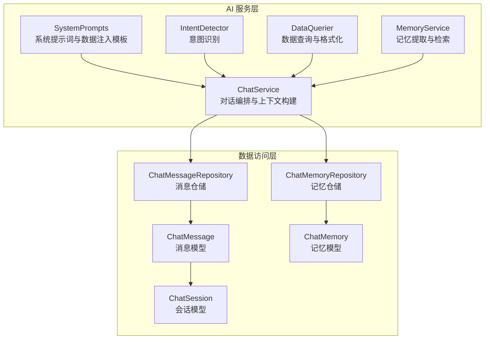
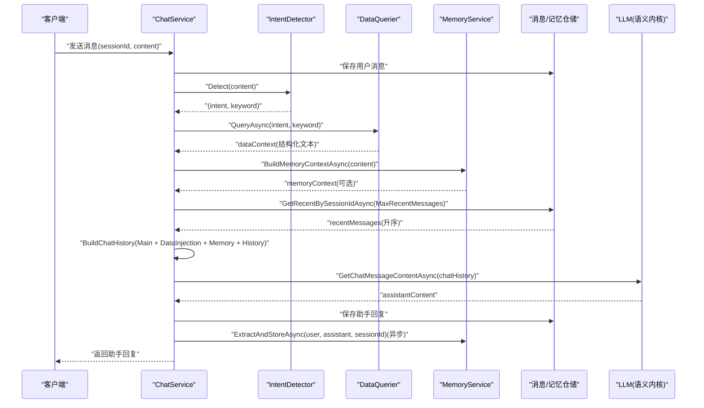
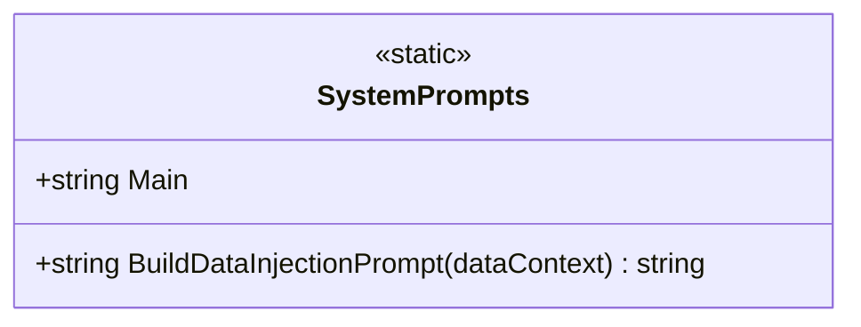
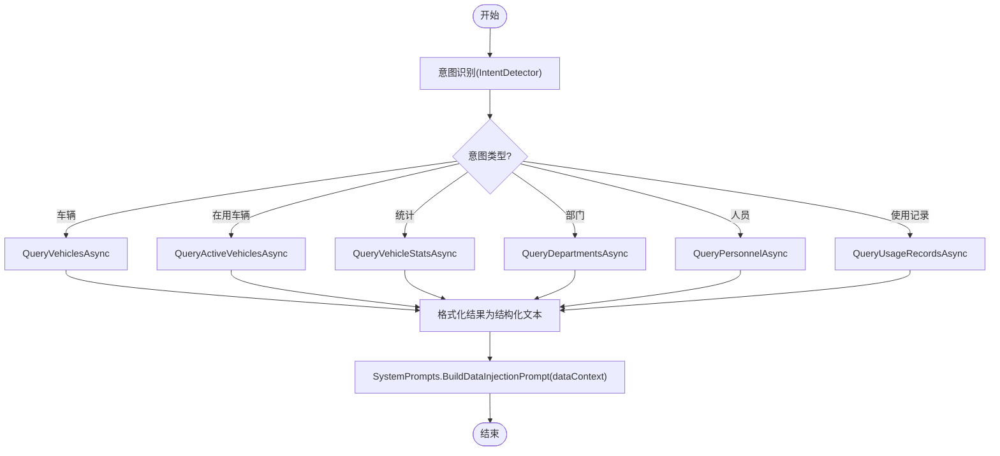
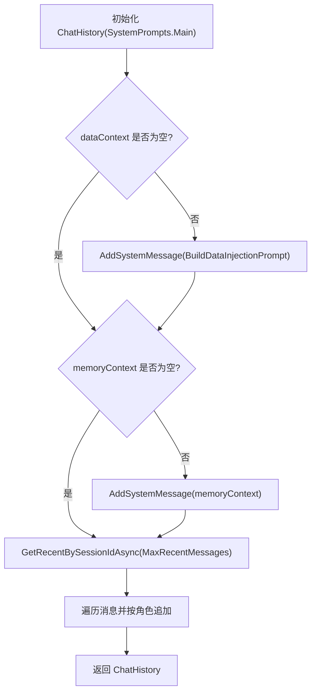
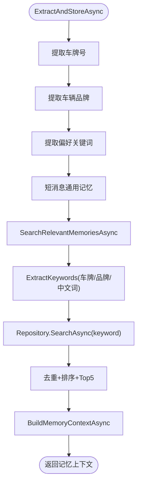
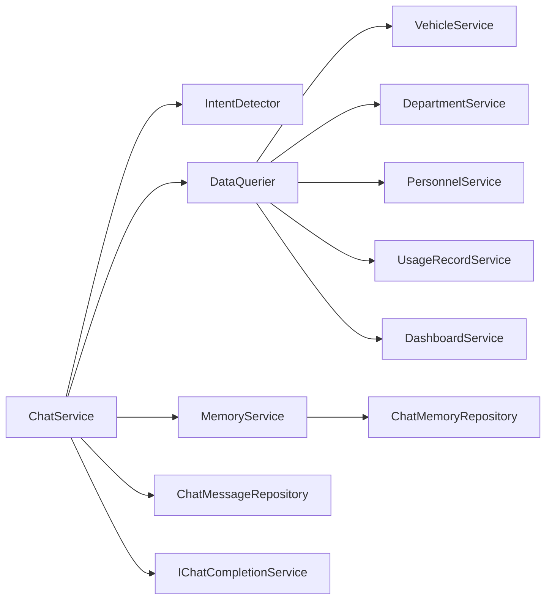

# 上下文工程

<cite>
**本文引用的文件**   
- [SystemPrompts.cs](file://aiServer/BLL/Prompts/SystemPrompts.cs)
- [ChatService.cs](file://aiServer/BLL/ChatService.cs)
- [MemoryService.cs](file://aiServer/BLL/MemoryService.cs)
- [DataQuerier.cs](file://aiServer/BLL/DataQuerier.cs)
- [IntentDetector.cs](file://aiServer/BLL/IntentDetector.cs)
- [ChatMessage.cs](file://aiServer/DAL/Model/ChatMessage.cs)
- [ChatSession.cs](file://aiServer/DAL/Model/ChatSession.cs)
- [ChatMemory.cs](file://aiServer/DAL/Model/ChatMemory.cs)
- [ChatMessageRepository.cs](file://aiServer/DAL/Repository/ChatMessageRepository.cs)
- [ChatMemoryRepository.cs](file://aiServer/DAL/Repository/ChatMemoryRepository.cs)
</cite>

## 目录
1. [引言](#引言)
2. [项目结构](#项目结构)
3. [核心组件](#核心组件)
4. [架构总览](#架构总览)
5. [详细组件分析](#详细组件分析)
6. [依赖关系分析](#依赖关系分析)
7. [性能与上下文优化](#性能与上下文优化)
8. [故障排查指南](#故障排查指南)
9. [结论](#结论)
10. [附录：最佳实践与常见问题](#附录最佳实践与常见问题)

## 引言
本技术文档聚焦 vehicleManagement 系统的“上下文工程”，围绕四层上下文结构展开：系统提示词、数据注入、历史记忆与会话窗口。目标是帮助开发者理解并优化从用户输入到 LLM 回复的完整上下文组装流程，确保回答严格基于真实数据库结果，同时兼顾性能、可维护性与安全性。

## 项目结构
与上下文工程直接相关的代码主要位于 aiServer 层，分为业务逻辑（BLL）、领域模型（DAL.Model）与仓储（DAL.Repository）。关键职责如下：
- SystemPrompts：定义系统角色、任务约束与安全规则，并提供数据注入模板。
- ChatService：对话编排中枢，负责会话管理、意图识别、数据查询、上下文构建与 LLM 调用。
- MemoryService：记忆提取、检索与上下文构建。
- DataQuerier：根据意图查询业务服务，并将结果格式化为结构化文本。
- IntentDetector：基于关键词匹配的用户意图识别器。
- DAL 模型与仓储：持久化会话、消息与记忆，提供最近 N 条消息加载能力。

图表来源
- [SystemPrompts.cs:1-39](file://aiServer/BLL/Prompts/SystemPrompts.cs#L1-L39)
- [ChatService.cs:18-202](file://aiServer/BLL/ChatService.cs#L18-L202)
- [IntentDetector.cs:12-152](file://aiServer/BLL/IntentDetector.cs#L12-L152)
- [DataQuerier.cs:21-333](file://aiServer/BLL/DataQuerier.cs#L21-L333)
- [MemoryService.cs:15-224](file://aiServer/BLL/MemoryService.cs#L15-L224)
- [ChatMessageRepository.cs:12-60](file://aiServer/DAL/Repository/ChatMessageRepository.cs#L12-L60)
- [ChatMemoryRepository.cs:12-78](file://aiServer/DAL/Repository/ChatMemoryRepository.cs#L12-L78)
- [ChatMessage.cs:10-51](file://aiServer/DAL/Model/ChatMessage.cs#L10-L51)
- [ChatSession.cs:11-39](file://aiServer/DAL/Model/ChatSession.cs#L11-L39)
- [ChatMemory.cs:10-52](file://aiServer/DAL/Model/ChatMemory.cs#L10-L52)

章节来源
- [ChatService.cs:18-202](file://aiServer/BLL/ChatService.cs#L18-L202)
- [SystemPrompts.cs:1-39](file://aiServer/BLL/Prompts/SystemPrompts.cs#L1-L39)

## 核心组件
- 系统提示词（SystemPrompts.Main）：定义 AI 助手角色、数据库结构说明、安全限制与输出规范。
- 数据注入（SystemPrompts.BuildDataInjectionPrompt）：将结构化查询结果以 system message 形式注入上下文。
- 历史记忆（MemoryService）：从对话中提取车牌、品牌、偏好等记忆，并在后续对话中检索相关记忆作为上下文。
- 会话窗口（ChatService.BuildChatHistory + ChatMessageRepository.GetRecentBySessionIdAsync）：控制最近 20 条消息加载顺序与角色映射。

章节来源
- [SystemPrompts.cs:1-39](file://aiServer/BLL/Prompts/SystemPrompts.cs#L1-L39)
- [MemoryService.cs:15-224](file://aiServer/BLL/MemoryService.cs#L15-L224)
- [ChatService.cs:158-183](file://aiServer/BLL/ChatService.cs#L158-L183)
- [ChatMessageRepository.cs:30-39](file://aiServer/DAL/Repository/ChatMessageRepository.cs#L30-L39)

## 架构总览
下图展示一次对话请求的端到端流程：保存用户消息 → 意图识别 → 数据查询 → 构建上下文（系统提示词 + 数据注入 + 记忆 + 历史消息）→ 调用 LLM → 保存回复 → 异步记忆提取。

图表来源
- [ChatService.cs:94-139](file://aiServer/BLL/ChatService.cs#L94-L139)
- [IntentDetector.cs:17-111](file://aiServer/BLL/IntentDetector.cs#L17-L111)
- [DataQuerier.cs:48-67](file://aiServer/BLL/DataQuerier.cs#L48-L67)
- [MemoryService.cs:144-153](file://aiServer/BLL/MemoryService.cs#L144-L153)
- [ChatMessageRepository.cs:30-39](file://aiServer/DAL/Repository/ChatMessageRepository.cs#L30-L39)

## 详细组件分析

### 系统提示词设计（SystemPrompts）
- 角色定义：明确 AI 助手身份为车辆管理系统助手。
- 任务描述：强调必须严格基于系统提供的数据上下文回答；若数据为空则如实告知无数据。
- 输出格式约束：中文回复、简洁清晰；对“有哪些车”等默认理解为全量列表；对部门用车问题直接依据部门车辆分布数据回答。
- 安全限制：禁止编造不存在的数据；避免不确定词汇；闲聊与数据查询区分处理。

数据注入机制通过 BuildDataInjectionPrompt 将结构化查询结果包装为 system message，强化“仅基于真实数据回答”的约束。

章节来源
- [SystemPrompts.cs:1-39](file://aiServer/BLL/Prompts/SystemPrompts.cs#L1-L39)

#### 类图：SystemPrompts

图表来源
- [SystemPrompts.cs:6-36](file://aiServer/BLL/Prompts/SystemPrompts.cs#L6-L36)

### 数据注入机制（DataQuerier + SystemPrompts.BuildDataInjectionPrompt）
- 意图分发：根据 UserIntent 选择具体查询方法（车辆、在用车辆、统计、部门、人员、使用记录）。
- 结果格式化：将业务对象转换为人类可读的结构化文本，包含标题、计数、字段摘要等。
- 注入策略：在 ChatService.BuildChatHistory 中，当 dataContext 非空时，追加一条 system message，内容为“以下是真实数据库查询结果……”。

图表来源
- [DataQuerier.cs:48-67](file://aiServer/BLL/DataQuerier.cs#L48-L67)
- [DataQuerier.cs:69-333](file://aiServer/BLL/DataQuerier.cs#L69-L333)
- [SystemPrompts.cs:33-36](file://aiServer/BLL/Prompts/SystemPrompts.cs#L33-L36)

章节来源
- [DataQuerier.cs:21-333](file://aiServer/BLL/DataQuerier.cs#L21-L333)
- [SystemPrompts.cs:33-36](file://aiServer/BLL/Prompts/SystemPrompts.cs#L33-L36)

### 历史消息管理与会话窗口（ChatService.BuildChatHistory）
- 上下文组装顺序：
  1) 初始化 ChatHistory 并注入 SystemPrompts.Main。
  2) 若有 dataContext，追加 system message 进行数据注入。
  3) 若有 memoryContext，追加 system message 提供历史记忆。
  4) 加载最近 MaxRecentMessages（20）条消息，按时间升序追加 user/assistant 消息。
- 长度限制：通过仓库层的 Take(count) 控制最近消息数量，避免上下文窗口过大。
- 角色处理：user 与 assistant 分别映射到 AddUserMessage/AddAssistantMessage。

图表来源
- [ChatService.cs:161-183](file://aiServer/BLL/ChatService.cs#L161-L183)
- [ChatMessageRepository.cs:30-39](file://aiServer/DAL/Repository/ChatMessageRepository.cs#L30-L39)

章节来源
- [ChatService.cs:158-183](file://aiServer/BLL/ChatService.cs#L158-L183)
- [ChatMessageRepository.cs:30-39](file://aiServer/DAL/Repository/ChatMessageRepository.cs#L30-L39)

### 记忆系统（MemoryService）
- 记忆提取：
  - 车牌号：正则匹配中国车牌模式，生成 vehicle_plate_* 键。
  - 车辆品牌：命中预置品牌列表，生成 vehicle_brand_* 键。
  - 偏好习惯：匹配偏好关键词，截取前后文片段存储为 preference_*。
  - 通用记忆：短消息且无规律时，存储为 general_*。
- 记忆检索：
  - 关键词提取：车牌、品牌、中文词（≥2字），最多取 5 个关键词。
  - 模糊搜索：按 Key/Content 包含关键词检索，去重后按创建时间倒序取前 5 条。
- 上下文构建：将检索到的记忆拼接为“以下是 AI 已知的关于用户的历史信息：\n- [分类] 内容”。

图表来源
- [MemoryService.cs:45-113](file://aiServer/BLL/MemoryService.cs#L45-L113)
- [MemoryService.cs:118-153](file://aiServer/BLL/MemoryService.cs#L118-L153)
- [MemoryService.cs:199-221](file://aiServer/BLL/MemoryService.cs#L199-L221)
- [ChatMemoryRepository.cs:29-41](file://aiServer/DAL/Repository/ChatMemoryRepository.cs#L29-L41)

章节来源
- [MemoryService.cs:15-224](file://aiServer/BLL/MemoryService.cs#L15-L224)
- [ChatMemoryRepository.cs:12-78](file://aiServer/DAL/Repository/ChatMemoryRepository.cs#L12-L78)

### 意图识别（IntentDetector）
- 优先级：统计意图优先于具体查询；在用车辆查询优先于普通车辆查询。
- 关键词过滤：去除停用词与噪声字符，保留有效搜索词。
- 特殊处理：当输入包含车牌号模式时，强制走车辆查询并提取车牌作为关键词。

章节来源
- [IntentDetector.cs:12-152](file://aiServer/BLL/IntentDetector.cs#L12-L152)

## 依赖关系分析
- ChatService 依赖：
  - IntentDetector：意图识别。
  - DataQuerier：数据查询与格式化。
  - MemoryService：记忆检索与上下文构建。
  - ChatMessageRepository：消息读写与最近 N 条加载。
  - Semantic Kernel IChatCompletionService：LLM 调用。
- DataQuerier 依赖：
  - VehicleService、DepartmentService、PersonnelService、UsageRecordService、DashboardService：业务查询。
- MemoryService 依赖：
  - ChatMemoryRepository：记忆存取。
- Repository 层依赖：
  - AiServerDbContext：EF Core 上下文工厂。

图表来源
- [ChatService.cs:18-42](file://aiServer/BLL/ChatService.cs#L18-L42)
- [DataQuerier.cs:21-43](file://aiServer/BLL/DataQuerier.cs#L21-L43)
- [MemoryService.cs:36-40](file://aiServer/BLL/MemoryService.cs#L36-L40)

章节来源
- [ChatService.cs:18-42](file://aiServer/BLL/ChatService.cs#L18-L42)
- [DataQuerier.cs:21-43](file://aiServer/BLL/DataQuerier.cs#L21-L43)
- [MemoryService.cs:36-40](file://aiServer/BLL/MemoryService.cs#L36-L40)

## 性能与上下文优化
- 提示词模板设计：
  - 使用 SystemPrompts.Main 明确角色、结构与规则，减少歧义。
  - 使用 BuildDataInjectionPrompt 将数据以 system message 注入，增强事实性约束。
- 信息密度控制：
  - DataQuerier 对查询结果进行分页与摘要（如“共找到 X 条，以下显示前 Y 条”），避免过长上下文。
  - MemoryService 限制检索结果 Top 5，避免记忆上下文膨胀。
- 会话窗口控制：
  - MaxRecentMessages = 20，结合仓库层 Take(count) 保证历史消息可控。
  - 历史消息按时间升序追加，保持对话时序一致性。
- 性能调优建议：
  - 将记忆提取设为异步（已在 ChatService 中实现），避免阻塞主流程。
  - 对频繁查询的统计数据（如部门车辆分布）考虑缓存或预聚合。
  - 合理调整 MaxQueryResults 与 MaxRecentMessages，平衡准确性与响应速度。

[本节为通用指导，不直接分析具体文件]

## 故障排查指南
- LLM 返回空响应或异常：
  - 检查 CallLlmAsync 的异常捕获与错误消息返回。
  - 确认 IChatCompletionService 配置正确（Ollama/Semantic Kernel）。
- 数据查询失败：
  - 查看 DataQuerier.QueryAsync 的异常处理，确认业务服务可用。
  - 校验意图识别是否正确（IntentDetector），必要时增加日志。
- 记忆提取失败：
  - MemoryService 已对异常进行警告日志记录，不影响对话流程。
  - 检查正则表达式与关键词列表是否覆盖常见场景。
- 历史消息未加载或顺序错误：
  - 确认 ChatMessageRepository.GetRecentBySessionIdAsync 的排序逻辑（先降序取 N，再升序返回）。
  - 验证 ChatService.BuildChatHistory 中的角色映射（user/assistant）。

章节来源
- [ChatService.cs:188-199](file://aiServer/BLL/ChatService.cs#L188-L199)
- [DataQuerier.cs:48-67](file://aiServer/BLL/DataQuerier.cs#L48-L67)
- [MemoryService.cs:109-113](file://aiServer/BLL/MemoryService.cs#L109-L113)
- [ChatMessageRepository.cs:30-39](file://aiServer/DAL/Repository/ChatMessageRepository.cs#L30-L39)

## 结论
vehicleManagement 的上下文工程通过四层结构（系统提示词、数据注入、历史记忆、会话窗口）实现了高事实性、低幻觉的对话体验。关键在于：
- 严格的系统提示词与数据注入约束。
- 高效的意图识别与数据格式化。
- 可控的记忆检索与会话窗口大小。
- 异步记忆提取与健壮的错误处理。

遵循本文的最佳实践与优化建议，可进一步提升系统的准确性、性能与可维护性。

[本节为总结，不直接分析具体文件]

## 附录：最佳实践与常见问题

### 最佳实践
- 系统设计
  - 始终使用 SystemPrompts.Main 定义角色与规则，避免自由发挥。
  - 使用 BuildDataInjectionPrompt 将结构化数据注入为 system message。
- 数据查询
  - 对大数据集进行分页与摘要，控制上下文长度。
  - 对高频统计数据进行缓存或预计算。
- 记忆管理
  - 限制检索结果数量（Top 5），避免上下文膨胀。
  - 使用明确的 Key 命名规范（vehicle_plate_*, vehicle_brand_*, preference_*, general_*）。
- 会话窗口
  - 固定 MaxRecentMessages（20），并结合仓库层排序保证时序一致。
  - 对超长对话考虑分段或摘要历史。

### 常见问题
- 问“哪个部门用车最多”却返回使用记录统计：
  - 原因：未遵循 SystemPrompts 中“部门车辆分布即代表该部门的用车数量”的规则。
  - 解决：确保 DataQuerier 返回部门车辆分布数据，并在 SystemPrompts 中强调。
- 问“有哪些车”返回空结果：
  - 原因：意图识别被车牌号模式拦截或关键词过滤过严。
  - 解决：检查 IntentDetector 的车牌号检测与关键词提取逻辑。
- 历史消息缺失或顺序错乱：
  - 原因：仓库层排序或 ChatService 的角色映射有误。
  - 解决：核对 GetRecentBySessionIdAsync 与 BuildChatHistory 的实现。

[本节为通用指导，不直接分析具体文件]