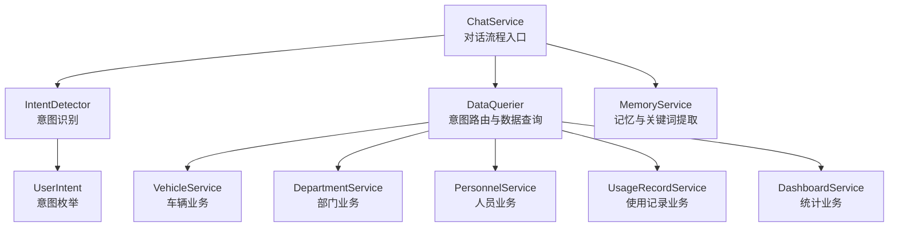
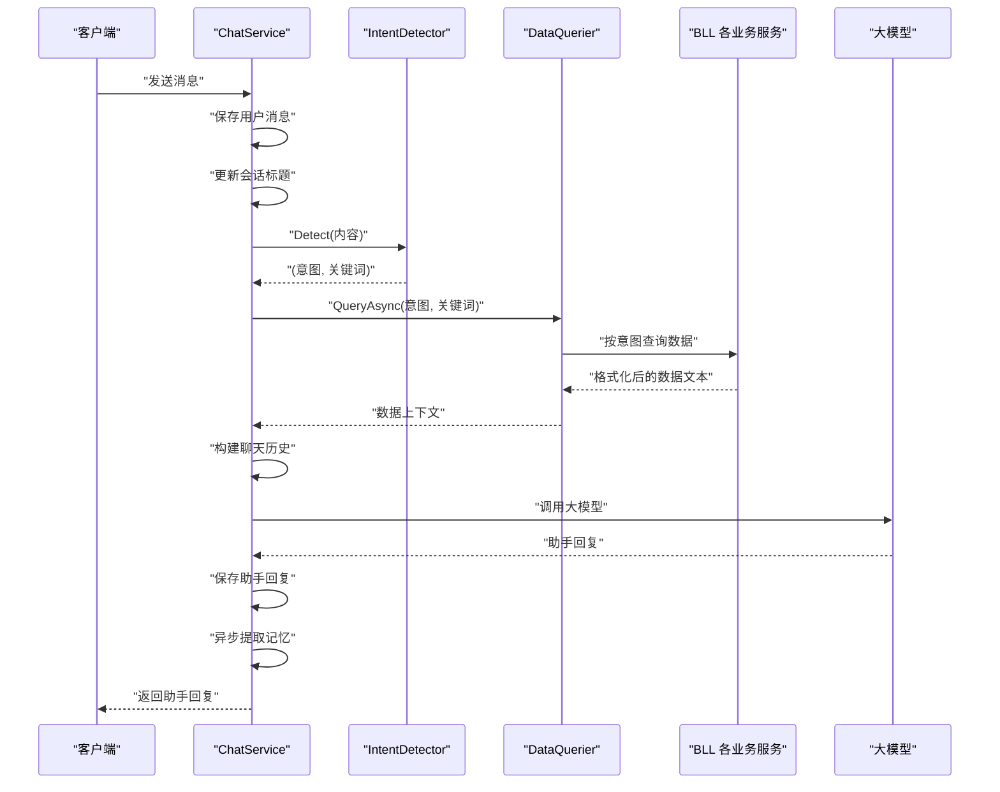
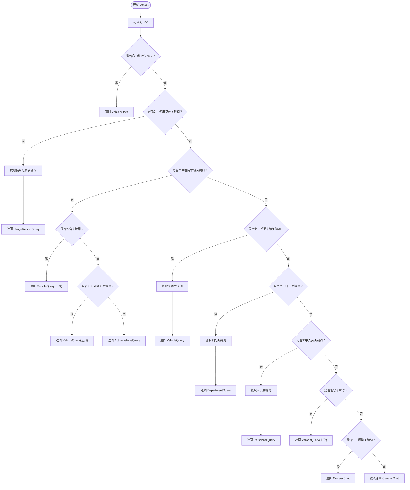
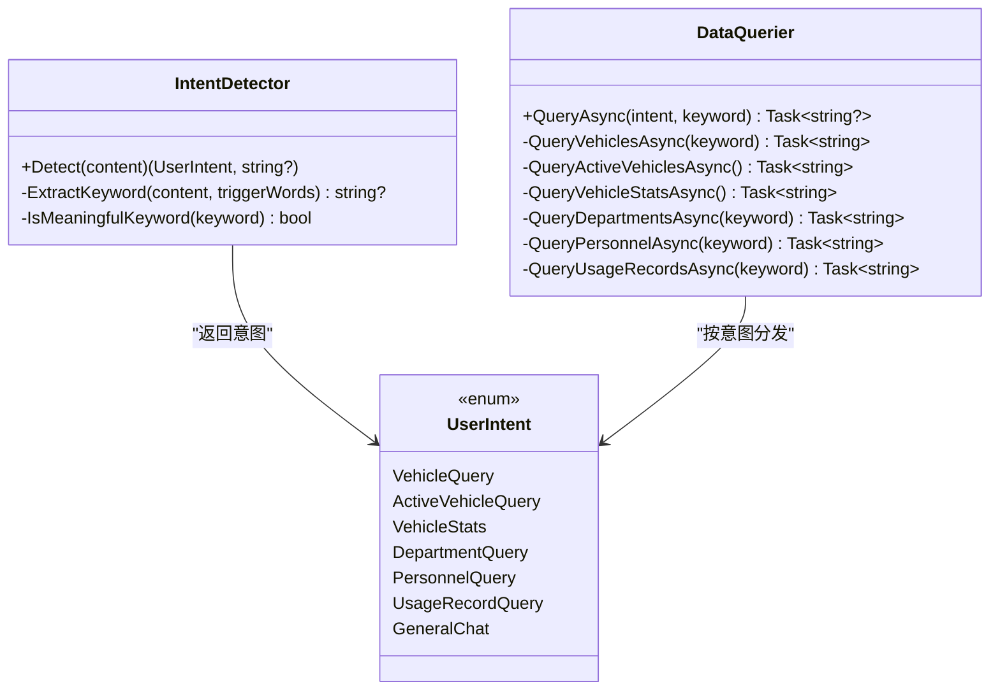
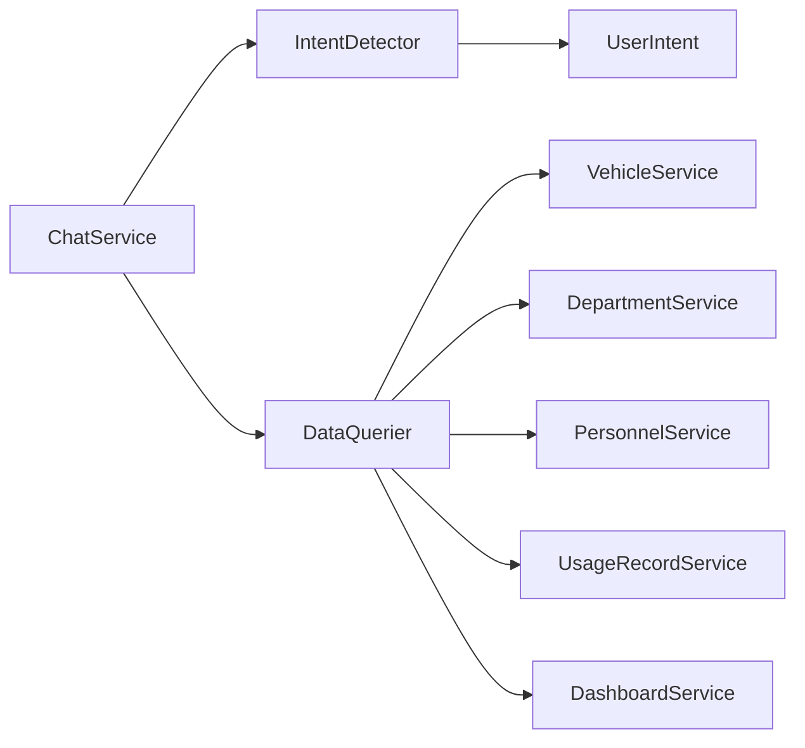

# 意图识别机制

<cite>
**本文引用的文件**   
- [IntentDetector.cs](file://aiServer/BLL/IntentDetector.cs)
- [UserIntent.cs](file://aiServer/BLL/Enums/UserIntent.cs)
- [ChatService.cs](file://aiServer/BLL/ChatService.cs)
- [DataQuerier.cs](file://aiServer/BLL/DataQuerier.cs)
- [MemoryService.cs](file://aiServer/BLL/MemoryService.cs)
- [README.md](file://README.md)
</cite>

## 目录
1. [引言](#引言)
2. [项目结构定位](#项目结构定位)
3. [核心组件总览](#核心组件总览)
4. [架构总览与数据流](#架构总览与数据流)
5. [意图识别器 IntentDetector 详解](#意图识别器-intentdetector-详解)
6. [七类意图定义与识别规则](#七类意图定义与识别规则)
7. [关键词权重、冲突解决与优先级规则](#关键词权重冲突解决与优先级规则)
8. [UserIntent 枚举设计与使用方式](#userintent-枚举设计与使用方式)
9. [意图扩展指南](#意图扩展指南)
10. [测试用例与调试方法](#测试用例与调试方法)
11. [依赖关系分析](#依赖关系分析)
12. [性能与可维护性建议](#性能与可维护性建议)
13. [常见问题排查](#常见问题排查)
14. [结论](#结论)

## 引言
本技术文档聚焦 vehicleManagement 系统中 AI 对话模块的意图识别机制，重点解释 `IntentDetector` 的工作原理：关键词匹配、正则表达式、优先级规则，以及七类用户意图的定义、识别策略和冲突解决方式。同时说明 `UserIntent` 枚举的设计和使用方式，给出意图扩展指南、测试用例建议和调试方法，帮助开发者快速理解并安全地扩展意图识别能力。

## 项目结构定位
意图识别相关代码集中在 aiServer 子项目中，属于“AI 对话服务层”的一部分：
- 意图识别逻辑位于 `aiServer/BLL/IntentDetector.cs`
- 意图类型定义位于 `aiServer/BLL/Enums/UserIntent.cs`
- 意图路由与数据库查询位于 `aiServer/BLL/DataQuerier.cs`
- 对话流程入口位于 `aiServer/BLL/ChatService.cs`
- 记忆与关键词提取辅助逻辑位于 `aiServer/BLL/MemoryService.cs`

**图表来源**
- [ChatService.cs:94-139](file://aiServer/BLL/ChatService.cs#L94-L139)
- [IntentDetector.cs:17-111](file://aiServer/BLL/IntentDetector.cs#L17-L111)
- [DataQuerier.cs:48-67](file://aiServer/BLL/DataQuerier.cs#L48-L67)
- [MemoryService.cs:45-63](file://aiServer/BLL/MemoryService.cs#L45-L63)

**章节来源**
- [IntentDetector.cs:1-152](file://aiServer/BLL/IntentDetector.cs#L1-L152)
- [UserIntent.cs:1-24](file://aiServer/BLL/Enums/UserIntent.cs#L1-L24)
- [ChatService.cs:1-202](file://aiServer/BLL/ChatService.cs#L1-L202)
- [DataQuerier.cs:1-333](file://aiServer/BLL/DataQuerier.cs#L1-L333)
- [MemoryService.cs:1-223](file://aiServer/BLL/MemoryService.cs#L1-L223)

## 核心组件总览
- `IntentDetector`：纯函数式静态类，负责根据用户输入文本进行关键词匹配、正则匹配，返回 `(UserIntent, string? Keyword)`。
- `UserIntent`：定义七类意图，包括车辆查询、在用车辆查询、车辆统计、部门查询、人员查询、使用记录查询、通用闲聊。
- `ChatService`：对话服务，保存消息、调用意图识别、执行数据查询、构建上下文、调用大模型、保存回复、异步提取记忆。
- `DataQuerier`：按意图分发到具体业务服务，将数据库结果格式化为 LLM 可读文本。
- `MemoryService`：从对话中提取车牌、品牌等关键词，持久化记忆，用于后续上下文增强。

**章节来源**
- [IntentDetector.cs:9-150](file://aiServer/BLL/IntentDetector.cs#L9-L150)
- [UserIntent.cs:6-22](file://aiServer/BLL/Enums/UserIntent.cs#L6-L22)
- [ChatService.cs:18-42](file://aiServer/BLL/ChatService.cs#L18-L42)
- [DataQuerier.cs:21-43](file://aiServer/BLL/DataQuerier.cs#L21-L43)
- [MemoryService.cs:15-40](file://aiServer/BLL/MemoryService.cs#L15-L40)

## 架构总览与数据流
对话请求进入 `ChatService.SendMessageAsync`，依次完成：
1. 保存用户消息
2. 自动更新会话标题
3. 调用 `IntentDetector.Detect` 识别意图与关键词
4. 调用 `DataQuerier.QueryAsync` 根据意图查询数据
5. 构建聊天历史（系统提示词 + 数据注入 + 记忆上下文 + 最近消息）
6. 调用大模型生成回复
7. 保存助手回复
8. 异步提取记忆

**图表来源**
- [ChatService.cs:94-139](file://aiServer/BLL/ChatService.cs#L94-L139)
- [IntentDetector.cs:17-111](file://aiServer/BLL/IntentDetector.cs#L17-L111)
- [DataQuerier.cs:48-67](file://aiServer/BLL/DataQuerier.cs#L48-L67)

**章节来源**
- [ChatService.cs:94-139](file://aiServer/BLL/ChatService.cs#L94-L139)

## 意图识别器 IntentDetector 详解
`IntentDetector.Detect` 的核心流程如下：
- 将输入转为小写进行匹配
- 按固定顺序检查各类意图关键词
- 对特定场景使用正则表达式（如车牌号模式）
- 提取去除触发词和停用词后的搜索关键词
- 若无任何数据查询意图命中，则回退为通用闲聊

**图表来源**
- [IntentDetector.cs:17-111](file://aiServer/BLL/IntentDetector.cs#L17-L111)

**章节来源**
- [IntentDetector.cs:17-111](file://aiServer/BLL/IntentDetector.cs#L17-L111)

## 七类意图定义与识别规则
七类意图及其识别规则如下：

| 意图 | 定义与用途 | 主要触发词（节选） | 识别规则与行为 |
| --- | --- | --- | --- |
| `VehicleStats` | 车辆统计、汇总、占比、分布、趋势、排行、最多、最少、哪个部门 | 统计、汇总、多少辆、几辆、几台、多少、几个、占比、分布、趋势、排行、最多、最少、哪个部门 | 优先于具体查询；命中即返回统计意图，不提取关键词 |
| `UsageRecordQuery` | 查询使用记录、出车、用车、行程 | 使用记录、出车、用车、行程、出车记录、用车记录 | 命中后提取关键词，交由 `DataQuerier` 支持中文时间范围解析 |
| `ActiveVehicleQuery` | 查询在用车辆列表 | 在用车辆、当前可用、正在使用、有哪些车、所有车辆、全部车辆、车辆列表 | 若输入含车牌号则降级为 `VehicleQuery`；若有有效附加关键词则走 `VehicleQuery` 过滤；否则返回在用车辆列表 |
| `VehicleQuery` | 查询车辆详情或台账 | 车辆、车牌、品牌、型号、状态、维修、退役、公里、颜色；或直接出现车牌号 | 提取关键词进行过滤；裸车牌号直接作为关键词 |
| `DepartmentQuery` | 查询部门信息 | 部门、单位、科室 | 提取关键词；若暗示问人则交叉带出各部门人员 |
| `PersonnelQuery` | 查询人员信息 | 人员、员工、司机、姓名、电话、手机 | 提取关键词；若暗示问车则交叉带出其用车记录 |
| `GeneralChat` | 通用问答、闲聊 | 你好、谢谢、再见、帮助、功能、版本 | 不查库，仅由大模型回答 |

上述分类与触发词在仓库 README 中也有总结，便于快速对照。

**章节来源**
- [IntentDetector.cs:21-110](file://aiServer/BLL/IntentDetector.cs#L21-L110)
- [README.md:221-233](file://README.md#L221-L233)

## 关键词权重、冲突解决与优先级规则
### 优先级规则
`IntentDetector` 采用固定顺序的优先级判断，越靠前优先级越高：
1. `VehicleStats`（统计）
2. `UsageRecordQuery`（使用记录）
3. `ActiveVehicleQuery`（在用车辆）
4. `VehicleQuery`（普通车辆）
5. `DepartmentQuery`（部门）
6. `PersonnelQuery`（人员）
7. 车牌号正则兜底
8. `GeneralChat`（闲聊）
9. 默认回退为 `GeneralChat`

这种设计确保统计意图不会被“多少”“几个”等常见量词误判为普通查询；在用车辆与普通车辆之间通过显式关键词和附加关键词判断避免冲突。

### 冲突解决策略
- **在用车辆 vs 普通车辆**：如果用户在“在用车辆”场景中附带品牌/型号等有效关键词，则降级为 `VehicleQuery` 进行过滤，而不是强行返回在用列表。
- **车牌号优先**：只要检测到车牌号模式（如“京A12345”），无论是否包含其他意图词，都走 `VehicleQuery`，并以车牌号为关键词。
- **闲聊兜底**：只有在没有命中任何数据查询意图时，才考虑闲聊关键词；否则即使包含“你好”“谢谢”，也会优先走数据查询。

### 关键词权重系统
当前实现未引入数值型权重评分，而是通过“顺序优先级 + 关键词集合 + 正则兜底”的方式实现隐式权重：
- 统计关键词集合具有最高优先级
- 在用车辆关键词集合高于普通车辆关键词集合
- 车牌号正则具有强兜底能力
- 闲聊关键词仅在无数据查询命中时生效

如果需要更细粒度的权重控制，可在未来引入评分机制，但需评估与现有简单规则的兼容性。

**章节来源**
- [IntentDetector.cs:21-110](file://aiServer/BLL/IntentDetector.cs#L21-L110)

## UserIntent 枚举设计与使用方式
`UserIntent` 定义了七类意图，供 `IntentDetector` 返回和 `DataQuerier` 路由使用：
- `VehicleQuery`：查询车辆列表/详情
- `ActiveVehicleQuery`：查询在用车辆列表
- `VehicleStats`：车辆统计/汇总
- `DepartmentQuery`：查询部门信息
- `PersonnelQuery`：查询人员信息
- `UsageRecordQuery`：查询使用记录
- `GeneralChat`：通用问答（不查数据库）

使用方式：
- `IntentDetector.Detect` 返回 `(UserIntent, string? Keyword)`
- `ChatService` 调用 `IntentDetector.Detect` 获取意图
- `DataQuerier.QueryAsync` 根据 `UserIntent` 分支调用对应查询方法

**图表来源**
- [UserIntent.cs:6-22](file://aiServer/BLL/Enums/UserIntent.cs#L6-L22)
- [IntentDetector.cs:17-111](file://aiServer/BLL/IntentDetector.cs#L17-L111)
- [DataQuerier.cs:48-67](file://aiServer/BLL/DataQuerier.cs#L48-L67)

**章节来源**
- [UserIntent.cs:1-24](file://aiServer/BLL/Enums/UserIntent.cs#L1-L24)
- [IntentDetector.cs:17-111](file://aiServer/BLL/IntentDetector.cs#L17-L111)
- [DataQuerier.cs:48-67](file://aiServer/BLL/DataQuerier.cs#L48-L67)

## 意图扩展指南
### 添加新的意图类型
1. 在 `UserIntent` 中新增枚举值，并添加注释说明用途。
2. 在 `IntentDetector.Detect` 中添加新的关键词集合与匹配逻辑，注意插入合适的优先级位置。
3. 在 `DataQuerier.QueryAsync` 中新增 switch 分支，调用对应的查询方法。
4. 如需支持时间范围、车牌号、附加关键词等复杂逻辑，参考现有 `UsageRecordQuery` 或 `ActiveVehicleQuery` 的实现。

### 配置关键词
- 新增意图的触发词应放在独立的字符串数组中，便于维护和测试。
- 对于可能产生歧义的词（如“在”“用”“有”），应在 `ExtractKeyword` 的停用词列表中处理，避免误提取。
- 对于噪声字符（如“辆”“个”“什么”），应在 `IsMeaningfulKeyword` 中过滤，防止无效关键词进入查询。

### 调整优先级
- 若新意图容易与其他意图冲突，应将其关键词检查放在更高优先级位置。
- 若新意图需要兜底正则（如车牌号），应在合适的位置插入正则检测。
- 若新意图需要附加关键词过滤，应复用 `ExtractKeyword` 和 `IsMeaningfulKeyword`。

### 示例步骤（概念性说明）
- 新增意图：在 `UserIntent` 中添加 `NewIntent`
- 新增关键词：在 `IntentDetector` 中添加 `newKeywords` 数组
- 新增匹配：在 `Detect` 中按优先级插入匹配逻辑
- 新增路由：在 `DataQuerier` 中新增 `QueryNewIntentAsync` 并在 `QueryAsync` 中分发

**章节来源**
- [UserIntent.cs:6-22](file://aiServer/BLL/Enums/UserIntent.cs#L6-L22)
- [IntentDetector.cs:21-111](file://aiServer/BLL/IntentDetector.cs#L21-L111)
- [DataQuerier.cs:48-67](file://aiServer/BLL/DataQuerier.cs#L48-L67)

## 测试用例与调试方法
### 单元测试建议
针对 `IntentDetector.Detect`，建议覆盖以下场景：
- 统计意图：输入包含“统计”“多少辆”“占比”等
- 使用记录意图：输入包含“使用记录”“出车”“用车”等
- 在用车辆意图：输入包含“在用车辆”“当前可用”等
- 普通车辆意图：输入包含“车辆”“品牌”“型号”等
- 部门意图：输入包含“部门”“单位”“科室”等
- 人员意图：输入包含“人员”“员工”“司机”等
- 车牌号兜底：输入包含“京A12345”等车牌号模式
- 闲聊兜底：输入包含“你好”“谢谢”等且无数据查询意图
- 冲突场景：在用车辆 + 车牌号；在用车辆 + 品牌关键词；统计 + 其他词

### 集成测试建议
- 通过 `ChatService.SendMessageAsync` 端到端验证意图识别、数据查询、LLM 回复。
- 验证 `DataQuerier` 对不同意图的数据输出格式是否符合预期。
- 验证 `MemoryService` 是否能正确提取车牌、品牌等关键词并存储记忆。

### 调试方法
- 在 `IntentDetector.Detect` 中增加日志输出，打印输入文本、命中的关键词、返回的意图与关键词。
- 在 `DataQuerier.QueryAsync` 中增加日志输出，打印意图、关键词、查询耗时、返回数据长度。
- 在 `ChatService.SendMessageAsync` 中增加关键步骤日志，便于定位问题发生在意图识别、数据查询还是 LLM 调用阶段。
- 使用仓库 README 中的意图路由表对照实际输出，快速定位偏差。

**章节来源**
- [IntentDetector.cs:17-111](file://aiServer/BLL/IntentDetector.cs#L17-L111)
- [ChatService.cs:94-139](file://aiServer/BLL/ChatService.cs#L94-L139)
- [DataQuerier.cs:48-67](file://aiServer/BLL/DataQuerier.cs#L48-L67)
- [README.md:221-233](file://README.md#L221-L233)

## 依赖关系分析
`IntentDetector` 与 `UserIntent` 紧密耦合，`ChatService` 依赖 `IntentDetector` 与 `DataQuerier`，`DataQuerier` 依赖多个 BLL 服务。

**图表来源**
- [IntentDetector.cs:1-152](file://aiServer/BLL/IntentDetector.cs#L1-L152)
- [UserIntent.cs:1-24](file://aiServer/BLL/Enums/UserIntent.cs#L1-L24)
- [ChatService.cs:1-202](file://aiServer/BLL/ChatService.cs#L1-L202)
- [DataQuerier.cs:1-333](file://aiServer/BLL/DataQuerier.cs#L1-L333)

**章节来源**
- [IntentDetector.cs:1-152](file://aiServer/BLL/IntentDetector.cs#L1-L152)
- [ChatService.cs:1-202](file://aiServer/BLL/ChatService.cs#L1-L202)
- [DataQuerier.cs:1-333](file://aiServer/BLL/DataQuerier.cs#L1-L333)

## 性能与可维护性建议
- 关键词匹配使用字符串包含判断，性能开销较小；若意图数量增长，可考虑预编译正则或使用字典索引。
- 正则表达式用于车牌号检测，建议在多处复用已编译的正则对象以减少重复开销。
- `ExtractKeyword` 与 `IsMeaningfulKeyword` 可抽取为独立工具类，便于复用与测试。
- 为每个意图添加单元测试，确保新增关键词不会破坏既有优先级规则。
- 在 `DataQuerier` 中限制最大查询结果数量，避免返回过多数据影响 LLM 响应质量。

[本节为通用建议，不直接分析具体文件]

## 常见问题排查
- **意图误判**：检查关键词集合是否过于宽泛，必要时提高优先级或缩小匹配范围。
- **车牌号未识别**：确认正则表达式是否匹配实际车牌格式；检查输入是否包含非法字符。
- **在用车辆与普通车辆冲突**：确认附加关键词是否被判定为有效；必要时调整 `IsMeaningfulKeyword` 的噪声过滤规则。
- **闲聊拦截数据查询**：确认闲聊关键词是否在数据查询意图之后检查；避免“怎么查京A”被误判为闲聊。
- **时间范围解析失败**：检查 `TryParseTimeRange` 是否支持用户表达的时间词；必要时扩展映射规则。

**章节来源**
- [IntentDetector.cs:40-98](file://aiServer/BLL/IntentDetector.cs#L40-L98)
- [DataQuerier.cs:272-330](file://aiServer/BLL/DataQuerier.cs#L272-L330)

## 结论
vehicleManagement 系统的意图识别机制以 `IntentDetector` 为核心，通过关键词匹配、正则表达式与固定优先级规则，将用户输入路由到七类意图之一。该设计简洁、可维护性强，并通过 `UserIntent` 枚举与 `DataQuerier` 路由形成清晰的职责边界。扩展新意图时，只需在枚举、关键词集合、匹配逻辑与路由分支中同步修改，即可安全地增强系统能力。配合完善的测试与调试方法，可有效保障意图识别的准确性与稳定性。

[本节为总结性内容，不直接分析具体文件]