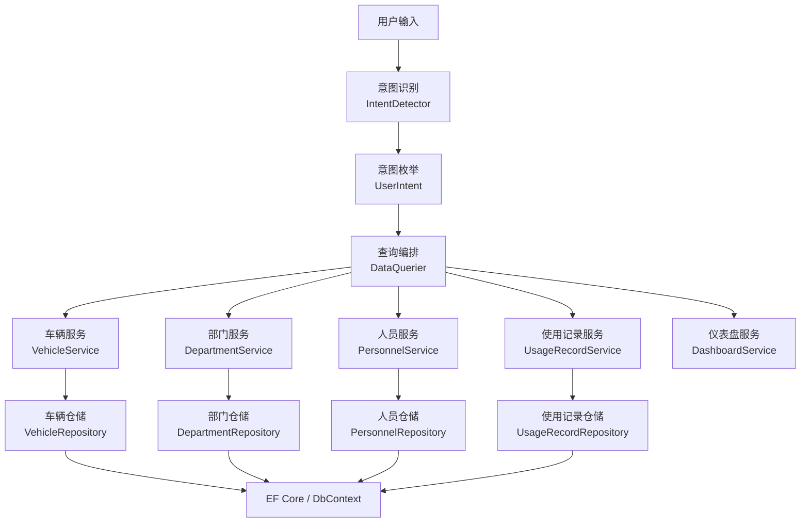
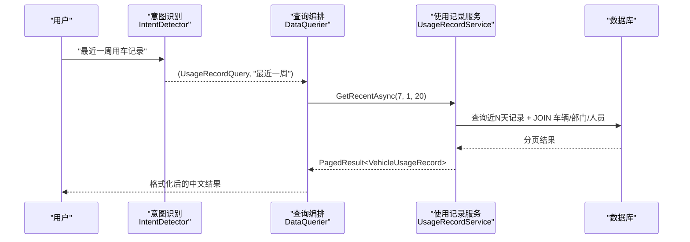
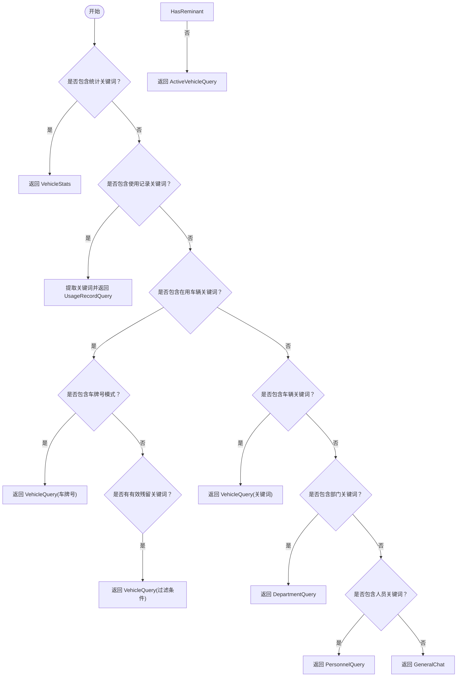
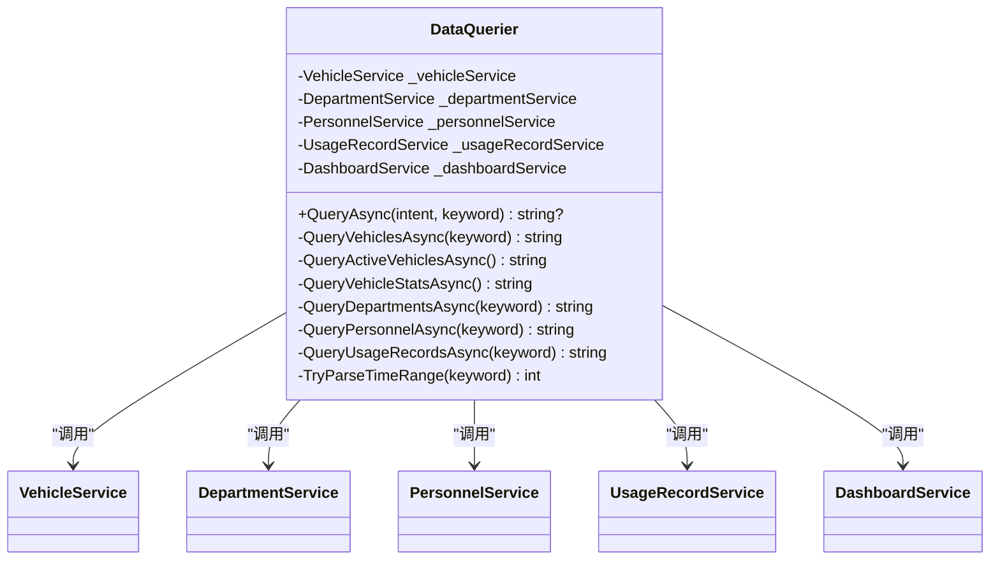
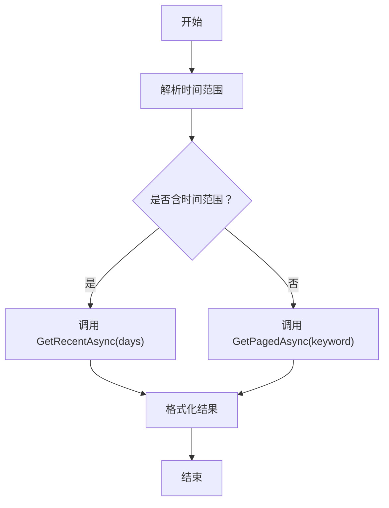
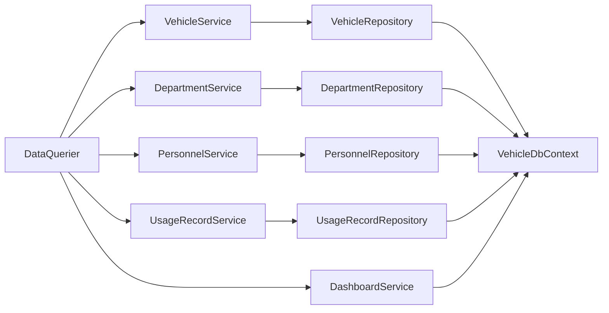

# 数据查询引擎

<cite>
**本文引用的文件**   
- [DataQuerier.cs](file://aiServer/BLL/DataQuerier.cs)
- [IntentDetector.cs](file://aiServer/BLL/IntentDetector.cs)
- [UserIntent.cs](file://aiServer/BLL/Enums/UserIntent.cs)
- [VehicleService.cs](file://BLL/Vehicle/VehicleService.cs)
- [DepartmentService.cs](file://BLL/Department/DepartmentService.cs)
- [PersonnelService.cs](file://BLL/Personnel/PersonnelService.cs)
- [UsageRecordService.cs](file://BLL/UsageRecord/UsageRecordService.cs)
- [DashboardService.cs](file://BLL/Dashboard/DashboardService.cs)
- [VehicleRepository.cs](file://DAL/Repository/VehicleRepository.cs)
- [UsageRecordRepository.cs](file://DAL/Repository/UsageRecordRepository.cs)
- [DepartmentRepository.cs](file://DAL/Repository/DepartmentRepository.cs)
- [PersonnelRepository.cs](file://DAL/Repository/PersonnelRepository.cs)
</cite>

## 目录
1. [引言](#引言)
2. [项目结构](#项目结构)
3. [核心组件](#核心组件)
4. [架构总览](#架构总览)
5. [详细组件分析](#详细组件分析)
6. [依赖关系分析](#依赖关系分析)
7. [性能与优化](#性能与优化)
8. [安全与防护](#安全与防护)
9. [扩展指南](#扩展指南)
10. [调试与监控](#调试与监控)
11. [结论](#结论)

## 引言
本技术文档面向 vehicleManagement 系统的 AI 数据查询引擎，重点解析 DataQuerier 的工作原理：意图路由、查询编排、参数绑定、结果格式化。文档还覆盖统计类查询、使用记录查询、在用车辆查询、车辆多字段搜索、部门层级关联、人员权限过滤等典型场景；说明 SQL 注入防护策略（参数化查询、白名单校验、权限控制）；阐述查询结果的数据转换（实体映射、分页处理、排序规则）；给出查询性能优化建议（索引设计、查询计划分析、缓存策略）；并提供扩展新查询类型、自定义 SQL 模板与结果格式化器的方法，以及调试与性能监控实践。

## 项目结构
AI 数据查询引擎位于 aiServer 层，通过 BLL 服务调用 DAL 仓储访问数据库。整体分层如下：
- 意图识别层：IntentDetector 将自然语言输入解析为 UserIntent 枚举并提取关键词。
- 查询编排层：DataQuerier 根据意图分发到具体业务服务，组装最终文本结果。
- 业务服务层：VehicleService、DepartmentService、PersonnelService、UsageRecordService、DashboardService 封装领域查询逻辑。
- 数据访问层：各 Repository 通过 EF Core 访问 VehicleDbContext。

图表来源
- [IntentDetector.cs:17-111](file://aiServer/BLL/IntentDetector.cs#L17-L111)
- [DataQuerier.cs:48-67](file://aiServer/BLL/DataQuerier.cs#L48-L67)
- [VehicleService.cs:67-109](file://BLL/Vehicle/VehicleService.cs#L67-L109)
- [DepartmentService.cs:41-76](file://BLL/Department/DepartmentService.cs#L41-L76)
- [PersonnelService.cs:39-74](file://BLL/Personnel/PersonnelService.cs#L39-L74)
- [UsageRecordService.cs:43-92](file://BLL/UsageRecord/UsageRecordService.cs#L43-L92)
- [DashboardService.cs:28-94](file://BLL/Dashboard/DashboardService.cs#L28-L94)

章节来源
- [IntentDetector.cs:17-111](file://aiServer/BLL/IntentDetector.cs#L17-L111)
- [DataQuerier.cs:48-67](file://aiServer/BLL/DataQuerier.cs#L48-L67)

## 核心组件
- IntentDetector：基于关键词匹配识别用户意图，并提取有效搜索词。支持统计、使用记录、在用车辆、车辆、部门、人员、通用问答等意图。
- DataQuerier：根据 UserIntent 分发查询，调用对应 Service 获取数据，并将实体结果格式化为 LLM 可读的中文文本。
- Service 层：封装分页、排序、过滤、聚合、时间范围等查询逻辑，返回 PagedResult<T> 或聚合 DTO。
- Repository 层：通过 EF Core 执行 LINQ 查询，必要时 Include 关联实体。

章节来源
- [IntentDetector.cs:17-111](file://aiServer/BLL/IntentDetector.cs#L17-L111)
- [DataQuerier.cs:48-67](file://aiServer/BLL/DataQuerier.cs#L48-L67)
- [VehicleService.cs:67-109](file://BLL/Vehicle/VehicleService.cs#L67-L109)
- [DepartmentService.cs:41-76](file://BLL/Department/DepartmentService.cs#L41-L76)
- [PersonnelService.cs:39-74](file://BLL/Personnel/PersonnelService.cs#L39-L74)
- [UsageRecordService.cs:43-92](file://BLL/UsageRecord/UsageRecordService.cs#L43-L92)
- [DashboardService.cs:28-94](file://BLL/Dashboard/DashboardService.cs#L28-L94)

## 架构总览
下图展示一次“查询最近一周用车记录”的完整调用链：从用户输入到意图识别、再到 DataQuerier 的分发、UsageRecordService 的时间范围解析与分页查询，最后由 DataQuerier 格式化输出。

图表来源
- [IntentDetector.cs:29-38](file://aiServer/BLL/IntentDetector.cs#L29-L38)
- [DataQuerier.cs:230-267](file://aiServer/BLL/DataQuerier.cs#L230-L267)
- [UsageRecordService.cs:97-120](file://BLL/UsageRecord/UsageRecordService.cs#L97-L120)

## 详细组件分析

### 意图识别与路由
- 意图优先级：统计意图优先于具体查询；在用车辆查询优先于普通车辆查询以避免关键词冲突。
- 关键词提取：去除触发词和停用词后得到有效搜索词；对车牌号进行正则识别并作为精确关键词。
- 默认行为：未命中任何数据查询意图时返回通用问答意图。

图表来源
- [IntentDetector.cs:21-111](file://aiServer/BLL/IntentDetector.cs#L21-L111)

章节来源
- [IntentDetector.cs:21-111](file://aiServer/BLL/IntentDetector.cs#L21-L111)
- [UserIntent.cs:6-22](file://aiServer/BLL/Enums/UserIntent.cs#L6-L22)

### 查询编排与结果格式化（DataQuerier）
- 统一入口 QueryAsync：按 UserIntent 分发到具体查询方法。
- 车辆查询：调用 VehicleService.GetPagedAsync，按关键词在车牌、品牌、型号、颜色上模糊匹配，并按 createdAt 默认排序，限制最多 20 条。
- 在用车辆查询：调用 VehicleService.GetActiveVehiclesAsync，仅返回状态为“在用”的车辆。
- 车辆统计：调用 DashboardService 获取总量、在用、维修、退役数量，部门分布，近6个月趋势。
- 部门查询：调用 DepartmentService.GetPagedAsync，支持名称/描述搜索与排序；若关键词暗示查询人员，则交叉查询各部门下的人员。
- 人员查询：调用 PersonnelService.GetPagedAsync，支持姓名/电话搜索；若关键词暗示查询用车，则交叉查询该人员的用车记录。
- 使用记录查询：先尝试解析时间范围（如“最近一周”），再调用 UsageRecordService.GetRecentAsync 或 GetPagedAsync；结果包含车牌、驾驶员、部门、目的等信息。
- 错误处理：捕获异常并返回友好提示。

图表来源
- [DataQuerier.cs:21-67](file://aiServer/BLL/DataQuerier.cs#L21-L67)
- [DataQuerier.cs:69-267](file://aiServer/BLL/DataQuerier.cs#L69-L267)
- [DataQuerier.cs:272-330](file://aiServer/BLL/DataQuerier.cs#L272-L330)

章节来源
- [DataQuerier.cs:48-67](file://aiServer/BLL/DataQuerier.cs#L48-L67)
- [DataQuerier.cs:69-267](file://aiServer/BLL/DataQuerier.cs#L69-L267)
- [DataQuerier.cs:272-330](file://aiServer/BLL/DataQuerier.cs#L272-L330)

### 统计查询（COUNT、SUM、AVG）
- 总量与状态计数：DashboardService.GetVehicleStatsAsync 使用多次 CountAsync 分别统计总数、在用、维修、退役数量，避免全表加载。
- 部门分布：GetDeptVehicleStatsAsync 使用 GroupBy 按部门名称分组计数，并在服务端排序。
- 月度趋势：GetMonthlyTrendAsync 筛选近6个月的使用记录，按年月分组计数，并补齐空月份。
- SUM/AVG 扩展：当前代码以 COUNT 为主；如需 SUM/AVG，可在 DashboardService 新增聚合方法，例如对里程、费用等字段进行 Sum/Average 计算。

章节来源
- [DashboardService.cs:28-94](file://BLL/Dashboard/DashboardService.cs#L28-L94)

### 使用记录查询（JOIN、WHERE 条件）
- 多表关联：UsageRecordService.GetPagedAsync 通过 Include 关联 Vehicle、Department、Personnel、FinalLocation、UsageRecordPurposes。
- WHERE 条件：支持按车牌、人员姓名、部门名称模糊搜索；支持按创建时间倒序排序。
- 时间范围：GetRecentAsync 使用 ChinaTime.Now.AddDays(-days) 计算起始时间，过滤 CreatedAt >= since。

图表来源
- [DataQuerier.cs:230-267](file://aiServer/BLL/DataQuerier.cs#L230-L267)
- [UsageRecordService.cs:43-120](file://BLL/UsageRecord/UsageRecordService.cs#L43-L120)

章节来源
- [UsageRecordService.cs:43-120](file://BLL/UsageRecord/UsageRecordService.cs#L43-L120)

### 在用车辆查询（状态过滤）
- VehicleService.GetActiveVehiclesAsync 使用 Where(v => v.Status == Active) 过滤在用车辆，并按车牌排序，Include 部门信息。

章节来源
- [VehicleService.cs:138-149](file://BLL/Vehicle/VehicleService.cs#L138-L149)

### 车辆查询（多字段搜索）
- VehicleService.GetPagedAsync 支持在 LicensePlate、Brand、Model、Color 上进行 Contains 模糊匹配；支持 plate、brand、color、createdAt 排序；分页处理采用 Skip/Take。

章节来源
- [VehicleService.cs:67-109](file://BLL/Vehicle/VehicleService.cs#L67-L109)

### 部门查询（层级关系）
- DepartmentService.GetPagedAsync 支持 Name/Description 搜索，支持 name/desc/createdAt 排序；删除前会校验是否存在人员、车辆、使用记录。
- DataQuerier.QueryDepartmentsAsync 在检测到人员相关关键词时，会遍历部门并调用 PersonnelService.GetPagedAsync 获取各部门人员列表。

章节来源
- [DepartmentService.cs:41-76](file://BLL/Department/DepartmentService.cs#L41-L76)
- [DataQuerier.cs:145-185](file://aiServer/BLL/DataQuerier.cs#L145-L185)

### 人员查询（权限过滤）
- PersonnelService.GetPagedAsync 支持 Name/Phone 搜索，支持 name/phone/createdAt 排序；Include Department。
- DataQuerier.QueryPersonnelAsync 在检测到用车相关关键词时，会遍历人员并调用 UsageRecordService.GetPagedAsync 获取其用车记录。

章节来源
- [PersonnelService.cs:39-74](file://BLL/Personnel/PersonnelService.cs#L39-L74)
- [DataQuerier.cs:187-228](file://aiServer/BLL/DataQuerier.cs#L187-L228)

## 依赖关系分析
- DataQuerier 依赖多个 Service，Service 依赖对应的 Repository 与 DbContextFactory。
- Repository 通过 IDbContextFactory<VehicleDbContext> 获取 DbContext 实例，执行 LINQ 查询。
- DashboardService 直接操作 Vehicles 与 VehicleUsageRecords 进行聚合统计。

图表来源
- [DataQuerier.cs:21-43](file://aiServer/BLL/DataQuerier.cs#L21-L43)
- [VehicleService.cs:20-38](file://BLL/Vehicle/VehicleService.cs#L20-L38)
- [DepartmentService.cs:18-36](file://BLL/Department/DepartmentService.cs#L18-L36)
- [PersonnelService.cs:19-34](file://BLL/Personnel/PersonnelService.cs#L19-L34)
- [UsageRecordService.cs:21-38](file://BLL/UsageRecord/UsageRecordService.cs#L21-L38)
- [DashboardService.cs:18-23](file://BLL/Dashboard/DashboardService.cs#L18-L23)

章节来源
- [DataQuerier.cs:21-43](file://aiServer/BLL/DataQuerier.cs#L21-L43)
- [VehicleService.cs:20-38](file://BLL/Vehicle/VehicleService.cs#L20-L38)
- [DepartmentService.cs:18-36](file://BLL/Department/DepartmentService.cs#L18-L36)
- [PersonnelService.cs:19-34](file://BLL/Personnel/PersonnelService.cs#L19-L34)
- [UsageRecordService.cs:21-38](file://BLL/UsageRecord/UsageRecordService.cs#L21-L38)
- [DashboardService.cs:18-23](file://BLL/Dashboard/DashboardService.cs#L18-L23)

## 性能与优化

### 索引设计建议
- 高频过滤字段：Vehicle.LicensePlate、Vehicle.Status、Vehicle.Brand、Vehicle.Model、Vehicle.Color；Department.Name；Personnel.Name、Personnel.Phone；VehicleUsageRecord.CreatedAt、VehicleId、PersonnelId、DepartmentId。
- 复合索引：(CreatedAt, VehicleId)、(Status, DepartmentId)、(Name, IsActive) 等，依据实际查询组合优化。
- 外键索引：VehicleUsageRecord.VehicleId、PersonnelId、DepartmentId、FinalLocationId 确保 JOIN 与 WHERE 高效。

### 查询计划分析
- 使用 EF Core 日志或数据库工具查看执行计划，关注 Full Table Scan、Index Seek/Scan、Nested Loops、Hash Match 等。
- 针对慢查询，检查 Include 是否过度加载、Where 条件是否可下推至数据库、GroupBy 是否在服务端完成。

### 缓存策略
- 统计数据缓存：DashboardService 的统计结果可加入内存缓存（如 IMemoryCache），设置合理过期时间（如 5-15 分钟）。
- 字典型数据缓存：部门、人员基础信息可缓存，减少重复查询。
- 热点查询缓存：常用关键词（如“在用车辆”）的结果可短期缓存。

### 分页与排序优化
- 所有分页查询均使用 Skip/Take，避免一次性加载全量数据。
- 排序字段尽量使用索引列，避免无索引排序导致性能下降。

章节来源
- [VehicleService.cs:67-109](file://BLL/Vehicle/VehicleService.cs#L67-L109)
- [DepartmentService.cs:41-76](file://BLL/Department/DepartmentService.cs#L41-L76)
- [PersonnelService.cs:39-74](file://BLL/Personnel/PersonnelService.cs#L39-L74)
- [UsageRecordService.cs:43-120](file://BLL/UsageRecord/UsageRecordService.cs#L43-L120)
- [DashboardService.cs:28-94](file://BLL/Dashboard/DashboardService.cs#L28-L94)

## 安全与防护

### SQL 注入防护
- 参数化查询：所有查询通过 EF Core LINQ 构建，字符串拼接被避免；Contains 等条件由 EF 生成参数化 SQL。
- 白名单验证：排序字段通过 switch 白名单控制（如 plate、brand、color、name、desc、createdAt 等），防止任意排序字段注入。
- 关键词清洗：IntentDetector 去除停用词与噪声字符，降低误匹配风险。

### 权限控制
- 当前实现未显式实现角色/权限控制；建议在 Service 层增加权限校验，例如按登录用户所属部门过滤数据。
- 建议在查询入口处统一鉴权中间件，结合部门归属进行数据隔离。

章节来源
- [IntentDetector.cs:113-149](file://aiServer/BLL/IntentDetector.cs#L113-L149)
- [VehicleService.cs:84-93](file://BLL/Vehicle/VehicleService.cs#L84-L93)
- [DepartmentService.cs:54-60](file://BLL/Department/DepartmentService.cs#L54-L60)
- [PersonnelService.cs:52-58](file://BLL/Personnel/PersonnelService.cs#L52-L58)
- [UsageRecordService.cs:66-76](file://BLL/UsageRecord/UsageRecordService.cs#L66-L76)

## 扩展指南

### 添加新的查询类型
- 定义新意图：在 UserIntent 枚举中添加新成员。
- 意图识别：在 IntentDetector.Detect 中增加关键词匹配分支，并返回新意图与关键词。
- 查询编排：在 DataQuerier.QueryAsync 中增加分支，调用对应 Service 方法。
- 结果格式化：在 DataQuerier 中新增私有方法，将实体结果转换为 LLM 可读文本。

### 自定义 SQL 模板
- 当前系统使用 EF Core LINQ，不直接使用 SQL 模板。如需复杂聚合，可在 DashboardService 或专用 Service 中使用 FromSqlRaw/ExecuteSqlRaw（谨慎使用并确保参数化）。
- 推荐优先使用 LINQ 与 GroupBy/Aggregate，便于维护与安全。

### 结果格式化器
- 在 DataQuerier 中新增格式化方法，遵循现有风格：标题行 + 摘要行 + 明细行。
- 对于集合结果，限制最大显示条数（MaxQueryResults = 20），避免过长响应。

章节来源
- [UserIntent.cs:6-22](file://aiServer/BLL/Enums/UserIntent.cs#L6-L22)
- [IntentDetector.cs:21-111](file://aiServer/BLL/IntentDetector.cs#L21-L111)
- [DataQuerier.cs:48-67](file://aiServer/BLL/DataQuerier.cs#L48-L67)

## 调试与监控

### 调试工具
- 启用 EF Core 日志：在开发环境输出 SQL 语句与参数，便于定位慢查询与参数问题。
- 结构化日志：在各 Service 关键路径记录入参、耗时、异常信息。
- 单元测试：为 DataQuerier 与各 Service 编写单元测试，覆盖意图识别、关键词提取、分页排序、时间范围解析等分支。

### 性能监控
- 应用指标：收集请求耗时、错误率、缓存命中率。
- 数据库指标：监控慢查询、锁等待、连接池使用率。
- 告警策略：对超过阈值的查询（如 > 1s）触发告警，并结合查询计划优化。

章节来源
- [DataQuerier.cs:63-66](file://aiServer/BLL/DataQuerier.cs#L63-L66)
- [VehicleService.cs:171-202](file://BLL/Vehicle/VehicleService.cs#L171-L202)
- [UsageRecordService.cs:125-154](file://BLL/UsageRecord/UsageRecordService.cs#L125-L154)

## 结论
DataQuerier 作为 AI 数据查询引擎的核心编排者，将自然语言意图转化为结构化查询，并通过 Service 层的安全、分页、排序与聚合能力，最终输出清晰易读的中文结果。系统在安全性上依赖 EF Core 的参数化查询与白名单排序，在性能上通过分页、索引与可能的缓存策略保障响应效率。未来可扩展更多统计维度、权限控制与缓存机制，进一步提升用户体验与系统稳定性。