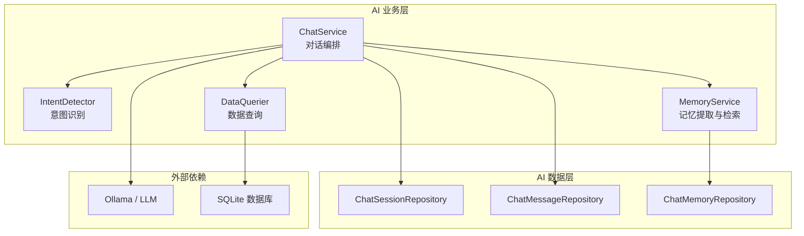
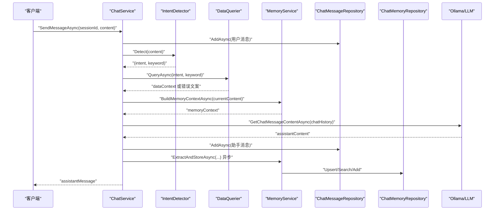
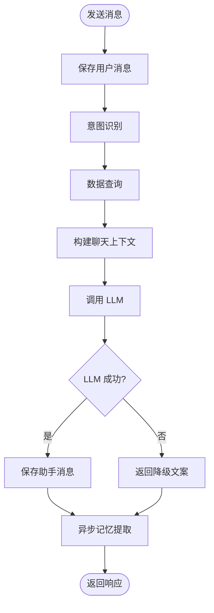
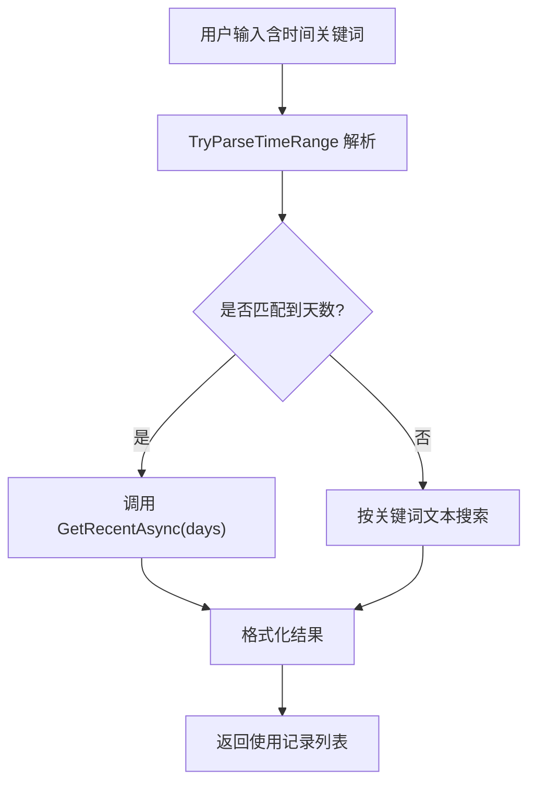
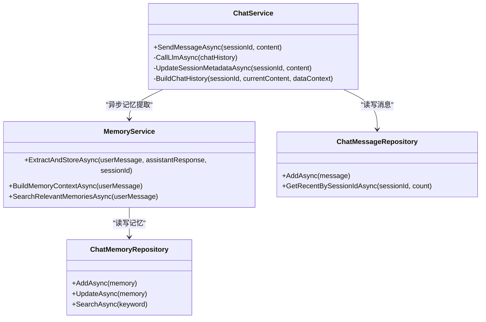
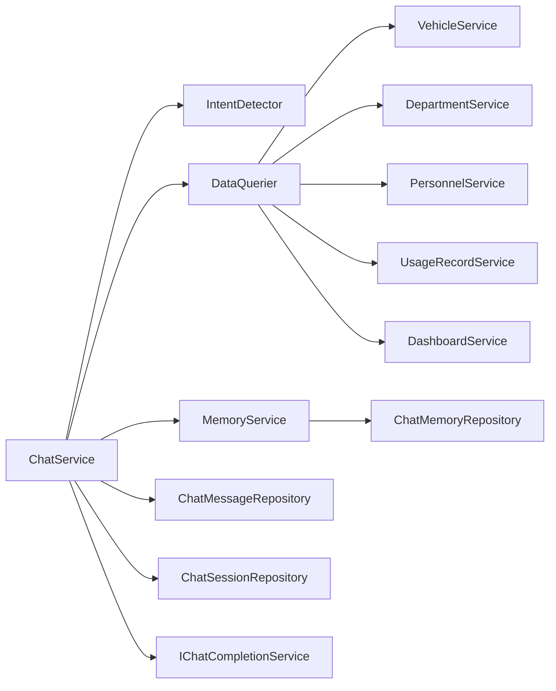

# 稳定性设计

<cite>
**本文引用的文件**   
- [ChatService.cs](file://aiServer/BLL/ChatService.cs)
- [DataQuerier.cs](file://aiServer/BLL/DataQuerier.cs)
- [IntentDetector.cs](file://aiServer/BLL/IntentDetector.cs)
- [MemoryService.cs](file://aiServer/BLL/MemoryService.cs)
- [UserIntent.cs](file://aiServer/BLL/Enums/UserIntent.cs)
- [ChinaTime.cs](file://DAL/Common/ChinaTime.cs)
- [Program.cs](file://Program.cs)
- [appsettings.json](file://appsettings.json)
- [ChatMemory.cs](file://aiServer/DAL/Model/ChatMemory.cs)
- [ChatMessage.cs](file://aiServer/DAL/Model/ChatMessage.cs)
- [ChatSession.cs](file://aiServer/DAL/Model/ChatSession.cs)
- [ChatMemoryRepository.cs](file://aiServer/DAL/Repository/ChatMemoryRepository.cs)
</cite>

## 目录
1. [引言](#引言)
2. [项目结构](#项目结构)
3. [核心组件](#核心组件)
4. [架构总览](#架构总览)
5. [详细组件分析](#详细组件分析)
6. [依赖关系分析](#依赖关系分析)
7. [性能与监控](#性能与监控)
8. [故障排查指南](#故障排查指南)
9. [结论](#结论)

## 引言
本文面向 vehicleManagement 系统的 AI 子系统，围绕“稳定性”这一目标，系统性梳理异常捕获、降级处理、超时控制、中文时间解析、记忆异步提取、错误分类与日志、以及可观测性与恢复策略。文档既适合开发者深入理解实现细节，也适合运维人员快速定位问题。

## 项目结构
AI 子系统位于 aiServer 目录，采用分层结构：
- BLL（业务逻辑层）：对话编排、意图识别、数据查询、记忆管理。
- DAL（数据访问层）：会话、消息、记忆的模型与仓储。
- Program.cs：服务注册、Serilog 日志、Semantic Kernel 配置、数据库初始化。
- appsettings.json：连接字符串等基础配置。

**图表来源**
- [ChatService.cs:18-42](file://aiServer/BLL/ChatService.cs#L18-L42)
- [DataQuerier.cs:21-43](file://aiServer/BLL/DataQuerier.cs#L21-L43)
- [MemoryService.cs:15-40](file://aiServer/BLL/MemoryService.cs#L15-L40)
- [Program.cs:97-102](file://Program.cs#L97-L102)

**章节来源**
- [Program.cs:28-102](file://Program.cs#L28-L102)
- [appsettings.json:1-8](file://appsettings.json#L1-L8)

## 核心组件
- ChatService：对话入口，负责保存消息、构建上下文、调用 LLM、异步记忆提取。
- IntentDetector：基于关键词的意图识别器，输出 UserIntent 与搜索关键词。
- DataQuerier：根据意图调用车辆、部门、人员、使用记录、统计等查询，并格式化文本。
- MemoryService：从对话中提取车牌、品牌、偏好等记忆，支持模糊检索与上下文注入。
- ChinaTime：统一北京时间（UTC+8），避免容器时区差异导致的时间不一致。

**章节来源**
- [ChatService.cs:18-42](file://aiServer/BLL/ChatService.cs#L18-L42)
- [IntentDetector.cs:12-18](file://aiServer/BLL/IntentDetector.cs#L12-L18)
- [DataQuerier.cs:21-43](file://aiServer/BLL/DataQuerier.cs#L21-L43)
- [MemoryService.cs:15-40](file://aiServer/BLL/MemoryService.cs#L15-L40)
- [ChinaTime.cs:5-16](file://DAL/Common/ChinaTime.cs#L5-L16)

## 架构总览
AI 对话主流程如下：用户消息进入 ChatService，先持久化用户消息，再执行意图识别与数据查询，随后构建包含系统提示词、数据上下文、历史记忆与最近消息的聊天上下文，最后调用 LLM 生成回复；同时异步提取记忆，不影响主响应路径。

**图表来源**
- [ChatService.cs:94-139](file://aiServer/BLL/ChatService.cs#L94-L139)
- [IntentDetector.cs:17-110](file://aiServer/BLL/IntentDetector.cs#L17-L110)
- [DataQuerier.cs:48-67](file://aiServer/BLL/DataQuerier.cs#L48-L67)
- [MemoryService.cs:45-113](file://aiServer/BLL/MemoryService.cs#L45-L113)

## 详细组件分析

### 容错机制：异常捕获、降级处理、超时控制
- LLM 不可用降级：
  - ChatService.CallLlmAsync 捕获所有异常，返回友好文案“AI 服务暂时不可用：{原因}”，保证页面不崩溃。
  - 若 LLM 返回空内容，则返回“抱歉，AI 返回了空响应，请重试”。
- 数据库查询失败降级：
  - DataQuerier.QueryAsync 捕获异常，返回“查询数据库时发生错误：{原因}”，仍允许 LLM 继续作答。
  - 各查询分支对空结果返回明确文案，如“当前没有匹配的车辆数据”。
- 记忆提取失败隔离：
  - MemoryService.ExtractAndStoreAsync 内部 try/catch 仅记录警告日志，不影响对话主流程。
  - ChatService 在异步任务中调用记忆提取，外层 catch 为空，确保非关键路径错误不会中断主响应。
- 超时控制现状与建议：
  - 当前代码未显式设置 LLM 调用超时；建议为 IChatCompletionService 调用增加 CancellationToken 与超时策略，避免长尾请求阻塞线程池。
  - 建议在 DataQuerier 的各查询方法中加入超时保护，防止慢查询拖垮响应。

**图表来源**
- [ChatService.cs:94-139](file://aiServer/BLL/ChatService.cs#L94-L139)
- [ChatService.cs:188-199](file://aiServer/BLL/ChatService.cs#L188-L199)
- [DataQuerier.cs:48-67](file://aiServer/BLL/DataQuerier.cs#L48-L67)
- [MemoryService.cs:45-113](file://aiServer/BLL/MemoryService.cs#L45-L113)

**章节来源**
- [ChatService.cs:188-199](file://aiServer/BLL/ChatService.cs#L188-L199)
- [DataQuerier.cs:48-67](file://aiServer/BLL/DataQuerier.cs#L48-L67)
- [MemoryService.cs:109-112](file://aiServer/BLL/MemoryService.cs#L109-L112)

### 中文时间表达解析：自然语言理解、日期范围计算、时区处理
- 自然语言时间理解：
  - DataQuerier.TryParseTimeRange 将中文时间表达映射为天数，例如“今天/昨日”→1，“一周/本周”→7，“一个月/本月”→30，“半年”→180，“一年/今年”→365，“两年”→730，“最近/近期”→7（默认）。
  - 支持精确数字匹配：“N天”“N个月”等。
- 日期范围计算：
  - 当检测到时间范围时，调用 UsageRecordService.GetRecentAsync(days, …)，否则回退到纯文本搜索。
- 时区处理：
  - ChinaTime.Now 提供 UTC+8 的北京时间，避免 Docker 容器默认 UTC 导致的存储时间偏差。
  - 注意：当前 ChatService 中仍使用 DateTime.Now 而非 ChinaTime.Now，建议统一替换以保证一致性。

**图表来源**
- [DataQuerier.cs:269-330](file://aiServer/BLL/DataQuerier.cs#L269-L330)
- [DataQuerier.cs:230-267](file://aiServer/BLL/DataQuerier.cs#L230-L267)
- [ChinaTime.cs:5-16](file://DAL/Common/ChinaTime.cs#L5-L16)

**章节来源**
- [DataQuerier.cs:269-330](file://aiServer/BLL/DataQuerier.cs#L269-L330)
- [ChinaTime.cs:5-16](file://DAL/Common/ChinaTime.cs#L5-L16)

### 稳定性兜底机制：LLM 不可用、查询失败、内存溢出保护
- LLM 不可用：
  - ChatService.CallLlmAsync 捕获异常并返回降级文案，确保 UI 正常显示。
- 查询失败：
  - DataQuerier.QueryAsync 捕获异常并返回错误文案，避免上层抛错。
  - 各查询分支对空结果返回明确文案，提升用户体验。
- 内存溢出保护：
  - 当前代码未显式限制上下文长度或结果集大小；建议：
    - 限制 chatHistory 最大条目数（已限制最近消息为 20 条）。
    - 限制 dataContext 与 memoryContext 的最大字符数，避免 LLM 输入过大。
    - 限制查询结果 MaxQueryResults（已设置为 20）。
    - 对大对象进行流式处理或分页加载，避免一次性加载过多数据。

**章节来源**
- [ChatService.cs:188-199](file://aiServer/BLL/ChatService.cs#L188-L199)
- [DataQuerier.cs:48-67](file://aiServer/BLL/DataQuerier.cs#L48-L67)
- [DataQuerier.cs:29-29](file://aiServer/BLL/DataQuerier.cs#L29-L29)

### 异步处理设计：记忆提取、错误隔离、资源释放
- 异步执行：
  - ChatService.SendMessageAsync 通过 Task.Run 异步调用 MemoryService.ExtractAndStoreAsync，不阻塞主响应路径。
- 错误隔离：
  - 记忆提取异常被 MemoryService 内部捕获并记录警告日志；外层 catch 为空，确保主流程不受影响。
- 资源释放：
  - 仓储层使用 IDbContextFactory 创建 DbContext，并通过 await using 确保及时释放连接。
  - 建议：为长时间运行的异步任务添加取消令牌，并在应用关闭时等待任务完成或丢弃。

**图表来源**
- [ChatService.cs:94-139](file://aiServer/BLL/ChatService.cs#L94-L139)
- [MemoryService.cs:45-113](file://aiServer/BLL/MemoryService.cs#L45-L113)
- [ChatMemoryRepository.cs:43-57](file://aiServer/DAL/Repository/ChatMemoryRepository.cs#L43-L57)

**章节来源**
- [ChatService.cs:131-136](file://aiServer/BLL/ChatService.cs#L131-L136)
- [MemoryService.cs:109-112](file://aiServer/BLL/MemoryService.cs#L109-L112)
- [ChatMemoryRepository.cs:21-41](file://aiServer/DAL/Repository/ChatMemoryRepository.cs#L21-L41)

### 错误处理和日志记录：异常分类、错误码设计、日志级别控制
- 异常分类：
  - LLM 调用异常：ChatService.CallLlmAsync 捕获并返回降级文案。
  - 数据库查询异常：DataQuerier.QueryAsync 捕获并返回错误文案。
  - 记忆提取异常：MemoryService 内部捕获并记录警告日志。
- 错误码设计：
  - 当前未定义结构化错误码；建议引入枚举或标准错误码，便于前端展示与监控告警。
- 日志级别控制：
  - Program.cs 使用 Serilog，默认 MinimumLevel.Information，抑制 Microsoft 与 EF Core SQL 日志至 Warning。
  - 建议：为不同模块设置独立日志级别，如 AI 相关日志设为 Information，框架日志保持 Warning。

**章节来源**
- [ChatService.cs:188-199](file://aiServer/BLL/ChatService.cs#L188-L199)
- [DataQuerier.cs:48-67](file://aiServer/BLL/DataQuerier.cs#L48-L67)
- [MemoryService.cs:109-112](file://aiServer/BLL/MemoryService.cs#L109-L112)
- [Program.cs:28-37](file://Program.cs#L28-L37)

## 依赖关系分析
- ChatService 依赖：
  - ChatSessionRepository、ChatMessageRepository：会话与消息持久化。
  - MemoryService：记忆提取与检索。
  - DataQuerier：数据查询与格式化。
  - Kernel/IChatCompletionService：LLM 调用。
- DataQuerier 依赖：
  - VehicleService、DepartmentService、PersonnelService、UsageRecordService、DashboardService：业务查询。
- MemoryService 依赖：
  - ChatMemoryRepository：记忆持久化。

**图表来源**
- [ChatService.cs:18-42](file://aiServer/BLL/ChatService.cs#L18-L42)
- [DataQuerier.cs:21-43](file://aiServer/BLL/DataQuerier.cs#L21-L43)
- [MemoryService.cs:15-40](file://aiServer/BLL/MemoryService.cs#L15-L40)

**章节来源**
- [ChatService.cs:18-42](file://aiServer/BLL/ChatService.cs#L18-L42)
- [DataQuerier.cs:21-43](file://aiServer/BLL/DataQuerier.cs#L21-L43)
- [MemoryService.cs:15-40](file://aiServer/BLL/MemoryService.cs#L15-L40)

## 性能与监控
- 响应时间监控：
  - 建议为 SendMessageAsync 增加计时中间件，记录端到端耗时。
  - 为 LLM 调用单独计时，区分网络延迟与模型推理时间。
- 内存使用监控：
  - 监控 chatHistory、dataContext、memoryContext 的大小，避免过大上下文导致内存峰值。
  - 建议对大对象使用弱引用或缓存淘汰策略。
- 错误率统计：
  - 基于 Serilog 日志聚合错误类型与频率，设置阈值告警。
  - 建议引入结构化日志字段，如 intent、sessionId、errorType、durationMs。
- 健康检查：
  - 已暴露 /health 端点，可用于存活探针与负载均衡健康检查。

**章节来源**
- [Program.cs:144-146](file://Program.cs#L144-L146)
- [Program.cs:28-37](file://Program.cs#L28-L37)

## 故障排查指南
- 常见错误诊断：
  - LLM 不可达：检查 OllamaEndpoint 与 OllamaModel 配置，确认网络连通性。
  - 数据库连接失败：检查 appsettings.json 中的连接字符串，确认 data 目录存在且可写。
  - 意图识别不准确：检查 IntentDetector 关键词优先级与残留关键词清洗逻辑。
  - 时间解析错误：检查 TryParseTimeRange 是否匹配到预期表达，必要时扩展关键词表。
- 性能瓶颈定位：
  - 慢查询：检查 UsageRecordService.GetRecentAsync 与分页参数，避免全表扫描。
  - LLM 调用延迟：监控网络与模型负载，考虑缓存或降级策略。
  - 记忆检索开销：限制关键词数量与搜索结果数量，避免频繁 IO。
- 恢复策略：
  - LLM 不可用时启用降级模式，返回固定文案或本地知识库答案。
  - 数据库不可用时返回缓存数据或只读视图，保障基本功能可用。
  - 记忆提取失败时忽略错误并记录日志，不影响主流程。

**章节来源**
- [appsettings.json:1-8](file://appsettings.json#L1-L8)
- [Program.cs:97-102](file://Program.cs#L97-L102)
- [DataQuerier.cs:269-330](file://aiServer/BLL/DataQuerier.cs#L269-L330)
- [IntentDetector.cs:17-110](file://aiServer/BLL/IntentDetector.cs#L17-L110)

## 结论
vehicleManagement 的 AI 子系统通过明确的异常捕获、降级文案、异步记忆提取与仓储层的资源释放，构建了基础的稳定性框架。未来可进一步增强超时控制、结构化错误码、性能监控与告警，以提升系统在复杂环境下的鲁棒性与可观测性。