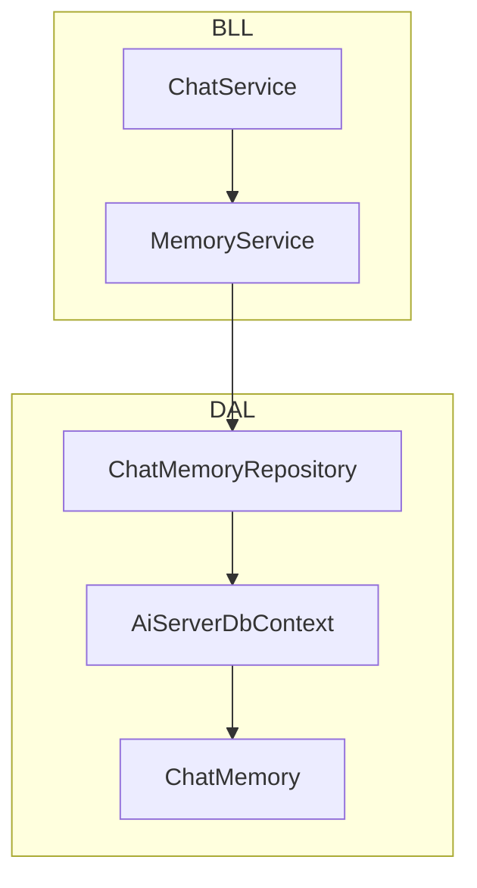
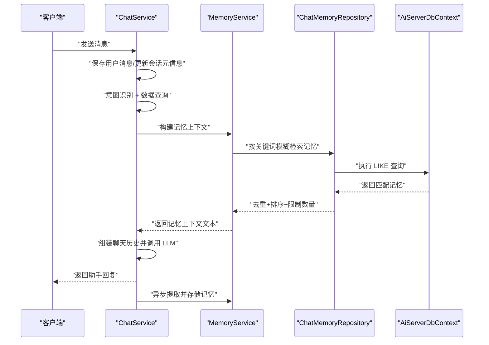
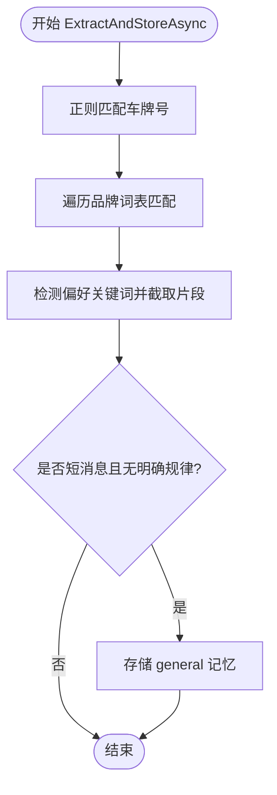
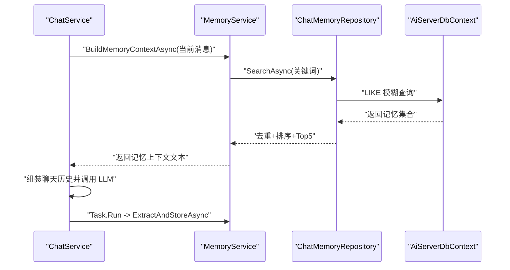
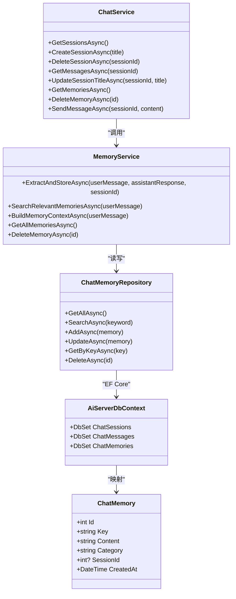

# 记忆系统

<cite>
**本文引用的文件**   
- [MemoryService.cs](file://aiServer/BLL/MemoryService.cs)
- [ChatService.cs](file://aiServer/BLL/ChatService.cs)
- [ChatMemory.cs](file://aiServer/DAL/Model/ChatMemory.cs)
- [ChatMemoryRepository.cs](file://aiServer/DAL/Repository/ChatMemoryRepository.cs)
- [AiServerDbContext.cs](file://aiServer/DAL/AiServerDbContext.cs)
</cite>

## 目录
1. [简介](#简介)
2. [项目结构](#项目结构)
3. [核心组件](#核心组件)
4. [架构总览](#架构总览)
5. [详细组件分析](#详细组件分析)
6. [依赖关系分析](#依赖关系分析)
7. [性能与优化](#性能与优化)
8. [故障排查指南](#故障排查指南)
9. [结论](#结论)
10. [附录：API 参考与扩展指南](#附录api-参考与扩展指南)

## 简介
本技术文档聚焦 vehicleManagement 系统中的 AI 记忆子系统，围绕 MemoryService 的工作原理展开，覆盖记忆的提取、存储、检索、清理，以及记忆数据结构、上下文构建、生命周期管理、与业务数据的关联方式，并给出性能优化建议、API 参考和扩展指南。目标是帮助开发者快速理解并安全扩展该记忆系统。

## 项目结构
记忆系统位于 aiServer 模块中，采用分层架构：
- BLL（业务逻辑层）：MemoryService、ChatService
- DAL（数据访问层）：ChatMemoryRepository、AiServerDbContext、ChatMemory 模型
- 页面层：AI 聊天页面（不直接参与记忆实现）

图表来源
- [MemoryService.cs:15-224](file://aiServer/BLL/MemoryService.cs#L15-L224)
- [ChatService.cs:18-202](file://aiServer/BLL/ChatService.cs#L18-L202)
- [ChatMemoryRepository.cs:12-78](file://aiServer/DAL/Repository/ChatMemoryRepository.cs#L12-L78)
- [AiServerDbContext.cs:9-59](file://aiServer/DAL/AiServerDbContext.cs#L9-L59)
- [ChatMemory.cs:10-52](file://aiServer/DAL/Model/ChatMemory.cs#L10-L52)

章节来源
- [MemoryService.cs:15-224](file://aiServer/BLL/MemoryService.cs#L15-L224)
- [ChatService.cs:18-202](file://aiServer/BLL/ChatService.cs#L18-L202)
- [ChatMemoryRepository.cs:12-78](file://aiServer/DAL/Repository/ChatMemoryRepository.cs#L12-L78)
- [AiServerDbContext.cs:9-59](file://aiServer/DAL/AiServerDbContext.cs#L9-L59)
- [ChatMemory.cs:10-52](file://aiServer/DAL/Model/ChatMemory.cs#L10-L52)

## 核心组件
- MemoryService：负责从对话中提取记忆、搜索相关记忆、构建记忆上下文、提供基础 CRUD 能力。
- ChatService：编排对话流程，并在异步任务中触发记忆提取；同时注入记忆上下文到 LLM 提示词。
- ChatMemoryRepository：对 ChatMemory 的增删改查与模糊检索。
- ChatMemory：记忆实体，包含 Key、Content、Category、SessionId、CreatedAt 等字段。
- AiServerDbContext：EF Core 上下文，定义表结构与索引。

章节来源
- [MemoryService.cs:15-224](file://aiServer/BLL/MemoryService.cs#L15-L224)
- [ChatService.cs:80-139](file://aiServer/BLL/ChatService.cs#L80-L139)
- [ChatMemoryRepository.cs:12-78](file://aiServer/DAL/Repository/ChatMemoryRepository.cs#L12-L78)
- [ChatMemory.cs:10-52](file://aiServer/DAL/Model/ChatMemory.cs#L10-L52)
- [AiServerDbContext.cs:44-55](file://aiServer/DAL/AiServerDbContext.cs#L44-L55)

## 架构总览
记忆系统在对话主流程中被集成：用户消息进入后，先保存消息、识别意图、查询业务数据，再构建聊天历史（包含数据库结果与记忆上下文），调用大模型生成回复；随后在后台异步执行记忆提取，避免阻塞主流程。

图表来源
- [ChatService.cs:94-139](file://aiServer/BLL/ChatService.cs#L94-L139)
- [MemoryService.cs:144-153](file://aiServer/BLL/MemoryService.cs#L144-L153)
- [ChatMemoryRepository.cs:29-41](file://aiServer/DAL/Repository/ChatMemoryRepository.cs#L29-L41)
- [AiServerDbContext.cs:44-55](file://aiServer/DAL/AiServerDbContext.cs#L44-L55)

## 详细组件分析

### MemoryService：记忆提取、存储、检索与上下文构建
- 记忆提取
  - 车牌号正则匹配：使用预编译的正则表达式匹配中国大陆车牌格式，将匹配到的车牌作为 Key 前缀进行记忆存储。
  - 品牌词表匹配：维护常见汽车品牌列表，若用户消息包含品牌词，则以品牌为 Key 前缀写入记忆。
  - 偏好/习惯提取：当出现“喜欢”“常用”“我的”等偏好关键词时，截取前后文片段作为记忆内容，分类为 preference。
  - 通用记忆兜底：当用户消息较短且未命中上述规则时，作为 general 类别记忆存储。
- 记忆存储
  - Upsert 语义：相同 Key 的记忆会更新内容与分类，否则新增记录。
  - 会话隔离：通过 SessionId 将记忆与具体会话关联。
- 记忆检索
  - 关键词提取：优先提取车牌号、品牌词，其次提取长度≥2的中文字词，最多取 5 个关键词。
  - 模糊检索：对每个关键词执行 Key 或 Content 的 LIKE 模糊匹配，合并结果后去重并按时间倒序取前 5 条。
- 上下文构建
  - 将检索到的记忆以统一格式拼接成系统提示文本，注入到对话上下文中，使 LLM 能感知用户历史偏好与车辆相关信息。

图表来源
- [MemoryService.cs:45-113](file://aiServer/BLL/MemoryService.cs#L45-L113)

章节来源
- [MemoryService.cs:20-34](file://aiServer/BLL/MemoryService.cs#L20-L34)
- [MemoryService.cs:45-113](file://aiServer/BLL/MemoryService.cs#L45-L113)
- [MemoryService.cs:118-153](file://aiServer/BLL/MemoryService.cs#L118-L153)
- [MemoryService.cs:174-221](file://aiServer/BLL/MemoryService.cs#L174-L221)

### ChatService：对话编排与记忆集成
- 对话主流程
  - 保存用户消息、自动更新会话标题。
  - 意图识别与数据查询。
  - 构建聊天历史：注入系统提示、数据库查询结果、记忆上下文，并追加最近历史消息。
  - 调用 LLM 获取回复并保存。
  - 异步触发记忆提取，不影响主线程响应。
- 记忆集成点
  - BuildChatHistory 中调用 MemoryService.BuildMemoryContextAsync，将相关记忆注入系统提示。
  - SendMessageAsync 末尾使用 Task.Run 异步执行 ExtractAndStoreAsync，确保非关键路径失败不影响对话体验。

图表来源
- [ChatService.cs:158-183](file://aiServer/BLL/ChatService.cs#L158-L183)
- [ChatService.cs:131-136](file://aiServer/BLL/ChatService.cs#L131-L136)
- [MemoryService.cs:144-153](file://aiServer/BLL/MemoryService.cs#L144-L153)
- [ChatMemoryRepository.cs:29-41](file://aiServer/DAL/Repository/ChatMemoryRepository.cs#L29-L41)
- [AiServerDbContext.cs:44-55](file://aiServer/DAL/AiServerDbContext.cs#L44-L55)

章节来源
- [ChatService.cs:94-139](file://aiServer/BLL/ChatService.cs#L94-L139)
- [ChatService.cs:158-183](file://aiServer/BLL/ChatService.cs#L158-L183)

### ChatMemoryRepository：记忆仓储与模糊检索
- 主要方法
  - GetAllAsync：按创建时间倒序返回所有记忆。
  - SearchAsync：对 Key 或 Content 执行 LIKE 模糊匹配，按时间倒序取前 5 条。
  - AddAsync/UpdateAsync：新增或更新记忆。
  - GetByKeyAsync：按 Key 精确查找，用于 Upsert 判断。
  - DeleteAsync：按 Id 删除记忆。
- 设计要点
  - 每次操作均通过 IDbContextFactory 创建独立 DbContext，保证线程安全与资源释放。
  - 模糊检索限制返回数量，避免上下文过大影响 LLM 性能。

章节来源
- [ChatMemoryRepository.cs:21-75](file://aiServer/DAL/Repository/ChatMemoryRepository.cs#L21-L75)

### ChatMemory：记忆数据模型
- 字段说明
  - Id：自增主键。
  - Key：记忆标识，如 vehicle_plate_京A12345、vehicle_brand_丰田、preference_xxx、general_xxx。
  - Content：记忆正文，如“用户提及了车牌号为...”。
  - Category：分类，支持 vehicle、preference、general 等。
  - SessionId：来源会话 ID，可选，便于会话级隔离。
  - CreatedAt：创建时间，用于排序与过期策略。
- 导航属性
  - Session：与 ChatSession 的一对一/一对多关系（外键可空）。

章节来源
- [ChatMemory.cs:10-52](file://aiServer/DAL/Model/ChatMemory.cs#L10-L52)

### AiServerDbContext：数据库上下文与索引
- 实体集
  - ChatSessions、ChatMessages、ChatMemories。
- 索引配置
  - ChatMessage：SessionId、CreatedAt 索引。
  - ChatMemory：Key、Category 索引，提升按 Key 查找与按分类筛选的性能。
- 关系配置
  - ChatMessage 与 ChatSession：级联删除。
  - ChatMemory 与 ChatSession：删除会话时将记忆的外键置空。

章节来源
- [AiServerDbContext.cs:16-55](file://aiServer/DAL/AiServerDbContext.cs#L16-L55)

## 依赖关系分析
- 组件耦合
  - ChatService 依赖 MemoryService 完成记忆上下文注入与异步提取。
  - MemoryService 依赖 ChatMemoryRepository 进行持久化与检索。
  - ChatMemoryRepository 依赖 AiServerDbContext 访问数据库。
- 外部依赖
  - EF Core（DbContext、DbSet、索引配置）。
  - Semantic Kernel（ChatHistory、IChatCompletionService）。
- 潜在循环依赖
  - 当前结构清晰，未见循环引用。

图表来源
- [ChatService.cs:18-202](file://aiServer/BLL/ChatService.cs#L18-L202)
- [MemoryService.cs:15-224](file://aiServer/BLL/MemoryService.cs#L15-L224)
- [ChatMemoryRepository.cs:12-78](file://aiServer/DAL/Repository/ChatMemoryRepository.cs#L12-L78)
- [ChatMemory.cs:10-52](file://aiServer/DAL/Model/ChatMemory.cs#L10-L52)
- [AiServerDbContext.cs:9-59](file://aiServer/DAL/AiServerDbContext.cs#L9-L59)

章节来源
- [ChatService.cs:18-202](file://aiServer/BLL/ChatService.cs#L18-L202)
- [MemoryService.cs:15-224](file://aiServer/BLL/MemoryService.cs#L15-L224)
- [ChatMemoryRepository.cs:12-78](file://aiServer/DAL/Repository/ChatMemoryRepository.cs#L12-L78)
- [ChatMemory.cs:10-52](file://aiServer/DAL/Model/ChatMemory.cs#L10-L52)
- [AiServerDbContext.cs:9-59](file://aiServer/DAL/AiServerDbContext.cs#L9-L59)

## 性能与优化
- 索引设计
  - ChatMemory.Key 与 ChatMemory.Category 已建立索引，加速按 Key 精确查找与按分类筛选。
  - ChatMessage.SessionId 与 ChatMessage.CreatedAt 索引，加速历史消息加载。
- 查询优化
  - 模糊检索限制返回 Top 5，避免上下文过长导致 LLM 延迟与成本上升。
  - 关键词提取限制最多 5 个，减少重复查询次数。
- 缓存策略
  - 当前未实现内存缓存；可在 MemoryService 层引入轻量缓存（如基于 Key 的字典缓存）以减少频繁数据库查询。
  - 注意缓存失效策略：按 SessionId 或 Category 维度设置 TTL，避免脏读。
- 异步处理
  - 记忆提取在后台 Task.Run 中执行，避免阻塞主对话流程。
- 可扩展性
  - 品牌词表与偏好关键词可通过配置文件注入，便于动态扩展。
  - 可引入全文检索引擎（如 Elasticsearch）替代 LIKE 模糊查询，提升召回率与性能。

[本节为通用性能建议，不直接分析具体代码文件]

## 故障排查指南
- 记忆提取失败
  - 现象：日志中出现“记忆提取失败，但不影响对话流程”的警告。
  - 原因：正则匹配、字符串截取或数据库写入异常。
  - 处理：检查车牌正则、品牌词表、偏好关键词配置；确认数据库连接与权限。
- 记忆检索为空
  - 现象：BuildMemoryContextAsync 返回空字符串。
  - 原因：关键词未命中任何记忆；或数据库中没有对应记录。
  - 处理：检查 ExtractKeywords 逻辑与 SearchAsync 的 LIKE 条件；确认 Key/Content 是否包含目标词。
- 上下文过大
  - 现象：LLM 响应缓慢或 Token 超限。
  - 原因：检索结果过多或单条记忆内容过长。
  - 处理：调整 Take(5) 上限；对偏好类记忆做截断；引入缓存与分页。
- 会话隔离问题
  - 现象：不同会话间记忆互相干扰。
  - 原因：检索未限定 SessionId。
  - 处理：在 SearchAsync 增加 SessionId 过滤条件；或在 MemoryService 层按会话维度组织缓存。

章节来源
- [MemoryService.cs:109-112](file://aiServer/BLL/MemoryService.cs#L109-L112)
- [MemoryService.cs:118-153](file://aiServer/BLL/MemoryService.cs#L118-L153)
- [ChatMemoryRepository.cs:29-41](file://aiServer/DAL/Repository/ChatMemoryRepository.cs#L29-L41)

## 结论
记忆系统通过结构化提取（车牌、品牌、偏好）、模糊检索与上下文注入，有效增强了 AI 对话的个性化与连贯性。其异步提取机制保证了主流程性能，而现有索引与查询限制提供了基础性能保障。未来可通过缓存、全文检索与会话级过滤进一步优化体验与扩展性。

[本节为总结性内容，不直接分析具体代码文件]

## 附录：API 参考与扩展指南

### API 参考（MemoryService）
- ExtractAndStoreAsync(userMessage, assistantResponse, sessionId)
  - 功能：从一轮对话中提取关键信息并存储为记忆。
  - 输入：用户消息、助手回复、会话 ID。
  - 输出：异步任务。
- SearchRelevantMemoriesAsync(userMessage)
  - 功能：根据用户消息检索相关历史记忆。
  - 输入：用户消息。
  - 输出：记忆集合（去重、按时间倒序、Top 5）。
- BuildMemoryContextAsync(userMessage)
  - 功能：构建记忆上下文文本，供 LLM 系统提示使用。
  - 输入：用户消息。
  - 输出：上下文字符串。
- GetAllMemoriesAsync()
  - 功能：获取所有记忆。
  - 输出：记忆集合。
- DeleteMemoryAsync(id)
  - 功能：删除指定记忆。
  - 输入：记忆 ID。
  - 输出：布尔值。

章节来源
- [MemoryService.cs:45-169](file://aiServer/BLL/MemoryService.cs#L45-L169)

### 扩展指南
- 扩展品牌词表
  - 在 VehicleBrands 数组中添加新品牌，或通过配置文件注入。
- 扩展偏好关键词
  - 在 PreferenceKeywords 数组中添加新关键词，或改为从配置读取。
- 增强检索能力
  - 在 ChatMemoryRepository.SearchAsync 中增加 SessionId 过滤，实现会话级隔离。
  - 引入向量检索或全文检索以提升召回精度。
- 容量控制与过期清理
  - 在 MemoryService 中增加定时任务，按 Category 或 SessionId 清理旧记忆。
  - 结合 CreatedAt 字段实现 TTL 过期策略。
- 与业务数据关联
  - 车牌号映射：可将车牌与车辆主数据关联，在记忆内容中补充品牌、部门等信息。
  - 品牌标准化：在提取阶段对品牌名进行归一化（如大小写、别名映射）。
  - 用户隔离：通过 SessionId 或用户标识实现多租户隔离。

章节来源
- [MemoryService.cs:20-34](file://aiServer/BLL/MemoryService.cs#L20-L34)
- [ChatMemoryRepository.cs:29-41](file://aiServer/DAL/Repository/ChatMemoryRepository.cs#L29-L41)
- [AiServerDbContext.cs:44-55](file://aiServer/DAL/AiServerDbContext.cs#L44-L55)