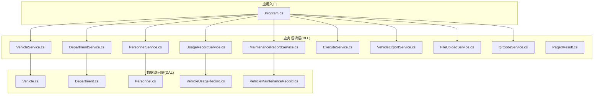
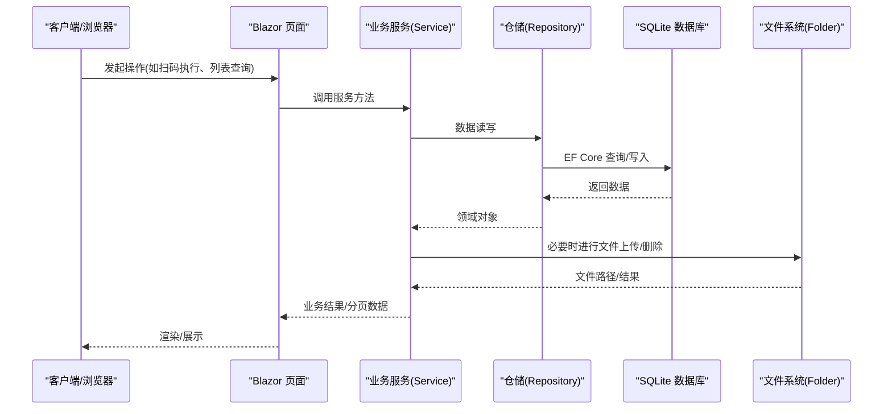
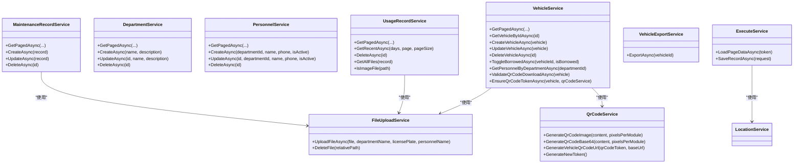

# API 参考文档

<cite>
**本文引用的文件**   
- [Program.cs](file://Program.cs)
- [VehicleService.cs](file://BLL/Vehicle/VehicleService.cs)
- [DepartmentService.cs](file://BLL/Department/DepartmentService.cs)
- [PersonnelService.cs](file://BLL/Personnel/PersonnelService.cs)
- [UsageRecordService.cs](file://BLL/UsageRecord/UsageRecordService.cs)
- [MaintenanceRecordService.cs](file://BLL/Maintenance/MaintenanceRecordService.cs)
- [FileUploadService.cs](file://BLL/Common/FileUploadService.cs)
- [QrCodeService.cs](file://BLL/Common/QrCodeService.cs)
- [VehicleExportService.cs](file://BLL/Export/VehicleExportService.cs)
- [ExecuteService.cs](file://BLL/Execute/ExecuteService.cs)
- [PagedResult.cs](file://BLL/Common/PagedResult.cs)
- [Vehicle.cs](file://DAL/Model/Vehicle.cs)
- [Department.cs](file://DAL/Model/Department.cs)
- [Personnel.cs](file://DAL/Model/Personnel.cs)
- [VehicleUsageRecord.cs](file://DAL/Model/VehicleUsageRecord.cs)
- [VehicleMaintenanceRecord.cs](file://DAL/Model/VehicleMaintenanceRecord.cs)
</cite>

## 目录
1. [简介](#简介)
2. [项目结构](#项目结构)
3. [核心组件](#核心组件)
4. [架构总览](#架构总览)
5. [详细接口与业务服务说明](#详细接口与业务服务说明)
6. [依赖关系分析](#依赖关系分析)
7. [性能与并发特性](#性能与并发特性)
8. [错误处理与排障指南](#错误处理与排障指南)
9. [客户端集成与调试建议](#客户端集成与调试建议)
10. [API 版本管理与兼容性](#api-版本管理与兼容性)
11. [结论](#结论)

## 简介
本文件为 vehicleManagement 系统的 API 参考文档。系统采用 Blazor Server + ASP.NET Core 架构，提供车辆管理、部门人员、使用记录、维护记录、文件上传、二维码生成、Excel 导出、扫码执行等能力。后端通过仓储层访问 SQLite 数据库，并通过通用服务封装分页、文件上传、二维码生成等横切能力。

本项目未暴露传统 REST API 控制器；当前对外能力主要通过 Blazor 页面与服务方法间接调用。本文在“接口定义”部分以“面向服务的 API 契约”形式描述请求参数、响应结构与错误语义，便于前端或外部系统集成。

## 项目结构
- BLL：业务逻辑层，按领域划分服务类（车辆、部门、人员、使用记录、维护、导出、执行、通用工具）。
- DAL：数据访问层，包含实体模型、仓储实现与 DbContext。
- Pages：Blazor 页面，承载用户交互与业务流程编排。
- Program.cs：应用启动、依赖注入、静态文件与路由配置。

图表来源
- [Program.cs:41-102](file://Program.cs#L41-L102)
- [VehicleService.cs:18-38](file://BLL/Vehicle/VehicleService.cs#L18-L38)
- [DepartmentService.cs:16-36](file://BLL/Department/DepartmentService.cs#L16-L36)
- [PersonnelService.cs:17-34](file://BLL/Personnel/PersonnelService.cs#L17-L34)
- [UsageRecordService.cs:19-38](file://BLL/UsageRecord/UsageRecordService.cs#L19-L38)
- [MaintenanceRecordService.cs:14-28](file://BLL/Maintenance/MaintenanceRecordService.cs#L14-L28)
- [ExecuteService.cs:16-25](file://BLL/Execute/ExecuteService.cs#L16-L25)
- [VehicleExportService.cs:16-23](file://BLL/Export/VehicleExportService.cs#L16-L23)
- [FileUploadService.cs:12-27](file://BLL/Common/FileUploadService.cs#L12-L27)
- [QrCodeService.cs:6-19](file://BLL/Common/QrCodeService.cs#L6-L19)

章节来源
- [Program.cs:41-148](file://Program.cs#L41-L148)

## 核心组件
- VehicleService：车辆增删改查、状态切换、二维码校验与 Token 管理、按部门获取人员。
- DepartmentService：部门分页查询、CRUD、删除前关联校验。
- PersonnelService：人员分页查询、CRUD、删除前关联校验。
- UsageRecordService：使用记录分页查询、最近 N 天查询、删除时清理附件。
- MaintenanceRecordService：维护记录分页查询、CRUD、删除时清理附件。
- FileUploadService：图片/视频上传、大小与格式校验、路径规范化与删除。
- QrCodeService：二维码图片/Base64 生成、Token 生成、扫码 URL 构造。
- VehicleExportService：按车辆导出 Excel（含使用记录与维修记录）。
- ExecuteService：扫码执行页数据加载、保存使用记录（含途经点顺序与附件合并）。
- PagedResult：通用分页结果封装。

章节来源
- [VehicleService.cs:18-239](file://BLL/Vehicle/VehicleService.cs#L18-L239)
- [DepartmentService.cs:16-144](file://BLL/Department/DepartmentService.cs#L16-L144)
- [PersonnelService.cs:17-139](file://BLL/Personnel/PersonnelService.cs#L17-L139)
- [UsageRecordService.cs:19-177](file://BLL/UsageRecord/UsageRecordService.cs#L19-L177)
- [MaintenanceRecordService.cs:14-100](file://BLL/Maintenance/MaintenanceRecordService.cs#L14-L100)
- [FileUploadService.cs:12-110](file://BLL/Common/FileUploadService.cs#L12-L110)
- [QrCodeService.cs:6-39](file://BLL/Common/QrCodeService.cs#L6-L39)
- [VehicleExportService.cs:16-160](file://BLL/Export/VehicleExportService.cs#L16-L160)
- [ExecuteService.cs:16-149](file://BLL/Execute/ExecuteService.cs#L16-L149)
- [PagedResult.cs:9-35](file://BLL/Common/PagedResult.cs#L9-L35)

## 架构总览
系统采用分层架构：
- 表现层：Blazor 页面（Pages）负责 UI 与交互流程。
- 业务层：各 Service 封装领域规则、事务边界、附件清理与校验。
- 数据层：Repository + EF Core DbContext 访问 SQLite。
- 通用能力：文件上传、二维码生成、分页封装。

图表来源
- [Program.cs:104-148](file://Program.cs#L104-L148)
- [VehicleService.cs:67-108](file://BLL/Vehicle/VehicleService.cs#L67-L108)
- [FileUploadService.cs:29-46](file://BLL/Common/FileUploadService.cs#L29-L46)
- [ExecuteService.cs:30-70](file://BLL/Execute/ExecuteService.cs#L30-L70)

## 详细接口与业务服务说明

### 车辆管理 API（增删改查、状态更新）
- 分页查询车辆列表
  - 调用方式：VehicleService.GetPagedAsync(searchKeyword, sortColumn, sortAscending, page, pageSize)
  - 输入参数：
    - searchKeyword：关键词（车牌/品牌/型号/颜色模糊匹配）
    - sortColumn：排序字段（plate/brand/color/默认CreatedAt）
    - sortAscending：是否升序
    - page：页码
    - pageSize：每页条数
  - 输出：PagedResult<Vehicle>
  - 错误：无直接异常抛出，分页参数会被归一化
  - 认证：由上层页面控制
  - 异步：是
  - 分页：支持
  - 批量：否
  - 示例：见[VehicleService.cs:67-108](file://BLL/Vehicle/VehicleService.cs#L67-L108)

- 根据 ID 获取车辆
  - 调用方式：VehicleService.GetVehicleByIdAsync(id)
  - 输入：id
  - 输出：Vehicle
  - 异步：是

- 创建车辆
  - 调用方式：VehicleService.CreateVehicleAsync(vehicle)
  - 输入：Vehicle 对象
  - 输出：Vehicle
  - 异步：是

- 更新车辆
  - 调用方式：VehicleService.UpdateVehicleAsync(vehicle)
  - 输入：Vehicle 对象（UpdatedAt 自动设置）
  - 输出：Vehicle
  - 异步：是

- 删除车辆
  - 调用方式：VehicleService.DeleteVehicleAsync(id)
  - 输入：id
  - 输出：(Success, ErrorMessage)
  - 约束：若存在使用记录则拒绝删除；删除前会尝试清理图片附件
  - 错误语义：返回失败原因字符串
  - 异步：是

- 设置借用状态
  - 调用方式：VehicleService.ToggleBorrowedAsync(vehicleId, isBorrowed)
  - 输入：vehicleId, isBorrowed
  - 输出：无（内部更新）
  - 异步：是

- 按部门获取在职人员
  - 调用方式：VehicleService.GetPersonnelByDepartmentAsync(departmentId)
  - 输入：departmentId
  - 输出：List<Personnel>
  - 异步：是

- 二维码相关
  - 校验下载条件：ValidateQrCodeDownloadAsync(vehicle)
    - 要求：已绑定部门且该部门有在职人员
  - 确保 Token：EnsureQrCodeTokenAsync(vehicle, qrCodeService)
    - 若无 Token 则生成并持久化

章节来源
- [VehicleService.cs:43-239](file://BLL/Vehicle/VehicleService.cs#L43-L239)
- [Vehicle.cs:8-48](file://DAL/Model/Vehicle.cs#L8-L48)

### 部门人员 API
- 部门分页查询
  - 调用方式：DepartmentService.GetPagedAsync(searchKeyword, sortColumn, sortAscending, page, pageSize)
  - 输入：searchKeyword、sortColumn(name/desc/默认)、sortAscending、page、pageSize
  - 输出：PagedResult<Department>
  - 异步：是

- 部门 CRUD
  - 创建：CreateAsync(name, description)
  - 更新：UpdateAsync(id, name, description)
  - 删除：DeleteAsync(id)，带关联校验（人员、车辆、使用记录）

- 人员分页查询
  - 调用方式：PersonnelService.GetPagedAsync(searchKeyword, sortColumn, sortAscending, page, pageSize)
  - 输入：searchKeyword、sortColumn(name/phone/默认)、sortAscending、page、pageSize
  - 输出：PagedResult<Personnel>
  - 异步：是

- 人员 CRUD
  - 创建：CreateAsync(departmentId, name, phone, isActive)
  - 更新：UpdateAsync(id, departmentId, name, phone, isActive)
  - 删除：DeleteAsync(id)，带关联校验（使用记录）

章节来源
- [DepartmentService.cs:41-144](file://BLL/Department/DepartmentService.cs#L41-L144)
- [PersonnelService.cs:39-139](file://BLL/Personnel/PersonnelService.cs#L39-L139)
- [Department.cs:7-21](file://DAL/Model/Department.cs#L7-L21)
- [Personnel.cs:7-29](file://DAL/Model/Personnel.cs#L7-L29)

### 使用记录 API
- 分页查询
  - 调用方式：UsageRecordService.GetPagedAsync(searchKeyword, sortColumn, sortAscending, page, pageSize)
  - 输入：searchKeyword、sortColumn(vehicle/person/默认)、sortAscending、page、pageSize
  - 输出：PagedResult<VehicleUsageRecord>
  - 关联加载：Vehicle、Department、Personnel、FinalLocation、PurposeSequence

- 最近 N 天查询
  - 调用方式：UsageRecordService.GetRecentAsync(days, page, pageSize)
  - 输出：PagedResult<VehicleUsageRecord>

- 删除使用记录
  - 调用方式：UsageRecordService.DeleteAsync(id)
  - 输出：(Success, ErrorMessage)
  - 行为：先清理图片与视频附件，再删除数据库记录

- 附件辅助
  - GetAllFiles(record)：合并图片与视频路径
  - IsImageFile(path)：判断是否为图片扩展名

章节来源
- [UsageRecordService.cs:43-177](file://BLL/UsageRecord/UsageRecordService.cs#L43-L177)
- [VehicleUsageRecord.cs:9-54](file://DAL/Model/VehicleUsageRecord.cs#L9-L54)

### 维护记录 API
- 分页查询
  - 调用方式：MaintenanceRecordService.GetPagedAsync(searchKeyword, page, pageSize)
  - 输入：searchKeyword、page、pageSize
  - 输出：PagedResult<VehicleMaintenanceRecord>
  - 排序：按维护日期倒序

- CRUD
  - CreateAsync(record)
  - UpdateAsync(record)
  - DeleteAsync(id)：删除前先清理附件

章节来源
- [MaintenanceRecordService.cs:30-100](file://BLL/Maintenance/MaintenanceRecordService.cs#L30-L100)
- [VehicleMaintenanceRecord.cs:8-35](file://DAL/Model/VehicleMaintenanceRecord.cs#L8-L35)

### 文件上传 API
- 上传文件
  - 调用方式：FileUploadService.UploadFileAsync(file, departmentName, licensePlate, personnelName)
  - 支持 IFormFile 与 IBrowserFile
  - 校验：
    - 格式：图片(.jpg/.jpeg/.png/.gif/.webp)、视频(.mp4/.avi/.mov/.wmv)
    - 大小：图片≤10MB，视频≤100MB
  - 存储路径：/Folder/{部门}/{车牌}/{人员}/{日期}/{文件名}
  - 返回：相对 URL 路径（/Folder/...）
  - 异常：参数为空、格式不支持、超出大小限制

- 删除文件
  - 调用方式：FileUploadService.DeleteFile(relativePath)
  - 行为：去除 /Folder/ 前缀后拼接根目录并删除物理文件

章节来源
- [FileUploadService.cs:29-110](file://BLL/Common/FileUploadService.cs#L29-L110)

### 二维码生成 API
- 生成二维码图片字节
  - 调用方式：QrCodeService.GenerateQrCodeImage(content, pixelsPerModule)
  - 输入：content（非空）、pixelsPerModule（默认20）
  - 输出：byte[] PNG 图像

- 生成 Base64 二维码
  - 调用方式：QrCodeService.GenerateQrCodeBase64(content, pixelsPerModule)
  - 输出：data:image/png;base64,...

- 生成车辆二维码 URL
  - 调用方式：QrCodeService.GenerateVehicleQrCodeUrl(qrCodeToken, baseUrl)
  - 输出：{baseUrl}/execute/{qrCodeToken}

- 生成新 Token
  - 调用方式：QrCodeService.GenerateNewToken()
  - 输出：Guid 的十六进制字符串

章节来源
- [QrCodeService.cs:8-39](file://BLL/Common/QrCodeService.cs#L8-L39)

### Excel 导出 API
- 导出车辆信息
  - 调用方式：VehicleExportService.ExportAsync(vehicleId)
  - 输入：vehicleId
  - 输出：byte[]（Excel 二进制流）
  - 内容：
    - 车辆基本信息（车牌、部门、品牌型号、颜色、状态、借用状态、导出时间）
    - 使用记录列表（序号、部门、是否借用、人员、路径、目的地、起止里程、时间）
    - 维修信息记录（序号、日期、项目、费用、备注）
  - 注意：若车辆不存在返回 null

章节来源
- [VehicleExportService.cs:25-160](file://BLL/Export/VehicleExportService.cs#L25-L160)

### 扫码执行 API
- 加载扫码页面数据
  - 调用方式：ExecuteService.LoadPageDataAsync(token)
  - 输入：token（二维码 Token）
  - 输出：ExecutePageData
    - Vehicle：车辆及部门信息
    - PersonnelList：部门在职人员
    - Waypoints：启用中的途经点
    - FinalLocations：启用中的最终停车位置
    - PreFilledMileageStart：上次结束里程预填值
  - 行为：若 token 无效返回 null

- 保存使用记录
  - 调用方式：ExecuteService.SaveRecordAsync(request)
  - 输入：SaveUsageRecordRequest
    - VehicleId、DepartmentId、PersonnelId、WaypointIds、FinalLocationId
    - MileageStart、MileageEnd
    - UploadedFiles：已上传文件路径列表（分号分隔合并到记录）
    - Remarks
  - 输出：(Success, ErrorMessage)
  - 校验：必须选择人员、至少一个途经点、最终停车位置
  - 事务：保存主记录与用途顺序关联表

章节来源
- [ExecuteService.cs:30-149](file://BLL/Execute/ExecuteService.cs#L30-L149)

## 依赖关系分析
- Service 层依赖 Repository 与 IDbContextFactory<TDbContext>，避免 Blazor Server 并发上下文冲突。
- FileUploadService 依赖 IWebHostEnvironment 与文件系统。
- QrCodeService 依赖第三方库 QRCoder。
- ExecuteService 依赖 LocationService 获取路径点与终点。

图表来源
- [VehicleService.cs:18-38](file://BLL/Vehicle/VehicleService.cs#L18-L38)
- [DepartmentService.cs:16-36](file://BLL/Department/DepartmentService.cs#L16-L36)
- [PersonnelService.cs:17-34](file://BLL/Personnel/PersonnelService.cs#L17-L34)
- [UsageRecordService.cs:19-38](file://BLL/UsageRecord/UsageRecordService.cs#L19-L38)
- [MaintenanceRecordService.cs:14-28](file://BLL/Maintenance/MaintenanceRecordService.cs#L14-L28)
- [FileUploadService.cs:12-27](file://BLL/Common/FileUploadService.cs#L12-L27)
- [QrCodeService.cs:6-19](file://BLL/Common/QrCodeService.cs#L6-L19)
- [VehicleExportService.cs:16-23](file://BLL/Export/VehicleExportService.cs#L16-L23)
- [ExecuteService.cs:16-25](file://BLL/Execute/ExecuteService.cs#L16-L25)

## 性能与并发特性
- 数据库上下文工厂：使用 IDbContextFactory<VehicleDbContext> 与 AddDbContextFactory 避免 Blazor Server 并发冲突，提升并发安全性。
- 分页查询：所有列表接口均返回 PagedResult，减少数据传输量与渲染压力。
- 文件上传：
  - 图片最大 10MB，视频最大 100MB，防止大文件阻塞。
  - 按部门/车牌/人员/日期组织目录，利于缓存与清理。
- 导出 Excel：内存中构建 MemoryStream，适合中小规模数据；大数据量建议分批或后台任务。
- 日志：Serilog 控制台与滚动文件日志，便于定位性能瓶颈。

章节来源
- [Program.cs:52-58](file://Program.cs#L52-L58)
- [PagedResult.cs:9-35](file://BLL/Common/PagedResult.cs#L9-L35)
- [FileUploadService.cs:17-19](file://BLL/Common/FileUploadService.cs#L17-L19)
- [VehicleExportService.cs:48-159](file://BLL/Export/VehicleExportService.cs#L48-L159)
- [Program.cs:28-37](file://Program.cs#L28-L37)

## 错误处理与排障指南
- 删除类操作的统一策略：
  - 先清理物理附件，失败则阻止数据库删除，返回明确错误消息。
  - 涉及关联数据的删除需前置校验（部门/人员/车辆/使用记录），否则返回友好提示。
- 常见错误场景：
  - 文件为空或格式不支持：抛出参数异常，客户端应提示重新选择。
  - 文件大小超限：抛出参数异常，客户端应提示压缩或更换设备。
  - 二维码 Token 无效：扫码页面返回 null，提示无效链接。
  - 车辆无法删除：存在使用记录或附件被占用。
- 诊断建议：
  - 查看 logs/log-.log 滚动日志。
  - 检查 Folder 目录权限与磁盘空间。
  - 使用健康检查端点验证服务可用性。

章节来源
- [VehicleService.cs:171-201](file://BLL/Vehicle/VehicleService.cs#L171-L201)
- [UsageRecordService.cs:125-154](file://BLL/UsageRecord/UsageRecordService.cs#L125-L154)
- [MaintenanceRecordService.cs:73-100](file://BLL/Maintenance/MaintenanceRecordService.cs#L73-L100)
- [FileUploadService.cs:69-84](file://BLL/Common/FileUploadService.cs#L69-L84)
- [Program.cs:145-146](file://Program.cs#L145-L146)

## 客户端集成与调试建议
- 集成模式：
  - Blazor 页面直接调用 Service 方法（同进程）。
  - 若需外部系统对接，可在现有 Service 之上封装轻量 HTTP 接口（例如 MapGet/MapPost），复用 Service 逻辑。
- 分页与搜索：
  - 统一使用 PagedResult，前端根据 TotalCount 与 CurrentPage 计算总页数。
  - 搜索关键词建议防抖，避免频繁请求。
- 文件上传：
  - 前端校验格式与大小，服务端再次校验。
  - 上传成功后将返回路径存入表单字段，提交时使用。
- 二维码流程：
  - 生成 Token → 生成二维码图片/Base64 → 打印或展示 → 扫码跳转 /execute/{token} → 加载页面数据 → 填写并提交使用记录。
- 调试工具：
  - 开发环境启用开发者异常页。
  - 使用 Serilog 日志与浏览器开发者工具观察网络与资源加载。
  - 对导出功能可先导出小样本验证列头与数据完整性。

章节来源
- [Program.cs:127-148](file://Program.cs#L127-L148)
- [QrCodeService.cs:27-39](file://BLL/Common/QrCodeService.cs#L27-L39)
- [ExecuteService.cs:30-70](file://BLL/Execute/ExecuteService.cs#L30-L70)

## API 版本管理与兼容性
- 当前未显式暴露 REST API 版本段；如需对外暴露，建议在新增控制器或服务包装时引入版本前缀（如 /api/v1/...）。
- 向后兼容建议：
  - 新增可选参数，保持旧参数行为不变。
  - 废弃字段标记 Obsolete，保留过渡期兼容逻辑。
  - 变更响应结构时增加版本号并在迁移期内同时支持新旧结构。
- 废弃接口迁移：
  - 提供迁移指南与示例，逐步引导客户端升级。
  - 在日志中记录废弃接口的调用统计，辅助下线决策。

[本节为概念性指导，不直接分析具体文件]

## 结论
vehicleManagement 系统通过清晰的层次划分与通用服务封装，提供了完整的车辆管理、部门人员、使用与维护记录、文件上传、二维码与导出、扫码执行等能力。尽管当前主要以内嵌 Blazor 页面为主，但其 Service 层具备良好可复用性，易于扩展为对外 API。建议在后续演进中引入统一的 API 网关与版本管理策略，完善鉴权与限流机制，进一步提升系统的安全性与可观测性。