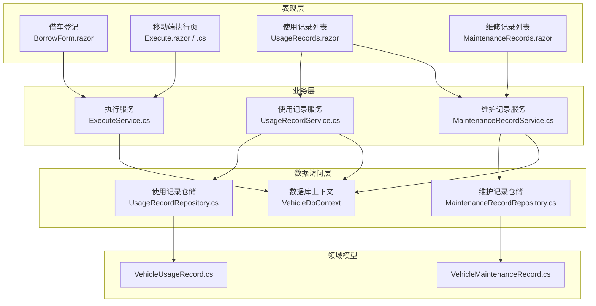
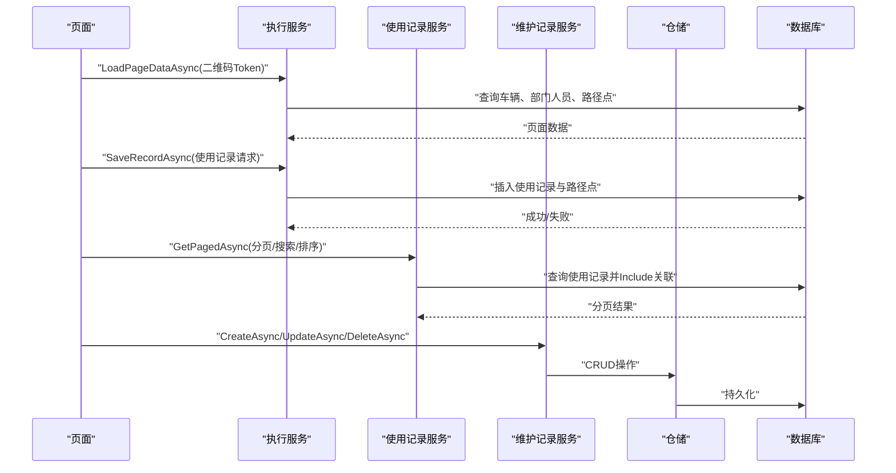
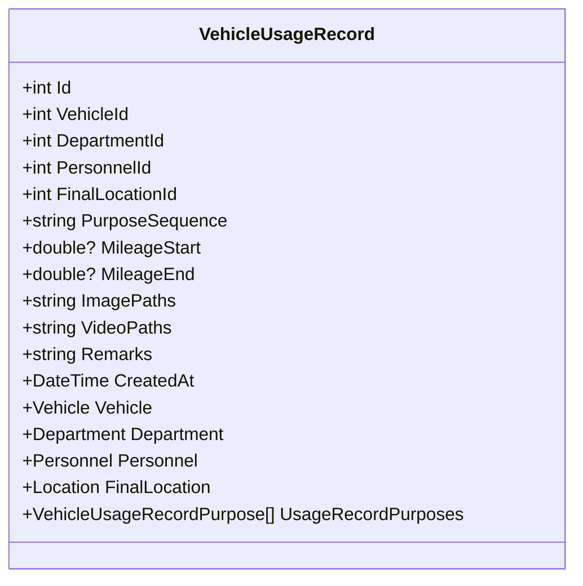
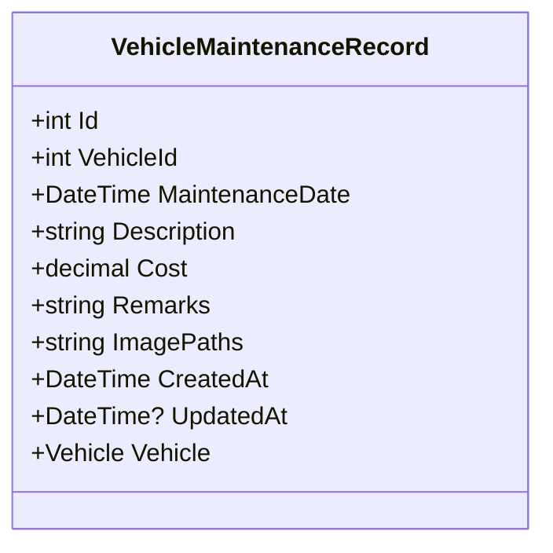
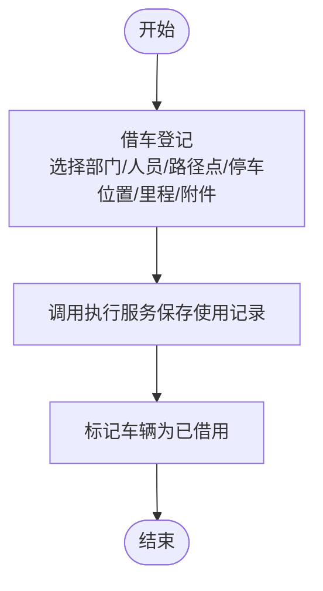
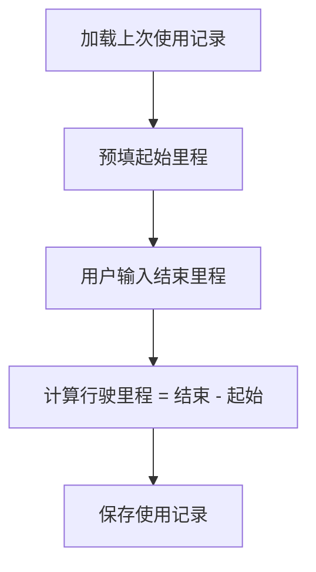
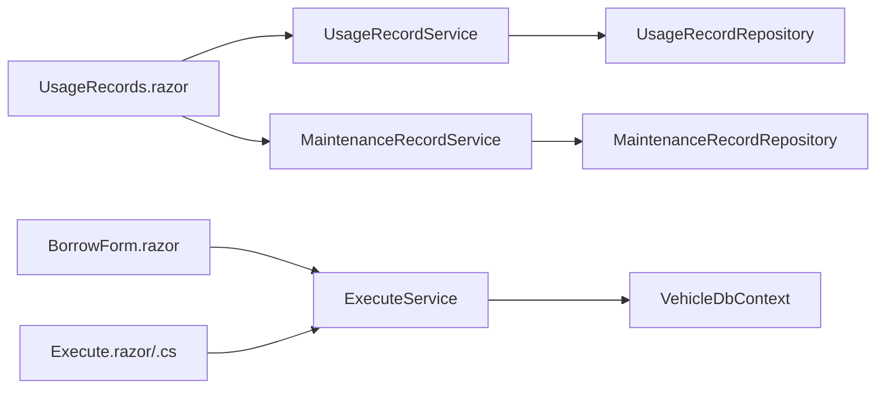

# 使用维护 API

<cite>
**本文引用的文件**   
- [UsageRecordService.cs](file://BLL/UsageRecord/UsageRecordService.cs)
- [MaintenanceRecordService.cs](file://BLL/Maintenance/MaintenanceRecordService.cs)
- [ExecuteService.cs](file://BLL/Execute/ExecuteService.cs)
- [UsageRecordRepository.cs](file://DAL/Repository/UsageRecordRepository.cs)
- [MaintenanceRecordRepository.cs](file://DAL/Repository/MaintenanceRecordRepository.cs)
- [VehicleUsageRecord.cs](file://DAL/Model/VehicleUsageRecord.cs)
- [VehicleMaintenanceRecord.cs](file://DAL/Model/VehicleMaintenanceRecord.cs)
- [UsageRecords.razor](file://Pages/UsageRecords.razor)
- [MaintenanceRecords.razor](file://Pages/MaintenanceRecords.razor)
- [BorrowForm.razor](file://Pages/BorrowForm.razor)
- [Execute.razor](file://Pages/Execute.razor)
- [Execute.razor.cs](file://Pages/Execute.razor.cs)
</cite>

## 目录
1. [引言](#引言)
2. [项目结构](#项目结构)
3. [核心组件](#核心组件)
4. [架构总览](#架构总览)
5. [详细组件分析](#详细组件分析)
6. [依赖关系分析](#依赖关系分析)
7. [性能与扩展建议](#性能与扩展建议)
8. [故障排查指南](#故障排查指南)
9. [结论](#结论)

## 引言
本文件面向“车辆使用记录”和“车辆维护记录”模块，提供综合 API 文档。内容覆盖：
- 使用记录的创建、查询、删除；借用申请、执行确认、归还流程的接口说明与数据模型。
- 维护记录的增删改查、费用统计、维修历史跟踪。
- 里程计算、使用频率分析等高级查询能力（当前实现以分页、排序、搜索为主）。
- 使用记录与维护记录的关联关系、状态流转、业务流程控制。
- 复杂查询参数规范、聚合统计响应格式、数据校验规则、事务处理机制。

## 项目结构
该模块采用分层架构：
- 表现层：Blazor 页面负责用户交互与表单提交。
- 业务层：服务类封装业务逻辑、校验、跨实体协调。
- 数据访问层：仓储类封装 EF Core 查询与持久化。
- 领域模型：实体定义字段、关系与约束。

**图表来源**
- [BorrowForm.razor:1-277](file://Pages/BorrowForm.razor#L1-L277)
- [Execute.razor:1-258](file://Pages/Execute.razor#L1-L258)
- [Execute.razor.cs:1-253](file://Pages/Execute.razor.cs#L1-L253)
- [UsageRecords.razor:1-605](file://Pages/UsageRecords.razor#L1-L605)
- [MaintenanceRecords.razor:1-161](file://Pages/MaintenanceRecords.razor#L1-L161)
- [ExecuteService.cs:1-151](file://BLL/Execute/ExecuteService.cs#L1-L151)
- [UsageRecordService.cs:1-179](file://BLL/UsageRecord/UsageRecordService.cs#L1-L179)
- [MaintenanceRecordService.cs:1-103](file://BLL/Maintenance/MaintenanceRecordService.cs#L1-L103)
- [UsageRecordRepository.cs:1-82](file://DAL/Repository/UsageRecordRepository.cs#L1-L82)
- [MaintenanceRecordRepository.cs:1-62](file://DAL/Repository/MaintenanceRecordRepository.cs#L1-L62)
- [VehicleUsageRecord.cs:1-56](file://DAL/Model/VehicleUsageRecord.cs#L1-L56)
- [VehicleMaintenanceRecord.cs:1-37](file://DAL/Model/VehicleMaintenanceRecord.cs#L1-L37)

**章节来源**
- [UsageRecordService.cs:1-179](file://BLL/UsageRecord/UsageRecordService.cs#L1-L179)
- [MaintenanceRecordService.cs:1-103](file://BLL/Maintenance/MaintenanceRecordService.cs#L1-L103)
- [ExecuteService.cs:1-151](file://BLL/Execute/ExecuteService.cs#L1-L151)

## 核心组件
- 使用记录服务：提供分页查询、最近 N 天查询、删除（含附件清理）、附件路径合并与图片判断。
- 维护记录服务：提供分页查询、按 ID 获取、新增、更新、删除（含附件清理）。
- 执行服务：二维码扫码后加载页面数据、保存使用记录（含途经路径点顺序写入）。
- 仓储层：对使用记录和维护记录进行基础 CRUD 与常用查询。
- 领域模型：定义使用记录与维护记录的字段、关系与约束。

**章节来源**
- [UsageRecordService.cs:40-176](file://BLL/UsageRecord/UsageRecordService.cs#L40-L176)
- [MaintenanceRecordService.cs:30-100](file://BLL/Maintenance/MaintenanceRecordService.cs#L30-L100)
- [ExecuteService.cs:27-125](file://BLL/Execute/ExecuteService.cs#L27-L125)
- [UsageRecordRepository.cs:21-79](file://DAL/Repository/UsageRecordRepository.cs#L21-L79)
- [MaintenanceRecordRepository.cs:19-59](file://DAL/Repository/MaintenanceRecordRepository.cs#L19-L59)
- [VehicleUsageRecord.cs:9-54](file://DAL/Model/VehicleUsageRecord.cs#L9-L54)
- [VehicleMaintenanceRecord.cs:8-35](file://DAL/Model/VehicleMaintenanceRecord.cs#L8-L35)

## 架构总览
系统通过 Blazor 页面发起请求，调用业务服务完成校验与业务编排，再由仓储访问数据库。使用记录与服务之间通过 EF Core 的 Include 预加载关联实体，维护记录则直接通过仓储进行增删改查。

**图表来源**
- [ExecuteService.cs:27-125](file://BLL/Execute/ExecuteService.cs#L27-L125)
- [UsageRecordService.cs:40-120](file://BLL/UsageRecord/UsageRecordService.cs#L40-L120)
- [MaintenanceRecordService.cs:30-100](file://BLL/Maintenance/MaintenanceRecordService.cs#L30-L100)

## 详细组件分析

### 使用记录 API
- 分页查询：支持关键词搜索（车牌号/人员/部门）、排序列（车辆、人员、创建时间）与升/降序。
- 最近 N 天查询：按创建时间过滤最近若干天的记录。
- 删除：先清理附件物理文件，再删除数据库记录；若附件清理失败则阻止删除。
- 附件管理：合并图片与视频路径列表，判断是否为图片。

#### 接口与方法
- GetPagedAsync(searchKeyword, sortColumn, sortAscending, page, pageSize) → PagedResult<VehicleUsageRecord>
- GetRecentAsync(days, page, pageSize) → PagedResult<VehicleUsageRecord>
- DeleteAsync(id) → (Success, ErrorMessage)
- GetAllFiles(record) → List<string>
- IsImageFile(path) → bool

#### 数据模型
- VehicleUsageRecord：包含车辆、部门、人员、最终位置、用途序列、起止里程、附件路径、备注、创建时间等字段，并关联 Vehicle、Department、Personnel、Location、UsageRecordPurposes。

**图表来源**
- [VehicleUsageRecord.cs:9-54](file://DAL/Model/VehicleUsageRecord.cs#L9-L54)

**章节来源**
- [UsageRecordService.cs:40-176](file://BLL/UsageRecord/UsageRecordService.cs#L40-L176)
- [VehicleUsageRecord.cs:9-54](file://DAL/Model/VehicleUsageRecord.cs#L9-L54)

### 维护记录 API
- 分页查询：支持关键词搜索（车牌号/维修项目），默认按维修日期倒序。
- 按 ID 获取：返回单条维护记录。
- 新增/更新：设置维修日期、项目、费用、备注、附件路径；更新时自动更新时间戳。
- 删除：先清理附件物理文件，再删除数据库记录；若附件清理失败则阻止删除。

#### 接口与方法
- GetPagedAsync(searchKeyword, page, pageSize) → PagedResult<VehicleMaintenanceRecord>
- GetByIdAsync(id) → VehicleMaintenanceRecord
- CreateAsync(record) → VehicleMaintenanceRecord
- UpdateAsync(record) → VehicleMaintenanceRecord
- DeleteAsync(id) → (Success, Error)

#### 数据模型
- VehicleMaintenanceRecord：包含车辆、维修日期、描述、费用、备注、附件路径、创建/更新时间等字段，并关联 Vehicle。

**图表来源**
- [VehicleMaintenanceRecord.cs:8-35](file://DAL/Model/VehicleMaintenanceRecord.cs#L8-L35)

**章节来源**
- [MaintenanceRecordService.cs:30-100](file://BLL/Maintenance/MaintenanceRecordService.cs#L30-L100)
- [VehicleMaintenanceRecord.cs:8-35](file://DAL/Model/VehicleMaintenanceRecord.cs#L8-L35)

### 借用申请、执行确认、归还流程
- 借用申请：在借车登记页面选择部门、人员、途经路径点、最终停车位置、起止里程、备注与附件，提交后调用执行服务保存使用记录，并将车辆标记为已借用。
- 执行确认：移动端扫码进入执行页，根据 Token 加载车辆信息、人员列表、路径点与停车位置，预填上次结束里程作为起始里程，支持三种模式：使用登记、借车登记、维修登记。
- 归还流程：当前代码未显式实现“归还”动作；通常可通过再次登记使用记录或单独归还接口实现。建议在现有基础上增加“归还”状态与接口，以完善生命周期。

**图表来源**
- [BorrowForm.razor:231-261](file://Pages/BorrowForm.razor#L231-L261)
- [ExecuteService.cs:72-125](file://BLL/Execute/ExecuteService.cs#L72-L125)

**章节来源**
- [BorrowForm.razor:1-277](file://Pages/BorrowForm.razor#L1-L277)
- [Execute.razor:1-258](file://Pages/Execute.razor#L1-L258)
- [Execute.razor.cs:78-149](file://Pages/Execute.razor.cs#L78-L149)
- [ExecuteService.cs:27-125](file://BLL/Execute/ExecuteService.cs#L27-L125)

### 里程计算与费用统计
- 里程计算：使用记录包含起始与结束里程，可在前端或服务端计算差值；执行服务会预填上次记录的结束里程作为本次起始里程。
- 费用统计：维护记录包含费用字段，可基于维护记录进行费用汇总；当前服务未提供聚合统计方法，可扩展。

**图表来源**
- [ExecuteService.cs:51-69](file://BLL/Execute/ExecuteService.cs#L51-L69)
- [VehicleUsageRecord.cs:29-31](file://DAL/Model/VehicleUsageRecord.cs#L29-L31)

**章节来源**
- [ExecuteService.cs:51-69](file://BLL/Execute/ExecuteService.cs#L51-L69)
- [VehicleUsageRecord.cs:29-31](file://DAL/Model/VehicleUsageRecord.cs#L29-L31)

### 使用频率分析与高级查询
- 当前实现提供分页、搜索与排序能力，可用于统计某段时间内的使用次数、车辆使用热度等。
- 建议在服务层扩展聚合方法，例如按车辆/部门/时间段统计使用次数、平均里程、费用合计等。

[本节为概念性说明，不直接分析具体文件]

## 依赖关系分析
- 使用记录服务依赖仓储与数据库工厂，用于分页查询与删除；同时依赖文件上传服务进行附件清理。
- 维护记录服务依赖仓储与数据库工厂，用于增删改查与附件清理。
- 执行服务依赖数据库工厂与位置服务，用于加载页面数据与保存使用记录。
- 页面层依赖各服务进行数据加载与提交。

**图表来源**
- [UsageRecords.razor:1-605](file://Pages/UsageRecords.razor#L1-L605)
- [BorrowForm.razor:1-277](file://Pages/BorrowForm.razor#L1-L277)
- [Execute.razor:1-258](file://Pages/Execute.razor#L1-L258)
- [Execute.razor.cs:1-253](file://Pages/Execute.razor.cs#L1-L253)
- [UsageRecordService.cs:1-179](file://BLL/UsageRecord/UsageRecordService.cs#L1-L179)
- [MaintenanceRecordService.cs:1-103](file://BLL/Maintenance/MaintenanceRecordService.cs#L1-L103)
- [ExecuteService.cs:1-151](file://BLL/Execute/ExecuteService.cs#L1-L151)
- [UsageRecordRepository.cs:1-82](file://DAL/Repository/UsageRecordRepository.cs#L1-L82)
- [MaintenanceRecordRepository.cs:1-62](file://DAL/Repository/MaintenanceRecordRepository.cs#L1-L62)

**章节来源**
- [UsageRecordService.cs:1-179](file://BLL/UsageRecord/UsageRecordService.cs#L1-L179)
- [MaintenanceRecordService.cs:1-103](file://BLL/Maintenance/MaintenanceRecordService.cs#L1-L103)
- [ExecuteService.cs:1-151](file://BLL/Execute/ExecuteService.cs#L1-L151)

## 性能与扩展建议
- 分页与排序：当前分页在服务层实现，注意避免全表扫描；建议在数据库层优化索引（如车牌号、创建时间、维修日期）。
- 附件清理：删除记录前先清理附件，避免磁盘残留；若附件被占用应给出明确错误提示。
- 聚合统计：建议在服务层新增聚合方法，减少前端计算压力。
- 事务处理：保存使用记录时涉及主记录与关联路径点，建议使用数据库事务保证一致性。

[本节为通用建议，不直接分析具体文件]

## 故障排查指南
- 删除失败：检查附件是否被占用或无法访问；查看日志中的附件清理异常信息。
- 保存失败：检查必填字段（人员、路径点、停车位置）是否填写完整；查看服务端异常消息。
- 分页异常：检查页码与每页大小参数是否合理；确保总数计算正确。

**章节来源**
- [UsageRecordService.cs:122-154](file://BLL/UsageRecord/UsageRecordService.cs#L122-L154)
- [MaintenanceRecordService.cs:73-100](file://BLL/Maintenance/MaintenanceRecordService.cs#L73-L100)
- [ExecuteService.cs:72-125](file://BLL/Execute/ExecuteService.cs#L72-L125)

## 结论
本模块围绕使用记录与维护记录提供了完整的增删改查与业务流程控制能力。通过服务层与仓储层的协作，实现了数据校验、附件管理与分页查询。未来可进一步扩展聚合统计、归还流程与更复杂的业务约束，以提升系统的可用性与可维护性。

[本节为总结性内容，不直接分析具体文件]