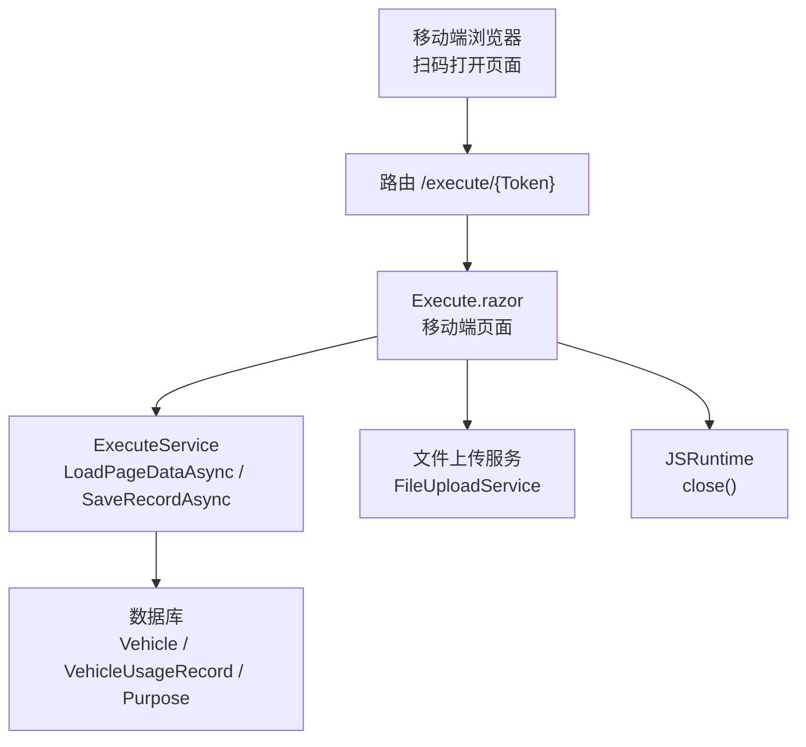
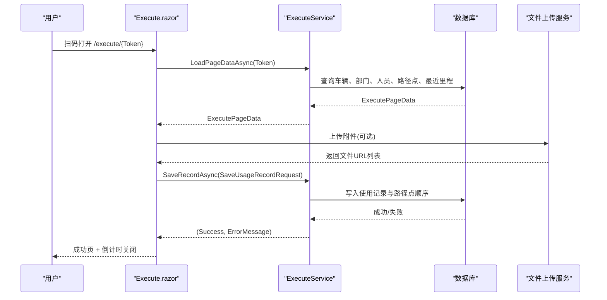
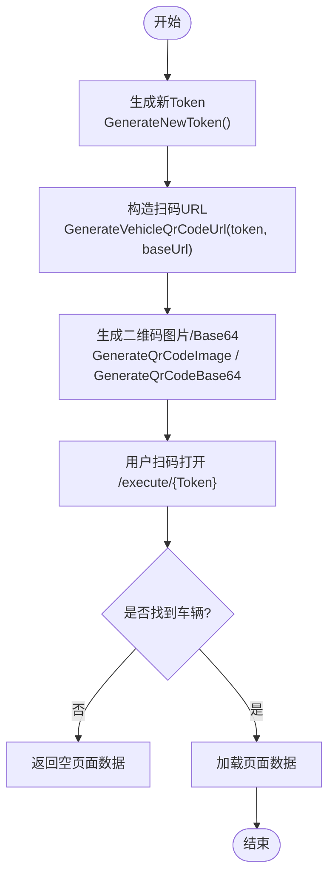
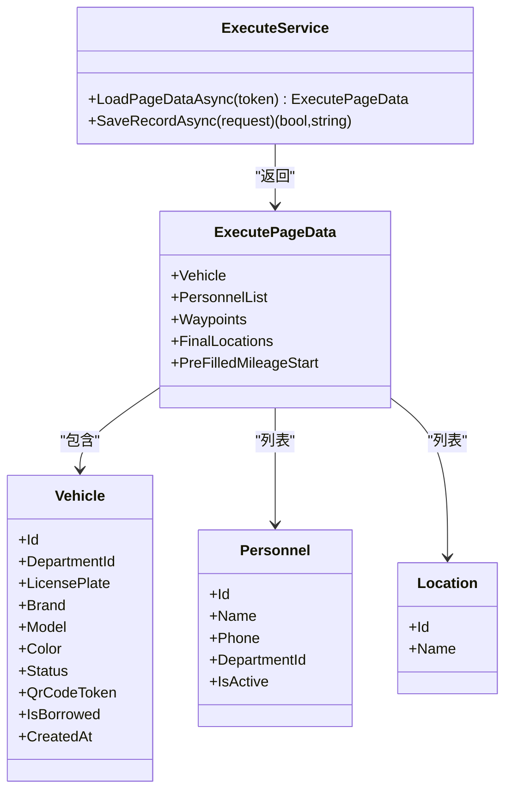
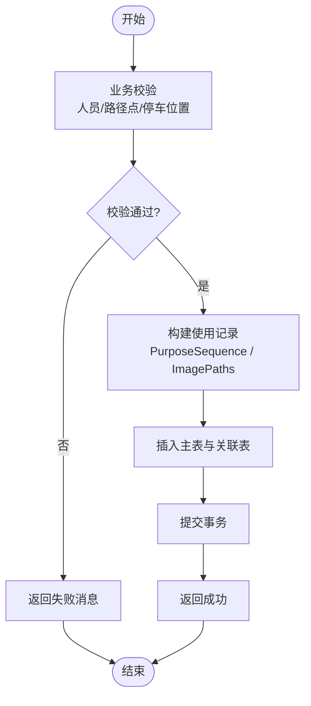
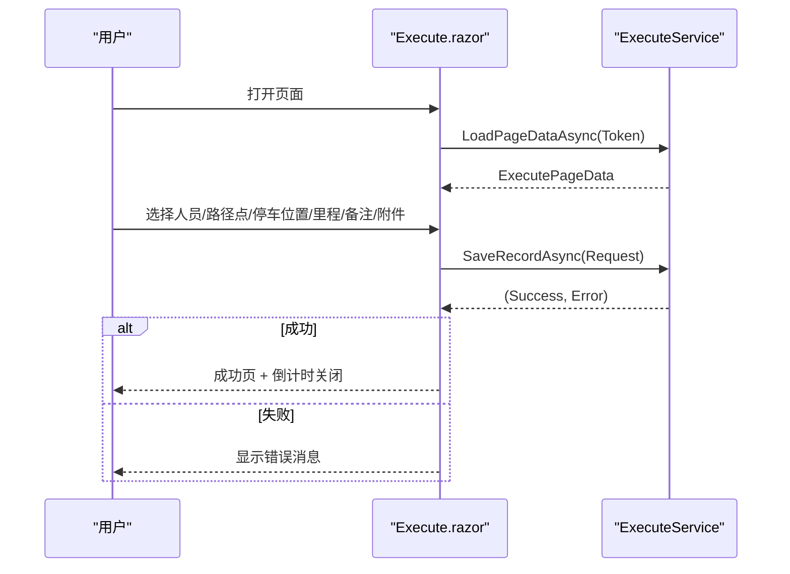
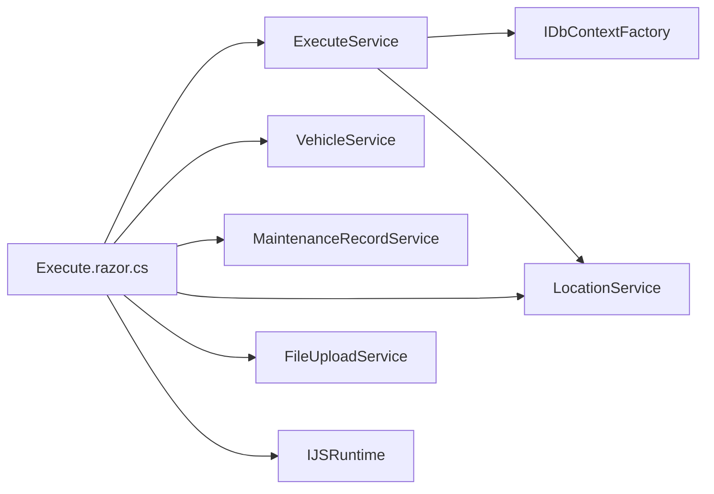
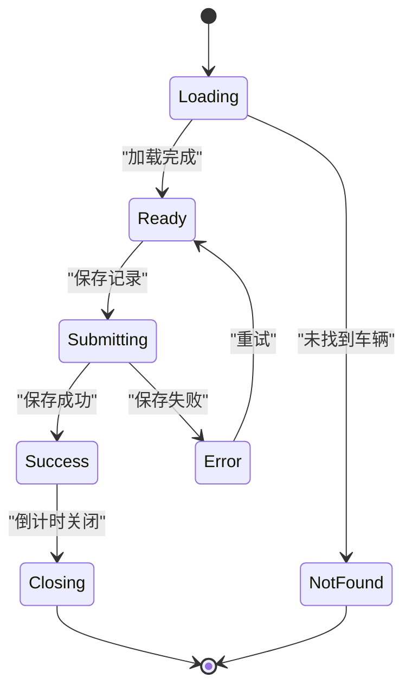

# 扫码执行 API

<cite>
**本文引用的文件**   
- [Execute.razor](file://Pages/Execute.razor)
- [Execute.razor.cs](file://Pages/Execute.razor.cs)
- [ExecuteService.cs](file://BLL/Execute/ExecuteService.cs)
- [QrCodeService.cs](file://BLL/Common/QrCodeService.cs)
- [VehicleUsageRecord.cs](file://DAL/Model/VehicleUsageRecord.cs)
- [VehicleUsageRecordPurpose.cs](file://DAL/Model/VehicleUsageRecordPurpose.cs)
- [Vehicle.cs](file://DAL/Model/Vehicle.cs)
</cite>

## 目录
1. [简介](#简介)
2. [项目结构与入口](#项目结构与入口)
3. [核心组件](#核心组件)
4. [架构总览](#架构总览)
5. [详细组件分析](#详细组件分析)
6. [依赖关系分析](#依赖关系分析)
7. [性能与并发](#性能与并发)
8. [移动端适配与离线处理](#移动端适配与离线处理)
9. [错误处理与恢复](#错误处理与恢复)
10. [审计与一致性](#审计与一致性)
11. [常见问题排查](#常见问题排查)
12. [结论](#结论)

## 简介
本文件为“扫码执行”功能的专用 API 文档，聚焦以下能力：
- 基于二维码 Token 的页面数据加载接口
- 使用记录保存接口
- ExecutePageData 数据结构定义
- SaveUsageRecordRequest 请求模型
- 业务验证规则
- 二维码扫描流程、Token 验证机制
- 车辆信息预填充、人员选择、路径点配置
- 移动端适配、离线数据处理、网络异常恢复
- 完整交互流程、数据提交格式、结果反馈机制
- 并发访问控制、数据一致性保证、操作审计追踪
- 移动端最佳实践、用户体验优化策略

## 项目结构与入口
扫码执行功能由 Blazor 移动端页面与服务层共同实现：
- 路由入口：/execute/{Token}
- 页面布局：MobileLayout（移动端优先）
- 页面逻辑：Execute.razor.cs
- 业务服务：ExecuteService
- 二维码生成与 URL 构造：QrCodeService
- 数据模型：Vehicle、VehicleUsageRecord、VehicleUsageRecordPurpose

图表来源
- [Execute.razor:1-9](file://Pages/Execute.razor#L1-L9)
- [Execute.razor.cs:78-94](file://Pages/Execute.razor.cs#L78-L94)
- [ExecuteService.cs:30-70](file://BLL/Execute/ExecuteService.cs#L30-L70)

章节来源
- [Execute.razor:1-9](file://Pages/Execute.razor#L1-L9)
- [Execute.razor.cs:78-94](file://Pages/Execute.razor.cs#L78-L94)

## 核心组件
- ExecuteService：提供 LoadPageDataAsync 与 SaveRecordAsync 两个关键方法
- ExecutePageData：页面数据载体，包含车辆、人员、路径点、最终停车位置、预填起始里程
- SaveUsageRecordRequest：保存使用记录的请求模型
- QrCodeService：生成二维码图片、Base64 与扫码 URL
- 页面 Execute.razor/.razor.cs：移动端表单、状态管理、文件上传、倒计时关闭

章节来源
- [ExecuteService.cs:16-150](file://BLL/Execute/ExecuteService.cs#L16-L150)
- [QrCodeService.cs:6-39](file://BLL/Common/QrCodeService.cs#L6-L39)
- [Execute.razor.cs:20-76](file://Pages/Execute.razor.cs#L20-L76)

## 架构总览
扫码执行的整体调用链如下：
- 用户通过扫码打开 /execute/{Token}
- 页面初始化时调用 LoadPageDataAsync 获取车辆信息与可选数据
- 用户在移动端填写使用人员、路径点、最终停车位置、里程、备注与附件
- 点击保存后调用 SaveRecordAsync 持久化使用记录与路径点顺序
- 成功后显示成功页并自动倒计时关闭

图表来源
- [Execute.razor.cs:78-94](file://Pages/Execute.razor.cs#L78-L94)
- [Execute.razor.cs:131-149](file://Pages/Execute.razor.cs#L131-L149)
- [ExecuteService.cs:30-70](file://BLL/Execute/ExecuteService.cs#L30-L70)
- [ExecuteService.cs:75-125](file://BLL/Execute/ExecuteService.cs#L75-L125)

## 详细组件分析

### 二维码与 Token 机制
- 二维码内容：通常为扫码执行页面的 URL
- URL 构造：/execute/{qrCodeToken}
- Token 生成：使用 GUID 去重字符串
- 页面路由：/execute/{Token}
- Token 验证：根据 QrCodeToken 匹配车辆；未找到则返回空页面数据

图表来源
- [QrCodeService.cs:27-39](file://BLL/Common/QrCodeService.cs#L27-L39)
- [ExecuteService.cs:30-40](file://BLL/Execute/ExecuteService.cs#L30-L40)

章节来源
- [QrCodeService.cs:6-39](file://BLL/Common/QrCodeService.cs#L6-L39)
- [Execute.razor:1-2](file://Pages/Execute.razor#L1-L2)
- [ExecuteService.cs:30-40](file://BLL/Execute/ExecuteService.cs#L30-L40)

### 页面数据加载接口：LoadPageDataAsync
- 输入：token（字符串）
- 输出：ExecutePageData 或 null
- 行为：
  - 校验 token 非空
  - 按 QrCodeToken 查询车辆及部门
  - 查询该部门在职人员
  - 查询启用中的路径点与最终停车位置
  - 查询该车辆最近一条使用记录的结束里程作为预填起始里程
- 错误处理：token 为空或未找到车辆时返回 null

图表来源
- [ExecuteService.cs:30-70](file://BLL/Execute/ExecuteService.cs#L30-L70)
- [ExecuteService.cs:129-136](file://BLL/Execute/ExecuteService.cs#L129-L136)
- [Vehicle.cs:8-48](file://DAL/Model/Vehicle.cs#L8-L48)

章节来源
- [ExecuteService.cs:30-70](file://BLL/Execute/ExecuteService.cs#L30-L70)
- [Execute.razor.cs:78-94](file://Pages/Execute.razor.cs#L78-L94)

### 使用记录保存接口：SaveRecordAsync
- 输入：SaveUsageRecordRequest
- 输出：(Success, ErrorMessage)
- 业务验证规则：
  - PersonnelId 必须大于 0
  - WaypointIds 不能为空
  - FinalLocationId 必须大于 0
- 数据持久化：
  - 创建 VehicleUsageRecord
  - 将路径点顺序以逗号分隔存入 PurposeSequence
  - 逐条插入 VehicleUsageRecordPurpose，SequenceOrder 从 1 开始递增
  - 将 UploadedFiles 以分号连接存入 ImagePaths
- 异常处理：捕获异常并返回失败消息

图表来源
- [ExecuteService.cs:75-125](file://BLL/Execute/ExecuteService.cs#L75-L125)
- [VehicleUsageRecord.cs:9-54](file://DAL/Model/VehicleUsageRecord.cs#L9-L54)
- [VehicleUsageRecordPurpose.cs:6-25](file://DAL/Model/VehicleUsageRecordPurpose.cs#L6-L25)

章节来源
- [ExecuteService.cs:75-125](file://BLL/Execute/ExecuteService.cs#L75-L125)
- [VehicleUsageRecord.cs:9-54](file://DAL/Model/VehicleUsageRecord.cs#L9-L54)
- [VehicleUsageRecordPurpose.cs:6-25](file://DAL/Model/VehicleUsageRecordPurpose.cs#L6-L25)

### 数据结构定义

#### ExecutePageData
- Vehicle：车辆实体，含部门、车牌、品牌型号、颜色、状态、二维码 Token、借出标志等
- PersonnelList：该部门在职人员列表
- Waypoints：启用的途经路径点列表
- FinalLocations：启用的最终停车位置列表
- PreFilledMileageStart：预填起始里程（来自最近一次使用记录的结束里程）

章节来源
- [ExecuteService.cs:129-136](file://BLL/Execute/ExecuteService.cs#L129-L136)
- [Vehicle.cs:8-48](file://DAL/Model/Vehicle.cs#L8-L48)

#### SaveUsageRecordRequest
- VehicleId：车辆 ID
- DepartmentId：部门 ID
- PersonnelId：使用人员 ID
- WaypointIds：路径点 ID 列表（顺序重要）
- FinalLocationId：最终停车位置 ID
- MileageStart：起始里程（可选）
- MileageEnd：结束里程（可选）
- UploadedFiles：已上传文件 URL 列表（可选）
- Remarks：备注（可选）

章节来源
- [ExecuteService.cs:138-149](file://BLL/Execute/ExecuteService.cs#L138-L149)

### 移动端交互流程
- 页面加载：
  - 读取路由参数 Token
  - 调用 LoadPageDataAsync 获取车辆信息与下拉选项
  - 若未找到车辆，显示“未找到车辆”提示
- 表单填写：
  - 使用人员：从 personnelList 中选择
  - 路径点：按顺序点选，支持移除
  - 最终停车位置：从 allFinalLocations 中选择
  - 里程：起始/结束（可选）
  - 备注：可选
  - 附件：支持图片与视频，批量上传
- 提交保存：
  - 前端组装 SaveUsageRecordRequest
  - 调用 SaveRecordAsync
  - 成功后显示成功页并倒计时关闭
- 借车登记：
  - 选择所属部门与人员
  - 选择路径点与最终停车位置
  - 保存成功后更新车辆借出状态

图表来源
- [Execute.razor.cs:78-94](file://Pages/Execute.razor.cs#L78-L94)
- [Execute.razor.cs:131-149](file://Pages/Execute.razor.cs#L131-L149)
- [Execute.razor.cs:227-251](file://Pages/Execute.razor.cs#L227-L251)

章节来源
- [Execute.razor.cs:78-94](file://Pages/Execute.razor.cs#L78-L94)
- [Execute.razor.cs:131-149](file://Pages/Execute.razor.cs#L131-L149)
- [Execute.razor.cs:227-251](file://Pages/Execute.razor.cs#L227-L251)

## 依赖关系分析
- Execute.razor.cs 依赖：
  - ExecuteService：页面数据加载与记录保存
  - VehicleService：部门与人员数据、借出状态切换
  - MaintenanceRecordService：维修记录保存
  - LocationService：路径点与最终停车位置
  - FileUploadService：文件上传
  - IJSRuntime：页面关闭
- ExecuteService 依赖：
  - IDbContextFactory<VehicleDbContext>：数据库上下文工厂
  - LocationService：路径点与最终停车位置查询

图表来源
- [Execute.razor.cs:1-17](file://Pages/Execute.razor.cs#L1-L17)
- [ExecuteService.cs:18-25](file://BLL/Execute/ExecuteService.cs#L18-L25)

章节来源
- [Execute.razor.cs:1-17](file://Pages/Execute.razor.cs#L1-L17)
- [ExecuteService.cs:18-25](file://BLL/Execute/ExecuteService.cs#L18-L25)

## 性能与并发
- 数据库访问：
  - 使用 IDbContextFactory 创建 DbContext，避免长生命周期上下文
  - Include 仅加载必要关联（部门），减少冗余数据
- 查询优化：
  - 路径点与最终停车位置通过 LocationService 获取，可复用缓存或索引
  - 最近使用记录查询按 CreatedAt 降序取第一条，注意索引设计
- 并发控制：
  - 当前实现未显式加锁，建议在高并发场景下对同一车辆的写操作进行串行化或乐观锁
  - 借出状态切换应确保原子性，避免重复借出
- 事务一致性：
  - SaveRecordAsync 在同一 DbContext 中写入主表与关联表，SaveChanges 一次性提交
  - 建议在更复杂场景中使用显式事务或分布式事务保障一致性

章节来源
- [ExecuteService.cs:30-70](file://BLL/Execute/ExecuteService.cs#L30-L70)
- [ExecuteService.cs:75-125](file://BLL/Execute/ExecuteService.cs#L75-L125)

## 移动端适配与离线处理
- 移动端适配：
  - 页面使用 MobileLayout，布局与控件针对移动端优化
  - 分段标签（使用/借车/维修）便于单手操作
  - 路径点选择采用按钮矩阵与标签展示，适合触摸交互
- 离线数据处理：
  - 当前实现未内置离线缓存与重试队列
  - 建议在前端增加本地存储（IndexedDB/LocalStorage）暂存草稿与待提交记录
  - 在网络恢复后自动同步离线数据至后端
- 网络异常恢复：
  - 当前错误通过 errorMessage 展示
  - 建议增加重试机制与退避策略，提升弱网体验

章节来源
- [Execute.razor:1-2](file://Pages/Execute.razor#L1-L2)
- [Execute.razor.cs:97-102](file://Pages/Execute.razor.cs#L97-L102)

## 错误处理与恢复
- 页面级错误：
  - loading 状态用于加载阶段
  - vehicle == null 表示未找到车辆，提示确认二维码
  - saved 状态表示提交成功，进入倒计时关闭
- 表单级错误：
  - 各模块维护独立错误字段（errorMessage/maintError/borrowError）
  - ClearErrors 统一清空错误
- 服务端错误：
  - SaveRecordAsync 返回 (Success, ErrorMessage)，前端展示错误消息
  - 文件上传失败时捕获异常并提示

图表来源
- [Execute.razor.cs:78-94](file://Pages/Execute.razor.cs#L78-L94)
- [Execute.razor.cs:131-149](file://Pages/Execute.razor.cs#L131-L149)
- [Execute.razor.cs:152-156](file://Pages/Execute.razor.cs#L152-L156)

章节来源
- [Execute.razor.cs:78-94](file://Pages/Execute.razor.cs#L78-L94)
- [Execute.razor.cs:131-149](file://Pages/Execute.razor.cs#L131-L149)
- [Execute.razor.cs:152-156](file://Pages/Execute.razor.cs#L152-L156)

## 审计与一致性
- 审计追踪：
  - VehicleUsageRecord.CreatedAt 记录创建时间
  - PurposeSequence 保留路径点顺序，便于回溯
  - ImagePaths 保留附件路径，便于证据追溯
- 数据一致性：
  - 主表与关联表在同一 DbContext 中写入，SaveChanges 保证原子性
  - 建议为 VehicleId、CreatedAt 建立索引以提升查询性能
  - 在高频写入场景考虑分区表或归档策略

章节来源
- [VehicleUsageRecord.cs:9-54](file://DAL/Model/VehicleUsageRecord.cs#L9-L54)
- [VehicleUsageRecordPurpose.cs:6-25](file://DAL/Model/VehicleUsageRecordPurpose.cs#L6-L25)
- [ExecuteService.cs:85-119](file://BLL/Execute/ExecuteService.cs#L85-L119)

## 常见问题排查
- 扫码后显示“未找到车辆”：
  - 检查 QrCodeToken 是否正确生成与绑定到车辆
  - 确认 URL 构造正确且域名/端口无误
- 保存失败：
  - 检查必填项：人员、路径点、最终停车位置
  - 查看服务器日志与数据库约束冲突
- 文件上传失败：
  - 检查 FileUploadService 权限与存储空间
  - 确认文件大小与类型限制

章节来源
- [Execute.razor.cs:97-102](file://Pages/Execute.razor.cs#L97-L102)
- [ExecuteService.cs:75-125](file://BLL/Execute/ExecuteService.cs#L75-L125)

## 结论
扫码执行 API 通过清晰的页面数据加载与记录保存接口，结合移动端友好的交互设计，实现了高效的车辆使用登记流程。建议在后续迭代中增强离线能力、并发控制与审计追踪，以提升系统的稳定性与可运维性。