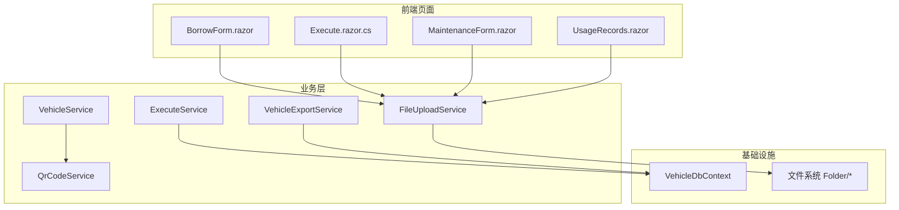
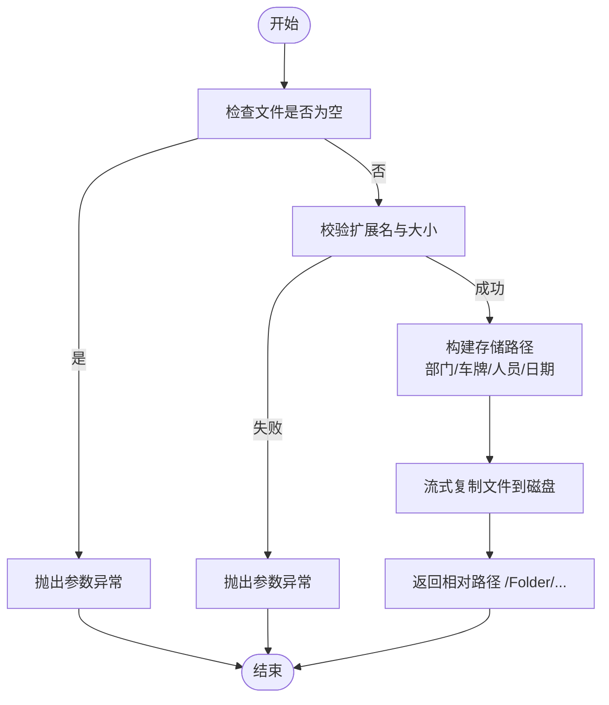
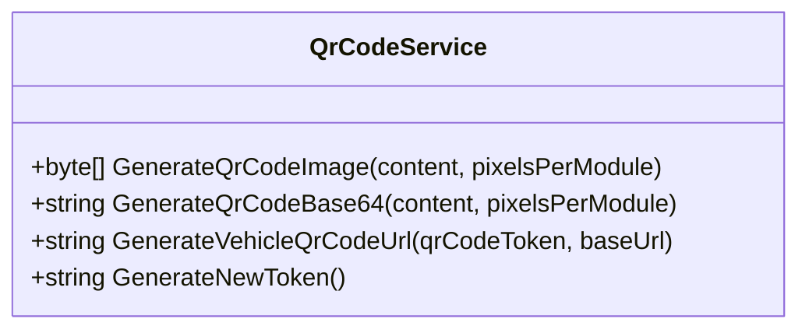
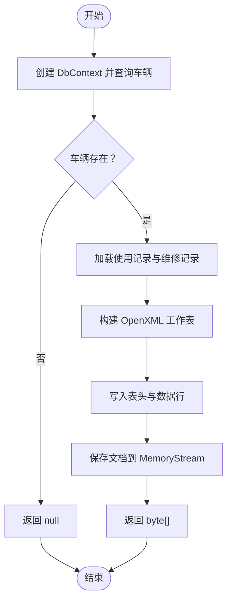
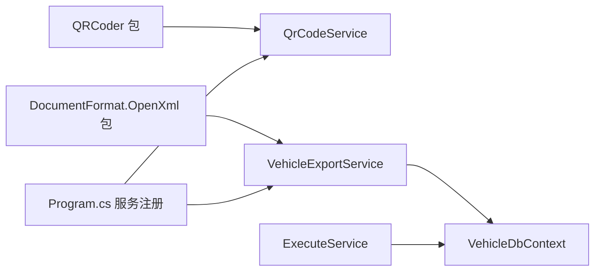

# 文件二维码导出 API

<cite>
**本文引用的文件**   
- [FileUploadService.cs](file://BLL/Common/FileUploadService.cs)
- [QrCodeService.cs](file://BLL/Common/QrCodeService.cs)
- [VehicleExportService.cs](file://BLL/Export/VehicleExportService.cs)
- [BorrowForm.razor](file://Pages/BorrowForm.razor)
- [Execute.razor.cs](file://Pages/Execute.razor.cs)
- [MaintenanceForm.razor](file://Pages/MaintenanceForm.razor)
- [UsageRecords.razor](file://Pages/UsageRecords.razor)
- [VehicleService.cs](file://BLL/Vehicle/VehicleService.cs)
- [ExecuteService.cs](file://BLL/Execute/ExecuteService.cs)
- [Program.cs](file://Program.cs)
- [vehicleManagement.csproj](file://vehicleManagement.csproj)
</cite>

## 目录
1. [简介](#简介)
2. [项目结构](#项目结构)
3. [核心组件](#核心组件)
4. [架构总览](#架构总览)
5. [详细组件分析](#详细组件分析)
6. [依赖关系分析](#依赖关系分析)
7. [性能与容量规划](#性能与容量规划)
8. [故障排查指南](#故障排查指南)
9. [结论](#结论)
10. [附录：API 参考](#附录api-参考)

## 简介
本文件为车辆管理系统中的“文件上传、二维码生成、数据导出”三类能力的 API 文档。系统采用 Blazor 前端与服务端业务层协作的方式，通过服务类封装核心逻辑：
- 文件上传：支持图片与视频多格式、大小限制、按部门/车牌/人员/日期组织存储路径，返回可访问的相对路径。
- 二维码生成：基于 QRCoder 生成 PNG 二进制或 Base64 字符串，并支持生成扫码跳转 URL 与 Token 管理。
- Excel 导出：使用 OpenXML 构建工作表，输出车辆信息、使用记录与维修记录的汇总表格字节数组。

该文档同时覆盖流式处理、二进制数据传输、MIME 类型识别策略、异步任务与错误处理建议，以及安全与权限控制建议。

## 项目结构
围绕三大能力的相关代码分布如下：
- BLL\Common\FileUploadService.cs：文件上传与删除、校验、路径组织。
- BLL\Common\QrCodeService.cs：二维码生成、Base64 编码、URL 构造、Token 生成。
- BLL\Export\VehicleExportService.cs：Excel 导出（OpenXML）。
- Pages 下的表单页面：调用 FileUploadService 进行前端文件选择与上传。
- BLL\Vehicle\VehicleService.cs：确保车辆拥有二维码 Token。
- BLL\Execute\ExecuteService.cs：根据二维码 Token 加载执行页面数据。
- Program.cs：服务注册（QrCodeService、VehicleExportService）。
- vehicleManagement.csproj：第三方库引用（QRCoder、DocumentFormat.OpenXml）。



图表来源
- [BorrowForm.razor:211-229](file://Pages/BorrowForm.razor#L211-L229)
- [Execute.razor.cs:115-129](file://Pages/Execute.razor.cs#L115-L129)
- [MaintenanceForm.razor:129-143](file://Pages/MaintenanceForm.razor#L129-L143)
- [UsageRecords.razor:420-440](file://Pages/UsageRecords.razor#L420-L440)
- [FileUploadService.cs:29-46](file://BLL/Common/FileUploadService.cs#L29-L46)
- [QrCodeService.cs:8-39](file://BLL/Common/QrCodeService.cs#L8-L39)
- [VehicleExportService.cs:25-159](file://BLL/Export/VehicleExportService.cs#L25-L159)
- [VehicleService.cs:227-238](file://BLL/Vehicle/VehicleService.cs#L227-L238)
- [ExecuteService.cs:27-41](file://BLL/Execute/ExecuteService.cs#L27-L41)

章节来源
- [vehicleManagement.csproj:14-30](file://vehicleManagement.csproj#L14-L30)
- [Program.cs:80-100](file://Program.cs#L80-L100)

## 核心组件
- 文件上传服务：提供 IFormFile 与 IBrowserFile 两种上传入口，统一校验扩展名与大小，按部门/车牌/人员/日期组织存储，返回相对路径；提供删除接口。
- 二维码服务：生成 PNG 二进制或 Base64 字符串，构造扫码 URL，生成唯一 Token。
- 导出服务：查询车辆及其使用、维修记录，写入 OpenXML 工作表，返回字节数组。

章节来源
- [FileUploadService.cs:12-110](file://BLL/Common/FileUploadService.cs#L12-L110)
- [QrCodeService.cs:6-39](file://BLL/Common/QrCodeService.cs#L6-L39)
- [VehicleExportService.cs:16-159](file://BLL/Export/VehicleExportService.cs#L16-L159)

## 架构总览
下图展示从前端到后端服务的典型调用链，包括文件上传、二维码生成与导出流程。

```mermaid
sequenceDiagram
participant UI as "前端页面<br/>BorrowForm/Execute/Maintenance/UsageRecords"
participant Upload as "FileUploadService"
participant Qr as "QrCodeService"
participant Export as "VehicleExportService"
participant DB as "VehicleDbContext"
participant FS as "文件系统 Folder/*"
Note over UI,FS : 文件上传流程
UI->>Upload : UploadFileAsync(file, dept, plate, person)
Upload->>Upload : ValidateFile(扩展名/大小)
Upload->>FS : SaveFileAsync(按部门/车牌/人员/日期组织)
FS-->>Upload : 相对路径
Upload-->>UI : 返回相对路径
Note over UI,Qr : 二维码生成流程
UI->>Qr : GenerateQrCodeImage/Base64(content, pixelsPerModule)
Qr-->>UI : PNG 二进制或 data : image/png;base64,...
Note over UI,Export : Excel 导出流程
UI->>Export : ExportAsync(vehicleId)
Export->>DB : 查询车辆/使用/维修记录
DB-->>Export : 实体集合
Export->>Export : 构建 OpenXML 工作表
Export-->>UI : byte[] Excel 内容
```

图表来源
- [BorrowForm.razor:211-229](file://Pages/BorrowForm.razor#L211-L229)
- [Execute.razor.cs:115-129](file://Pages/Execute.razor.cs#L115-L129)
- [MaintenanceForm.razor:129-143](file://Pages/MaintenanceForm.razor#L129-L143)
- [UsageRecords.razor:420-440](file://Pages/UsageRecords.razor#L420-L440)
- [FileUploadService.cs:29-110](file://BLL/Common/FileUploadService.cs#L29-L110)
- [QrCodeService.cs:8-39](file://BLL/Common/QrCodeService.cs#L8-L39)
- [VehicleExportService.cs:25-159](file://BLL/Export/VehicleExportService.cs#L25-L159)

## 详细组件分析

### 文件上传组件
职责
- 接收前端文件对象（IFormFile 或 IBrowserFile），校验扩展名与大小，将文件保存到服务器本地目录，返回可访问的相对路径。
- 提供删除接口，按相对路径清理文件。

关键行为
- 支持的图片扩展名：jpg、jpeg、png、gif、webp。
- 支持的视频扩展名：mp4、avi、mov、wmv。
- 大小限制：图片最大 10MB，视频最大 100MB。
- 存储路径：根目录为应用 ContentRootPath/Folder，子目录按“部门/车牌/人员/日期”组织，文件名以 GUID 前缀命名避免冲突。
- 返回路径：以 /Folder/... 开头的相对路径，便于前端直接访问静态资源。

异常与边界
- 空文件或长度为 0：抛出参数异常。
- 不支持的扩展名：抛出参数异常。
- 超出大小限制：抛出参数异常。
- 删除时路径为空或文件不存在：返回 false。



图表来源
- [FileUploadService.cs:29-46](file://BLL/Common/FileUploadService.cs#L29-L46)
- [FileUploadService.cs:69-84](file://BLL/Common/FileUploadService.cs#L69-L84)
- [FileUploadService.cs:92-110](file://BLL/Common/FileUploadService.cs#L92-L110)

章节来源
- [FileUploadService.cs:12-110](file://BLL/Common/FileUploadService.cs#L12-L110)
- [BorrowForm.razor:211-229](file://Pages/BorrowForm.razor#L211-L229)
- [Execute.razor.cs:115-129](file://Pages/Execute.razor.cs#L115-L129)
- [MaintenanceForm.razor:129-143](file://Pages/MaintenanceForm.razor#L129-L143)
- [UsageRecords.razor:420-440](file://Pages/UsageRecords.razor#L420-L440)

### 二维码生成组件
职责
- 生成二维码 PNG 二进制数据。
- 生成 Base64 格式的二维码字符串（data URI）。
- 生成扫码跳转 URL（包含 Token）。
- 生成唯一 Token。

关键行为
- 输入 content 不能为空，否则抛出参数异常。
- 默认 ECC 等级为 Q，像素模块数可配置（pixelsPerModule）。
- 生成的 URL 形如 {baseUrl}/execute/{qrCodeToken}。
- Token 使用 Guid 生成，保证唯一性。



图表来源
- [QrCodeService.cs:6-39](file://BLL/Common/QrCodeService.cs#L6-L39)

章节来源
- [QrCodeService.cs:6-39](file://BLL/Common/QrCodeService.cs#L6-L39)
- [VehicleService.cs:227-238](file://BLL/Vehicle/VehicleService.cs#L227-L238)
- [ExecuteService.cs:27-41](file://BLL/Execute/ExecuteService.cs#L27-L41)

### Excel 导出组件
职责
- 根据车辆 ID 查询车辆基本信息、使用记录、维修记录。
- 使用 OpenXML 构建工作表，写入标题行与数据行。
- 返回 Excel 文件的字节数组，供前端下载。

关键行为
- 若车辆不存在，返回 null。
- 使用 Include 预加载关联实体（部门、人员、目的地、用途等）。
- 使用内存流 MemoryStream 构建文档，最后转换为 byte[]。
- 列宽设置最小宽度，便于阅读。



图表来源
- [VehicleExportService.cs:25-159](file://BLL/Export/VehicleExportService.cs#L25-L159)

章节来源
- [VehicleExportService.cs:16-159](file://BLL/Export/VehicleExportService.cs#L16-L159)

## 依赖关系分析
- 第三方库
  - QRCoder：用于二维码生成。
  - DocumentFormat.OpenXml：用于 Excel 文件构建。
- 服务注册
  - QrCodeService 作为单例注入。
  - VehicleExportService 作为作用域注入。
- 数据库上下文
  - VehicleDbContext 通过 IDbContextFactory 在导出与执行服务中按需创建。



图表来源
- [vehicleManagement.csproj:14-30](file://vehicleManagement.csproj#L14-L30)
- [Program.cs:80-100](file://Program.cs#L80-L100)
- [VehicleExportService.cs:18-23](file://BLL/Export/VehicleExportService.cs#L18-L23)
- [ExecuteService.cs:18-25](file://BLL/Execute/ExecuteService.cs#L18-L25)

章节来源
- [vehicleManagement.csproj:14-30](file://vehicleManagement.csproj#L14-L30)
- [Program.cs:80-100](file://Program.cs#L80-L100)

## 性能与容量规划
- 文件上传
  - 使用流式复制（CopyToAsync）避免一次性加载大文件到内存。
  - 建议在前端限制单次选择数量（当前页面多处限制为 10~15 个）。
  - 对视频与大图建议在服务端增加并发限制与队列化上传。
- 二维码生成
  - 生成 PNG 二进制与 Base64 转换会占用内存，批量生成时应注意内存峰值。
  - 可通过调整 pixelsPerModule 控制图像尺寸与体积。
- Excel 导出
  - 使用内存流构建文档，数据量大时可能产生较高内存占用。
  - 建议对大数据集分页查询与分批写入，或引入后台任务与分片导出。

[本节为通用指导，不直接分析具体文件]

## 故障排查指南
- 文件上传失败
  - 常见原因：文件为空、扩展名不被允许、文件大小超限。
  - 定位方法：检查抛出的参数异常信息与日志。
  - 解决建议：确认前端选择的文件格式与大小符合限制；必要时调整服务端常量。
- 二维码生成失败
  - 常见原因：content 为空。
  - 定位方法：检查传入 content 是否有效。
  - 解决建议：确保在生成前已填充必要字段。
- Excel 导出失败
  - 常见原因：车辆不存在导致返回 null；数据库连接异常。
  - 定位方法：检查 vehicleId 是否存在；查看数据库连接与查询日志。
  - 解决建议：确保数据完整性与数据库可用性。

章节来源
- [FileUploadService.cs:29-84](file://BLL/Common/FileUploadService.cs#L29-L84)
- [QrCodeService.cs:8-18](file://BLL/Common/QrCodeService.cs#L8-L18)
- [VehicleExportService.cs:25-32](file://BLL/Export/VehicleExportService.cs#L25-L32)

## 结论
本系统通过清晰的服务分层与第三方库集成，实现了文件上传、二维码生成与 Excel 导出的核心能力。文件上传具备多格式支持与严格的大小限制；二维码生成提供二进制与 Base64 输出，并支持 URL 构造与 Token 管理；Excel 导出基于 OpenXML 构建结构化报表。后续可在安全性、异步任务与进度反馈方面进一步增强，以满足更大规模与更高安全要求的场景。

[本节为总结性内容，不直接分析具体文件]

## 附录：API 参考

### 文件上传接口
- 功能说明
  - 支持图片与视频上传，返回可访问的相对路径。
  - 支持删除已上传文件。
- 输入参数
  - file：IFormFile 或 IBrowserFile。
  - departmentName：部门名称（用于路径组织）。
  - licensePlate：车牌号（用于路径组织）。
  - personnelName：人员名称（用于路径组织）。
- 输出结果
  - 成功：返回相对路径，形如 /Folder/{department}/{licensePlate}/{personnel}/{date}/{fileName}。
  - 失败：抛出参数异常（空文件、不支持格式、大小超限）。
- 安全与验证
  - 扩展名校验：仅允许 jpg、jpeg、png、gif、webp、mp4、avi、mov、wmv。
  - 大小限制：图片 ≤ 10MB，视频 ≤ 100MB。
  - 存储路径：按部门/车牌/人员/日期组织，避免冲突。
- MIME 类型识别
  - 当前实现基于扩展名判断，未进行二进制签名检测。
  - 建议在生产环境结合 Content-Type 与文件头签名进行二次校验。
- 示例调用位置
  - [BorrowForm.razor:211-229](file://Pages/BorrowForm.razor#L211-L229)
  - [Execute.razor.cs:115-129](file://Pages/Execute.razor.cs#L115-L129)
  - [MaintenanceForm.razor:129-143](file://Pages/MaintenanceForm.razor#L129-L143)
  - [UsageRecords.razor:420-440](file://Pages/UsageRecords.razor#L420-L440)

章节来源
- [FileUploadService.cs:29-110](file://BLL/Common/FileUploadService.cs#L29-L110)

### 二维码生成接口
- 功能说明
  - 生成 PNG 二维码二进制或 Base64 字符串。
  - 生成扫码跳转 URL 与唯一 Token。
- 输入参数
  - content：二维码内容（必填）。
  - pixelsPerModule：像素模块数（可选，默认 20）。
  - qrCodeToken：二维码 Token（必填）。
  - baseUrl：基础 URL（必填）。
- 输出结果
  - GenerateQrCodeImage：PNG 二进制数组。
  - GenerateQrCodeBase64：data:image/png;base64,... 字符串。
  - GenerateVehicleQrCodeUrl：{baseUrl}/execute/{qrCodeToken}。
  - GenerateNewToken：唯一 Token 字符串。
- 样式定制
  - 当前仅支持像素模块数调整；颜色、边距、纠错等级固定。
  - 如需更多样式，可扩展 QRCoder 的参数或使用其他库。
- 扫描解析
  - 扫码后跳转到 {baseUrl}/execute/{token}，由 ExecuteService 根据 token 加载页面数据。
- 示例调用位置
  - [QrCodeService.cs:8-39](file://BLL/Common/QrCodeService.cs#L8-L39)
  - [VehicleService.cs:227-238](file://BLL/Vehicle/VehicleService.cs#L227-L238)
  - [ExecuteService.cs:27-41](file://BLL/Execute/ExecuteService.cs#L27-L41)

章节来源
- [QrCodeService.cs:6-39](file://BLL/Common/QrCodeService.cs#L6-L39)
- [VehicleService.cs:227-238](file://BLL/Vehicle/VehicleService.cs#L227-L238)
- [ExecuteService.cs:27-41](file://BLL/Execute/ExecuteService.cs#L27-L41)

### Excel 导出接口
- 功能说明
  - 根据车辆 ID 导出车辆信息、使用记录与维修记录。
- 输入参数
  - vehicleId：车辆标识（必填）。
- 输出结果
  - 成功：返回 Excel 文件的字节数组。
  - 失败：若车辆不存在，返回 null。
- 模板定制
  - 表头与列顺序在服务端硬编码，可按需扩展。
  - 列宽设置为最小宽度，便于阅读。
- 数据格式化
  - 里程数值保留一位小数，费用保留两位小数，时间格式化为 yyyy-MM-dd HH:mm。
- 进度跟踪与大文件处理
  - 当前为同步导出，无进度回调。
  - 建议对大数据集引入后台任务、分片导出与进度推送机制。
- 示例调用位置
  - [VehicleExportService.cs:25-159](file://BLL/Export/VehicleExportService.cs#L25-L159)

章节来源
- [VehicleExportService.cs:16-159](file://BLL/Export/VehicleExportService.cs#L16-L159)

### 异步任务、进度回调与错误重试（建议）
- 异步任务
  - 文件上传：当前为同步流式写入，建议对大批量文件引入队列与并发控制。
  - 二维码生成：批量生成建议使用并行任务与内存池。
  - Excel 导出：建议改为后台任务，完成后通知前端下载。
- 进度回调
  - 可使用 SignalR 或轮询接口上报任务进度（上传百分比、导出进度）。
- 错误重试
  - 对网络不稳定导致的上传失败，建议实现指数退避重试。
  - 对导出失败，建议记录日志并提供重试按钮。

[本节为通用建议，不直接分析具体文件]

### 安全性与访问控制（建议）
- 病毒扫描
  - 建议在文件落盘前调用外部杀毒引擎扫描，拒绝恶意文件。
- 访问权限控制
  - 对 /Folder/* 静态资源启用鉴权中间件，防止未授权访问。
  - 对导出接口与二维码跳转接口增加身份校验与角色控制。
- 输入校验
  - 除扩展名外，建议结合 MIME 类型与文件头签名进行二次校验。
- 存储隔离
  - 建议对不同租户或部门使用独立目录，并限制路径遍历攻击。

[本节为通用建议，不直接分析具体文件]