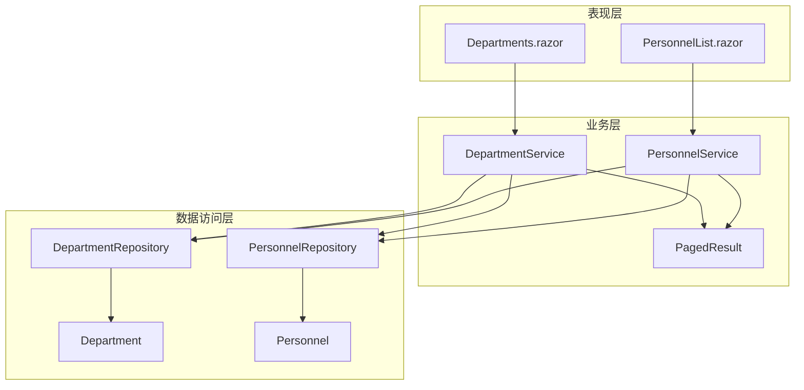
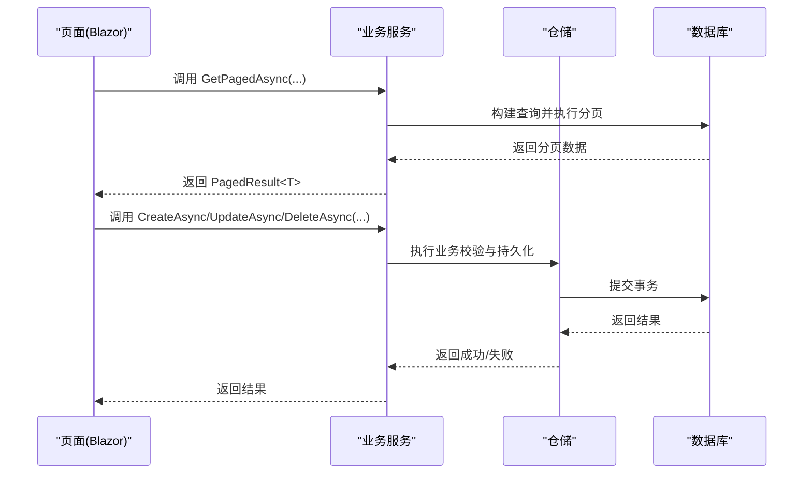
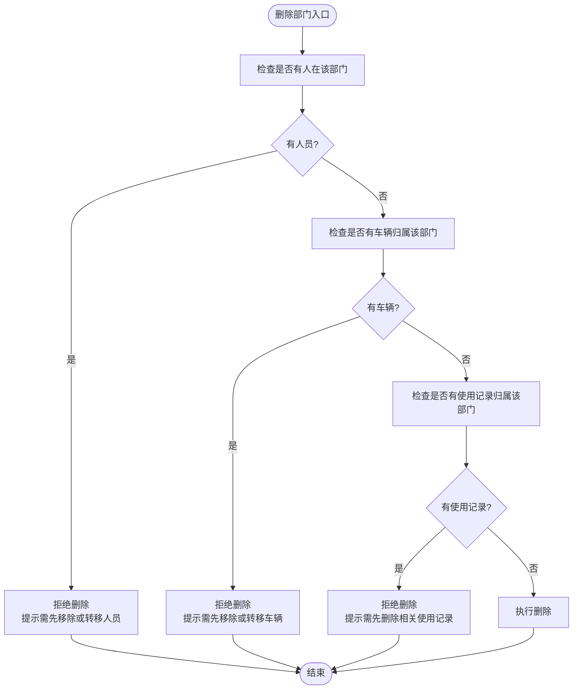
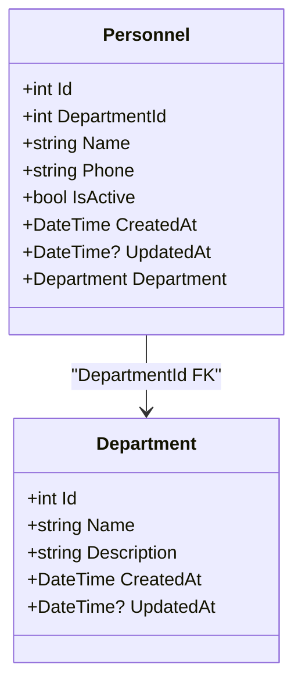
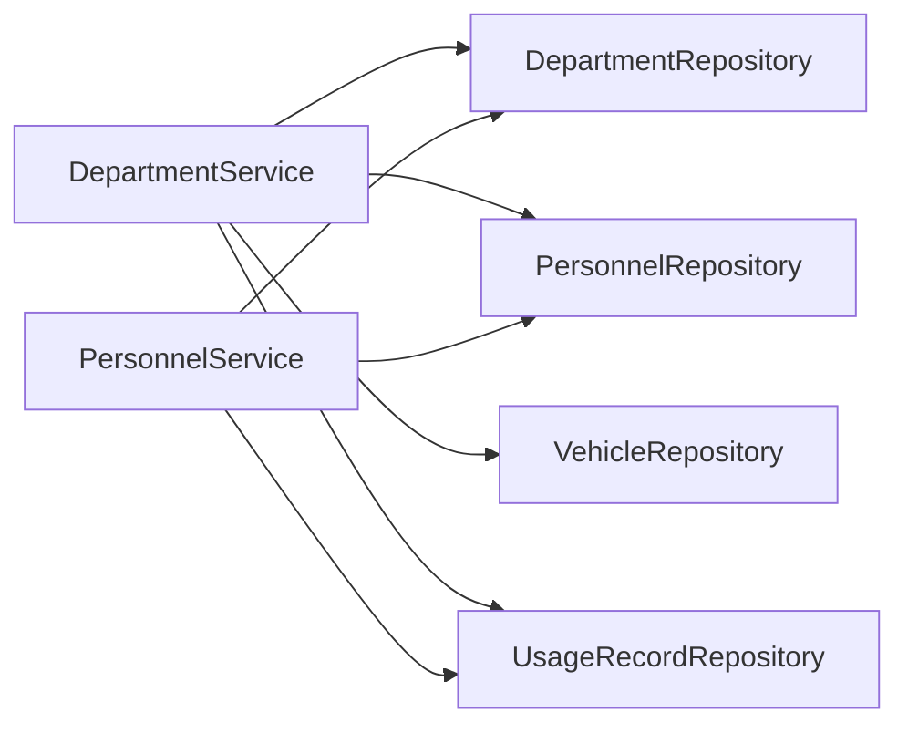

# 组织管理 API

<cite>
**本文引用的文件**   
- [DepartmentService.cs](file://BLL/Department/DepartmentService.cs)
- [PersonnelService.cs](file://BLL/Personnel/PersonnelService.cs)
- [PagedResult.cs](file://BLL/Common/PagedResult.cs)
- [Department.cs](file://DAL/Model/Department.cs)
- [Personnel.cs](file://DAL/Model/Personnel.cs)
- [DepartmentRepository.cs](file://DAL/Repository/DepartmentRepository.cs)
- [PersonnelRepository.cs](file://DAL/Repository/PersonnelRepository.cs)
- [Departments.razor](file://Pages/Departments.razor)
- [PersonnelList.razor](file://Pages/PersonnelList.razor)
</cite>

## 目录
1. [简介](#简介)
2. [项目结构](#项目结构)
3. [核心组件](#核心组件)
4. [架构总览](#架构总览)
5. [详细组件分析](#详细组件分析)
6. [依赖关系分析](#依赖关系分析)
7. [性能与并发考虑](#性能与并发考虑)
8. [故障排查指南](#故障排查指南)
9. [结论](#结论)
10. [附录：API 规范与示例](#附录api-规范与示例)

## 简介
本文件为“组织和人员管理模块”的完整 API 文档，覆盖部门与人员的增删改查、分页搜索排序、组织架构树形结构获取、人员在职状态管理、数据完整性约束与级联删除处理等。同时说明批量导入导出、权限矩阵、并发访问控制、数据同步机制与审计日志记录的实现现状与建议。

当前代码库采用 Blazor 页面 + 业务服务 + 仓储的数据访问模式，未暴露传统 REST API；但本节将基于现有服务方法抽象出一致的 API 契约，便于前端或外部系统集成。

## 项目结构
- 业务层（BLL）
  - DepartmentService：部门领域服务，提供分页查询、创建、更新、删除及业务校验。
  - PersonnelService：人员领域服务，提供分页查询、创建、更新、删除、部门列表获取。
  - PagedResult：通用分页结果封装。
- 数据访问层（DAL）
  - Model：Department、Personnel 实体模型。
  - Repository：DepartmentRepository、PersonnelRepository 实现基础 CRUD 与按条件查询。
- 表现层（Pages）
  - Departments.razor：部门管理页面，调用 DepartmentService。
  - PersonnelList.razor：人员管理页面，调用 PersonnelService。

图表来源
- [DepartmentService.cs:1-147](file://BLL/Department/DepartmentService.cs#L1-L147)
- [PersonnelService.cs:1-142](file://BLL/Personnel/PersonnelService.cs#L1-L142)
- [PagedResult.cs:1-37](file://BLL/Common/PagedResult.cs#L1-L37)
- [DepartmentRepository.cs:1-69](file://DAL/Repository/DepartmentRepository.cs#L1-L69)
- [PersonnelRepository.cs:1-77](file://DAL/Repository/PersonnelRepository.cs#L1-L77)
- [Department.cs:1-23](file://DAL/Model/Department.cs#L1-L23)
- [Personnel.cs:1-32](file://DAL/Model/Personnel.cs#L1-L32)
- [Departments.razor:1-280](file://Pages/Departments.razor#L1-L280)
- [PersonnelList.razor:1-318](file://Pages/PersonnelList.razor#L1-L318)

章节来源
- [DepartmentService.cs:1-147](file://BLL/Department/DepartmentService.cs#L1-L147)
- [PersonnelService.cs:1-142](file://BLL/Personnel/PersonnelService.cs#L1-L142)
- [PagedResult.cs:1-37](file://BLL/Common/PagedResult.cs#L1-L37)
- [DepartmentRepository.cs:1-69](file://DAL/Repository/DepartmentRepository.cs#L1-L69)
- [PersonnelRepository.cs:1-77](file://DAL/Repository/PersonnelRepository.cs#L1-L77)
- [Department.cs:1-23](file://DAL/Model/Department.cs#L1-L23)
- [Personnel.cs:1-32](file://DAL/Model/Personnel.cs#L1-L32)
- [Departments.razor:1-280](file://Pages/Departments.razor#L1-L280)
- [PersonnelList.razor:1-318](file://Pages/PersonnelList.razor#L1-L318)

## 核心组件
- 部门服务（DepartmentService）
  - 分页查询：支持关键词搜索、多字段排序、页码与每页大小。
  - 创建/更新：字段修剪与时间戳维护。
  - 删除：业务校验（部门下是否有人员、车辆、使用记录），通过后执行删除。
- 人员服务（PersonnelService）
  - 分页查询：支持姓名/电话搜索、多字段排序、页码与每页大小。
  - 创建/更新：包含部门关联、在职状态、时间戳维护。
  - 删除：业务校验（是否存在使用记录）。
  - 部门列表：返回所有部门，用于下拉选择。
- 分页结果（PagedResult<T>）
  - Items、TotalCount、CurrentPage、PageSize、TotalPages。

章节来源
- [DepartmentService.cs:38-144](file://BLL/Department/DepartmentService.cs#L38-L144)
- [PersonnelService.cs:36-139](file://BLL/Personnel/PersonnelService.cs#L36-L139)
- [PagedResult.cs:5-35](file://BLL/Common/PagedResult.cs#L5-L35)

## 架构总览
系统通过 Blazor 页面驱动业务服务，服务再委托仓储完成数据库操作。关键流程如下：

图表来源
- [DepartmentService.cs:41-144](file://BLL/Department/DepartmentService.cs#L41-L144)
- [PersonnelService.cs:39-139](file://BLL/Personnel/PersonnelService.cs#L39-L139)
- [DepartmentRepository.cs:22-66](file://DAL/Repository/DepartmentRepository.cs#L22-L66)
- [PersonnelRepository.cs:22-74](file://DAL/Repository/PersonnelRepository.cs#L22-L74)

## 详细组件分析

### 部门管理
- 能力
  - 分页查询：支持名称/描述模糊搜索，支持按名称、描述、创建时间排序。
  - 创建/更新：字段 Trim 处理，CreatedAt/UpdatedAt 维护。
  - 删除：先校验是否有关联人员、车辆、使用记录，存在则拒绝删除。
- 数据模型
  - 部门：Id、Name（必填，最大长度100）、Description、CreatedAt、UpdatedAt。
- 接口行为
  - GetPagedAsync(searchKeyword, sortColumn, sortAscending, page, pageSize) → PagedResult<Department>
  - GetByIdAsync(id) → Department
  - CreateAsync(name, description) → Department
  - UpdateAsync(id, name, description) → Department
  - DeleteAsync(id) → (Success, ErrorMessage)

图表来源
- [DepartmentService.cs:118-144](file://BLL/Department/DepartmentService.cs#L118-L144)

章节来源
- [DepartmentService.cs:38-144](file://BLL/Department/DepartmentService.cs#L38-L144)
- [Department.cs:7-21](file://DAL/Model/Department.cs#L7-L21)
- [DepartmentRepository.cs:22-66](file://DAL/Repository/DepartmentRepository.cs#L22-L66)
- [Departments.razor:148-278](file://Pages/Departments.razor#L148-L278)

### 人员管理
- 能力
  - 分页查询：支持姓名/电话模糊搜索，支持按姓名、电话、创建时间排序。
  - 创建/更新：设置所属部门、姓名、电话、在职状态，维护时间戳。
  - 删除：若存在使用记录则拒绝删除。
  - 部门列表：返回所有部门，供人员表单下拉选择。
- 数据模型
  - 人员：Id、DepartmentId（必填）、Name（必填，最大长度50）、Phone（最大长度20）、IsActive（默认true）、CreatedAt、UpdatedAt，外键关联 Department。
- 接口行为
  - GetPagedAsync(searchKeyword, sortColumn, sortAscending, page, pageSize) → PagedResult<Personnel>
  - GetAllDepartmentsAsync() → List<Department>
  - GetByIdAsync(id) → Personnel
  - CreateAsync(departmentId, name, phone, isActive) → Personnel
  - UpdateAsync(id, departmentId, name, phone, isActive) → Personnel
  - DeleteAsync(id) → (Success, ErrorMessage)

图表来源
- [Department.cs:7-21](file://DAL/Model/Department.cs#L7-L21)
- [Personnel.cs:7-30](file://DAL/Model/Personnel.cs#L7-L30)

章节来源
- [PersonnelService.cs:36-139](file://BLL/Personnel/PersonnelService.cs#L36-L139)
- [Personnel.cs:7-30](file://DAL/Model/Personnel.cs#L7-L30)
- [PersonnelRepository.cs:22-74](file://DAL/Repository/PersonnelRepository.cs#L22-L74)
- [PersonnelList.razor:184-316](file://Pages/PersonnelList.razor#L184-L316)

### 组织架构树形结构
- 现状
  - 当前 Department 模型未包含 ParentId 或层级字段，无法直接表达树形结构。
  - PersonnelService.GetAllDepartmentsAsync 返回扁平部门列表，可用于前端自行构建树（例如以根节点开始递归组装）。
- 建议
  - 在 Department 模型中增加 ParentId 与 Level 字段，并在服务层提供 BuildTree 方法，返回树形结构。
  - 对外暴露 GetOrganizationTreeAsync 接口，返回树形节点集合。

[本节为概念性说明，不直接分析具体文件]

### 人员权限管理
- 现状
  - 当前无独立权限模型与权限矩阵；仅通过人员与部门的关联以及 IsActive 状态进行基本区分。
- 建议
  - 引入 Role、Permission 模型，建立用户-角色-权限的多对多关系。
  - 在服务层提供 GetPermissionsByUser、GetRoleMatrix 等方法，输出权限矩阵。
  - 在页面层根据权限矩阵渲染可操作按钮与菜单。

[本节为概念性说明，不直接分析具体文件]

## 依赖关系分析
- 耦合关系
  - DepartmentService 依赖 DepartmentRepository、PersonnelRepository、VehicleRepository、UsageRecordRepository，用于跨实体业务校验。
  - PersonnelService 依赖 PersonnelRepository、DepartmentRepository、UsageRecordRepository，用于人员数据与关联校验。
- 内聚性
  - 每个服务聚焦单一领域职责，仓储负责数据访问，模型定义数据结构与约束。
- 潜在循环依赖
  - 当前未发现循环引用；服务之间相互独立。

图表来源
- [DepartmentService.cs:18-35](file://BLL/Department/DepartmentService.cs#L18-L35)
- [PersonnelService.cs:19-33](file://BLL/Personnel/PersonnelService.cs#L19-L33)

章节来源
- [DepartmentService.cs:18-35](file://BLL/Department/DepartmentService.cs#L18-L35)
- [PersonnelService.cs:19-33](file://BLL/Personnel/PersonnelService.cs#L19-L33)

## 性能与并发考虑
- 分页与查询优化
  - 使用 Skip/Take 实现服务端分页，避免全量加载。
  - Include 按需加载关联数据（如人员列表包含部门），减少 N+1 查询。
- 并发访问控制
  - 当前未实现显式锁或乐观并发控制；建议在高频更新场景引入版本号或时间戳比较，防止覆盖写入。
- 数据同步机制
  - 当前为直连数据库，无缓存或消息队列；如需跨进程同步，可引入 Redis 缓存或事件总线。
- 审计日志记录
  - 当前未实现统一审计日志；建议在仓储或服务层增加审计拦截器，记录变更前后值、操作人、时间。

[本节为通用指导，不直接分析具体文件]

## 故障排查指南
- 删除部门失败
  - 可能原因：部门下仍有人员、车辆或使用记录。
  - 排查步骤：检查 Personnel、Vehicle、UsageRecord 表中的 DepartmentId 关联。
  - 参考实现：[DepartmentService.DeleteAsync:118-144](file://BLL/Department/DepartmentService.cs#L118-L144)
- 删除人员失败
  - 可能原因：该人员仍有使用记录。
  - 排查步骤：检查 UsageRecord 表中 PersonnelId 关联。
  - 参考实现：[PersonnelService.DeleteAsync:128-139](file://BLL/Personnel/PersonnelService.cs#L128-L139)
- 分页数据异常
  - 可能原因：页码越界或排序字段无效。
  - 排查步骤：确认传入 page、pageSize、sortColumn 参数合法性。
  - 参考实现：[DepartmentService.GetPagedAsync:41-76](file://BLL/Department/DepartmentService.cs#L41-L76)、[PersonnelService.GetPagedAsync:39-74](file://BLL/Personnel/PersonnelService.cs#L39-L74)

章节来源
- [DepartmentService.cs:118-144](file://BLL/Department/DepartmentService.cs#L118-L144)
- [PersonnelService.cs:128-139](file://BLL/Personnel/PersonnelService.cs#L128-L139)
- [DepartmentService.cs:41-76](file://BLL/Department/DepartmentService.cs#L41-L76)
- [PersonnelService.cs:39-74](file://BLL/Personnel/PersonnelService.cs#L39-L74)

## 结论
- 部门与人员管理具备完整的增删改查与分页搜索排序能力，并通过业务校验保障数据一致性。
- 当前未实现组织架构树形结构、权限矩阵、批量导入导出、并发控制与审计日志；建议按上述方案逐步完善。
- 建议优先扩展 Department 模型以支持树形结构，并引入权限与审计模块以提升系统治理能力。

[本节为总结性内容，不直接分析具体文件]

## 附录：API 规范与示例

### 通用分页响应格式
- 响应体：PagedResult<T>
  - items: T[]
  - totalCount: number
  - currentPage: number
  - pageSize: number
  - totalPages: number

章节来源
- [PagedResult.cs:5-35](file://BLL/Common/PagedResult.cs#L5-L35)

### 部门 API
- 分页查询
  - 方法：GET /departments
  - 参数：searchKeyword, sortColumn, sortAscending, page, pageSize
  - 响应：PagedResult<Department>
- 获取详情
  - 方法：GET /departments/{id}
  - 响应：Department
- 创建
  - 方法：POST /departments
  - 请求体：{ name, description }
  - 响应：Department
- 更新
  - 方法：PUT /departments/{id}
  - 请求体：{ name, description }
  - 响应：Department
- 删除
  - 方法：DELETE /departments/{id}
  - 响应：{ success: boolean, errorMessage?: string }

章节来源
- [DepartmentService.cs:41-144](file://BLL/Department/DepartmentService.cs#L41-L144)

### 人员 API
- 分页查询
  - 方法：GET /personnel
  - 参数：searchKeyword, sortColumn, sortAscending, page, pageSize
  - 响应：PagedResult<Personnel>
- 获取部门列表
  - 方法：GET /personnel/departments
  - 响应：Department[]
- 获取详情
  - 方法：GET /personnel/{id}
  - 响应：Personnel
- 创建
  - 方法：POST /personnel
  - 请求体：{ departmentId, name, phone, isActive }
  - 响应：Personnel
- 更新
  - 方法：PUT /personnel/{id}
  - 请求体：{ departmentId, name, phone, isActive }
  - 响应：Personnel
- 删除
  - 方法：DELETE /personnel/{id}
  - 响应：{ success: boolean, errorMessage?: string }

章节来源
- [PersonnelService.cs:39-139](file://BLL/Personnel/PersonnelService.cs#L39-L139)

### 数据完整性约束
- 部门
  - Name 必填，最大长度 100。
  - CreatedAt 自动填充，UpdatedAt 更新时维护。
- 人员
  - DepartmentId 必填，Name 必填且最大长度 50，Phone 最大长度 20，IsActive 默认 true。
  - 外键关联 Department。

章节来源
- [Department.cs:7-21](file://DAL/Model/Department.cs#L7-L21)
- [Personnel.cs:7-30](file://DAL/Model/Personnel.cs#L7-L30)

### 级联删除处理
- 部门删除前校验
  - 若部门下存在人员、车辆或使用记录，则拒绝删除并返回错误信息。
- 人员删除前校验
  - 若人员存在使用记录，则拒绝删除并返回错误信息。

章节来源
- [DepartmentService.cs:118-144](file://BLL/Department/DepartmentService.cs#L118-L144)
- [PersonnelService.cs:128-139](file://BLL/Personnel/PersonnelService.cs#L128-L139)

### 批量导入导出
- 现状
  - 当前未实现批量导入导出功能。
- 建议
  - 引入 Excel/CSV 解析服务，提供 ImportDepartments、ImportPersonnel、ExportDepartments、ExportPersonnel 接口。
  - 在仓储层增加批量插入/更新方法，结合事务保证一致性。

[本节为概念性说明，不直接分析具体文件]

### 搜索筛选与分页加载
- 搜索
  - 部门：按名称或描述模糊匹配。
  - 人员：按姓名或电话模糊匹配。
- 排序
  - 部门：name、desc、created。
  - 人员：name、phone、created。
- 分页
  - 统一使用 PagedResult<T> 返回。

章节来源
- [DepartmentService.cs:41-76](file://BLL/Department/DepartmentService.cs#L41-L76)
- [PersonnelService.cs:39-74](file://BLL/Personnel/PersonnelService.cs#L39-L74)
- [PagedResult.cs:5-35](file://BLL/Common/PagedResult.cs#L5-L35)

### 并发访问控制与数据同步机制
- 并发控制
  - 建议引入乐观并发（版本号/时间戳）或分布式锁，避免覆盖写。
- 数据同步
  - 建议引入缓存（Redis）与事件总线，实现跨进程数据一致性与实时通知。

[本节为概念性说明，不直接分析具体文件]

### 审计日志记录
- 现状
  - 未实现统一审计日志。
- 建议
  - 在服务层或仓储层增加审计拦截器，记录操作类型、实体类型、主键、变更前后的值、操作人、时间。

[本节为概念性说明，不直接分析具体文件]