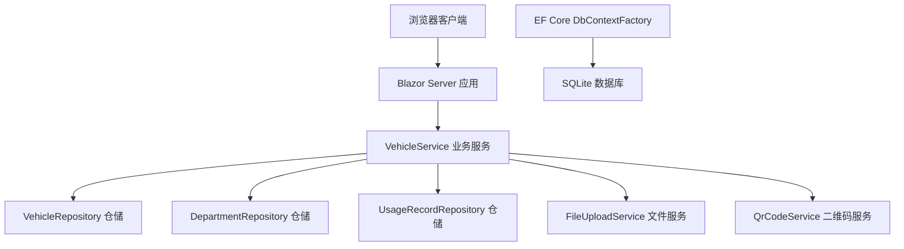
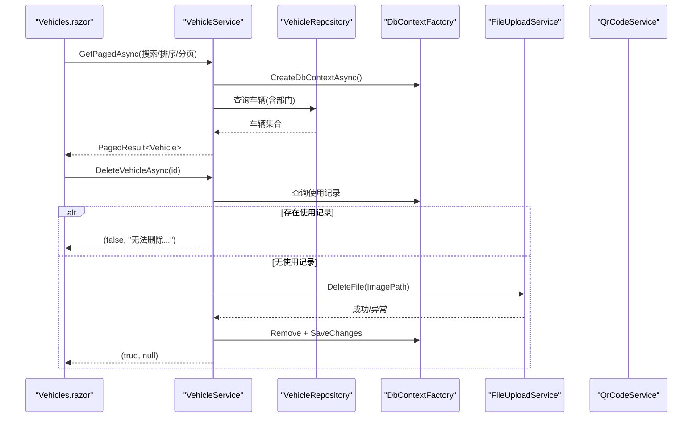
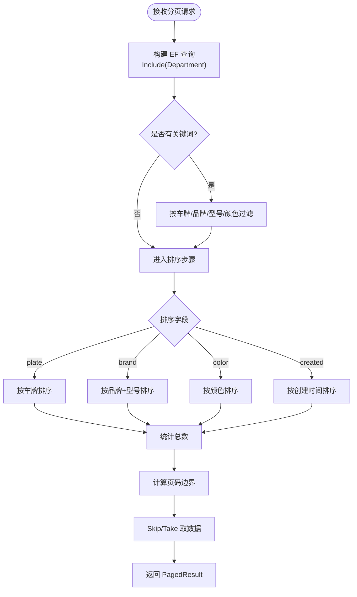
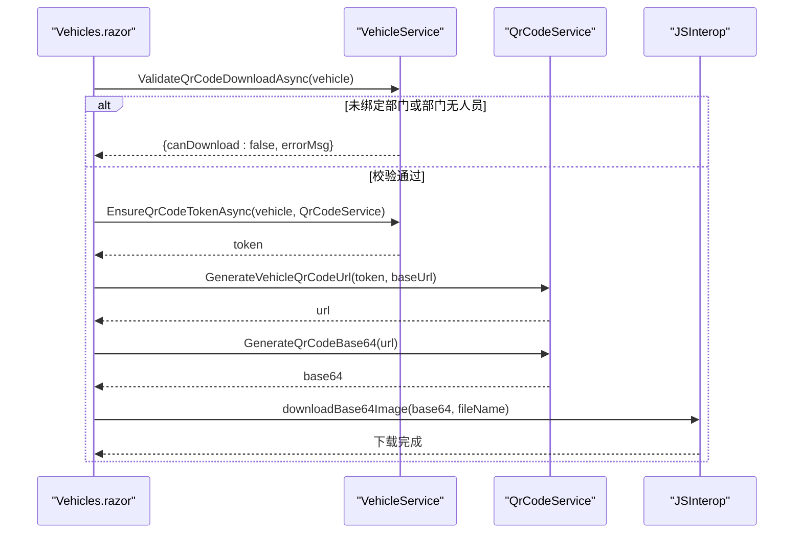
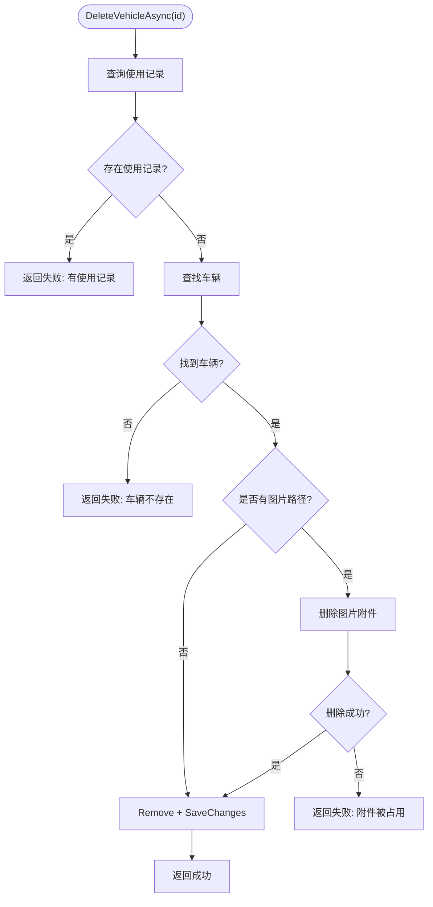
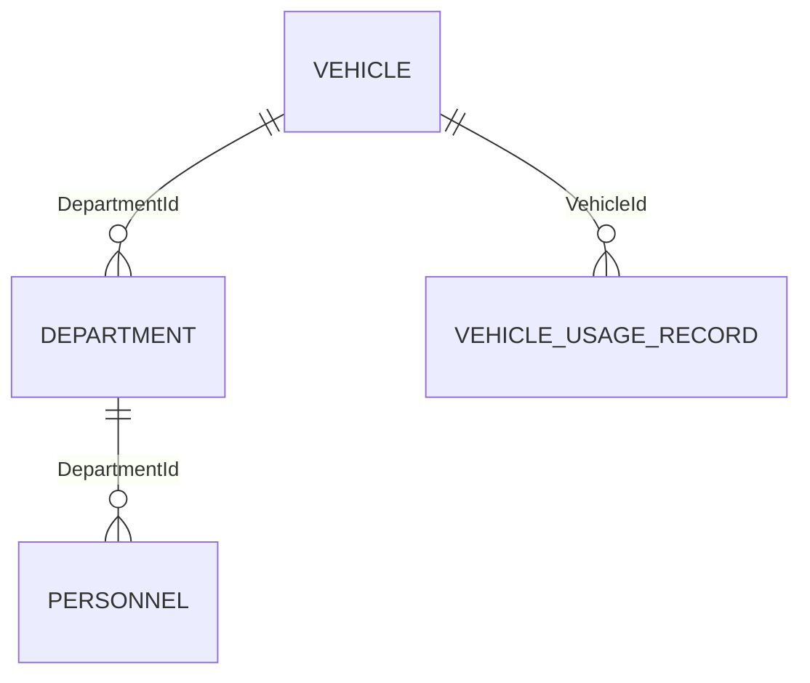

# 车辆管理 API

<cite>
**本文引用的文件**   
- [Program.cs](file://Program.cs)
- [VehicleService.cs](file://BLL/Vehicle/VehicleService.cs)
- [Vehicle.cs](file://DAL/Model/Vehicle.cs)
- [VehicleEnums.cs](file://DAL/Model/VehicleEnums.cs)
- [Vehicles.razor](file://Pages/Vehicles.razor)
- [PagedResult.cs](file://BLL/Common/PagedResult.cs)
- [QrCodeService.cs](file://BLL/Common/QrCodeService.cs)
- [FileUploadService.cs](file://BLL/Common/FileUploadService.cs)
- [DepartmentRepository.cs](file://DAL/Repository/DepartmentRepository.cs)
- [VehicleRepository.cs](file://DAL/Repository/VehicleRepository.cs)
- [UsageRecordRepository.cs](file://DAL/Repository/UsageRecordRepository.cs)
- [appsettings.json](file://appsettings.json)
</cite>

## 目录
1. [简介](#简介)
2. [项目结构与定位](#项目结构与定位)
3. [核心组件与职责](#核心组件与职责)
4. [架构总览](#架构总览)
5. [车辆实体定义](#车辆实体定义)
6. [状态枚举与业务规则](#状态枚举与业务规则)
7. [RESTful 接口规范](#restful-接口规范)
8. [分页、筛选与排序](#分页筛选与排序)
9. [二维码下载流程](#二维码下载流程)
10. [删除与附件清理一致性](#删除与附件清理一致性)
11. [关联关系说明](#关联关系说明)
12. [错误码与异常处理](#错误码与异常处理)
13. [性能优化建议](#性能优化建议)
14. [缓存策略](#缓存策略)
15. [数据一致性保证](#数据一致性保证)
16. [异步调用模式与批量操作建议](#异步调用模式与批量操作建议)
17. [故障排查指南](#故障排查指南)
18. [结论](#结论)

## 简介
本文件为“车辆管理模块”的 API 文档。当前系统采用 Blazor Server 前端 + .NET 后端，并通过服务层 `VehicleService` 暴露车辆相关的业务能力；HTTP 路由中未直接注册传统 REST Controller，而是通过页面组件与服务层协作完成增删改查、状态更新、查询筛选、二维码生成等操作。本文在保持现有实现的前提下，将服务层能力映射为面向后端的“逻辑 API”，并给出标准 REST 风格约定、请求响应结构、错误语义以及扩展建议，便于后续封装为正式 REST API 或供其他系统集成。

## 项目结构与定位
- 应用入口与依赖注入：[Program.cs:41-148](file://Program.cs#L41-L148)
- 健康检查端点：[Program.cs:144-145](file://Program.cs#L144-L145)
- 静态资源与上传目录：[Program.cs:132-140](file://Program.cs#L132-L140)
- 数据库连接配置：[appsettings.json:1-7](file://appsettings.json#L1-L7)



**图表来源**
- [Program.cs:41-148](file://Program.cs#L41-L148)
- [VehicleService.cs:18-38](file://BLL/Vehicle/VehicleService.cs#L18-L38)

**章节来源**
- [Program.cs:41-148](file://Program.cs#L41-L148)
- [appsettings.json:1-7](file://appsettings.json#L1-L7)

## 核心组件与职责
- `VehicleService`：车辆领域服务，负责车辆信息查询、创建、更新、删除、借用状态切换、二维码校验与 Token 管理等。
- `VehicleRepository`：车辆数据访问仓储，提供基础 CRUD。
- `DepartmentRepository`：部门数据访问仓储，用于获取部门列表及人员校验。
- `UsageRecordRepository`：使用记录仓储，用于删除前校验是否存在使用记录。
- `FileUploadService`：文件上传与删除服务，用于清理车辆图片附件。
- `QrCodeService`：二维码 Token 生成与 URL 构建服务。
- `PagedResult<T>`：分页结果通用模型。

**章节来源**
- [VehicleService.cs:18-38](file://BLL/Vehicle/VehicleService.cs#L18-L38)
- [PagedResult.cs](file://BLL/Common/PagedResult.cs)
- [QrCodeService.cs](file://BLL/Common/QrCodeService.cs)
- [FileUploadService.cs](file://BLL/Common/FileUploadService.cs)

## 架构总览
系统以 Blazor Server 页面作为用户界面，通过依赖注入获取 `VehicleService`，再由服务层协调仓储与外部服务完成业务逻辑。当前 HTTP 层仅暴露 `/health` 健康检查与 Blazor Hub，车辆相关能力由页面组件驱动。



**图表来源**
- [VehicleService.cs:67-109](file://BLL/Vehicle/VehicleService.cs#L67-L109)
- [VehicleService.cs:171-202](file://BLL/Vehicle/VehicleService.cs#L171-L202)
- [Vehicles.razor:220-227](file://Pages/Vehicles.razor#L220-L227)
- [Vehicles.razor:382-395](file://Pages/Vehicles.razor#L382-L395)

## 车辆实体定义
车辆实体字段如下（类型、约束与默认值）：

| 字段 | 类型 | 必填 | 长度/约束 | 说明 |
| --- | --- | --- | --- | --- |
| Id | int | 是 | 主键 | 车辆唯一标识 |
| DepartmentId | int | 是 | 外键 | 所属部门 ID |
| LicensePlate | string | 是 | ≤50 | 车牌号 |
| Brand | string | 否 | ≤50 | 品牌 |
| Model | string | 否 | ≤50 | 型号 |
| Year | int? | 否 | - | 年份 |
| Color | string | 否 | ≤20 | 颜色 |
| Status | VehicleStatus | 否 | 枚举 | 默认在用 |
| QrCodeToken | string | 否 | ≤64 | 二维码 Token |
| ImagePath | string | 否 | - | 车辆图片路径 |
| Remarks | string | 否 | - | 备注 |
| IsBorrowed | bool | 否 | - | 是否借出 |
| CreatedAt | DateTime | 否 | - | 创建时间，默认当前时间 |
| UpdatedAt | DateTime? | 否 | - | 更新时间 |
| Department | Department | 导航属性 | - | 所属部门对象 |

**章节来源**
- [Vehicle.cs:8-48](file://DAL/Model/Vehicle.cs#L8-L48)

## 状态枚举与业务规则
- 车辆状态 `VehicleStatus`：
  - Active：在用
  - Maintenance：维修
  - Retired：退役

- 业务规则要点：
  - 新增车辆时，若未绑定部门则不允许下载二维码。
  - 删除车辆前需校验是否存在使用记录；若存在则禁止删除。
  - 删除车辆时需先清理图片附件，若附件删除失败则阻止数据库删除。
  - 下载二维码前需确保车辆已绑定部门且该部门下存在在职人员。
  - 若车辆缺少二维码 Token，则在下载前自动生成并持久化。

**章节来源**
- [VehicleEnums.cs:3-8](file://DAL/Model/VehicleEnums.cs#L3-L8)
- [VehicleService.cs:207-238](file://BLL/Vehicle/VehicleService.cs#L207-L238)
- [VehicleService.cs:171-202](file://BLL/Vehicle/VehicleService.cs#L171-L202)

## RESTful 接口规范
以下接口为基于现有服务能力的“逻辑 API”定义，便于后续封装为正式 REST Controller。所有接口均返回 JSON，错误统一以业务消息体返回。

### 1. 分页查询车辆列表
- 方法：GET
- URL：`/api/vehicles`
- 查询参数：
  - `searchKeyword`：关键词（支持车牌号、品牌、型号、颜色模糊匹配）
  - `sortColumn`：排序字段，可选 `plate`、`brand`、`color`、`created`（默认）
  - `sortAscending`：是否升序，布尔值（默认 false）
  - `page`：页码，整数（默认 1）
  - `pageSize`：每页条数，整数（默认 10）
- 响应体：`PagedResult<Vehicle>`
- 示例响应：
  ```json
  {
    "items": [
      {
        "id": 1,
        "departmentId": 10,
        "licensePlate": "京A12345",
        "brand": "丰田",
        "model": "凯美瑞",
        "year": 2024,
        "color": "白色",
        "status": 1,
        "qrCodeToken": "abc123",
        "imagePath": "/Folder/car.jpg",
        "remarks": "公司用车",
        "isBorrowed": false,
        "createdAt": "2024-01-01T00:00:00Z",
        "updatedAt": null,
        "department": {
          "id": 10,
          "name": "行政部"
        }
      }
    ],
    "totalCount": 120,
    "currentPage": 1,
    "pageSize": 10
  }
  ```

**章节来源**
- [VehicleService.cs:67-109](file://BLL/Vehicle/VehicleService.cs#L67-L109)
- [PagedResult.cs](file://BLL/Common/PagedResult.cs)

### 2. 根据 ID 获取车辆详情
- 方法：GET
- URL：`/api/vehicles/{id}`
- 路径参数：`id`（整数）
- 响应体：`Vehicle`
- 示例响应：同车辆实体定义。

**章节来源**
- [VehicleService.cs:122-125](file://BLL/Vehicle/VehicleService.cs#L122-L125)

### 3. 根据二维码 Token 获取车辆（含部门）
- 方法：GET
- URL：`/api/vehicles/qrcode/{token}`
- 路径参数：`token`（字符串）
- 响应体：`Vehicle`（包含 `Department`）

**章节来源**
- [VehicleService.cs:130-136](file://BLL/Vehicle/VehicleService.cs#L130-L136)

### 4. 获取在用车辆列表
- 方法：GET
- URL：`/api/vehicles/active`
- 响应体：`List<Vehicle>`（按车牌号排序，含部门信息）

**章节来源**
- [VehicleService.cs:141-149](file://BLL/Vehicle/VehicleService.cs#L141-L149)

### 5. 新增车辆
- 方法：POST
- URL：`/api/vehicles`
- 请求体：`Vehicle`（不包含 `Id`、`CreatedAt`、`UpdatedAt`）
- 业务校验：
  - `LicensePlate` 必填
  - `DepartmentId` 必填
- 响应体：`Vehicle`（服务端填充 `CreatedAt`、`QrCodeToken` 等）

**章节来源**
- [VehicleService.cs:154-157](file://BLL/Vehicle/VehicleService.cs#L154-L157)
- [Vehicle.cs:13-18](file://DAL/Model/Vehicle.cs#L13-L18)

### 6. 更新车辆
- 方法：PUT
- URL：`/api/vehicles/{id}`
- 路径参数：`id`（整数）
- 请求体：`Vehicle`（包含 `Id`）
- 业务规则：
  - 服务端自动设置 `UpdatedAt` 为当前时间。

**章节来源**
- [VehicleService.cs:162-166](file://BLL/Vehicle/VehicleService.cs#L162-L166)

### 7. 删除车辆
- 方法：DELETE
- URL：`/api/vehicles/{id}`
- 路径参数：`id`（整数）
- 业务校验：
  - 若存在使用记录，返回错误消息。
  - 若图片附件删除失败，返回错误消息。
- 响应体：
  - 成功：空或 `{ success: true }`
  - 失败：`{ success: false, errorMessage: "..." }`

**章节来源**
- [VehicleService.cs:171-202](file://BLL/Vehicle/VehicleService.cs#L171-L202)

### 8. 更新车辆借用状态
- 方法：PATCH
- URL：`/api/vehicles/{id}/borrowed`
- 路径参数：`id`（整数）
- 请求体：`{ isBorrowed: boolean }`
- 行为：
  - 若车辆存在，更新 `IsBorrowed`。
  - 若车辆不存在，静默忽略或返回 404（建议）。

**章节来源**
- [VehicleService.cs:54-62](file://BLL/Vehicle/VehicleService.cs#L54-L62)

### 9. 校验二维码下载资格
- 方法：GET
- URL：`/api/vehicles/{id}/qr-code-validate`
- 路径参数：`id`（整数）
- 响应体：
  - 成功：`{ canDownload: true }`
  - 失败：`{ canDownload: false, errorMessage: "..." }`

**章节来源**
- [VehicleService.cs:207-225](file://BLL/Vehicle/VehicleService.cs#L207-L225)

### 10. 确保二维码 Token 并返回
- 方法：POST
- URL：`/api/vehicles/{id}/ensure-qr-token`
- 路径参数：`id`（整数）
- 响应体：`{ qrCodeToken: "..." }`

**章节来源**
- [VehicleService.cs:230-238](file://BLL/Vehicle/VehicleService.cs#L230-L238)

### 11. 健康检查
- 方法：GET
- URL：`/health`
- 响应体：纯文本 `"健康"`

**章节来源**
- [Program.cs:144-145](file://Program.cs#L144-L145)

## 分页、筛选与排序
- 分页参数：
  - `page`：页码，从 1 开始。
  - `pageSize`：每页数量，建议 10-50。
- 筛选条件：
  - `searchKeyword`：对车牌号、品牌、型号、颜色进行模糊匹配。
- 排序字段：
  - `plate`：车牌号
  - `brand`：品牌+型号
  - `color`：颜色
  - `created`：创建时间（默认）
- 排序方向：
  - `sortAscending`：true 升序，false 降序。



**图表来源**
- [VehicleService.cs:67-109](file://BLL/Vehicle/VehicleService.cs#L67-L109)

**章节来源**
- [VehicleService.cs:67-109](file://BLL/Vehicle/VehicleService.cs#L67-L109)

## 二维码下载流程
二维码下载涉及多步校验与 Token 管理：



**图表来源**
- [VehicleService.cs:207-238](file://BLL/Vehicle/VehicleService.cs#L207-L238)
- [Vehicles.razor:336-358](file://Pages/Vehicles.razor#L336-L358)

**章节来源**
- [VehicleService.cs:207-238](file://BLL/Vehicle/VehicleService.cs#L207-L238)
- [Vehicles.razor:336-358](file://Pages/Vehicles.razor#L336-L358)

## 删除与附件清理一致性
删除车辆时，系统会：
1. 检查是否存在使用记录，若存在则拒绝删除。
2. 查找车辆记录，若不存在则返回失败。
3. 尝试删除图片附件，若失败则阻止数据库删除并返回错误。
4. 执行数据库删除并保存更改。



**图表来源**
- [VehicleService.cs:171-202](file://BLL/Vehicle/VehicleService.cs#L171-L202)

**章节来源**
- [VehicleService.cs:171-202](file://BLL/Vehicle/VehicleService.cs#L171-L202)

## 关联关系说明
- 车辆与部门：
  - 通过 `DepartmentId` 外键关联，导航属性 `Department` 可加载部门信息。
  - 新增/编辑时需选择部门；二维码下载前需校验部门下存在在职人员。
- 车辆与人员：
  - 人员属于部门，车辆不直接关联人员；但可通过部门间接关联。
- 车辆与使用记录：
  - 删除车辆前需校验是否存在使用记录；若存在则禁止删除。



**图表来源**
- [Vehicle.cs:46-47](file://DAL/Model/Vehicle.cs#L46-L47)
- [VehicleService.cs:171-178](file://BLL/Vehicle/VehicleService.cs#L171-L178)
- [VehicleService.cs:216-222](file://BLL/Vehicle/VehicleService.cs#L216-L222)

**章节来源**
- [Vehicle.cs:46-47](file://DAL/Model/Vehicle.cs#L46-L47)
- [VehicleService.cs:171-178](file://BLL/Vehicle/VehicleService.cs#L171-L178)
- [VehicleService.cs:216-222](file://BLL/Vehicle/VehicleService.cs#L216-L222)

## 错误码与异常处理
当前系统未定义统一的 HTTP 状态码映射，建议在封装 REST Controller 时采用如下约定：

| 场景 | 建议状态码 | 响应体示例 |
| --- | --- | --- |
| 成功 | 200 | `{ ... }` |
| 新增/更新成功 | 201/200 | `{ ... }` |
| 删除成功 | 204/200 | `{ success: true }` |
| 参数无效 | 400 | `{ success: false, errorMessage: "..." }` |
| 资源不存在 | 404 | `{ success: false, errorMessage: "车辆不存在" }` |
| 业务校验失败 | 422 | `{ success: false, errorMessage: "无法删除...有使用记录" }` |
| 附件删除失败 | 500 | `{ success: false, errorMessage: "附件被占用或无法访问" }` |
| 服务器内部错误 | 500 | `{ success: false, errorMessage: "保存失败: ..." }` |

**章节来源**
- [Vehicles.razor:327-330](file://Pages/Vehicles.razor#L327-L330)
- [VehicleService.cs:171-202](file://BLL/Vehicle/VehicleService.cs#L171-L202)

## 性能优化建议
- 分页查询：
  - 使用 `Skip/Take` 避免全表扫描。
  - 按需 Include 导航属性，减少 N+1 查询。
- 索引建议：
  - 对 `LicensePlate`、`DepartmentId`、`Status`、`CreatedAt` 建立索引以提升查询性能。
- 排序字段限制：
  - 仅允许白名单字段排序，防止 SQL 注入与低效排序。
- 缓存热点数据：
  - 部门列表、在用车辆列表可考虑短期缓存。
- 文件操作：
  - 删除附件失败时应快速失败，避免长时间阻塞事务。

**章节来源**
- [VehicleService.cs:67-109](file://BLL/Vehicle/VehicleService.cs#L67-L109)
- [VehicleService.cs:141-149](file://BLL/Vehicle/VehicleService.cs#L141-L149)

## 缓存策略
- 部门列表：
  - 变化频率低，可缓存 5-10 分钟。
- 在用车辆列表：
  - 变化频率中等，可缓存 1-5 分钟。
- 二维码 Token：
  - 仅在缺失时生成并持久化，避免重复生成。
- 缓存失效：
  - 车辆新增/更新/删除时清除相关缓存。

**章节来源**
- [VehicleService.cs:114-117](file://BLL/Vehicle/VehicleService.cs#L114-L117)
- [VehicleService.cs:141-149](file://BLL/Vehicle/VehicleService.cs#L141-L149)
- [VehicleService.cs:230-238](file://BLL/Vehicle/VehicleService.cs#L230-L238)

## 数据一致性保证
- 事务性：
  - 删除车辆时，先删除附件再删除数据库记录，若附件删除失败则回滚数据库操作。
- 业务校验：
  - 删除前检查使用记录，防止脏数据。
- 时间戳：
  - 更新车辆时自动设置 `UpdatedAt`，确保审计追踪。

**章节来源**
- [VehicleService.cs:162-166](file://BLL/Vehicle/VehicleService.cs#L162-L166)
- [VehicleService.cs:171-202](file://BLL/Vehicle/VehicleService.cs#L171-L202)

## 异步调用模式与批量操作建议
- 异步调用：
  - 所有 I/O 操作（数据库、文件、二维码生成）均采用异步方法，避免阻塞线程。
- 批量操作：
  - 当前未实现批量新增/更新/删除，建议后续扩展：
    - 批量新增：传入 `List<Vehicle>`，分批插入数据库。
    - 批量更新：传入 `List<(id, fields)>`，批量更新指定字段。
    - 批量删除：传入 `List<int>`，逐个校验并使用事务包裹。

**章节来源**
- [VehicleService.cs:43-49](file://BLL/Vehicle/VehicleService.cs#L43-L49)
- [VehicleService.cs:54-62](file://BLL/Vehicle/VehicleService.cs#L54-L62)

## 故障排查指南
- 常见问题：
  - 删除失败：检查是否存在使用记录。
  - 附件删除失败：检查文件权限与路径有效性。
  - 二维码下载失败：检查是否绑定部门且部门下有在职人员。
- 日志查看：
  - 使用 Serilog 输出到控制台与文件，路径见 [Program.cs:29-37](file://Program.cs#L29-L37)。
- 健康检查：
  - 访问 `/health` 确认服务可用。

**章节来源**
- [VehicleService.cs:171-202](file://BLL/Vehicle/VehicleService.cs#L171-L202)
- [VehicleService.cs:207-225](file://BLL/Vehicle/VehicleService.cs#L207-L225)
- [Program.cs:29-37](file://Program.cs#L29-L37)
- [Program.cs:144-145](file://Program.cs#L144-L145)

## 结论
本文基于现有代码库梳理了车辆管理的核心业务能力，并将其映射为标准 RESTful 接口规范，涵盖增删改查、状态更新、分页筛选、二维码下载、删除一致性等关键场景。同时提供了性能优化、缓存策略、数据一致性保证以及故障排查建议，便于后续扩展为正式 API 或集成到其他系统。