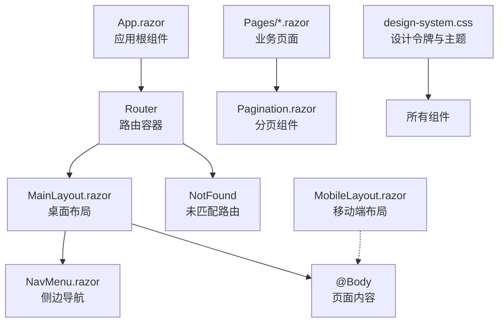
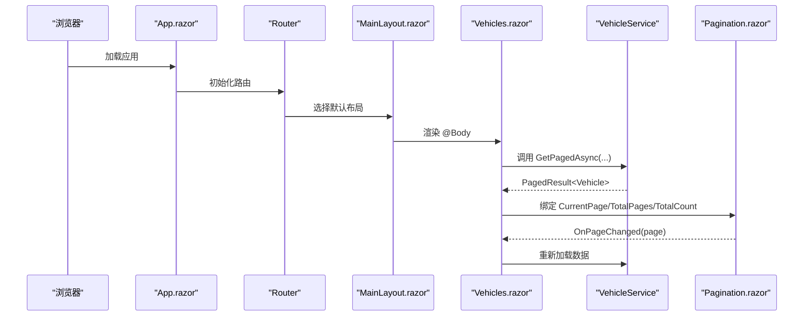
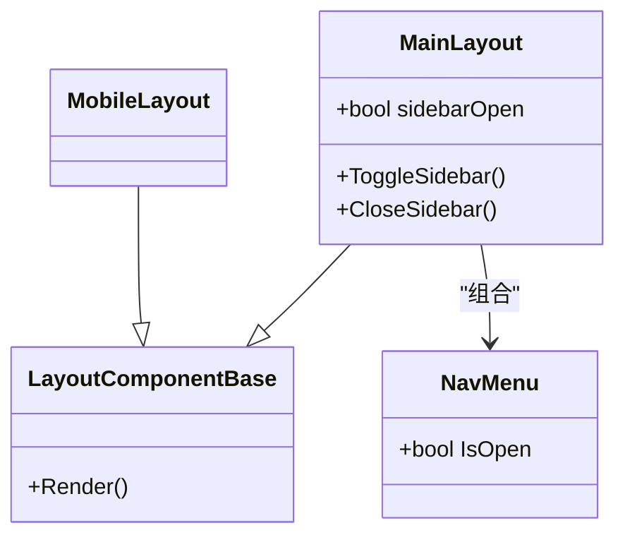
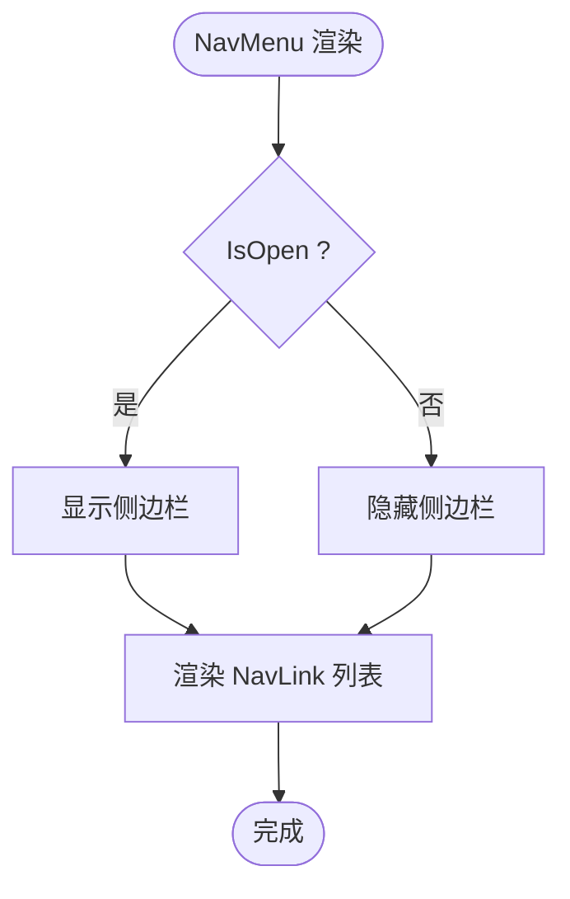
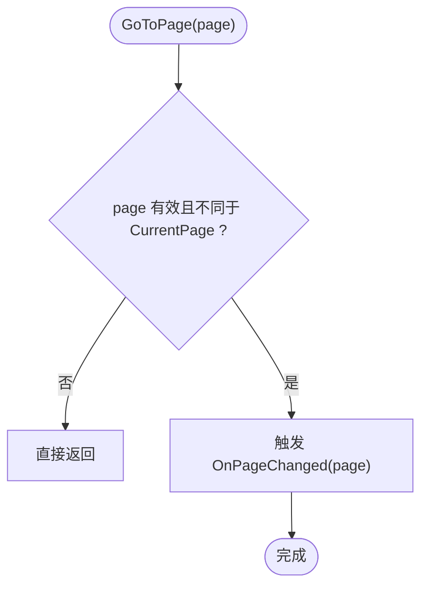
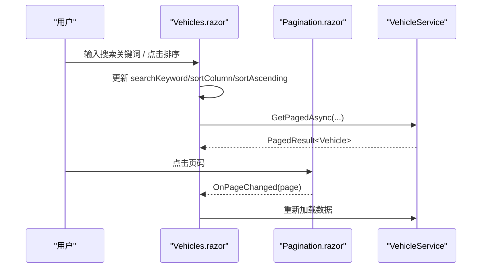
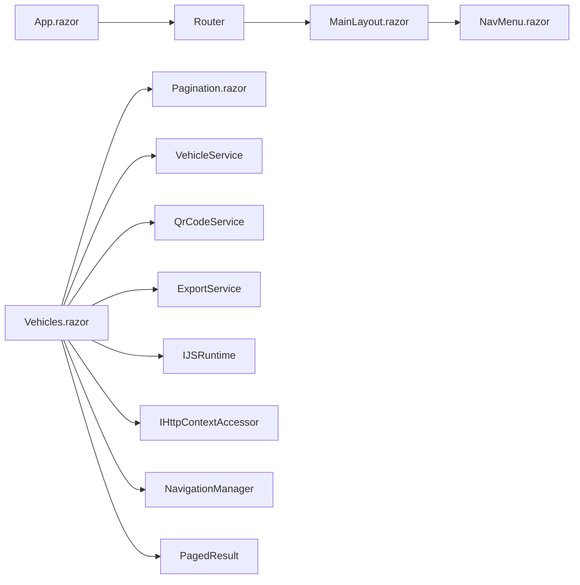

# 前端组件架构

<cite>
**本文引用的文件**   
- [MainLayout.razor](file://Components/Layouts/MainLayout.razor)
- [MobileLayout.razor](file://Components/Layouts/MobileLayout.razor)
- [NavMenu.razor](file://Components/Navigation/NavMenu.razor)
- [Pagination.razor](file://Components/Common/Pagination.razor)
- [App.razor](file://App.razor)
- [_Imports.razor](file://_Imports.razor)
- [Vehicles.razor](file://Pages/Vehicles.razor)
- [PagedResult.cs](file://BLL/Common/PagedResult.cs)
- [design-system.css](file://wwwroot/css/design-system.css)
- [site.css](file://wwwroot/css/site.css)
</cite>

## 目录
1. [引言](#引言)
2. [项目结构](#项目结构)
3. [核心组件](#核心组件)
4. [架构总览](#架构总览)
5. [详细组件分析](#详细组件分析)
6. [依赖关系分析](#依赖关系分析)
7. [性能与可维护性](#性能与可维护性)
8. [故障排查指南](#故障排查指南)
9. [结论](#结论)
10. [附录：组件开发规范与扩展指南](#附录组件开发规范与扩展指南)

## 引言
本文件面向 vehicleManagement 系统的前端 Blazor Server 组件体系，目标是帮助开发者快速理解页面组件、布局组件、导航组件与通用组件的职责边界，掌握父子参数传递、事件回调、服务注入等通信模式，并说明响应式布局、样式系统与主题定制方式。文档同时给出组件扩展建议，包括自定义组件开发、第三方组件集成与主题定制实践。

## 项目结构
vehicleManagement 的前端代码主要分布在以下位置：
- `Components`：Blazor 组件，包含布局、导航和通用组件。
- `Pages`：业务页面，例如车辆管理、部门管理、使用记录等。
- `wwwroot/css`：全局样式与设计令牌。
- `_Imports.razor`：全局 using 声明，集中引入命名空间。
- `App.razor`：应用根组件，负责路由与默认布局。

**图表来源**
- [App.razor:1-12](file://App.razor#L1-L12)
- [MainLayout.razor:1-40](file://Components/Layouts/MainLayout.razor#L1-L40)
- [MobileLayout.razor:1-8](file://Components/Layouts/MobileLayout.razor#L1-L8)
- [NavMenu.razor:1-56](file://Components/Navigation/NavMenu.razor#L1-L56)
- [Pagination.razor:1-42](file://Components/Common/Pagination.razor#L1-L42)
- [design-system.css:38-176](file://wwwroot/css/design-system.css#L38-L176)

**章节来源**
- [App.razor:1-12](file://App.razor#L1-L12)
- [_Imports.razor:1-30](file://_Imports.razor#L1-L30)

## 核心组件
本节聚焦四个关键组件：MainLayout、MobileLayout、NavMenu、Pagination，并说明它们在 Blazor Server 中的职责与交互方式。

- MainLayout（桌面布局）
  - 继承 `LayoutComponentBase`，作为默认布局。
  - 组合 NavMenu 与顶部栏，渲染 `@Body` 为页面内容。
  - 控制侧边栏展开状态，支持点击遮罩关闭。
- MobileLayout（移动端布局）
  - 继承 `LayoutComponentBase`，提供简化布局。
  - 仅渲染 `@Body`，适合窄屏或独立入口场景。
- NavMenu（导航菜单）
  - 通过 `[Parameter] IsOpen` 接收父组件状态。
  - 使用 NavLink 构建主菜单与 AI 服务菜单。
- Pagination（分页组件）
  - 暴露 CurrentPage、TotalPages、TotalCount 参数。
  - 通过 EventCallback<int> OnPageChanged 通知父组件页码变化。
  - 内部计算当前可见页码范围，禁用首尾页按钮。

**章节来源**
- [MainLayout.razor:1-40](file://Components/Layouts/MainLayout.razor#L1-L40)
- [MobileLayout.razor:1-8](file://Components/Layouts/MobileLayout.razor#L1-L8)
- [NavMenu.razor:1-56](file://Components/Navigation/NavMenu.razor#L1-L56)
- [Pagination.razor:1-42](file://Components/Common/Pagination.razor#L1-L42)

## 架构总览
Blazor Server 的组件树由 App.razor 启动，Router 根据路由选择页面，并将默认布局 MainLayout 应用到页面内容。页面组件通过服务注入访问业务层，并通过通用组件（如 Pagination）提升复用性。

**图表来源**
- [App.razor:1-12](file://App.razor#L1-L12)
- [MainLayout.razor:1-40](file://Components/Layouts/MainLayout.razor#L1-L40)
- [Vehicles.razor:1-410](file://Pages/Vehicles.razor#L1-L410)
- [Pagination.razor:1-42](file://Components/Common/Pagination.razor#L1-L42)

## 详细组件分析

### 布局组件：MainLayout 与 MobileLayout
- MainLayout
  - 职责：组织侧边栏、顶部栏与主体区域；管理侧边栏展开状态。
  - 关键点：
    - 使用 `@inherits LayoutComponentBase` 获得布局能力。
    - 将 NavMenu 作为子组件，传入 IsOpen 状态。
    - 通过 `@Body` 渲染页面内容。
    - 提供 ToggleSidebar 与 CloseSidebar 方法切换状态。
- MobileLayout
  - 职责：提供移动端简化布局，仅渲染 `@Body`。
  - 关键点：
    - 同样继承 `LayoutComponentBase`。
    - 适用于窄屏或独立入口场景。

**图表来源**
- [MainLayout.razor:1-40](file://Components/Layouts/MainLayout.razor#L1-L40)
- [MobileLayout.razor:1-8](file://Components/Layouts/MobileLayout.razor#L1-L8)
- [NavMenu.razor:1-56](file://Components/Navigation/NavMenu.razor#L1-L56)

**章节来源**
- [MainLayout.razor:1-40](file://Components/Layouts/MainLayout.razor#L1-L40)
- [MobileLayout.razor:1-8](file://Components/Layouts/MobileLayout.razor#L1-L8)

### 导航组件：NavMenu
- 职责：展示主菜单与 AI 服务菜单，支持高亮当前路由。
- 关键点：
  - 使用 NavLink 实现路由链接与激活状态。
  - 通过 `[Parameter] IsOpen` 接收父组件状态，用于控制侧边栏显示。
  - 图标与文案内联，便于统一风格。

**图表来源**
- [NavMenu.razor:1-56](file://Components/Navigation/NavMenu.razor#L1-L56)

**章节来源**
- [NavMenu.razor:1-56](file://Components/Navigation/NavMenu.razor#L1-L56)

### 通用组件：Pagination
- 职责：提供可复用的分页 UI，封装页码计算与按钮禁用逻辑。
- 关键点：
  - 参数：CurrentPage、TotalPages、TotalCount。
  - 事件：OnPageChanged 回调父组件页码变更。
  - 算法：GetPageNumbers 计算当前页附近页码范围。
  - 行为：首页/上一页在首页禁用；下一页/末页在末页禁用。

**图表来源**
- [Pagination.razor:20-42](file://Components/Common/Pagination.razor#L20-L42)

**章节来源**
- [Pagination.razor:1-42](file://Components/Common/Pagination.razor#L1-L42)

### 页面组件：Vehicles
- 职责：车辆管理的完整页面，包含搜索、排序、新增/编辑、删除确认、二维码下载与 Excel 导出。
- 关键点：
  - 服务注入：VehicleService、QrCodeService、ExportService、IJSRuntime、IHttpContextAccessor、NavigationManager。
  - 状态管理：本地变量管理表单、弹窗、分页、搜索与排序状态。
  - 数据流：LoadData 委托 VehicleService.GetPagedAsync，返回 PagedResult<Vehicle>。
  - 分页集成：将 CurrentPage、TotalPages、TotalCount 绑定到 Pagination，并处理 OnPageChanged。
  - 错误处理：捕获异常并显示错误弹窗。

**图表来源**
- [Vehicles.razor:1-410](file://Pages/Vehicles.razor#L1-L410)
- [Pagination.razor:1-42](file://Components/Common/Pagination.razor#L1-L42)

**章节来源**
- [Vehicles.razor:1-410](file://Pages/Vehicles.razor#L1-L410)

## 依赖关系分析
- 组件间依赖
  - App.razor 依赖 Router 与 MainLayout。
  - MainLayout 依赖 NavMenu。
  - Vehicles 依赖 Pagination。
- 服务依赖
  - Vehicles 注入多个服务：VehicleService、QrCodeService、ExportService、IJSRuntime、IHttpContextAccessor、NavigationManager。
- 数据模型依赖
  - Vehicles 使用 BLL 层的 PagedResult<T> 与实体模型（如 Vehicle）。

**图表来源**
- [App.razor:1-12](file://App.razor#L1-L12)
- [MainLayout.razor:1-40](file://Components/Layouts/MainLayout.razor#L1-L40)
- [NavMenu.razor:1-56](file://Components/Navigation/NavMenu.razor#L1-L56)
- [Vehicles.razor:1-410](file://Pages/Vehicles.razor#L1-L410)
- [Pagination.razor:1-42](file://Components/Common/Pagination.razor#L1-L42)
- [PagedResult.cs:1-37](file://BLL/Common/PagedResult.cs#L1-L37)

**章节来源**
- [App.razor:1-12](file://App.razor#L1-L12)
- [Vehicles.razor:1-410](file://Pages/Vehicles.razor#L1-L410)
- [PagedResult.cs:1-37](file://BLL/Common/PagedResult.cs#L1-L37)

## 性能与可维护性
- 组件拆分与职责单一
  - 布局、导航、分页分别独立，降低耦合度。
- 服务端渲染优化
  - Blazor Server 下避免频繁重绘，合理使用局部状态与条件渲染。
- 分页与大数据集
  - 使用 PagedResult 限制单次数据量，减少传输与渲染开销。
- 样式与主题
  - 通过 CSS 变量统一管理颜色、间距、圆角、阴影等设计令牌，便于主题定制与维护。
- 可测试性
  - 通用组件（如 Pagination）具备明确参数与事件，便于单元测试与模拟。

[本节为通用指导，不直接分析具体文件]

## 故障排查指南
- 侧边栏无法关闭
  - 检查 MainLayout 中 ToggleSidebar/CloseSidebar 是否被正确调用。
- 导航高亮异常
  - 检查 NavLink 的 href 与路由路径是否一致。
- 分页无效
  - 检查 Pagination 的 CurrentPage/TotalPages 是否正确绑定，OnPageChanged 是否刷新数据。
- 服务注入失败
  - 检查 Program.cs 中服务注册与 _Imports.razor 中命名空间导入。
- 样式错乱
  - 检查 design-system.css 与 site.css 是否加载，CSS 变量是否覆盖。

**章节来源**
- [MainLayout.razor:27-39](file://Components/Layouts/MainLayout.razor#L27-L39)
- [NavMenu.razor:11-49](file://Components/Navigation/NavMenu.razor#L11-L49)
- [Pagination.razor:20-42](file://Components/Common/Pagination.razor#L20-L42)
- [design-system.css:38-176](file://wwwroot/css/design-system.css#L38-L176)
- [site.css:1-55](file://wwwroot/css/site.css#L1-L55)

## 结论
vehicleManagement 的前端采用清晰的 Blazor Server 组件分层：布局组件负责整体结构与状态，导航组件负责路由与菜单，通用组件提供可复用能力，页面组件编排业务逻辑与服务调用。通过 CSS 变量与设计令牌实现主题化，通过服务注入与事件回调实现松耦合通信。该架构具备良好的可扩展性与可维护性，适合持续迭代与团队协作。

[本节为总结性内容，不直接分析具体文件]

## 附录：组件开发规范与扩展指南

### 命名约定
- 组件文件：使用 PascalCase，如 MainLayout.razor、NavMenu.razor、Pagination.razor。
- 参数与方法：使用 PascalCase，如 IsOpen、ToggleSidebar、OnPageChanged。
- 样式类名：使用 kebab-case，如 app-layout、sidebar-nav、pagination。

### 文件组织
- Components/Layouts：布局组件。
- Components/Navigation：导航组件。
- Components/Common：通用组件。
- Pages：业务页面。
- wwwroot/css：全局样式与设计令牌。

### 组件间通信模式
- 父子参数传递
  - 父组件通过属性向子组件传值，如 MainLayout 向 NavMenu 传入 IsOpen。
- 事件冒泡
  - 子组件通过 EventCallback 向父组件上报事件，如 Pagination 的 OnPageChanged。
- 服务注入
  - 页面组件通过 @inject 注入服务，如 VehicleService、QrCodeService、ExportService。
- 状态管理
  - 页面组件维护本地状态，必要时可抽取为共享服务或状态容器。

### 响应式设计
- 移动端适配
  - 使用 MobileLayout 提供简化布局，或在 MainLayout 中通过媒体查询调整侧边栏行为。
- 屏幕尺寸检测
  - 可通过 JSInterop 获取窗口尺寸，结合 Blazor 状态驱动 UI 切换。
- 布局切换机制
  - 根据设备类型或窗口宽度动态选择 MainLayout 或 MobileLayout。

### 样式系统设计
- Fluent UI 主题定制
  - 通过 CSS 变量定义主色、灰阶、红蓝橙等色系，并在组件中引用。
- 设计令牌
  - 使用 --primary-*、--gray-*、--radius-*、--shadow-* 等变量统一视觉语言。
- 响应式断点
  - 在 CSS 中使用媒体查询适配不同屏幕尺寸，确保布局与可读性。

### 组件开发规范
- 命名约定：遵循上述命名规则。
- 文件组织：按功能域划分目录，保持组件职责单一。
- 单元测试：对通用组件编写单元测试，验证参数与事件行为。
- 性能优化：避免不必要的重渲染，合理使用条件渲染与局部状态。

### 组件扩展指南
- 自定义组件开发
  - 新建 .razor 文件，定义参数与事件，复用设计令牌与样式类。
- 第三方组件集成
  - 在 _Imports.razor 中添加 using 声明，按需引入第三方组件库。
- 主题定制实践
  - 修改 design-system.css 中的 CSS 变量，实现品牌色、字体、间距等全局定制。

[本节为通用指导，不直接分析具体文件]