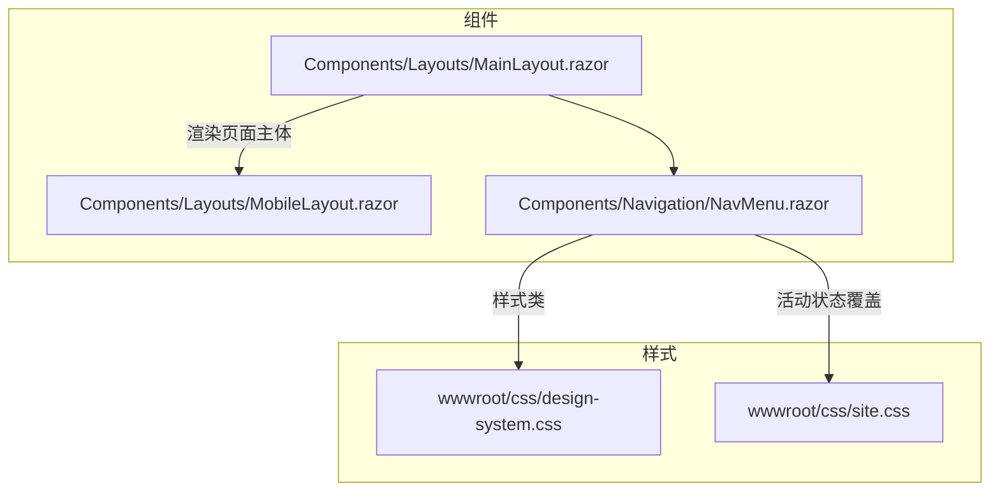
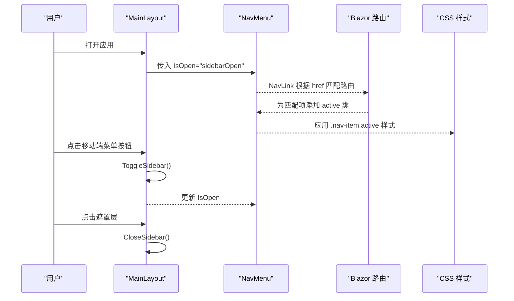
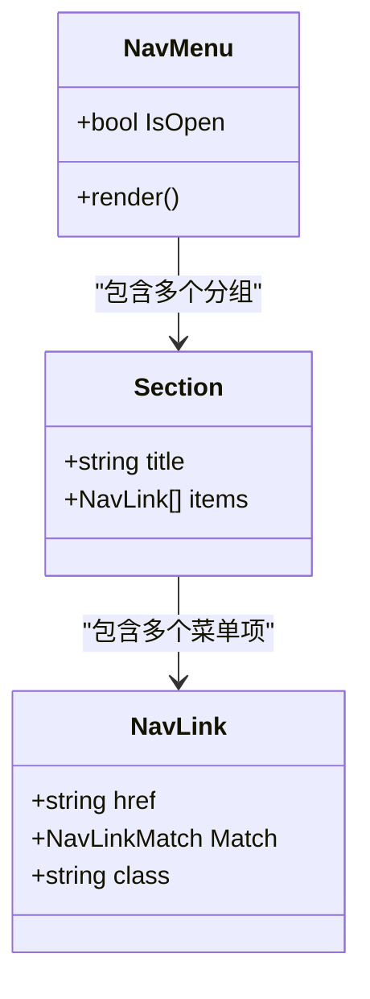
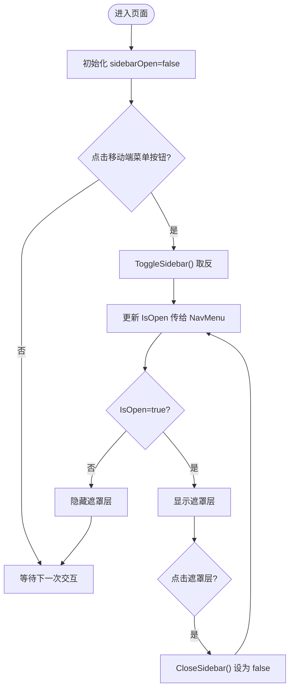
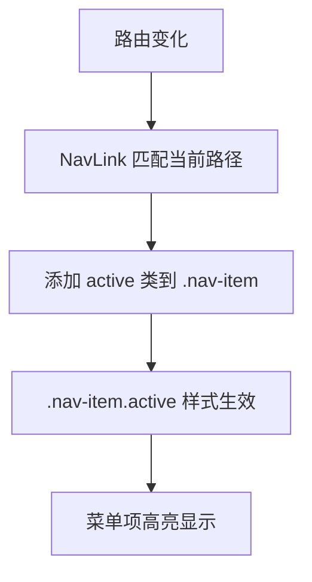
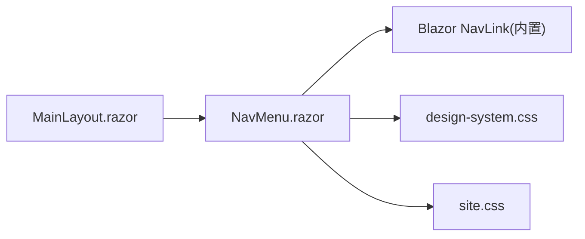

# 导航组件

<cite>
**本文引用的文件**   
- [NavMenu.razor](file://Components/Navigation/NavMenu.razor)
- [MainLayout.razor](file://Components/Layouts/MainLayout.razor)
- [MobileLayout.razor](file://Components/Layouts/MobileLayout.razor)
- [design-system.css](file://wwwroot/css/design-system.css)
- [site.css](file://wwwroot/css/site.css)
</cite>

## 目录
1. [简介](#简介)
2. [项目结构](#项目结构)
3. [核心组件](#核心组件)
4. [架构总览](#架构总览)
5. [详细组件分析](#详细组件分析)
6. [依赖关系分析](#依赖关系分析)
7. [性能与可访问性](#性能与可访问性)
8. [故障排查指南](#故障排查指南)
9. [结论](#结论)
10. [附录：定制与扩展指南](#附录定制与扩展指南)

## 简介
本文件为 vehicleManagement 系统的导航组件文档，聚焦 NavMenu 的实现与使用。内容涵盖：
- 动态菜单生成、路由链接管理、活动状态高亮
- 移动端折叠效果与遮罩层处理
- 导航数据结构（菜单项定义、权限控制集成、图标配置、子菜单支持）
- 交互逻辑（展开收起、点击跳转、遮罩关闭）
- 定制指南（菜单配置、权限过滤、样式定制、多语言支持）
- 扩展示例（动态菜单加载、面包屑导航、搜索功能集成）

## 项目结构
导航相关代码位于 Components 与 wwwroot/css 下，布局由 MainLayout 负责，移动端基础布局由 MobileLayout 提供。

图表来源
- [MainLayout.razor:1-39](file://Components/Layouts/MainLayout.razor#L1-L39)
- [MobileLayout.razor:1-8](file://Components/Layouts/MobileLayout.razor#L1-L8)
- [NavMenu.razor:1-56](file://Components/Navigation/NavMenu.razor#L1-L56)
- [design-system.css:236-450](file://wwwroot/css/design-system.css#L236-L450)
- [site.css:22-27](file://wwwroot/css/site.css#L22-L27)

章节来源
- [MainLayout.razor:1-39](file://Components/Layouts/MainLayout.razor#L1-L39)
- [MobileLayout.razor:1-8](file://Components/Layouts/MobileLayout.razor#L1-L8)
- [NavMenu.razor:1-56](file://Components/Navigation/NavMenu.razor#L1-L56)
- [design-system.css:236-450](file://wwwroot/css/design-system.css#L236-L450)
- [site.css:22-27](file://wwwroot/css/site.css#L22-L27)

## 核心组件
- NavMenu：侧边栏导航，包含品牌区、分组标题、菜单项（NavLink），通过 IsOpen 参数控制显示状态。
- MainLayout：应用主布局，注入 NavMenu，维护 sidebarOpen 状态，提供移动端菜单按钮与遮罩层。
- MobileLayout：移动端基础布局容器。
- design-system.css：导航样式主题（侧边栏、菜单项、活动态、遮罩响应式）。
- site.css：Blazor NavLink 活动态增强样式。

章节来源
- [NavMenu.razor:1-56](file://Components/Navigation/NavMenu.razor#L1-L56)
- [MainLayout.razor:1-39](file://Components/Layouts/MainLayout.razor#L1-L39)
- [MobileLayout.razor:1-8](file://Components/Layouts/MobileLayout.razor#L1-L8)
- [design-system.css:236-450](file://wwwroot/css/design-system.css#L236-L450)
- [site.css:22-27](file://wwwroot/css/site.css#L22-L27)

## 架构总览
导航在 Blazor 中的职责划分清晰：
- 视图层：NavMenu 渲染菜单结构与图标；MainLayout 组织布局与交互。
- 路由层：使用 NavLink 自动匹配当前路由并添加 active 类。
- 样式层：design-system.css 提供主题与响应式行为；site.css 补充活动态样式。

图表来源
- [MainLayout.razor:5-25](file://Components/Layouts/MainLayout.razor#L5-L25)
- [NavMenu.razor:11-49](file://Components/Navigation/NavMenu.razor#L11-L49)
- [site.css:22-27](file://wwwroot/css/site.css#L22-L27)

## 详细组件分析

### NavMenu 组件
- 结构
  - 侧边栏容器 aside.sidebar，通过 IsOpen 切换 open 类。
  - 品牌区：品牌图标与名称。
  - 导航区 nav.sidebar-nav，按组划分（主菜单、AI 服务），每组含分组标题与若干 NavLink。
  - 每个 NavLink 包含 SVG 图标与文本标签。
- 参数
  - IsOpen：布尔值，控制侧边栏是否展开。
- 活动状态
  - 使用 Blazor NavLink 的 Match 属性与默认 active 类机制实现高亮。
- 图标
  - 内联 SVG，便于统一风格与替换。
- 可扩展点
  - 将静态 NavLink 列表抽取为数据模型，循环渲染以支持动态菜单。
  - 增加权限字段与条件渲染以支持权限控制。
  - 增加子菜单节点与展开收起逻辑。

图表来源
- [NavMenu.razor:1-56](file://Components/Navigation/NavMenu.razor#L1-L56)

章节来源
- [NavMenu.razor:1-56](file://Components/Navigation/NavMenu.razor#L1-L56)

### MainLayout 布局与移动端交互
- 职责
  - 注入 NavMenu，传递 IsOpen。
  - 维护 sidebarOpen 状态，提供 ToggleSidebar 与 CloseSidebar。
  - 渲染顶部工具栏与移动端菜单按钮。
  - 渲染遮罩层 sidebar-overlay，点击时关闭侧边栏。
- 移动端行为
  - 点击汉堡按钮切换侧边栏显示。
  - 点击遮罩层关闭侧边栏。
  - 响应式样式在 design-system.css 中控制遮罩与按钮显隐。

图表来源
- [MainLayout.razor:5-39](file://Components/Layouts/MainLayout.razor#L5-L39)
- [design-system.css:1156-1172](file://wwwroot/css/design-system.css#L1156-L1172)

章节来源
- [MainLayout.razor:1-39](file://Components/Layouts/MainLayout.razor#L1-L39)
- [design-system.css:1156-1172](file://wwwroot/css/design-system.css#L1156-L1172)

### 样式与活动状态
- 活动态高亮
  - Blazor NavLink 自动为匹配项添加 active 类。
  - site.css 对 .nav-item.active 进行颜色与背景强化。
- 菜单项样式
  - design-system.css 定义 .nav-item、.nav-icon、.nav-label、.nav-badge 等样式。
- 响应式与遮罩
  - design-system.css 在小屏下显示移动端菜单按钮与遮罩层。

图表来源
- [site.css:22-27](file://wwwroot/css/site.css#L22-L27)
- [design-system.css:342-399](file://wwwroot/css/design-system.css#L342-L399)

章节来源
- [site.css:22-27](file://wwwroot/css/site.css#L22-L27)
- [design-system.css:342-399](file://wwwroot/css/design-system.css#L342-L399)

## 依赖关系分析
- NavMenu 依赖 Blazor 内置 NavLink 进行路由匹配与高亮。
- MainLayout 依赖 NavMenu 并通过参数驱动其显示状态。
- 样式依赖 design-system.css 与 site.css。
- 无直接外部库依赖，纯前端组件与样式。

图表来源
- [MainLayout.razor:1-39](file://Components/Layouts/MainLayout.razor#L1-L39)
- [NavMenu.razor:1-56](file://Components/Navigation/NavMenu.razor#L1-L56)
- [design-system.css:236-450](file://wwwroot/css/design-system.css#L236-L450)
- [site.css:22-27](file://wwwroot/css/site.css#L22-L27)

章节来源
- [MainLayout.razor:1-39](file://Components/Layouts/MainLayout.razor#L1-L39)
- [NavMenu.razor:1-56](file://Components/Navigation/NavMenu.razor#L1-L56)
- [design-system.css:236-450](file://wwwroot/css/design-system.css#L236-L450)
- [site.css:22-27](file://wwwroot/css/site.css#L22-L27)

## 性能与可访问性
- 渲染性能
  - 当前为静态菜单，结构简单，渲染开销低。
  - 若改为动态菜单，建议将菜单数据缓存并在首次加载后复用，避免重复计算。
- 路由性能
  - NavLink 由框架优化，无需额外处理。
- 可访问性
  - 建议在 NavLink 外层保留语义化标签（已使用 nav）。
  - 为图标提供 aria-hidden 或替代文本以提升无障碍体验。
- 移动端交互
  - 遮罩层点击关闭，符合常见交互模式。
  - 建议在键盘场景下支持 ESC 关闭侧边栏。

[本节为通用指导，不直接分析具体文件]

## 故障排查指南
- 菜单项未高亮
  - 检查 NavLink 的 href 是否与路由一致。
  - 确认 site.css 中 .nav-item.active 未被其他样式覆盖。
- 移动端菜单无法打开
  - 检查 MainLayout 的 ToggleSidebar 是否被调用。
  - 检查 design-system.css 中小屏下的 .mobile-menu-btn 与 .sidebar-overlay.show 是否生效。
- 遮罩层不可见
  - 确认 .sidebar-overlay.show 的 display:block 是否被应用。
  - 检查 z-index 是否被其他元素覆盖。

章节来源
- [site.css:22-27](file://wwwroot/css/site.css#L22-L27)
- [design-system.css:1156-1172](file://wwwroot/css/design-system.css#L1156-L1172)
- [MainLayout.razor:27-39](file://Components/Layouts/MainLayout.razor#L27-L39)

## 结论
NavMenu 在当前项目中提供了简洁、稳定的侧边导航能力，结合 MainLayout 实现了移动端折叠与遮罩交互，样式体系完善且易于定制。后续可通过数据驱动的方式扩展动态菜单、权限控制与子菜单，以满足更复杂的业务需求。

[本节为总结性内容，不直接分析具体文件]

## 附录：定制与扩展指南

### 导航数据结构设计
- 菜单项定义
  - 字段建议：id、title、href、icon、children、permission、badge、order。
  - 分组结构：section.title 与 section.items。
- 权限控制集成
  - 在渲染前根据当前用户角色或权限集合过滤菜单项。
  - 对敏感菜单设置 permission 字段，仅在具备权限时渲染。
- 图标配置
  - 将 SVG 字符串或图标名集中管理，便于统一替换与主题切换。
- 子菜单支持
  - children 数组表示子菜单，配合展开收起状态变量。
  - 子菜单项同样支持权限过滤与活动态高亮。

[本节为概念性说明，不直接分析具体文件]

### 动态菜单加载
- 步骤
  - 在服务端或本地 JSON 中定义菜单数据。
  - 在 NavMenu 中异步加载数据，缓存结果。
  - 使用 foreach 渲染菜单项与分组。
- 注意事项
  - 首次加载时显示骨架屏或占位符。
  - 失败时提供重试机制与错误提示。

[本节为概念性说明，不直接分析具体文件]

### 面包屑导航
- 思路
  - 基于当前路由解析层级，映射到菜单树获取面包屑路径。
  - 在 MainLayout 顶部区域渲染面包屑。
- 实现要点
  - 维护路由到面包屑的映射表。
  - 支持多级路由与动态参数。

[本节为概念性说明，不直接分析具体文件]

### 搜索功能集成
- 思路
  - 在 NavMenu 顶部加入搜索框，支持关键词过滤菜单项。
  - 支持快捷键触发（如 Ctrl/Cmd+K）。
- 实现要点
  - 维护搜索词与过滤后的菜单列表。
  - 高亮匹配文本并提供跳转。

[本节为概念性说明，不直接分析具体文件]

### 样式定制选项
- 主题色
  - 修改 design-system.css 中的 --primary-* 变量以统一主题。
- 间距与尺寸
  - 调整 .nav-item 的 padding、font-size 与 height。
- 活动态样式
  - 在 site.css 中覆盖 .nav-item.active 的背景与颜色。
- 响应式行为
  - 在 design-system.css 中调整小屏下的遮罩与按钮显隐断点。

章节来源
- [design-system.css:342-399](file://wwwroot/css/design-system.css#L342-L399)
- [site.css:22-27](file://wwwroot/css/site.css#L22-L27)

### 多语言支持
- 资源文件
  - 使用 .resx 或 JSON 文件存储菜单文案。
- 运行时切换
  - 在 NavMenu 中根据当前文化加载对应文案。
- 键值映射
  - 使用 key 映射到实际文本，便于维护与扩展。

[本节为概念性说明，不直接分析具体文件]