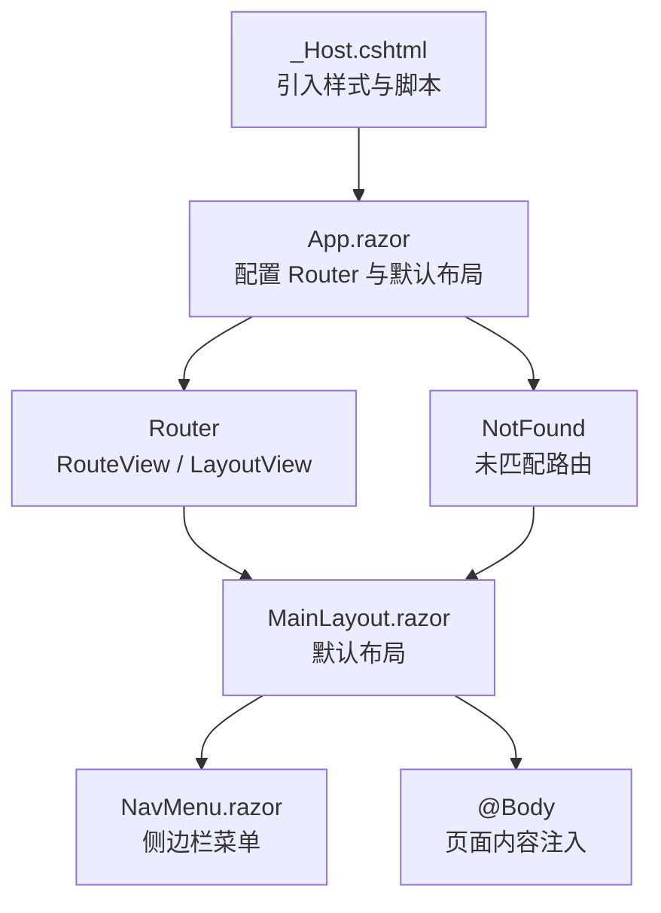
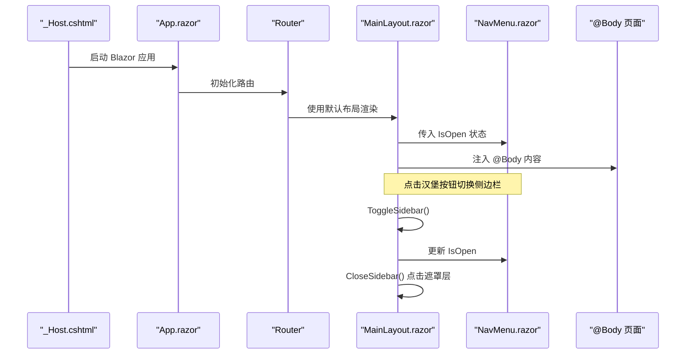
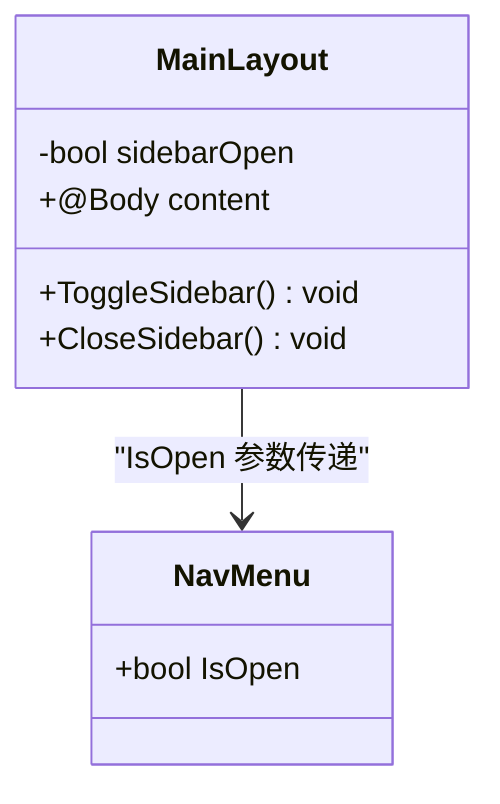
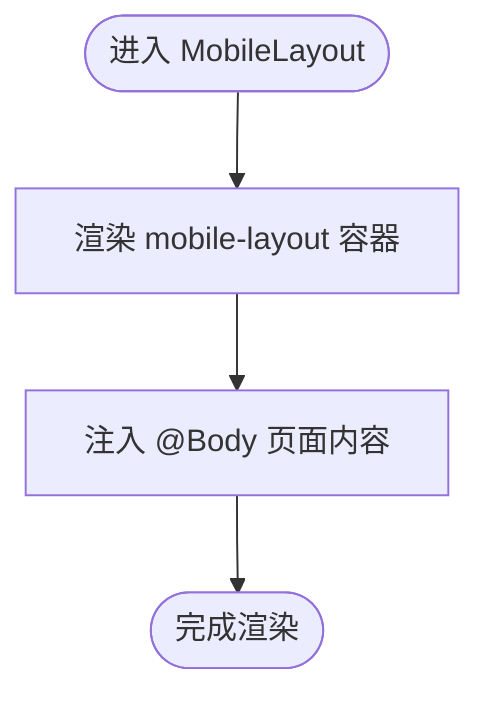
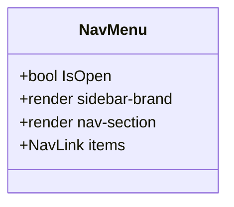
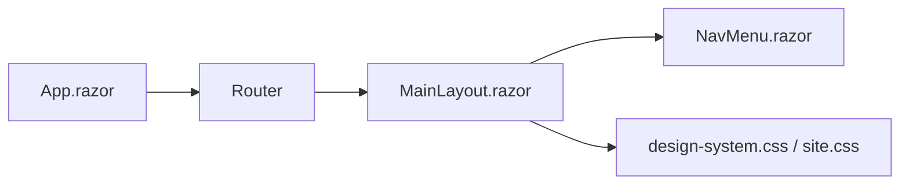

# 布局组件

<cite>
**本文引用的文件**   
- [MainLayout.razor](file://Components/Layouts/MainLayout.razor)
- [MobileLayout.razor](file://Components/Layouts/MobileLayout.razor)
- [NavMenu.razor](file://Components/Navigation/NavMenu.razor)
- [App.razor](file://App.razor)
- [_Host.cshtml](file://Pages/_Host.cshtml)
- [design-system.css](file://wwwroot/css/design-system.css)
- [site.css](file://wwwroot/css/site.css)
</cite>

## 目录
1. [简介](#简介)
2. [项目结构](#项目结构)
3. [核心组件](#核心组件)
4. [架构总览](#架构总览)
5. [详细组件分析](#详细组件分析)
6. [依赖关系分析](#依赖关系分析)
7. [性能与可访问性](#性能与可访问性)
8. [故障排查指南](#故障排查指南)
9. [结论](#结论)
10. [附录：布局定制与扩展指南](#附录布局定制与扩展指南)

## 简介
本章节面向 vehicleManagement 系统的 Blazor WebAssembly/Server 前端，聚焦布局层的设计与实现。文档围绕 MainLayout 与 MobileLayout 两大布局组件展开，解释响应式适配、侧边栏管理、顶部导航栏、内容区域渲染的职责边界；说明 @Body 注入机制、移动端菜单切换、屏幕尺寸检测策略、布局状态管理方式；阐述 LayoutComponentBase 的继承与生命周期；并提供主题变量使用、CSS Grid/Flexbox 布局、断点设置与移动端优化的实践建议，以及头部组件、用户信息展示、通知系统集成的扩展示例。

## 项目结构
- 布局组件位于 Components/Layouts 下，包含桌面端主布局 MainLayout 与移动端基础布局 MobileLayout。
- 侧边栏导航由 Components/Navigation/NavMenu 提供，通过参数控制打开/关闭状态。
- 应用入口 App.razor 将路由默认布局设置为 MainLayout。
- 页面宿主 _Host.cshtml 引入全局样式与脚本，确保设计系统与站点样式生效。
- 样式集中在 wwwroot/css 下，其中 design-system.css 定义设计令牌（主题变量）与响应式断点，site.css 补充业务页面样式。

图表来源
- [_Host.cshtml:1-22](file://Pages/_Host.cshtml#L1-L22)
- [App.razor:1-12](file://App.razor#L1-L12)
- [MainLayout.razor:1-39](file://Components/Layouts/MainLayout.razor#L1-L39)
- [NavMenu.razor:1-56](file://Components/Navigation/NavMenu.razor#L1-L56)

章节来源
- [_Host.cshtml:1-22](file://Pages/_Host.cshtml#L1-L22)
- [App.razor:1-12](file://App.razor#L1-L12)

## 核心组件
- MainLayout：桌面端主布局，负责侧边栏开关、顶部工具栏、主体内容区渲染，并通过遮罩层提升移动端交互体验。
- MobileLayout：移动端极简布局，仅包裹 @Body，便于在特定路由或条件下替换为纯内容视图。
- NavMenu：侧边栏菜单组件，接收 IsOpen 参数以控制显示状态，内部使用 NavLink 构建导航项。
- App.razor：应用根组件，配置 Router 并将默认布局指向 MainLayout。
- _Host.cshtml：Blazor 宿主页，加载设计系统与站点样式，并挂载 Blazor 应用。

章节来源
- [MainLayout.razor:1-39](file://Components/Layouts/MainLayout.razor#L1-L39)
- [MobileLayout.razor:1-8](file://Components/Layouts/MobileLayout.razor#L1-L8)
- [NavMenu.razor:1-56](file://Components/Navigation/NavMenu.razor#L1-L56)
- [App.razor:1-12](file://App.razor#L1-L12)
- [_Host.cshtml:1-22](file://Pages/_Host.cshtml#L1-L22)

## 架构总览
下图展示了从宿主到布局再到内容的渲染流程，以及侧边栏与遮罩层的交互关系。

图表来源
- [_Host.cshtml:1-22](file://Pages/_Host.cshtml#L1-L22)
- [App.razor:1-12](file://App.razor#L1-L12)
- [MainLayout.razor:1-39](file://Components/Layouts/MainLayout.razor#L1-L39)
- [NavMenu.razor:1-56](file://Components/Navigation/NavMenu.razor#L1-L56)

## 详细组件分析

### MainLayout 组件
职责与行为
- 继承自 LayoutComponentBase，获得 @Body 注入能力与 Blazor 布局生命周期。
- 渲染侧边栏 NavMenu，并通过 sidebarOpen 状态控制其打开/关闭。
- 顶部工具栏包含汉堡按钮与头像占位，用于移动端菜单切换与用户信息展示预留。
- 主体区域 main-content 承载 @Body 渲染的页面内容。
- 底部遮罩层 sidebar-overlay 在移动端点击时关闭侧边栏。

状态与事件
- sidebarOpen：布尔状态，控制侧边栏可见性与遮罩层显示。
- ToggleSidebar：切换侧边栏状态。
- CloseSidebar：关闭侧边栏（遮罩层点击）。

响应式与样式
- 通过 CSS 类 app-layout、main-wrapper、topbar、main-content、sidebar-overlay 组织布局。
- 侧边栏打开状态通过 NavMenu 的 IsOpen 参数传递，配合 CSS 类 open 控制位移与过渡。
- 遮罩层根据 sidebarOpen 动态添加 show 类名，实现半透明覆盖效果。

图表来源
- [MainLayout.razor:1-39](file://Components/Layouts/MainLayout.razor#L1-L39)
- [NavMenu.razor:1-56](file://Components/Navigation/NavMenu.razor#L1-L56)

章节来源
- [MainLayout.razor:1-39](file://Components/Layouts/MainLayout.razor#L1-L39)
- [NavMenu.razor:1-56](file://Components/Navigation/NavMenu.razor#L1-L56)

### MobileLayout 组件
职责与行为
- 继承自 LayoutComponentBase，提供最小化移动端布局容器。
- 仅渲染 mobile-layout 容器与 mobile-content 主区域，直接注入 @Body。
- 适用于需要隐藏侧边栏与顶部栏的移动端场景，或在路由级选择不同布局时使用。

图表来源
- [MobileLayout.razor:1-8](file://Components/Layouts/MobileLayout.razor#L1-L8)

章节来源
- [MobileLayout.razor:1-8](file://Components/Layouts/MobileLayout.razor#L1-L8)

### NavMenu 组件
职责与行为
- 作为侧边栏容器，包含品牌标识与导航链接。
- 通过 IsOpen 参数控制 aside.sidebar 的 open 类名，从而驱动 CSS 变换显示/隐藏。
- 使用 NavLink 构建导航项，支持高亮与路由匹配。

图表来源
- [NavMenu.razor:1-56](file://Components/Navigation/NavMenu.razor#L1-L56)

章节来源
- [NavMenu.razor:1-56](file://Components/Navigation/NavMenu.razor#L1-L56)

### 布局继承与生命周期
- MainLayout 与 MobileLayout 均使用 @inherits LayoutComponentBase，从而获得：
  - @Body 注入：将当前路由页面内容渲染到布局指定位置。
  - 生命周期钩子：OnInitialized、OnAfterRender 等，可用于初始化布局状态或订阅外部事件。
- 建议在 OnAfterRender 中监听窗口尺寸变化以实现更精确的响应式逻辑（例如自动收起侧边栏）。

章节来源
- [MainLayout.razor:1-39](file://Components/Layouts/MainLayout.razor#L1-L39)
- [MobileLayout.razor:1-8](file://Components/Layouts/MobileLayout.razor#L1-L8)

## 依赖关系分析
- App.razor 将 Router 的默认布局设置为 MainLayout，所有路由页面在未显式指定布局时都会使用该布局。
- MainLayout 依赖 NavMenu 提供侧边栏导航，并通过参数传递 IsOpen 状态。
- 样式依赖 design-system.css 与 site.css，前者提供设计令牌与响应式断点，后者补充业务样式。

图表来源
- [App.razor:1-12](file://App.razor#L1-L12)
- [MainLayout.razor:1-39](file://Components/Layouts/MainLayout.razor#L1-L39)
- [NavMenu.razor:1-56](file://Components/Navigation/NavMenu.razor#L1-L56)
- [design-system.css:1-53](file://wwwroot/css/design-system.css#L1-L53)
- [site.css:432-455](file://wwwroot/css/site.css#L432-L455)

章节来源
- [App.razor:1-12](file://App.razor#L1-L12)
- [design-system.css:1099-1162](file://wwwroot/css/design-system.css#L1099-L1162)
- [site.css:432-455](file://wwwroot/css/site.css#L432-L455)

## 性能与可访问性
- 避免在频繁触发的回调中进行重绘：ToggleSidebar 与 CloseSidebar 仅修改布尔状态，Blazor 会增量更新 DOM。
- 遮罩层仅在移动端有效：通过 CSS 媒体查询控制 display，减少不必要的节点渲染。
- 可访问性建议：
  - 汉堡按钮应提供 aria-label 与键盘焦点支持。
  - 侧边栏打开时禁用背景滚动，防止页面滚动穿透。
  - 遮罩层点击关闭需提供清晰的视觉反馈与焦点管理。

[本节为通用指导，不直接分析具体文件]

## 故障排查指南
常见问题与定位方法
- 侧边栏无法打开：
  - 检查 NavMenu.IsOpen 是否正确从 MainLayout 传入。
  - 确认 CSS 类 open 是否被正确添加到 aside.sidebar。
- 遮罩层无效：
  - 检查 sidebar-overlay 的 show 类名是否与 sidebarOpen 状态同步。
  - 确认媒体查询未在桌面端隐藏遮罩层。
- 内容区域被遮挡：
  - 检查 main-wrapper 的 margin-left 与 --sidebar-width 变量是否一致。
  - 确认 topbar 与 main-content 的层级与 z-index 设置。

章节来源
- [MainLayout.razor:1-39](file://Components/Layouts/MainLayout.razor#L1-L39)
- [design-system.css:1099-1162](file://wwwroot/css/design-system.css#L1099-L1162)

## 结论
MainLayout 与 MobileLayout 共同构成了 vehicleManagement 的前端布局骨架：MainLayout 提供完整的桌面端体验与移动端遮罩交互，MobileLayout 提供轻量化的移动端容器。通过 NavMenu 的参数化控制与 CSS 设计令牌，系统在响应式适配、状态管理与样式一致性方面具备良好的可扩展性。后续可在主题变量、断点与组件职责上持续优化，以满足复杂业务场景下的布局需求。

[本节为总结性内容，不直接分析具体文件]

## 附录：布局定制与扩展指南

### 主题变量使用
- 设计令牌集中定义于 design-system.css 的 :root，包括主色系列 --primary-*、灰度 --gray-*、圆角 --radius-*、过渡 --transition*。
- 建议在组件内优先使用这些变量，避免硬编码颜色值，便于统一换肤与品牌定制。

章节来源
- [design-system.css:1-53](file://wwwroot/css/design-system.css#L1-L53)

### CSS Grid/Flexbox 布局
- 侧边栏与主体采用 Flex 布局：aside.sidebar 与 main-wrapper 并列，main-wrapper 通过 margin-left 留出侧边栏宽度。
- 网格布局在统计卡片与列表中使用 grid-* 类，结合媒体查询在不同断点调整列数。

章节来源
- [design-system.css:262-456](file://wwwroot/css/design-system.css#L262-L456)
- [design-system.css:1099-1162](file://wwwroot/css/design-system.css#L1099-L1162)

### 断点设置
- 设计系统定义了常用断点：1440px（超大屏）、1200px（大屏）、992px（平板横屏）、768px（平板竖屏）、480px（手机）。
- 在 992px 及以下，侧边栏默认隐藏，通过 open 类控制滑出；同时 main-wrapper 的 margin-left 归零。

章节来源
- [design-system.css:1099-1162](file://wwwroot/css/design-system.css#L1099-L1162)

### 移动端优化
- 汉堡按钮与遮罩层在移动端提供直观的菜单切换体验。
- 建议在 OnAfterRender 中监听 window.innerWidth，当小于断点时自动关闭侧边栏，避免状态不一致。

章节来源
- [MainLayout.razor:1-39](file://Components/Layouts/MainLayout.razor#L1-L39)

### 布局扩展示例
- 自定义头部组件：
  - 在 MainLayout 的 topbar 区域嵌入新的头部组件，如搜索框、面包屑、快捷操作。
  - 通过 CSS 变量与 Flexbox 对齐元素，保持与现有风格一致。
- 用户信息展示：
  - 在 topbar-right 区域增加用户头像下拉菜单，展示用户名、角色、退出登录等操作。
  - 使用设计令牌中的 --primary-* 与 --gray-* 配色，确保视觉统一。
- 通知系统集成：
  - 在 topbar 右侧增加通知图标与角标，点击弹出通知面板。
  - 使用遮罩层与侧边栏类似的交互模式，保证移动端体验一致。

[本节为概念性扩展指导，不直接分析具体文件]