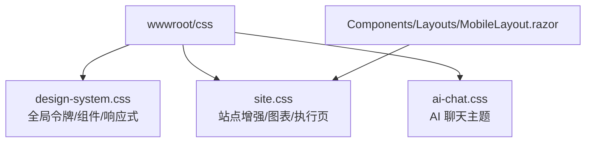
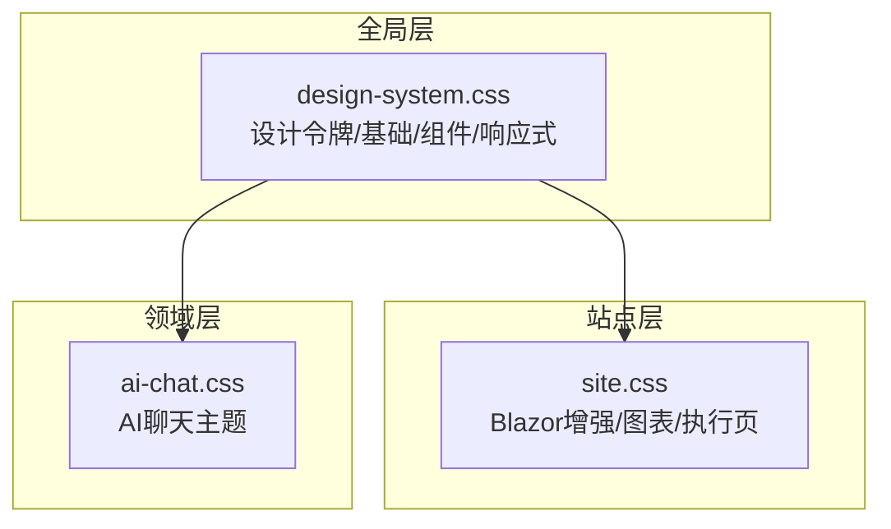
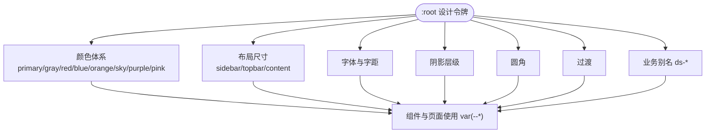
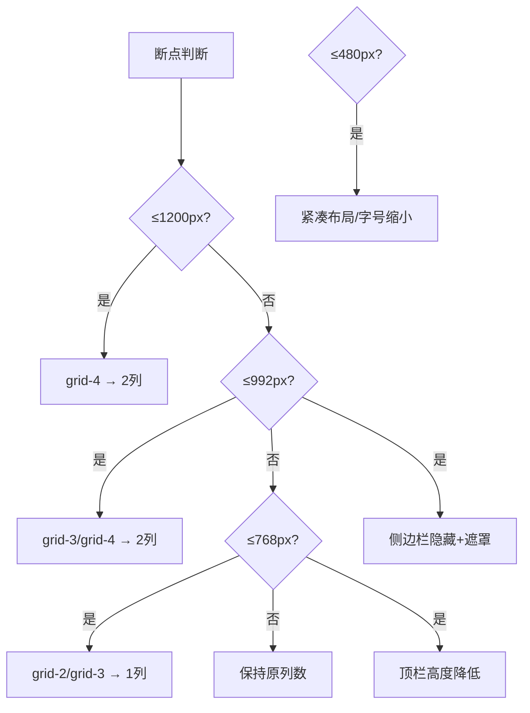
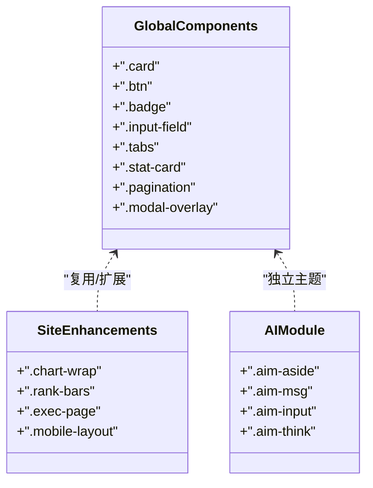
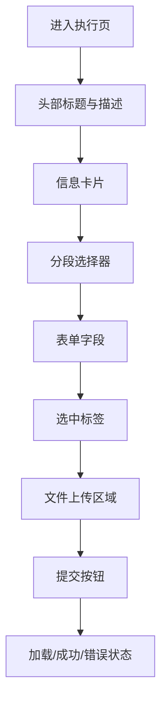
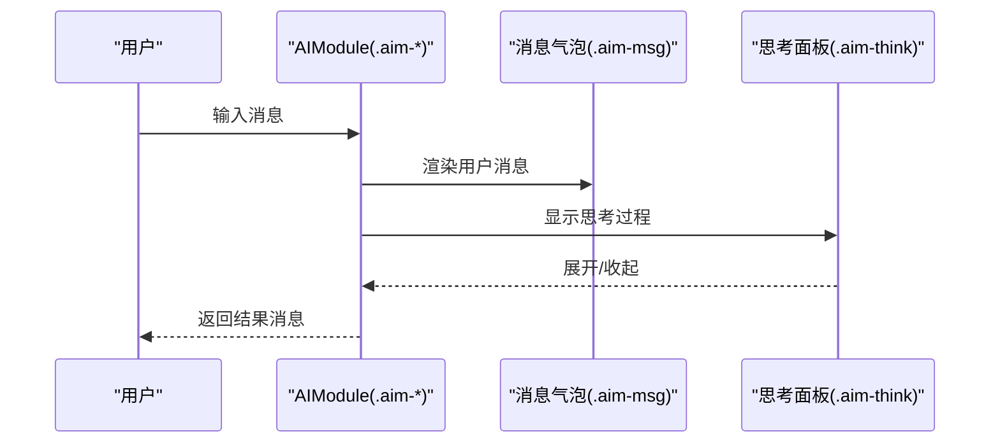
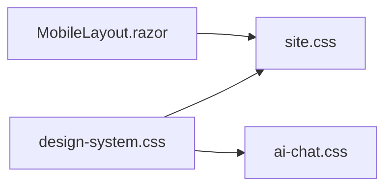

# 样式系统设计

<cite>
**本文引用的文件**   
- [design-system.css](file://wwwroot/css/design-system.css)
- [site.css](file://wwwroot/css/site.css)
- [ai-chat.css](file://wwwroot/css/ai-chat.css)
- [MobileLayout.razor](file://Components/Layouts/MobileLayout.razor)
</cite>

## 目录
1. [引言](#引言)
2. [项目结构](#项目结构)
3. [核心组件](#核心组件)
4. [架构总览](#架构总览)
5. [详细组件分析](#详细组件分析)
6. [依赖关系分析](#依赖关系分析)
7. [性能与可访问性](#性能与可访问性)
8. [故障排查指南](#故障排查指南)
9. [结论](#结论)
10. [附录：扩展与最佳实践](#附录扩展与最佳实践)

## 引言
本样式系统设计文档面向 vehicleManagement 系统的 UI 层，目标是建立统一、可扩展、可维护的视觉与交互规范。系统以 CSS 变量为核心设计令牌，围绕颜色体系、字体规范、间距标准、阴影层级展开；同时提供主题定制能力（品牌色、语义色、布局尺寸），并覆盖响应式断点、移动优先策略、弹性与网格布局。此外，文档给出 BEM 命名建议、组件样式隔离、性能优化技巧与浏览器兼容性处理方案，并提供自定义主题、第三方库集成、动画效果实现和无障碍样式支持等扩展指南。

## 项目结构
样式资源位于 wwwroot/css 下，按功能域拆分：
- design-system.css：全局设计令牌、基础样式、通用组件、响应式断点与工具类
- site.css：Blazor 站点增强样式、图表容器、排行榜、执行页专用样式与移动端适配
- ai-chat.css：AI 聊天模块独立主题与布局

**图示来源**
- [design-system.css:38-176](file://wwwroot/css/design-system.css#L38-L176)
- [site.css:283-456](file://wwwroot/css/site.css#L283-L456)
- [ai-chat.css:9-18](file://wwwroot/css/ai-chat.css#L9-L18)
- [MobileLayout.razor:1-7](file://Components/Layouts/MobileLayout.razor#L1-L7)

**章节来源**
- [design-system.css:1-176](file://wwwroot/css/design-system.css#L1-L176)
- [site.css:1-456](file://wwwroot/css/site.css#L1-L456)
- [ai-chat.css:1-497](file://wwwroot/css/ai-chat.css#L1-L497)
- [MobileLayout.razor:1-7](file://Components/Layouts/MobileLayout.razor#L1-L7)

## 核心组件
- 设计令牌（Design Tokens）
  - 颜色：主色（绿色）、灰阶、红、蓝、橙、天蓝、紫、粉等完整色板
  - 布局：侧边栏宽度、顶栏高度、内容最大宽度
  - 字体：默认字体族、字距
  - 阴影：sm/md/lg 三级
  - 圆角：sm/md/lg/xl/full
  - 过渡：统一过渡时长与缓动
  - 业务别名：ds-* 系列用于“执行页”等场景，复用全局色板
- 基础样式
  - Reset、html/body/a/ul/ol/img/button/input/select/textarea 基线
- 通用组件
  - 侧边栏、顶部栏、卡片、按钮、表格、徽章、输入框、标签页、统计卡片、网格、Flex 工具类、文本工具类、间距工具类、图标、横幅、分页、头像组、进度条、下拉菜单、空状态、开关、模态、提示条、表单容器、分段控制器等
- 响应式
  - 断点：1200px / 992px / 768px / 480px
  - 侧边栏在平板横屏隐藏，通过遮罩与滑入展示
  - 网格列数随断点变化
- Blazor 站点增强
  - NavLink active 状态、表单控件一致化、InputFile 样式、禁用态、图表容器自适应、排行榜纯 CSS 可视化、页面淡入动画、移动端布局
- AI 聊天主题
  - 独立 :root 变量、侧边栏会话列表、消息气泡、思考面板、输入区、欢迎卡片、按钮、遮罩、诊断面板、响应式与无障碍动画降级

**章节来源**
- [design-system.css:38-176](file://wwwroot/css/design-system.css#L38-L176)
- [design-system.css:178-227](file://wwwroot/css/design-system.css#L178-L227)
- [design-system.css:230-800](file://wwwroot/css/design-system.css#L230-L800)
- [design-system.css:801-1600](file://wwwroot/css/design-system.css#L801-L1600)
- [site.css:1-158](file://wwwroot/css/site.css#L1-L158)
- [site.css:160-271](file://wwwroot/css/site.css#L160-L271)
- [site.css:273-456](file://wwwroot/css/site.css#L273-L456)
- [ai-chat.css:9-18](file://wwwroot/css/ai-chat.css#L9-L18)
- [ai-chat.css:24-468](file://wwwroot/css/ai-chat.css#L24-L468)

## 架构总览
样式系统采用“全局令牌 + 领域主题 + 组件样式”的分层架构：
- 全局层：design-system.css 定义 :root 设计令牌与基础样式
- 站点层：site.css 基于全局令牌扩展 Blazor 站点样式与业务页面样式
- 领域层：ai-chat.css 为 AI 聊天模块提供独立主题与布局

**图示来源**
- [design-system.css:38-176](file://wwwroot/css/design-system.css#L38-L176)
- [site.css:283-456](file://wwwroot/css/site.css#L283-L456)
- [ai-chat.css:9-18](file://wwwroot/css/ai-chat.css#L9-L18)

## 详细组件分析

### 设计令牌与主题定制
- 颜色系统
  - 主色（绿色）多阶梯度，作为品牌与强调色
  - 灰阶用于背景、边框、文字层级
  - 语义色：红（错误）、蓝（信息）、橙（警告）、天蓝/紫/粉（装饰）
- 布局尺寸
  - --sidebar-width、--topbar-height、--content-max-width 控制整体骨架
- 字体规范
  - 默认字体族使用 Geist 与系统字体栈，字距微调
  - 外部字体 Plus Jakarta Sans 通过 @import 引入
- 阴影层级
  - --shadow-sm/md/lg 提供一致的深度层次
- 圆角与过渡
  - --radius-* 与 --transition 统一圆角与动效节奏
- 业务别名 ds-*
  - 将全局色板映射到业务语义（如 --ds-primary、--ds-surface、--ds-bg、--ds-fg、--ds-border、--ds-error、--ds-warning 等），便于在不同页面或模块中保持一致的主题表达

**图示来源**
- [design-system.css:38-176](file://wwwroot/css/design-system.css#L38-L176)

**章节来源**
- [design-system.css:38-176](file://wwwroot/css/design-system.css#L38-L176)

### 响应式设计
- 断点定义
  - 1200px：大屏，四列变两列
  - 992px：平板横屏，三列变两列，侧边栏隐藏并通过遮罩滑出
  - 768px：平板竖屏，两列/三列变一列，顶部栏高度减小
  - 480px：手机紧凑布局，网格全一列，字号与内边距收紧
- 移动优先策略
  - 基础样式在小屏可用，逐步在大屏增强
  - 侧边栏默认隐藏于小屏，通过 JS 切换 .open 显示
- 弹性布局与网格系统
  - 使用 .grid 与 .grid-2/.grid-3/.grid-4 快速构建栅格
  - Flex 工具类 .flex/.flex-col/.items-center/.justify-between/.gap-* 组合布局
- 图表与排行榜
  - 图表容器根据断点调整高度，canvas 强制铺满容器
  - 纯 CSS 排行榜通过 .rank-bars 与 .rank-bar-row 实现

**图示来源**
- [design-system.css:1118-1315](file://wwwroot/css/design-system.css#L1118-L1315)
- [site.css:118-158](file://wwwroot/css/site.css#L118-L158)

**章节来源**
- [design-system.css:1118-1315](file://wwwroot/css/design-system.css#L1118-L1315)
- [site.css:118-158](file://wwwroot/css/site.css#L118-L158)

### 组件样式与命名规范
- 命名风格
  - 全局与站点组件倾向简洁的 BEM 风格（如 .card, .card-header, .btn, .badge, .input-field）
  - AI 聊天模块采用更严格的 BEM（如 .aim-msg__bub, .aim-aside__list, .aim-input__wrap）
- 组件隔离
  - 通过作用域类名避免冲突，AI 聊天模块使用 .aim-* 前缀隔离
  - Blazor 站点样式集中在 site.css，避免与全局样式互相污染
- 状态管理
  - 使用 .active、.show、.open 等状态类驱动交互（如侧边栏、下拉菜单、模态）

**图示来源**
- [design-system.css:596-800](file://wwwroot/css/design-system.css#L596-L800)
- [site.css:84-158](file://wwwroot/css/site.css#L84-L158)
- [ai-chat.css:24-468](file://wwwroot/css/ai-chat.css#L24-L468)

**章节来源**
- [design-system.css:596-800](file://wwwroot/css/design-system.css#L596-L800)
- [site.css:84-158](file://wwwroot/css/site.css#L84-L158)
- [ai-chat.css:24-468](file://wwwroot/css/ai-chat.css#L24-L468)

### 执行页（车辆使用登记）样式
- 主题约束
  - 明确使用项目全局绿色主题 (--primary-*)，禁止蓝色
  - 通过 ds-* 别名统一表面、背景、前景、边框、错误与警告色
- 交互元素
  - 分段选择器、输入框、下拉选择、标签、文件上传区域、提交按钮、加载与成功状态
- 响应式
  - 小屏行堆叠、头部与卡片内边距收缩、按钮最小触控尺寸

**图示来源**
- [site.css:283-456](file://wwwroot/css/site.css#L283-L456)

**章节来源**
- [site.css:283-456](file://wwwroot/css/site.css#L283-L456)

### AI 聊天模块样式
- 主题变量
  - 独立的 :root 变量集（--ai-p/--ai-t/--ai-bg 等）
- 布局
  - 左侧会话列表、右侧消息区、底部输入区
- 交互
  - 消息气泡（用户/AI）、思考面板折叠展开、打字指示器、滚动到底部按钮
- 响应式
  - 平板以下侧边栏抽屉式弹出，消息气泡宽度增大
- 无障碍
  - prefers-reduced-motion 禁用动画与过渡

**图示来源**
- [ai-chat.css:125-288](file://wwwroot/css/ai-chat.css#L125-L288)
- [ai-chat.css:412-468](file://wwwroot/css/ai-chat.css#L412-L468)

**章节来源**
- [ai-chat.css:9-18](file://wwwroot/css/ai-chat.css#L9-L18)
- [ai-chat.css:125-288](file://wwwroot/css/ai-chat.css#L125-L288)
- [ai-chat.css:412-468](file://wwwroot/css/ai-chat.css#L412-L468)

## 依赖关系分析
- 样式文件之间的依赖
  - site.css 与 ai-chat.css 均依赖 design-system.css 的设计令牌
  - MobileLayout.razor 通过 .mobile-layout 与 .mobile-content 与 site.css 联动
- 组件耦合
  - 全局组件类名被多处复用，需保持命名稳定
  - AI 聊天模块通过前缀隔离，降低耦合风险

**图示来源**
- [design-system.css:38-176](file://wwwroot/css/design-system.css#L38-L176)
- [site.css:273-281](file://wwwroot/css/site.css#L273-L281)
- [ai-chat.css:24-30](file://wwwroot/css/ai-chat.css#L24-L30)
- [MobileLayout.razor:1-7](file://Components/Layouts/MobileLayout.razor#L1-L7)

**章节来源**
- [design-system.css:38-176](file://wwwroot/css/design-system.css#L38-L176)
- [site.css:273-281](file://wwwroot/css/site.css#L273-L281)
- [ai-chat.css:24-30](file://wwwroot/css/ai-chat.css#L24-L30)
- [MobileLayout.razor:1-7](file://Components/Layouts/MobileLayout.razor#L1-L7)

## 性能与可访问性
- 性能优化
  - 使用 CSS 变量减少重复值，提升可维护性与渲染一致性
  - 合理使用 transition 与 transform，避免重排重绘
  - 图表 canvas 强制铺满容器，减少缩放失真
  - 滚动条样式统一，避免不必要的重绘
- 可访问性
  - AI 聊天模块对 prefers-reduced-motion 进行降级处理
  - 输入框 focus 状态使用高对比度边框与外发光
  - 按钮与链接具备足够的触控尺寸与对比度

**章节来源**
- [ai-chat.css:463-468](file://wwwroot/css/ai-chat.css#L463-L468)
- [site.css:43-48](file://wwwroot/css/site.css#L43-L48)
- [design-system.css:1332-1349](file://wwwroot/css/design-system.css#L1332-L1349)

## 故障排查指南
- 侧边栏不显示
  - 检查是否在 ≤992px 断点下未添加 .open 类
  - 确认遮罩 .sidebar-overlay 是否显示
- 图表高度异常
  - 检查 .chart-wrap 高度与 canvas 的 !important 覆盖是否正确
- 执行页主题不一致
  - 确保使用 --ds-* 变量而非硬编码颜色
  - 确认未引入蓝色系变量
- AI 聊天动画卡顿
  - 检查是否触发 prefers-reduced-motion 导致动画被禁用
  - 确认未过度使用复杂滤镜与阴影

**章节来源**
- [design-system.css:1140-1168](file://wwwroot/css/design-system.css#L1140-L1168)
- [site.css:84-102](file://wwwroot/css/site.css#L84-L102)
- [site.css:283-456](file://wwwroot/css/site.css#L283-L456)
- [ai-chat.css:463-468](file://wwwroot/css/ai-chat.css#L463-L468)

## 结论
vehicleManagement 的样式系统以设计令牌为中心，通过全局层、站点层与领域层的分层组织，实现了主题一致、组件复用与模块隔离。响应式断点与移动优先策略确保了跨设备体验，BEM 命名与状态类管理提升了可维护性。未来可在暗色模式、Fluent UI 主题集成方面进一步扩展，同时持续优化性能与无障碍支持。

## 附录：扩展与最佳实践

### 设计令牌与主题定制
- 使用 :root 集中定义颜色、布局、字体、阴影、圆角与过渡
- 通过 ds-* 别名将全局色板映射到业务语义，便于在不同页面保持一致主题
- 建议在新增页面时优先使用 ds-* 变量，避免硬编码颜色

**章节来源**
- [design-system.css:38-176](file://wwwroot/css/design-system.css#L38-L176)

### 响应式与布局
- 断点：1200px / 992px / 768px / 480px
- 移动优先：基础样式在小屏可用，逐步在大屏增强
- 网格与 Flex：使用 .grid-* 与 .flex-* 工具类快速布局

**章节来源**
- [design-system.css:1118-1315](file://wwwroot/css/design-system.css#L1118-L1315)

### BEM 命名与组件隔离
- 全局组件使用简洁类名，AI 聊天模块使用 .aim-* 前缀隔离
- 状态类：.active/.show/.open 统一管理交互状态

**章节来源**
- [design-system.css:596-800](file://wwwroot/css/design-system.css#L596-L800)
- [ai-chat.css:24-468](file://wwwroot/css/ai-chat.css#L24-L468)

### 性能优化
- 使用 CSS 变量与 transition/transform 提升渲染效率
- 图表 canvas 强制铺满容器，避免缩放失真
- 统一滚动条样式，减少重绘

**章节来源**
- [site.css:84-102](file://wwwroot/css/site.css#L84-L102)
- [design-system.css:1332-1349](file://wwwroot/css/design-system.css#L1332-L1349)

### 浏览器兼容性与无障碍
- 针对 prefers-reduced-motion 禁用动画与过渡
- 输入框 focus 状态使用高对比度边框与外发光
- 按钮与链接具备足够触控尺寸与对比度

**章节来源**
- [ai-chat.css:463-468](file://wwwroot/css/ai-chat.css#L463-L468)
- [site.css:43-48](file://wwwroot/css/site.css#L43-L48)

### 第三方库集成与动画
- 第三方库样式建议使用独立前缀或作用域类名，避免污染全局
- 动画应遵循统一的过渡时长与缓动曲线，必要时提供无障碍降级

**章节来源**
- [ai-chat.css:463-468](file://wwwroot/css/ai-chat.css#L463-L468)