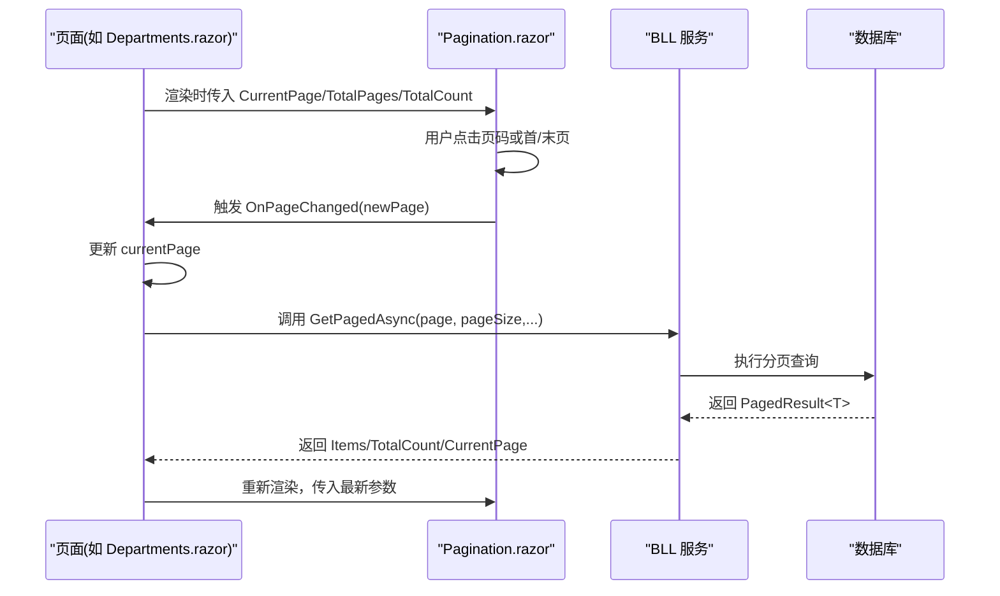
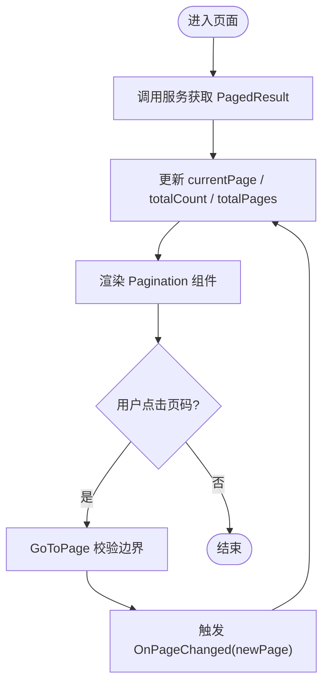
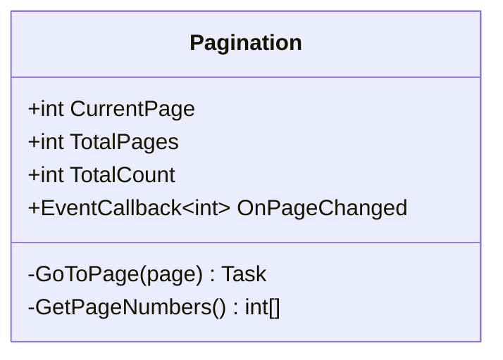
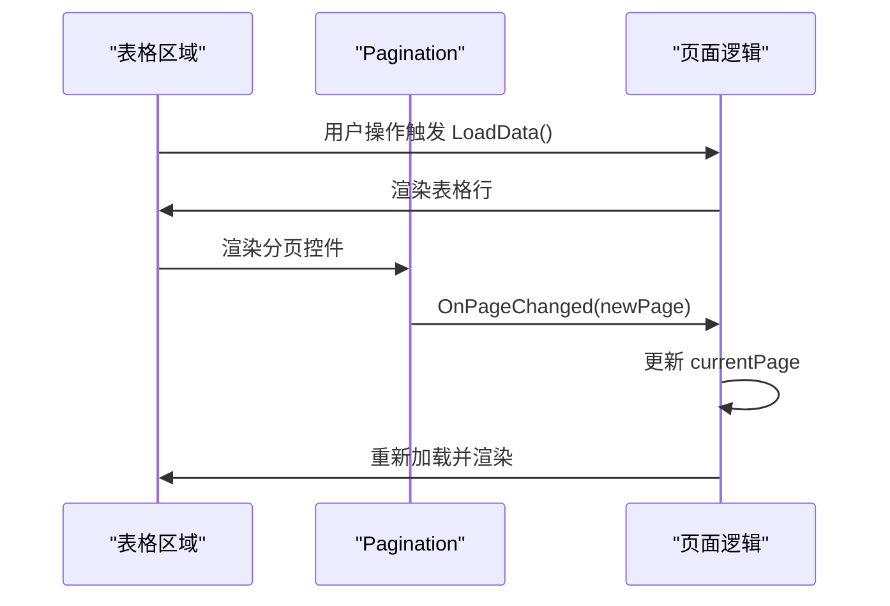
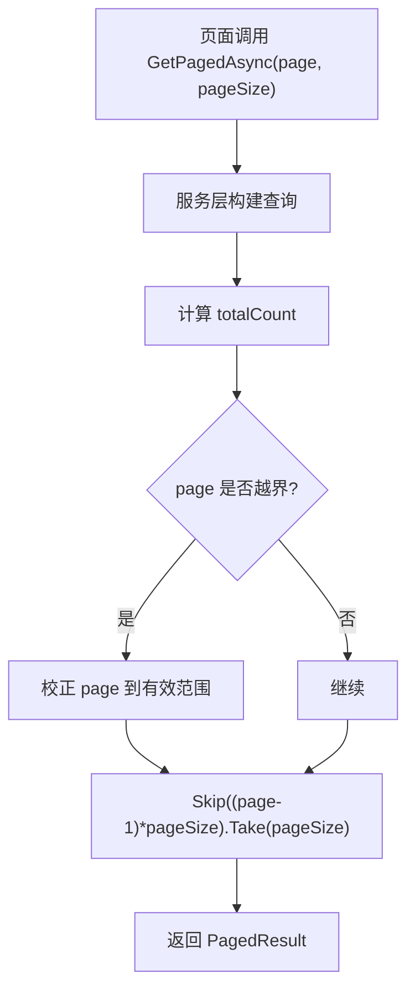
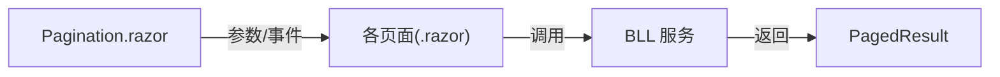

# 通用组件

<cite>
**本文引用的文件**   
- [Pagination.razor](file://Components/Common/Pagination.razor)
- [Departments.razor](file://Pages/Departments.razor)
- [PersonnelList.razor](file://Pages/PersonnelList.razor)
- [Locations.razor](file://Pages/Locations.razor)
- [MaintenanceRecords.razor](file://Pages/MaintenanceRecords.razor)
- [UsageRecords.razor](file://Pages/UsageRecords.razor)
- [Vehicles.razor](file://Pages/Vehicles.razor)
- [PagedResult.cs](file://BLL/Common/PagedResult.cs)
- [UsageRecordService.cs](file://BLL/UsageRecord/UsageRecordService.cs)
- [design-system.css](file://wwwroot/css/design-system.css)
- [site.css](file://wwwroot/css/site.css)
</cite>

## 目录
1. [简介](#简介)
2. [项目结构](#项目结构)
3. [核心组件](#核心组件)
4. [架构总览](#架构总览)
5. [详细组件分析](#详细组件分析)
6. [依赖关系分析](#依赖关系分析)
7. [性能考虑](#性能考虑)
8. [故障排查指南](#故障排查指南)
9. [结论](#结论)
10. [附录：通用组件开发规范](#附录通用组件开发规范)

## 简介
本文件面向 vehicleManagement 系统中的通用分页组件 Pagination，系统性说明其设计目标、参数契约、内部实现、与页面表格的集成方式、数据流与事件模型，并给出可落地的优化建议与通用组件开发规范。文档同时覆盖页码计算、边界处理、跳转逻辑、样式封装等关键点，帮助读者在现有代码基础上扩展键盘导航、无障碍访问与 URL 同步能力。

## 项目结构
Pagination 组件位于 Components/Common 下，被多个业务页面（部门、人员、车辆、使用记录、维保记录、位置等）以“受控模式”消费：页面持有当前页码、总页数、总条数等状态，并通过 OnPageChanged 回调驱动异步数据加载。

```mermaid
graph TB
subgraph "页面层"
D["Departments.razor"]
P["PersonnelList.razor"]
L["Locations.razor"]
M["MaintenanceRecords.razor"]
U["UsageRecords.razor"]
V["Vehicles.razor"]
end
subgraph "通用组件"
PG["Pagination.razor"]
end
subgraph "后端服务"
PR["PagedResult<T>"]
US["UsageRecordService.cs"]
end
D --> PG
P --> PG
L --> PG
M --> PG
U --> PG
V --> PG
PG --> |OnPageChanged(page)| D
PG --> |OnPageChanged(page)| P
PG --> |OnPageChanged(page)| L
PG --> |OnPageChanged(page)| M
PG --> |OnPageChanged(page)| U
PG --> |OnPageChanged(page)| V
D --> PR
P --> PR
L --> PR
M --> PR
U --> PR
V --> PR
US --> PR
```

图表来源
- [Pagination.razor:1-42](file://Components/Common/Pagination.razor#L1-L42)
- [Departments.razor:125-168](file://Pages/Departments.razor#L125-L168)
- [PersonnelList.razor:158-205](file://Pages/PersonnelList.razor#L158-L205)
- [Locations.razor:144-194](file://Pages/Locations.razor#L144-L194)
- [MaintenanceRecords.razor:99-120](file://Pages/MaintenanceRecords.razor#L99-L120)
- [UsageRecords.razor:94-170](file://Pages/UsageRecords.razor#L94-L170)
- [Vehicles.razor:184-210](file://Pages/Vehicles.razor#L184-L210)
- [PagedResult.cs:1-37](file://BLL/Common/PagedResult.cs#L1-L37)
- [UsageRecordService.cs:64-96](file://BLL/UsageRecord/UsageRecordService.cs#L64-L96)

章节来源
- [Pagination.razor:1-42](file://Components/Common/Pagination.razor#L1-L42)
- [Departments.razor:125-168](file://Pages/Departments.razor#L125-L168)
- [PersonnelList.razor:158-205](file://Pages/PersonnelList.razor#L158-L205)

## 核心组件
- 组件名称：Pagination
- 命名空间：vehicleManagement.Components.Common
- 职责：提供可视化分页控件，接收受控参数，触发 OnPageChanged 事件，由父组件负责数据获取与状态更新。

关键参数与事件
- CurrentPage：当前页码（默认 1）
- TotalPages：总页数（默认 1）
- TotalCount：总记录数（默认 0）
- OnPageChanged：页码变更回调，传入新页码

内部方法
- GoToPage(page)：校验边界后触发 OnPageChanged
- GetPageNumbers()：生成当前页附近的页码数组，用于渲染中间页按钮

章节来源
- [Pagination.razor:20-40](file://Components/Common/Pagination.razor#L20-L40)

## 架构总览
Pagination 采用“受控组件”模式：
- 页面维护 currentPage、totalPages、totalCount 等状态
- 将状态绑定到组件参数
- 通过 OnPageChanged 回调更新状态并重新加载数据



图表来源
- [Departments.razor:156-168](file://Pages/Departments.razor#L156-L168)
- [Pagination.razor:26-30](file://Components/Common/Pagination.razor#L26-L30)
- [PagedResult.cs:9-35](file://BLL/Common/PagedResult.cs#L9-L35)

## 详细组件分析

### 分页数据流与页码计算
- 数据源：各页面的 BLL 服务返回 PagedResult<T>，包含 Items、TotalCount、CurrentPage、PageSize
- 总页数计算：页面侧通常根据 TotalCount 与 PageSize 计算 totalPages；BLL 层也提供 TotalPages 属性
- 组件行为：Pagination 不直接参与数据加载，仅负责 UI 交互与页码校验



图表来源
- [Departments.razor:156-168](file://Pages/Departments.razor#L156-L168)
- [PersonnelList.razor:192-205](file://Pages/PersonnelList.razor#L192-L205)
- [Pagination.razor:26-40](file://Components/Common/Pagination.razor#L26-L40)
- [PagedResult.cs:21-35](file://BLL/Common/PagedResult.cs#L21-L35)

章节来源
- [Departments.razor:139-168](file://Pages/Departments.razor#L139-L168)
- [PersonnelList.razor:175-205](file://Pages/PersonnelList.razor#L175-L205)
- [PagedResult.cs:1-37](file://BLL/Common/PagedResult.cs#L1-L37)

### 组件参数设计
- CurrentPage：控制当前高亮页码，初始值 1
- TotalPages：决定是否需要显示分页控件（当 >1 时显示）
- TotalCount：展示“共 X 条记录”信息
- OnPageChanged：统一的事件契约，便于页面集中处理分页逻辑

最佳实践
- 页面应保证 CurrentPage 始终处于 [1, TotalPages] 区间
- 若服务端返回的 CurrentPage 越界，应在页面层修正后再传给组件

章节来源
- [Pagination.razor:21-24](file://Components/Common/Pagination.razor#L21-L24)

### 内部实现要点
- 页码数组生成：GetPageNumbers 基于 CurrentPage 生成前后各 2 页的窗口，避免大总数时渲染过多按钮
- 边界处理：GoToPage 对 <1 或 >TotalPages 或等于当前页进行短路保护
- 禁用态：首页/上一页在 CurrentPage<=1 时禁用；下一页/末页在 CurrentPage>=TotalPages 时禁用
- 样式：使用 .pagination 容器与 .page-btn 按钮类，active 表示当前页



图表来源
- [Pagination.razor:20-40](file://Components/Common/Pagination.razor#L20-L40)

章节来源
- [Pagination.razor:1-42](file://Components/Common/Pagination.razor#L1-L42)

### 与表格组件集成示例
- 部门列表：在表格下方挂载 Pagination，并在 OnPageChanged 中更新 currentPage 并重新加载数据
- 人员列表：同上，支持搜索与排序联动重置为第 1 页
- 多表同页：Locations 页面在同一视图内使用两个 Pagination，分别绑定 locPage1/locPage2



图表来源
- [Departments.razor:125-168](file://Pages/Departments.razor#L125-L168)
- [PersonnelList.razor:158-205](file://Pages/PersonnelList.razor#L158-L205)
- [Locations.razor:144-194](file://Pages/Locations.razor#L144-L194)

章节来源
- [Departments.razor:125-168](file://Pages/Departments.razor#L125-L168)
- [PersonnelList.razor:158-205](file://Pages/PersonnelList.razor#L158-L205)
- [Locations.razor:144-194](file://Pages/Locations.razor#L144-L194)

### 异步数据加载与服务端分页
- 典型流程：页面调用服务 GetPagedAsync(page, pageSize, sortColumn, sortAscending)，服务执行 Skip/Take 分页查询，返回 PagedResult<T>
- 页码校正：服务层对 page 做边界校正，防止越界导致空结果



图表来源
- [UsageRecordService.cs:64-96](file://BLL/UsageRecord/UsageRecordService.cs#L64-L96)
- [PagedResult.cs:9-35](file://BLL/Common/PagedResult.cs#L9-L35)

章节来源
- [UsageRecordService.cs:64-96](file://BLL/UsageRecord/UsageRecordService.cs#L64-L96)
- [PagedResult.cs:1-37](file://BLL/Common/PagedResult.cs#L1-L37)

### 样式封装与视觉状态
- 容器样式：.pagination 使用 flex 布局，支持换行与间距
- 按钮样式：.page-btn 定义基础尺寸、圆角、过渡效果；.active 高亮当前页
- 禁用态：.page-btn:disabled 降低透明度并禁止交互
- 响应式：小屏设备缩小按钮尺寸与间距

章节来源
- [design-system.css:980-1021](file://wwwroot/css/design-system.css#L980-L1021)
- [site.css:65-82](file://wwwroot/css/site.css#L65-L82)

## 依赖关系分析
- 组件耦合：Pagination 仅依赖 Blazor 参数与事件机制，无业务耦合
- 页面耦合：页面通过参数与事件与组件解耦，便于替换或扩展
- 服务契约：PagedResult<T> 作为统一分页结果载体，贯穿 BLL 与页面



图表来源
- [Pagination.razor:20-30](file://Components/Common/Pagination.razor#L20-L30)
- [PagedResult.cs:9-35](file://BLL/Common/PagedResult.cs#L9-L35)

章节来源
- [Pagination.razor:1-42](file://Components/Common/Pagination.razor#L1-L42)
- [PagedResult.cs:1-37](file://BLL/Common/PagedResult.cs#L1-L37)

## 性能考虑
- 减少无效请求：GoToPage 已对相同页码与越界页码进行短路，避免重复请求
- 合理每页大小：建议 10-50 之间，结合业务场景调整
- 服务端分页：确保使用 Skip/Take 而非全量拉取
- 防抖与节流：搜索输入可加防抖，避免频繁刷新
- 虚拟滚动：超大数据集可考虑与虚拟滚动方案结合

[本节为通用指导，不涉及具体文件分析]

## 故障排查指南
常见问题与定位思路
- 页码不变化：检查 OnPageChanged 是否更新 currentPage 并重新加载数据
- 总页数异常：确认 TotalCount 与 PageSize 的计算是否正确；服务端是否返回正确的 TotalPages
- 按钮禁用态异常：检查 CurrentPage 与 TotalPages 的边界条件
- 样式错乱：确认 .pagination 与 .page-btn 类名未被覆盖

章节来源
- [Pagination.razor:26-40](file://Components/Common/Pagination.razor#L26-L40)
- [Departments.razor:156-168](file://Pages/Departments.razor#L156-L168)
- [PersonnelList.razor:192-205](file://Pages/PersonnelList.razor#L192-L205)

## 结论
Pagination 组件以简洁的参数与事件契约实现了可控的分页交互，配合页面层的状态管理与服务端的分页查询，形成清晰的数据流。当前实现已具备页码窗口、边界保护与禁用态等关键特性。建议在后续迭代中补充键盘导航、无障碍标签与 URL 同步，进一步提升可访问性与用户体验。

[本节为总结性内容，不涉及具体文件分析]

## 附录：通用组件开发规范
- 参数验证
  - 对 CurrentPage、TotalPages、PageSize 等数值型参数进行边界校验与默认值设置
  - 对字符串参数进行空值与长度校验
- 事件命名
  - 使用 OnXxxChanged 命名约定，参数类型明确（如 int）
  - 事件仅在状态真正变化时触发，避免抖动
- 样式封装
  - 使用语义化类名（如 .pagination、.page-btn），避免全局污染
  - 提供主题变量与响应式适配
- 无障碍访问
  - 为按钮添加 aria-label 描述动作（如“跳转到第 N 页”）
  - 支持键盘导航（方向键、Home/End）
- URL 同步
  - 将 CurrentPage 写入路由查询参数，支持分享与回退
  - 监听路由变化，初始化组件状态
- 测试建议
  - 单元测试：页码计算、边界处理、事件触发
  - 集成测试：与表格联动的端到端流程

[本节为通用规范，不涉及具体文件分析]