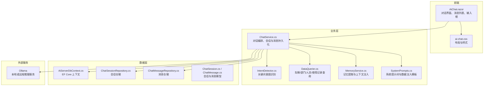
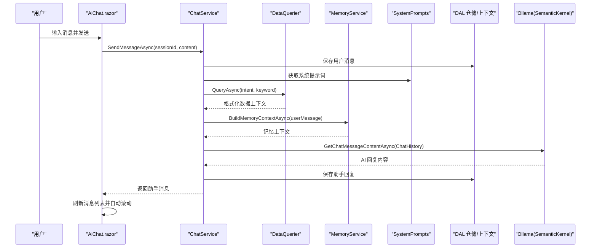
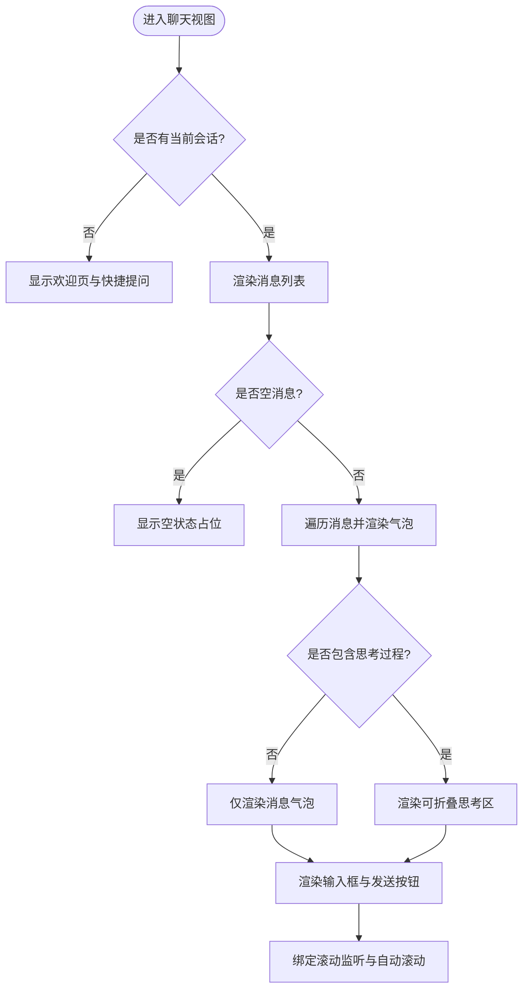
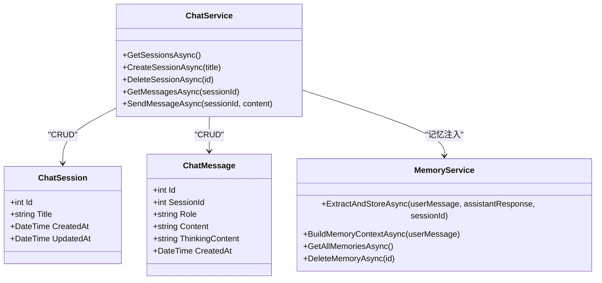
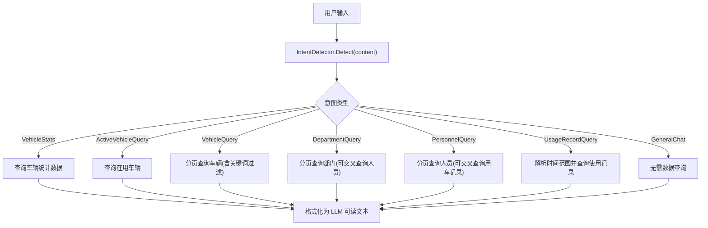
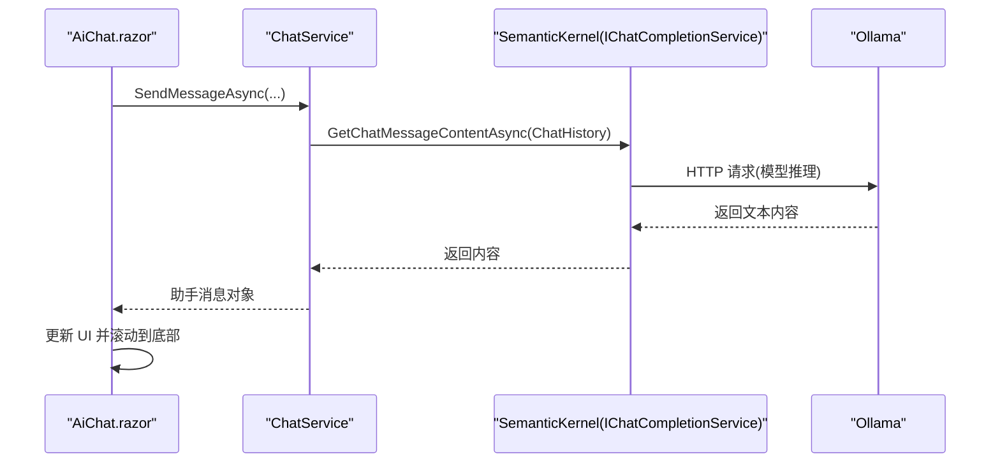
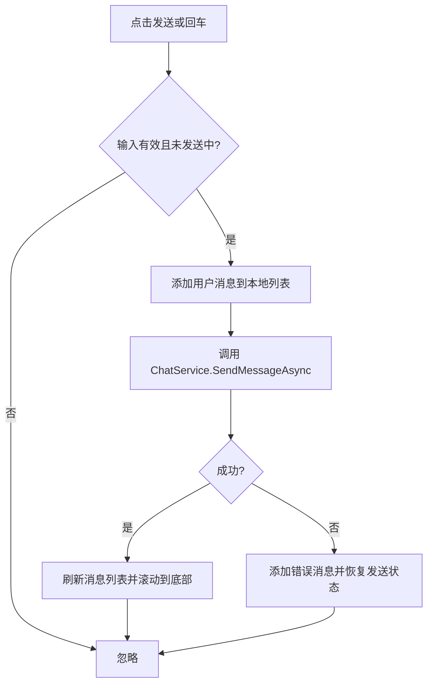
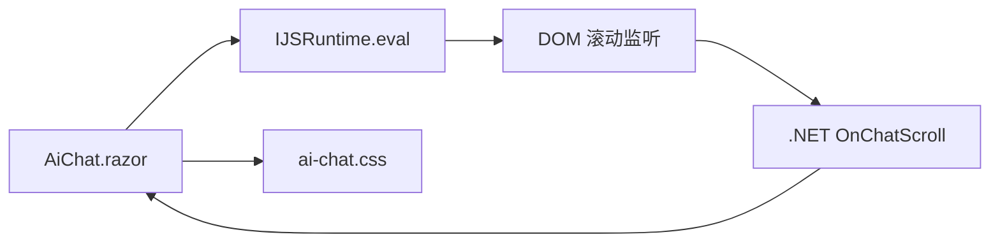
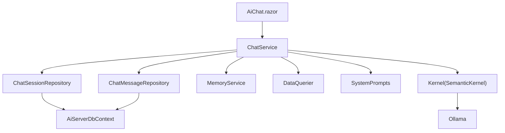

# AI 聊天页面

<cite>
**本文引用的文件**   
- [aiServer/Pages/AiChat.razor](file://aiServer/Pages/AiChat.razor)
- [aiServer/BLL/ChatService.cs](file://aiServer/BLL/ChatService.cs)
- [aiServer/BLL/IntentDetector.cs](file://aiServer/BLL/IntentDetector.cs)
- [aiServer/BLL/DataQuerier.cs](file://aiServer/BLL/DataQuerier.cs)
- [aiServer/BLL/MemoryService.cs](file://aiServer/BLL/MemoryService.cs)
- [aiServer/BLL/Prompts/SystemPrompts.cs](file://aiServer/BLL/Prompts/SystemPrompts.cs)
- [aiServer/DAL/Model/ChatSession.cs](file://aiServer/DAL/Model/ChatSession.cs)
- [aiServer/DAL/Model/ChatMessage.cs](file://aiServer/DAL/Model/ChatMessage.cs)
- [aiServer/DAL/AiServerDbContext.cs](file://aiServer/DAL/AiServerDbContext.cs)
- [aiServer/DAL/Repository/ChatSessionRepository.cs](file://aiServer/DAL/Repository/ChatSessionRepository.cs)
- [aiServer/DAL/Repository/ChatMessageRepository.cs](file://aiServer/DAL/Repository/ChatMessageRepository.cs)
- [wwwroot/css/ai-chat.css](file://wwwroot/css/ai-chat.css)
- [appsettings.json](file://appsettings.json)
- [aisettings.example.json](file://aisettings.example.json)
- [Program.cs](file://Program.cs)
</cite>

## 目录
1. [简介](#简介)
2. [项目结构](#项目结构)
3. [核心组件](#核心组件)
4. [架构总览](#架构总览)
5. [详细组件分析](#详细组件分析)
6. [依赖关系分析](#依赖关系分析)
7. [性能与体验优化](#性能与体验优化)
8. [故障排查指南](#故障排查指南)
9. [配置说明](#配置说明)
10. [结论](#结论)

## 简介
本文件面向 vehicleManagement 系统的 AI 聊天页面，系统性说明其界面架构、消息流、会话管理、记忆机制以及与 Ollama 的集成方式。文档同时覆盖 Blazor Server 实时通信、JavaScript 交互、样式适配、错误处理与重试策略，以及 Ollama 连接与安全配置要点。

## 项目结构
AI 聊天功能位于 aiServer 子模块中，前端为 Blazor 页面，后端通过 ChatService 串联意图识别、数据查询、提示词构建与 LLM 调用；UI 样式由独立 CSS 文件提供，数据库模型与仓储位于 DAL 层。

**图表来源**
- [aiServer/Pages/AiChat.razor:1-218](file://aiServer/Pages/AiChat.razor#L1-L218)
- [aiServer/BLL/ChatService.cs:14-42](file://aiServer/BLL/ChatService.cs#L14-L42)
- [aiServer/BLL/IntentDetector.cs:12-18](file://aiServer/BLL/IntentDetector.cs#L12-L18)
- [aiServer/BLL/DataQuerier.cs:18-43](file://aiServer/BLL/DataQuerier.cs#L18-L43)
- [aiServer/BLL/MemoryService.cs:15-39](file://aiServer/BLL/MemoryService.cs#L15-L39)
- [aiServer/BLL/Prompts/SystemPrompts.cs:6-11](file://aiServer/BLL/Prompts/SystemPrompts.cs#L6-L11)
- [aiServer/DAL/AiServerDbContext.cs:9-18](file://aiServer/DAL/AiServerDbContext.cs#L9-L18)
- [aiServer/DAL/Repository/ChatSessionRepository.cs:12-21](file://aiServer/DAL/Repository/ChatSessionRepository.cs#L12-L21)
- [aiServer/DAL/Repository/ChatMessageRepository.cs:12-21](file://aiServer/DAL/Repository/ChatMessageRepository.cs#L12-L21)
- [aiServer/DAL/Model/ChatSession.cs:11-21](file://aiServer/DAL/Model/ChatSession.cs#L11-L21)
- [aiServer/DAL/Model/ChatMessage.cs:10-26](file://aiServer/DAL/Model/ChatMessage.cs#L10-L26)

**章节来源**
- [aiServer/Pages/AiChat.razor:1-218](file://aiServer/Pages/AiChat.razor#L1-L218)
- [aiServer/BLL/ChatService.cs:14-42](file://aiServer/BLL/ChatService.cs#L14-L42)
- [wwwroot/css/ai-chat.css:20-30](file://wwwroot/css/ai-chat.css#L20-L30)

## 核心组件
- AiChat.razor：Blazor 页面，负责对话界面渲染、侧边栏会话管理、消息列表展示、输入框交互、滚动控制、诊断面板等。
- ChatService：对话编排服务，封装会话创建/删除、消息读写、意图识别、数据查询、记忆注入、LLM 调用与回复保存。
- IntentDetector：基于关键词匹配的用户意图识别器，输出意图类型与可选关键词。
- DataQuerier：根据意图调用车辆、部门、人员、使用记录与仪表盘服务，将结果格式化为 LLM 可读文本。
- MemoryService：从对话中提取记忆（车牌、品牌、偏好等），并构建历史记忆上下文。
- SystemPrompts：定义系统提示词和数据注入模板，约束 LLM 回答必须基于真实数据。
- DAL 模型与仓储：会话、消息、记忆的实体定义与 EF Core 访问封装。
- ai-chat.css：统一的 AI 聊天设计系统与响应式样式。

**章节来源**
- [aiServer/Pages/AiChat.razor:235-554](file://aiServer/Pages/AiChat.razor#L235-L554)
- [aiServer/BLL/ChatService.cs:14-42](file://aiServer/BLL/ChatService.cs#L14-L42)
- [aiServer/BLL/IntentDetector.cs:12-18](file://aiServer/BLL/IntentDetector.cs#L12-L18)
- [aiServer/BLL/DataQuerier.cs:18-43](file://aiServer/BLL/DataQuerier.cs#L18-L43)
- [aiServer/BLL/MemoryService.cs:15-39](file://aiServer/BLL/MemoryService.cs#L15-L39)
- [aiServer/BLL/Prompts/SystemPrompts.cs:6-11](file://aiServer/BLL/Prompts/SystemPrompts.cs#L6-L11)
- [aiServer/DAL/Model/ChatSession.cs:11-21](file://aiServer/DAL/Model/ChatSession.cs#L11-L21)
- [aiServer/DAL/Model/ChatMessage.cs:10-26](file://aiServer/DAL/Model/ChatMessage.cs#L10-L26)
- [wwwroot/css/ai-chat.css:9-18](file://wwwroot/css/ai-chat.css#L9-L18)

## 架构总览
AI 聊天页面采用“前端 UI + 业务编排 + 数据访问 + 外部 LLM”的分层架构。用户输入经 Blazor 事件触发 ChatService，后者完成意图识别、数据查询、记忆注入与 LLM 调用，最终将回复写入数据库并刷新到界面。

**图表来源**
- [aiServer/Pages/AiChat.razor:375-419](file://aiServer/Pages/AiChat.razor#L375-L419)
- [aiServer/BLL/ChatService.cs:94-139](file://aiServer/BLL/ChatService.cs#L94-L139)
- [aiServer/BLL/DataQuerier.cs:48-67](file://aiServer/BLL/DataQuerier.cs#L48-L67)
- [aiServer/BLL/MemoryService.cs:144-153](file://aiServer/BLL/MemoryService.cs#L144-L153)
- [aiServer/BLL/Prompts/SystemPrompts.cs:11-28](file://aiServer/BLL/Prompts/SystemPrompts.cs#L11-L28)
- [aiServer/DAL/Repository/ChatMessageRepository.cs:21-28](file://aiServer/DAL/Repository/ChatMessageRepository.cs#L21-L28)
- [aiServer/DAL/AiServerDbContext.cs:16-18](file://aiServer/DAL/AiServerDbContext.cs#L16-L18)

## 详细组件分析

### 对话界面与消息列表
- 欢迎页：当无当前会话时显示引导卡片与快捷提问按钮。
- 消息列表：按角色区分用户与助手气泡，支持时间戳与简单 Markdown 渲染（加粗、代码块）。
- 思考过程：助手消息可附带“思考过程”，以折叠面板呈现，便于调试与透明化。
- 输入框：支持 Enter 发送、Shift+Enter 换行，禁用状态在发送中不可用。
- 滚动控制：JS 监听滚动事件，距离底部阈值控制“回到底部”按钮与自动滚动开关。

**图表来源**
- [aiServer/Pages/AiChat.razor:95-218](file://aiServer/Pages/AiChat.razor#L95-L218)
- [aiServer/Pages/AiChat.razor:279-311](file://aiServer/Pages/AiChat.razor#L279-L311)
- [aiServer/Pages/AiChat.razor:516-538](file://aiServer/Pages/AiChat.razor#L516-L538)

**章节来源**
- [aiServer/Pages/AiChat.razor:95-218](file://aiServer/Pages/AiChat.razor#L95-L218)
- [aiServer/Pages/AiChat.razor:279-311](file://aiServer/Pages/AiChat.razor#L279-L311)
- [aiServer/Pages/AiChat.razor:516-538](file://aiServer/Pages/AiChat.razor#L516-L538)

### 会话管理与记忆
- 会话列表：侧边栏展示所有会话，支持新建、选择、删除；移动端以遮罩抽屉形式展示。
- 记忆面板：可展开查看已提取的记忆条目，支持分类标记与删除。
- 记忆提取：异步后台任务从对话中提取车牌、品牌、偏好等记忆，并注入后续对话上下文。

**图表来源**
- [aiServer/DAL/Model/ChatSession.cs:11-36](file://aiServer/DAL/Model/ChatSession.cs#L11-L36)
- [aiServer/DAL/Model/ChatMessage.cs:10-48](file://aiServer/DAL/Model/ChatMessage.cs#L10-L48)
- [aiServer/BLL/ChatService.cs:44-86](file://aiServer/BLL/ChatService.cs#L44-L86)
- [aiServer/BLL/MemoryService.cs:45-113](file://aiServer/BLL/MemoryService.cs#L45-L113)

**章节来源**
- [aiServer/Pages/AiChat.razor:17-91](file://aiServer/Pages/AiChat.razor#L17-L91)
- [aiServer/Pages/AiChat.razor:329-373](file://aiServer/Pages/AiChat.razor#L329-L373)
- [aiServer/BLL/MemoryService.cs:45-113](file://aiServer/BLL/MemoryService.cs#L45-L113)

### 意图识别与数据查询
- 意图识别：通过关键词匹配判断用户意图（车辆统计、在用车辆、车辆查询、部门查询、人员查询、使用记录查询、通用闲聊）。
- 数据查询：根据意图调用对应 BLL 服务，将结果拼接为结构化文本供 LLM 参考。
- 时间范围解析：对使用记录查询支持自然语言时间范围（如“最近一周”“三个月”）转换为天数。

**图表来源**
- [aiServer/BLL/IntentDetector.cs:17-110](file://aiServer/BLL/IntentDetector.cs#L17-L110)
- [aiServer/BLL/DataQuerier.cs:48-67](file://aiServer/BLL/DataQuerier.cs#L48-L67)
- [aiServer/BLL/DataQuerier.cs:69-143](file://aiServer/BLL/DataQuerier.cs#L69-L143)
- [aiServer/BLL/DataQuerier.cs:145-228](file://aiServer/BLL/DataQuerier.cs#L145-L228)
- [aiServer/BLL/DataQuerier.cs:230-330](file://aiServer/BLL/DataQuerier.cs#L230-L330)

**章节来源**
- [aiServer/BLL/IntentDetector.cs:17-110](file://aiServer/BLL/IntentDetector.cs#L17-L110)
- [aiServer/BLL/DataQuerier.cs:48-330](file://aiServer/BLL/DataQuerier.cs#L48-L330)

### 与 AI 服务的通信机制
- 通信方式：通过 SemanticKernel 的 IChatCompletionService 调用 Ollama 模型，非 WebSocket 长连接，而是 HTTP 请求-响应模式。
- 会话上下文：ChatHistory 包含系统提示词、数据注入、记忆上下文与最近历史消息。
- 错误处理：LLM 调用异常时返回友好错误信息；前端捕获异常并在消息列表中显示错误消息。

**图表来源**
- [aiServer/BLL/ChatService.cs:188-199](file://aiServer/BLL/ChatService.cs#L188-L199)
- [aiServer/Pages/AiChat.razor:396-419](file://aiServer/Pages/AiChat.razor#L396-L419)
- [Program.cs:97-102](file://Program.cs#L97-L102)

**章节来源**
- [aiServer/BLL/ChatService.cs:188-199](file://aiServer/BLL/ChatService.cs#L188-L199)
- [Program.cs:97-102](file://Program.cs#L97-L102)

### 用户交互体验
- 打字效果：发送中显示“思考中”动画指示器，提升等待感知。
- 自动滚动：首次渲染与新增消息后自动滚动到底部；用户上滚超过阈值隐藏自动滚动并显示“回到底部”按钮。
- 错误重试：当前实现捕获异常并显示错误消息；未实现自动重试逻辑，可在前端增加重试按钮或指数退避策略。
- 键盘快捷键：F12 打开布局诊断面板（Ctrl+F12 带标记），Enter 发送，Shift+Enter 换行。

**图表来源**
- [aiServer/Pages/AiChat.razor:375-419](file://aiServer/Pages/AiChat.razor#L375-L419)
- [aiServer/Pages/AiChat.razor:429-443](file://aiServer/Pages/AiChat.razor#L429-L443)
- [aiServer/Pages/AiChat.razor:516-538](file://aiServer/Pages/AiChat.razor#L516-L538)

**章节来源**
- [aiServer/Pages/AiChat.razor:375-419](file://aiServer/Pages/AiChat.razor#L375-L419)
- [aiServer/Pages/AiChat.razor:429-443](file://aiServer/Pages/AiChat.razor#L429-L443)
- [aiServer/Pages/AiChat.razor:516-538](file://aiServer/Pages/AiChat.razor#L516-L538)

### 技术实现细节
- Blazor Server 实时通信：页面通过 @inject 注入 ChatService 与 IJSRuntime，使用 JS 进行 DOM 操作与滚动监听。
- JavaScript 交互：注册全局滚动监听函数，通过 DotNetObjectReference 回调 .NET 方法 OnChatScroll，控制自动滚动与按钮显示。
- 样式适配：CSS 变量统一主题色与圆角阴影，媒体查询适配桌面与移动端，减少动效以提升无障碍体验。

**图表来源**
- [aiServer/Pages/AiChat.razor:279-311](file://aiServer/Pages/AiChat.razor#L279-L311)
- [aiServer/Pages/AiChat.razor:313-327](file://aiServer/Pages/AiChat.razor#L313-L327)
- [wwwroot/css/ai-chat.css:412-468](file://wwwroot/css/ai-chat.css#L412-L468)

**章节来源**
- [aiServer/Pages/AiChat.razor:279-327](file://aiServer/Pages/AiChat.razor#L279-L327)
- [wwwroot/css/ai-chat.css:412-468](file://wwwroot/css/ai-chat.css#L412-L468)

## 依赖关系分析
- 组件耦合：AiChat.razor 依赖 ChatService 与 IJSRuntime；ChatService 依赖仓储、MemoryService、DataQuerier、SystemPrompts 与 Kernel。
- 外部依赖：SemanticKernel 通过 Program.cs 注册单例 Kernel，连接 Ollama。
- 数据依赖：AiServerDbContext 管理会话、消息、记忆表；仓储提供 CRUD 与分页查询。

**图表来源**
- [aiServer/Pages/AiChat.razor:5-7](file://aiServer/Pages/AiChat.razor#L5-L7)
- [aiServer/BLL/ChatService.cs:14-42](file://aiServer/BLL/ChatService.cs#L14-L42)
- [aiServer/DAL/Repository/ChatSessionRepository.cs:12-21](file://aiServer/DAL/Repository/ChatSessionRepository.cs#L12-L21)
- [aiServer/DAL/Repository/ChatMessageRepository.cs:12-21](file://aiServer/DAL/Repository/ChatMessageRepository.cs#L12-L21)
- [aiServer/DAL/AiServerDbContext.cs:16-18](file://aiServer/DAL/AiServerDbContext.cs#L16-L18)
- [Program.cs:97-102](file://Program.cs#L97-L102)

**章节来源**
- [aiServer/Pages/AiChat.razor:5-7](file://aiServer/Pages/AiChat.razor#L5-L7)
- [aiServer/BLL/ChatService.cs:14-42](file://aiServer/BLL/ChatService.cs#L14-L42)
- [aiServer/DAL/AiServerDbContext.cs:16-18](file://aiServer/DAL/AiServerDbContext.cs#L16-L18)
- [Program.cs:97-102](file://Program.cs#L97-L102)

## 性能与体验优化
- 消息历史限制：只加载最近 20 条消息构建 ChatHistory，避免上下文过大影响推理速度与成本。
- 异步记忆提取：记忆提取在后台 Task.Run 执行，不阻塞主对话流程。
- 滚动优化：OnAfterRenderAsync 内使用瞬间滚动避免动画延迟；用户手动滚动时切换自动滚动开关。
- 样式性能：CSS 变量与媒体查询减少重复计算；减少复杂动画以提升低端设备体验。

[本节为通用指导，不直接分析具体文件]

## 故障排查指南
- LLM 不可用：检查 Ollama 端点与模型配置；若返回“AI 服务暂时不可用”，确认网络连通性与模型名称。
- 数据库连接失败：确保 appsettings.json 中 AiServerConnection 正确，且 data/aiServer.db 存在并可写。
- 意图识别不准确：调整 IntentDetector 关键词与停用词；必要时扩展正则表达式匹配规则。
- 滚动异常：检查 JS 滚动监听是否注册成功；确认 messagesContainer 引用与 CSS 类名一致。
- 样式错乱：核对 ai-chat.css 是否被引入；检查浏览器控制台是否存在 CSS 加载错误。

**章节来源**
- [aiServer/BLL/ChatService.cs:188-199](file://aiServer/BLL/ChatService.cs#L188-L199)
- [appsettings.json:3-6](file://appsettings.json#L3-L6)
- [aiServer/BLL/IntentDetector.cs:17-110](file://aiServer/BLL/IntentDetector.cs#L17-L110)
- [aiServer/Pages/AiChat.razor:279-311](file://aiServer/Pages/AiChat.razor#L279-L311)
- [wwwroot/css/ai-chat.css:20-30](file://wwwroot/css/ai-chat.css#L20-L30)

## 配置说明
- Ollama 连接设置：
  - 端点与模型通过配置键 AiServer:OllamaEndpoint 与 AiServer:OllamaModel 读取，默认值分别为 http://localhost:11434 与 gemma4:e2b。
  - 示例配置文件 aisettings.example.json 提供模板，实际使用时复制为 aisettings.json 并修改。
- 数据库连接：
  - appsettings.json 中 ConnectionStrings.AiServerConnection 指向 aiServer.db。
- 安全配置建议：
  - 生产环境应限制 Ollama 端点为可信地址，启用 HTTPS 反向代理。
  - 对 AI 输入进行长度与敏感词校验，防止注入攻击。
  - 对会话与记忆数据实施访问控制与审计日志。

**章节来源**
- [Program.cs:97-102](file://Program.cs#L97-L102)
- [aisettings.example.json:1-7](file://aisettings.example.json#L1-L7)
- [appsettings.json:3-6](file://appsettings.json#L3-L6)

## 结论
AI 聊天页面以 Blazor Server 为前端载体，通过 ChatService 将意图识别、数据查询、记忆注入与 LLM 调用整合成稳定可靠的对话流程。界面层提供友好的消息展示、会话管理与滚动体验，样式层保证跨设备一致性。通过合理配置 Ollama 与数据库连接，系统可在本地或远程环境中运行，并为车辆管理系统提供智能问答能力。未来可在错误重试、流式输出与更丰富的 Markdown 渲染方面进一步增强用户体验。