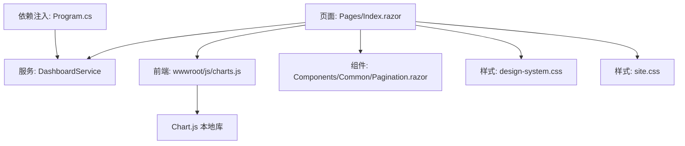
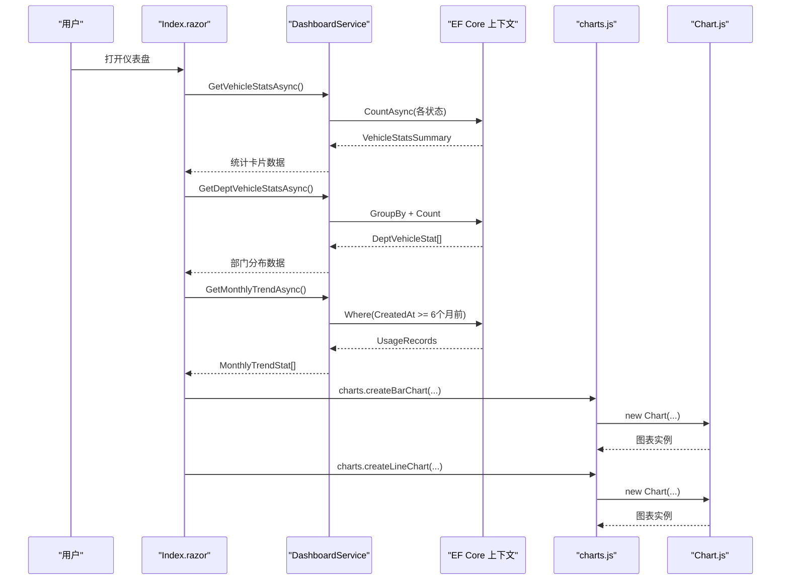
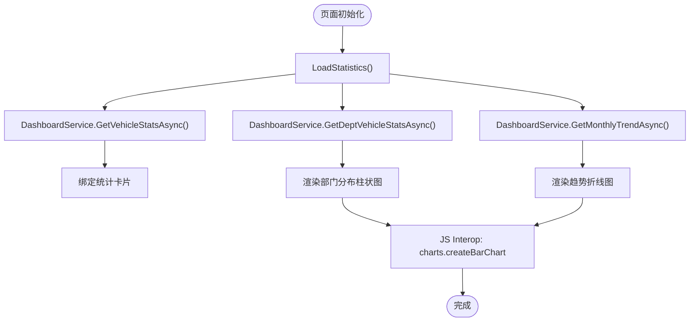
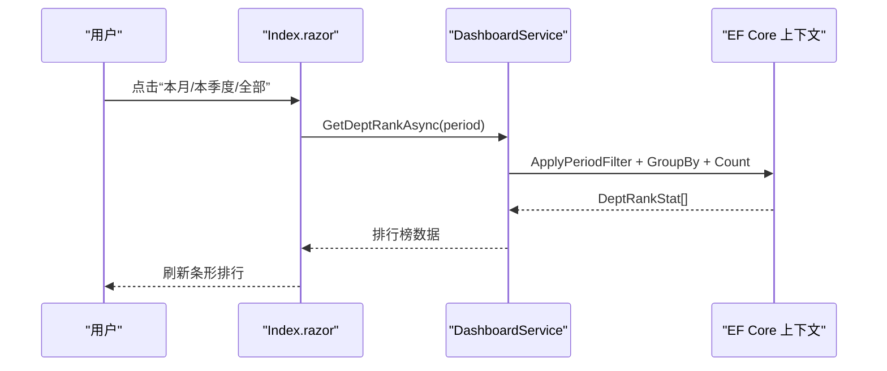
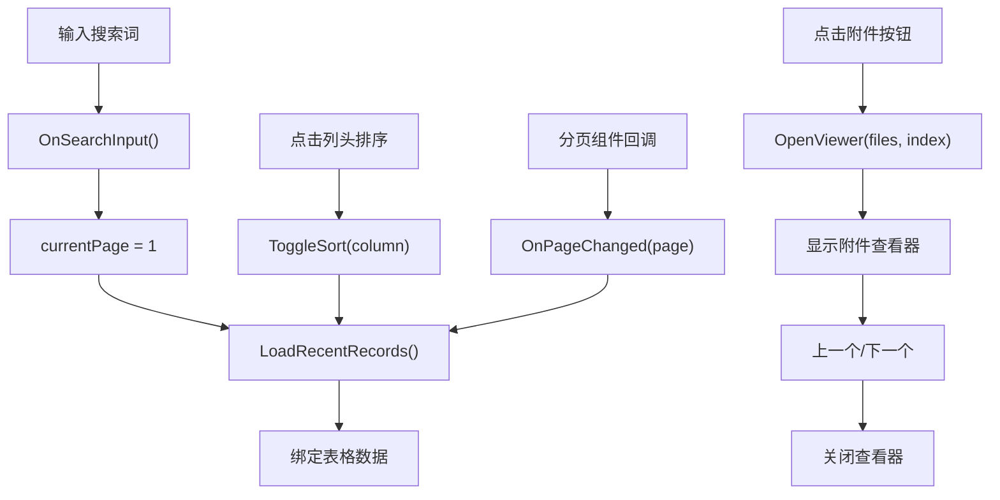
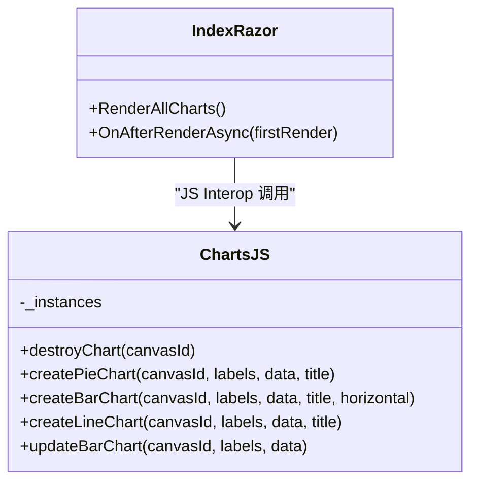
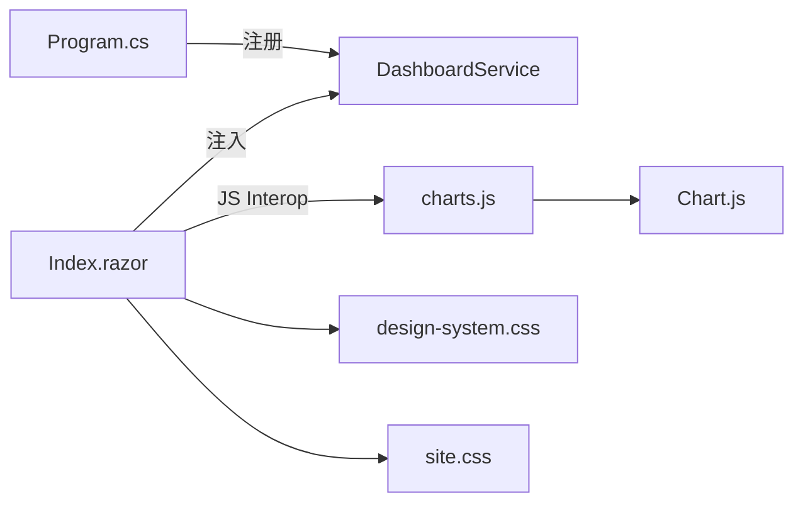

# 仪表盘页面

<cite>
**本文引用的文件**   
- [Pages/Index.razor](file://Pages/Index.razor)
- [BLL/Dashboard/DashboardService.cs](file://BLL/Dashboard/DashboardService.cs)
- [wwwroot/js/charts.js](file://wwwroot/js/charts.js)
- [wwwroot/css/site.css](file://wwwroot/css/site.css)
- [wwwroot/css/design-system.css](file://wwwroot/css/design-system.css)
- [Program.cs](file://Program.cs)
- [Components/Common/Pagination.razor](file://Components/Common/Pagination.razor)
</cite>

## 目录
1. [简介](#简介)
2. [项目结构](#项目结构)
3. [核心组件](#核心组件)
4. [架构总览](#架构总览)
5. [详细组件分析](#详细组件分析)
6. [依赖关系分析](#依赖关系分析)
7. [性能与优化](#性能与优化)
8. [故障排查指南](#故障排查指南)
9. [结论](#结论)

## 简介
本文件面向 vehicleManagement 系统的仪表盘页面，系统性说明其架构设计、数据流、图表渲染机制、用户交互能力以及性能优化策略。仪表盘承担“车辆总览”职责，包含统计卡片、部门/状态分布图、近六个月趋势折线图、部门与人员用车排行榜、最近使用记录（支持搜索、排序、分页）以及附件查看器。

## 项目结构
仪表盘页面由 Blazor 页面、业务服务、前端 JS 图表库与样式共同组成：
- 页面层：`Pages/Index.razor` 负责 UI 布局、状态管理、用户交互与调用服务。
- 业务层：`BLL/Dashboard/DashboardService.cs` 封装统计数据、排行、趋势与分页查询逻辑。
- 前端资源：`wwwroot/js/charts.js` 基于 Chart.js 提供图表创建与更新方法；`wwwroot/js/chart.umd.min.js` 为 Chart.js 本地包。
- 样式层：`wwwroot/css/design-system.css` 提供基础设计令牌与网格系统；`wwwroot/css/site.css` 补充仪表盘相关样式。
- 通用组件：`Components/Common/Pagination.razor` 提供分页控件。
- 依赖注入：`Program.cs` 将 `DashboardService` 注册为服务。

**图示来源**
- [Pages/Index.razor:1-460](file://Pages/Index.razor#L1-L460)
- [BLL/Dashboard/DashboardService.cs:1-247](file://BLL/Dashboard/DashboardService.cs#L1-L247)
- [wwwroot/js/charts.js:1-509](file://wwwroot/js/charts.js#L1-L509)
- [Components/Common/Pagination.razor](file://Components/Common/Pagination.razor)
- [wwwroot/css/design-system.css:853-910](file://wwwroot/css/design-system.css#L853-L910)
- [wwwroot/css/site.css:107-185](file://wwwroot/css/site.css#L107-L185)
- [Program.cs:81-81](file://Program.cs#L81-L81)

**章节来源**
- [Pages/Index.razor:1-460](file://Pages/Index.razor#L1-L460)
- [BLL/Dashboard/DashboardService.cs:1-247](file://BLL/Dashboard/DashboardService.cs#L1-L247)
- [wwwroot/js/charts.js:1-509](file://wwwroot/js/charts.js#L1-L509)
- [wwwroot/css/design-system.css:853-910](file://wwwroot/css/design-system.css#L853-L910)
- [wwwroot/css/site.css:107-185](file://wwwroot/css/site.css#L107-L185)
- [Program.cs:81-81](file://Program.cs#L81-L81)

## 核心组件
- 统计卡片：展示车辆总数、在用、维修、退役数量，数据来自 `DashboardService.GetVehicleStatsAsync`。
- 图表可视化：
  - 部门车辆分布柱状图：通过 `charts.createBarChart` 渲染。
  - 车辆状态分布柱状图：通过 `charts.createBarChart` 渲染。
  - 近六个月趋势折线图：通过 `charts.createLineChart` 渲染。
- 排行榜：
  - 部门用车排行：支持本月/本季度/全部切换，数据来自 `GetDeptRankAsync`。
  - 人员用车排行：支持本月/本季度/全部切换，数据来自 `GetPersonRankAsync`。
- 最近使用记录：支持关键词搜索、列排序、分页导航与附件查看。
- 附件查看器：弹窗内以图片/视频形式浏览附件，支持上一个/下一个切换。

**章节来源**
- [Pages/Index.razor:14-228](file://Pages/Index.razor#L14-L228)
- [BLL/Dashboard/DashboardService.cs:25-192](file://BLL/Dashboard/DashboardService.cs#L25-L192)

## 架构总览
仪表盘采用分层架构：
- 表现层：Blazor 页面负责视图与交互。
- 服务层：DashboardService 聚合数据库查询与数据转换。
- 数据访问层：通过 EF Core 上下文工厂获取 DbContext，执行高效查询。
- 前端图表层：JS Interop 调用 charts.js，基于 Chart.js 渲染图表。

**图示来源**
- [Pages/Index.razor:297-396](file://Pages/Index.razor#L297-L396)
- [BLL/Dashboard/DashboardService.cs:28-94](file://BLL/Dashboard/DashboardService.cs#L28-L94)
- [wwwroot/js/charts.js:60-330](file://wwwroot/js/charts.js#L60-L330)

## 详细组件分析

### 统计卡片与数据加载流程
- 生命周期：
  - `OnInitializedAsync` 中并行加载统计与最近记录。
  - `OnAfterRenderAsync` 中检测交互模式并仅创建一次图表。
- 数据源：
  - 统计卡片：`GetVehicleStatsAsync` 返回 `VehicleStatsSummary`。
  - 部门分布：`GetDeptVehicleStatsAsync` 返回 `DeptVehicleStat[]`。
  - 月度趋势：`GetMonthlyTrendAsync` 返回 `MonthlyTrendStat[]`。
- 图表渲染：
  - 延迟 100ms 确保 DOM 就绪后调用 `charts.createBarChart` / `charts.createLineChart`。
  - 使用 `IJSRuntime.InvokeVoidAsync` 进行 JS Interop。

**图示来源**
- [Pages/Index.razor:297-396](file://Pages/Index.razor#L297-L396)
- [BLL/Dashboard/DashboardService.cs:28-94](file://BLL/Dashboard/DashboardService.cs#L28-L94)

**章节来源**
- [Pages/Index.razor:297-396](file://Pages/Index.razor#L297-L396)
- [BLL/Dashboard/DashboardService.cs:28-94](file://BLL/Dashboard/DashboardService.cs#L28-L94)

### 排行榜功能
- 部门用车排行：
  - 周期参数：month/quarter/all。
  - 数据获取：`GetDeptRankAsync(period)`，内部按时间范围过滤后分组计数，取前 10。
- 人员用车排行：
  - 周期参数：month/quarter/all。
  - 数据获取：`GetPersonRankAsync(period)`，内部按时间范围过滤后分组计数，取前 10。
- 交互：
  - 切换按钮触发 `ChangeDeptRankPeriod` / `ChangePersonRankPeriod`，重新拉取数据并刷新列表。

**图示来源**
- [Pages/Index.razor:92-163](file://Pages/Index.razor#L92-L163)
- [BLL/Dashboard/DashboardService.cs:96-140](file://BLL/Dashboard/DashboardService.cs#L96-L140)

**章节来源**
- [Pages/Index.razor:92-163](file://Pages/Index.razor#L92-L163)
- [BLL/Dashboard/DashboardService.cs:96-140](file://BLL/Dashboard/DashboardService.cs#L96-L140)

### 最近使用记录：搜索、排序、分页、附件查看
- 搜索过滤：
  - 输入框绑定 `searchKeyword`，实时触发 `OnSearchInput`，重置页码并重新加载。
- 排序：
  - 支持按车辆、使用人、时间排序，切换升/降序，触发 `ToggleSort` 后重新加载。
- 分页：
  - 使用 `Pagination.razor` 组件，回调 `OnPageChanged` 更新当前页码并重新加载。
- 附件查看：
  - 解析 `ImagePaths` / `VideoPaths`，根据扩展名判断图片/视频，弹窗内显示并支持上一个/下一个切换。

**图示来源**
- [Pages/Index.razor:166-257](file://Pages/Index.razor#L166-L257)
- [Pages/Index.razor:401-459](file://Pages/Index.razor#L401-L459)
- [BLL/Dashboard/DashboardService.cs:142-192](file://BLL/Dashboard/DashboardService.cs#L142-L192)

**章节来源**
- [Pages/Index.razor:166-257](file://Pages/Index.razor#L166-L257)
- [Pages/Index.razor:401-459](file://Pages/Index.razor#L401-L459)
- [BLL/Dashboard/DashboardService.cs:142-192](file://BLL/Dashboard/DashboardService.cs#L142-L192)

### 图表渲染机制：Chart.js 集成与 JS Interop
- 全局配置：
  - 主题色、字体、工具提示等统一在 `charts.js` 中设置。
- 图表创建：
  - `createBarChart`：用于部门分布与状态分布。
  - `createLineChart`：用于月度趋势。
- 生命周期控制：
  - 页面仅在交互模式下创建图表一次，避免重复销毁重建。
  - 使用 `requestAnimationFrame` 与 `setTimeout` 确保 DOM 就绪后再绘制。
- 响应式更新：
  - 图表容器高度随屏幕尺寸变化，CSS 媒体查询调整 `.chart-wrap` 高度。
  - 图表实例维护在 `window.charts._instances`，支持后续更新。

**图示来源**
- [wwwroot/js/charts.js:60-509](file://wwwroot/js/charts.js#L60-L509)
- [Pages/Index.razor:303-396](file://Pages/Index.razor#L303-L396)

**章节来源**
- [wwwroot/js/charts.js:60-509](file://wwwroot/js/charts.js#L60-L509)
- [Pages/Index.razor:303-396](file://Pages/Index.razor#L303-L396)

## 依赖关系分析
- 服务注册：
  - `Program.cs` 中将 `DashboardService` 注册为作用域服务。
- 页面依赖：
  - `Index.razor` 通过依赖注入获取 `DashboardService` 与 `IJSRuntime`。
- 图表依赖：
  - `charts.js` 依赖 `Chart.js` 本地库，暴露 `window.charts` API。
- 样式依赖：
  - `design-system.css` 提供网格、文本、颜色等基础样式。
  - `site.css` 补充仪表盘图表容器与排行榜样式。

**图示来源**
- [Program.cs:81-81](file://Program.cs#L81-L81)
- [Pages/Index.razor:1-4](file://Pages/Index.razor#L1-L4)
- [wwwroot/js/charts.js:1-509](file://wwwroot/js/charts.js#L1-L509)
- [wwwroot/css/design-system.css:853-910](file://wwwroot/css/design-system.css#L853-L910)
- [wwwroot/css/site.css:107-185](file://wwwroot/css/site.css#L107-L185)

**章节来源**
- [Program.cs:81-81](file://Program.cs#L81-L81)
- [Pages/Index.razor:1-4](file://Pages/Index.razor#L1-L4)
- [wwwroot/js/charts.js:1-509](file://wwwroot/js/charts.js#L1-L509)
- [wwwroot/css/design-system.css:853-910](file://wwwroot/css/design-system.css#L853-L910)
- [wwwroot/css/site.css:107-185](file://wwwroot/css/site.css#L107-L185)

## 性能与优化
- 异步数据加载：
  - 所有数据获取均为异步方法，避免阻塞 UI 线程。
- 数据库查询优化：
  - 统计卡片使用多次 `CountAsync`，避免全表加载。
  - 部门分布使用 `GroupBy` + `Select` 在服务端聚合。
  - 月度趋势先筛选近六个月数据，再内存分组补齐空月份。
  - 排行榜使用 `ApplyPeriodFilter` 动态拼接时间范围，减少不必要数据。
  - 最近记录使用 `Include` 预加载关联实体，结合 `Skip/Take` 分页。
- 图表渲染优化：
  - 仅在交互模式下创建图表一次，避免重复销毁重建。
  - 使用 `requestAnimationFrame` 与 `setTimeout` 确保 DOM 就绪。
  - 图表实例缓存于 `window.charts._instances`，便于更新与释放。
- 内存管理：
  - 图表销毁时从 `_instances` 移除引用，防止内存泄漏。
  - 附件查看器按需加载图片/视频，避免一次性加载大量媒体。
- 响应式与懒加载：
  - 图表容器高度随屏幕尺寸变化，提升移动端体验。
  - 排行榜与最近记录按需分页，减少首屏数据量。

[本节为通用性能建议，不直接分析具体代码文件]

## 故障排查指南
- 图表未渲染：
  - 检查是否处于交互模式（非预渲染阶段）。
  - 确认 `chartsCreated` 标志未被错误重置。
  - 验证 `canvas` 元素是否存在且 ID 正确。
- JS Interop 失败：
  - 检查 `IJSRuntime` 是否可用。
  - 确认 `charts.js` 已加载且 `window.charts` 对象存在。
- 数据为空：
  - 检查数据库连接与上下文工厂是否正常。
  - 确认 `ChinaTime.Now` 计算是否正确。
- 附件无法查看：
  - 检查 `ImagePaths` / `VideoPaths` 字段是否为空或格式不正确。
  - 确认浏览器对图片/视频类型的支持。

**章节来源**
- [Pages/Index.razor:303-324](file://Pages/Index.razor#L303-L324)
- [wwwroot/js/charts.js:60-68](file://wwwroot/js/charts.js#L60-L68)
- [BLL/Dashboard/DashboardService.cs:67-94](file://BLL/Dashboard/DashboardService.cs#L67-L94)

## 结论
仪表盘页面通过清晰的层次化架构与高效的数据库查询，实现了丰富的可视化与交互功能。借助 Chart.js 与 JS Interop，图表渲染稳定且响应迅速；通过分页、搜索与排序，最近使用记录易于检索；附件查看器提升了用户体验。整体实现兼顾性能与可维护性，适合在企业级车辆管理系统中作为核心监控入口。