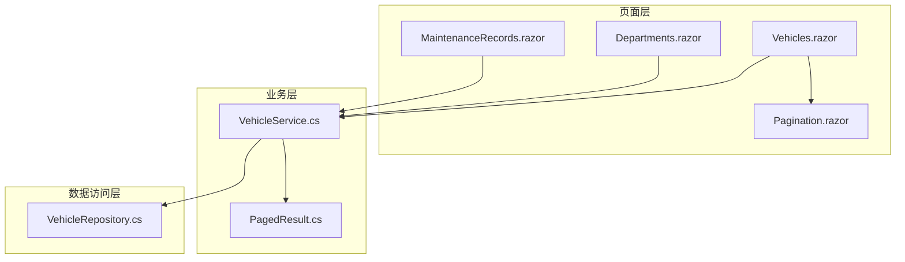
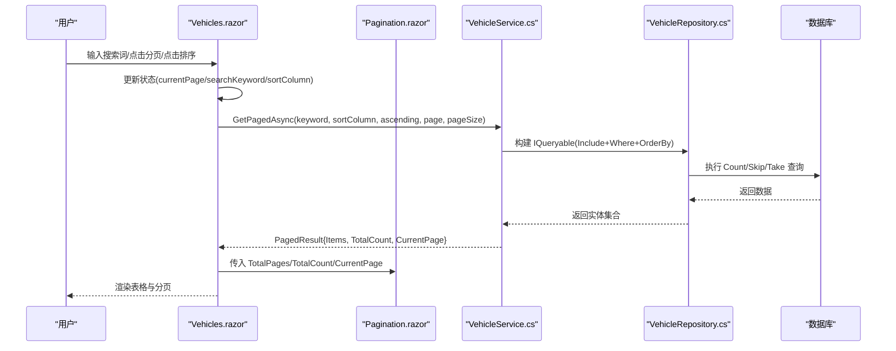
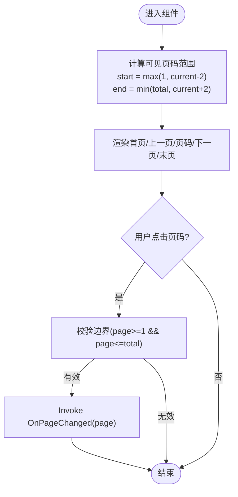
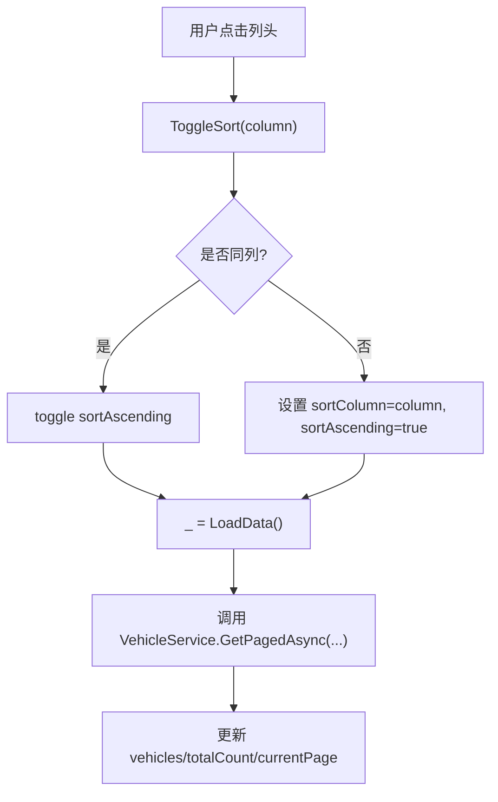
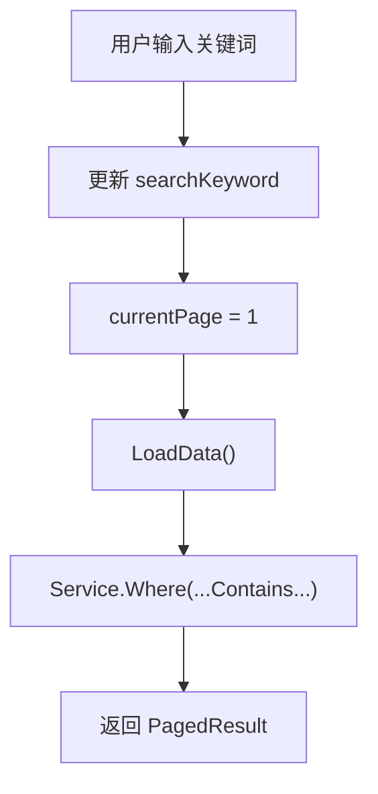
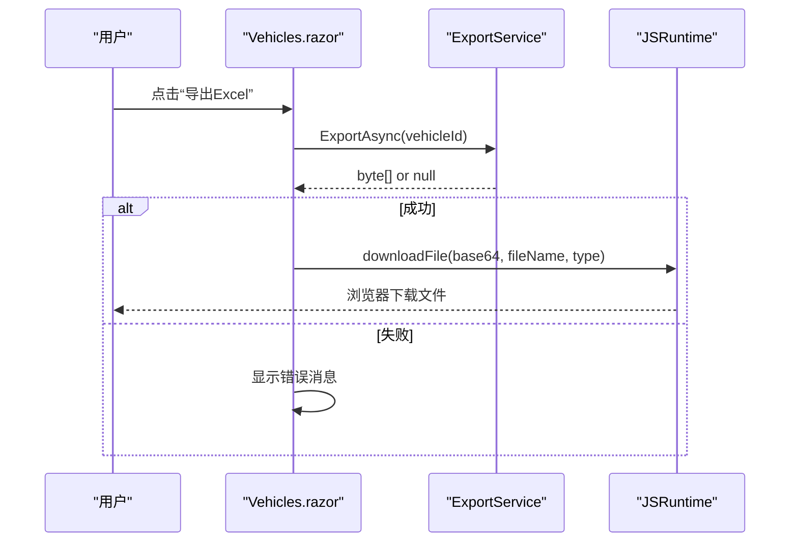
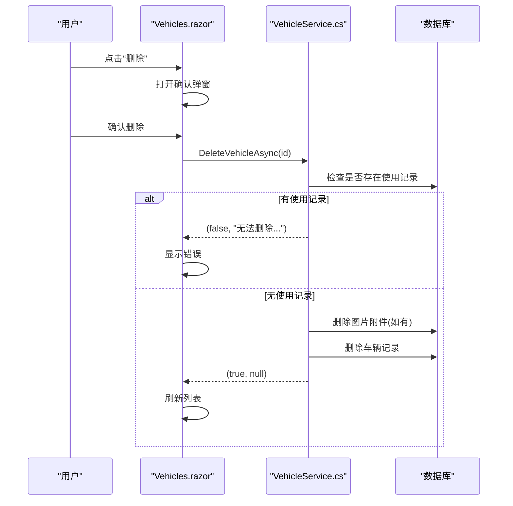
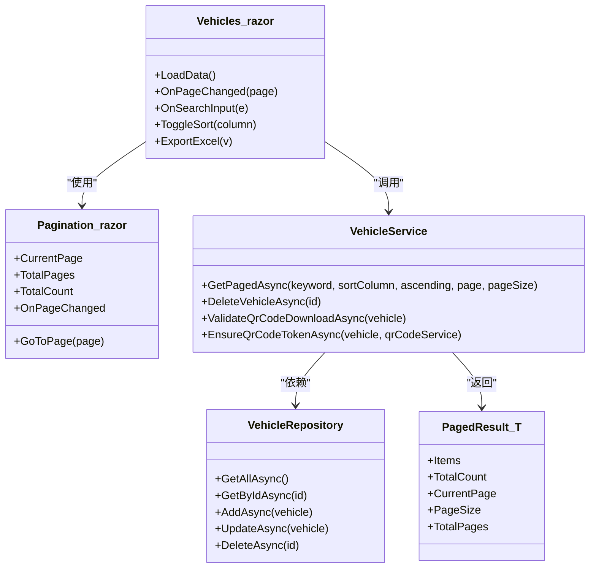

# 数据列表页面

<cite>
**本文引用的文件**   
- [Vehicles.razor](file://Pages/Vehicles.razor)
- [Departments.razor](file://Pages/Departments.razor)
- [MaintenanceRecords.razor](file://Pages/MaintenanceRecords.razor)
- [Pagination.razor](file://Components/Common/Pagination.razor)
- [VehicleService.cs](file://BLL/Vehicle/VehicleService.cs)
- [PagedResult.cs](file://BLL/Common/PagedResult.cs)
- [VehicleRepository.cs](file://DAL/Repository/VehicleRepository.cs)
</cite>

## 目录
1. [简介](#简介)
2. [项目结构](#项目结构)
3. [核心组件](#核心组件)
4. [架构总览](#架构总览)
5. [详细组件分析](#详细组件分析)
6. [依赖关系分析](#依赖关系分析)
7. [性能与扩展性](#性能与扩展性)
8. [故障排查指南](#故障排查指南)
9. [结论](#结论)
10. [附录：快速搭建新列表页指南](#附录快速搭建新列表页指南)

## 简介
本文件面向 vehicleManagement 系统的数据列表页面，聚焦“车辆管理”列表作为通用模板，系统性说明以下能力：
- 表格展示、分页导航、搜索过滤、排序功能、批量操作（以单行快捷操作为主）
- 组件复用模式：Pagination 组件、数据表格（页面内嵌）、搜索栏的集成方式
- 数据处理流程：服务端分页、异步加载、数据转换、缓存策略
- 用户交互：列宽调整、视图切换、导出功能、快捷操作
- 扩展指南：如何快速搭建新列表页、自定义列配置、权限控制集成

## 项目结构
数据列表相关代码主要分布在三层：
- 页面层（Pages）：负责 UI 渲染、用户交互、状态管理
- 业务层（BLL）：封装查询、校验、业务规则
- 数据访问层（DAL）：通过 Repository 访问数据库

图表来源
- [Vehicles.razor:1-410](file://Pages/Vehicles.razor#L1-L410)
- [Departments.razor:1-280](file://Pages/Departments.razor#L1-L280)
- [MaintenanceRecords.razor:1-161](file://Pages/MaintenanceRecords.razor#L1-L161)
- [Pagination.razor:1-42](file://Components/Common/Pagination.razor#L1-L42)
- [VehicleService.cs:67-109](file://BLL/Vehicle/VehicleService.cs#L67-L109)
- [PagedResult.cs:1-37](file://BLL/Common/PagedResult.cs#L1-L37)
- [VehicleRepository.cs:1-66](file://DAL/Repository/VehicleRepository.cs#L1-L66)

章节来源
- [Vehicles.razor:1-410](file://Pages/Vehicles.razor#L1-L410)
- [Pagination.razor:1-42](file://Components/Common/Pagination.razor#L1-L42)
- [VehicleService.cs:67-109](file://BLL/Vehicle/VehicleService.cs#L67-L109)
- [PagedResult.cs:1-37](file://BLL/Common/PagedResult.cs#L1-L37)

## 核心组件
- 分页组件 Pagination：提供首页/上一页/页码/下一页/末页按钮，内部计算可见页码范围，并通过事件回调通知父组件。
- 数据表格：在页面中以原生 table 实现，支持列头点击触发排序、行内快捷操作（编辑、下载二维码、导出 Excel、删除）。
- 搜索栏：输入框绑定关键词，实时触发服务端分页查询并重置到第一页。
- 服务层 VehicleService：统一处理分页、搜索、排序、业务校验（如删除前检查使用记录、二维码下载条件等）。
- 分页结果 PagedResult：统一封装 Items、TotalCount、CurrentPage、PageSize、TotalPages。

章节来源
- [Pagination.razor:1-42](file://Components/Common/Pagination.razor#L1-L42)
- [Vehicles.razor:126-184](file://Pages/Vehicles.razor#L126-L184)
- [VehicleService.cs:67-109](file://BLL/Vehicle/VehicleService.cs#L67-L109)
- [PagedResult.cs:1-37](file://BLL/Common/PagedResult.cs#L1-L37)

## 架构总览
数据列表页面的典型调用链如下：
- 用户输入搜索或点击分页/排序
- 页面更新本地状态并调用 LoadData
- LoadData 调用 VehicleService.GetPagedAsync
- Service 组合 EF Core 查询（Include 部门、Where 搜索、OrderBy 排序、Skip/Take 分页）
- 返回 PagedResult，页面刷新表格和分页控件

图表来源
- [Vehicles.razor:215-247](file://Pages/Vehicles.razor#L215-L247)
- [Pagination.razor:20-40](file://Components/Common/Pagination.razor#L20-L40)
- [VehicleService.cs:67-109](file://BLL/Vehicle/VehicleService.cs#L67-L109)

## 详细组件分析

### 分页组件 Pagination
- 参数：CurrentPage、TotalPages、TotalCount、OnPageChanged
- 行为：
  - 自动禁用首尾页/上下页按钮
  - 动态显示当前页前后若干页码
  - 通过 OnPageChanged 将目标页码回传给父组件
- 复杂度：GetPageNumbers 为 O(k)，k 为显示的页码数量（通常很小）

图表来源
- [Pagination.razor:20-40](file://Components/Common/Pagination.razor#L20-L40)

章节来源
- [Pagination.razor:1-42](file://Components/Common/Pagination.razor#L1-L42)

### 数据表格与交互（以 Vehicles.razor 为例）
- 表格列：车牌号、所属部门、品牌/型号、颜色、状态、创建时间、操作
- 排序：列头可点击，ToggleSort 维护 sortColumn 与 sortAscending，并在 UI 上显示 ▲/▼
- 搜索：顶部输入框绑定 searchKeyword，oninput 触发 OnSearchInput，重置 currentPage=1 并重新加载
- 快捷操作：编辑、下载二维码、导出 Excel、删除（带确认弹窗）
- 状态管理：vehicles、totalCount、currentPage、pageSize、sortColumn、sortAscending、searchKeyword

图表来源
- [Vehicles.razor:242-247](file://Pages/Vehicles.razor#L242-L247)
- [Vehicles.razor:215-227](file://Pages/Vehicles.razor#L215-L227)

章节来源
- [Vehicles.razor:126-184](file://Pages/Vehicles.razor#L126-L184)
- [Vehicles.razor:206-247](file://Pages/Vehicles.razor#L206-L247)

### 搜索与过滤
- 前端：输入框 value 双向绑定 searchKeyword，@oninput 触发 OnSearchInput
- 后端：VehicleService.GetPagedAsync 对 LicensePlate/Brand/Model/Color 进行 Contains 模糊匹配
- 行为：每次输入都重置到第 1 页并重新请求

图表来源
- [Vehicles.razor:235-240](file://Pages/Vehicles.razor#L235-L240)
- [VehicleService.cs:73-82](file://BLL/Vehicle/VehicleService.cs#L73-L82)

章节来源
- [Vehicles.razor:235-240](file://Pages/Vehicles.razor#L235-L240)
- [VehicleService.cs:73-82](file://BLL/Vehicle/VehicleService.cs#L73-L82)

### 导出功能
- 入口：行内“导出 Excel”按钮
- 流程：调用 ExportService.ExportAsync(v.Id) → 获取字节数组 → Base64 → JS 下载
- 错误处理：未找到数据或异常时显示错误弹窗

图表来源
- [Vehicles.razor:397-408](file://Pages/Vehicles.razor#L397-L408)

章节来源
- [Vehicles.razor:397-408](file://Pages/Vehicles.razor#L397-L408)

### 删除与二次确认
- 流程：点击删除 → 弹出确认框 → ConfirmDelete 调用 VehicleService.DeleteVehicleAsync → 成功后刷新列表
- 业务校验：若存在使用记录则拒绝删除；同时清理图片附件，失败则阻止删除

图表来源
- [Vehicles.razor:382-395](file://Pages/Vehicles.razor#L382-L395)
- [VehicleService.cs:171-202](file://BLL/Vehicle/VehicleService.cs#L171-L202)

章节来源
- [Vehicles.razor:382-395](file://Pages/Vehicles.razor#L382-L395)
- [VehicleService.cs:171-202](file://BLL/Vehicle/VehicleService.cs#L171-L202)

### 其他列表页的一致性
- Departments.razor 与 MaintenanceRecords.razor 同样采用“搜索 + 分页 + 表格 + Pagination 组件”的模式，体现统一的列表页范式。

章节来源
- [Departments.razor:1-280](file://Pages/Departments.razor#L1-L280)
- [MaintenanceRecords.razor:1-161](file://Pages/MaintenanceRecords.razor#L1-L161)

## 依赖关系分析
- 页面层依赖服务层：Vehicles.razor 注入 VehicleService，用于数据加载与业务校验
- 服务层依赖仓储层：VehicleService 通过 VehicleRepository 访问数据库
- 分页结果模型：PagedResult<T> 被服务层返回给页面层，统一分页信息

图表来源
- [Vehicles.razor:1-410](file://Pages/Vehicles.razor#L1-L410)
- [Pagination.razor:1-42](file://Components/Common/Pagination.razor#L1-L42)
- [VehicleService.cs:1-241](file://BLL/Vehicle/VehicleService.cs#L1-L241)
- [VehicleRepository.cs:1-66](file://DAL/Repository/VehicleRepository.cs#L1-L66)
- [PagedResult.cs:1-37](file://BLL/Common/PagedResult.cs#L1-L37)

章节来源
- [Vehicles.razor:1-410](file://Pages/Vehicles.razor#L1-L410)
- [VehicleService.cs:1-241](file://BLL/Vehicle/VehicleService.cs#L1-L241)
- [VehicleRepository.cs:1-66](file://DAL/Repository/VehicleRepository.cs#L1-L66)
- [PagedResult.cs:1-37](file://BLL/Common/PagedResult.cs#L1-L37)

## 性能与扩展性

### 数据处理流程
- 服务端分页：Service 层使用 Skip/Take 控制每页数据量，避免一次性拉取全表
- 异步加载：页面与服务层均为 async/await，避免阻塞 UI
- 数据转换：Service 层 Include 关联 Department，减少 N+1 查询
- 缓存策略：当前实现未引入显式缓存；如需优化，可在 Service 层增加内存缓存（例如按查询条件键控），注意失效策略（增删改后清除）

章节来源
- [VehicleService.cs:67-109](file://BLL/Vehicle/VehicleService.cs#L67-L109)

### 用户体验增强点
- 列宽调整：当前未实现拖拽列宽，可通过第三方表格库或自定义 CSS 实现
- 视图切换：当前仅表格视图，可扩展卡片视图/详情视图
- 批量操作：当前为单行操作，可扩展多选 + 批量删除/导出
- 权限控制：可在 Service 层或页面层根据角色/权限拦截敏感操作（如删除、导出）

[本节为通用建议，不直接分析具体文件]

## 故障排查指南
- 删除失败提示“无法删除该车辆：该车辆还有使用记录”
  - 原因：存在关联的使用记录
  - 解决：先删除使用记录或解除关联
  - 参考：[VehicleService.cs:171-178](file://BLL/Vehicle/VehicleService.cs#L171-L178)
- 删除失败提示“图片附件被占用或无法访问”
  - 原因：文件删除失败导致事务回滚
  - 解决：检查文件路径权限与占用情况
  - 参考：[VehicleService.cs:183-195](file://BLL/Vehicle/VehicleService.cs#L183-L195)
- 导出失败或未找到数据
  - 现象：导出按钮报错或提示“未找到该车辆数据”
  - 排查：确认 ExportService 是否能正确生成文件
  - 参考：[Vehicles.razor:397-408](file://Pages/Vehicles.razor#L397-L408)
- 二维码下载受限
  - 现象：提示“尚未绑定部门”或“部门下暂无人员”
  - 解决：完善车辆部门绑定与人员信息
  - 参考：[VehicleService.cs:207-225](file://BLL/Vehicle/VehicleService.cs#L207-L225)

章节来源
- [VehicleService.cs:171-225](file://BLL/Vehicle/VehicleService.cs#L171-L225)
- [Vehicles.razor:397-408](file://Pages/Vehicles.razor#L397-L408)

## 结论
vehicleManagement 的数据列表页面采用“页面 + 服务 + 仓储”的分层架构，结合 Pagination 组件实现了统一的表格、分页、搜索与排序体验。车辆列表还集成了二维码下载与 Excel 导出等实用功能。整体结构清晰、职责明确，便于扩展新的列表页与业务场景。

[本节为总结性内容，不直接分析具体文件]

## 附录：快速搭建新列表页指南

### 步骤概览
1. 新建页面 Razor 文件（例如 NewList.razor）
2. 定义页面状态：items、totalCount、currentPage、pageSize、searchKeyword、sortColumn、sortAscending
3. 注入对应 Service，实现 LoadData 调用 GetPagedAsync
4. 在页面中放置：
   - 搜索输入框（绑定 searchKeyword，oninput 触发 OnSearchInput）
   - 表格（遍历 items 渲染列）
   - Pagination 组件（绑定 CurrentPage/TotalPages/TotalCount/OnPageChanged）
5. 实现 ToggleSort、OnPageChanged、OnSearchInput、CRUD 方法（新增/编辑/删除）

### 关键要点
- 分页：确保 Service 返回 PagedResult，页面据此计算 totalPages
- 搜索：每次输入重置到第 1 页并重新加载
- 排序：维护 sortColumn 与 sortAscending，传递给 Service
- 操作：新增/编辑使用模态框，删除使用确认弹窗
- 权限：在服务层或页面层加入权限判断，必要时抛出友好错误

章节来源
- [Vehicles.razor:186-247](file://Pages/Vehicles.razor#L186-L247)
- [Departments.razor:127-193](file://Pages/Departments.razor#L127-L193)
- [MaintenanceRecords.razor:101-136](file://Pages/MaintenanceRecords.razor#L101-L136)
- [PagedResult.cs:1-37](file://BLL/Common/PagedResult.cs#L1-L37)