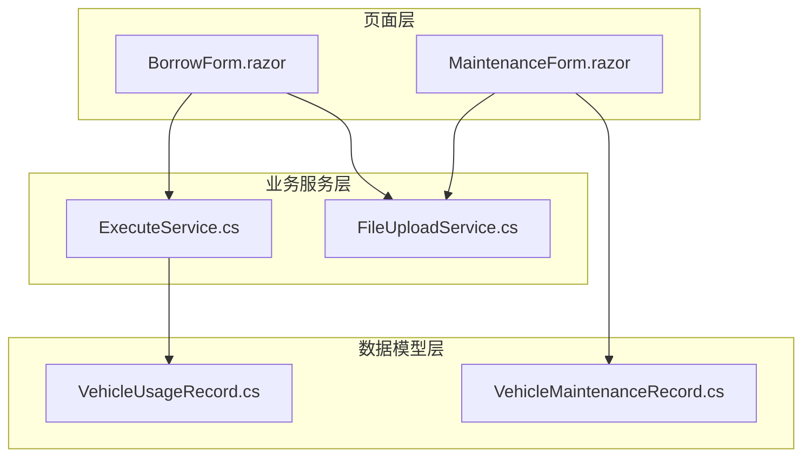
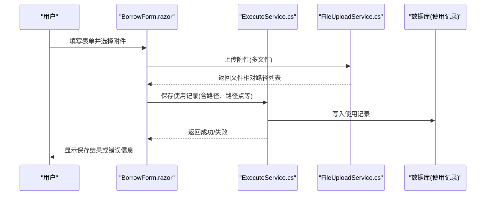
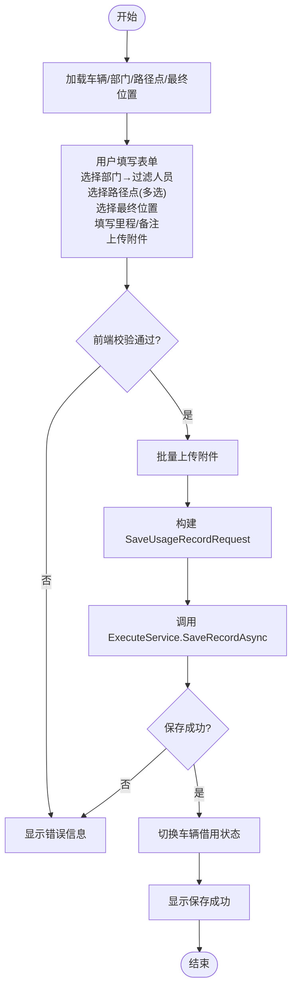
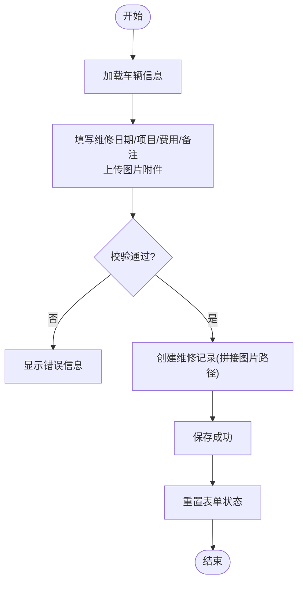
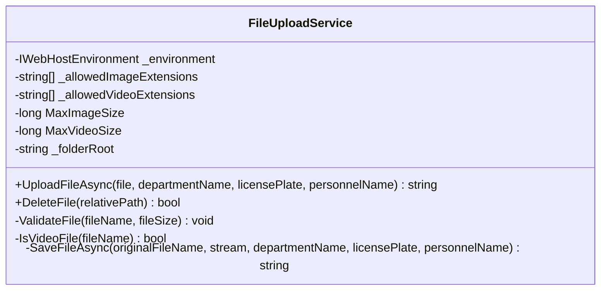
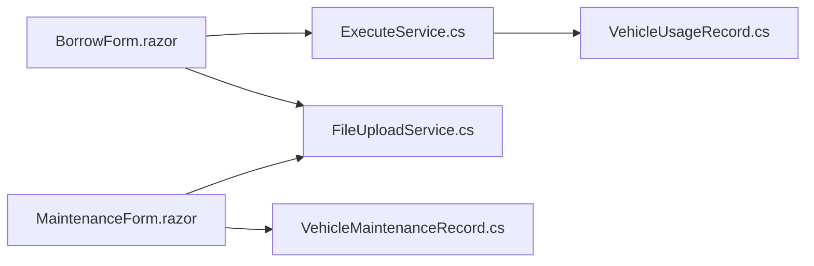

# 表单页面

<cite>
**本文引用的文件**   
- [BorrowForm.razor](file://Pages/BorrowForm.razor)
- [MaintenanceForm.razor](file://Pages/MaintenanceForm.razor)
- [FileUploadService.cs](file://BLL/Common/FileUploadService.cs)
- [ExecuteService.cs](file://BLL/Execute/ExecuteService.cs)
- [VehicleUsageRecord.cs](file://DAL/Model/VehicleUsageRecord.cs)
- [VehicleMaintenanceRecord.cs](file://DAL/Model/VehicleMaintenanceRecord.cs)
</cite>

## 目录
1. [引言](#引言)
2. [项目结构](#项目结构)
3. [核心组件](#核心组件)
4. [架构总览](#架构总览)
5. [详细组件分析](#详细组件分析)
6. [依赖关系分析](#依赖关系分析)
7. [性能与体验优化](#性能与体验优化)
8. [故障排查指南](#故障排查指南)
9. [结论](#结论)
10. [附录：开发规范](#附录开发规范)

## 引言
本章节面向 vehicleManagement 系统的表单页面，聚焦两类关键业务表单：借用申请与维护记录。文档从设计模式、数据绑定、验证规则、提交处理、组件结构（输入控件、下拉选择、日期选择、文件上传）、业务逻辑（数据校验、状态管理、API 调用、错误处理）到用户体验优化（实时校验、进度反馈、草稿保存、自动完成）进行系统化说明，并给出可复用的开发规范与最佳实践。

## 项目结构
围绕表单页面的相关文件分布如下：
- 页面层：借车登记页 BorrowForm.razor；维修登记页 MaintenanceForm.razor
- 通用服务：文件上传 FileUploadService.cs
- 业务服务：执行服务 ExecuteService.cs（用于保存使用记录）
- 数据模型：车辆使用记录 VehicleUsageRecord.cs；车辆维修记录 VehicleMaintenanceRecord.cs

图表来源
- [BorrowForm.razor:1-277](file://Pages/BorrowForm.razor#L1-L277)
- [MaintenanceForm.razor:1-179](file://Pages/MaintenanceForm.razor#L1-L179)
- [FileUploadService.cs:1-113](file://BLL/Common/FileUploadService.cs#L1-L113)
- [ExecuteService.cs:66-97](file://BLL/Execute/ExecuteService.cs#L66-L97)
- [VehicleUsageRecord.cs:1-55](file://DAL/Model/VehicleUsageRecord.cs#L1-L55)
- [VehicleMaintenanceRecord.cs:1-37](file://DAL/Model/VehicleMaintenanceRecord.cs#L1-L37)

章节来源
- [BorrowForm.razor:1-277](file://Pages/BorrowForm.razor#L1-L277)
- [MaintenanceForm.razor:1-179](file://Pages/MaintenanceForm.razor#L1-L179)

## 核心组件
- 借用申请表单（BorrowForm.razor）
  - 负责收集部门、人员、途经路径点、最终停车位置、起止里程、备注与附件，并进行前端校验后调用执行服务保存使用记录。
- 维护记录表单（MaintenanceForm.razor）
  - 负责收集维修日期、维修项目/内容、费用、备注与图片附件，并进行基础校验后直接持久化维修记录。
- 文件上传服务（FileUploadService.cs）
  - 提供统一的文件校验（类型、大小）、按“部门/车牌/人员/日期”组织存储目录、返回相对路径供表单持久化。
- 执行服务（ExecuteService.cs）
  - 封装使用记录的保存流程，包含业务校验、序列化处理与数据库写入。
- 数据模型
  - VehicleUsageRecord.cs：定义使用记录字段与关联关系。
  - VehicleMaintenanceRecord.cs：定义维修记录字段与关联关系。

章节来源
- [BorrowForm.razor:155-276](file://Pages/BorrowForm.razor#L155-L276)
- [MaintenanceForm.razor:105-178](file://Pages/MaintenanceForm.razor#L105-L178)
- [FileUploadService.cs:14-46](file://BLL/Common/FileUploadService.cs#L14-L46)
- [ExecuteService.cs:72-97](file://BLL/Execute/ExecuteService.cs#L72-L97)
- [VehicleUsageRecord.cs:9-53](file://DAL/Model/VehicleUsageRecord.cs#L9-L53)
- [VehicleMaintenanceRecord.cs:8-35](file://DAL/Model/VehicleMaintenanceRecord.cs#L8-L35)

## 架构总览
表单页面通过 Blazor 组件注入服务，完成数据加载、用户交互、文件上传与后端持久化。整体数据流如下：

图表来源
- [BorrowForm.razor:211-260](file://Pages/BorrowForm.razor#L211-L260)
- [ExecuteService.cs:72-97](file://BLL/Execute/ExecuteService.cs#L72-L97)
- [FileUploadService.cs:29-46](file://BLL/Common/FileUploadService.cs#L29-L46)

## 详细组件分析

### 借用申请表单（BorrowForm.razor）
- 页面职责
  - 展示当前车辆基本信息（只读）。
  - 收集借用申请所需字段：所属部门、使用人员、途经路径点（多选）、最终停车位置、起止里程、备注、附件。
  - 实现级联下拉：选择部门后动态过滤人员。
  - 支持多文件上传（图片/视频），并在保存前进行必填项校验。
  - 保存成功后切换车辆借用状态并提示成功。

- 数据绑定与状态管理
  - 使用 @bind 双向绑定输入框与数值型字段（如起止里程）。
  - 使用 select 的 value/@onchange 绑定部门选择，触发 OnDeptChanged 更新人员列表。
  - 使用集合 selectedWaypoints 管理多选路径点，提供 ToggleWaypoint/RemoveWaypoint 方法。
  - 使用 uploadedFiles 集合暂存已上传文件的相对路径。
  - 使用 saving/saved/uploading/loading 控制 UI 状态与按钮禁用。

- 验证规则
  - 前端校验：人员必须选择、至少一个路径点、最终停车位置必须选择。
  - 服务端校验：ExecuteService 再次校验人员、路径点、最终位置，确保一致性。

- 提交处理
  - 组装 SaveUsageRecordRequest 请求对象，调用 ExecService.SaveRecordAsync。
  - 成功后调用 VehicleService.ToggleBorrowedAsync 将车辆标记为已借用。
  - 捕获异常并设置 errorMessage 展示给用户。

- 组件结构与交互
  - 输入控件：文本、数字、日期（未在本表单使用）、下拉选择、多选标签式路径点。
  - 文件上传：InputFile 多文件，限制 accept 类型为 image/*,video/*，上传中禁用控件并显示进度。
  - 错误提示：errorMessage 在表单顶部统一展示。

图表来源
- [BorrowForm.razor:180-276](file://Pages/BorrowForm.razor#L180-L276)
- [ExecuteService.cs:72-97](file://BLL/Execute/ExecuteService.cs#L72-L97)

章节来源
- [BorrowForm.razor:1-277](file://Pages/BorrowForm.razor#L1-L277)
- [ExecuteService.cs:72-97](file://BLL/Execute/ExecuteService.cs#L72-L97)

### 维护记录表单（MaintenanceForm.razor）
- 页面职责
  - 展示当前车辆基本信息（只读）。
  - 收集维修日期、维修项目/内容、费用、备注与图片附件。
  - 基础校验通过后直接创建维修记录。

- 数据绑定与状态管理
  - 使用 @bind 双向绑定日期、文本、数值与备注。
  - 使用 uploadedFiles 集合暂存图片相对路径。
  - 使用 saving/saved/uploading 控制 UI 状态。

- 验证规则
  - 前端校验：维修项目不能为空。
  - 服务端校验：由 Repository/Service 层进一步保证数据完整性。

- 提交处理
  - 构造 VehicleMaintenanceRecord 实体，调用 MaintenanceService.CreateAsync。
  - 将多个图片路径以分号拼接为字符串 ImagePaths 持久化。
  - 捕获异常并设置 errorMessage。

图表来源
- [MaintenanceForm.razor:122-178](file://Pages/MaintenanceForm.razor#L122-L178)

章节来源
- [MaintenanceForm.razor:1-179](file://Pages/MaintenanceForm.razor#L1-L179)

### 文件上传服务（FileUploadService.cs）
- 功能要点
  - 支持图片与视频类型校验，分别限制最大文件大小（图片 10MB，视频 100MB）。
  - 根据部门名、车牌号、人员名与当天日期生成子目录，避免冲突并便于检索。
  - 返回相对路径 /Folder/... 供表单持久化。
  - 提供删除文件能力（DeleteFile）。

- 安全与健壮性
  - 空文件检查、扩展名校验、大小限制、异常抛出。
  - 目录不存在时自动创建。

图表来源
- [FileUploadService.cs:14-110](file://BLL/Common/FileUploadService.cs#L14-L110)

章节来源
- [FileUploadService.cs:1-113](file://BLL/Common/FileUploadService.cs#L1-L113)

### 数据模型与持久化
- 使用记录（VehicleUsageRecord.cs）
  - 关键字段：VehicleId、DepartmentId、PersonnelId、FinalLocationId、PurposeSequence（路径点序列）、MileageStart/End、ImagePaths/VideoPaths、Remarks。
  - 关联：Vehicle、Department、Personnel、FinalLocation、UsageRecordPurposes。

- 维修记录（VehicleMaintenanceRecord.cs）
  - 关键字段：VehicleId、MaintenanceDate、Description、Cost、Remarks、ImagePaths（分号分隔）。
  - 关联：Vehicle。

章节来源
- [VehicleUsageRecord.cs:9-53](file://DAL/Model/VehicleUsageRecord.cs#L9-L53)
- [VehicleMaintenanceRecord.cs:8-35](file://DAL/Model/VehicleMaintenanceRecord.cs#L8-L35)

## 依赖关系分析
- BorrowForm.razor 依赖
  - ExecuteService：保存使用记录。
  - FileUploadService：上传附件。
  - VehicleService/LocationService：获取部门、人员、路径点、最终位置等字典数据。
- MaintenanceForm.razor 依赖
  - FileUploadService：上传图片。
  - MaintenanceService：创建维修记录。
- FileUploadService 依赖
  - IWebHostEnvironment：访问服务器文件系统。
  - ChinaTime：统一时间源。

图表来源
- [BorrowForm.razor:1-277](file://Pages/BorrowForm.razor#L1-L277)
- [MaintenanceForm.razor:1-179](file://Pages/MaintenanceForm.razor#L1-L179)
- [FileUploadService.cs:1-113](file://BLL/Common/FileUploadService.cs#L1-L113)
- [ExecuteService.cs:66-97](file://BLL/Execute/ExecuteService.cs#L66-L97)
- [VehicleUsageRecord.cs:1-55](file://DAL/Model/VehicleUsageRecord.cs#L1-L55)
- [VehicleMaintenanceRecord.cs:1-37](file://DAL/Model/VehicleMaintenanceRecord.cs#L1-L37)

章节来源
- [BorrowForm.razor:1-277](file://Pages/BorrowForm.razor#L1-L277)
- [MaintenanceForm.razor:1-179](file://Pages/MaintenanceForm.razor#L1-L179)
- [FileUploadService.cs:1-113](file://BLL/Common/FileUploadService.cs#L1-L113)
- [ExecuteService.cs:66-97](file://BLL/Execute/ExecuteService.cs#L66-L97)

## 性能与体验优化
- 实时验证
  - 建议在输入控件上增加 oninput/onchange 事件，即时校验必填项与格式（如里程为正数、费用非负）。
  - 对下拉选择进行即时联动校验（如未选部门时禁用人员选择）。
- 进度反馈
  - 上传中禁用 InputFile 并显示“上传中...”提示；批量上传时显示已上传文件清单。
  - 保存按钮在 saving 状态下禁用并显示“保存中...”。
- 草稿保存
  - 建议引入本地存储（LocalStorage）或后端草稿接口，定时保存表单字段（部门、人员、路径点、里程、备注、已上传文件路径）。
  - 页面初始化时优先恢复草稿，减少重复录入。
- 自动完成
  - 对人员、路径点、最终位置等长列表提供搜索与自动完成（防抖），提升选择效率。
  - 对维修项目/内容提供历史常用项建议。
- 并发与幂等
  - 保存操作应防止重复提交（saving 标志+按钮禁用）。
  - 文件上传失败重试机制与断点续传（大视频场景）。
- 国际化
  - 将错误消息、占位符、按钮文案抽取至资源文件，按语言包切换。

[本节为通用指导，不直接分析具体文件]

## 故障排查指南
- 常见错误与定位
  - 上传失败：检查 FileUploadService.ValidateFile 抛出的异常（不支持的文件格式或超出大小限制），确认浏览器端 accept 与文件大小是否匹配。
  - 保存失败：查看 ExecuteService 的业务校验返回（人员、路径点、最终位置），以及异常堆栈中的数据库约束错误。
  - 数据不一致：核对前端校验与服务端校验是否一致，必要时在服务端集中校验并返回明确错误码。
- 日志与诊断
  - 在 FileUploadService 与 ExecuteService 中加入结构化日志（文件名、大小、目标路径、异常信息）。
  - 在页面层保留 errorMessage 并输出到控制台以便调试。
- 回滚与补偿
  - 对于复杂事务（如同时更新车辆借用状态与使用记录），建议使用分布式事务或补偿机制，确保部分失败时可回滚。

章节来源
- [FileUploadService.cs:69-84](file://BLL/Common/FileUploadService.cs#L69-L84)
- [ExecuteService.cs:72-97](file://BLL/Execute/ExecuteService.cs#L72-L97)
- [BorrowForm.razor:231-260](file://Pages/BorrowForm.razor#L231-L260)
- [MaintenanceForm.razor:145-167](file://Pages/MaintenanceForm.razor#L145-L167)

## 结论
vehicleManagement 的表单页面采用清晰的组件化设计与分层架构：页面层负责交互与状态，服务层负责业务校验与持久化，文件上传服务提供统一的安全与存储策略。通过前后端双重校验、明确的错误提示与良好的状态管理，系统在保证数据一致性的同时提升了用户体验。后续可在实时校验、草稿保存、自动完成与国际化方面持续优化，进一步提升易用性与可维护性。

[本节为总结性内容，不直接分析具体文件]

## 附录：开发规范
- 表单模板
  - 页面结构：标题区、返回按钮、主内容区（卡片布局）、错误提示区、提交按钮。
  - 字段分组：只读信息区与编辑区分离，提高可读性。
  - 状态变量：loading/saving/saved/uploading 统一命名，配合按钮禁用与文案切换。
- 验证规则定义
  - 前端：必填、格式、范围校验；与服务端保持一致。
  - 服务端：集中校验入口（如 ExecuteService），返回 (Success, ErrorMessage) 元组或标准错误响应。
- 文件上传规范
  - 统一使用 FileUploadService，禁止页面直接写盘。
  - 限制类型与大小，按“部门/车牌/人员/日期”组织目录。
  - 返回相对路径，由表单持久化为字符串字段（分号分隔）。
- 国际化支持
  - 所有用户可见文案（提示、错误、按钮）放入资源文件。
  - 页面中引用资源键，避免硬编码中文。
- 代码组织
  - 页面仅负责视图与简单交互，复杂逻辑下沉至服务层。
  - 模型使用 DataAnnotations 标注约束，便于复用与自动生成文档。

[本节为通用规范，不直接分析具体文件]