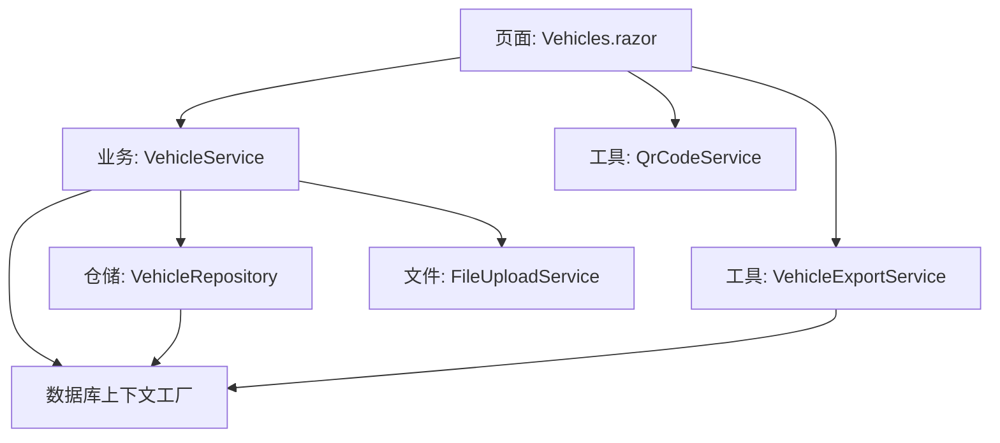
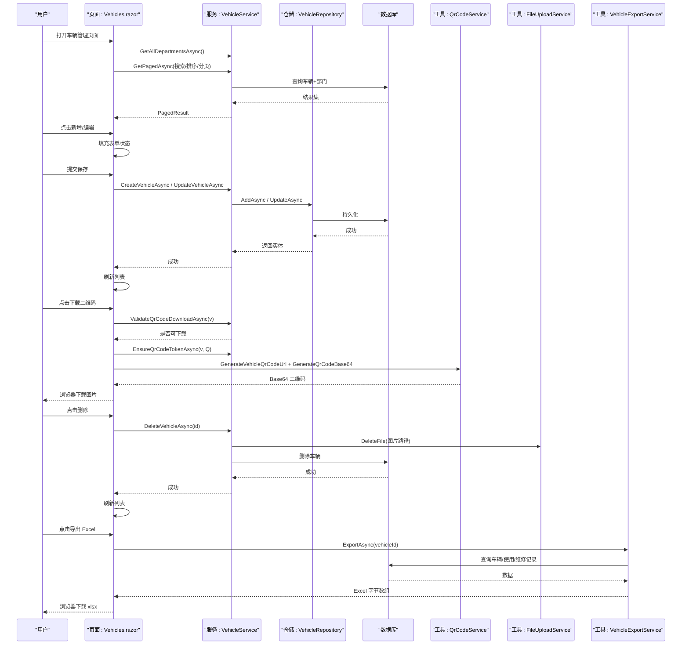
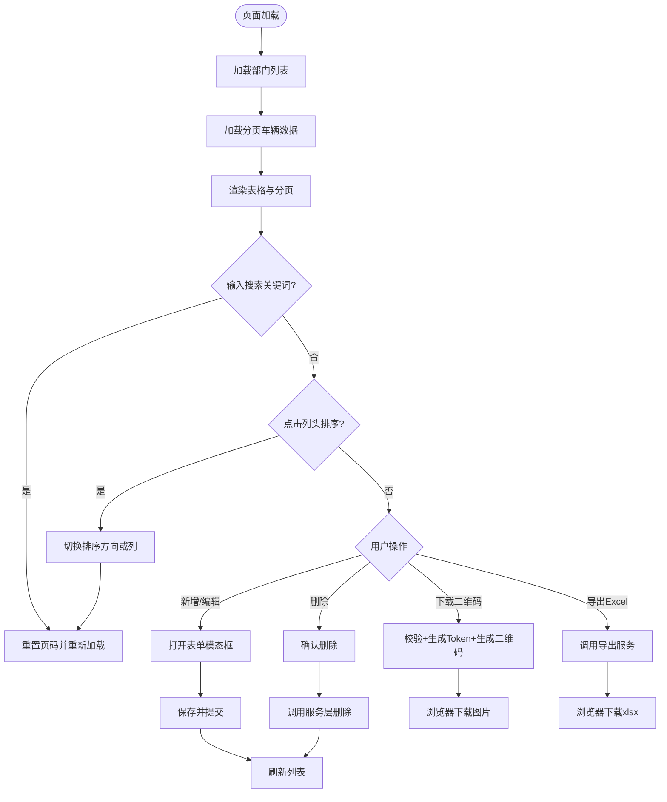
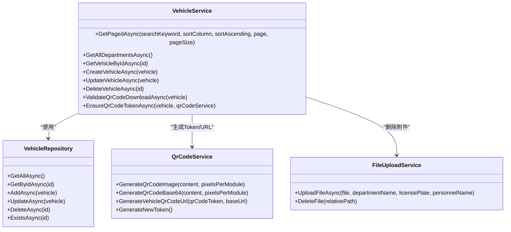
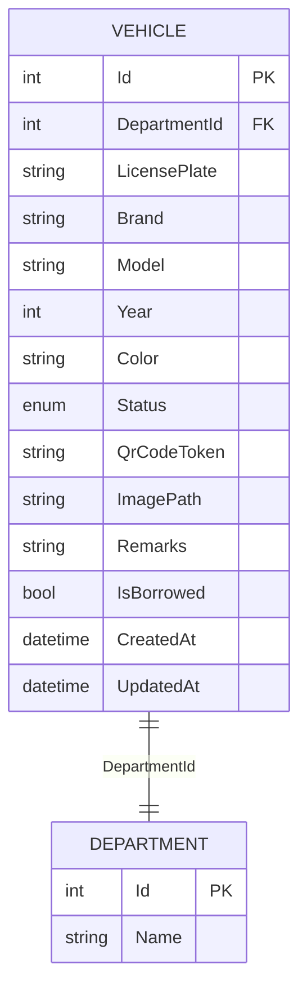
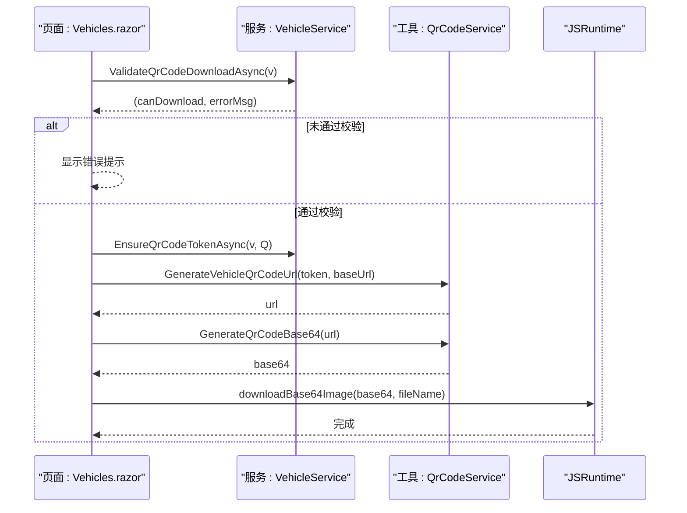
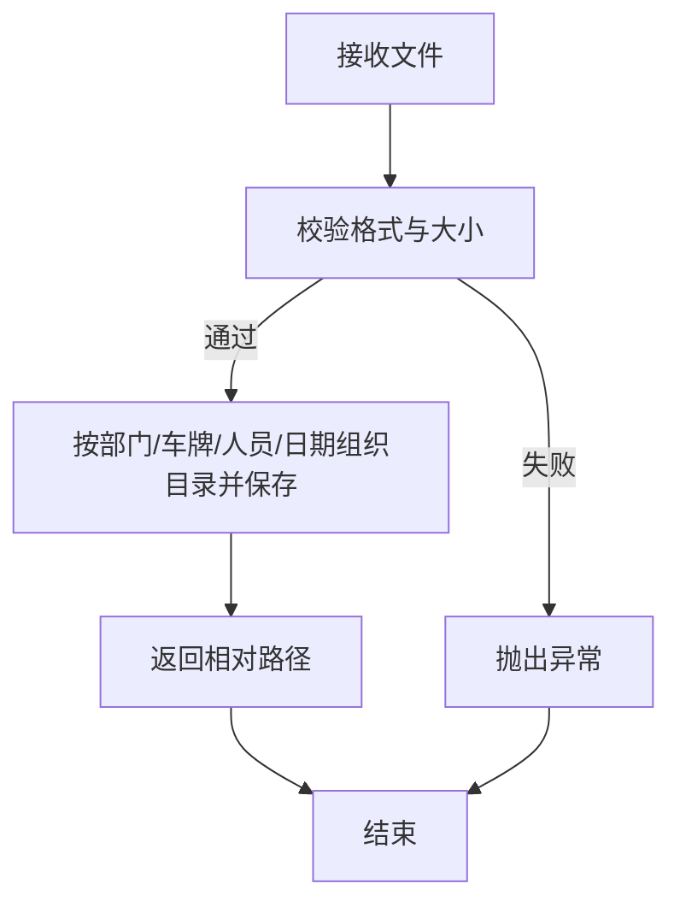
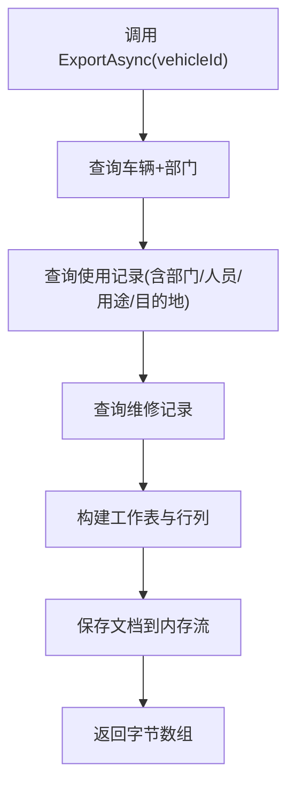
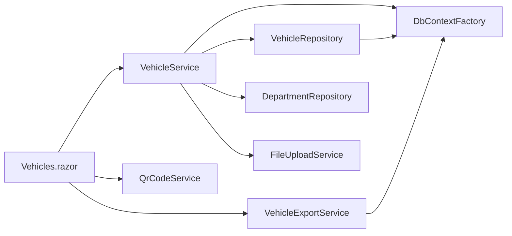

# 车辆管理页面

<cite>
**本文引用的文件**   
- [Vehicles.razor](file://Pages/Vehicles.razor)
- [VehicleService.cs](file://BLL/Vehicle/VehicleService.cs)
- [Vehicle.cs](file://DAL/Model/Vehicle.cs)
- [VehicleEnums.cs](file://DAL/Model/VehicleEnums.cs)
- [QrCodeService.cs](file://BLL/Common/QrCodeService.cs)
- [FileUploadService.cs](file://BLL/Common/FileUploadService.cs)
- [VehicleExportService.cs](file://BLL/Export/VehicleExportService.cs)
- [VehicleRepository.cs](file://DAL/Repository/VehicleRepository.cs)
- [Pagination.razor](file://Components/Common/Pagination.razor)
</cite>

## 目录
1. [引言](#引言)
2. [项目结构](#项目结构)
3. [核心组件](#核心组件)
4. [架构总览](#架构总览)
5. [详细组件分析](#详细组件分析)
6. [依赖关系分析](#依赖关系分析)
7. [性能与体验优化](#性能与体验优化)
8. [故障排查指南](#故障排查指南)
9. [扩展开发指南](#扩展开发指南)
10. [结论](#结论)

## 引言
本文件面向 vehicleManagement 系统的“车辆管理”页面，系统性说明其功能、组件结构、业务逻辑、数据流、错误处理与扩展方式。重点覆盖：
- 车辆信息 CRUD（新增、编辑、删除）
- 状态管理与展示
- 二维码生成与下载
- 文件附件处理（上传、删除）
- 数据表格、表单验证、模态框、分页
- 实时搜索、排序、导出 Excel
- 服务层调用与校验规则
- 权限控制集成建议与扩展点

## 项目结构
车辆管理相关代码分布在以下层次：
- 页面层：Vehicles.razor 负责 UI、交互、事件处理与状态管理
- 业务层：VehicleService 封装查询、保存、删除、二维码校验等核心业务；QrCodeService 提供二维码生成能力；FileUploadService 提供文件上传与删除能力；VehicleExportService 提供 Excel 导出
- 数据访问层：VehicleRepository 提供基础仓储操作；VehicleDbContext 由工厂注入
- 模型层：Vehicle 实体与 VehicleStatus 枚举定义数据结构与状态
- 通用组件：Pagination.razor 提供分页 UI

图表来源
- [Vehicles.razor:1-18](file://Pages/Vehicles.razor#L1-L18)
- [VehicleService.cs:18-38](file://BLL/Vehicle/VehicleService.cs#L18-L38)
- [VehicleRepository.cs:10-17](file://DAL/Repository/VehicleRepository.cs#L10-L17)
- [QrCodeService.cs:6-39](file://BLL/Common/QrCodeService.cs#L6-L39)
- [FileUploadService.cs:12-27](file://BLL/Common/FileUploadService.cs#L12-L27)
- [VehicleExportService.cs:16-23](file://BLL/Export/VehicleExportService.cs#L16-L23)

章节来源
- [Vehicles.razor:1-18](file://Pages/Vehicles.razor#L1-L18)
- [VehicleService.cs:18-38](file://BLL/Vehicle/VehicleService.cs#L18-L38)
- [VehicleRepository.cs:10-17](file://DAL/Repository/VehicleRepository.cs#L10-L17)

## 核心组件
- 页面组件 Vehicles.razor
  - 负责：搜索、排序、分页、新增/编辑模态框、删除确认、错误提示、二维码下载、Excel 导出
  - 关键状态：vehicles、allDepartments、searchKeyword、sortColumn、currentPage、pageSize、totalCount、form* 字段、showForm、showDeleteConfirm、errorMessage
- 业务服务 VehicleService
  - 负责：分页查询（含搜索与排序）、部门列表、CRUD、删除前业务校验（使用记录检查、图片附件清理）、二维码下载校验与 Token 保证
- 模型 Vehicle 与枚举 VehicleStatus
  - 字段包括车牌号、品牌、型号、颜色、年份、状态、二维码 Token、图片路径、备注、借用状态、创建/更新时间、所属部门导航属性
  - 状态枚举：在用、维修、退役
- 工具服务
  - QrCodeService：生成二维码图片/Base64、构造车辆二维码 URL、生成新 Token
  - FileUploadService：文件上传校验与保存、按部门/车牌/人员/日期组织目录、删除文件
  - VehicleExportService：基于 OpenXML 生成 Excel，包含车辆基本信息、使用记录、维修记录
- 通用组件 Pagination.razor
  - 提供页码按钮、首页/末页/上一页/下一页、当前页高亮

章节来源
- [Vehicles.razor:186-409](file://Pages/Vehicles.razor#L186-L409)
- [VehicleService.cs:64-166](file://BLL/Vehicle/VehicleService.cs#L64-L166)
- [Vehicle.cs:8-48](file://DAL/Model/Vehicle.cs#L8-L48)
- [VehicleEnums.cs:3-8](file://DAL/Model/VehicleEnums.cs#L3-L8)
- [QrCodeService.cs:6-39](file://BLL/Common/QrCodeService.cs#L6-L39)
- [FileUploadService.cs:12-110](file://BLL/Common/FileUploadService.cs#L12-L110)
- [VehicleExportService.cs:16-160](file://BLL/Export/VehicleExportService.cs#L16-L160)
- [Pagination.razor:1-42](file://Components/Common/Pagination.razor#L1-L42)

## 架构总览
车辆管理页面的请求-响应流程如下：

图表来源
- [Vehicles.razor:220-227](file://Pages/Vehicles.razor#L220-L227)
- [Vehicles.razor:284-331](file://Pages/Vehicles.razor#L284-L331)
- [Vehicles.razor:336-358](file://Pages/Vehicles.razor#L336-L358)
- [Vehicles.razor:382-395](file://Pages/Vehicles.razor#L382-L395)
- [Vehicles.razor:397-408](file://Pages/Vehicles.razor#L397-L408)
- [VehicleService.cs:64-166](file://BLL/Vehicle/VehicleService.cs#L64-L166)
- [VehicleService.cs:171-238](file://BLL/Vehicle/VehicleService.cs#L171-L238)
- [QrCodeService.cs:21-39](file://BLL/Common/QrCodeService.cs#L21-L39)
- [FileUploadService.cs:48-67](file://BLL/Common/FileUploadService.cs#L48-L67)
- [VehicleExportService.cs:25-160](file://BLL/Export/VehicleExportService.cs#L25-L160)

## 详细组件分析

### 页面组件 Vehicles.razor
- 数据加载与展示
  - 初始化时加载部门列表与分页车辆数据
  - 支持实时搜索（输入即触发重新加载）
  - 支持列头点击排序（车牌、品牌/型号、颜色、创建时间）
  - 使用 Pagination.razor 渲染分页控件
- 表单与模态框
  - 新增/编辑共用一个模态框，通过 editId 区分
  - 表单字段绑定到 form* 变量，包含车牌号、部门、品牌、型号、颜色、年份、状态、备注
  - 保存时进行前端必填校验（车牌号非空、部门已选择），失败直接返回不提交
- 删除确认与错误提示
  - 删除前弹出确认框，确认后调用服务层删除并刷新列表
  - 所有异常统一捕获并显示在错误提示模态框中
- 二维码下载
  - 先调用服务层校验（必须绑定部门且部门下有在职人员）
  - 确保存在二维码 Token，不存在则生成
  - 根据当前请求 Scheme+Host 构建二维码 URL，生成 Base64 图片并通过 JS 下载
- 导出 Excel
  - 调用 VehicleExportService.ExportAsync 获取字节数组，转 Base64 后通过 JS 下载 xlsx

图表来源
- [Vehicles.razor:215-247](file://Pages/Vehicles.razor#L215-L247)
- [Vehicles.razor:251-331](file://Pages/Vehicles.razor#L251-L331)
- [Vehicles.razor:336-358](file://Pages/Vehicles.razor#L336-L358)
- [Vehicles.razor:360-395](file://Pages/Vehicles.razor#L360-L395)
- [Vehicles.razor:397-408](file://Pages/Vehicles.razor#L397-L408)

章节来源
- [Vehicles.razor:1-409](file://Pages/Vehicles.razor#L1-L409)
- [Pagination.razor:1-42](file://Components/Common/Pagination.razor#L1-L42)

### 业务服务 VehicleService
- 分页查询
  - 支持关键字模糊匹配（车牌号、品牌、型号、颜色）
  - 支持多列排序（车牌、品牌/型号、颜色、创建时间）
  - 返回 PagedResult 包含 Items、TotalCount、CurrentPage、PageSize
- 部门列表
  - 返回所有部门供下拉选择
- CRUD
  - CreateVehicleAsync：新增车辆
  - UpdateVehicleAsync：更新车辆并设置更新时间
  - DeleteVehicleAsync：删除前检查是否存在使用记录；若存在则阻止删除；否则先尝试删除图片附件，再删除数据库记录
- 二维码相关
  - ValidateQrCodeDownloadAsync：校验车辆是否绑定部门且部门下有在职人员
  - EnsureQrCodeTokenAsync：若车辆无二维码 Token，则生成并持久化
- 日志与异常
  - 删除附件失败会记录日志并返回失败消息

图表来源
- [VehicleService.cs:18-38](file://BLL/Vehicle/VehicleService.cs#L18-L38)
- [VehicleService.cs:64-166](file://BLL/Vehicle/VehicleService.cs#L64-L166)
- [VehicleService.cs:171-238](file://BLL/Vehicle/VehicleService.cs#L171-L238)
- [VehicleRepository.cs:10-63](file://DAL/Repository/VehicleRepository.cs#L10-L63)
- [QrCodeService.cs:6-39](file://BLL/Common/QrCodeService.cs#L6-L39)
- [FileUploadService.cs:12-110](file://BLL/Common/FileUploadService.cs#L12-L110)

章节来源
- [VehicleService.cs:64-166](file://BLL/Vehicle/VehicleService.cs#L64-L166)
- [VehicleService.cs:171-238](file://BLL/Vehicle/VehicleService.cs#L171-L238)
- [VehicleRepository.cs:19-63](file://DAL/Repository/VehicleRepository.cs#L19-L63)

### 数据模型与状态
- Vehicle 实体
  - 关键字段：LicensePlate、Brand、Model、Color、Year、Status、QrCodeToken、ImagePath、Remarks、IsBorrowed、CreatedAt、UpdatedAt、DepartmentId、Department
  - 约束：LicensePlate 必填且最大长度 50；DepartmentId 必填；各文本字段有 MaxLength 限制
- VehicleStatus 枚举
  - Active（在用）、Maintenance（维修）、Retired（退役）

图表来源
- [Vehicle.cs:8-48](file://DAL/Model/Vehicle.cs#L8-L48)
- [VehicleEnums.cs:3-8](file://DAL/Model/VehicleEnums.cs#L3-L8)

章节来源
- [Vehicle.cs:8-48](file://DAL/Model/Vehicle.cs#L8-L48)
- [VehicleEnums.cs:3-8](file://DAL/Model/VehicleEnums.cs#L3-L8)

### 二维码生成与下载流程
- 校验阶段：VehicleService.ValidateQrCodeDownloadAsync 检查车辆是否绑定部门以及部门下是否有在职人员
- Token 保障：VehicleService.EnsureQrCodeTokenAsync 确保车辆拥有唯一 Token
- URL 生成：QrCodeService.GenerateVehicleQrCodeUrl 将 Token 拼接为 /execute/{token}
- 图片生成：QrCodeService.GenerateQrCodeBase64 生成 Base64 图片
- 下载：页面通过 JS 调用下载 Base64 图片

图表来源
- [Vehicles.razor:336-358](file://Pages/Vehicles.razor#L336-L358)
- [VehicleService.cs:207-238](file://BLL/Vehicle/VehicleService.cs#L207-L238)
- [QrCodeService.cs:21-39](file://BLL/Common/QrCodeService.cs#L21-L39)

章节来源
- [Vehicles.razor:336-358](file://Pages/Vehicles.razor#L336-L358)
- [VehicleService.cs:207-238](file://BLL/Vehicle/VehicleService.cs#L207-L238)
- [QrCodeService.cs:21-39](file://BLL/Common/QrCodeService.cs#L21-L39)

### 文件附件处理
- 上传
  - FileUploadService 支持图片与视频格式校验与大小限制
  - 存储目录结构：Folder/部门名/车牌号/人员名/日期/文件名
  - 返回相对路径字符串，便于保存到 Vehicle.ImagePath
- 删除
  - 删除车辆时会尝试删除对应图片附件
  - 若文件被占用或无法访问，会记录日志并返回失败消息，阻止数据库删除

图表来源
- [FileUploadService.cs:29-46](file://BLL/Common/FileUploadService.cs#L29-L46)
- [FileUploadService.cs:69-110](file://BLL/Common/FileUploadService.cs#L69-L110)

章节来源
- [FileUploadService.cs:29-46](file://BLL/Common/FileUploadService.cs#L29-L46)
- [FileUploadService.cs:69-110](file://BLL/Common/FileUploadService.cs#L69-L110)

### 导出 Excel
- 数据来源：车辆基本信息、使用记录（含部门、人员、用途顺序、目的地、里程、时间）、维修记录
- 输出结构：工作表“车辆信息导出”，包含标题行、明细行、空行分隔
- 实现方式：OpenXML 直接写入内存流，最后转为字节数组返回给页面

图表来源
- [VehicleExportService.cs:25-160](file://BLL/Export/VehicleExportService.cs#L25-L160)

章节来源
- [VehicleExportService.cs:25-160](file://BLL/Export/VehicleExportService.cs#L25-L160)

## 依赖关系分析
- 页面层依赖
  - Vehicles.razor 依赖 VehicleService、QrCodeService、VehicleExportService、IJSRuntime、NavigationManager、HttpContextAccessor
- 业务层依赖
  - VehicleService 依赖 VehicleRepository、DepartmentRepository、IDbContextFactory<VehicleDbContext>、FileUploadService、ILogger
- 数据访问层依赖
  - VehicleRepository 依赖 IDbContextFactory<VehicleDbContext>
- 工具层依赖
  - QrCodeService 依赖 QRCoder 库
  - FileUploadService 依赖 IWebHostEnvironment、IFormFile/IBrowserFile
  - VehicleExportService 依赖 DocumentFormat.OpenXml

图表来源
- [Vehicles.razor:1-7](file://Pages/Vehicles.razor#L1-L7)
- [VehicleService.cs:18-38](file://BLL/Vehicle/VehicleService.cs#L18-L38)
- [VehicleRepository.cs:10-17](file://DAL/Repository/VehicleRepository.cs#L10-L17)
- [QrCodeService.cs:1-2](file://BLL/Common/QrCodeService.cs#L1-L2)
- [FileUploadService.cs:1-8](file://BLL/Common/FileUploadService.cs#L1-L8)
- [VehicleExportService.cs:1-12](file://BLL/Export/VehicleExportService.cs#L1-L12)

章节来源
- [Vehicles.razor:1-7](file://Pages/Vehicles.razor#L1-L7)
- [VehicleService.cs:18-38](file://BLL/Vehicle/VehicleService.cs#L18-L38)
- [VehicleRepository.cs:10-17](file://DAL/Repository/VehicleRepository.cs#L10-L17)

## 性能与体验优化
- 实时搜索
  - 每次输入即触发重新加载，适合小规模数据；大数据量时可考虑防抖与后端全文索引
- 排序
  - 服务端排序减少前端计算开销；注意多列排序的稳定性
- 分页
  - 使用 PagedResult 与服务端 Skip/Take 提升大列表性能
- 二维码生成
  - 仅在需要时生成 Base64，避免重复计算；Token 生成一次后缓存
- 文件上传
  - 前端限制文件大小与类型，减少无效请求；后端再次校验防止绕过
- 导出 Excel
  - 使用 OpenXML 内存流避免磁盘 IO；必要时增加异步任务与进度提示

[本节为通用指导，不涉及具体文件分析]

## 故障排查指南
- 删除失败
  - 现象：提示“无法删除该车辆：该车辆还有使用记录...”
  - 原因：存在关联的使用记录
  - 处理：先删除使用记录，再删除车辆
- 删除附件失败
  - 现象：提示“删除失败：图片附件被占用或无法访问...”
  - 原因：文件被进程占用或路径不可访问
  - 处理：释放文件占用或检查路径权限
- 二维码下载失败
  - 现象：提示“尚未绑定部门”或“部门下暂无人员”
  - 原因：未绑定部门或部门无在职人员
  - 处理：编辑车辆绑定部门并在人员管理中添加人员
- 导出失败
  - 现象：提示“导出失败：未找到该车辆数据”或“导出失败：{异常信息}”
  - 原因：车辆不存在或导出过程异常
  - 处理：确认车辆 ID 有效，检查依赖库与权限

章节来源
- [VehicleService.cs:171-202](file://BLL/Vehicle/VehicleService.cs#L171-L202)
- [VehicleService.cs:207-225](file://BLL/Vehicle/VehicleService.cs#L207-L225)
- [Vehicles.razor:382-408](file://Pages/Vehicles.razor#L382-L408)

## 扩展开发指南
- 新增字段
  - 在 Vehicle 模型中添加字段并配置 DataAnnotations（如 Required、MaxLength）
  - 在 Vehicles.razor 表单中增加绑定字段与显示列
  - 在 VehicleService.GetPagedAsync 的查询与排序逻辑中补充过滤与排序支持
  - 在 VehicleExportService 中增加导出列
- 自定义验证
  - 前端：在 Save 方法中增加校验逻辑，失败时设置 errorMessage 并阻止提交
  - 后端：在 VehicleService 中增加业务校验方法，返回 (Success, ErrorMessage)
- 权限控制集成
  - 在 Vehicles.razor 中根据当前用户角色/权限控制按钮显示与操作执行
  - 在 VehicleService 中增加权限校验，拒绝无权操作
  - 在导出与二维码下载处增加权限拦截
- 批量操作
  - 在表格增加复选框，收集选中项 ID 列表
  - 在服务层增加批量更新/删除方法，内部做事务与幂等性处理
  - 在前端增加批量操作按钮与确认提示
- 导入功能
  - 在前端增加导入按钮与文件选择器
  - 在后端增加导入解析（CSV/Excel），校验数据并批量入库
  - 返回导入结果统计与错误明细

[本节为通用指导，不涉及具体文件分析]

## 结论
车辆管理页面以清晰的三层架构实现了车辆信息的完整生命周期管理，结合二维码与文件附件能力，提供了良好的用户体验与可扩展性。通过服务层的业务校验与日志记录，系统具备较强的健壮性与可维护性。后续可按扩展指南逐步增强字段、验证、权限与批量处理能力，以满足更复杂的业务场景。