# 页面组件

<cite>
**本文引用的文件**   
- [Program.cs](file://Program.cs)
- [App.razor](file://App.razor)
- [_Imports.razor](file://_Imports.razor)
- [README.md](file://README.md)
- [Index.razor](file://Pages/Index.razor)
- [Vehicles.razor](file://Pages/Vehicles.razor)
- [BorrowForm.razor](file://Pages/BorrowForm.razor)
- [Departments.razor](file://Pages/Departments.razor)
- [PersonnelList.razor](file://Pages/PersonnelList.razor)
- [Locations.razor](file://Pages/Locations.razor)
- [UsageRecords.razor](file://Pages/UsageRecords.razor)
- [MaintenanceRecords.razor](file://Pages/MaintenanceRecords.razor)
- [AiChat.razor](file://aiServer/Pages/AiChat.razor)
- [MainLayout.razor](file://Components/Layouts/MainLayout.razor)
- [NavMenu.razor](file://Components/Navigation/NavMenu.razor)
- [Pagination.razor](file://Components/Common/Pagination.razor)
</cite>

## 目录
1. [引言](#引言)
2. [项目结构与页面入口](#项目结构与页面入口)
3. [核心页面职责与数据流](#核心页面职责与数据流)
4. [架构总览与页面关系](#架构总览与页面关系)
5. [详细页面分析](#详细页面分析)
6. [页面间通信机制](#页面间通信机制)
7. [错误处理、加载状态与健壮性](#错误处理加载状态与健壮性)
8. [性能与可维护性建议](#性能与可维护性建议)
9. [页面开发规范](#页面开发规范)
10. [页面扩展指南](#页面扩展指南)
11. [常见问题排查](#常见问题排查)
12. [结论](#结论)

## 引言
本文件面向 vehicleManagement 系统的页面组件，目标是帮助开发者理解仪表盘、车辆管理、AI 聊天、表单等页面的设计模式，明确每个页面的职责边界：数据获取、状态管理、用户交互、错误处理、加载状态。同时说明页面间通信方式（路由参数、服务注入、JS 互操作）、以及新增页面时的组织规范、命名约定、代码分割与懒加载优化策略。

## 项目结构与页面入口
系统采用 Blazor Server 架构，页面位于 `Pages` 与 `aiServer/Pages`，布局与导航位于 `Components`，业务逻辑通过依赖注入的服务层暴露给页面。应用根路由由 `App.razor` 配置，默认使用 `MainLayout`；全局命名空间在 `_Imports.razor` 中统一引入，便于页面直接访问 DAL 模型、BLL 服务与 AI 子系统类型。

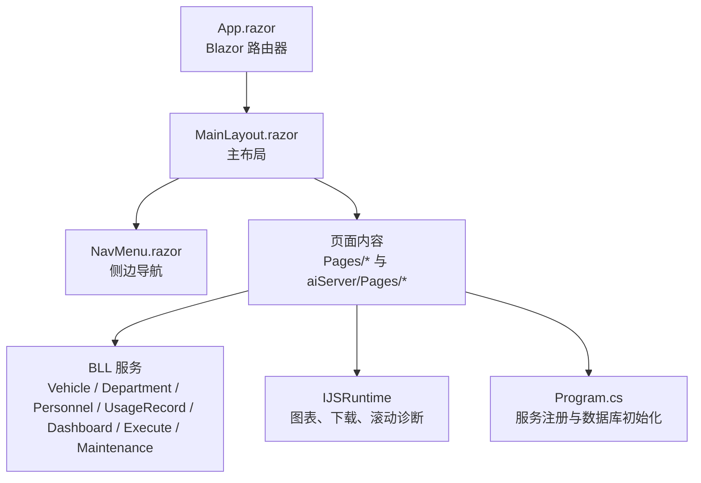

**图示来源**
- [App.razor:2-11](file://App.razor#L2-L11)
- [MainLayout.razor:4-23](file://Components/Layouts/MainLayout.razor#L4-L23)
- [NavMenu.razor:8-49](file://Components/Navigation/NavMenu.razor#L8-L49)
- [Program.cs:48-102](file://Program.cs#L48-L102)

**章节来源**
- [App.razor:2-11](file://App.razor#L2-L11)
- [_Imports.razor:1-30](file://_Imports.razor#L1-L30)
- [Program.cs:48-102](file://Program.cs#L48-L102)

## 核心页面职责与数据流
各页面遵循“页面负责 UI 与交互，服务负责数据与业务校验”的分工：

| 页面 | 主要职责 | 数据来源 | 关键交互 |
| --- | --- | --- | --- |
| 仪表盘 `/` | 统计卡片、部门分布、状态分布、趋势图、最近记录、附件查看 | `DashboardService` | 搜索、排序、分页、图表渲染 |
| 车辆管理 `/vehicles` | 车辆增删改查、二维码下载、Excel 导出 | `VehicleService`、`QrCodeService`、`VehicleExportService` | 搜索、排序、分页、弹窗表单、删除确认 |
| 借车登记 `/borrow/{VehicleId}` | 基于车辆的借用表单、路径点选择、附件上传 | `VehicleService`、`ExecuteService`、`FileUploadService`、`LocationService` | 部门联动人员、多选路径点、保存后切换状态 |
| 部门管理 `/departments` | 部门增删改查 | `DepartmentService` | 搜索、排序、分页、弹窗表单 |
| 人员管理 `/personnel` | 人员增删改查、在职状态 | `PersonnelService` | 搜索、排序、分页、弹窗表单 |
| 地点管理 `/locations` | 途经路径点与停车位置双表维护 | `LocationService` | 分类分页、排序、启用状态 |
| 使用记录 `/usage-records` | 使用记录与维护记录列表、删除、维修弹窗 | `UsageRecordService`、`MaintenanceRecordService`、`VehicleService` | 搜索、排序、分页、附件查看、维修表单 |
| 维修记录 `/maintenance-records` | 维修记录列表、跳转编辑 | `MaintenanceRecordService`、`VehicleService` | 搜索、分页、删除确认 |
| AI 助手 `/ai-chat` | 多会话、消息发送、记忆面板、移动端侧栏 | `ChatService`、JS 滚动监听 | 新建会话、快速提问、键盘发送、滚动到底部 |

**章节来源**
- [Index.razor:1-461](file://Pages/Index.razor#L1-L461)
- [Vehicles.razor:1-410](file://Pages/Vehicles.razor#L1-L410)
- [BorrowForm.razor:1-277](file://Pages/BorrowForm.razor#L1-L277)
- [Departments.razor:1-280](file://Pages/Departments.razor#L1-L280)
- [PersonnelList.razor:1-318](file://Pages/PersonnelList.razor#L1-L318)
- [Locations.razor:1-348](file://Pages/Locations.razor#L1-L348)
- [UsageRecords.razor:1-605](file://Pages/UsageRecords.razor#L1-L605)
- [MaintenanceRecords.razor:1-161](file://Pages/MaintenanceRecords.razor#L1-L161)
- [AiChat.razor:1-555](file://aiServer/Pages/AiChat.razor#L1-L555)

## 架构总览与页面关系
页面通过依赖注入获取服务，服务再调用仓储与数据库；部分页面通过 `IJSRuntime` 调用前端 JS 完成图表、文件下载、滚动控制等能力。AI 聊天页面还承载会话、消息与记忆展示，并与后端 `ChatService` 协作。

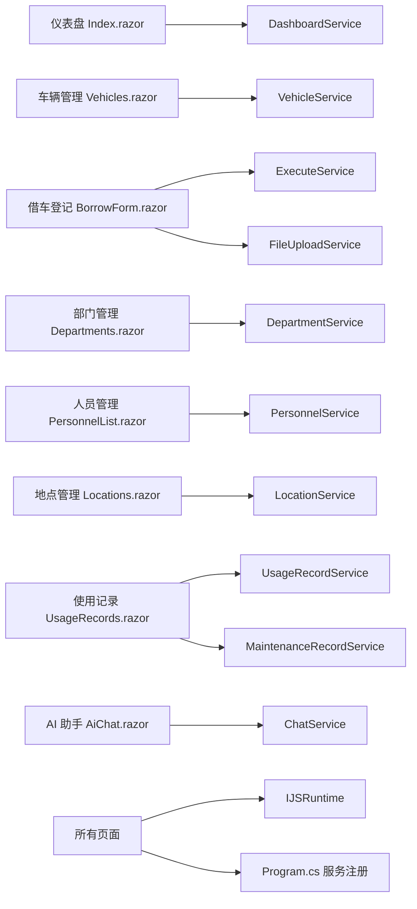

**图示来源**
- [Program.cs:60-95](file://Program.cs#L60-L95)
- [Index.razor:3-4](file://Pages/Index.razor#L3-L4)
- [Vehicles.razor:2-7](file://Pages/Vehicles.razor#L2-L7)
- [BorrowForm.razor:2-6](file://Pages/BorrowForm.razor#L2-L6)
- [Departments.razor:2-3](file://Pages/Departments.razor#L2-L3)
- [PersonnelList.razor:2-3](file://Pages/PersonnelList.razor#L2-L3)
- [Locations.razor:2-2](file://Pages/Locations.razor#L2-L2)
- [UsageRecords.razor:2-6](file://Pages/UsageRecords.razor#L2-L6)
- [AiChat.razor:5-6](file://aiServer/Pages/AiChat.razor#L5-L6)

**章节来源**
- [Program.cs:60-95](file://Program.cs#L60-L95)

## 详细页面分析

### 仪表盘页面
仪表盘承担“数据概览 + 图表 + 最近记录”的职责。它从 `DashboardService` 拉取统计、部门分布、月度趋势、排行榜与最近使用记录，并通过 `IJSRuntime` 调用本地 Chart.js 渲染柱状图与折线图。页面内部维护统计值、图表创建标记、搜索关键词、排序列、分页状态，并在 `OnAfterRenderAsync` 中检测交互模式后执行一次图表渲染。

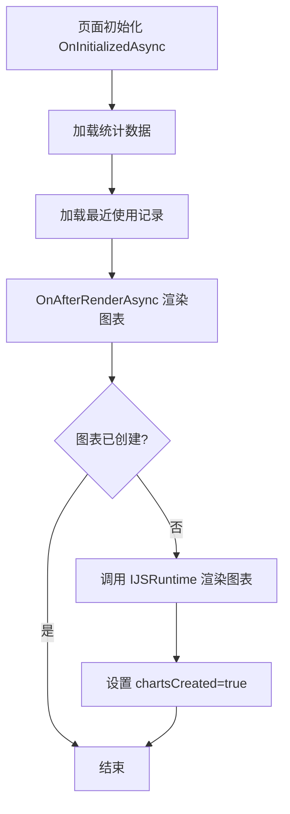

**图示来源**
- [Index.razor:297-324](file://Pages/Index.razor#L297-L324)
- [Index.razor:329-349](file://Pages/Index.razor#L329-L349)
- [Index.razor:364-396](file://Pages/Index.razor#L364-L396)

**章节来源**
- [Index.razor:1-461](file://Pages/Index.razor#L1-L461)

### 车辆管理页面
车辆管理页面提供完整的台账维护能力：搜索、排序、分页、新增/编辑弹窗、删除确认、二维码下载、Excel 导出。它通过 `VehicleService` 获取分页数据与部门下拉选项，通过 `QrCodeService` 生成二维码 URL 与 Base64，通过 `VehicleExportService` 导出 Excel，再通过 `IJSRuntime` 触发浏览器下载。

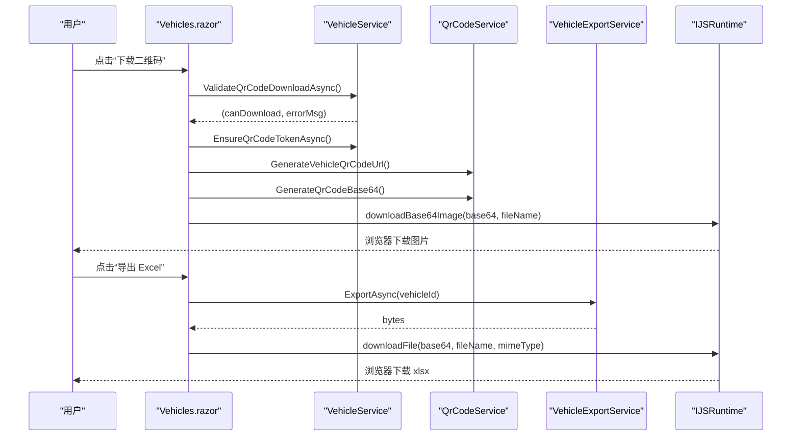

**图示来源**
- [Vehicles.razor:336-358](file://Pages/Vehicles.razor#L336-L358)
- [Vehicles.razor:397-408](file://Pages/Vehicles.razor#L397-L408)

**章节来源**
- [Vehicles.razor:1-410](file://Pages/Vehicles.razor#L1-L410)

### 借车登记表单页面
借车登记页面以路由参数 `VehicleId` 绑定目标车辆，并加载部门、人员、路径点与最终停车位置。用户选择部门后动态过滤人员；路径点支持多选；附件通过 `FileUploadService` 上传到服务器目录；保存成功后调用 `ExecuteService.SaveRecordAsync` 并更新车辆借用状态。

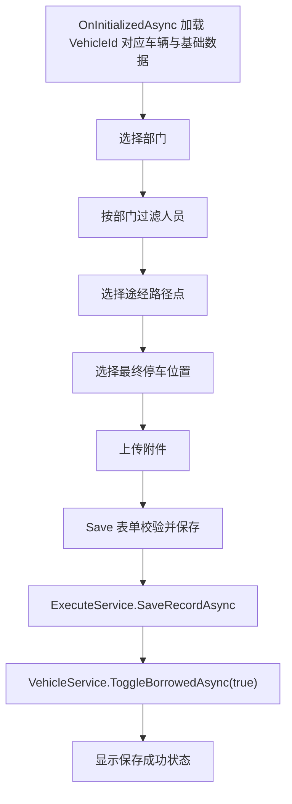

**图示来源**
- [BorrowForm.razor:180-187](file://Pages/BorrowForm.razor#L180-L187)
- [BorrowForm.razor:189-197](file://Pages/BorrowForm.razor#L189-L197)
- [BorrowForm.razor:211-229](file://Pages/BorrowForm.razor#L211-L229)
- [BorrowForm.razor:231-261](file://Pages/BorrowForm.razor#L231-L261)

**章节来源**
- [BorrowForm.razor:1-277](file://Pages/BorrowForm.razor#L1-L277)

### 部门、人员、地点管理页面
这三个页面结构高度一致：顶部标题与搜索、弹窗新增/编辑、表格列表、分页组件、删除确认、错误提示。它们分别委托 `DepartmentService`、`PersonnelService`、`LocationService` 完成分页查询、创建、更新、删除。

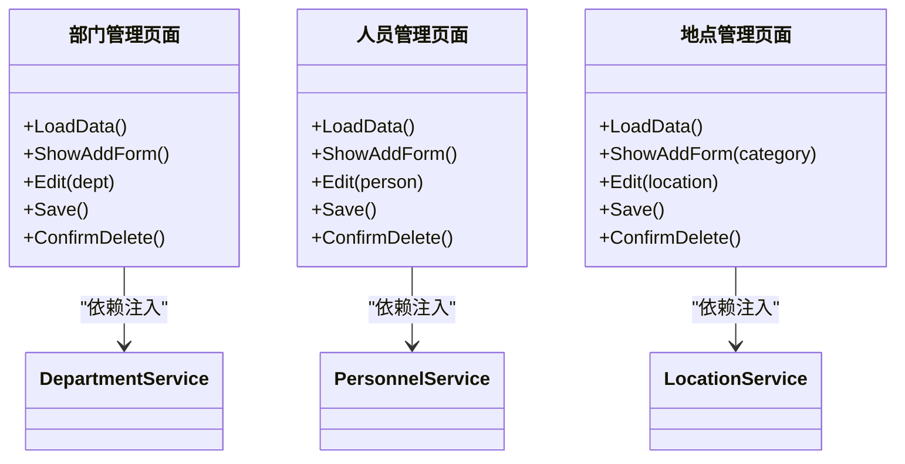

**图示来源**
- [Departments.razor:148-162](file://Pages/Departments.razor#L148-L162)
- [Departments.razor:219-241](file://Pages/Departments.razor#L219-L241)
- [PersonnelList.razor:184-199](file://Pages/PersonnelList.razor#L184-L199)
- [PersonnelList.razor:257-279](file://Pages/PersonnelList.razor#L257-L279)
- [Locations.razor:226-242](file://Pages/Locations.razor#L226-L242)
- [Locations.razor:287-309](file://Pages/Locations.razor#L287-L309)

**章节来源**
- [Departments.razor:1-280](file://Pages/Departments.razor#L1-L280)
- [PersonnelList.razor:1-318](file://Pages/PersonnelList.razor#L1-L318)
- [Locations.razor:1-348](file://Pages/Locations.razor#L1-L348)

### 使用记录与维修记录页面
使用记录页面同时承载“使用记录列表”和“维修记录列表”，并提供删除、附件查看、维修记录新增/编辑弹窗。它通过 `UsageRecordService` 获取使用记录分页，通过 `MaintenanceRecordService` 获取维修记录分页，并通过 `FileUploadService` 上传维修附件。

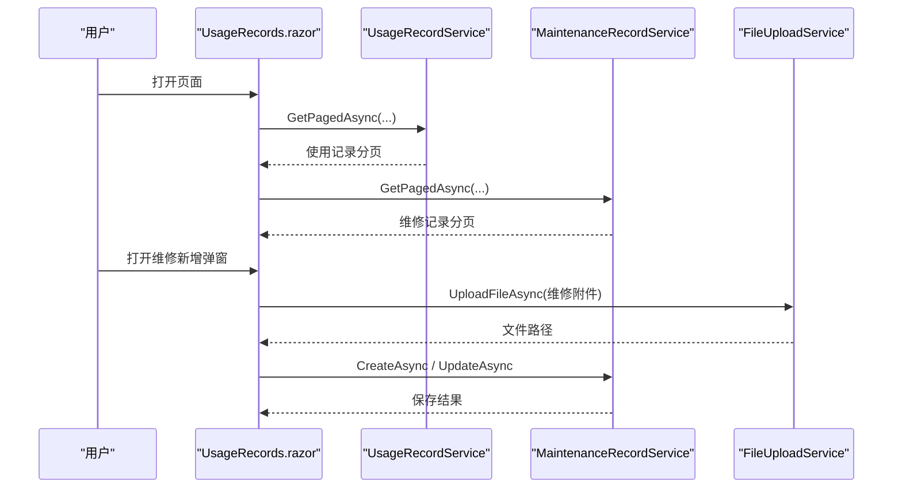

**图示来源**
- [UsageRecords.razor:368-383](file://Pages/UsageRecords.razor#L368-L383)
- [UsageRecords.razor:425-438](file://Pages/UsageRecords.razor#L425-L438)
- [UsageRecords.razor:440-476](file://Pages/UsageRecords.razor#L440-L476)

**章节来源**
- [UsageRecords.razor:1-605](file://Pages/UsageRecords.razor#L1-L605)
- [MaintenanceRecords.razor:1-161](file://Pages/MaintenanceRecords.razor#L1-L161)

### AI 聊天页面
AI 聊天页面负责会话管理、消息发送、记忆面板、移动端侧栏、滚动到底部、F12 布局诊断。它通过 `ChatService` 完成会话创建、消息发送、消息与记忆读取。页面在首次渲染时注册 JS 滚动监听，并根据距离底部阈值自动恢复滚动或显示“回到底部”按钮。

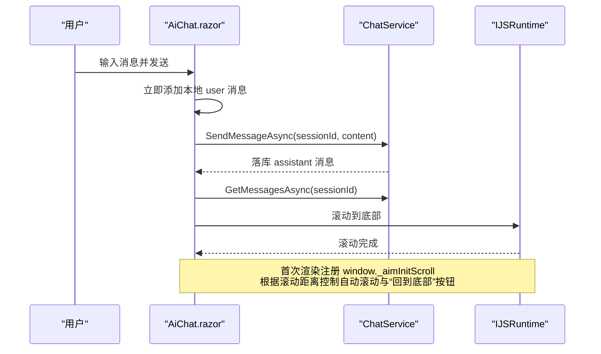

**图示来源**
- [AiChat.razor:277-311](file://aiServer/Pages/AiChat.razor#L277-L311)
- [AiChat.razor:375-419](file://aiServer/Pages/AiChat.razor#L375-L419)
- [AiChat.razor:516-538](file://aiServer/Pages/AiChat.razor#L516-L538)

**章节来源**
- [AiChat.razor:1-555](file://aiServer/Pages/AiChat.razor#L1-L555)

## 页面间通信机制
当前系统主要通过以下方式进行页面间通信与上下文传递：

| 机制 | 使用场景 | 示例 |
| --- | --- | --- |
| 路由参数 | 借车登记页面接收车辆 ID | `/borrow/{VehicleId:int}` |
| 服务注入 | 页面通过 `@inject` 获取 BLL 服务 | `VehicleService`、`DashboardService`、`ChatService` |
| JS 互操作 | 图表渲染、文件下载、滚动控制、布局诊断 | `IJSRuntime.InvokeVoidAsync` |
| 导航跳转 | 返回车辆列表、跳转到维修编辑页 | `NavigationManager.NavigateTo` |
| 组件参数与事件回调 | 分页组件向父页面传页码 | `Pagination.OnPageChanged` |
| 全局导入 | 页面直接使用 DAL 模型与服务命名空间 | `_Imports.razor` |

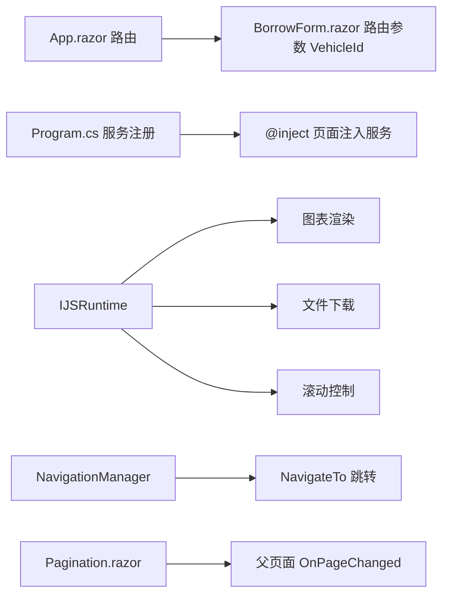

**图示来源**
- [App.razor:2-11](file://App.razor#L2-L11)
- [BorrowForm.razor:1](file://Pages/BorrowForm.razor#L1)
- [Program.cs:60-95](file://Program.cs#L60-L95)
- [Index.razor:4](file://Pages/Index.razor#L4)
- [Vehicles.razor:5](file://Pages/Vehicles.razor#L5)
- [AiChat.razor:6](file://aiServer/Pages/AiChat.razor#L6)
- [BorrowForm.razor:6](file://Pages/BorrowForm.razor#L6)
- [Pagination.razor:24-30](file://Components/Common/Pagination.razor#L24-L30)
- [_Imports.razor:1-30](file://_Imports.razor#L1-L30)

**章节来源**
- [App.razor:2-11](file://App.razor#L2-L11)
- [BorrowForm.razor:1](file://Pages/BorrowForm.razor#L1)
- [Program.cs:60-95](file://Program.cs#L60-L95)
- [Pagination.razor:20-41](file://Components/Common/Pagination.razor#L20-L41)
- [_Imports.razor:1-30](file://_Imports.razor#L1-L30)

## 错误处理、加载状态与健壮性
页面普遍采用统一的错误处理模式：

- **加载状态**：表单类页面使用 `loading`、`saving`、`saved`、`uploading` 等布尔字段控制界面反馈。
- **错误提示**：通过 `errorMessage` 字符串配合模态框展示失败原因。
- **删除确认**：通过 `showDeleteConfirm` 与待删除实体信息避免误操作。
- **空数据状态**：仪表盘与使用记录页面在数据为空时显示“暂无数据”。
- **异常捕获**：保存、删除、导出、上传等操作均包裹 try/catch，将异常转为用户可读错误。
- **AI 子系统兜底**：README 指出 Ollama 不可达、查询异常、结果为空、记忆写失败均有独立兜底，不影响业务页面可用性。

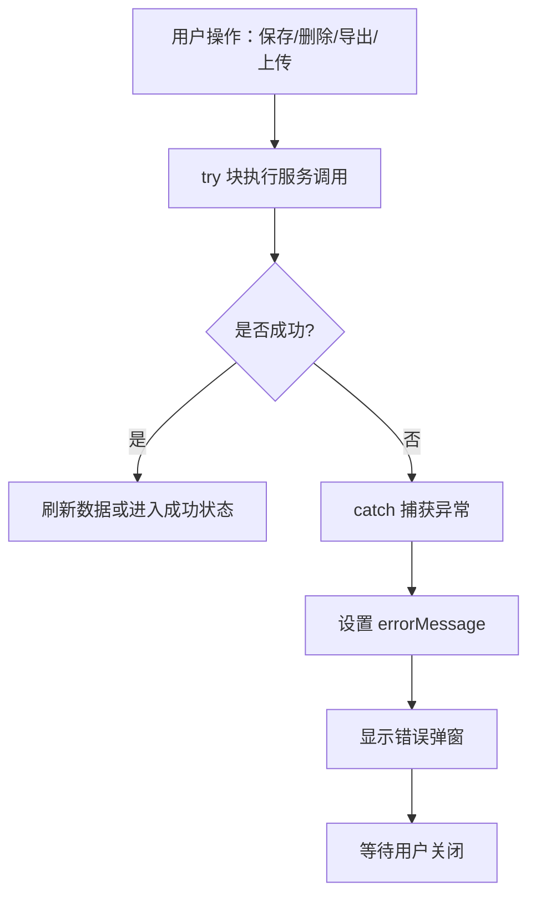

**图示来源**
- [Vehicles.razor:284-331](file://Pages/Vehicles.razor#L284-L331)
- [Departments.razor:219-241](file://Pages/Departments.razor#L219-L241)
- [PersonnelList.razor:257-279](file://Pages/PersonnelList.razor#L257-L279)
- [Locations.razor:287-309](file://Pages/Locations.razor#L287-L309)
- [UsageRecords.razor:440-476](file://Pages/UsageRecords.razor#L440-L476)
- [BorrowForm.razor:231-261](file://Pages/BorrowForm.razor#L231-L261)
- [README.md:291-300](file://README.md#L291-L300)

**章节来源**
- [README.md:291-300](file://README.md#L291-L300)

## 性能与可维护性建议
当前页面多为单文件 Blazor 组件，适合中小型业务页面。若未来页面复杂度继续增长，建议：

- **代码分割与懒加载**：对重型页面（如仪表盘含多个图表）可按模块拆分子组件，减少首屏渲染压力。
- **图表渲染优化**：仪表盘已在 `OnAfterRenderAsync` 中延迟 100ms 并仅创建一次图表，可进一步封装为专用图表组件，避免重复调用 JS。
- **分页组件复用**：已有 `Pagination.razor`，所有列表页应统一使用该组件，避免重复实现页码计算逻辑。
- **服务层复用**：文件上传、二维码生成、导出等通用能力集中在 BLL 与 Common 服务，页面只负责组装请求参数。
- **日志与可观测性**：启动阶段已配置 Serilog，页面级异常建议结合日志记录关键操作，便于定位问题。

[本节为通用建议，不直接分析具体文件]

## 页面开发规范
为保证团队一致性，新增页面应遵循以下规范：

| 维度 | 规范 |
| --- | --- |
| 文件组织 | 业务页面放在 `Pages`，AI 相关页面放在 `aiServer/Pages`；公共布局与导航放在 `Components/Layouts` 与 `Components/Navigation`；通用 UI 组件放在 `Components/Common`。 |
| 命名约定 | 页面文件名使用 PascalCase，如 `Vehicles.razor`、`BorrowForm.razor`；路由使用小写短横线风格，如 `/usage-records`、`/ai-chat`。 |
| 服务注入 | 页面通过 `@inject` 注入 BLL 服务，避免在页面中直接访问数据库或仓储。 |
| 状态管理 | 页面内状态变量集中声明在 `@code` 块，UI 状态与业务状态分离，例如 `loading`、`errorMessage`、`currentPage`。 |
| 用户交互 | 表单提交前进行前端校验，重要操作提供确认弹窗，错误通过统一错误弹窗展示。 |
| 文件上传 | 使用 `FileUploadService.UploadFileAsync`，并在 UI 上显示上传进度与失败信息。 |
| 附件查看 | 使用统一的图片/视频查看器逻辑，区分图片与视频后缀。 |
| 分页 | 使用 `Pagination.razor` 组件，通过 `OnPageChanged` 回调通知父页面重新加载数据。 |
| 图表 | 使用 `IJSRuntime` 调用本地 Chart.js，避免 CDN 依赖，并在 `OnAfterRenderAsync` 中确保 DOM 就绪后再渲染。 |
| 导航 | 使用 `NavigationManager.NavigateTo` 进行页面跳转，避免硬编码字符串拼接路由。 |

**章节来源**
- [Pagination.razor:1-42](file://Components/Common/Pagination.razor#L1-L42)
- [MainLayout.razor:4-23](file://Components/Layouts/MainLayout.razor#L4-L23)
- [NavMenu.razor:8-49](file://Components/Navigation/NavMenu.razor#L8-L49)

## 页面扩展指南

### 新页面创建模板
创建一个新页面时，建议按以下步骤：

1. 在 `Pages` 下创建 `.razor` 文件，并在顶部声明 `@page "/your-route"`。
2. 通过 `@inject` 注入所需服务，例如 `YourService`。
3. 在 `OnInitializedAsync` 中加载初始数据。
4. 定义 UI 状态变量：列表、分页、搜索、排序、弹窗、错误信息。
5. 实现数据加载方法 `LoadData()`，封装搜索、排序、分页参数。
6. 实现新增/编辑弹窗：表单绑定、保存、取消。
7. 实现删除确认：显示确认弹窗，调用服务删除后刷新列表。
8. 使用 `Pagination.razor` 组件展示分页。
9. 如需文件上传，调用 `FileUploadService.UploadFileAsync`。
10. 如需图表，使用 `IJSRuntime` 调用本地 JS 函数。

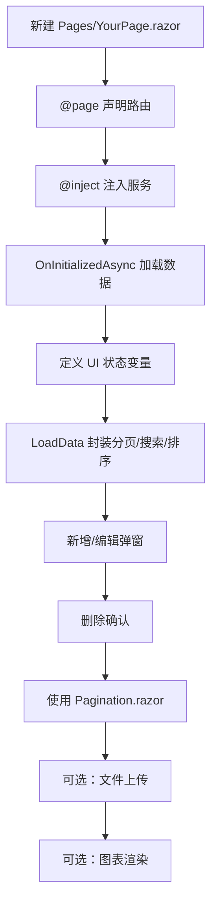

[本节为概念性模板，不直接分析具体文件]

### API 调用封装
页面不应直接构造 HTTP 请求或拼接 SQL。所有数据访问应通过 BLL 服务：

- 列表查询：`GetPagedAsync(keyword, sortColumn, ascending, page, pageSize)`
- 详情查询：`GetXxxByIdAsync(id)`
- 创建：`CreateXxxAsync(model)`
- 更新：`UpdateXxxAsync(model)`
- 删除：`DeleteXxxAsync(id)` 或返回 `(success, error)` 元组
- 文件上传：`FileUploadService.UploadFileAsync(file, deptName, plate, personName)`

**章节来源**
- [Vehicles.razor:220-227](file://Pages/Vehicles.razor#L220-L227)
- [Departments.razor:156-162](file://Pages/Departments.razor#L156-L162)
- [PersonnelList.razor:192-199](file://Pages/PersonnelList.razor#L192-L199)
- [Locations.razor:231-242](file://Pages/Locations.razor#L231-L242)
- [UsageRecords.razor:503-509](file://Pages/UsageRecords.razor#L503-L509)
- [BorrowForm.razor:211-229](file://Pages/BorrowForm.razor#L211-L229)

### 表单验证
表单验证应在页面层做基础校验，在服务层做业务校验：

- 必填字段：车牌号、部门、人员、路径点、最终停车位置等。
- 数值字段：年份、里程、费用等。
- 枚举字段：状态、类别等。
- 文件字段：允许的图片/视频格式与数量限制。
- 错误提示：统一使用 `errorMessage` 与模态框展示。

**章节来源**
- [BorrowForm.razor:231-261](file://Pages/BorrowForm.razor#L231-L261)
- [Vehicles.razor:284-331](file://Pages/Vehicles.razor#L284-L331)
- [Departments.razor:219-241](file://Pages/Departments.razor#L219-L241)
- [PersonnelList.razor:257-279](file://Pages/PersonnelList.razor#L257-L279)
- [Locations.razor:287-309](file://Pages/Locations.razor#L287-L309)

### 文件上传处理
文件上传流程建议如下：

1. 使用 `InputFile` 组件绑定 `OnChange`。
2. 设置 `uploading` 状态防止重复上传。
3. 遍历文件调用 `FileUploadService.UploadFileAsync`。
4. 将返回的文件路径加入 `uploadedFiles` 列表。
5. 保存表单时将路径集合传给服务。
6. 上传失败时设置 `errorMessage` 并提示用户。

**章节来源**
- [BorrowForm.razor:211-229](file://Pages/BorrowForm.razor#L211-L229)
- [UsageRecords.razor:425-438](file://Pages/UsageRecords.razor#L425-L438)

## 常见问题排查

| 问题 | 可能原因 | 排查建议 |
| --- | --- | --- |
| 图表不显示 | JS 尚未就绪或 DOM 未更新 | 检查 `OnAfterRenderAsync` 中的交互模式判断与延迟渲染 |
| 二维码无法下载 | Token 缺失或外部 Host 不正确 | 检查 `EnsureQrCodeTokenAsync` 与 `HttpContextAccessor` 获取的 Scheme/Host |
| Excel 导出失败 | 未找到车辆数据或服务异常 | 检查 `ExportService.ExportAsync` 返回值与异常信息 |
| AI 助手无响应 | Ollama 不可达或模型配置错误 | 检查 `aisettings.json`、环境变量、Ollama 端点与模型 tag |
| 滚动到底部无效 | 消息容器未渲染或 JS 监听未注册 | 检查 `OnAfterRenderAsync` 中 `_aimInitScroll` 注册与 `currentSessionId != 0` |
| 页面报错但无提示 | 未捕获异常或未设置 `errorMessage` | 在保存、删除、上传等操作中添加 try/catch |

**章节来源**
- [Index.razor:303-324](file://Pages/Index.razor#L303-L324)
- [Vehicles.razor:336-358](file://Pages/Vehicles.razor#L336-L358)
- [Vehicles.razor:397-408](file://Pages/Vehicles.razor#L397-L408)
- [README.md:157-185](file://README.md#L157-L185)
- [AiChat.razor:277-311](file://aiServer/Pages/AiChat.razor#L277-L311)

## 结论
vehicleManagement 的页面组件整体遵循清晰的职责划分：页面负责 UI 与交互，服务负责数据与业务规则，公共组件负责通用 UI 能力。仪表盘侧重数据可视化，车辆管理与基础数据页面侧重 CRUD，借车登记表单侧重复杂表单与状态流转，AI 聊天页面侧重会话、消息与记忆展示。通过依赖注入、路由参数、JS 互操作与分页组件，系统实现了可扩展、可维护的页面架构。后续可在代码分割、图表组件化、日志增强方面进一步优化，以提升大型页面与复杂交互场景下的性能与可观测性。