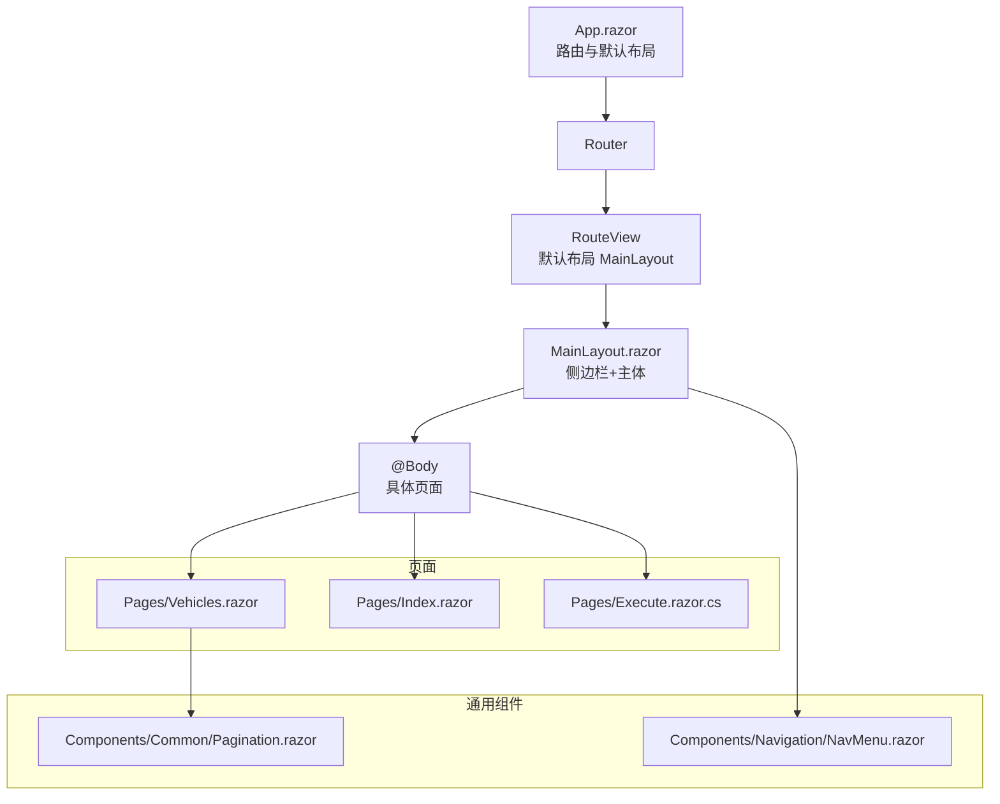
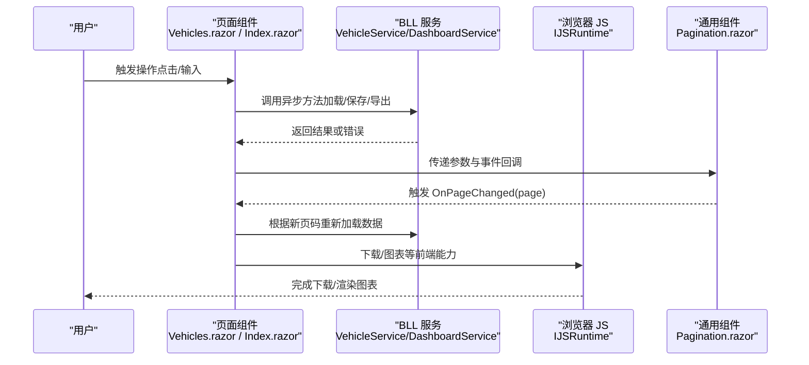
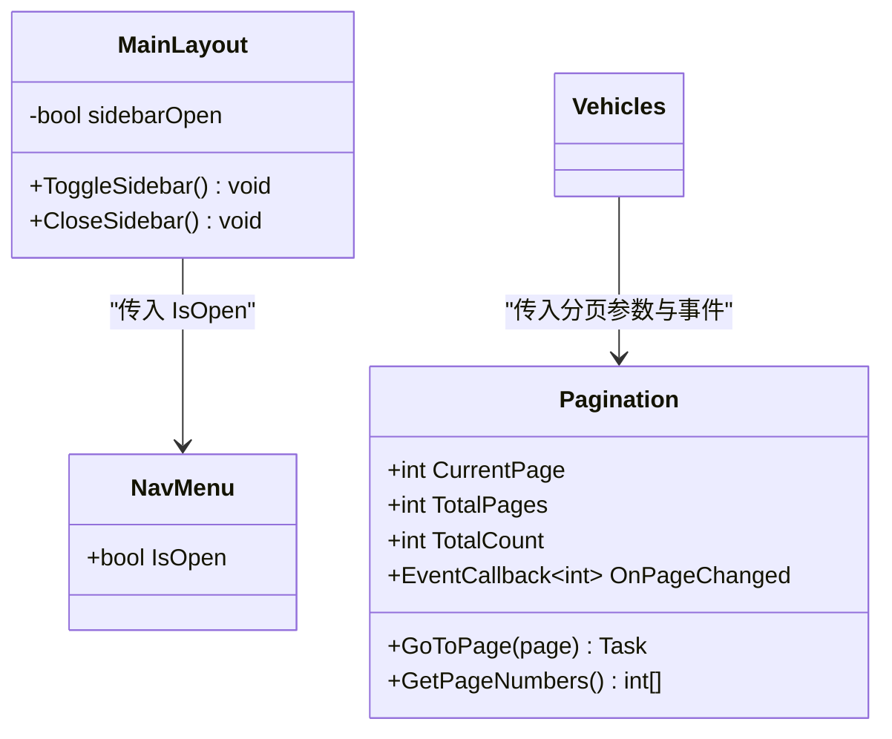
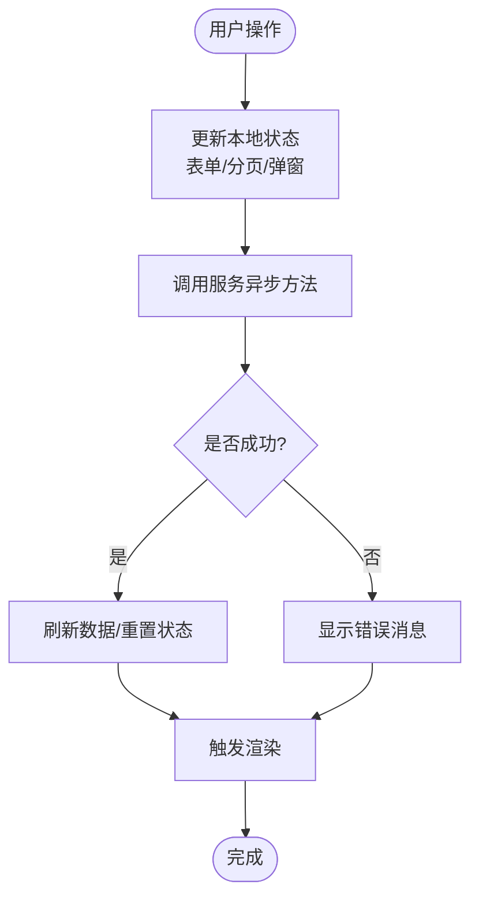
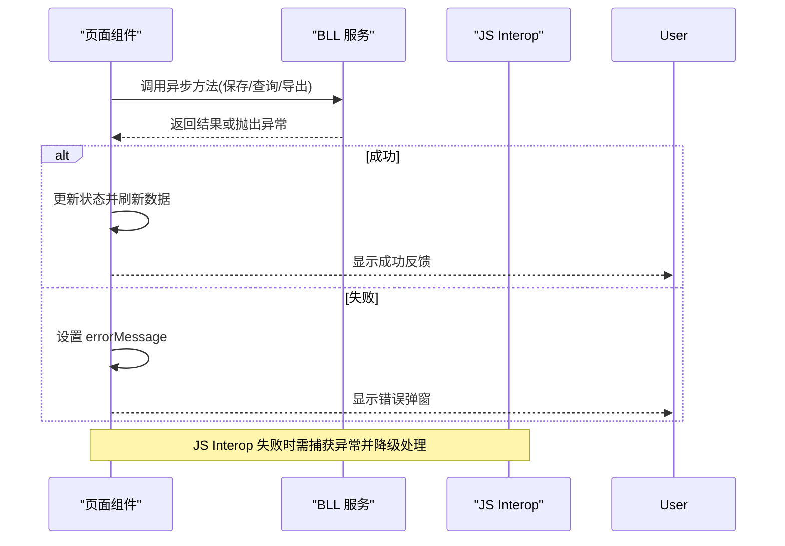
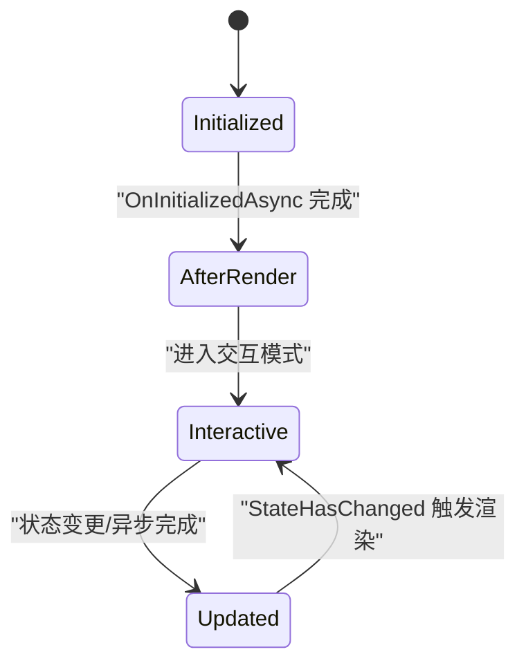
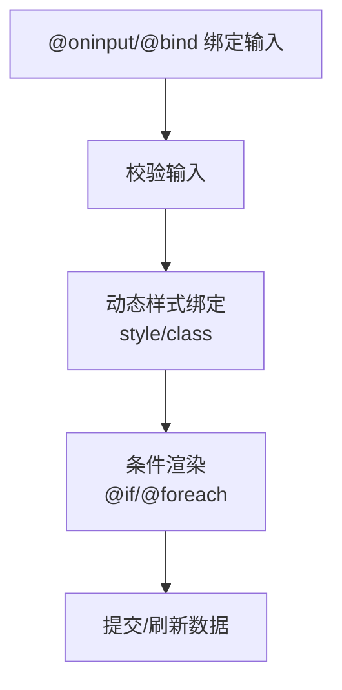
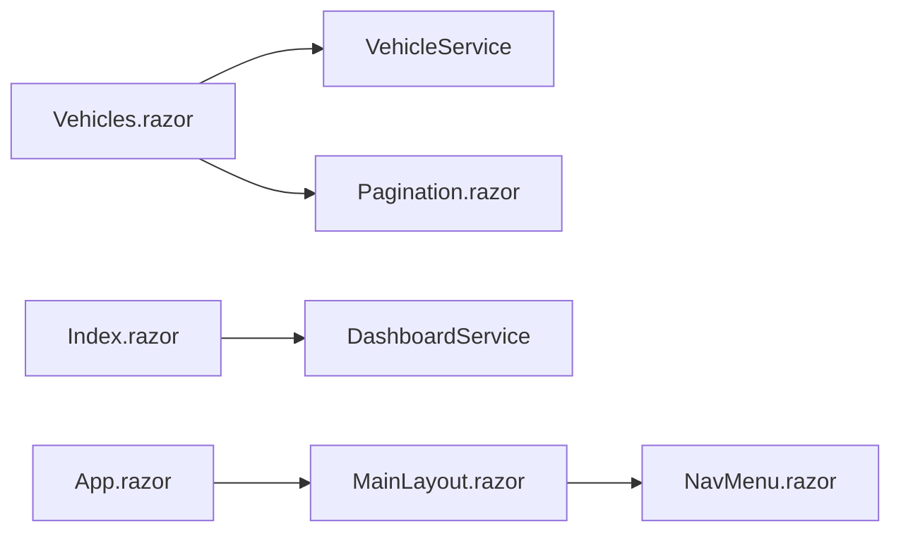

# Blazor 组件开发规范

<cite>
**本文引用的文件**   
- [App.razor](file://App.razor)
- [_Imports.razor](file://._Imports.razor)
- [MainLayout.razor](file://Components/Layouts/MainLayout.razor)
- [MobileLayout.razor](file://Components/Layouts/MobileLayout.razor)
- [NavMenu.razor](file://Components/Navigation/NavMenu.razor)
- [Pagination.razor](file://Components/Common/Pagination.razor)
- [Vehicles.razor](file://Pages/Vehicles.razor)
- [Index.razor](file://Pages/Index.razor)
- [Execute.razor.cs](file://Pages/Execute.razor.cs)
- [AiChat.razor](file://aiServer/Pages/AiChat.razor)
- [site.css](file://wwwroot/css/site.css)
</cite>

## 目录
1. [引言](#引言)
2. [项目结构](#项目结构)
3. [核心组件](#核心组件)
4. [架构总览](#架构总览)
5. [详细组件分析](#详细组件分析)
6. [依赖关系分析](#依赖关系分析)
7. [性能与优化](#性能与优化)
8. [测试策略](#测试策略)
9. [故障排查](#故障排查)
10. [结论](#结论)

## 引言
本规范面向 vehicleManagement 系统的 Blazor 组件开发，目标是在现有代码基础上沉淀一套可复用的开发约定，覆盖：
- 组件命名规范（页面、可复用组件、布局）
- 属性设计（[Parameter]、验证、默认值、事件参数）
- 状态管理（字段、StateHasChanged、父子数据流）
- 异步处理（async/await、Task、错误处理与用户反馈）
- 生命周期、事件绑定、样式绑定、条件渲染最佳实践
- 组件测试策略与性能优化技巧

## 项目结构
vehicleManagement 采用典型的 Blazor WebAssembly/Server 混合结构：
- Pages：页面级组件，承载业务视图与交互逻辑
- Components：可复用 UI 组件与布局
- BLL/DAL：业务与数据访问层
- wwwroot：静态资源（CSS/JS）
- App.razor：应用根组件与路由配置
- _Imports.razor：全局 using 与命名空间导入

图示来源
- [App.razor:1-12](file://App.razor#L1-L12)
- [MainLayout.razor:1-40](file://Components/Layouts/MainLayout.razor#L1-L40)
- [NavMenu.razor:1-56](file://Components/Navigation/NavMenu.razor#L1-L56)
- [Pagination.razor:1-42](file://Components/Common/Pagination.razor#L1-L42)
- [Vehicles.razor:1-410](file://Pages/Vehicles.razor#L1-L410)
- [Index.razor:1-461](file://Pages/Index.razor#L1-L461)

章节来源
- [App.razor:1-12](file://App.razor#L1-L12)
- [_Imports.razor:1-30](file://._Imports.razor#L1-L30)

## 核心组件
本节梳理项目中关键组件的职责与协作方式。

- 应用入口与路由
  - App.razor 定义 Router，并设置默认布局为 MainLayout；NotFound 使用 LayoutView 包裹提示内容。
- 布局组件
  - MainLayout.razor 继承 LayoutComponentBase，组合 NavMenu 与 @Body，提供顶部栏与侧边栏开关状态。
  - MobileLayout.razor 提供移动端基础布局骨架。
- 导航菜单
  - NavMenu.razor 通过 NavLink 构建主菜单与 AI 服务入口，接收 IsOpen 控制展开状态。
- 分页组件
  - Pagination.razor 暴露 CurrentPage、TotalPages、TotalCount 与 OnPageChanged 事件回调，内部计算页码范围并禁用无效按钮。
- 页面组件
  - Vehicles.razor 实现车辆列表的搜索、排序、分页、新增/编辑弹窗、删除确认、二维码下载与 Excel 导出。
  - Index.razor 实现仪表盘统计、图表渲染（JS Interop）、最近使用记录与附件查看器。
  - Execute.razor.cs 作为后置代码示例，展示路由参数与注入服务的组织方式。

章节来源
- [App.razor:1-12](file://App.razor#L1-L12)
- [MainLayout.razor:1-40](file://Components/Layouts/MainLayout.razor#L1-L40)
- [MobileLayout.razor:1-8](file://Components/Layouts/MobileLayout.razor#L1-L8)
- [NavMenu.razor:1-56](file://Components/Navigation/NavMenu.razor#L1-L56)
- [Pagination.razor:1-42](file://Components/Common/Pagination.razor#L1-L42)
- [Vehicles.razor:1-410](file://Pages/Vehicles.razor#L1-L410)
- [Index.razor:1-461](file://Pages/Index.razor#L1-L461)
- [Execute.razor.cs:1-38](file://Pages/Execute.razor.cs#L1-L38)

## 架构总览
Blazor 组件在 vehicleManagement 中遵循“页面负责编排、通用组件负责呈现、服务负责业务”的分层模式。

图示来源
- [Vehicles.razor:215-408](file://Pages/Vehicles.razor#L215-L408)
- [Index.razor:297-427](file://Pages/Index.razor#L297-L427)
- [Pagination.razor:20-41](file://Components/Common/Pagination.razor#L20-L41)

## 详细组件分析

### 命名规范
- 页面组件：使用 PageName.razor，如 Vehicles.razor、Index.razor。
- 可复用组件：使用 ComponentName.razor，如 Pagination.razor。
- 布局组件：使用 LayoutName.razor，如 MainLayout.razor、MobileLayout.razor。
- 命名空间：通用组件建议置于 Components 子目录，并在 _Imports.razor 中统一引入。

章节来源
- [Vehicles.razor:1-410](file://Pages/Vehicles.razor#L1-L410)
- [Index.razor:1-461](file://Pages/Index.razor#L1-L461)
- [Pagination.razor:1-42](file://Components/Common/Pagination.razor#L1-L42)
- [MainLayout.razor:1-40](file://Components/Layouts/MainLayout.razor#L1-L40)
- [MobileLayout.razor:1-8](file://Components/Layouts/MobileLayout.razor#L1-L8)
- [_Imports.razor:1-30](file://._Imports.razor#L1-L30)

### 属性设计与事件参数
- 使用 [Parameter] 暴露受控属性，并为常用属性设置合理默认值。
- 使用 EventCallback<T> 向父组件抛出事件，避免直接耦合。
- 对必填参数进行校验（可在组件内校验或在调用方校验），并提供友好提示。

参考实现要点
- Pagination.razor 通过 [Parameter] 暴露 CurrentPage、TotalPages、TotalCount，并通过 EventCallback<int> OnPageChanged 通知父组件翻页。
- NavMenu.razor 通过 [Parameter] 暴露 IsOpen，由父布局控制展开状态。

图示来源
- [Pagination.razor:20-41](file://Components/Common/Pagination.razor#L20-L41)
- [NavMenu.razor:53-55](file://Components/Navigation/NavMenu.razor#L53-L55)
- [MainLayout.razor:27-39](file://Components/Layouts/MainLayout.razor#L27-L39)
- [Vehicles.razor:184-184](file://Pages/Vehicles.razor#L184-L184)

章节来源
- [Pagination.razor:20-41](file://Components/Common/Pagination.razor#L20-L41)
- [NavMenu.razor:53-55](file://Components/Navigation/NavMenu.razor#L53-L55)
- [MainLayout.razor:27-39](file://Components/Layouts/MainLayout.razor#L27-L39)

### 状态管理与父子数据流
- 页面组件维护本地 UI 状态（如表单字段、弹窗显隐、分页参数）。
- 通过 [Parameter] 将数据从父组件传递给子组件，通过 EventCallback 将子组件事件回传给父组件。
- StateHasChanged 通常在手动更新 UI 且未触发自动重绘时调用（例如在 JS Interop 成功回调后刷新界面）。

参考实现要点
- Vehicles.razor 维护 vehicles、searchKeyword、currentPage 等状态，并在异步操作完成后重新加载数据以触发渲染。
- Index.razor 在 OnAfterRenderAsync 中检测交互模式并仅创建一次图表，避免重复渲染。
- AiChat.razor 在多处调用 StateHasChanged 以同步 UI 状态。

图示来源
- [Vehicles.razor:284-331](file://Pages/Vehicles.razor#L284-L331)
- [Index.razor:297-324](file://Pages/Index.razor#L297-L324)
- [AiChat.razor:422-529](file://aiServer/Pages/AiChat.razor#L422-L529)

章节来源
- [Vehicles.razor:186-408](file://Pages/Vehicles.razor#L186-L408)
- [Index.razor:259-461](file://Pages/Index.razor#L259-L461)
- [AiChat.razor:422-529](file://aiServer/Pages/AiChat.razor#L422-L529)

### 异步操作处理与错误反馈
- 所有 I/O 与网络请求使用 async/await，返回 Task 或 Task<T>。
- 在 try/catch 中捕获异常，并将错误信息写入 errorMessage 或通过弹窗提示。
- 对于 JS Interop 失败场景，需考虑连接未就绪时的重试与容错。

参考实现要点
- Vehicles.razor 的 Save、DownloadQrCode、ExportExcel 等方法均包含错误处理与用户反馈。
- Index.razor 在图表渲染时延迟执行并捕获异常，避免阻塞首屏。
- Execute.razor.cs 展示了路由参数与服务注入的组织方式。

图示来源
- [Vehicles.razor:284-408](file://Pages/Vehicles.razor#L284-L408)
- [Index.razor:364-396](file://Pages/Index.razor#L364-L396)
- [Execute.razor.cs:20-38](file://Pages/Execute.razor.cs#L20-L38)

章节来源
- [Vehicles.razor:284-408](file://Pages/Vehicles.razor#L284-L408)
- [Index.razor:364-396](file://Pages/Index.razor#L364-L396)
- [Execute.razor.cs:20-38](file://Pages/Execute.razor.cs#L20-L38)

### 生命周期管理
- OnInitializedAsync：用于初始化数据加载。
- OnAfterRenderAsync：用于 DOM 就绪后的 JS Interop 与第三方库初始化。
- 在需要手动刷新 UI 的场景调用 StateHasChanged。

参考实现要点
- Vehicles.razor 在 OnInitializedAsync 中加载数据。
- Index.razor 在 OnAfterRenderAsync 中检测交互模式并渲染图表。
- AiChat.razor 在多处调用 StateHasChanged 以同步 UI。

图示来源
- [Vehicles.razor:215-227](file://Pages/Vehicles.razor#L215-L227)
- [Index.razor:297-324](file://Pages/Index.razor#L297-L324)
- [AiChat.razor:422-529](file://aiServer/Pages/AiChat.razor#L422-L529)

章节来源
- [Vehicles.razor:215-227](file://Pages/Vehicles.razor#L215-L227)
- [Index.razor:297-324](file://Pages/Index.razor#L297-L324)
- [AiChat.razor:422-529](file://aiServer/Pages/AiChat.razor#L422-L529)

### 事件处理与样式绑定
- 事件绑定：@onclick、@oninput、@bind 等指令用于绑定用户交互与双向绑定。
- 样式绑定：通过 style 属性与 CSS 变量结合，或使用类名切换实现动态样式。
- 条件渲染：使用 @if/@foreach 控制 UI 分支与列表渲染。

参考实现要点
- Vehicles.razor 使用 @bind 绑定表单字段，@onclick 触发保存/删除等操作。
- Index.razor 使用 @if 判断数据存在性并渲染图表或空状态。
- site.css 定义了统一的输入框与 NavLink active 样式。

图示来源
- [Vehicles.razor:14-86](file://Pages/Vehicles.razor#L14-L86)
- [Index.razor:44-90](file://Pages/Index.razor#L44-L90)
- [site.css:22-48](file://wwwroot/css/site.css#L22-L48)

章节来源
- [Vehicles.razor:14-86](file://Pages/Vehicles.razor#L14-L86)
- [Index.razor:44-90](file://Pages/Index.razor#L44-L90)
- [site.css:22-48](file://wwwroot/css/site.css#L22-L48)

## 依赖关系分析
- 页面组件依赖 BLL 服务进行数据获取与业务处理。
- 通用组件通过 [Parameter] 与 EventCallback 解耦父子关系。
- 布局组件通过 @Body 注入页面内容，并通过自身状态控制 UI 行为。
- _Imports.razor 集中管理命名空间，减少重复 using。

图示来源
- [Vehicles.razor:1-410](file://Pages/Vehicles.razor#L1-L410)
- [Index.razor:1-461](file://Pages/Index.razor#L1-L461)
- [Pagination.razor:1-42](file://Components/Common/Pagination.razor#L1-L42)
- [MainLayout.razor:1-40](file://Components/Layouts/MainLayout.razor#L1-L40)
- [NavMenu.razor:1-56](file://Components/Navigation/NavMenu.razor#L1-L56)
- [App.razor:1-12](file://App.razor#L1-L12)

章节来源
- [Vehicles.razor:1-410](file://Pages/Vehicles.razor#L1-L410)
- [Index.razor:1-461](file://Pages/Index.razor#L1-L461)
- [Pagination.razor:1-42](file://Components/Common/Pagination.razor#L1-L42)
- [MainLayout.razor:1-40](file://Components/Layouts/MainLayout.razor#L1-L40)
- [NavMenu.razor:1-56](file://Components/Navigation/NavMenu.razor#L1-L56)
- [App.razor:1-12](file://App.razor#L1-L12)

## 性能与优化
- 避免在频繁触发的回调中进行昂贵计算，必要时使用防抖或节流（可在 JS 层实现）。
- 仅在交互模式下渲染图表，避免预渲染阶段重复初始化。
- 合理使用 @key 提升列表渲染性能（当前未使用，建议在长列表中加入）。
- 减少不必要的 StateHasChanged 调用，优先依赖 Blazor 自动渲染机制。
- 对大数据集进行分页与懒加载，避免一次性加载过多数据。

章节来源
- [Index.razor:303-324](file://Pages/Index.razor#L303-L324)
- [Vehicles.razor:215-247](file://Pages/Vehicles.razor#L215-L247)

## 测试策略
- 单元测试
  - 针对组件的事件回调与状态变化编写断言，模拟父组件传入参数与事件触发。
  - 对通用组件（如 Pagination）进行边界测试（首页/末页/无效页码）。
- 集成测试
  - 验证页面与服务层的协作流程，包括异步加载、错误处理与用户反馈。
- 端到端测试
  - 使用浏览器自动化工具验证用户操作流程（新增/编辑/删除/导出）。
- 建议
  - 为每个公共组件建立最小化测试用例，确保参数校验与事件回调正确。
  - 对 JS Interop 调用进行 Mock，避免依赖外部库的不确定性。

[本节为概念性说明，不直接分析具体文件]

## 故障排查
- 常见问题
  - JS Interop 失败：检查连接是否就绪，增加重试与降级逻辑。
  - 状态未更新：确认是否在异步回调中调用了 StateHasChanged。
  - 样式未生效：检查类名是否正确、CSS 变量是否定义。
- 定位方法
  - 查看浏览器控制台日志与网络请求。
  - 在关键步骤输出调试信息（注意生产环境关闭敏感日志）。
  - 使用 site.css 中的错误 UI 样式辅助定位问题。

章节来源
- [site.css:1-27](file://wwwroot/css/site.css#L1-L27)
- [AiChat.razor:446-497](file://aiServer/Pages/AiChat.razor#L446-L497)

## 结论
vehicleManagement 的 Blazor 组件体系遵循清晰的职责划分与约定：
- 页面组件负责业务编排与用户交互
- 通用组件通过 [Parameter] 与 EventCallback 实现松耦合
- 布局组件提供一致的视觉与交互框架
- 异步处理与错误反馈贯穿各层，保障用户体验
- 通过合理的生命周期管理与性能优化，提升整体稳定性与响应速度

遵循本规范有助于团队在扩展新功能时保持一致的代码风格与质量，降低维护成本并提升可测试性。