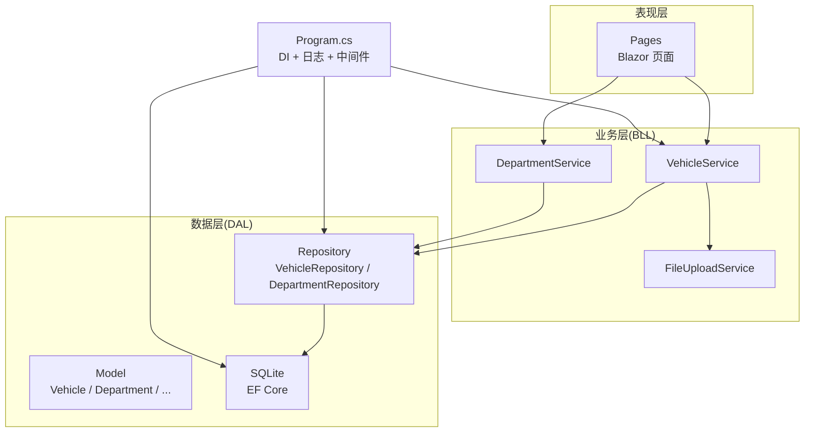
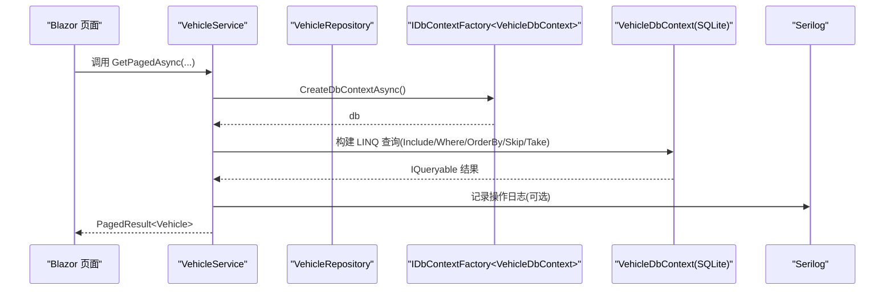
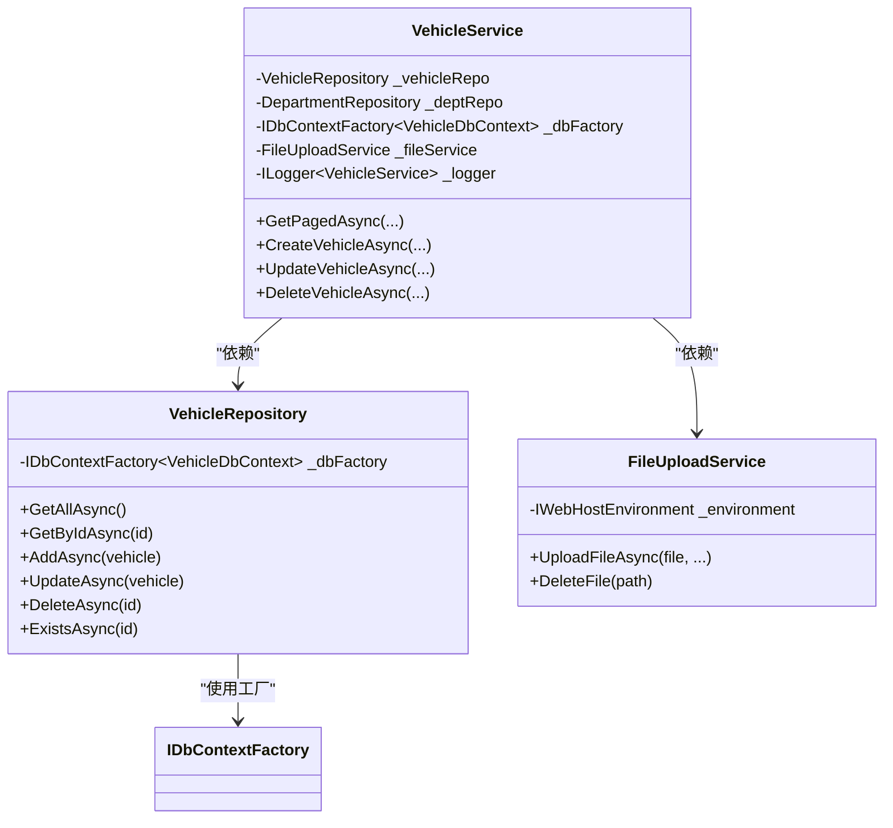

# C# 编码规范

<cite>
**本文引用的文件**   
- [Program.cs](file://Program.cs)
- [VehicleService.cs](file://BLL/Vehicle/VehicleService.cs)
- [VehicleRepository.cs](file://DAL/Repository/VehicleRepository.cs)
- [DepartmentRepository.cs](file://DAL/Repository/DepartmentRepository.cs)
- [FileUploadService.cs](file://BLL/Common/FileUploadService.cs)
- [Vehicle.cs](file://DAL/Model/Vehicle.cs)
</cite>

## 目录
1. [引言](#引言)
2. [项目结构](#项目结构)
3. [核心组件](#核心组件)
4. [架构总览](#架构总览)
5. [详细组件分析](#详细组件分析)
6. [依赖关系分析](#依赖关系分析)
7. [性能与可维护性](#性能与可维护性)
8. [故障排查指南](#故障排查指南)
9. [结论](#结论)
10. [附录：命名与格式速查表](#附录命名与格式速查表)

## 引言
本规范面向 vehicleManagement 系统的 C# 开发，目标是统一代码风格、提升可读性与可维护性，并给出在现有代码库中已体现的最佳实践。文档覆盖命名约定、代码格式、注释规范、异常处理模式、异步编程、LINQ 查询优化与依赖注入使用等主题，并通过仓库中的实际代码作为参考依据。

## 项目结构
本项目采用分层架构：
- BLL（业务逻辑层）：封装领域规则、编排仓储调用、对外暴露服务方法。
- DAL（数据访问层）：仓储实现与实体模型，基于 EF Core 与 SQLite。
- Pages（Blazor 页面）：用户界面与交互逻辑。
- aiServer（AI 子模块）：独立上下文与 AI 相关服务。
- Program.cs：应用启动、依赖注入、日志与中间件配置。

图表来源
- [Program.cs:41-102](file://Program.cs#L41-L102)
- [VehicleService.cs:13-38](file://BLL/Vehicle/VehicleService.cs#L13-L38)
- [VehicleRepository.cs:8-17](file://DAL/Repository/VehicleRepository.cs#L8-L17)
- [Vehicle.cs:6-48](file://DAL/Model/Vehicle.cs#L6-L48)

章节来源
- [Program.cs:41-102](file://Program.cs#L41-L102)

## 核心组件
- 应用启动与 DI：Program.cs 负责注册服务、配置 Serilog、创建 DbContextFactory、初始化数据库与静态文件托管。
- 业务服务：VehicleService 提供车辆相关的查询、创建、更新、删除、二维码校验与生成等业务能力。
- 仓储实现：VehicleRepository、DepartmentRepository 等提供统一的 CRUD 与 Exists 查询。
- 通用服务：FileUploadService 提供图片/视频上传、校验与删除。
- 数据模型：Vehicle 等实体通过 DataAnnotations 描述约束与关系。

章节来源
- [Program.cs:28-102](file://Program.cs#L28-L102)
- [VehicleService.cs:13-239](file://BLL/Vehicle/VehicleService.cs#L13-L239)
- [VehicleRepository.cs:8-64](file://DAL/Repository/VehicleRepository.cs#L8-L64)
- [DepartmentRepository.cs:8-67](file://DAL/Repository/DepartmentRepository.cs#L8-L67)
- [FileUploadService.cs:10-110](file://BLL/Common/FileUploadService.cs#L10-L110)
- [Vehicle.cs:6-48](file://DAL/Model/Vehicle.cs#L6-L48)

## 架构总览
下图展示从 Blazor 页面到业务层、仓储层与数据库的调用链，以及依赖注入与日志记录的位置。

图表来源
- [VehicleService.cs:67-108](file://BLL/Vehicle/VehicleService.cs#L67-L108)
- [VehicleRepository.cs:19-23](file://DAL/Repository/VehicleRepository.cs#L19-L23)
- [Program.cs:52-54](file://Program.cs#L52-L54)

## 详细组件分析

### 命名约定
- 类名：PascalCase，如 VehicleService、DepartmentRepository、FileUploadService。
- 方法名：PascalCase；异步方法以 Async 结尾，如 GetVehiclesAsync、CreateVehicleAsync、DeleteVehicleAsync。
- 变量名：camelCase，如 vehicleList、userId、searchKeyword。
- 常量名：UPPER_SNAKE_CASE，如 MAX_RETRY_COUNT、MAX_IMAGE_SIZE。
- 私有字段：以下划线前缀的 camelCase，如 _vehicleRepo、_logger。
- 属性名：PascalCase，遵循 .NET 惯例，如 LicensePlate、CreatedAt。
- 命名空间：小写点分隔，如 vehicleManagement.BLL.Vehicle。

示例定位
- 类与方法命名：[VehicleService.cs:18-38](file://BLL/Vehicle/VehicleService.cs#L18-L38)、[VehicleRepository.cs:10-17](file://DAL/Repository/VehicleRepository.cs#L10-L17)
- 常量命名：[FileUploadService.cs:17-18](file://BLL/Common/FileUploadService.cs#L17-L18)
- 属性命名：[Vehicle.cs:10-47](file://DAL/Model/Vehicle.cs#L10-L47)

章节来源
- [VehicleService.cs:18-38](file://BLL/Vehicle/VehicleService.cs#L18-L38)
- [VehicleRepository.cs:10-17](file://DAL/Repository/VehicleRepository.cs#L10-L17)
- [FileUploadService.cs:17-18](file://BLL/Common/FileUploadService.cs#L17-L18)
- [Vehicle.cs:10-47](file://DAL/Model/Vehicle.cs#L10-L47)

### 代码格式标准
- 缩进：4 空格。
- 行宽：建议不超过 120 字符，复杂 LINQ 表达式应换行并保持可读性。
- using 组织顺序：
  - 系统命名空间在前，第三方库其次，项目内命名空间最后。
  - 按字母顺序排列同组 using。
  - 避免冗余 using，仅引入必要类型。
- 空行与块：方法之间保留一个空行；if/for/try/catch 块体内部保持统一缩进。

示例定位
- using 顺序与分组：[VehicleService.cs:1-11](file://BLL/Vehicle/VehicleService.cs#L1-L11)、[Program.cs:1-26](file://Program.cs#L1-L26)

章节来源
- [VehicleService.cs:1-11](file://BLL/Vehicle/VehicleService.cs#L1-L11)
- [Program.cs:1-26](file://Program.cs#L1-L26)

### 注释规范
- XML 文档注释用于公共 API，说明方法目的、参数与返回值。
- 内联注释解释复杂逻辑或边界条件。
- TODO/FIXME 标记待办事项，便于追踪。

示例定位
- XML 文档注释：[VehicleService.cs:15-17](file://BLL/Vehicle/VehicleService.cs#L15-L17)、[DepartmentRepository.cs:10-12](file://DAL/Repository/DepartmentRepository.cs#L10-L12)
- 内联注释：[VehicleService.cs:73-82](file://BLL/Vehicle/VehicleService.cs#L73-L82)

章节来源
- [VehicleService.cs:15-17](file://BLL/Vehicle/VehicleService.cs#L15-L17)
- [DepartmentRepository.cs:10-12](file://DAL/Repository/DepartmentRepository.cs#L10-L12)
- [VehicleService.cs:73-82](file://BLL/Vehicle/VehicleService.cs#L73-L82)

### 异常处理模式
- 自定义异常类型：建议在 BLL 层定义领域异常（如 VehicleNotFoundException、BusinessRuleViolationException），并在 Repository 层抛出基础异常（如 ArgumentException）。
- 错误消息格式化：对用户可见的错误信息需友好且不含敏感细节；对内部日志记录包含完整堆栈。
- 日志记录最佳实践：
  - 使用结构化日志，避免字符串拼接。
  - 区分 Information/WARNING/ERROR 级别。
  - 在关键路径（增删改、外部 IO）记录成功与失败日志。

示例定位
- 基础异常与参数校验：[FileUploadService.cs:31-35](file://BLL/Common/FileUploadService.cs#L31-L35)、[FileUploadService.cs:69-84](file://BLL/Common/FileUploadService.cs#L69-L84)
- 业务校验与错误返回：[VehicleService.cs:171-201](file://BLL/Vehicle/VehicleService.cs#L171-L201)
- 全局日志与启动异常捕获：[Program.cs:28-37](file://Program.cs#L28-L37)、[Program.cs:150-157](file://Program.cs#L150-L157)

章节来源
- [FileUploadService.cs:31-35](file://BLL/Common/FileUploadService.cs#L31-L35)
- [FileUploadService.cs:69-84](file://BLL/Common/FileUploadService.cs#L69-L84)
- [VehicleService.cs:171-201](file://BLL/Vehicle/VehicleService.cs#L171-L201)
- [Program.cs:28-37](file://Program.cs#L28-L37)
- [Program.cs:150-157](file://Program.cs#L150-L157)

### 异步编程模式
- 所有 I/O 与数据库操作使用 async/await。
- 方法名以 Async 结尾，返回 Task 或 Task<T>。
- 使用 await using 管理 DbContext 生命周期，避免连接泄漏。
- 避免阻塞式等待（如 .Result/.Wait()）。

示例定位
- 异步方法与 await using：[VehicleService.cs:43-49](file://BLL/Vehicle/VehicleService.cs#L43-L49)、[VehicleService.cs:67-108](file://BLL/Vehicle/VehicleService.cs#L67-L108)
- Repository 异步 CRUD：[VehicleRepository.cs:19-57](file://DAL/Repository/VehicleRepository.cs#L19-L57)

章节来源
- [VehicleService.cs:43-49](file://BLL/Vehicle/VehicleService.cs#L43-L49)
- [VehicleService.cs:67-108](file://BLL/Vehicle/VehicleService.cs#L67-L108)
- [VehicleRepository.cs:19-57](file://DAL/Repository/VehicleRepository.cs#L19-L57)

### LINQ 查询优化
- 使用 Include 按需加载关联实体，避免 N+1 问题。
- Where/OrderBy/Skip/Take 组合实现分页与排序。
- 先 Count 再 Skip/Take，确保分页准确。
- 避免在客户端执行大量计算，尽量下推到数据库。

示例定位
- Include 与过滤排序：[VehicleService.cs:71-100](file://BLL/Vehicle/VehicleService.cs#L71-L100)
- 多 Include 读取详情：[UsageRecordRepository.cs:37-44](file://DAL/Repository/UsageRecordRepository.cs#L37-L44)

章节来源
- [VehicleService.cs:71-100](file://BLL/Vehicle/VehicleService.cs#L71-L100)
- [UsageRecordRepository.cs:37-44](file://DAL/Repository/UsageRecordRepository.cs#L37-L44)

### 依赖注入使用
- 使用 AddScoped 注册服务与仓储，保证请求级生命周期。
- 使用 AddSingleton 注册无状态或共享实例（如 QrCodeService、Kernel）。
- 使用 IDbContextFactory 创建 DbContext，避免 Blazor Server 并发冲突。
- 构造函数注入，避免静态依赖。

示例定位
- DI 注册：[Program.cs:60-102](file://Program.cs#L60-L102)
- 构造函数注入：[VehicleService.cs:26-38](file://BLL/Vehicle/VehicleService.cs#L26-L38)、[VehicleRepository.cs:14-17](file://DAL/Repository/VehicleRepository.cs#L14-L17)

章节来源
- [Program.cs:60-102](file://Program.cs#L60-L102)
- [VehicleService.cs:26-38](file://BLL/Vehicle/VehicleService.cs#L26-L38)
- [VehicleRepository.cs:14-17](file://DAL/Repository/VehicleRepository.cs#L14-L17)

### 正确编码方式与常见错误避免
- 正确：
  - 使用 await using 管理 DbContext。
  - 使用 ILogger 记录结构化日志。
  - 使用 IDbContextFactory 创建 DbContext。
  - 使用 Include 预加载关联实体。
  - 使用异步方法并以 Async 结尾。
- 常见错误：
  - 同步阻塞等待异步方法（.Result/.Wait()）。
  - 未释放 DbContext 导致连接泄漏。
  - 忽略 Include 导致 N+1 查询。
  - 将敏感信息直接写入用户可见的错误消息。
  - 在循环中进行数据库 I/O。

示例定位
- 正确用法：[VehicleService.cs:70-100](file://BLL/Vehicle/VehicleService.cs#L70-L100)、[VehicleRepository.cs:19-57](file://DAL/Repository/VehicleRepository.cs#L19-L57)
- 错误消息与日志：[VehicleService.cs:171-201](file://BLL/Vehicle/VehicleService.cs#L171-L201)、[Program.cs:28-37](file://Program.cs#L28-L37)

章节来源
- [VehicleService.cs:70-100](file://BLL/Vehicle/VehicleService.cs#L70-L100)
- [VehicleRepository.cs:19-57](file://DAL/Repository/VehicleRepository.cs#L19-L57)
- [VehicleService.cs:171-201](file://BLL/Vehicle/VehicleService.cs#L171-L201)
- [Program.cs:28-37](file://Program.cs#L28-L37)

## 依赖关系分析
- 服务与仓储解耦：BLL 通过接口或具体仓储类型依赖 DAL，降低耦合度。
- 工厂模式：IDbContextFactory 隔离 DbContext 创建，提高可测试性与并发安全性。
- 日志框架：Serilog 贯穿应用启动与业务层，提供统一日志输出。

图表来源
- [VehicleService.cs:20-38](file://BLL/Vehicle/VehicleService.cs#L20-L38)
- [VehicleRepository.cs:12-17](file://DAL/Repository/VehicleRepository.cs#L12-L17)
- [FileUploadService.cs:14-27](file://BLL/Common/FileUploadService.cs#L14-L27)

章节来源
- [VehicleService.cs:20-38](file://BLL/Vehicle/VehicleService.cs#L20-L38)
- [VehicleRepository.cs:12-17](file://DAL/Repository/VehicleRepository.cs#L12-L17)
- [FileUploadService.cs:14-27](file://BLL/Common/FileUploadService.cs#L14-L27)

## 性能与可维护性
- 数据库访问：
  - 使用 IDbContextFactory 避免长生命周期 DbContext。
  - 合理使用 Include，减少多次往返。
  - 分页查询使用 Skip/Take，避免一次性加载大数据集。
- 文件上传：
  - 限制文件大小与扩展名，防止恶意上传。
  - 使用 Guid 重命名文件，避免文件名冲突。
- 日志与监控：
  - 关键路径记录结构化日志，便于问题定位。
  - 生产环境关闭详细错误页，使用统一错误页面。

章节来源
- [Program.cs:52-54](file://Program.cs#L52-L54)
- [VehicleService.cs:71-100](file://BLL/Vehicle/VehicleService.cs#L71-L100)
- [FileUploadService.cs:17-18](file://BLL/Common/FileUploadService.cs#L17-L18)
- [FileUploadService.cs:92-110](file://BLL/Common/FileUploadService.cs#L92-L110)

## 故障排查指南
- 启动失败：
  - 检查 Serilog 配置与日志文件路径。
  - 确认数据库连接字符串与 data 目录权限。
- 删除车辆失败：
  - 检查是否存在使用记录。
  - 检查图片附件是否被占用或路径无效。
- 上传失败：
  - 检查文件格式与大小限制。
  - 检查 Folder 目录是否存在与写入权限。

章节来源
- [Program.cs:28-37](file://Program.cs#L28-L37)
- [Program.cs:106-125](file://Program.cs#L106-L125)
- [VehicleService.cs:171-201](file://BLL/Vehicle/VehicleService.cs#L171-L201)
- [FileUploadService.cs:69-84](file://BLL/Common/FileUploadService.cs#L69-L84)

## 结论
本规范基于 vehicleManagement 项目的实际代码提炼而成，强调清晰的命名、严格的格式、完善的注释、稳健的异常处理与日志记录、规范的异步与 LINQ 使用，以及合理的依赖注入设计。遵循这些规范有助于提升团队协作效率、降低维护成本并增强系统稳定性。

## 附录：命名与格式速查表
- 命名
  - 类/接口：PascalCase（如 VehicleService、IVehicleRepository）
  - 方法：PascalCase，异步以 Async 结尾（如 GetVehiclesAsync）
  - 变量：camelCase（如 vehicleList、userId）
  - 常量：UPPER_SNAKE_CASE（如 MAX_RETRY_COUNT）
  - 私有字段：_camelCase（如 _vehicleRepo）
- 格式
  - 缩进：4 空格
  - 行宽：≤120 字符
  - using：系统→第三方→项目，组内按字母序
- 注释
  - XML 文档注释用于公共 API
  - 内联注释解释复杂逻辑
  - TODO/FIXME 标记待办
- 异常与日志
  - 自定义领域异常
  - 结构化日志，区分级别
  - 用户可见错误不泄露敏感信息
- 异步与 LINQ
  - 全部 I/O 使用 async/await
  - 使用 Include 预加载
  - 分页使用 Skip/Take
- 依赖注入
  - AddScoped 服务/仓储
  - AddSingleton 共享实例
  - IDbContextFactory 创建 DbContext