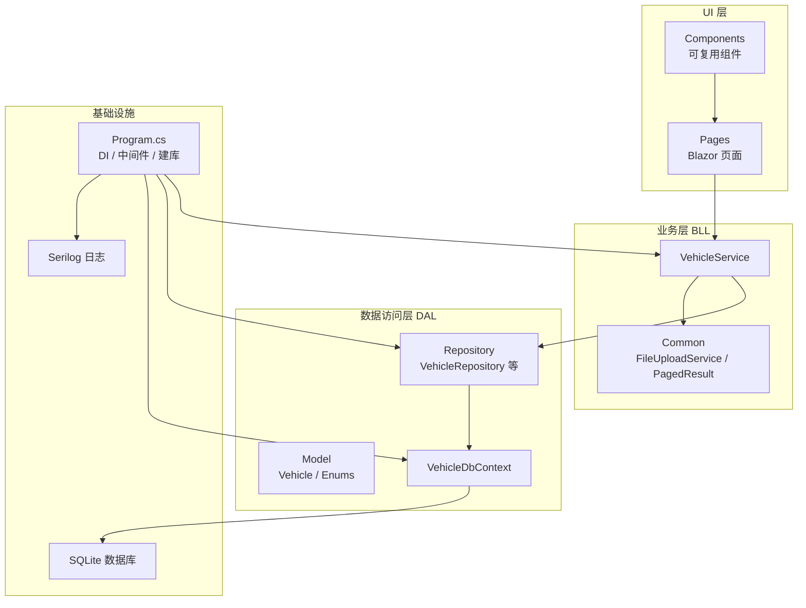
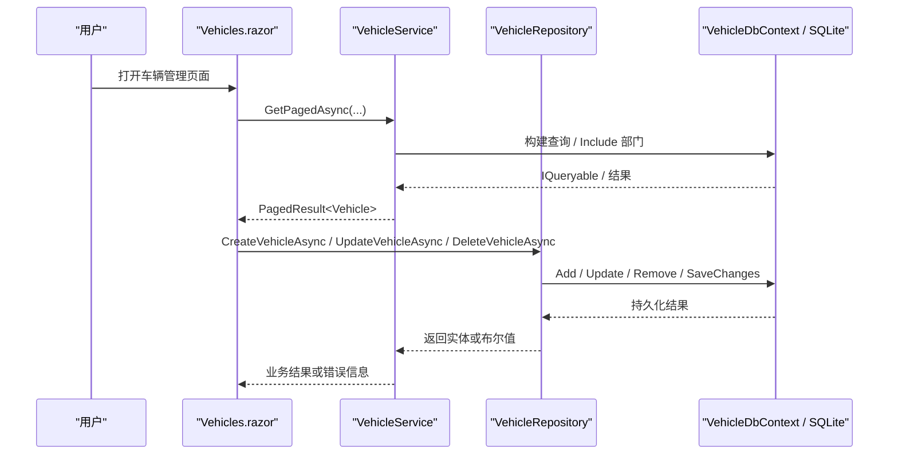
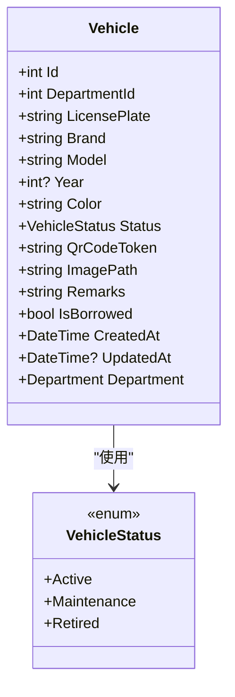
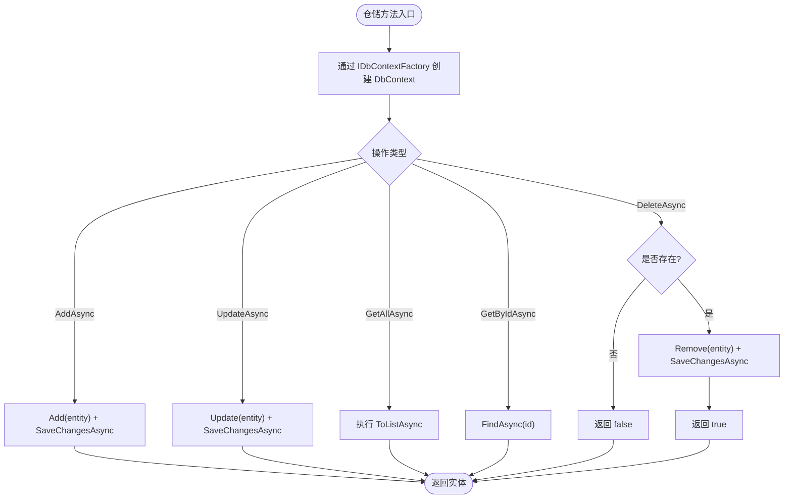
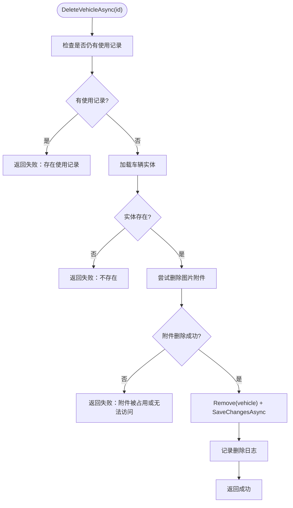
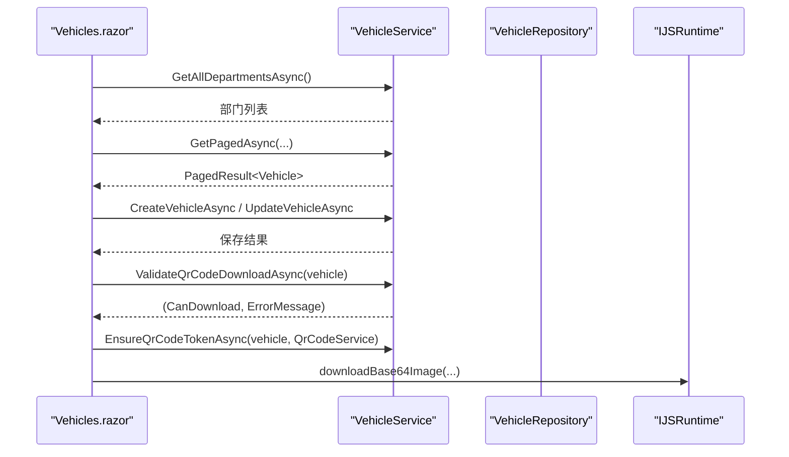
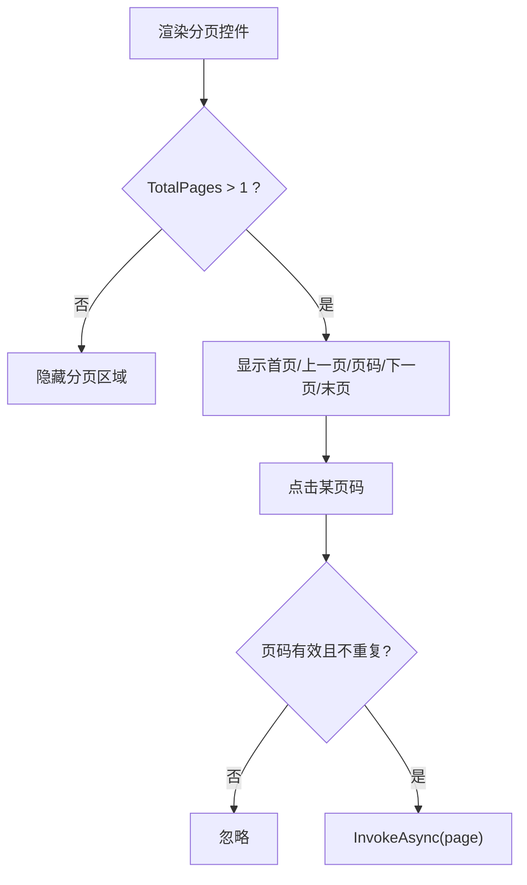
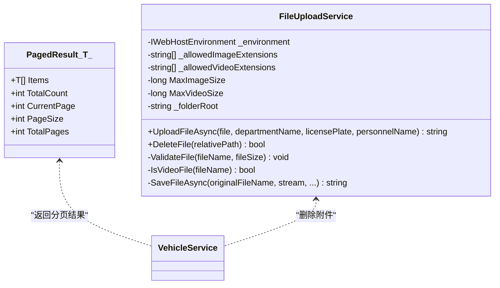
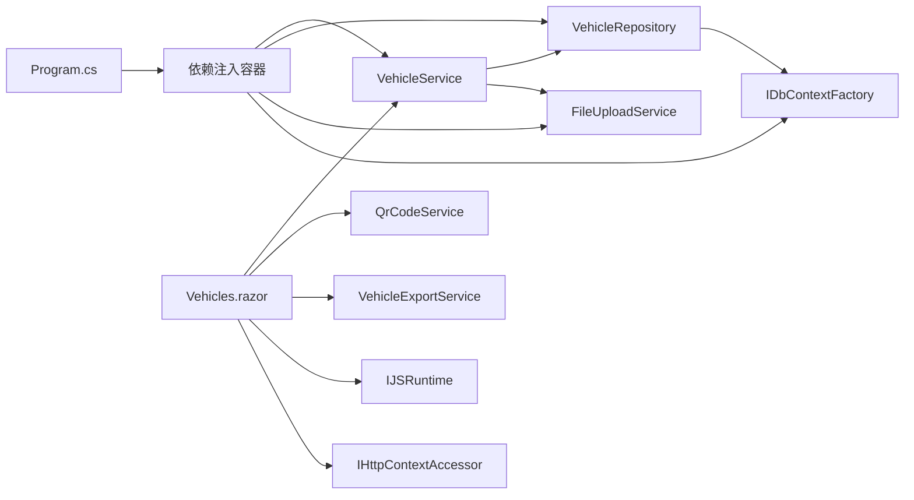
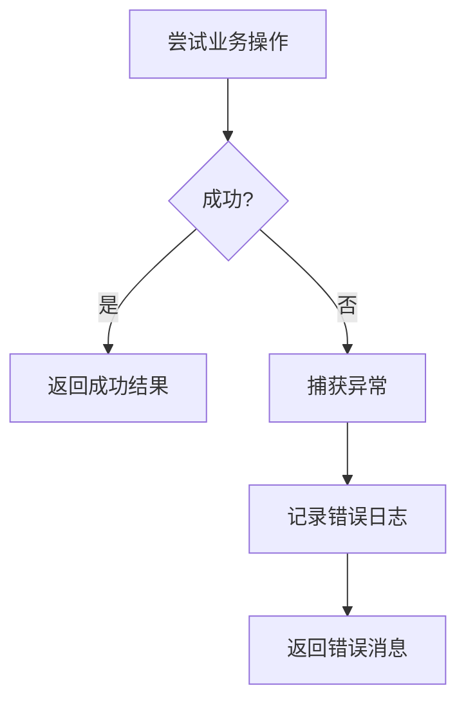

# 代码规范与最佳实践

<cite>
**本文引用的文件**   
- [README.md](file://README.md)
- [Program.cs](file://Program.cs)
- [vehicleManagement.csproj](file://vehicleManagement.csproj)
- [DAL/Model/Vehicle.cs](file://DAL/Model/Vehicle.cs)
- [DAL/Model/VehicleEnums.cs](file://DAL/Model/VehicleEnums.cs)
- [DAL/Repository/VehicleRepository.cs](file://DAL/Repository/VehicleRepository.cs)
- [BLL/Vehicle/VehicleService.cs](file://BLL/Vehicle/VehicleService.cs)
- [BLL/Common/FileUploadService.cs](file://BLL/Common/FileUploadService.cs)
- [BLL/Common/PagedResult.cs](file://BLL/Common/PagedResult.cs)
- [Pages/Vehicles.razor](file://Pages/Vehicles.razor)
- [Components/Common/Pagination.razor](file://Components/Common/Pagination.razor)
</cite>

## 目录
1. [引言](#引言)
2. [项目结构](#项目结构)
3. [核心组件](#核心组件)
4. [架构总览](#架构总览)
5. [详细组件分析](#详细组件分析)
6. [依赖关系分析](#依赖关系分析)
7. [性能与并发特性](#性能与并发特性)
8. [错误处理与稳定性模式](#错误处理与稳定性模式)
9. [C# 编码规范](#c-编码规范)
10. [Blazor 组件开发规范](#blazor-组件开发规范)
11. [分层架构组织规范](#分层架构组织规范)
12. [代码质量工具配置建议](#代码质量工具配置建议)
13. [常见问题排查](#常见问题排查)
14. [结论](#结论)

## 引言
本规范面向 vehicleManagement 系统，目标是为 C#、Blazor、EF Core、仓储层、业务服务层和页面组件建立统一的编码约定、架构边界、异常处理模式和可维护性标准。文档同时给出当前仓库中已体现的实现方式，并提炼出可复用的最佳实践，帮助新成员快速理解“数据模型 → 仓储 → 业务服务 → Blazor 页面”的完整链路。

## 项目结构
vehicleManagement 采用典型三层 + UI 的分层结构：
- DAL：实体模型、DbContext、仓储实现。
- BLL：领域服务、通用能力（分页、文件上传、二维码）。
- Pages：Blazor Server 页面。
- Components：可复用 UI 组件（布局、导航、分页）。
- aiServer：AI 子系统，独立命名空间与数据库。
- Program.cs：应用启动、依赖注入、中间件、数据库初始化。

**图表来源**
- [Program.cs:41-102](file://Program.cs#L41-L102)
- [BLL/Vehicle/VehicleService.cs:18-38](file://BLL/Vehicle/VehicleService.cs#L18-L38)
- [DAL/Repository/VehicleRepository.cs:10-17](file://DAL/Repository/VehicleRepository.cs#L10-L17)
- [DAL/Model/Vehicle.cs:8-48](file://DAL/Model/Vehicle.cs#L8-L48)

**章节来源**
- [README.md:122-140](file://README.md#L122-L140)
- [README.md:342-361](file://README.md#L342-L361)
- [Program.cs:41-102](file://Program.cs#L41-L102)

## 核心组件
本节聚焦车辆管理主流程中的关键类型：
- 数据模型：`Vehicle`、`VehicleStatus`。
- 仓储：`VehicleRepository`。
- 业务服务：`VehicleService`。
- 通用能力：`PagedResult<T>`、`FileUploadService`。
- UI 组件：`Vehicles.razor`、`Pagination.razor`。

这些组件共同构成“列表查询 → 分页 → 新增/编辑 → 删除 → 附件处理 → 二维码导出”的业务闭环。

**章节来源**
- [DAL/Model/Vehicle.cs:8-48](file://DAL/Model/Vehicle.cs#L8-L48)
- [DAL/Model/VehicleEnums.cs:3-8](file://DAL/Model/VehicleEnums.cs#L3-L8)
- [DAL/Repository/VehicleRepository.cs:10-63](file://DAL/Repository/VehicleRepository.cs#L10-L63)
- [BLL/Vehicle/VehicleService.cs:18-238](file://BLL/Vehicle/VehicleService.cs#L18-L238)
- [BLL/Common/PagedResult.cs:9-35](file://BLL/Common/PagedResult.cs#L9-L35)
- [BLL/Common/FileUploadService.cs:12-110](file://BLL/Common/FileUploadService.cs#L12-L110)
- [Pages/Vehicles.razor:186-408](file://Pages/Vehicles.razor#L186-L408)
- [Components/Common/Pagination.razor:20-40](file://Components/Common/Pagination.razor#L20-L40)

## 架构总览
vehicleManagement 的主数据流遵循“页面调用服务 → 服务组合仓储与通用能力 → 仓储通过 EF Core 访问 SQLite”。AI 子系统通过 `aiServer` 命名空间隔离，使用独立的 `AiServerDbContext` 和独立数据库文件。

**图表来源**
- [Pages/Vehicles.razor:220-227](file://Pages/Vehicles.razor#L220-L227)
- [BLL/Vehicle/VehicleService.cs:67-108](file://BLL/Vehicle/VehicleService.cs#L67-L108)
- [DAL/Repository/VehicleRepository.cs:19-56](file://DAL/Repository/VehicleRepository.cs#L19-L56)

**章节来源**
- [README.md:55-83](file://README.md#L55-L83)
- [Program.cs:52-58](file://Program.cs#L52-L58)

## 详细组件分析

### 数据模型与枚举
`Vehicle` 是车辆台账的核心实体，包含车牌、品牌、型号、颜色、状态、二维码 Token、图片路径、借用状态、创建时间、更新时间以及部门关联。`VehicleStatus` 用枚举表达“在用 / 维修 / 退役”，避免魔法数字。

**图表来源**
- [DAL/Model/Vehicle.cs:8-48](file://DAL/Model/Vehicle.cs#L8-L48)
- [DAL/Model/VehicleEnums.cs:3-8](file://DAL/Model/VehicleEnums.cs#L3-L8)

**章节来源**
- [DAL/Model/Vehicle.cs:8-48](file://DAL/Model/Vehicle.cs#L8-L48)
- [DAL/Model/VehicleEnums.cs:3-14](file://DAL/Model/VehicleEnums.cs#L3-L14)

### 仓储层实现规范
`VehicleRepository` 通过 `IDbContextFactory<VehicleDbContext>` 获取上下文，每个方法内部创建并使用 `await using var db`，确保连接及时释放。仓储暴露标准的 CRUD 异步方法，并在删除前做存在性检查。

**图表来源**
- [DAL/Repository/VehicleRepository.cs:19-56](file://DAL/Repository/VehicleRepository.cs#L19-L56)

**章节来源**
- [DAL/Repository/VehicleRepository.cs:10-63](file://DAL/Repository/VehicleRepository.cs#L10-L63)

### 业务服务编写规范
`VehicleService` 承担跨仓储协调、业务校验、附件清理、二维码 Token 管理等职责。它不直接拼 SQL，而是通过仓储和 EF Core 查询完成数据访问；对复杂操作返回 `(Success, ErrorMessage)` 元组，便于 UI 展示明确错误。

**图表来源**
- [BLL/Vehicle/VehicleService.cs:171-201](file://BLL/Vehicle/VehicleService.cs#L171-L201)

**章节来源**
- [BLL/Vehicle/VehicleService.cs:40-238](file://BLL/Vehicle/VehicleService.cs#L40-L238)

### Blazor 页面组件开发规范
`Vehicles.razor` 展示了典型的 Blazor Server 页面模式：
- 使用 `@inject` 注入服务。
- 在 `OnInitializedAsync` 中加载初始数据。
- 将表单状态、分页状态、排序状态集中在 `@code` 块。
- 所有异步操作包裹 try/catch，并将错误写入 `errorMessage`。
- 通过 `VehicleService` 委托业务逻辑，不在页面写查询细节。

**图表来源**
- [Pages/Vehicles.razor:220-227](file://Pages/Vehicles.razor#L220-L227)
- [Pages/Vehicles.razor:284-331](file://Pages/Vehicles.razor#L284-L331)
- [Pages/Vehicles.razor:336-358](file://Pages/Vehicles.razor#L336-L358)

**章节来源**
- [Pages/Vehicles.razor:1-410](file://Pages/Vehicles.razor#L1-L410)

### 分页组件设计
`Pagination.razor` 是一个无状态 UI 组件，接收 `CurrentPage`、`TotalPages`、`TotalCount`，并通过 `EventCallback<int> OnPageChanged` 通知父组件翻页。其内部计算可见页码范围，避免渲染过多按钮。

**图表来源**
- [Components/Common/Pagination.razor:20-40](file://Components/Common/Pagination.razor#L20-L40)

**章节来源**
- [Components/Common/Pagination.razor:1-42](file://Components/Common/Pagination.razor#L1-L42)

### 通用能力：分页结果与文件上传
`PagedResult<T>` 提供统一的分页数据结构，包含当前页数据、总数、当前页码、每页大小，并计算总页数。`FileUploadService` 负责图片与视频文件的扩展名校验、大小限制、按日期与业务维度组织目录、生成唯一文件名，并提供删除接口。

**图表来源**
- [BLL/Common/PagedResult.cs:9-35](file://BLL/Common/PagedResult.cs#L9-L35)
- [BLL/Common/FileUploadService.cs:12-110](file://BLL/Common/FileUploadService.cs#L12-L110)
- [BLL/Vehicle/VehicleService.cs:183-195](file://BLL/Vehicle/VehicleService.cs#L183-L195)

**章节来源**
- [BLL/Common/PagedResult.cs:1-37](file://BLL/Common/PagedResult.cs#L1-L37)
- [BLL/Common/FileUploadService.cs:1-113](file://BLL/Common/FileUploadService.cs#L1-L113)

## 依赖关系分析
从依赖角度看：
- `Program.cs` 注册 DbContextFactory、仓储、服务、通用服务和 AI 相关服务。
- `VehicleService` 依赖多个仓储、`IDbContextFactory`、`FileUploadService`、`ILogger`。
- `VehicleRepository` 依赖 `IDbContextFactory<VehicleDbContext>`。
- `Vehicles.razor` 依赖 `VehicleService`、`QrCodeService`、`ExportService`、`IJSRuntime`、`IHttpContextAccessor`、`NavigationManager`。

**图表来源**
- [Program.cs:60-95](file://Program.cs#L60-L95)
- [BLL/Vehicle/VehicleService.cs:20-38](file://BLL/Vehicle/VehicleService.cs#L20-L38)
- [DAL/Repository/VehicleRepository.cs:12-17](file://DAL/Repository/VehicleRepository.cs#L12-L17)
- [Pages/Vehicles.razor:1-7](file://Pages/Vehicles.razor#L1-L7)

**章节来源**
- [Program.cs:60-95](file://Program.cs#L60-L95)
- [BLL/Vehicle/VehicleService.cs:20-38](file://BLL/Vehicle/VehicleService.cs#L20-L38)
- [DAL/Repository/VehicleRepository.cs:12-17](file://DAL/Repository/VehicleRepository.cs#L12-L17)
- [Pages/Vehicles.razor:1-7](file://Pages/Vehicles.razor#L1-L7)

## 性能与并发特性
- 使用 `IDbContextFactory` 为 Blazor Server 避免单 Circuit 共享 DbContext 导致的并发冲突。
- 仓储方法内 `await using var db` 确保每次请求都创建新的 DbContext，减少长生命周期对象带来的线程安全问题。
- 分页查询在服务层先计算总数再取子集，避免一次性拉取全表。
- 文件上传按日期和业务维度分目录，降低单目录文件数量，提高文件系统遍历效率。

**章节来源**
- [Program.cs:52-58](file://Program.cs#L52-L58)
- [DAL/Repository/VehicleRepository.cs:19-56](file://DAL/Repository/VehicleRepository.cs#L19-L56)
- [BLL/Vehicle/VehicleService.cs:67-108](file://BLL/Vehicle/VehicleService.cs#L67-L108)
- [BLL/Common/FileUploadService.cs:92-110](file://BLL/Common/FileUploadService.cs#L92-L110)

## 错误处理与稳定性模式
- 业务服务对删除等敏感操作返回 `(Success, ErrorMessage)`，让 UI 能展示明确错误。
- 文件删除失败时记录错误日志并阻止数据库删除，保证数据一致性。
- 页面层捕获异常并写入 `errorMessage`，避免页面崩溃。
- 应用启动阶段使用 Serilog 输出结构化日志，抑制框架噪声。

**图表来源**
- [BLL/Vehicle/VehicleService.cs:183-195](file://BLL/Vehicle/VehicleService.cs#L183-L195)
- [Pages/Vehicles.razor:327-331](file://Pages/Vehicles.razor#L327-L331)
- [Program.cs:28-37](file://Program.cs#L28-L37)

**章节来源**
- [BLL/Vehicle/VehicleService.cs:171-201](file://BLL/Vehicle/VehicleService.cs#L171-L201)
- [Pages/Vehicles.razor:327-331](file://Pages/Vehicles.razor#L327-L331)
- [Program.cs:28-37](file://Program.cs#L28-L37)

## C# 编码规范
基于当前仓库实现，建议统一以下约定：

- 命名约定
  - 类名使用 PascalCase，如 `VehicleService`、`VehicleRepository`、`FileUploadService`。
  - 方法名使用 PascalCase，异步方法以 `Async` 结尾，如 `GetPagedAsync`、`CreateVehicleAsync`。
  - 属性名使用 PascalCase，如 `LicensePlate`、`UpdatedAt`。
  - 常量使用 `const` 或 `static readonly`，如文件大小上限、允许的文件扩展名数组。
  - 私有字段使用 `_camelCase`，如 `_dbFactory`、 `_logger`。
  - 枚举使用 PascalCase，如 `VehicleStatus`、`LocationCategory`。

- 代码格式标准
  - 使用 Visual Studio 默认格式化规则，保持缩进、换行、空行一致。
  - 控制语句使用花括号，避免单行 if。
  - 字符串插值和模板尽量清晰可读，避免过长表达式。

- 注释规范
  - 公共 API 使用 XML 注释 `
`，说明用途、参数、返回值。
  - 复杂业务逻辑添加行内注释解释决策原因。
  - 避免冗余注释，注释应解释“为什么”，而不是“做了什么”。

- 异常处理模式
  - 业务服务对可能失败的操作返回明确结果类型（如元组），而非仅抛异常。
  - 文件 IO 异常捕获后记录日志并返回用户友好错误。
  - 页面层捕获异常并更新 UI 状态，不中断整个页面。

**章节来源**
- [BLL/Vehicle/VehicleService.cs:15-38](file://BLL/Vehicle/VehicleService.cs#L15-L38)
- [DAL/Repository/VehicleRepository.cs:19-56](file://DAL/Repository/VehicleRepository.cs#L19-L56)
- [BLL/Common/FileUploadService.cs:14-27](file://BLL/Common/FileUploadService.cs#L14-L27)
- [DAL/Model/VehicleEnums.cs:3-14](file://DAL/Model/VehicleEnums.cs#L3-L14)

## Blazor 组件开发规范
- 组件命名
  - 页面文件使用 `.razor`，类名与文件名一致，如 `Vehicles.razor`。
  - 可复用组件放在 `Components` 下，命名空间明确，如 `vehicleManagement.Components.Common`。

- 属性设计
  - 使用 `[Parameter]` 定义输入属性，如 `CurrentPage`、`TotalPages`、`TotalCount`。
  - 使用 `EventCallback` 向父组件传递事件，如 `OnPageChanged`。

- 事件处理
  - 用户交互事件使用 `@onclick`、`@oninput` 绑定到组件方法。
  - 异步事件方法使用 `async Task`，并在 UI 上触发重新渲染。

- 状态管理
  - 页面级状态集中在 `@code` 块，区分 UI 状态、表单状态、分页状态。
  - 避免在组件中持有全局可变状态，必要时使用服务。

- 异步操作处理
  - 所有外部 IO 操作（服务调用、JS 互操作）使用 `await`。
  - 在 try/catch 中捕获异常并更新错误状态。
  - 避免在同步方法中调用异步方法导致阻塞。

**章节来源**
- [Components/Common/Pagination.razor:20-40](file://Components/Common/Pagination.razor#L20-L40)
- [Pages/Vehicles.razor:186-227](file://Pages/Vehicles.razor#L186-L227)
- [Pages/Vehicles.razor:284-331](file://Pages/Vehicles.razor#L284-L331)

## 分层架构组织规范
- DAL 仓储层实现规范
  - 每个实体对应一个仓储类，如 `VehicleRepository`。
  - 通过 `IDbContextFactory` 获取 DbContext，避免共享上下文。
  - 方法命名体现操作语义：`GetAllAsync`、`GetByIdAsync`、`AddAsync`、`UpdateAsync`、`DeleteAsync`。
  - 删除前进行存在性检查，返回布尔值表示是否成功。

- BLL 业务服务编写规范
  - 服务类封装跨仓储协调、业务校验、事务边界。
  - 对外暴露清晰的异步方法，复杂操作返回 `(Success, ErrorMessage)`。
  - 使用 `ILogger` 记录关键业务事件。
  - 不直接拼接 SQL，优先使用 EF Core 查询和仓储方法。

- Pages 页面组件开发规范
  - 页面只负责 UI 状态和用户交互，业务逻辑委托给服务。
  - 使用 `@inject` 注入服务，避免在页面构造器中解析服务。
  - 所有异步操作包裹 try/catch，错误信息集中展示。
  - 分页、搜索、排序状态由页面管理，但查询逻辑在服务层实现。

**章节来源**
- [DAL/Repository/VehicleRepository.cs:10-63](file://DAL/Repository/VehicleRepository.cs#L10-L63)
- [BLL/Vehicle/VehicleService.cs:40-238](file://BLL/Vehicle/VehicleService.cs#L40-L238)
- [Pages/Vehicles.razor:186-408](file://Pages/Vehicles.razor#L186-L408)

## 代码质量工具配置建议
虽然仓库未显式包含 `.editorconfig` 或 Roslyn 分析规则文件，但可参考以下建议：
- 启用 .NET 内置分析器，设置严重级别为警告或错误。
- 使用 `dotnet format` 统一代码风格。
- 在 CI 中运行静态分析，阻断低质量提交。
- 使用 SonarQube 或 Azure DevOps 任务集成代码扫描。
- 为 Blazor 组件启用 Razor 分析器，检查参数绑定和事件处理问题。

[本节为通用建议，不直接分析具体文件]

## 常见问题排查
- 启动失败
  - 检查 Serilog 日志是否输出“应用程序启动失败”。
  - 确认 `aisettings.json` 是否存在且 Ollama 端点可访问。
  - 确认 SQLite 数据库文件目录 `data/` 已创建。

- 数据库连接问题
  - 确认 `DefaultConnection` 和 `AiServerConnection` 配置正确。
  - 确认 `IDbContextFactory` 已注册。

- 文件上传失败
  - 检查扩展名是否在允许列表中。
  - 检查文件大小是否超过限制。
  - 检查 `Folder` 目录是否有写入权限。

- 页面报错
  - 检查 `errorMessage` 是否被赋值。
  - 检查服务调用是否抛出异常。
  - 检查 JS 互操作是否正确下载文件。

**章节来源**
- [Program.cs:150-157](file://Program.cs#L150-L157)
- [BLL/Common/FileUploadService.cs:69-84](file://BLL/Common/FileUploadService.cs#L69-L84)
- [Pages/Vehicles.razor:327-331](file://Pages/Vehicles.razor#L327-L331)

## 结论
vehicleManagement 的代码结构清晰，分层明确，仓储与服务职责分离，Blazor 页面专注于 UI 状态与交互。通过 `IDbContextFactory`、分页结果封装、文件上传服务、二维码 Token 管理等实现，系统在可维护性、可扩展性和稳定性方面具备良好基础。建议在后续迭代中继续强化：
- 统一命名与注释规范。
- 完善单元测试覆盖。
- 引入静态分析与格式化流水线。
- 对复杂业务增加更明确的错误码与重试策略。

[本节为总结性内容，不直接分析具体文件]