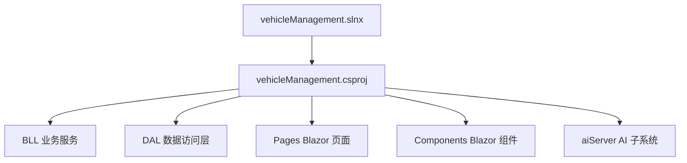
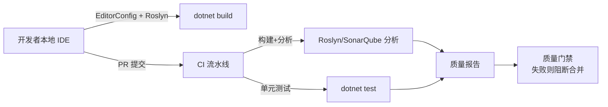
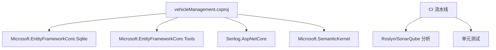

# 代码质量工具配置

<cite>
**本文引用的文件**   
- [vehicleManagement.csproj](file://vehicleManagement.csproj)
- [vehicleManagement.slnx](file://vehicleManagement.slnx)
- [README.md](file://README.md)
</cite>

## 目录
1. [引言](#引言)
2. [项目结构](#项目结构)
3. [核心组件](#核心组件)
4. [架构总览](#架构总览)
5. [详细组件分析](#详细组件分析)
6. [依赖关系分析](#依赖关系分析)
7. [性能与构建特性](#性能与构建特性)
8. [故障排查指南](#故障排查指南)
9. [结论](#结论)
10. [附录：配置文件清单与最佳实践](#附录配置文件清单与最佳实践)

## 引言
本文件为 vehicleManagement 系统的“代码质量工具配置”专项文档。当前仓库尚未内置静态分析、代码格式化、SonarQube、持续集成等质量门禁配置，因此本文以现有工程为基础，给出可直接落地的配置方案与落地步骤，覆盖以下目标：
- 静态分析规则：Roslyn 分析器、SonarQube 规则集、代码异味检测
- 代码格式化：EditorConfig、IDE 集成、CI/CD 流水线中的格式化检查
- 代码审查清单：Pull Request 检查项、复杂度阈值、测试覆盖率要求
- 持续集成：GitHub Actions / Azure DevOps 流水线、自动化测试执行、代码质量门禁
- 具体配置文件示例与最佳实践，确保团队风格一致、质量可控

## 项目结构
vehicleManagement 是一个 .NET 10 Blazor Server 应用，采用 DAL/BLL/Pages/Components 分层，并包含独立的 aiServer 子系统。解决方案由一个 SDK 风格的 csproj 构成，并通过 slnx 文件组织。

**图表来源**
- [vehicleManagement.slnx:1-4](file://vehicleManagement.slnx#L1-L4)
- [vehicleManagement.csproj:1-37](file://vehicleManagement.csproj#L1-L37)

**章节来源**
- [vehicleManagement.slnx:1-4](file://vehicleManagement.slnx#L1-L4)
- [vehicleManagement.csproj:1-37](file://vehicleManagement.csproj#L1-L37)

## 核心组件
围绕代码质量，本项目需要补齐以下核心能力：
- 静态分析与代码规范：通过 Roslyn 分析器与 SonarQube 规则集统一代码风格与质量问题
- 代码格式化：通过 EditorConfig 与 IDE 设置保证本地与 CI 一致的格式
- 代码审查：在 Pull Request 中强制检查复杂度、变更范围、测试覆盖
- 持续集成：在 GitHub Actions 或 Azure DevOps 中执行构建、分析、测试、报告生成与门禁

当前仓库现状：
- 未包含 .editorconfig、*.ruleset、sonar-project.properties、CI 工作流文件
- 项目使用 Microsoft.EntityFrameworkCore.Tools（含 analyzers），但未显式启用强规则集
- README 提供了运行与部署说明，可作为 CI 参考

**章节来源**
- [vehicleManagement.csproj:1-37](file://vehicleManagement.csproj#L1-L37)
- [README.md:87-100](file://README.md#L87-L100)

## 架构总览
下图展示建议的代码质量工具链如何与现有工程协作：

该图是概念性流程，不直接映射到具体源文件，因此不提供图表来源。

## 详细组件分析

### 静态分析规则配置（Roslyn 与 SonarQube）
- 建议在解决方案根目录新增 .editorconfig，统一缩进、换行、命名约定、using 排序等
- 引入 SonarQube 规则集，将严重问题设为错误，一般问题设为警告
- 启用 Roslyn 分析器（EF Core Tools 已自带 analyzers），并在 CI 中将分析结果输出为可归档工件

推荐落地步骤：
1. 添加 .editorconfig，定义 C# 语言规则与全局样式
2. 添加 *.ruleset，引用 SonarAnalyzer 规则集，并将关键规则升级为 Error
3. 在 csproj 中启用 TreatWarningsAsErrors（可选）和 NoWarn 白名单
4. 在 CI 中执行 dotnet build --configuration Release，收集分析日志

注意：
- 当前 csproj 未显式引入 SonarQube 相关包；可在 CI 中使用 SonarScanner 命令行工具扫描
- EF Core Tools 的 analyzers 会随包自动加载，无需额外安装

**章节来源**
- [vehicleManagement.csproj:14-30](file://vehicleManagement.csproj#L14-L30)

### 代码格式化配置（EditorConfig 与 IDE 集成）
- 在仓库根目录创建 .editorconfig，统一 C# 编码风格、文件结尾、缩进、空行
- 在 VS/VS Code/Rider 中启用“保存时格式化”，确保本地与 CI 一致
- 在 CI 中增加 dotnet format 校验步骤，防止未经格式化的代码进入分支

建议检查项：
- 缩进与制表符策略
- using 语句排序与去重
- 属性与方法声明风格
- 字符串与注释风格
- 文件末尾换行

**章节来源**
- [README.md:87-100](file://README.md#L87-L100)

### 代码审查清单（Pull Request 检查项）
建议 PR 模板包含以下检查点：
- 是否遵循 .editorconfig 与 ruleset 规则
- 是否存在高复杂度方法（圈复杂度阈值建议 ≤10）
- 是否新增公共 API 且提供 XML 文档
- 是否更新相关测试用例
- 是否影响安全敏感区域（鉴权、输入校验、SQL/参数化查询）
- 是否更新 README 或配置说明

复杂度与覆盖率建议：
- 圈复杂度阈值：≤10（关键业务逻辑可更严）
- 行覆盖率：≥80%
- 分支覆盖率：≥70%
- 新增代码覆盖率：≥90%

这些阈值应在 CI 中强制执行，否则仅作为团队约定。

**章节来源**
- [README.md:141-153](file://README.md#L141-L153)

### 持续集成配置（GitHub Actions 或 Azure DevOps）
建议流水线阶段：
- 初始化环境：安装 .NET SDK
- 还原依赖：dotnet restore
- 构建项目：dotnet build --configuration Release
- 静态分析：dotnet build 触发 Roslyn 分析；可选 SonarQube 扫描
- 单元测试：dotnet test
- 生成报告：上传分析结果与测试报告
- 质量门禁：任一阶段失败则阻断合并

GitHub Actions 要点：
- 使用 actions/setup-dotnet 安装 SDK
- 使用 dotnet-format 进行格式化检查
- 使用 SonarQube Scanner CLI 执行扫描（需配置 SonarQube 服务器与令牌）
- 使用 actions/upload-artifact 上传分析报告

Azure DevOps 要点：
- 使用 .NET Tool Installer 任务安装 SDK
- 使用 DotNetCoreCLI@2 执行 restore/build/test
- 使用 SonarQubePrepare/SonarQubeAnalyze 任务执行扫描
- 使用 PublishTestResults 发布测试结果

**章节来源**
- [README.md:87-100](file://README.md#L87-L100)

## 依赖关系分析
当前项目的依赖主要集中在 EF Core、Serilog、Semantic Kernel 等包，未显式引入代码质量工具包。建议在 CI 侧引入 SonarQube 扫描，而非在运行时依赖。

**图表来源**
- [vehicleManagement.csproj:14-30](file://vehicleManagement.csproj#L14-L30)

**章节来源**
- [vehicleManagement.csproj:14-30](file://vehicleManagement.csproj#L14-L30)

## 性能与构建特性
- 目标框架为 net10.0，建议使用最新 .NET SDK 以获得最佳构建性能
- EF Core Tools 包含 analyzers，会在构建时执行静态分析
- 建议在 Release 配置下执行构建与分析，避免 Debug 符号带来的噪声

**章节来源**
- [vehicleManagement.csproj:3-5](file://vehicleManagement.csproj#L3-L5)
- [vehicleManagement.csproj:18-22](file://vehicleManagement.csproj#L18-L22)

## 故障排查指南
常见质量相关问题与定位建议：
- 本地与 CI 格式化不一致：确认 .editorconfig 存在并被 IDE 识别；CI 中执行 dotnet format --verify-no-changes
- 分析规则未生效：确认 ruleset 被引用；CI 中查看构建日志中的 analyzer 输出
- SonarQube 扫描失败：检查 SonarQube 服务器可达性与令牌权限；确认 sonar-project.properties 配置正确
- 测试覆盖率不达标：检查测试项目是否被包含在 dotnet test 命令中；排除无关代码路径

**章节来源**
- [README.md:87-100](file://README.md#L87-L100)

## 结论
当前 vehicleManagement 工程具备清晰的 Blazor Server 分层结构与 AI 子系统，但尚未内置代码质量工具链。通过引入 .editorconfig、SonarQube 规则集、CI 流水线与 PR 检查清单，可实现：
- 统一的代码风格与静态分析规则
- 自动化的格式化检查与质量门禁
- 可量化的复杂度与覆盖率要求
- 稳定的构建、测试与分析流程

建议优先落地 .editorconfig 与 CI 构建/测试阶段，再逐步接入 SonarQube 与 PR 模板。

## 附录：配置文件清单与最佳实践

### 建议新增的文件清单
- .editorconfig：统一 C# 编码风格与 IDE 行为
- *.ruleset：集中管理 Roslyn 与 SonarQube 规则
- sonar-project.properties：SonarQube 扫描配置
- .github/workflows/ci.yml 或 azure-pipelines.yml：持续集成流水线
- docs/pr-checklist.md：Pull Request 检查清单

### 最佳实践要点
- 将 .editorconfig 纳入版本控制，所有成员必须遵守
- 在 CI 中同时执行 dotnet build 与 dotnet test，失败即阻断
- 将 SonarQube 质量门禁设置为“必须通过”，否则不允许合并
- 对新增代码设定更高覆盖率门槛，逐步提升整体质量基线
- 定期回顾规则集，避免过度严格导致开发效率下降

[本节为通用指导，不直接分析具体源文件]