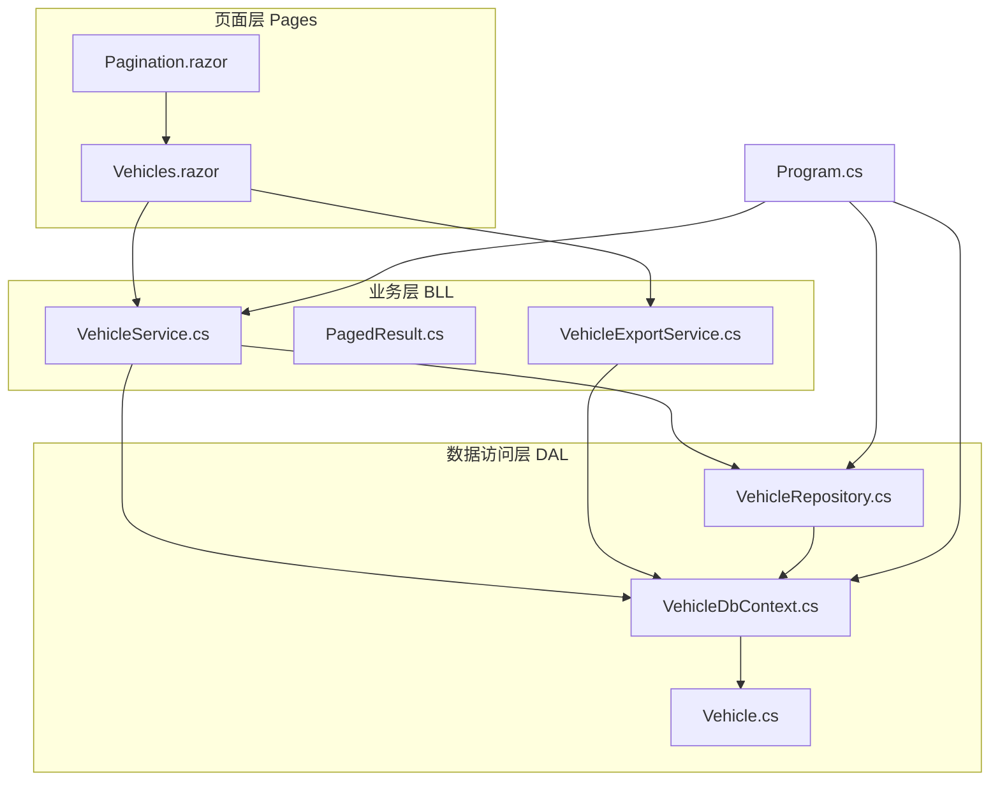
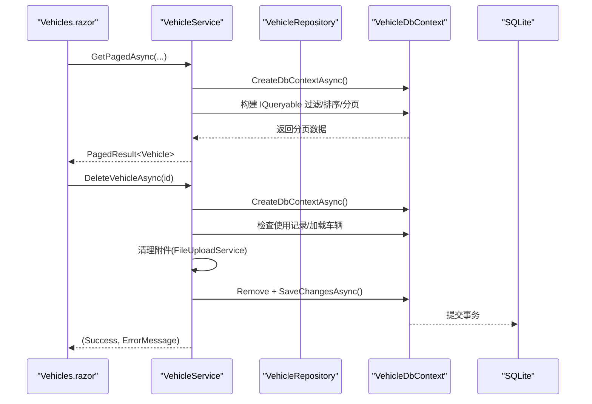
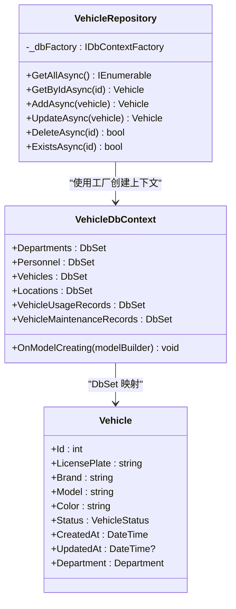
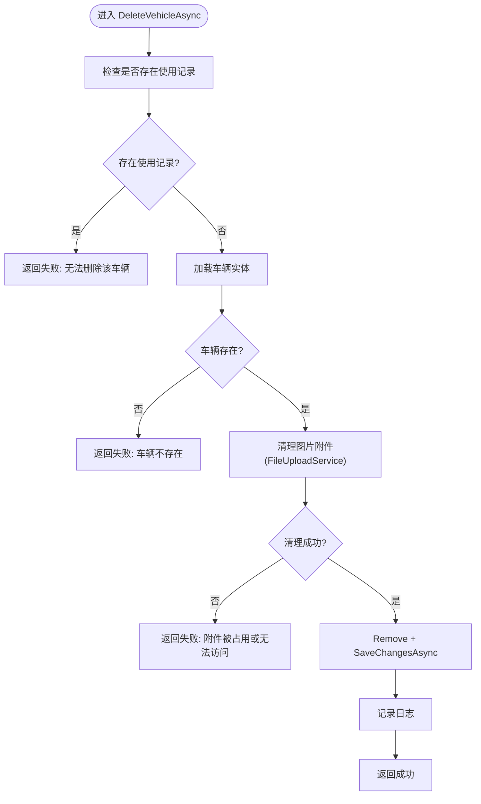
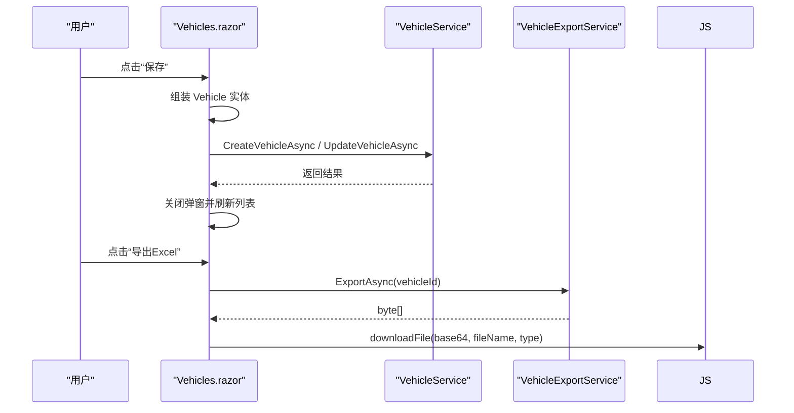
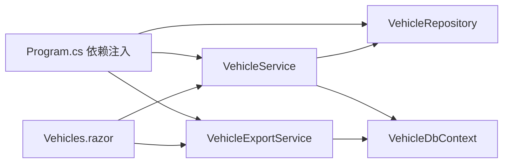
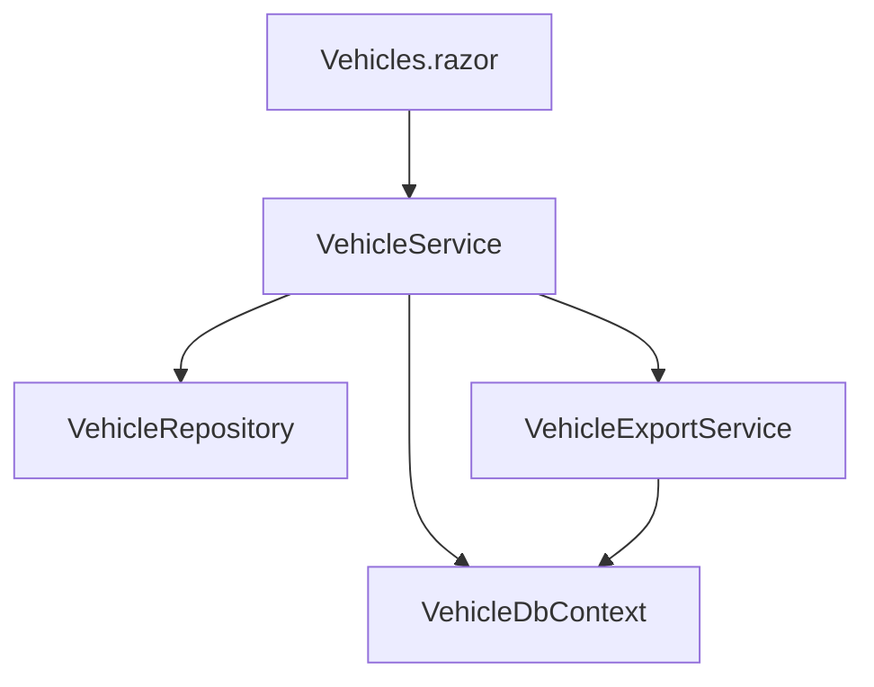

# 分层架构代码规范

<cite>
**本文引用的文件**   
- [Program.cs](file://Program.cs)
- [VehicleDbContext.cs](file://DAL/VehicleDbContext.cs)
- [VehicleRepository.cs](file://DAL/Repository/VehicleRepository.cs)
- [Vehicle.cs](file://DAL/Model/Vehicle.cs)
- [VehicleService.cs](file://BLL/Vehicle/VehicleService.cs)
- [PagedResult.cs](file://BLL/Common/PagedResult.cs)
- [VehicleExportService.cs](file://BLL/Export/VehicleExportService.cs)
- [Vehicles.razor](file://Pages/Vehicles.razor)
- [Pagination.razor](file://Components/Common/Pagination.razor)
</cite>

## 目录
1. [引言](#引言)
2. [项目结构](#项目结构)
3. [核心组件](#核心组件)
4. [架构总览](#架构总览)
5. [详细组件分析](#详细组件分析)
6. [依赖关系分析](#依赖关系分析)
7. [性能与可扩展性](#性能与可扩展性)
8. [故障排查指南](#故障排查指南)
9. [结论](#结论)

## 引言
本规范面向 vehicleManagement 系统的分层架构，明确数据访问层（DAL）、业务逻辑层（BLL）与页面层（Pages）的职责边界、交互方式与最佳实践。重点包括：
- DAL 仓储层：实体映射、CRUD 封装、查询构建器使用、事务与上下文生命周期管理。
- BLL 业务服务：业务规则封装、跨服务协作、事务边界、校验与异常传播。
- Pages 页面组件：UI 状态与交互、与服务层的解耦、错误展示与用户反馈。
- 跨层通信：依赖注入配置、接口抽象建议、数据传输对象设计。
- 松耦合与高内聚：通过仓储抽象、服务职责单一、分页与导出等横切能力复用实现。

## 项目结构
系统采用三层典型结构：
- DAL：数据库上下文、领域模型、仓储实现。
- BLL：领域服务、通用工具、导出服务等。
- Pages：Blazor 页面与通用 UI 组件。
- Program.cs：应用启动、依赖注入、中间件与初始化。

**图表来源**
- [Program.cs:48-95](file://Program.cs#L48-L95)
- [VehicleDbContext.cs:6-19](file://DAL/VehicleDbContext.cs#L6-L19)
- [VehicleRepository.cs:10-17](file://DAL/Repository/VehicleRepository.cs#L10-L17)
- [VehicleService.cs:18-38](file://BLL/Vehicle/VehicleService.cs#L18-L38)
- [VehicleExportService.cs:16-23](file://BLL/Export/VehicleExportService.cs#L16-L23)
- [Vehicles.razor:1-7](file://Pages/Vehicles.razor#L1-L7)
- [Pagination.razor:1-4](file://Components/Common/Pagination.razor#L1-L4)

**章节来源**
- [Program.cs:48-95](file://Program.cs#L48-L95)
- [VehicleDbContext.cs:6-19](file://DAL/VehicleDbContext.cs#L6-L19)

## 核心组件
- 数据上下文与实体映射：VehicleDbContext 定义 DbSet、索引、外键与级联删除策略；Vehicle 模型使用 DataAnnotations 标注主键、必填、长度限制与时间戳默认值。
- 仓储层：VehicleRepository 提供基础 CRUD，统一通过 IDbContextFactory 创建 DbContext，避免 Blazor Server 并发问题。
- 业务服务：VehicleService 封装车辆相关规则（分页查询、借用状态切换、二维码下载校验、删除前业务校验），并协调 FileUploadService、DepartmentRepository 等。
- 通用分页：PagedResult<T> 作为跨层分页结果 DTO，包含 Items、TotalCount、CurrentPage、PageSize 与计算 TotalPages。
- 导出服务：VehicleExportService 负责将车辆信息、使用记录、维修记录写入 Excel 字节流。
- 页面组件：Vehicles.razor 负责 UI 状态、用户交互、调用服务并展示错误；Pagination.razor 为通用分页控件。

**章节来源**
- [VehicleDbContext.cs:21-104](file://DAL/VehicleDbContext.cs#L21-L104)
- [Vehicle.cs:8-48](file://DAL/Model/Vehicle.cs#L8-L48)
- [VehicleRepository.cs:19-63](file://DAL/Repository/VehicleRepository.cs#L19-L63)
- [VehicleService.cs:40-238](file://BLL/Vehicle/VehicleService.cs#L40-L238)
- [PagedResult.cs:9-34](file://BLL/Common/PagedResult.cs#L9-L34)
- [VehicleExportService.cs:25-159](file://BLL/Export/VehicleExportService.cs#L25-L159)
- [Vehicles.razor:186-408](file://Pages/Vehicles.razor#L186-L408)
- [Pagination.razor:20-40](file://Components/Common/Pagination.razor#L20-L40)

## 架构总览
下图展示从页面到数据源的请求流程，以及关键职责划分：
- 页面层：接收用户输入、维护 UI 状态、调用服务、展示结果与错误。
- 业务层：组合多个仓储与工具服务，执行业务规则与校验，必要时直接操作 DbContext。
- 数据访问层：封装 EF Core 查询与持久化，保证上下文生命周期与事务边界。

**图表来源**
- [Vehicles.razor:219-227](file://Pages/Vehicles.razor#L219-L227)
- [VehicleService.cs:67-109](file://BLL/Vehicle/VehicleService.cs#L67-L109)
- [VehicleService.cs:171-201](file://BLL/Vehicle/VehicleService.cs#L171-L201)
- [VehicleDbContext.cs:50-76](file://DAL/VehicleDbContext.cs#L50-L76)

## 详细组件分析

### DAL 仓储层实现规范
- 实体映射
  - 在 VehicleDbContext.OnModelCreating 中集中声明索引、外键与删除行为，确保数据一致性。
  - 对高频查询字段建立索引（如车牌号、二维码 Token、部门 ID）。
  - 使用级联删除策略时需谨慎，避免意外删除关联数据。
- CRUD 封装
  - Repository 方法统一通过 IDbContextFactory 获取 DbContext，并在 using 块中自动释放。
  - Add/Update/Delete 等方法内部完成 SaveChanges，保证单写操作的事务边界。
- 查询构建器
  - 复杂查询建议在 Service 层使用 LINQ 构建，便于组合过滤、排序与分页。
  - Include 按需加载导航属性，避免 N+1 问题。
- 事务处理
  - 简单写操作由仓储方法自身提交。
  - 跨多表或跨服务的复合事务应在 Service 层显式控制 DbContext 生命周期，必要时使用 TransactionScope（当前实现以单 DbContext 为主）。

**图表来源**
- [VehicleRepository.cs:10-63](file://DAL/Repository/VehicleRepository.cs#L10-L63)
- [VehicleDbContext.cs:6-104](file://DAL/VehicleDbContext.cs#L6-L104)
- [Vehicle.cs:8-48](file://DAL/Model/Vehicle.cs#L8-L48)

**章节来源**
- [VehicleDbContext.cs:21-104](file://DAL/VehicleDbContext.cs#L21-L104)
- [VehicleRepository.cs:19-63](file://DAL/Repository/VehicleRepository.cs#L19-L63)
- [Vehicle.cs:8-48](file://DAL/Model/Vehicle.cs#L8-L48)

### BLL 业务服务编写规范
- 业务逻辑封装
  - 将跨实体的规则集中在 Service 中，例如删除前的使用记录校验、二维码下载的业务前置条件。
  - 对可复用的查询（如按部门获取在职人员）暴露为异步方法。
- 服务间调用
  - 通过依赖注入注入其他仓储或服务（如 DepartmentRepository、FileUploadService）。
  - 避免在 Service 中直接持有 UI 或 JS 运行时依赖。
- 事务边界
  - 单个仓储写操作由仓储方法提交。
  - 涉及多步操作的 Service 方法应自行管理 DbContext 生命周期，确保原子性。
- 业务规则验证
  - 返回明确的业务结果（如 Success/ErrorMessage），便于上层展示友好提示。
  - 对非法输入进行早期校验，减少无效数据库访问。

**图表来源**
- [VehicleService.cs:171-201](file://BLL/Vehicle/VehicleService.cs#L171-L201)

**章节来源**
- [VehicleService.cs:40-238](file://BLL/Vehicle/VehicleService.cs#L40-L238)

### Pages 页面组件开发规范
- UI 逻辑与业务逻辑分离
  - 页面仅维护 UI 状态（表单字段、分页参数、错误消息），所有业务规则委托给 Service。
  - 列表加载、保存、删除等操作均调用 Service 的异步方法。
- 数据绑定
  - 使用 @bind 双向绑定表单字段，简化新增/编辑流程。
  - 下拉框与枚举类型结合，提升用户体验。
- 用户交互处理
  - 搜索、排序、分页通过事件回调触发 LoadData，保持 UI 与数据同步。
  - 删除确认弹窗与错误弹窗统一管理状态变量。
- 错误展示
  - 捕获异常并转换为可读消息，显示于统一错误弹窗。
  - 对业务失败（如删除校验不通过）返回结构化结果，页面根据 Success/ErrorMessage 展示。

**图表来源**
- [Vehicles.razor:284-331](file://Pages/Vehicles.razor#L284-L331)
- [Vehicles.razor:397-408](file://Pages/Vehicles.razor#L397-L408)
- [VehicleService.cs:154-166](file://BLL/Vehicle/VehicleService.cs#L154-L166)
- [VehicleExportService.cs:25-159](file://BLL/Export/VehicleExportService.cs#L25-L159)

**章节来源**
- [Vehicles.razor:186-408](file://Pages/Vehicles.razor#L186-L408)
- [Pagination.razor:20-40](file://Components/Common/Pagination.razor#L20-L40)

### 跨层通信模式
- 依赖注入配置
  - 在 Program.cs 中注册仓储与服务为 Scoped，确保每个请求拥有独立实例。
  - 使用 IDbContextFactory 避免 Blazor Server 并发冲突。
- 接口抽象
  - 当前仓储与服务未使用接口，但建议对外暴露接口以提升可测试性与替换性。
- 数据传输对象设计
  - 使用 PagedResult<T> 作为分页结果 DTO，统一上下层分页数据结构。
  - 页面与服务之间传递领域模型（Vehicle），必要时在服务层做投影以减少传输体积。

**图表来源**
- [Program.cs:60-95](file://Program.cs#L60-L95)
- [VehicleService.cs:20-38](file://BLL/Vehicle/VehicleService.cs#L20-L38)
- [VehicleExportService.cs:18-23](file://BLL/Export/VehicleExportService.cs#L18-L23)
- [Vehicles.razor:1-7](file://Pages/Vehicles.razor#L1-L7)

**章节来源**
- [Program.cs:60-95](file://Program.cs#L60-L95)
- [PagedResult.cs:9-34](file://BLL/Common/PagedResult.cs#L9-L34)

## 依赖关系分析
- 低耦合
  - 页面只依赖服务，不直接访问仓储或上下文。
  - 服务通过仓储与上下文协作，避免在页面中实现业务规则。
- 高内聚
  - 仓储专注数据访问，服务专注业务规则，页面专注 UI 交互。
  - 分页与导出等横切能力分别封装在通用类与专用服务中。

**图表来源**
- [Vehicles.razor:1-7](file://Pages/Vehicles.razor#L1-L7)
- [VehicleService.cs:20-38](file://BLL/Vehicle/VehicleService.cs#L20-L38)
- [VehicleRepository.cs:10-17](file://DAL/Repository/VehicleRepository.cs#L10-L17)
- [VehicleDbContext.cs:6-19](file://DAL/VehicleDbContext.cs#L6-L19)
- [VehicleExportService.cs:18-23](file://BLL/Export/VehicleExportService.cs#L18-L23)

**章节来源**
- [VehicleService.cs:20-38](file://BLL/Vehicle/VehicleService.cs#L20-L38)
- [VehicleRepository.cs:10-17](file://DAL/Repository/VehicleRepository.cs#L10-L17)
- [VehicleDbContext.cs:6-19](file://DAL/VehicleDbContext.cs#L6-L19)
- [VehicleExportService.cs:18-23](file://BLL/Export/VehicleExportService.cs#L18-L23)
- [Vehicles.razor:1-7](file://Pages/Vehicles.razor#L1-L7)

## 性能与可扩展性
- 查询优化
  - 使用 Include 按需加载导航属性，避免 N+1 查询。
  - 在 Service 层构建 IQueryable，利用 EF Core 服务端分页与过滤。
- 事务与并发
  - 使用 IDbContextFactory 为每次请求创建独立上下文，避免 Blazor Server 并发问题。
  - 对复合写操作在 Service 层统一提交，确保原子性。
- 扩展点
  - 建议为仓储与服务引入接口，便于单元测试与替换实现。
  - 将更多横切关注点（如审计、软删除）抽取为中间件或基类。

[本节为通用指导，不涉及具体文件分析]

## 故障排查指南
- 常见问题
  - 删除失败：若存在使用记录，会阻止删除并返回业务错误消息。
  - 附件清理失败：当图片文件被占用或路径不可访问时，会返回错误并中止数据库删除。
  - 二维码下载受限：若车辆未绑定部门或所属部门无在职人员，将拒绝下载。
- 定位建议
  - 查看 Service 返回的 Success/ErrorMessage，快速定位业务校验失败原因。
  - 检查日志输出（Serilog），确认附件清理与删除操作的执行轨迹。
  - 核对数据库约束与级联删除策略，确保关联数据一致。

**章节来源**
- [VehicleService.cs:171-201](file://BLL/Vehicle/VehicleService.cs#L171-L201)
- [VehicleService.cs:207-225](file://BLL/Vehicle/VehicleService.cs#L207-L225)
- [Program.cs:28-37](file://Program.cs#L28-L37)

## 结论
vehicleManagement 系统通过清晰的三层架构实现了职责分离与松耦合：
- DAL 仓储层专注于数据访问与持久化，使用 EF Core 与工厂模式保障上下文生命周期。
- BLL 业务服务封装领域规则与跨服务协作，提供明确的结果结构与错误语义。
- Pages 页面组件聚焦 UI 状态与用户交互，通过依赖注入调用服务，保持简洁与可维护性。
遵循本规范有助于提升代码质量、可测试性与可扩展性，并为后续功能演进奠定坚实基础。