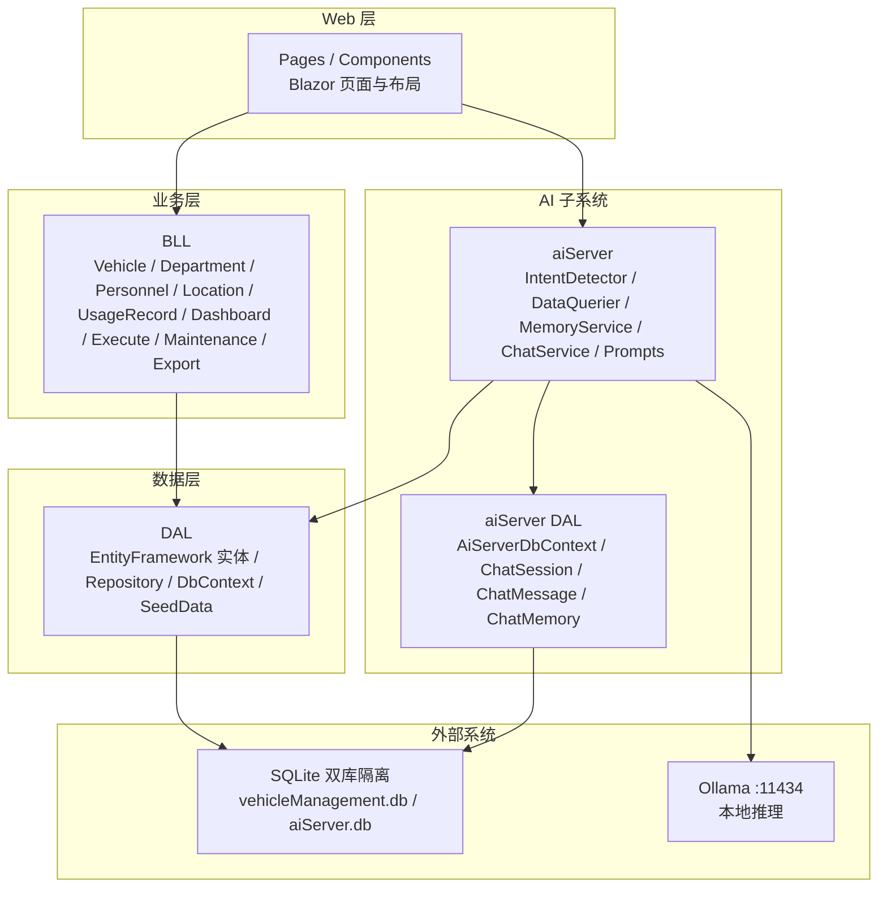
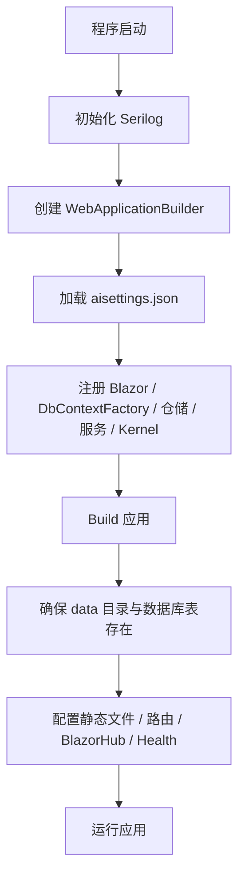
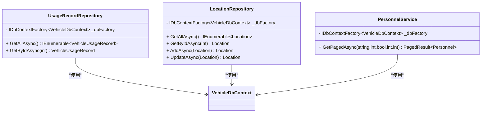
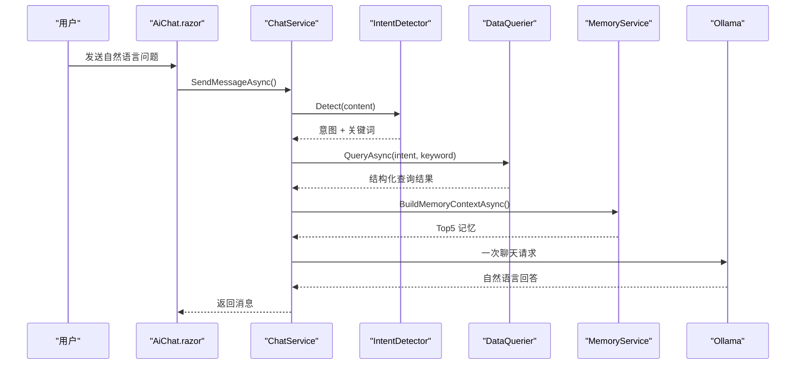
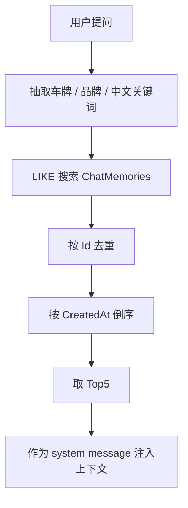

# 代码审查流程

<cite>
**本文引用的文件**   
- [README.md](file://README.md)
- [Program.cs](file://Program.cs)
- [vehicleManagement.csproj](file://vehicleManagement.csproj)
- [appsettings.json](file://appsettings.json)
- [Dockerfile](file://Dockerfile)
- [VehicleDbContext.cs](file://DAL/VehicleDbContext.cs)
- [SeedDataInitializer.cs](file://DAL/SeedDataInitializer.cs)
- [UsageRecordRepository.cs](file://DAL/Repository/UsageRecordRepository.cs)
- [LocationRepository.cs](file://DAL/Repository/LocationRepository.cs)
- [ChatMemoryRepository.cs](file://aiServer/DAL/Repository/ChatMemoryRepository.cs)
- [PersonnelService.cs](file://BLL/Personnel/PersonnelService.cs)
- [LocationService.cs](file://BLL/Location/LocationService.cs)
- [MaintenanceRecordService.cs](file://BLL/Maintenance/MaintenanceRecordService.cs)
- [VehicleExportService.cs](file://BLL/Export/VehicleExportService.cs)
- [AiChat.razor](file://aiServer/Pages/AiChat.razor)
- [SystemPrompts.cs](file://aiServer/BLL/Prompts/SystemPrompts.cs)
</cite>

## 目录
1. [引言](#引言)
2. [项目结构与审查范围](#项目结构与审查范围)
3. [Pull Request 审查清单](#pull-request-审查清单)
4. [自动化代码检查流程](#自动化代码检查流程)
5. [审查质量标准](#审查质量标准)
6. [审查工具与质量门禁配置](#审查工具与质量门禁配置)
7. [审查反馈处理与代码迭代改进](#审查反馈处理与代码迭代改进)
8. [关键组件审查要点](#关键组件审查要点)
9. [依赖与架构一致性审查](#依赖与架构一致性审查)
10. [性能与安全审查重点](#性能与安全审查重点)
11. [常见问题排查](#常见问题排查)
12. [结论](#结论)

## 引言
本文件为 vehicleManagement 项目的代码审查流程与标准。该项目是 .NET 10 Blazor Server 车辆管理系统，并嵌入本地 AI 助手：业务数据通过规则意图识别和 C# 白名单查询后，再交给本地 Ollama 模型组织中文回答。仓库当前没有独立的测试项目和 CI 配置文件，因此本文在“自动化检查”部分给出可落地的建议方案，并在“审查质量标准”中明确人工审查的验收门槛。

## 项目结构与审查范围
项目采用分层结构：
- DAL：EF Core 实体、仓储、数据库上下文、种子数据初始化。
- BLL：业务服务，封装车辆、部门、人员、地点、使用记录、仪表盘、执行、维修、导出等能力。
- Pages + Components：Blazor 页面与布局、导航、分页等 UI 组件。
- aiServer：AI 子系统，包含意图识别、数据查询、记忆、提示词、会话与消息仓储，以及 `/ai-chat` 页面。
- 根目录：应用启动装配、配置、Docker 构建脚本、项目定义。

**图表来源**
- [README.md:55-83](file://README.md#L55-L83)
- [README.md:139-153](file://README.md#L139-L153)
- [README.md:342-360](file://README.md#L342-L360)

**章节来源**
- [README.md:55-83](file://README.md#L55-L83)
- [README.md:139-153](file://README.md#L139-L153)
- [README.md:342-360](file://README.md#L342-L360)

## Pull Request 审查清单
以下清单用于每次 Pull Request 的人工审查。每条都应给出“通过 / 不通过 / 需补充说明”。

### 一、代码质量检查
- 命名是否清晰一致：类名、方法名、变量名遵循 C# 惯例；领域术语统一（如“使用记录”“维修记录”“二维码 Token”）。
- 方法职责单一：BLL 服务只承担业务编排，DAL 仓储只承担数据访问；UI 页面只做交互与展示。
- 异步与资源释放：数据库访问使用 `await using` 或 `IDbContextFactory`；避免长时间持有 DbContext。
- 错误处理：异常捕获有明确日志；用户可见错误信息不含敏感细节。
- 日志规范：Serilog 输出包含时间戳、级别、消息；框架日志被抑制到 Warning；业务异常记录 Warning/Error。
- 代码可读性：复杂逻辑拆分为小方法；条件分支使用 switch 表达式或策略对象；避免深层嵌套。

**章节来源**
- [Program.cs:28-37](file://Program.cs#L28-L37)
- [MaintenanceRecordService.cs:14-28](file://BLL/Maintenance/MaintenanceRecordService.cs#L14-L28)

### 二、功能完整性验证
- 新增或修改的业务路由是否能在 `/vehicles`、`/departments`、`/personnel`、`/locations`、`/usage-records`、`/maintenance-records`、`/execute/{Token}`、`/ai-chat` 等路径正常访问。
- 增删改查是否覆盖主键唯一约束、外键关系、空值边界。
- 分页查询是否正确计算总条数、页码越界保护、排序字段白名单。
- AI 问答链路是否保持“规则意图识别 → 白名单查询 → 结果注入 → 模型归纳”，且不会让模型直接写 SQL。
- 附件上传、二维码生成、Excel 导出是否返回预期结果或明确失败原因。

**章节来源**
- [README.md:122-139](file://README.md#L122-L139)
- [PersonnelService.cs:38-66](file://BLL/Personnel/PersonnelService.cs#L38-L66)
- [LocationService.cs:35-63](file://BLL/Location/LocationService.cs#L35-L63)

### 三、安全性审查
- 输入校验：搜索关键词、表单字段、URL Token 必须 Trim、长度限制、非法字符过滤。
- 权限控制：当前系统按内网单工具设计，无登录与权限模型；若新增公网入口，必须增加鉴权。
- 文件上传：限制类型、大小、路径，防止目录遍历与恶意文件。
- 外部调用：Ollama 端点、模型名称必须来自配置，禁止拼接用户输入。
- 日志脱敏：手机号、车牌、Token、IP 等敏感信息不得明文写入日志。
- 数据库连接字符串：生产环境必须从环境变量或密钥管理获取，不能硬编码。

**章节来源**
- [README.md:363-370](file://README.md#L363-L370)
- [appsettings.json:1-8](file://appsettings.json#L1-L8)
- [Program.cs:97-102](file://Program.cs#L97-L102)

### 四、性能影响评估
- EF Core 查询是否按需 Include，避免 N+1 查询。
- 分页是否先 Count 再 Skip/Take，避免全量加载。
- 大表导出是否流式或分批处理，避免一次性加载全部数据。
- AI 问答是否限制最近消息窗口，避免上下文无限增长。
- 日志滚动与保留策略是否合理，避免磁盘占满。

**章节来源**
- [UsageRecordRepository.cs:21-31](file://DAL/Repository/UsageRecordRepository.cs#L21-L31)
- [PersonnelService.cs:60-66](file://BLL/Personnel/PersonnelService.cs#L60-L66)
- [VehicleExportService.cs:25-39](file://BLL/Export/VehicleExportService.cs#L25-L39)
- [Program.cs:34-36](file://Program.cs#L34-L36)

## 自动化代码检查流程
当前仓库未提供独立测试项目和 CI 配置，但可在现有结构中逐步补齐。

### 一、编译检查
- 所有 PR 必须能通过 `dotnet build`。
- 发布模式必须能通过 `dotnet publish -c Release`。
- Docker 构建必须成功：`docker build -t vehicle-management-test .`。

**章节来源**
- [vehicleManagement.csproj:1-37](file://vehicleManagement.csproj#L1-L37)
- [Dockerfile:6-16](file://Dockerfile#L6-L16)

### 二、单元测试执行
建议新增测试项目，至少覆盖：
- IntentDetector 意图识别规则。
- DataQuerier 中文时间解析。
- MemoryService 记忆抽取与检索。
- BLL 分页查询、排序、过滤。
- DAL 仓储基础 CRUD。

CI 命令示例：
- `dotnet test --no-build --collect:"XPlat Code Coverage"`
- 失败时阻断合并。

### 三、覆盖率统计
建议设置最低覆盖率阈值：
- 行覆盖率 ≥ 70%。
- 分支覆盖率 ≥ 60%。
- 关键模块（意图识别、时间解析、记忆检索）≥ 80%。

### 四、依赖安全扫描
- 使用 `dotnet audit` 或第三方依赖扫描工具。
- 对 NuGet 包版本升级进行安全评估。
- 禁止引入已知高危漏洞包。

### 五、静态分析与格式化
- 启用 Roslyn analyzers。
- 强制 `dotnet format`。
- 禁止提交包含调试断点、临时注释、未使用引用。

## 审查质量标准
### 一、代码可读性
- 方法长度适中，复杂逻辑拆分。
- 变量命名表达业务含义。
- XML 注释仅用于公共 API 或复杂决策点。
- 错误消息对用户友好，对开发者可追踪。

### 二、架构一致性
- DAL 只暴露仓储接口，BLL 只依赖仓储和服务。
- AI 子系统与业务子系统通过 Service 调用，不直接操作 UI。
- 数据库上下文工厂避免 Blazor Server 并发冲突。
- 配置集中管理，外部参数走 Configuration。

**章节来源**
- [Program.cs:52-102](file://Program.cs#L52-L102)
- [README.md:310-319](file://README.md#L310-L319)

### 三、错误处理
- 外层 try/catch 包裹不可恢复异常。
- 业务异常转换为用户可读错误。
- 外部依赖（Ollama、文件 IO、数据库）失败不影响核心页面可用性。
- 日志区分 Information、Warning、Error。

**章节来源**
- [Program.cs:150-157](file://Program.cs#L150-L157)
- [README.md:291-300](file://README.md#L291-L300)

### 四、日志记录
- 启动失败记录 Fatal。
- 业务异常记录 Warning 或 Error。
- 框架日志抑制到 Warning，避免淹没业务日志。
- 日志文件按天滚动，保留固定数量。

**章节来源**
- [Program.cs:28-37](file://Program.cs#L28-L37)
- [Program.cs:150-157](file://Program.cs#L150-L157)

## 审查工具与质量门禁配置
### 一、GitHub PR 模板
建议在 `.github/PULL_REQUEST_TEMPLATE.md` 中添加：
- 变更摘要
- 涉及模块
- 测试情况
- 风险说明
- 回滚方案
- 审查人确认项

### 二、自动化评论机器人
建议接入以下能力：
- 自动检测未测试变更。
- 自动提示缺失注释或过长方法。
- 自动检查敏感信息泄露。
- 自动提醒依赖版本过旧。

### 三、质量门禁策略
- 编译失败：拒绝合并。
- 单元测试失败：拒绝合并。
- 覆盖率低于阈值：警告或拒绝合并。
- 安全扫描发现高危漏洞：拒绝合并。
- 代码风格不符合格式化工具：自动修复或拒绝合并。

## 审查反馈处理与代码迭代改进
- 审查意见应具体、可操作，避免模糊评价。
- 作者应在 24 小时内回应审查意见。
- 重大架构变更需要二次审查。
- 审查通过后由维护者合并，禁止自批自合。
- 线上问题应关联 PR 编号，便于追溯。

## 关键组件审查要点

### 应用启动与依赖注入
Program.cs 负责 Serilog 初始化、Configuration 加载、Blazor 服务注册、DbContextFactory 注册、仓储与服务注册、Semantic Kernel 注册、数据库初始化、中间件配置与健康检查。

**图表来源**
- [Program.cs:28-148](file://Program.cs#L28-L148)

**章节来源**
- [Program.cs:28-148](file://Program.cs#L28-L148)

### 数据访问与分页查询
仓储层使用 `IDbContextFactory` 创建 DbContext，避免共享上下文冲突；BLL 层实现分页、搜索、排序。

**图表来源**
- [UsageRecordRepository.cs:12-31](file://DAL/Repository/UsageRecordRepository.cs#L12-L31)
- [LocationRepository.cs:12-42](file://DAL/Repository/LocationRepository.cs#L12-L42)
- [PersonnelService.cs:38-66](file://BLL/Personnel/PersonnelService.cs#L38-L66)

**章节来源**
- [UsageRecordRepository.cs:12-31](file://DAL/Repository/UsageRecordRepository.cs#L12-L31)
- [LocationRepository.cs:12-42](file://DAL/Repository/LocationRepository.cs#L12-L42)
- [PersonnelService.cs:38-66](file://BLL/Personnel/PersonnelService.cs#L38-L66)

### AI 问答完整链路
一次问答从 Blazor 页面进入 ChatService，经过意图识别、数据查询、记忆检索、上下文组装，最终调用 Ollama。

**图表来源**
- [README.md:187-219](file://README.md#L187-L219)
- [AiChat.razor:422-458](file://aiServer/Pages/AiChat.razor#L422-L458)
- [SystemPrompts.cs:22-38](file://aiServer/BLL/Prompts/SystemPrompts.cs#L22-L38)

**章节来源**
- [README.md:187-219](file://README.md#L187-L219)
- [AiChat.razor:422-458](file://aiServer/Pages/AiChat.razor#L422-L458)
- [SystemPrompts.cs:22-38](file://aiServer/BLL/Prompts/SystemPrompts.cs#L22-L38)

### 记忆检索流程
记忆检索基于 LIKE 匹配，不是语义检索；支持按 key 幂等写入、Top5 回取。

**图表来源**
- [ChatMemoryRepository.cs:21-39](file://aiServer/DAL/Repository/ChatMemoryRepository.cs#L21-L39)
- [README.md:261-269](file://README.md#L261-L269)

**章节来源**
- [ChatMemoryRepository.cs:21-39](file://aiServer/DAL/Repository/ChatMemoryRepository.cs#L21-L39)
- [README.md:261-269](file://README.md#L261-L269)

## 依赖与架构一致性审查
### 一、项目依赖
- 目标框架：net10.0。
- ORM：Microsoft.EntityFrameworkCore.Sqlite。
- UI：Microsoft.FluentUI.AspNetCore.Components。
- AI：Microsoft.SemanticKernel + SemanticKernel.Connectors.Ollama。
- 日志：Serilog + Serilog.AspNetCore + Serilog.Sinks.File。
- 其他：QRCoder、DocumentFormat.OpenXml。

**章节来源**
- [vehicleManagement.csproj:14-30](file://vehicleManagement.csproj#L14-L30)

### 二、数据库模型与索引
VehicleDbContext 中定义了车辆、地点、使用记录等实体的索引与外键关系，审查时应关注：
- 唯一索引是否合理。
- 外键删除行为是否符合业务。
- 查询是否命中索引。

**章节来源**
- [VehicleDbContext.cs:37-73](file://DAL/VehicleDbContext.cs#L37-L73)

### 三、种子数据
开发环境启动时会初始化种子数据，审查时应注意：
- 种子数据不应包含真实敏感信息。
- 种子数据应可重复执行。
- 生产环境不应自动写入种子数据。

**章节来源**
- [Program.cs:109-118](file://Program.cs#L109-L118)
- [SeedDataInitializer.cs:35-54](file://DAL/SeedDataInitializer.cs#L35-L54)

## 性能与安全审查重点

### 一、性能重点
- 分页查询应先 Count 再分页，避免全量加载。
- Include 只加载必要关联，避免过度 eager loading。
- AI 问答限制最近消息数量，避免上下文过大。
- 日志滚动保留固定数量，避免磁盘爆满。
- 导出大文件考虑流式处理。

**章节来源**
- [PersonnelService.cs:60-66](file://BLL/Personnel/PersonnelService.cs#L60-L66)
- [LocationService.cs:52-63](file://BLL/Location/LocationService.cs#L52-L63)
- [Program.cs:34-36](file://Program.cs#L34-L36)
- [VehicleExportService.cs:25-39](file://BLL/Export/VehicleExportService.cs#L25-L39)

### 二、安全重点
- 当前系统无鉴权，不适合公网暴露。
- Ollama 端点和模型名称必须来自配置。
- 日志中不得记录敏感信息。
- 文件上传需限制类型、大小、路径。
- 数据库连接字符串应通过环境变量注入。

**章节来源**
- [README.md:363-370](file://README.md#L363-L370)
- [Program.cs:97-102](file://Program.cs#L97-L102)
- [appsettings.json:1-8](file://appsettings.json#L1-L8)

## 常见问题排查
- Ollama 不可达：检查端点、模型 tag、容器网络、环境变量。
- 数据库未初始化：检查 data 目录权限、EnsureCreatedAsync、开发环境种子数据。
- 日志过多：检查 Serilog 最小级别与框架日志抑制。
- 页面报错：检查 Development 与 Production 异常处理分支。
- 健康检查失败：检查 `/health` 路由与 Docker HEALTHCHECK。

**章节来源**
- [README.md:106-118](file://README.md#L106-L118)
- [Program.cs:127-148](file://Program.cs#L127-L148)
- [Dockerfile:40-43](file://Dockerfile#L40-L43)

## 结论
vehicleManagement 项目在架构上实现了业务层与 AI 子系统的解耦，并通过规则意图识别和白名单查询降低 AI 注入面。当前仓库缺少独立测试与 CI 配置，因此代码审查应以人工为主，同时逐步补齐自动化检查。Pull Request 应严格遵循质量清单，重点关注代码可读性、架构一致性、错误处理、日志记录、性能影响与安全性。随着测试与 CI 完善，可将更多审查标准下沉为自动化门禁，提升整体交付质量。