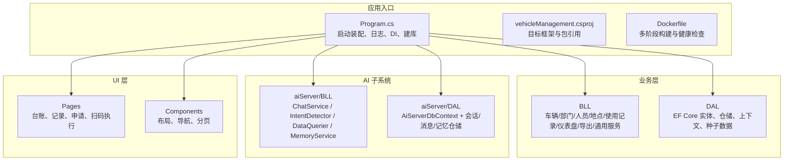
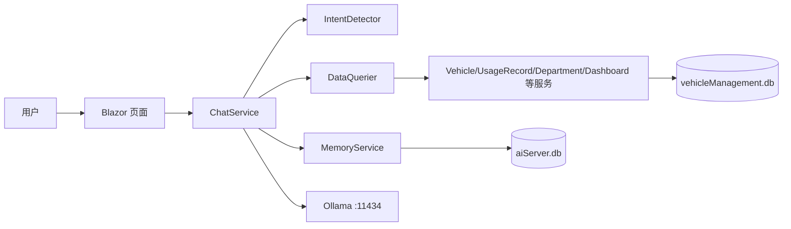
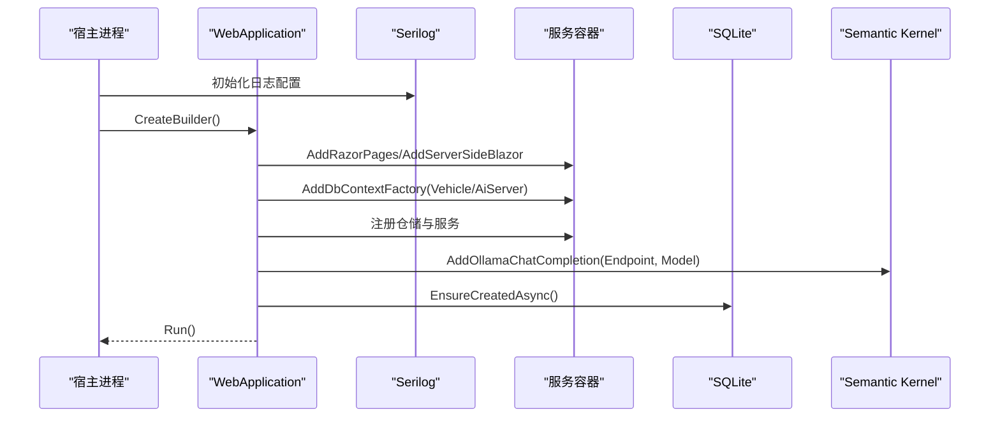
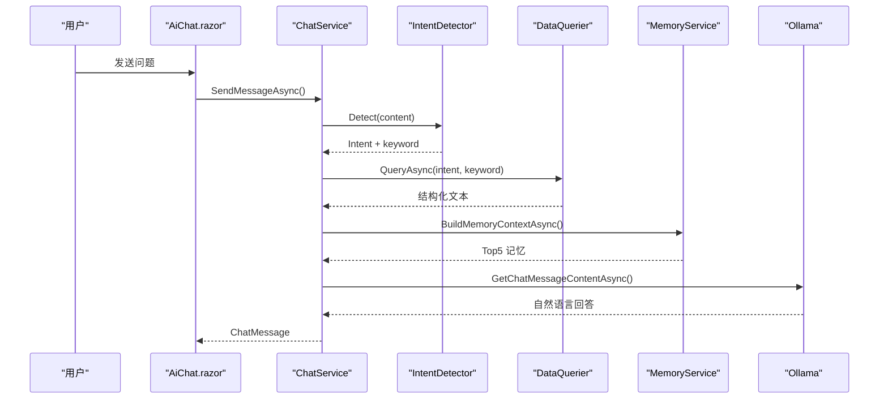
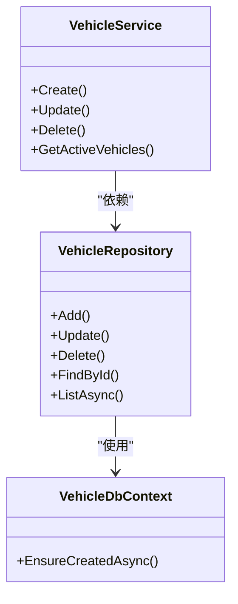
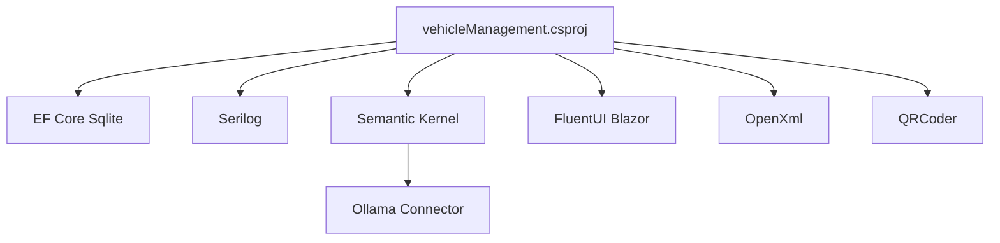

# 代码质量保障

<cite>
**本文引用的文件**   
- [README.md](file://README.md)
- [Program.cs](file://Program.cs)
- [vehicleManagement.csproj](file://vehicleManagement.csproj)
- [Dockerfile](file://Dockerfile)
</cite>

## 目录
1. [引言](#引言)
2. [项目结构](#项目结构)
3. [核心组件](#核心组件)
4. [架构总览](#架构总览)
5. [详细组件分析](#详细组件分析)
6. [依赖关系分析](#依赖关系分析)
7. [性能与稳定性考量](#性能与稳定性考量)
8. [故障排查指南](#故障排查指南)
9. [结论](#结论)
10. [附录：代码质量保障体系落地清单](#附录代码质量保障体系落地清单)

## 引言
本文件面向 vehicleManagement 系统，目标是建立一套完整的代码质量保障体系，覆盖静态分析、安全扫描、代码审查流程、持续集成、自动化测试、重构与技术债务管理、发布质量控制等维度。该系统基于 .NET 10 Blazor Server，使用 EF Core + SQLite，并内嵌本地 Ollama 推理的 AI 子系统，业务与 AI 数据物理隔离，具备较强的可观测性与容错设计。

## 项目结构
仓库采用分层组织：DAL（数据访问层）、BLL（业务逻辑层）、Pages/Components（Blazor UI）、aiServer（AI 子系统），以及配置与部署相关文件。整体遵循“规则路由 + 结果注入”的 AI 取数模式，避免模型直接生成 SQL，降低注入面与幻觉风险。

**图表来源**
- [Program.cs:41-102](file://Program.cs#L41-L102)
- [vehicleManagement.csproj:1-30](file://vehicleManagement.csproj#L1-L30)
- [Dockerfile:1-44](file://Dockerfile#L1-L44)

**章节来源**
- [README.md:122-139](file://README.md#L122-L139)
- [Program.cs:41-102](file://Program.cs#L41-L102)
- [vehicleManagement.csproj:1-30](file://vehicleManagement.csproj#L1-L30)
- [Dockerfile:1-44](file://Dockerfile#L1-L44)

## 核心组件
- 应用启动与装配：Program.cs 负责 Serilog 日志、Blazor Server、SQLite DbContextFactory、仓储与服务注册、Semantic Kernel 连接 Ollama、数据库初始化与健康端点。
- 项目配置：vehicleManagement.csproj 定义目标框架 net10.0 与关键 NuGet 包（EF Core、Serilog、Semantic Kernel、QRCoder、OpenXml）。
- 容器化：Dockerfile 提供多阶段构建、健康检查、环境变量注入与持久卷挂载。

**章节来源**
- [Program.cs:28-102](file://Program.cs#L28-L102)
- [vehicleManagement.csproj:1-30](file://vehicleManagement.csproj#L1-L30)
- [Dockerfile:1-44](file://Dockerfile#L1-L44)

## 架构总览
系统由三层组成：UI（Blazor Pages/Components）→ 业务层（BLL）→ 数据层（DAL）。AI 子系统 aiServer 通过规则意图识别与白名单查询，将结构化结果注入本地小模型进行自然语言回答，同时保持业务与 AI 数据隔离。

**图表来源**
- [README.md:57-83](file://README.md#L57-L83)
- [README.md:187-216](file://README.md#L187-L216)

**章节来源**
- [README.md:55-83](file://README.md#L55-L83)
- [README.md:187-216](file://README.md#L187-L216)

## 详细组件分析

### 启动与装配（Program.cs）
- 日志：Serilog 控制台与按天滚动文件输出，抑制框架与 EF Core SQL 噪声。
- DI：注册 Blazor、HttpContextAccessor、DbContextFactory、仓储、服务、通用服务、Semantic Kernel。
- 配置：加载 aisettings.json（可选+热重载），从配置读取 Ollama 端点与模型名。
- 数据库：确保 data 目录存在；启动时 EnsureCreatedAsync；开发环境写入种子数据。
- 中间件：静态文件、Blazor Hub、健康探针、回退到 _Host。

**图表来源**
- [Program.cs:28-102](file://Program.cs#L28-L102)
- [Program.cs:106-148](file://Program.cs#L106-L148)

**章节来源**
- [Program.cs:28-102](file://Program.cs#L28-L102)
- [Program.cs:106-148](file://Program.cs#L106-L148)

### AI 子系统（aiServer/BLL）
- ChatService：组装聊天历史、调用意图检测与数据查询、构造提示词、调用 Ollama、落库消息与异步记忆抽取。
- IntentDetector：关键词与正则匹配，固定优先级路由至 DataQuerier 的白名单分支。
- DataQuerier：封装业务查询方法，返回结构化文本供模型归纳。
- MemoryService：规则抽取车牌/品牌/偏好短句，Top5 记忆注入，失败隔离与可观测面板。

**图表来源**
- [README.md:187-216](file://README.md#L187-L216)

**章节来源**
- [README.md:221-269](file://README.md#L221-L269)

### 数据访问与实体（DAL）
- VehicleDbContext：业务库上下文，配合 EF Core Tools。
- Repository：各实体仓储实现，被 BLL 服务调用。
- SeedDataInitializer：开发环境种子数据初始化。

**图表来源**
- [vehicleManagement.csproj:18-22](file://vehicleManagement.csproj#L18-L22)

**章节来源**
- [vehicleManagement.csproj:18-22](file://vehicleManagement.csproj#L18-L22)

## 依赖关系分析
- 运行时与 Web：net10.0 + ASP.NET Core Blazor Server。
- ORM：Microsoft.EntityFrameworkCore.Sqlite 10.0.9。
- UI：Microsoft.FluentUI.AspNetCore.Components 4.14.3。
- LLM：Microsoft.SemanticKernel 1.77.0 + Connector.Ollama 1.77.0-alpha。
- 日志：Serilog + Serilog.AspNetCore + Serilog.Sinks.File。
- 其他：DocumentFormat.OpenXml、QRCoder。

**图表来源**
- [vehicleManagement.csproj:14-30](file://vehicleManagement.csproj#L14-L30)

**章节来源**
- [vehicleManagement.csproj:14-30](file://vehicleManagement.csproj#L14-L30)

## 性能与稳定性考量
- 并发与上下文：使用 IDbContextFactory 避免 Blazor Server 单 Circuit 共享上下文冲突。
- 日志降噪：抑制 Microsoft 与 EF Core SQL 日志，减少噪声。
- 模型调用收敛：一次问答仅调用一次 Ollama，避免多次网络开销。
- 窗口控制：固定最近 20 条消息，限制上下文长度。
- 失败隔离：Ollama 不可达、查询异常、结果为空、记忆写失败均有兜底处理，不影响主流程。

**章节来源**
- [Program.cs:28-37](file://Program.cs#L28-L37)
- [Program.cs:52-58](file://Program.cs#L52-L58)
- [README.md:240-269](file://README.md#L240-L269)
- [README.md:291-300](file://README.md#L291-L300)

## 故障排查指南
- Ollama 连通性：先验证 /health 是否返回 200，再检查容器内 localhost 解析、环境变量覆盖、模型 tag 一致性。
- 配置优先级：环境变量 > aisettings.json > 代码默认值。
- 日志定位：查看 logs/log-.log，注意 Serilog 输出模板与滚动策略。
- 数据库初始化：确认 data 目录存在，首次运行自动建库与种子数据（开发环境）。

**章节来源**
- [README.md:106-118](file://README.md#L106-L118)
- [README.md:165-183](file://README.md#L165-L183)
- [Program.cs:28-37](file://Program.cs#L28-L37)
- [Program.cs:106-125](file://Program.cs#L106-L125)

## 结论
vehicleManagement 系统在架构上实现了业务与 AI 的清晰分离，并通过规则意图识别与白名单查询保证安全性与可解释性。结合 Serilog 日志、DbContextFactory 并发安全、失败隔离与容器健康检查，具备良好的稳定性基础。为进一步提升代码质量，建议引入静态分析、安全扫描、自动化测试与 CI/CD 门禁，完善版本与变更管理。

## 附录：代码质量保障体系落地清单

### 静态分析工具配置
- Roslyn 分析器
  - 启用内置规则集（AllRules）或自定义规则集，聚焦可维护性、命名规范、空引用、异步最佳实践。
  - 在 CI 中作为独立步骤执行 dotnet build 并设置警告即错误。
- 代码规范检查
  - 引入 EditorConfig 统一缩进、换行、using 排序、文件头注释。
  - 使用 StyleCop.Analyzers 强化 C# 风格一致性。
- 安全漏洞扫描
  - 使用 dotnet audit 或 Dependabot/GitHub Advanced Security 对 NuGet 包进行漏洞扫描。
  - 在 PR 中阻断高危漏洞升级。

### 代码审查流程
- Pull Request 审查清单
  - 变更范围明确、影响面评估、新增依赖说明、兼容性影响、测试覆盖情况。
  - 涉及 AI 子系统需验证意图路由与数据注入正确性。
- 自动化代码检查
  - 构建 + 静态分析 + 安全扫描 + 单元测试在 PR 中强制通过。
- 质量门禁设置
  - 覆盖率阈值（如 ≥80%）、无新增高危漏洞、无新增严重警告。

### 持续集成配置（GitHub Actions）
- 工作流触发
  - push/PR 到 main/develop 分支触发构建与测试。
- 自动化构建
  - dotnet restore/build/publish，缓存依赖加速。
- 自动化测试执行
  - 运行单元测试、集成测试（SQLite 内存库或临时文件库）。
- 报告与归档
  - 上传测试报告、覆盖率报告、静态分析报告。

### 自动化测试策略
- 单元测试框架选择
  - xUnit/NUnit/MSTest 任选其一，推荐 xUnit 与 Parallelization。
- 测试用例编写
  - 针对 BLL 服务与 DataQuerier 白名单分支编写用例，覆盖正常路径与边界条件。
  - 使用 Mock 外部依赖（文件系统、二维码生成、HTTP 客户端）。
- 覆盖率要求
  - 行覆盖率 ≥80%，分支覆盖率 ≥70%，关键模块 ≥90%。

### 代码重构指南
- 代码异味识别
  - 长方法、重复逻辑、深层嵌套、魔法数字、跨层耦合。
- 重构模式应用
  - 提取方法、引入常量、替换条件判断为策略模式、拆分职责过大的 Service。
- 技术债务管理
  - 在 Issue 中登记技术债，定期评审与排期修复，避免累积。

### 发布质量控制
- 版本标签管理
  - 语义化版本（SemVer），Git Tag 与 Release Notes 同步。
- 变更日志生成
  - 基于 Git 提交信息自动生成 CHANGELOG，标注破坏性变更。
- 回滚策略
  - 保留上一个稳定镜像与数据库迁移脚本，支持一键回滚与数据恢复。