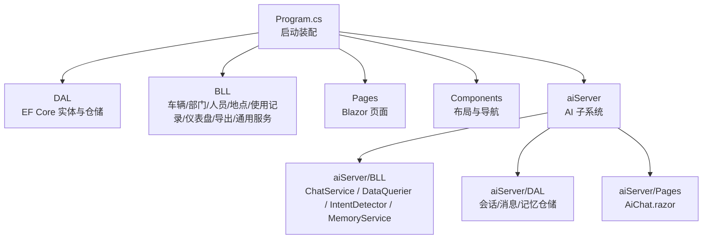
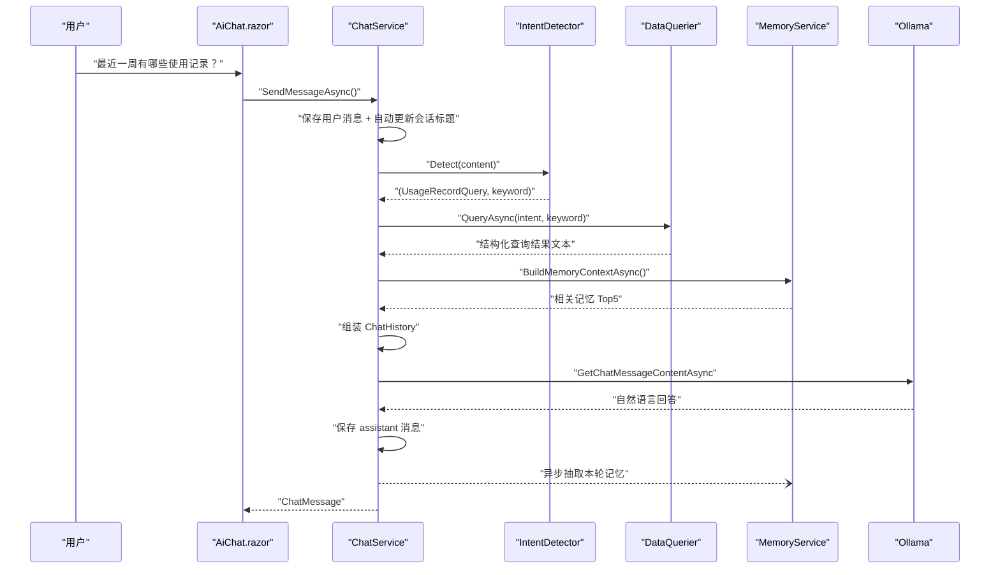
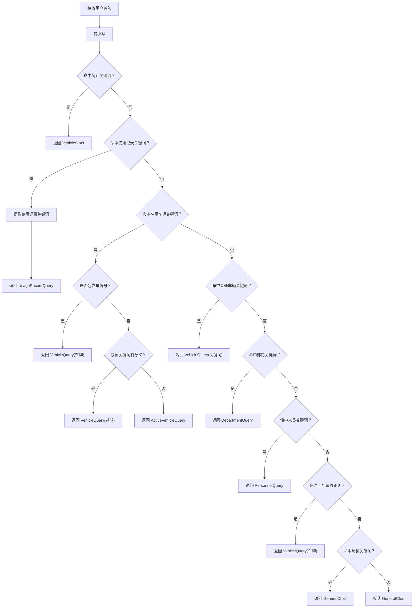
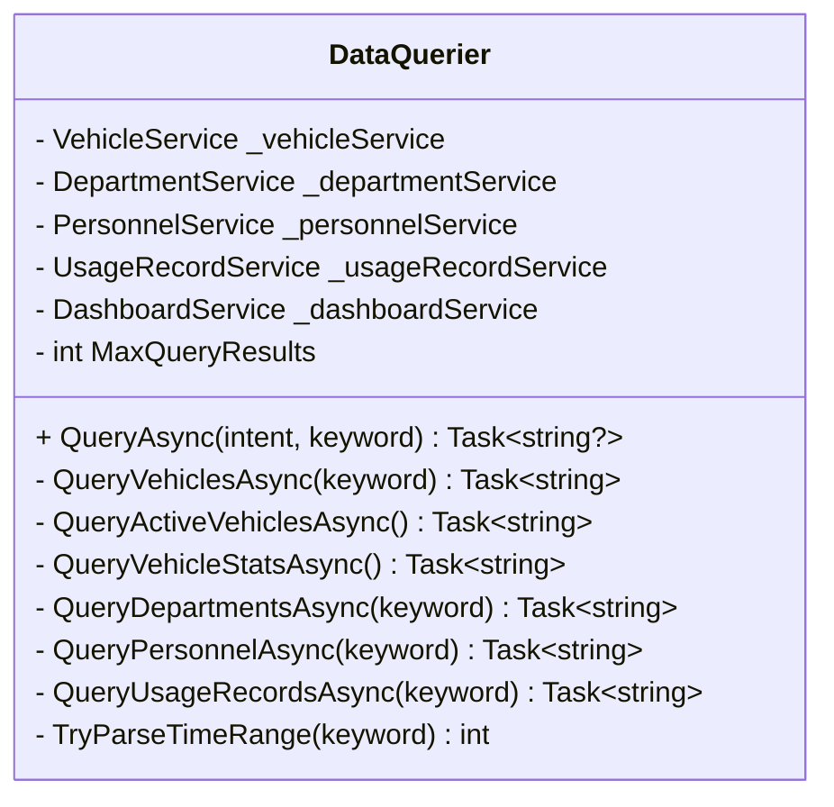
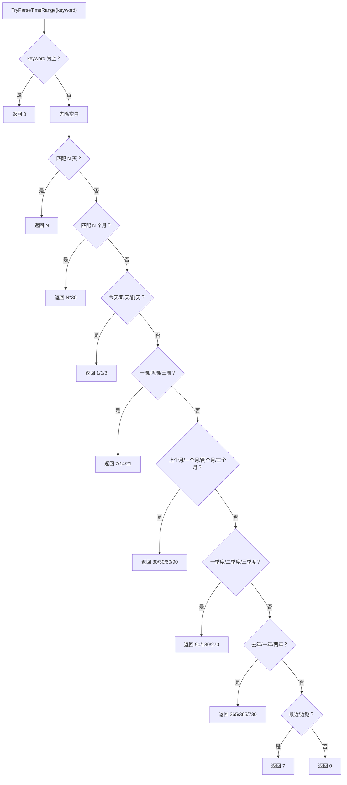
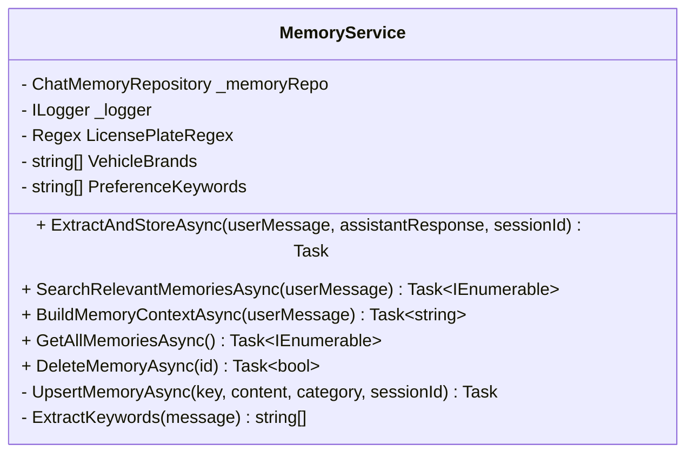
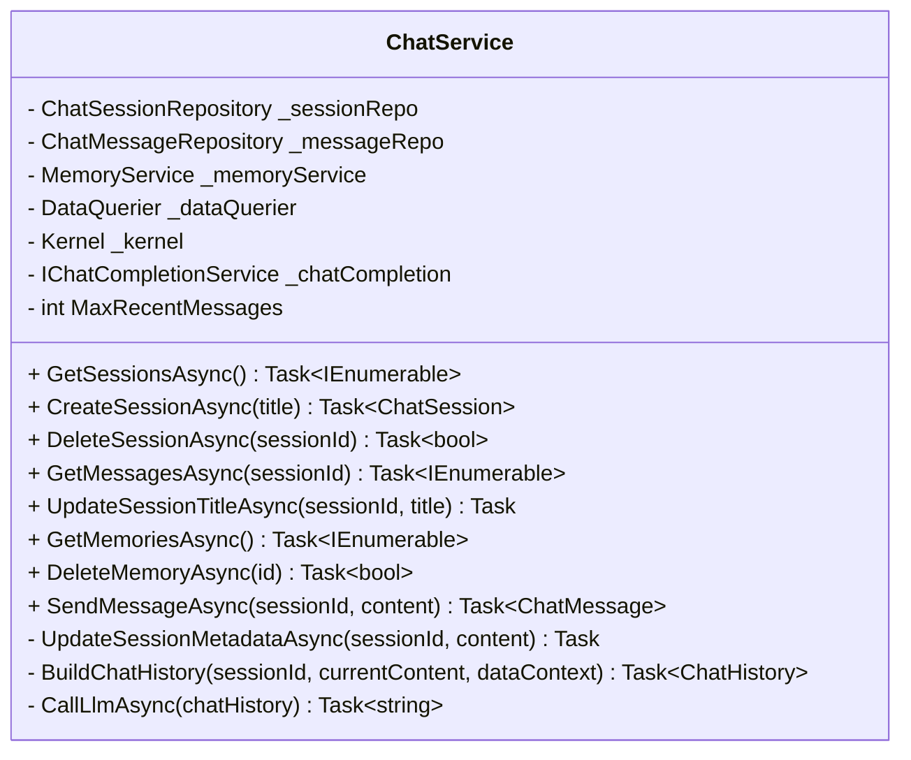
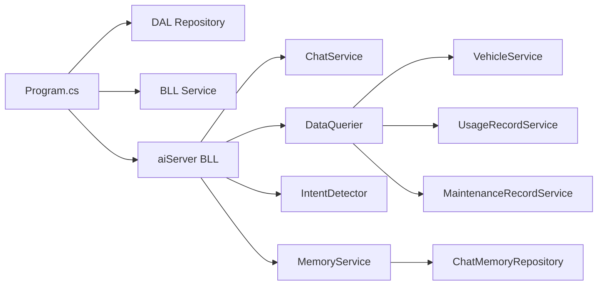

# 代码重构指南

<cite>
**本文引用的文件**   
- [Program.cs](file://Program.cs)
- [README.md](file://README.md)
- [aiServer/BLL/ChatService.cs](file://aiServer/BLL/ChatService.cs)
- [aiServer/BLL/DataQuerier.cs](file://aiServer/BLL/DataQuerier.cs)
- [aiServer/BLL/IntentDetector.cs](file://aiServer/BLL/IntentDetector.cs)
- [aiServer/BLL/MemoryService.cs](file://aiServer/BLL/MemoryService.cs)
- [BLL/Vehicle/VehicleService.cs](file://BLL/Vehicle/VehicleService.cs)
- [BLL/UsageRecord/UsageRecordService.cs](file://BLL/UsageRecord/UsageRecordService.cs)
- [BLL/Maintenance/MaintenanceRecordService.cs](file://BLL/Maintenance/MaintenanceRecordService.cs)
</cite>

## 目录
1. [引言](#引言)
2. [项目结构](#项目结构)
3. [核心组件](#核心组件)
4. [架构总览](#架构总览)
5. [详细组件分析](#详细组件分析)
6. [依赖关系分析](#依赖关系分析)
7. [性能与复杂度考量](#性能与复杂度考量)
8. [技术债务管理](#技术债务管理)
9. [重构工具支持](#重构工具支持)
10. [重构最佳实践](#重构最佳实践)
11. [重构效果评估](#重构效果评估)
12. [故障排查指南](#故障排查指南)
13. [结论](#结论)

## 引言
本指南面向 vehicleManagement 项目的代码重构工作，目标是在不改变业务语义的前提下，降低重复代码、过长方法、复杂类和魔法数字，提升可维护性、可测试性与运行稳定性。项目采用 Blazor Server + EF Core + SQLite，并嵌入本地 Ollama 小模型作为自然语言取数助手；AI 子系统通过规则意图识别、白名单查询和结果注入的方式调用业务服务，避免让模型直接写 SQL。

从现有实现看，主要重构机会集中在：
- AI 子系统的意图识别、时间解析、记忆抽取等规则型逻辑。
- 多个 Service 中重复的分页、排序、附件清理、异常处理模式。
- 多处硬编码常量、字符串模板和状态映射。
- 启动装配、配置加载、数据库初始化等基础设施职责集中。

## 项目结构
仓库按分层组织：DAL（实体、仓储、上下文）、BLL（业务服务）、Pages 与 Components（Blazor UI），以及 aiServer（AI 子系统）。Program.cs 负责日志、配置、依赖注入、数据库初始化与中间件注册；aiServer 内部再按 BLL/DAL/Pages 划分。

**图表来源**
- [Program.cs:41-102](file://Program.cs#L41-L102)
- [README.md:139-153](file://README.md#L139-L153)

**章节来源**
- [Program.cs:28-102](file://Program.cs#L28-L102)
- [README.md:122-153](file://README.md#L122-L153)

## 核心组件
vehicleManagement 的核心由三类组件构成：
- 业务服务层：VehicleService、UsageRecordService、MaintenanceRecordService 等，封装分页查询、排序、删除与附件清理。
- AI 子系统：ChatService 编排对话流程，DataQuerier 根据意图调用业务服务，IntentDetector 做关键词路由，MemoryService 做记忆抽取与检索。
- 基础设施：Program.cs 统一装配 Serilog、DbContextFactory、Repository、Service、Semantic Kernel 与 Ollama。

这些组件共同支撑“自然语言问句 → 意图识别 → 白名单查询 → 结构化文本注入 → 本地模型回答”的链路。

**章节来源**
- [Program.cs:41-102](file://Program.cs#L41-L102)
- [aiServer/BLL/ChatService.cs:18-42](file://aiServer/BLL/ChatService.cs#L18-L42)
- [aiServer/BLL/DataQuerier.cs:21-43](file://aiServer/BLL/DataQuerier.cs#L21-L43)
- [aiServer/BLL/IntentDetector.cs:12-17](file://aiServer/BLL/IntentDetector.cs#L12-L17)
- [aiServer/BLL/MemoryService.cs:15-40](file://aiServer/BLL/MemoryService.cs#L15-L40)

## 架构总览
下图展示一次问答的完整调用链：用户输入进入 Blazor 页面后，ChatService 保存用户消息、更新会话标题、识别意图、查询数据、构建聊天历史、调用 Ollama，并异步提取记忆。

**图表来源**
- [aiServer/BLL/ChatService.cs:94-139](file://aiServer/BLL/ChatService.cs#L94-L139)
- [aiServer/BLL/IntentDetector.cs:17-111](file://aiServer/BLL/IntentDetector.cs#L17-L111)
- [aiServer/BLL/DataQuerier.cs:48-67](file://aiServer/BLL/DataQuerier.cs#L48-L67)
- [aiServer/BLL/MemoryService.cs:144-153](file://aiServer/BLL/MemoryService.cs#L144-L153)

**章节来源**
- [README.md:187-219](file://README.md#L187-L219)
- [aiServer/BLL/ChatService.cs:94-139](file://aiServer/BLL/ChatService.cs#L94-L139)

## 详细组件分析

### 意图识别器 IntentDetector
IntentDetector 是规则驱动的路由入口，按固定优先级匹配统计、使用记录、在用车辆、普通车辆、部门、人员、车牌正则与闲聊关键词，并提取残留关键词。

代码异味与重构建议：
- 重复代码：多组 `string[]` 关键词数组与 `Contains` 判断结构高度相似，适合提取为“意图规则表”。
- 魔法数字：无，但存在大量硬编码中文词表，应迁移到配置或枚举化规则。
- 复杂类风险：当前为静态类，耦合点主要在 Detect 主流程，可通过策略对象拆分不同意图的匹配与关键词提取。
- 简化条件逻辑：将“触发词 → 残留关键词 → 停用词清洗 → 有效关键词判定”抽象为管道。

**图表来源**
- [aiServer/BLL/IntentDetector.cs:17-111](file://aiServer/BLL/IntentDetector.cs#L17-L111)

**章节来源**
- [aiServer/BLL/IntentDetector.cs:17-151](file://aiServer/BLL/IntentDetector.cs#L17-L151)

### 数据查询器 DataQuerier
DataQuerier 根据 UserIntent 分发到具体查询方法，并把业务服务返回的数据格式化为 LLM 可读文本。其最大问题是：每个分支都重复构造 StringBuilder、空结果文案、状态映射与字段拼接。

代码异味与重构建议：
- 重复代码：QueryVehiclesAsync、QueryDepartmentsAsync、QueryPersonnelAsync、QueryUsageRecordsAsync 的结构几乎一致。
- 过长方法：QueryVehicleStatsAsync 聚合多个 Dashboard 查询并拼接多段文本，可读性尚可但扩展成本高。
- 魔法数字：MaxQueryResults = 20 是全局限制，应提升到配置项。
- 替换算法：将“查询 → 判空 → 格式化 → 追加交叉查询”抽象为 QueryFormatter 或 ResultBuilder。
- 简化条件逻辑：状态映射可抽成 DisplayText 映射表。

**图表来源**
- [aiServer/BLL/DataQuerier.cs:21-43](file://aiServer/BLL/DataQuerier.cs#L21-L43)
- [aiServer/BLL/DataQuerier.cs:48-67](file://aiServer/BLL/DataQuerier.cs#L48-L67)
- [aiServer/BLL/DataQuerier.cs:69-93](file://aiServer/BLL/DataQuerier.cs#L69-L93)
- [aiServer/BLL/DataQuerier.cs:114-143](file://aiServer/BLL/DataQuerier.cs#L114-L143)
- [aiServer/BLL/DataQuerier.cs:145-185](file://aiServer/BLL/DataQuerier.cs#L145-L185)
- [aiServer/BLL/DataQuerier.cs:187-228](file://aiServer/BLL/DataQuerier.cs#L187-L228)
- [aiServer/BLL/DataQuerier.cs:230-267](file://aiServer/BLL/DataQuerier.cs#L230-L267)
- [aiServer/BLL/DataQuerier.cs:272-330](file://aiServer/BLL/DataQuerier.cs#L272-L330)

**章节来源**
- [aiServer/BLL/DataQuerier.cs:1-333](file://aiServer/BLL/DataQuerier.cs#L1-L333)

### 时间范围解析 TryParseTimeRange
TryParseTimeRange 把中文相对时间转换为天数，用于 UsageRecord 的近期查询。该方法是典型的“魔法数字 + 长 if/contains 链”，需要被规则化。

重构建议：
- 提取为 TimeExpressionRule 列表，每条规则包含“匹配函数 → 返回天数”。
- 将“今天/昨天/前天”“一周/两周/三周”“一个月/两个月/三个月”“一季度/二季度/三季度”“一年/两年”“最近/近期”分别归入分类表。
- 对数字表达式“N天/N个月”保留正则优先匹配。
- 将硬编码天数集中到配置或枚举，便于单元测试覆盖。

**图表来源**
- [aiServer/BLL/DataQuerier.cs:272-330](file://aiServer/BLL/DataQuerier.cs#L272-L330)

**章节来源**
- [aiServer/BLL/DataQuerier.cs:272-330](file://aiServer/BLL/DataQuerier.cs#L272-L330)

### 记忆服务 MemoryService
MemoryService 负责从对话中提取车牌、品牌、偏好短句，并以 Key 幂等方式写入记忆库；同时提供基于 LIKE 的相关记忆检索。

代码异味与重构建议：
- 重复代码：ExtractAndStoreAsync 中多次遍历 VehicleBrands、PreferenceKeywords，且 UpsertMemoryAsync 与 AddAsync 有重复写入路径。
- 魔法数字：20 字阈值、Top5 记忆数量、前后文截取长度 100 等应配置化。
- 复杂类风险：当前类承担提取、存储、检索、上下文构建、全部记忆获取与删除职责，可按职责拆分为 MemoryExtractor、MemoryWriter、MemoryRetriever。
- 替换算法：LIKE 检索可先定义关键词提取策略，再统一执行去重、排序、截断。

**图表来源**
- [aiServer/BLL/MemoryService.cs:15-40](file://aiServer/BLL/MemoryService.cs#L15-L40)
- [aiServer/BLL/MemoryService.cs:45-113](file://aiServer/BLL/MemoryService.cs#L45-L113)
- [aiServer/BLL/MemoryService.cs:118-153](file://aiServer/BLL/MemoryService.cs#L118-L153)
- [aiServer/BLL/MemoryService.cs:158-194](file://aiServer/BLL/MemoryService.cs#L158-L194)
- [aiServer/BLL/MemoryService.cs:199-221](file://aiServer/BLL/MemoryService.cs#L199-L221)

**章节来源**
- [aiServer/BLL/MemoryService.cs:1-224](file://aiServer/BLL/MemoryService.cs#L1-L224)

### 对话编排 ChatService
ChatService 是 AI 子系统的协调者：保存消息、更新会话标题、调用 IntentDetector、DataQuerier、MemoryService，并调用 Semantic Kernel 的 IChatCompletionService。

代码异味与重构建议：
- 过长方法：SendMessageAsync 串联 7 步流程，虽注释清晰，但后续若增加步骤会难以维护。
- 复杂类风险：同时承担会话管理、记忆管理、对话编排、LLM 调用。
- 简化条件逻辑：UpdateSessionMetadataAsync 中的标题生成逻辑可提取为 TitleGenerator。
- 错误处理：CallLlmAsync 已捕获异常并返回友好文案，符合兜底设计；可进一步区分网络异常、模型空响应、超时等类型。

**图表来源**
- [aiServer/BLL/ChatService.cs:18-42](file://aiServer/BLL/ChatService.cs#L18-L42)
- [aiServer/BLL/ChatService.cs:46-78](file://aiServer/BLL/ChatService.cs#L46-L78)
- [aiServer/BLL/ChatService.cs:94-139](file://aiServer/BLL/ChatService.cs#L94-L139)
- [aiServer/BLL/ChatService.cs:146-156](file://aiServer/BLL/ChatService.cs#L146-L156)
- [aiServer/BLL/ChatService.cs:161-183](file://aiServer/BLL/ChatService.cs#L161-L183)
- [aiServer/BLL/ChatService.cs:188-199](file://aiServer/BLL/ChatService.cs#L188-L199)

**章节来源**
- [aiServer/BLL/ChatService.cs:1-202](file://aiServer/BLL/ChatService.cs#L1-L202)

### 业务服务：VehicleService、UsageRecordService、MaintenanceRecordService
这三个 Service 体现了项目中最明显的重复模式：
- 分页查询：计算 totalCount、校验 page、Skip/Take。
- 动态排序：switch 或 if 选择排序列。
- 删除流程：先查记录，再清理物理附件，失败则阻止 DB 删除，成功则记录日志。
- 依赖 IDbContextFactory 避免 Blazor Server 并发共享 DbContext。

重构建议：
- 提取通用分页基类或泛型分页处理器，统一 PageResult 构造、页码修正、排序表达式。
- 提取附件清理策略，支持图片、视频、维修附件等不同字段。
- 将删除流程抽象为“预检查 → 资源清理 → 持久化 → 日志”的标准事务模板。
- 将 ImageExtensions、排序列映射、状态显示文本等常量上移到配置或公共模块。

**章节来源**
- [BLL/Vehicle/VehicleService.cs:67-109](file://BLL/Vehicle/VehicleService.cs#L67-L109)
- [BLL/Vehicle/VehicleService.cs:171-202](file://BLL/Vehicle/VehicleService.cs#L171-L202)
- [BLL/UsageRecord/UsageRecordService.cs:43-92](file://BLL/UsageRecord/UsageRecordService.cs#L43-L92)
- [BLL/UsageRecord/UsageRecordService.cs:125-154](file://BLL/UsageRecord/UsageRecordService.cs#L125-L154)
- [BLL/Maintenance/MaintenanceRecordService.cs:30-59](file://BLL/Maintenance/MaintenanceRecordService.cs#L30-L59)
- [BLL/Maintenance/MaintenanceRecordService.cs:73-100](file://BLL/Maintenance/MaintenanceRecordService.cs#L73-L100)

## 依赖关系分析
Program.cs 是依赖注入中心，注册了 DAL 仓储、BLL 服务、AI 服务、通用服务与 Semantic Kernel。AI 子系统通过 ChatService 依赖 DataQuerier、MemoryService、Kernel；DataQuerier 依赖各业务 Service；MemoryService 依赖 ChatMemoryRepository。

**图表来源**
- [Program.cs:60-102](file://Program.cs#L60-L102)
- [aiServer/BLL/ChatService.cs:18-42](file://aiServer/BLL/ChatService.cs#L18-L42)
- [aiServer/BLL/DataQuerier.cs:21-43](file://aiServer/BLL/DataQuerier.cs#L21-L43)
- [aiServer/BLL/MemoryService.cs:15-40](file://aiServer/BLL/MemoryService.cs#L15-L40)

**章节来源**
- [Program.cs:60-102](file://Program.cs#L60-L102)

## 性能与复杂度考量
- 分页查询已在 Service 层使用 CountAsync + Skip/Take，避免一次性拉取全量数据，这对 SQLite 场景很重要。
- DataQuerier 的 MaxQueryResults 限制输出条数，有助于控制 LLM 上下文大小。
- MemoryService 的记忆检索是 LIKE 模糊匹配，简单但召回率有限；在数据量增长后可能成为瓶颈。
- ChatService 的异步记忆抽取放在主流程之外，避免影响用户响应时间。
- 建议引入查询缓存（如内存缓存）用于频繁访问的部门分布、趋势数据，减少重复 IO。

[本节为通用性能讨论，不直接分析具体文件]

## 技术债务管理

### 债务识别
当前项目中可识别的技术债务主要包括：
- 重复分页与排序逻辑：VehicleService、UsageRecordService、MaintenanceRecordService 中都有类似实现。
- 重复附件清理逻辑：删除车辆、使用记录、维修记录时都先清理物理文件再删库。
- 重复结果格式化逻辑：DataQuerier 中多个查询方法都手动拼接 StringBuilder。
- 规则型魔法值：时间解析中的天数、记忆抽取中的阈值、关键词表、停用词表、噪声字符表。
- 启动装配集中：Program.cs 同时承担日志、配置、DI、建库、静态文件、健康探针等职责。

### 优先级排序
建议按“影响面 × 修复成本 × 风险”排序：
1. 高优先级：重复分页/排序、重复附件清理、重复结果格式化。
2. 中高优先级：时间解析规则化、关键词表与停用词表配置化。
3. 中优先级：MemoryService 职责拆分、DataQuerier 结果构建器。
4. 低优先级：Program.cs 细粒度拆分（需配合部署脚本与配置迁移）。

### 偿还计划
- 第一阶段：抽取通用分页处理器与附件清理策略，覆盖三个 Service。
- 第二阶段：将 DataQuerier 的结果格式化逻辑抽象为 ResultBuilder，消除重复 StringBuilder。
- 第三阶段：将 TryParseTimeRange 改为规则表，并将关键词表、停用词表、噪声字符表外置。
- 第四阶段：拆分 MemoryService 的职责，并引入可配置的 TopN、阈值。
- 第五阶段：渐进式拆分 Program.cs，引入 Startup 模块或模块化装配。

### 监控指标
- 代码复杂度：圈复杂度、平均方法长度、类大小。
- 重复度：重复代码行数比例、重复片段数量。
- 可测试性：单元测试覆盖率、规则类可单测比例。
- 稳定性：异常兜底覆盖率、关键路径异常日志数量。
- 性能：分页查询耗时、记忆检索耗时、LLM 调用耗时。

[本节为通用债务管理讨论，不直接分析具体文件]

## 重构工具支持

### Visual Studio 重构功能
- 提取方法：适用于将 DataQuerier 中的重复格式化逻辑、MemoryService 中的重复遍历逻辑拆分为独立方法。
- 内联变量/方法：适用于临时变量过多或短方法可直接合并的场景。
- 更改签名：适用于调整 Service 分页参数、统一分页返回值。
- 移除未使用引用：适用于清理 BLL 与 aiServer 中冗余 using。
- 重新组织 using：适用于 Program.cs 与 Service 文件的命名空间整理。

### ReSharper 插件
- 代码异味检测：可自动发现过长方法、过深嵌套、重复代码、未使用的私有成员。
- 快速修复：一键提取为属性、方法、局部函数；将 switch/if 链转换为字典或策略表。
- 重构预览：在执行批量重构前预览变更，降低误改风险。
- 自定义规则：可结合 Roslyn Analyzer 编写团队规范规则，例如禁止魔法数字、强制使用配置常量。

### 自定义分析规则
建议新增以下规则：
- 禁止在 Service 中直接拼接用户可见字符串模板，必须通过格式化器。
- 禁止在业务方法中出现硬编码天数、TopN、阈值。
- 分页方法必须使用统一分页处理器。
- 删除方法必须先清理外部资源，再执行数据库操作。
- 所有对外部系统（Ollama、文件系统、数据库）的调用必须有异常兜底。

[本节为通用工具指导，不直接分析具体文件]

## 重构最佳实践

### 小步快跑
- 每次只重构一个重复模式，例如先统一分页，再统一附件清理，再统一结果格式化。
- 每次提交只包含一个重构目标，保持 diff 清晰。
- 重构前先写或补充单元测试，确保行为不变。

### 测试保护
- 对 IntentDetector.Detect 的关键用例编写单测，覆盖统计、在用车辆、车牌正则、闲聊等分支。
- 对 TryParseTimeRange 编写边界用例，覆盖 N 天、N 个月、一周、一个月、季度、年、最近。
- 对分页处理器编写页码越界、空结果、排序列未知等用例。
- 对附件清理策略编写文件不存在、权限不足、路径为空等用例。

### 版本控制
- 使用特性分支进行重构，完成后通过 Pull Request 评审。
- 提交信息明确标注重构目标，例如“抽取通用分页处理器”“规则化时间解析”。
- 对破坏性变更（如 API 或配置键变化）提供迁移说明。

### 团队协作
- 制定代码规范：命名、异常处理、日志级别、配置键命名。
- 建立重构清单：每个 PR 至少解决一个已知债务项。
- 定期回顾：每月统计重复代码比例、圈复杂度、测试覆盖率变化。

[本节为通用实践指导，不直接分析具体文件]

## 重构效果评估

### 代码复杂度降低
- 通过抽取通用分页处理器，预计可将 VehicleService、UsageRecordService、MaintenanceRecordService 的分页逻辑重复率降至接近零。
- 通过 ResultBuilder 抽象，DataQuerier 中多个查询方法的格式化复杂度可显著下降。
- 通过规则表替代 if/contains 链，IntentDetector 与 TryParseTimeRange 的可读性和可测试性提升。

### 性能提升
- 统一分页处理器可减少重复的页码修正逻辑，降低出错概率。
- 将 TopN、MaxQueryResults、记忆阈值配置化后，可在不同环境调优性能。
- 对高频查询引入缓存可降低 SQLite 压力。

### 可维护性改善
- 规则外置后，新增意图、时间表达、记忆关键词无需修改核心逻辑。
- 附件清理策略复用后，新增记录类型的删除逻辑只需声明字段映射。
- 启动装配模块化后，新增服务或中间件更容易定位。

[本节为通用效果评估，不直接分析具体文件]

## 故障排查指南

### 常见异常与兜底
- Ollama 不可达或返回空：ChatService.CallLlmAsync 捕获异常并返回友好文案。
- 业务查询异常：DataQuerier.QueryAsync 捕获异常并返回数据库错误提示。
- 查询结果为空：各查询方法返回显式“没有匹配数据”文案。
- 记忆抽取异常：MemoryService.ExtractAndStoreAsync 捕获异常并记录警告。
- 并发写库：Program.cs 使用 IDbContextFactory 避免 Blazor Server 共享 DbContext 冲突。
- 日志噪声：Serilog 抑制 Microsoft 与 EF Core SQL 日志。

**章节来源**
- [aiServer/BLL/ChatService.cs:188-199](file://aiServer/BLL/ChatService.cs#L188-L199)
- [aiServer/BLL/DataQuerier.cs:48-67](file://aiServer/BLL/DataQuerier.cs#L48-L67)
- [aiServer/BLL/MemoryService.cs:109-113](file://aiServer/BLL/MemoryService.cs#L109-L113)
- [Program.cs:28-37](file://Program.cs#L28-L37)
- [Program.cs:52-58](file://Program.cs#L52-L58)

### 启动与健康检查
- Program.cs 在 Development 环境启用开发者异常页，生产环境使用 /Error。
- 提供 /health 健康探针，供容器 HEALTHCHECK 使用。
- 首次运行自动创建数据库表，并在开发环境写入种子数据。

**章节来源**
- [Program.cs:104-148](file://Program.cs#L104-L148)
- [README.md:321-336](file://README.md#L321-L336)

## 结论
vehicleManagement 项目在业务闭环、AI 取数链路、稳定性兜底方面已有良好基础。下一步重构应聚焦于消除重复代码、规则化魔法数字、拆分复杂类、统一分页与附件清理，并通过单元测试与规则化配置保障重构安全。通过小步快跑、测试保护、版本控制与团队协作，可以在不中断业务的前提下持续降低技术债务，提升代码复杂度、性能与可维护性。

[本节为总结性内容，不直接分析具体文件]