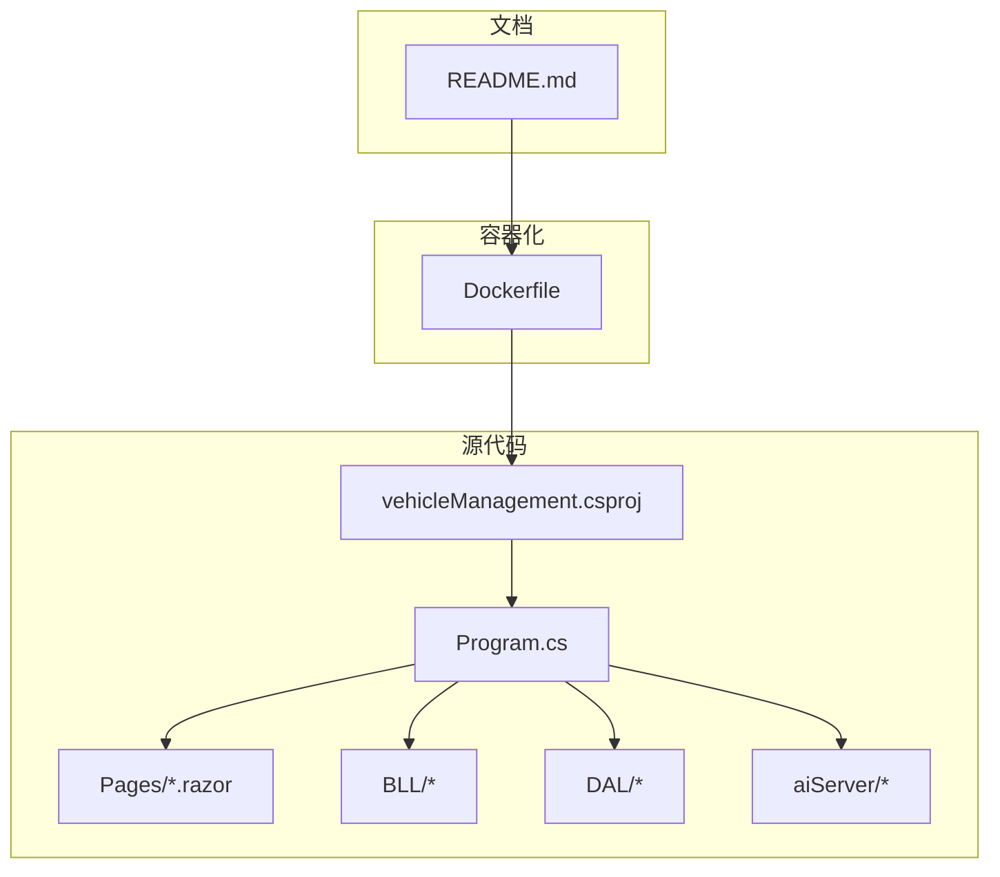
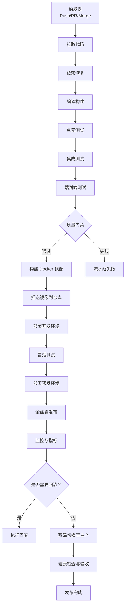
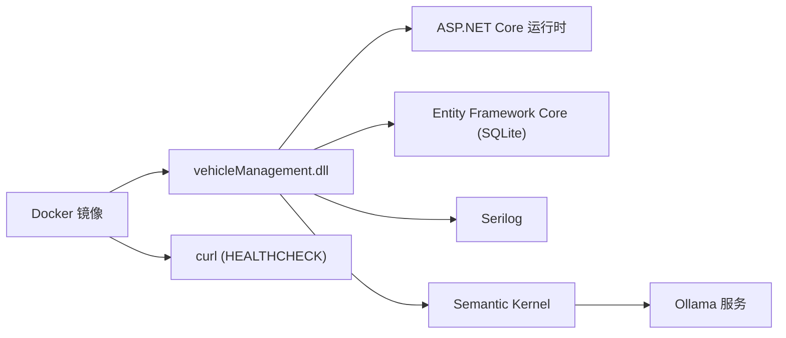

# 持续集成配置

<cite>
**本文引用的文件**   
- [Dockerfile](file://Dockerfile)
- [vehicleManagement.csproj](file://vehicleManagement.csproj)
- [Program.cs](file://Program.cs)
- [README.md](file://README.md)
</cite>

## 目录
1. [引言](#引言)
2. [项目结构](#项目结构)
3. [核心组件](#核心组件)
4. [架构总览](#架构总览)
5. [详细组件分析](#详细组件分析)
6. [依赖关系分析](#依赖关系分析)
7. [性能考虑](#性能考虑)
8. [故障排查指南](#故障排查指南)
9. [结论](#结论)
10. [附录](#附录)

## 引言
本文件为 vehicleManagement 系统的持续集成（CI）流水线提供完整配置与实施指南，覆盖 GitHub Actions 工作流设计、构建管道、自动化测试、Docker 镜像构建与推送、质量门禁以及部署策略。目标是在保证代码质量与安全的前提下，实现多环境稳定发布与可回滚的平滑升级。

## 项目结构
当前仓库是一个基于 .NET 10 的 Blazor Server Web 应用，包含业务层（BLL）、数据访问层（DAL）、页面（Pages）、AI 服务模块（aiServer）以及 Docker 化运行配置。关键 CI 相关资产如下：
- 项目定义与依赖：[vehicleManagement.csproj](file://vehicleManagement.csproj)
- 应用启动与运行时配置：[Program.cs](file://Program.cs)
- 容器镜像构建与运行参数：[Dockerfile](file://Dockerfile)
- 部署说明与环境变量约定：[README.md](file://README.md)

**图表来源**
- [vehicleManagement.csproj:1-37](file://vehicleManagement.csproj#L1-L37)
- [Program.cs:1-158](file://Program.cs#L1-L158)
- [Dockerfile:1-44](file://Dockerfile#L1-L44)
- [README.md:321-340](file://README.md#L321-L340)

**章节来源**
- [vehicleManagement.csproj:1-37](file://vehicleManagement.csproj#L1-L37)
- [Program.cs:1-158](file://Program.cs#L1-L158)
- [Dockerfile:1-44](file://Dockerfile#L1-L44)
- [README.md:321-340](file://README.md#L321-L340)

## 核心组件
- 构建与发布：通过 .NET SDK 进行依赖恢复、编译与发布；Docker 多阶段构建用于生成最小运行镜像。
- 运行时健康检查：暴露 /health 端点，Docker HEALTHCHECK 定期探测。
- 外部依赖：SQLite 数据库、Serilog 日志、Semantic Kernel + Ollama AI 能力。
- 环境变量与配置：支持 appsettings 与 aisettings.json，同时通过环境变量覆盖 AI 端点与模型。

**章节来源**
- [vehicleManagement.csproj:1-37](file://vehicleManagement.csproj#L1-L37)
- [Program.cs:28-102](file://Program.cs#L28-L102)
- [Program.cs:104-148](file://Program.cs#L104-L148)
- [Dockerfile:1-44](file://Dockerfile#L1-L44)
- [README.md:321-340](file://README.md#L321-L340)

## 架构总览
下图展示从代码提交到生产发布的端到端流程，包括触发器、构建、测试、镜像构建与推送、部署与验证。

[本图为概念性流程图，不直接映射具体源码文件]

## 详细组件分析

### 构建管道设计
- 代码拉取：在 GitHub Actions 中 checkout 指定分支或标签。
- 依赖恢复：使用 dotnet restore 恢复 NuGet 包。
- 编译构建：dotnet build 与 dotnet publish 生成发布产物。
- 包发布：将发布产物归档为 Action Artifacts，供后续步骤使用。

建议的 GitHub Actions 任务顺序：
1. setup-dotnet（安装 .NET SDK）
2. restore（dotnet restore）
3. build（dotnet build）
4. test（单元测试）
5. publish（dotnet publish）
6. upload-artifact（上传发布产物）

**章节来源**
- [vehicleManagement.csproj:1-37](file://vehicleManagement.csproj#L1-L37)

### 自动化测试集成
- 单元测试：使用 xUnit/NUnit/MSTest 等框架编写并运行；在 CI 中输出覆盖率报告。
- 集成测试：针对 SQLite 与仓储层进行集成测试，确保 EF Core 迁移与种子数据正确。
- 端到端测试：启动容器或本地进程，调用 /health 与关键页面接口进行冒烟测试。
- 测试报告：生成 JUnit XML 与覆盖率 HTML，上传为 Action Artifacts。

建议的 GitHub Actions 任务顺序：
1. run-unit-tests（dotnet test --collect:"XPlat Code Coverage"）
2. generate-test-report（上传测试结果与覆盖率）
3. start-e2e-service（启动容器或本地服务）
4. run-e2e-tests（调用 /health 与关键页面）
5. stop-e2e-service（清理资源）

**章节来源**
- [Program.cs:144-148](file://Program.cs#L144-L148)

### Docker 镜像构建与推送
- 多阶段构建：SDK 阶段还原与发布，运行时阶段仅包含 ASP.NET Core 运行时与 curl。
- 健康检查：HEALTHCHECK 调用 /health 端点，间隔与重试参数已配置。
- 环境变量：AiServer__OllamaEndpoint 与 AiServer__OllamaModel 可通过环境变量注入。
- 持久化卷：/app/data、/app/logs、/app/Folder 作为挂载卷。

建议的 GitHub Actions 任务顺序：
1. docker-login（登录镜像仓库）
2. docker-build（docker build -t ...）
3. docker-push（docker push ...）
4. deploy（kubectl/docker-compose 部署）

**章节来源**
- [Dockerfile:1-44](file://Dockerfile#L1-L44)
- [Program.cs:144-148](file://Program.cs#L144-L148)
- [README.md:321-340](file://README.md#L321-L340)

### 质量门禁设置
- 代码覆盖率：要求单元测试覆盖率阈值（例如 ≥80%），未达标则流水线失败。
- 安全扫描：对依赖进行漏洞扫描（如 Dependabot、Snyk、GitHub Advanced Security）。
- 性能基准：对关键接口进行基准测试（BenchmarkDotNet），对比基线结果。

建议在 CI 中添加：
- 覆盖率门控：解析覆盖率报告并比较阈值。
- 安全扫描：运行依赖漏洞扫描并阻断高危漏洞。
- 性能回归：运行基准测试并与上次成功构建的结果对比。

[本节为通用指导，不直接分析具体源码文件]

### 部署策略
- 蓝绿部署：并行维护两套环境，流量切换时快速切换入口。
- 金丝雀发布：逐步放量新版本，观察错误率与延迟后决定是否全量。
- 回滚机制：保留上一版本镜像与配置，出现问题时一键回滚。

建议的 GitHub Actions 任务顺序：
1. deploy-staging（预发环境）
2. smoke-test（冒烟测试）
3. canary-deploy（金丝雀）
4. monitor-and-validate（监控与验证）
5. blue-green-switch（蓝绿切换）
6. rollback-on-failure（失败自动回滚）

[本节为通用指导，不直接分析具体源码文件]

## 依赖关系分析
- 运行时依赖：ASP.NET Core 运行时、SQLite、Serilog、Semantic Kernel、Ollama。
- 构建依赖：.NET 10 SDK、NuGet 包源。
- 容器依赖：curl（用于 HEALTHCHECK）。

**图表来源**
- [vehicleManagement.csproj:14-30](file://vehicleManagement.csproj#L14-L30)
- [Dockerfile:22-41](file://Dockerfile#L22-L41)
- [Program.cs:28-102](file://Program.cs#L28-L102)

**章节来源**
- [vehicleManagement.csproj:14-30](file://vehicleManagement.csproj#L14-L30)
- [Dockerfile:22-41](file://Dockerfile#L22-L41)
- [Program.cs:28-102](file://Program.cs#L28-L102)

## 性能考虑
- 构建缓存：利用 Docker 层缓存与 dotnet 包缓存加速 CI 构建。
- 并行任务：单元测试与静态分析并行执行，缩短流水线时长。
- 资源限制：为 CI Runner 分配足够 CPU/内存，避免构建超时。
- 镜像优化：仅包含必要依赖，减小镜像体积，提升部署速度。

[本节为通用指导，不直接分析具体源码文件]

## 故障排查指南
- 构建失败：检查 .NET SDK 版本与目标框架是否匹配；确认 NuGet 源可达。
- 测试失败：查看测试输出与覆盖率报告；确认 SQLite 与 EF Core 迁移正常。
- 健康检查失败：确认 /health 端点可用；检查容器内 curl 与网络连通性。
- AI 服务不可用：校验 AiServer__OllamaEndpoint 与 AiServer__OllamaModel 环境变量；确认 Ollama 服务可达。

**章节来源**
- [Program.cs:144-148](file://Program.cs#L144-L148)
- [Dockerfile:40-41](file://Dockerfile#L40-L41)
- [README.md:321-340](file://README.md#L321-L340)

## 结论
通过上述 CI 流水线设计，vehicleManagement 系统可实现从代码提交到生产发布的自动化闭环。结合质量门禁与多环境部署策略，能够在保证质量与安全的同时，提供快速、稳定的发布能力。建议在生产环境中启用蓝绿与金丝雀发布，并完善监控与告警，以进一步提升系统可靠性。

[本节为总结性内容，不直接分析具体源码文件]

## 附录
- 环境变量参考：
  - AiServer__OllamaEndpoint：Ollama 服务地址
  - AiServer__OllamaModel：使用的模型名称
- 持久化目录：
  - /app/data：数据库文件
  - /app/logs：日志文件
  - /app/Folder：上传附件

**章节来源**
- [Dockerfile:31-38](file://Dockerfile#L31-L38)
- [README.md:321-340](file://README.md#L321-L340)