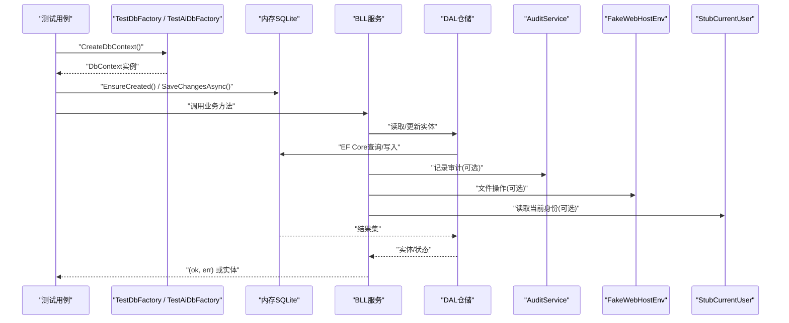
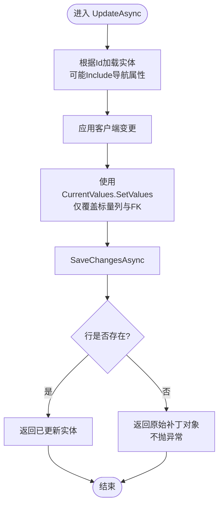
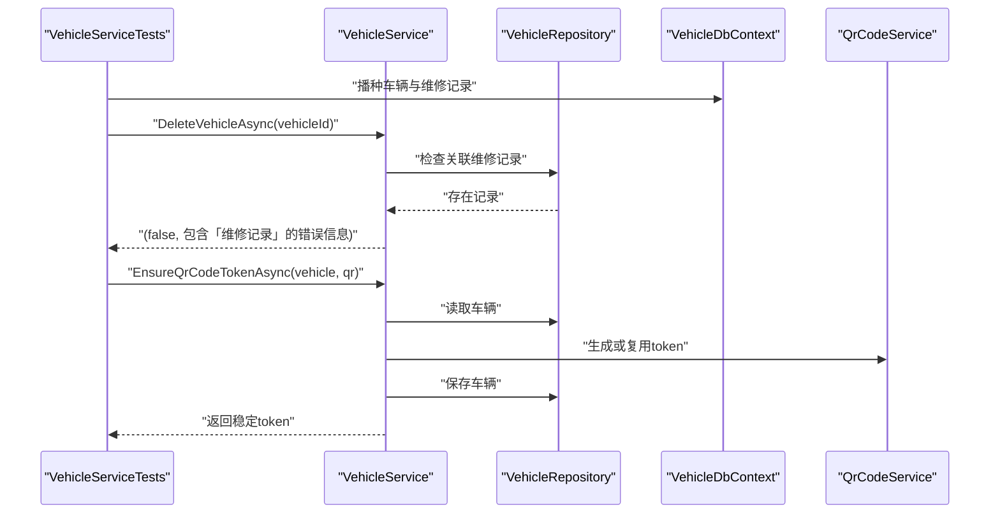
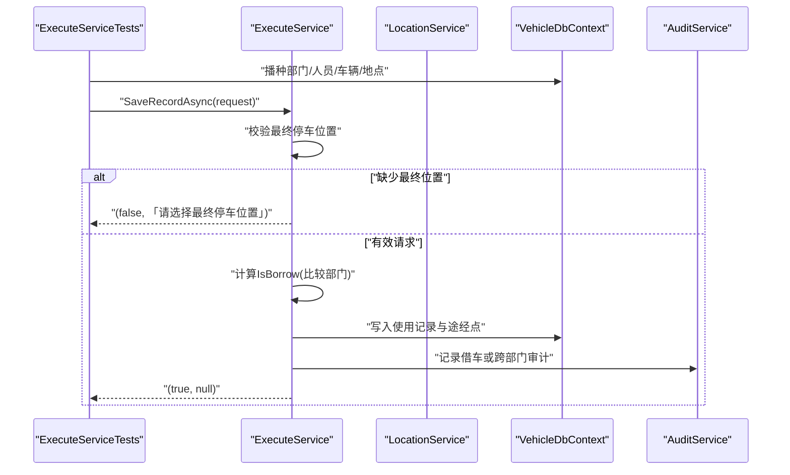
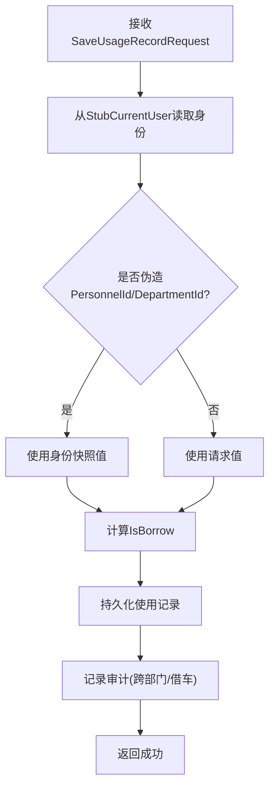
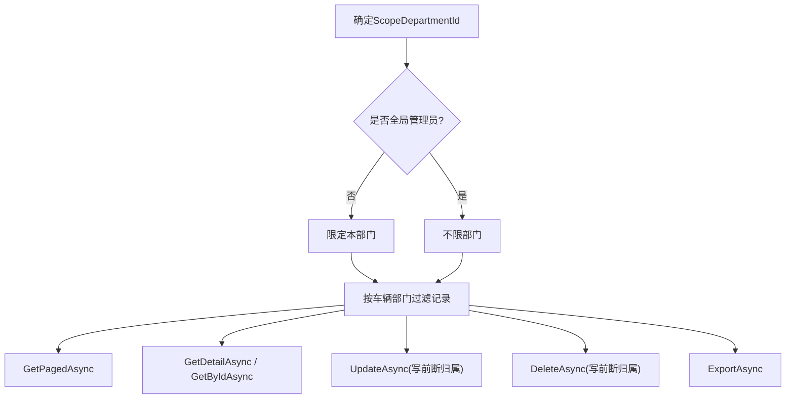
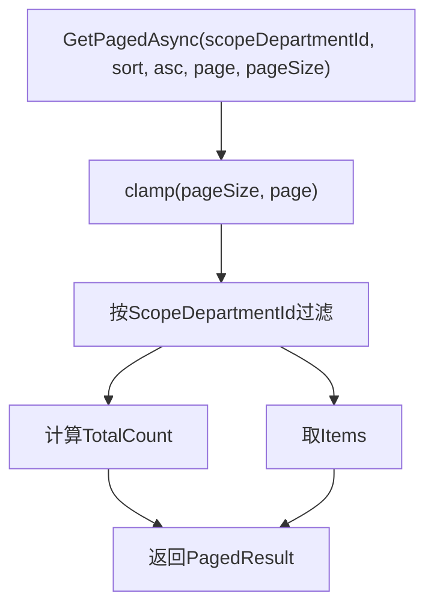
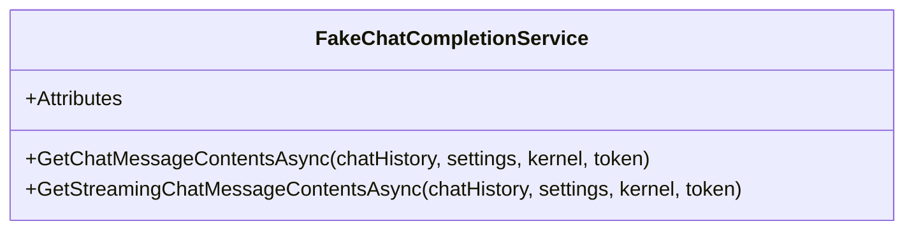
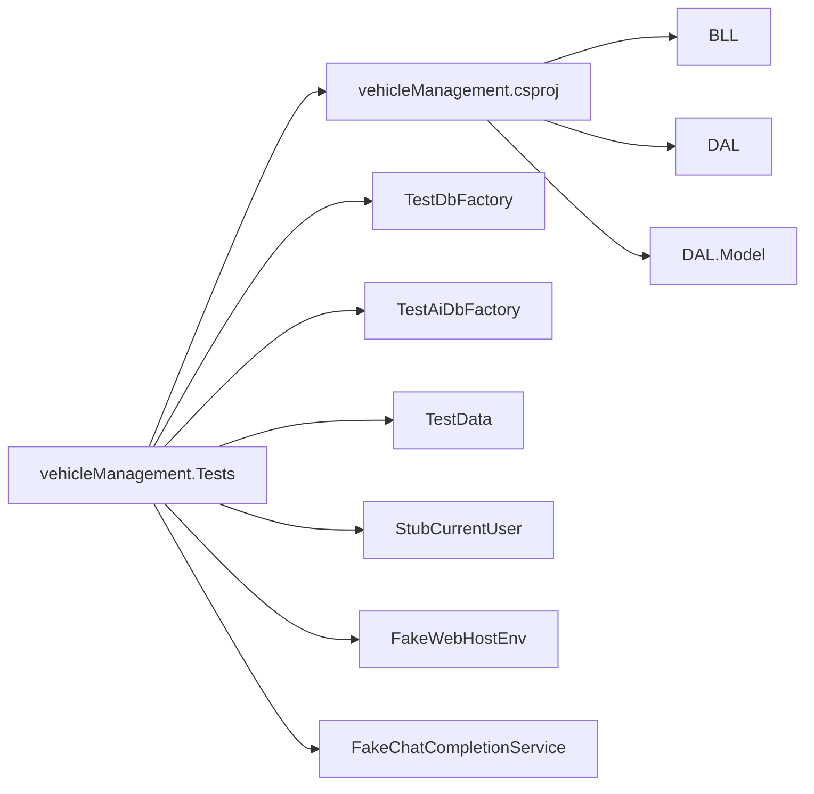

# 测试基础设施

<cite>
**本文引用的文件**   
- [vehicleManagement.Tests.csproj](file://tests/vehicleManagement.Tests/vehicleManagement.Tests.csproj)
- [TestDbFactory.cs](file://tests/vehicleManagement.Tests/TestDbFactory.cs)
- [TestAiDbFactory.cs](file://tests/vehicleManagement.Tests/TestAiDbFactory.cs)
- [TestData.cs](file://tests/vehicleManagement.Tests/TestData.cs)
- [RepositorySetValuesTests.cs](file://tests/vehicleManagement.Tests/RepositorySetValuesTests.cs)
- [PersonnelRepositoryUpdateTests.cs](file://tests/vehicleManagement.Tests/PersonnelRepositoryUpdateTests.cs)
- [VehicleServiceTests.cs](file://tests/vehicleManagement.Tests/VehicleServiceTests.cs)
- [ExecuteServiceTests.cs](file://tests/vehicleManagement.Tests/ExecuteServiceTests.cs)
- [ExecuteServiceIdentityTests.cs](file://tests/vehicleManagement.Tests/ExecuteServiceIdentityTests.cs)
- [MaintenanceRecordScopeTests.cs](file://tests/vehicleManagement.Tests/MaintenanceRecordScopeTests.cs)
- [DepartmentScopeTests.cs](file://tests/vehicleManagement.Tests/DepartmentScopeTests.cs)
- [StubCurrentUser.cs](file://tests/vehicleManagement.Tests/StubCurrentUser.cs)
- [FakeChatCompletionService.cs](file://tests/vehicleManagement.Tests/FakeChatCompletionService.cs)
- [FakeWebHostEnv.cs](file://tests/vehicleManagement.Tests/FakeWebHostEnv.cs)
</cite>

## 目录
1. [简介](#简介)
2. [项目结构](#项目结构)
3. [核心组件](#核心组件)
4. [架构总览](#架构总览)
5. [详细组件分析](#详细组件分析)
6. [依赖关系分析](#依赖关系分析)
7. [性能与稳定性考量](#性能与稳定性考量)
8. [故障排查指南](#故障排查指南)
9. [结论](#结论)

## 简介
本仓库的测试基础设施围绕 xUnit、内存 SQLite 数据库、可替换服务桩和固定数据播种器构建，目标是覆盖仓储层写操作的数据一致性、业务层部门隔离与身份校验、扫码使用记录主链路、AI 聊天能力以及文件上传等关键路径。测试工程通过显式引用主工程，避免 SDK.Web 在测试场景下未传导 FrameworkReference 的问题；同时为两个 DbContext（车辆管理与 AI 服务器）分别提供内存数据库工厂，确保用例之间互不干扰且无需外部数据库。

## 项目结构
测试工程位于 `tests/vehicleManagement.Tests`，采用按“关注点”组织的扁平结构：
- 基础能力：测试工程配置、DbContext 工厂、固定数据、环境桩、当前用户桩、LLM 桩。
- 仓储回归：验证仓储读-改-写不会反向覆盖导航属性或无关列。
- 业务回归：车辆删除、二维码生成、扫码保存使用记录、跨部门借车、审计日志。
- 权限与范围：人员部门隔离、维修记录部门隔离、分页收敛。
- AI 能力：聊天完成服务假实现与记忆相关测试。

```mermaid
graph TB
subgraph "测试工程"
TProj["vehicleManagement.Tests.csproj"]
TDb["TestDbFactory.cs"]
TAiDb["TestAiDbFactory.cs"]
TData["TestData.cs"]
TUser["StubCurrentUser.cs"]
TEnv["FakeWebHostEnv.cs"]
TLLM["FakeChatCompletionService.cs"]
end
subgraph "仓储回归"
RSV["RepositorySetValuesTests.cs"]
PRU["PersonnelRepositoryUpdateTests.cs"]
end
subgraph "业务回归"
VST["VehicleServiceTests.cs"]
EST["ExecuteServiceTests.cs"]
EIDT["ExecuteServiceIdentityTests.cs"]
MRS["MaintenanceRecordScopeTests.cs"]
DST["DepartmentScopeTests.cs"]
end
TProj --> TDb
TProj --> TAiDb
TProj --> TData
TProj --> TUser
TProj --> TEnv
TProj --> TLLM
RSV --> TDb
RSV --> TData
PRU --> TDb
PRU --> TData
VST --> TDb
VST --> TEnv
VST --> TData
EST --> TDb
EST --> TData
EIDT --> TDb
EIDT --> TData
MRS --> TDb
MRS --> TEnv
MRS --> TData
DST --> TDb
DST --> TData
```

**图示来源**
- [vehicleManagement.Tests.csproj:1-27](file://tests/vehicleManagement.Tests/vehicleManagement.Tests.csproj#L1-L27)
- [TestDbFactory.cs:1-34](file://tests/vehicleManagement.Tests/TestDbFactory.cs#L1-L34)
- [TestAiDbFactory.cs:1-32](file://tests/vehicleManagement.Tests/TestAiDbFactory.cs#L1-L32)
- [TestData.cs:1-39](file://tests/vehicleManagement.Tests/TestData.cs#L1-L39)
- [RepositorySetValuesTests.cs:1-107](file://tests/vehicleManagement.Tests/RepositorySetValuesTests.cs#L1-L107)
- [PersonnelRepositoryUpdateTests.cs:1-69](file://tests/vehicleManagement.Tests/PersonnelRepositoryUpdateTests.cs#L1-L69)
- [VehicleServiceTests.cs:1-99](file://tests/vehicleManagement.Tests/VehicleServiceTests.cs#L1-L99)
- [ExecuteServiceTests.cs:1-190](file://tests/vehicleManagement.Tests/ExecuteServiceTests.cs#L1-L190)
- [ExecuteServiceIdentityTests.cs:1-101](file://tests/vehicleManagement.Tests/ExecuteServiceIdentityTests.cs#L1-L101)
- [MaintenanceRecordScopeTests.cs:1-362](file://tests/vehicleManagement.Tests/MaintenanceRecordScopeTests.cs#L1-L362)
- [DepartmentScopeTests.cs:1-88](file://tests/vehicleManagement.Tests/DepartmentScopeTests.cs#L1-L88)

**章节来源**
- [vehicleManagement.Tests.csproj:1-27](file://tests/vehicleManagement.Tests/vehicleManagement.Tests.csproj#L1-L27)

## 核心组件
- 测试工程配置：目标框架 .NET 10，禁用 Nullable 与 ImplicitUsings，显式引入 ASP.NET Core 运行时引用，并通过 ProjectReference 引用主工程，避免 EF Core Sqlite 版本二义性。
- 内存数据库工厂：
  - `TestDbFactory`：为 `VehicleDbContext` 提供内存 SQLite 连接，构造时打开连接并创建数据库，实现同步与异步 `CreateDbContext`。
  - `TestAiDbFactory`：为 `AiServerDbContext` 提供相同模式的内存 SQLite 连接。
- 固定数据播种器：`TestData.SeedBasicsAsync` 统一初始化部门、人员、车辆、地点，供所有用例复用。
- 当前用户桩：`StubCurrentUser` 返回构造时给定的 `UserIdentity`，支持匿名和管理员快捷构造。
- Web 环境桩：`FakeWebHostEnv` 提供临时内容根目录，用于文件上传相关测试，析构时清理目录。
- LLM 桩：`FakeChatCompletionService` 提供固定回复或可控异常，使 ChatService 全链路可在无 Ollama 环境下运行。

**章节来源**
- [vehicleManagement.Tests.csproj:1-27](file://tests/vehicleManagement.Tests/vehicleManagement.Tests.csproj#L1-L27)
- [TestDbFactory.cs:1-34](file://tests/vehicleManagement.Tests/TestDbFactory.cs#L1-L34)
- [TestAiDbFactory.cs:1-32](file://tests/vehicleManagement.Tests/TestAiDbFactory.cs#L1-L32)
- [TestData.cs:1-39](file://tests/vehicleManagement.Tests/TestData.cs#L1-L39)
- [StubCurrentUser.cs:1-28](file://tests/vehicleManagement.Tests/StubCurrentUser.cs#L1-L28)
- [FakeWebHostEnv.cs:1-41](file://tests/vehicleManagement.Tests/FakeWebHostEnv.cs#L1-L41)
- [FakeChatCompletionService.cs:1-51](file://tests/vehicleManagement.Tests/FakeChatCompletionService.cs#L1-L51)

## 架构总览
测试基础设施以“用例 → 服务/仓储 → 内存数据库 + 桩”为主线，形成稳定的回归闭环：
- 用例通过 `TestDbFactory` / `TestAiDbFactory` 获取独立 DbContext。
- 用例通过 `TestData` 快速播种最小数据集。
- 业务用例通过 `StubCurrentUser` 注入身份，结合 `AuditService` 验证审计行为。
- 文件上传用例通过 `FakeWebHostEnv` 隔离文件系统。
- AI 用例通过 `FakeChatCompletionService` 屏蔽外部模型依赖。

**图示来源**
- [TestDbFactory.cs:1-34](file://tests/vehicleManagement.Tests/TestDbFactory.cs#L1-L34)
- [TestAiDbFactory.cs:1-32](file://tests/vehicleManagement.Tests/TestAiDbFactory.cs#L1-L32)
- [RepositorySetValuesTests.cs:1-107](file://tests/vehicleManagement.Tests/RepositorySetValuesTests.cs#L1-L107)
- [VehicleServiceTests.cs:1-99](file://tests/vehicleManagement.Tests/VehicleServiceTests.cs#L1-L99)
- [ExecuteServiceTests.cs:1-190](file://tests/vehicleManagement.Tests/ExecuteServiceTests.cs#L1-L190)
- [MaintenanceRecordScopeTests.cs:1-362](file://tests/vehicleManagement.Tests/MaintenanceRecordScopeTests.cs#L1-L362)

## 详细组件分析

### 仓储写操作回归：SetValues 与导航保护
仓储层的读-改-写路径需要保证：
- 变更字段确实落库。
- 未被修改的标量列、外键、导航属性不被反向覆盖。
- 缺失行不抛异常，保持既有返回契约。

**图示来源**
- [RepositorySetValuesTests.cs:1-107](file://tests/vehicleManagement.Tests/RepositorySetValuesTests.cs#L1-L107)
- [PersonnelRepositoryUpdateTests.cs:1-69](file://tests/vehicleManagement.Tests/PersonnelRepositoryUpdateTests.cs#L1-L69)

**章节来源**
- [RepositorySetValuesTests.cs:1-107](file://tests/vehicleManagement.Tests/RepositorySetValuesTests.cs#L1-L107)
- [PersonnelRepositoryUpdateTests.cs:1-69](file://tests/vehicleManagement.Tests/PersonnelRepositoryUpdateTests.cs#L1-L69)

### 车辆服务回归：删除保护与二维码生成
车辆服务测试覆盖两条关键路径：
- 有维修记录的车辆删除应返回失败，而不是抛出底层异常。
- 首次生成二维码后保持不变，且不应覆盖车辆所属部门。

**图示来源**
- [VehicleServiceTests.cs:1-99](file://tests/vehicleManagement.Tests/VehicleServiceTests.cs#L1-L99)

**章节来源**
- [VehicleServiceTests.cs:1-99](file://tests/vehicleManagement.Tests/VehicleServiceTests.cs#L1-L99)

### 扫码使用记录主链路：顺序、归属与借车标记
扫码保存使用记录的测试覆盖：
- 未选择最终停车位置时返回错误且不落库。
- 途经点顺序必须原样持久化。
- 同部门用车登记为使用，不置车辆为已借用。
- 跨部门用车登记为借车，但提交即结束，不残留车辆借用状态。
- 前端伪造的 `DepartmentId` 被服务端忽略，身份快照为准。

**图示来源**
- [ExecuteServiceTests.cs:1-190](file://tests/vehicleManagement.Tests/ExecuteServiceTests.cs#L1-L190)

**章节来源**
- [ExecuteServiceTests.cs:1-190](file://tests/vehicleManagement.Tests/ExecuteServiceTests.cs#L1-L190)

### 身份伪造防护：Blazor 直接调 BLL 的自动化回归
由于 Blazor 没有 HTTP 表单可伪造，测试直接调用 BLL 验证：
- 伪造的 `PersonnelId` 与 `DepartmentId` 必须被身份快照替换。
- 用户角色下 `PersonnelId=0` 应回落到自身人员。
- 跨部门借车必须产生审计日志，但不把车辆标记为已借用。

**图示来源**
- [ExecuteServiceIdentityTests.cs:1-101](file://tests/vehicleManagement.Tests/ExecuteServiceIdentityTests.cs#L1-L101)
- [StubCurrentUser.cs:1-28](file://tests/vehicleManagement.Tests/StubCurrentUser.cs#L1-L28)

**章节来源**
- [ExecuteServiceIdentityTests.cs:1-101](file://tests/vehicleManagement.Tests/ExecuteServiceIdentityTests.cs#L1-L101)
- [StubCurrentUser.cs:1-28](file://tests/vehicleManagement.Tests/StubCurrentUser.cs#L1-L28)

### 维修记录部门隔离：列表、详情、编辑、删除、导出
维修记录测试覆盖部门账号与管理员的差异：
- 部门账号只能看到「被维修车辆属于本部门」的记录。
- 列表总数与分页项数一致，搜索不能穿透部门范围。
- 详情与按 Id 取对越权返回 null，不泄露任何字段。
- 编辑与删除前断归属，拒绝时数据不变且不记录成功审计。
- 导出同样受部门范围约束。
- 跨部门维修是合法业务，但可见性仍按车辆部门收窄。

**图示来源**
- [MaintenanceRecordScopeTests.cs:1-362](file://tests/vehicleManagement.Tests/MaintenanceRecordScopeTests.cs#L1-L362)

**章节来源**
- [MaintenanceRecordScopeTests.cs:1-362](file://tests/vehicleManagement.Tests/MaintenanceRecordScopeTests.cs#L1-L362)

### 人员部门隔离与分页收敛
人员服务测试验证：
- 不同 `ScopeDepartmentId` 下，TotalCount 与 Items 数量一致。
- 分页参数越界时进行收敛：pageSize 上限 100，页码越界回退到最后一页。

**图示来源**
- [DepartmentScopeTests.cs:1-88](file://tests/vehicleManagement.Tests/DepartmentScopeTests.cs#L1-L88)

**章节来源**
- [DepartmentScopeTests.cs:1-88](file://tests/vehicleManagement.Tests/DepartmentScopeTests.cs#L1-L88)

### AI 聊天能力测试桩
AI 聊天测试通过假 LLM 服务屏蔽外部依赖：
- 固定回复用于正常流程。
- 可控异常用于超时/故障分支。
- 支持流式与非流式接口。

**图示来源**
- [FakeChatCompletionService.cs:1-51](file://tests/vehicleManagement.Tests/FakeChatCompletionService.cs#L1-L51)

**章节来源**
- [FakeChatCompletionService.cs:1-51](file://tests/vehicleManagement.Tests/FakeChatCompletionService.cs#L1-L51)

## 依赖关系分析
测试工程依赖主工程提供的 BLL、DAL、Model 与公共组件，并通过以下桩降低耦合：
- `TestDbFactory` / `TestAiDbFactory` 替代真实数据库。
- `StubCurrentUser` 替代认证上下文。
- `FakeWebHostEnv` 替代文件系统。
- `FakeChatCompletionService` 替代外部 LLM。

**图示来源**
- [vehicleManagement.Tests.csproj:1-27](file://tests/vehicleManagement.Tests/vehicleManagement.Tests.csproj#L1-L27)

**章节来源**
- [vehicleManagement.Tests.csproj:1-27](file://tests/vehicleManagement.Tests/vehicleManagement.Tests.csproj#L1-L27)

## 性能与稳定性考量
- 内存 SQLite：每个工厂持有单个打开的连接，用例间共享同一内存库，减少启动开销；注意长生命周期连接在大量并发用例下的资源占用。
- 固定数据播种：集中维护最小数据集，避免用例重复编写种子逻辑，提升可读性与执行速度。
- 桩对象：避免网络 IO 与文件系统副作用，提高测试稳定性与可重复性。
- 分页收敛：防止超大 pageSize 导致内存压力，确保分页边界安全。

[本节为通用指导，不直接分析具体文件]

## 故障排查指南
- 仓储更新未生效：确认是否走 `UpdateAsync` 并使用 `SetValues`；检查是否因 Include 导航属性导致反向覆盖。
- 部门数据被覆盖：重点检查 `PersonnelRepository` 的读-改-写路径；确认 `GetByIdAsync` 是否 Include 了 Department。
- 二维码 Token 丢失：确认生成顺序是否在保存之前；检查 `EnsureQrCodeTokenAsync` 是否先赋值再保存。
- 删除抛异常而非返回失败：检查是否有维修记录关联；确认服务层捕获并返回友好错误。
- 前端伪造身份生效：确认 BLL 是否从 `StubCurrentUser` 读取身份，而不是直接使用请求中的 `PersonnelId` / `DepartmentId`。
- 部门隔离失效：检查列表、详情、编辑、删除、导出是否都应用了 `ScopeDepartmentId` 过滤。
- 分页总数不一致：确认 Count 与查询使用相同的过滤条件。
- AI 测试不稳定：确认 `FakeChatCompletionService` 是否返回固定回复或可控异常，避免外部模型波动。

**章节来源**
- [RepositorySetValuesTests.cs:1-107](file://tests/vehicleManagement.Tests/RepositorySetValuesTests.cs#L1-L107)
- [PersonnelRepositoryUpdateTests.cs:1-69](file://tests/vehicleManagement.Tests/PersonnelRepositoryUpdateTests.cs#L1-L69)
- [VehicleServiceTests.cs:1-99](file://tests/vehicleManagement.Tests/VehicleServiceTests.cs#L1-L99)
- [ExecuteServiceIdentityTests.cs:1-101](file://tests/vehicleManagement.Tests/ExecuteServiceIdentityTests.cs#L1-L101)
- [MaintenanceRecordScopeTests.cs:1-362](file://tests/vehicleManagement.Tests/MaintenanceRecordScopeTests.cs#L1-L362)
- [DepartmentScopeTests.cs:1-88](file://tests/vehicleManagement.Tests/DepartmentScopeTests.cs#L1-L88)

## 结论
该测试基础设施以内存 SQLite 与桩对象为核心，覆盖了仓储写操作的数据一致性、业务层身份与部门隔离、扫码使用记录主链路、AI 聊天能力与文件上传等关键路径。通过固定数据播种、分页收敛与审计验证，测试既保证了正确性，也兼顾了可重复性与可维护性。后续若扩展新功能，建议沿用现有模式：新增用例优先使用 `TestDbFactory` / `TestAiDbFactory`、`TestData`、`StubCurrentUser` 与 `FakeWebHostEnv`，并在 BLL 层补充部门隔离与身份校验的自动化回归。