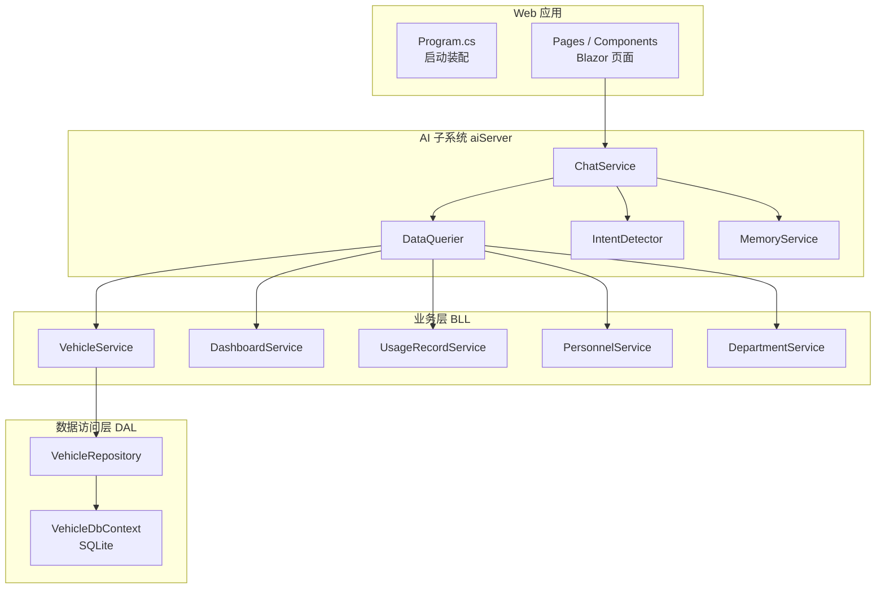
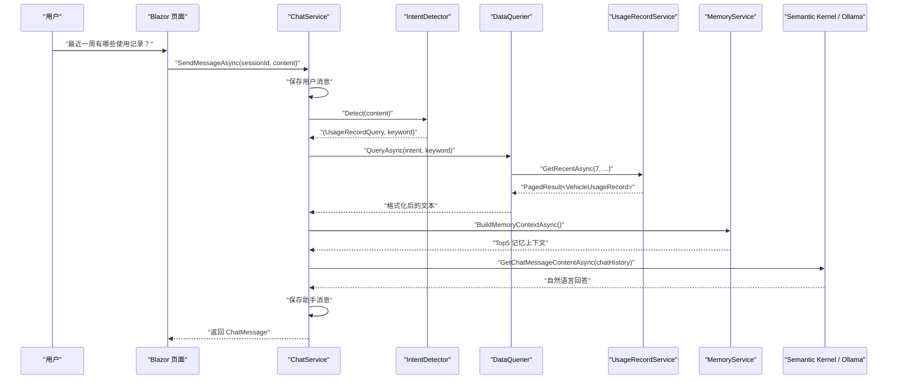
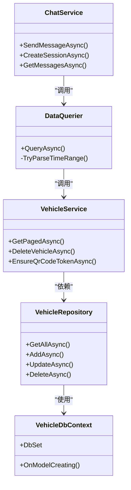

# 自动化测试策略

<cite>
**本文引用的文件**   
- [README.md](file://README.md)
- [Program.cs](file://Program.cs)
- [vehicleManagement.csproj](file://vehicleManagement.csproj)
- [VehicleDbContext.cs](file://DAL/VehicleDbContext.cs)
- [VehicleRepository.cs](file://DAL/Repository/VehicleRepository.cs)
- [VehicleService.cs](file://BLL/Vehicle/VehicleService.cs)
- [ChatService.cs](file://aiServer/BLL/ChatService.cs)
- [DataQuerier.cs](file://aiServer/BLL/DataQuerier.cs)
</cite>

## 目录
1. [引言](#引言)
2. [项目结构](#项目结构)
3. [核心组件](#核心组件)
4. [架构总览](#架构总览)
5. [详细组件分析](#详细组件分析)
6. [依赖关系分析](#依赖关系分析)
7. [性能与执行优化](#性能与执行优化)
8. [故障排查指南](#故障排查指南)
9. [结论](#结论)
10. [附录：测试工程模板建议](#附录测试工程模板建议)

## 引言
本策略面向 vehicleManagement 系统，目标是建立可维护、可扩展且具备质量门禁的自动化测试体系。系统采用 Blazor Server + EF Core + SQLite，并集成 Semantic Kernel 与本地 Ollama 模型；AI 子系统通过规则意图识别调用业务服务查询真实数据库，再将结构化结果交给模型生成自然语言回答。测试策略需要覆盖三层：单元测试（纯逻辑）、集成测试（EF Core + SQLite + SeedData）、端到端测试（Blazor 页面 + AI 对话链路），同时给出覆盖率阈值、并行执行、缓存与增量策略，以及报告与质量门禁方案。

## 项目结构
当前仓库为单 Web 应用，分层清晰：
- DAL：实体、仓储、DbContext、种子数据初始化
- BLL：业务服务（车辆、部门、人员、地点、使用记录、仪表盘、导出、通用能力）
- aiServer：AI 子系统（意图识别、数据查询、记忆、会话消息）
- Pages / Components：Blazor UI
- Program.cs：启动装配、配置、DI、建库、中间件

图表来源
- [Program.cs:41-102](file://Program.cs#L41-L102)
- [ChatService.cs:94-139](file://aiServer/BLL/ChatService.cs#L94-L139)
- [DataQuerier.cs:48-67](file://aiServer/BLL/DataQuerier.cs#L48-L67)
- [VehicleService.cs:67-109](file://BLL/Vehicle/VehicleService.cs#L67-L109)
- [VehicleRepository.cs:19-36](file://DAL/Repository/VehicleRepository.cs#L19-L36)
- [VehicleDbContext.cs:6-19](file://DAL/VehicleDbContext.cs#L6-L19)

章节来源
- [README.md:122-139](file://README.md#L122-L139)
- [Program.cs:41-102](file://Program.cs#L41-L102)

## 核心组件
- VehicleService：车辆台账增删改查、分页搜索、状态切换、二维码校验与 Token 生成、删除前关联校验与附件清理。
- DataQuerier：根据意图路由到各业务服务，将查询结果格式化为 LLM 可读文本；包含中文时间范围解析。
- ChatService：会话管理、消息落库、意图识别、数据注入、上下文构建、Ollama 推理、异步记忆抽取。
- VehicleRepository：基于 IDbContextFactory 的仓储封装，避免 Blazor 并发冲突。
- VehicleDbContext：EF Core 实体映射、索引与外键约束。

章节来源
- [VehicleService.cs:18-239](file://BLL/Vehicle/VehicleService.cs#L18-L239)
- [DataQuerier.cs:21-330](file://aiServer/BLL/DataQuerier.cs#L21-L330)
- [ChatService.cs:18-200](file://aiServer/BLL/ChatService.cs#L18-L200)
- [VehicleRepository.cs:10-63](file://DAL/Repository/VehicleRepository.cs#L10-L63)
- [VehicleDbContext.cs:6-105](file://DAL/VehicleDbContext.cs#L6-L105)

## 架构总览
下图展示一次“最近一周有哪些使用记录”的完整调用链，体现规则意图识别、白名单查询、结果注入与模型生成的边界。

图表来源
- [ChatService.cs:94-139](file://aiServer/BLL/ChatService.cs#L94-L139)
- [DataQuerier.cs:230-267](file://aiServer/BLL/DataQuerier.cs#L230-L267)
- [README.md:187-219](file://README.md#L187-L219)

## 详细组件分析

### 单元测试策略与规范
- 目标：验证无外部依赖的业务逻辑正确性，包括参数校验、分支条件、异常处理、边界值。
- 推荐框架：xUnit + Moq。xUnit 提供现代测试组织方式，Moq 用于模拟仓储与服务接口。
- 测试类命名：`{被测类名}Tests`，方法命名遵循 `Should_{行为}_{场景}`。
- 断言优先使用 xUnit 原生断言；复杂对象比较可使用 FluentAssertions（可选）。
- 关键被测点：
  - VehicleService：分页排序、搜索过滤、删除前关联校验、附件清理失败回滚、二维码校验与 Token 生成。
  - DataQuerier：意图分发、空结果文案、中文时间范围解析。
  - ChatService：会话创建/更新/删除、消息保存、上下文构建、异常兜底文案。

示例测试要点（不展示代码，仅路径参考）：
- 车辆分页查询：[VehicleService.cs:67-109](file://BLL/Vehicle/VehicleService.cs#L67-L109)
- 删除车辆校验与附件清理：[VehicleService.cs:171-202](file://BLL/Vehicle/VehicleService.cs#L171-L202)
- 中文时间解析：[DataQuerier.cs:272-330](file://aiServer/BLL/DataQuerier.cs#L272-L330)
- 意图分发与错误兜底：[DataQuerier.cs:48-67](file://aiServer/BLL/DataQuerier.cs#L48-L67)
- 会话管理与消息保存：[ChatService.cs:46-78](file://aiServer/BLL/ChatService.cs#L46-L78)

章节来源
- [VehicleService.cs:67-202](file://BLL/Vehicle/VehicleService.cs#L67-L202)
- [DataQuerier.cs:48-67](file://aiServer/BLL/DataQuerier.cs#L48-L67)
- [DataQuerier.cs:272-330](file://aiServer/BLL/DataQuerier.cs#L272-L330)
- [ChatService.cs:46-78](file://aiServer/BLL/ChatService.cs#L46-L78)

### 集成测试设计模式
- 目标：验证 EF Core + SQLite 的真实数据流，包括实体映射、索引、外键、事务与种子数据。
- 容器化测试：使用 Testcontainers 启动 SQLite 或轻量级数据库容器（如 SQL Server LocalDB/PostgreSQL 容器），在测试夹具中完成数据库初始化与数据准备。
- 测试夹具：
  - 每个测试用例独立 DbContext 实例（利用 IDbContextFactory）。
  - 测试前 EnsureCreated + SeedDataInitializer。
  - 测试后清理数据或重建数据库。
- 关键验证点：
  - VehicleDbContext 实体关系与索引：[VehicleDbContext.cs:21-105](file://DAL/VehicleDbContext.cs#L21-L105)
  - 仓储 CRUD 操作：[VehicleRepository.cs:19-63](file://DAL/Repository/VehicleRepository.cs#L19-L63)
  - 启动时建库与种子数据：[Program.cs:106-125](file://Program.cs#L106-L125)

章节来源
- [VehicleDbContext.cs:21-105](file://DAL/VehicleDbContext.cs#L21-L105)
- [VehicleRepository.cs:19-63](file://DAL/Repository/VehicleRepository.cs#L19-L63)
- [Program.cs:106-125](file://Program.cs#L106-L125)

### 端到端测试场景覆盖
- 目标：验证 Blazor 页面与 AI 子系统的整体可用性，包括健康检查、页面渲染、AI 问答链路。
- 推荐工具：Playwright.NET 或 Selenium；结合 Testcontainers 启动 Ollama 容器或使用 Mock Ollama 服务。
- 关键场景：
  - 健康检查：GET /health 返回成功。
  - 车辆台账页面：列表加载、搜索、分页、排序。
  - AI 助手：发送问题 → 意图识别 → 数据查询 → 模型回复 → 消息落库。
  - 扫码执行：Token 有效性、页面跳转与数据绑定。
- 环境隔离：每个 E2E 用例使用独立容器或内存数据库，避免用例间污染。

章节来源
- [Program.cs:142-146](file://Program.cs#L142-L146)
- [README.md:122-139](file://README.md#L122-L139)

### 测试数据管理
- 测试数据库初始化：
  - 使用 Testcontainers 启动数据库容器，运行 EnsureCreatedAsync 与 SeedDataInitializer.InitializeAsync。
  - 针对 AI 子系统，确保 AiServerDbContext 也完成建库。
- Mock 数据生成：
  - 使用 Bogus 或 AutoFixture 生成部门、人员、车辆、使用记录等实体。
  - 针对边界条件构造空集合、重复车牌、无效外键等数据。
- 测试环境隔离：
  - 每个测试进程使用独立连接字符串或临时文件（SQLite in-memory 或临时文件）。
  - 上传附件目录使用临时文件夹，测试后清理。

章节来源
- [Program.cs:106-125](file://Program.cs#L106-L125)
- [README.md:302-306](file://README.md#L302-L306)

### 测试覆盖率要求
- 代码覆盖率阈值：
  - 行覆盖率 ≥ 80%
  - 分支覆盖率 ≥ 75%
  - 关键路径（AI 问答、车辆台账、使用记录查询）≥ 90%
- 关键路径测试：
  - ChatService.SendMessageAsync 全流程
  - DataQuerier.QueryAsync 意图分发
  - VehicleService.GetPagedAsync 分页搜索
  - UsageRecordService 时间范围查询
- 边界条件覆盖：
  - 空结果、非法输入、外键缺失、附件删除失败、Ollama 不可达、查询异常。

章节来源
- [ChatService.cs:94-139](file://aiServer/BLL/ChatService.cs#L94-L139)
- [DataQuerier.cs:48-67](file://aiServer/BLL/DataQuerier.cs#L48-L67)
- [VehicleService.cs:67-109](file://BLL/Vehicle/VehicleService.cs#L67-L109)

## 依赖关系分析
下图展示主要组件之间的依赖关系，便于定位测试中的耦合点与模拟范围。

图表来源
- [VehicleService.cs:18-239](file://BLL/Vehicle/VehicleService.cs#L18-L239)
- [VehicleRepository.cs:10-63](file://DAL/Repository/VehicleRepository.cs#L10-L63)
- [VehicleDbContext.cs:6-105](file://DAL/VehicleDbContext.cs#L6-L105)
- [DataQuerier.cs:21-330](file://aiServer/BLL/DataQuerier.cs#L21-L330)
- [ChatService.cs:18-200](file://aiServer/BLL/ChatService.cs#L18-L200)

章节来源
- [VehicleService.cs:18-239](file://BLL/Vehicle/VehicleService.cs#L18-L239)
- [DataQuerier.cs:21-330](file://aiServer/BLL/DataQuerier.cs#L21-L330)
- [ChatService.cs:18-200](file://aiServer/BLL/ChatService.cs#L18-L200)

## 性能与执行优化
- 并行测试执行：
  - 使用 xUnit 的 ParallelizeWorkers 或 .NET Test SDK 的 RunConfiguration 启用并行。
  - 对共享资源（数据库、文件系统）进行隔离，避免竞争。
- 测试缓存：
  - 启用 NuGet 包缓存与 dotnet restore 缓存。
  - 对 Docker/Testcontainers 镜像层进行缓存。
- 增量测试：
  - 基于 Git diff 仅运行受影响项目的测试。
  - 使用 dotnet test --filter 按特性或命名空间筛选。
- 报告与质量门禁：
  - 生成 OpenCover/Coverlet 覆盖率报告，上传至 CI 平台。
  - 设置覆盖率阈值门禁，未达标则阻断合并。
  - 使用 ReportGenerator 生成 HTML 报告，便于团队评审。

章节来源
- [vehicleManagement.csproj:1-37](file://vehicleManagement.csproj#L1-L37)
- [Program.cs:28-37](file://Program.cs#L28-L37)

## 故障排查指南
- Ollama 不可达：
  - ChatService.CallLlmAsync 捕获异常并返回友好提示。
  - 建议在集成测试中 Mock IChatCompletionService 或启动 Ollama 容器。
- 数据库查询异常：
  - DataQuerier.QueryAsync 捕获异常并返回错误文案，保证主流程可用。
- 查询结果为空：
  - DataQuerier 各分支返回明确文案，便于 E2E 断言。
- 记忆抽取异常：
  - ChatService 异步提取记忆，异常不影响主流程。
- 日志噪声：
  - Serilog 抑制 Microsoft 与 EF Core SQL 日志，聚焦业务日志。

章节来源
- [ChatService.cs:188-199](file://aiServer/BLL/ChatService.cs#L188-L199)
- [DataQuerier.cs:48-67](file://aiServer/BLL/DataQuerier.cs#L48-L67)
- [Program.cs:28-37](file://Program.cs#L28-L37)

## 结论
本策略围绕 vehicleManagement 的分层架构与 AI 子系统特点，提出以 xUnit/Moq 为核心的单元测试、以 Testcontainers/SeedData 为核心的集成测试、以 Playwright/Selenium 为核心的端到端测试方案。通过明确的覆盖率阈值、并行执行、缓存与增量策略，以及报告与质量门禁，确保系统在持续集成环境中稳定演进。建议逐步落地：先补齐单元测试与集成测试，再完善 E2E 与质量门禁，最终形成闭环的质量保障体系。

## 附录：测试工程模板建议
- 测试工程结构：
  - UnitTests：xUnit + Moq，覆盖 BLL 与 aiServer 纯逻辑。
  - IntegrationTests：Testcontainers + EF Core，覆盖 DAL 与 DbContext。
  - EndToEndTests：Playwright/Selenium，覆盖 Pages 与 AI 链路。
- 关键配置文件：
  - appsettings.Test.json：测试用连接字符串与 Ollama 端点。
  - docker-compose.test.yml：启动 SQLite/Ollama 容器。
- 持续集成：
  - 并行执行测试、生成覆盖率报告、设置质量门禁。

章节来源
- [README.md:321-340](file://README.md#L321-L340)
- [Program.cs:41-102](file://Program.cs#L41-L102)