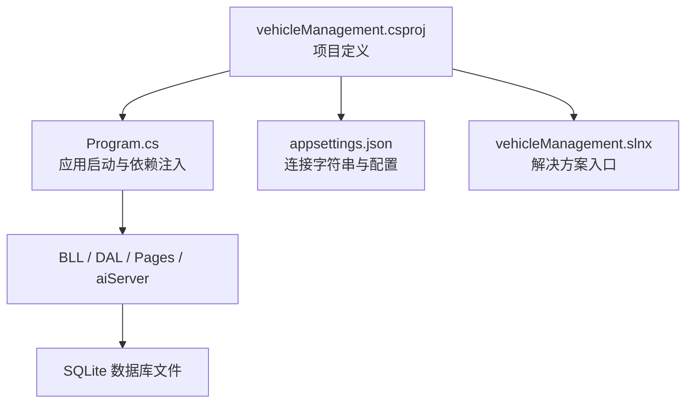
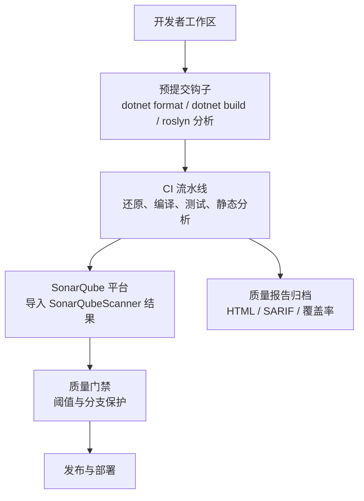
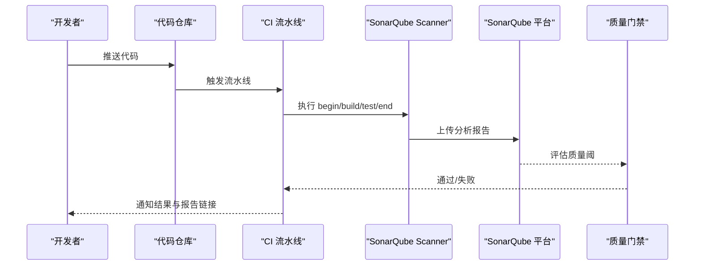
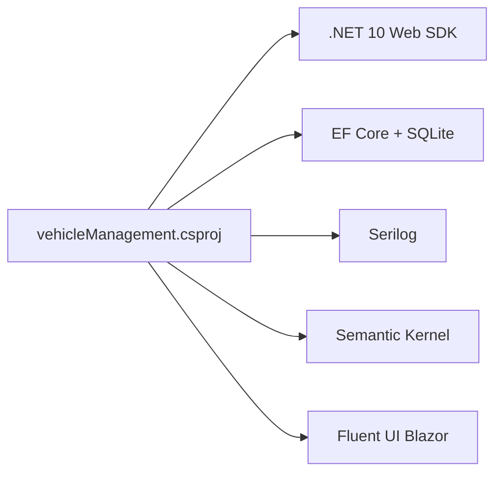

# 静态代码分析

<cite>
**本文引用的文件**   
- [vehicleManagement.csproj](file://vehicleManagement.csproj)
- [Program.cs](file://Program.cs)
- [appsettings.json](file://appsettings.json)
- [vehicleManagement.slnx](file://vehicleManagement.slnx)
- [README.md](file://README.md)
- [Execute.razor.cs](file://Pages/Execute.razor.cs)
- [ChatService.cs](file://aiServer/BLL/ChatService.cs)
- [DataQuerier.cs](file://aiServer/BLL/DataQuerier.cs)
- [IntentDetector.cs](file://aiServer/BLL/IntentDetector.cs)
- [SeedDataInitializer.cs](file://DAL/SeedDataInitializer.cs)
</cite>

## 目录
1. [引言](#引言)
2. [项目结构](#项目结构)
3. [核心组件](#核心组件)
4. [架构总览](#架构总览)
5. [详细组件分析](#详细组件分析)
6. [依赖关系分析](#依赖关系分析)
7. [性能与可维护性考量](#性能与可维护性考量)
8. [故障排查指南](#故障排查指南)
9. [结论](#结论)
10. [附录：规则与配置清单](#附录规则与配置清单)

## 引言
本文件为 vehicleManagement 系统提供一套完整的静态代码分析与质量门禁方案，覆盖 Roslyn 分析器、代码规范检查、安全漏洞扫描、性能分析规则，以及与 SonarQube 等质量平台的集成方式。同时给出 C# 编码规范、命名约定、注释标准，以及预提交钩子、CI 流水线、质量报告生成和代码异味处理流程。

## 项目结构
当前仓库是一个 .NET 10 Blazor Server 应用，包含业务层（BLL）、数据访问层（DAL）、页面（Pages）、AI 子系统（aiServer）与前端资源（wwwroot）。构建目标框架为 net10.0，使用 EF Core + SQLite，并集成 Semantic Kernel 与 Ollama。

图示来源
- [vehicleManagement.csproj:1-37](file://vehicleManagement.csproj#L1-L37)
- [Program.cs:1-158](file://Program.cs#L1-L158)
- [appsettings.json:1-8](file://appsettings.json#L1-L8)
- [vehicleManagement.slnx:1-4](file://vehicleManagement.slnx#L1-L4)

章节来源
- [vehicleManagement.csproj:1-37](file://vehicleManagement.csproj#L1-L37)
- [Program.cs:1-158](file://Program.cs#L1-L158)
- [appsettings.json:1-8](file://appsettings.json#L1-L8)
- [vehicleManagement.slnx:1-4](file://vehicleManagement.slnx#L1-L4)

## 核心组件
围绕静态代码分析，需要关注以下工程与运行时关键点：
- 项目目标框架与 SDK：net10.0，Web SDK，便于启用最新 Roslyn 分析能力。
- 依赖包：EF Core、Serilog、Semantic Kernel、Fluent UI 等，这些包自带或兼容 Roslyn 分析器。
- 启动装配：Program.cs 中注册服务、日志、数据库上下文与 AI 推理端点。
- 配置：appsettings.json 中的连接字符串与外部 aisettings.json 热重载。
- 可空引用类型：部分文件已启用 #nullable enable，利于空引用警告。

章节来源
- [vehicleManagement.csproj:1-37](file://vehicleManagement.csproj#L1-L37)
- [Program.cs:28-102](file://Program.cs#L28-L102)
- [appsettings.json:1-8](file://appsettings.json#L1-L8)
- [Execute.razor.cs:1-1](file://Pages/Execute.razor.cs#L1-L1)
- [ChatService.cs:11-11](file://aiServer/BLL/ChatService.cs#L11-L11)
- [DataQuerier.cs:14-14](file://aiServer/BLL/DataQuerier.cs#L14-L14)
- [IntentDetector.cs:5-5](file://aiServer/BLL/IntentDetector.cs#L5-L5)

## 架构总览
下图展示“代码质量门禁”在开发到部署全链路中的位置，包括本地 IDE、预提交钩子、CI 构建、SonarQube 扫描与报告归档。

说明
- 预提交阶段：执行格式化、基础编译与轻量级分析，快速反馈问题。
- CI 阶段：完整还原、编译、单元测试、Roslyn 分析、SAST 扫描、覆盖率统计。
- SonarQube：通过 Scanner 将结果上传至平台，结合质量阈控制合并请求。
- 报告归档：保留 HTML/SARIF/覆盖率报告，供审计与回溯。

## 详细组件分析

### Roslyn 分析器与代码规范
建议启用以下能力：
- 内置分析器：Microsoft.CodeAnalysis.NetAnalyzers（默认随 SDK 引入），用于代码风格、潜在缺陷、可空引用、异步最佳实践等。
- 自定义规则：通过 .editorconfig 统一缩进、命名、using 排序、XML 文档注释要求；通过 .ruleset 或 analyzers 包扩展规则集。
- 可空引用类型：建议在项目文件中全局启用 Nullable，配合现有 #nullable enable 文件逐步迁移。
- 代码格式化：dotnet format 作为预提交钩子与 CI 步骤，确保团队风格一致。

建议的 .editorconfig 要点（概念性说明）
- 语言版本：csharp_file_version = latest
- 命名约定：类/接口 PascalCase，方法/属性 PascalCase，局部变量 camelCase，常量 UPPER_SNAKE_CASE
- 样式：new_line_before_open_brace、indentation、trailing_whitespace、eof_newline
- XML 文档：公共 API 必须包含 
/<param>/<returns>
- 禁用/抑制：仅对历史遗留代码按行抑制，避免滥用

章节来源
- [vehicleManagement.csproj:1-37](file://vehicleManagement.csproj#L1-L37)
- [Execute.razor.cs:1-1](file://Pages/Execute.razor.cs#L1-L1)
- [ChatService.cs:11-11](file://aiServer/BLL/ChatService.cs#L11-L11)
- [DataQuerier.cs:14-14](file://aiServer/BLL/DataQuerier.cs#L14-L14)
- [IntentDetector.cs:5-5](file://aiServer/BLL/IntentDetector.cs#L5-L5)

### 安全漏洞扫描（SAST）
建议组合工具：
- Microsoft.SemanticAnalyzer（SK 相关）或通用 SAST：如 CodeQL、Semgrep、SonarQube 内置规则。
- 依赖漏洞扫描：dotnet audit、Dependabot/GitHub Advanced Security。
- 敏感信息检测：TruffleHog、Gitleaks，防止密钥/连接串误提交。

在 CI 中建议顺序
- 先运行 dotnet restore 与 dotnet build
- 再运行 SAST 与依赖漏洞扫描
- 最后运行单元测试与覆盖率

章节来源
- [README.md:141-153](file://README.md#L141-L153)
- [appsettings.json:1-8](file://appsettings.json#L1-L8)

### 性能分析规则
建议启用与分析项
- 异步 I/O：禁止阻塞调用（例如同步等待 Task.Result），推荐 await 与 ConfigureAwait(false) 在库代码中。
- 内存分配：减少装箱、避免频繁 LINQ 中间集合、注意大对象堆分配。
- 数据库查询：避免 N+1 查询、过度投影、未分页列表加载。
- 日志噪声：Serilog 级别过滤已在 Program.cs 中设置，保持生产环境低噪声。

章节来源
- [Program.cs:28-37](file://Program.cs#L28-L37)
- [Program.cs:52-58](file://Program.cs#L52-L58)

### 与 SonarQube 集成（质量门禁）
建议流程
- 安装 SonarQube 与 Scanner for MSBuild。
- 在 CI 中执行：
  - dotnet build
  - dotnet test
  - sonar-scanner-msbuild begin/end
- 在 SonarQube 中配置质量阈（Quality Gates）：
  - 重复率、技术债务比率、严重/ blocker 问题数、覆盖率阈值、安全热点数量等。
- 分支保护：仅在满足质量阈时允许合并到主分支。

### 代码风格统一配置
建议落地项
- 统一 .editorconfig：缩进、换行、命名、XML 文档、using 分组与排序。
- 统一 .ruleset：启用关键规则，关闭不相关规则，集中管理。
- 统一注释标准：公共 API 必须 XML 文档；复杂算法需添加行内注释说明意图与边界条件。
- 统一错误处理：异常分类、日志记录、用户可见提示文案规范化。

章节来源
- [Program.cs:28-37](file://Program.cs#L28-L37)
- [Program.cs:52-58](file://Program.cs#L52-L58)

### 自动化检查流程
- 预提交钩子（pre-commit）
  - dotnet format --verify-no-changes
  - dotnet build --no-restore
  - 轻量级分析：dotnet build /t:Analyze
- CI 流水线
  - dotnet restore
  - dotnet build
  - dotnet test
  - SAST 扫描（CodeQL/Semgrep/SonarQube）
  - 依赖漏洞扫描（dotnet audit）
  - 覆盖率收集与报告
  - 质量报告归档（HTML/SARIF）

章节来源
- [README.md:141-153](file://README.md#L141-L153)

### 代码异味处理与重构建议
常见异味与建议
- 过长方法与类：拆分职责，提取 Service/Helper。
- 深层嵌套与魔法数字：抽取常量、封装判断逻辑。
- 重复代码：提取公共方法或基类。
- 高耦合：通过接口与 DI 解耦，遵循分层架构。
- 缺少文档：补充 XML 文档与关键路径注释。

自动化工具建议
- Roslyn 分析器：发现可空引用、异步反模式、冗余代码。
- StyleCop/EditorConfig：强制命名与格式。
- ReSharpener/Roslyn Analyzers：提供重构建议（本地 IDE 使用）。
- SonarQube：识别重复、复杂度、死代码、安全热点。

章节来源
- [README.md:310-320](file://README.md#L310-L320)

## 依赖关系分析
本项目依赖的关键运行时与工具链如下：
- .NET 10 Web SDK
- EF Core + SQLite
- Serilog 日志
- Semantic Kernel + Ollama Connector
- Fluent UI Blazor Components

图示来源
- [vehicleManagement.csproj:1-37](file://vehicleManagement.csproj#L1-L37)
- [README.md:141-153](file://README.md#L141-L153)

章节来源
- [vehicleManagement.csproj:1-37](file://vehicleManagement.csproj#L1-L37)
- [README.md:141-153](file://README.md#L141-L153)

## 性能与可维护性考量
- 日志级别控制：Program.cs 中已将 Microsoft 与 EF Core SQL 日志降级，降低噪音。
- 并发安全：DbContextFactory 避免 Blazor Server 共享上下文冲突。
- 可空引用：已有部分文件启用 #nullable enable，建议逐步推广到全项目。
- 配置热重载：aisettings.json optional + reloadOnChange，便于容器化部署后动态调整。

章节来源
- [Program.cs:28-37](file://Program.cs#L28-L37)
- [Program.cs:52-58](file://Program.cs#L52-L58)
- [Program.cs:45-47](file://Program.cs#L45-L47)
- [Execute.razor.cs:1-1](file://Pages/Execute.razor.cs#L1-L1)
- [ChatService.cs:11-11](file://aiServer/BLL/ChatService.cs#L11-L11)
- [DataQuerier.cs:14-14](file://aiServer/BLL/DataQuerier.cs#L14-L14)
- [IntentDetector.cs:5-5](file://aiServer/BLL/IntentDetector.cs#L5-L5)

## 故障排查指南
- 启动失败：Program.cs 顶层 try/catch 捕获异常并记录致命日志，确认日志输出与文件写入权限。
- 数据库初始化：EnsureCreatedAsync 在启动时创建表，首次运行会写入种子数据（Development 环境）。
- AI 端点不可达：Ollama 端点与模型 tag 通过环境变量/配置文件三级取值，优先环境变量，其次 aisettings.json，最后代码默认值。
- 日志噪声：Serilog 已压制框架日志，若仍过多，检查最小级别与覆盖规则。

章节来源
- [Program.cs:39-58](file://Program.cs#L39-L58)
- [Program.cs:106-125](file://Program.cs#L106-L125)
- [Program.cs:149-157](file://Program.cs#L149-L157)
- [SeedDataInitializer.cs:35-54](file://DAL/SeedDataInitializer.cs#L35-L54)
- [README.md:157-185](file://README.md#L157-L185)

## 结论
通过在本项目中系统化引入 Roslyn 分析器、代码规范、SAST、依赖漏洞扫描与 SonarQube 质量门禁，并结合预提交钩子与 CI 流水线，可以显著提升代码质量、安全性与可维护性。建议分阶段推进：先统一格式与命名，再启用可空引用与关键分析规则，最后接入 SonarQube 与质量阈控制。

## 附录：规则与配置清单
- 项目与 SDK
  - 目标框架：net10.0
  - SDK：Microsoft.NET.Sdk.Web
- 关键依赖
  - EF Core + SQLite
  - Serilog
  - Semantic Kernel + Ollama Connector
  - Fluent UI Blazor Components
- 分析器与工具
  - Microsoft.CodeAnalysis.NetAnalyzers（内置）
  - dotnet format
  - SonarQube Scanner for MSBuild
  - dotnet audit / Dependabot
  - Gitleaks / TruffleHog（可选）
- 配置项
  - appsettings.json：连接字符串
  - aisettings.json：Ollama 端点与模型（可选 + 热重载）
  - Program.cs：Serilog 配置、DI 注册、AI 端点读取

章节来源
- [vehicleManagement.csproj:1-37](file://vehicleManagement.csproj#L1-L37)
- [appsettings.json:1-8](file://appsettings.json#L1-L8)
- [Program.cs:28-102](file://Program.cs#L28-L102)
- [README.md:141-185](file://README.md#L141-L185)