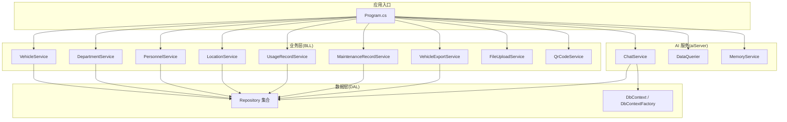
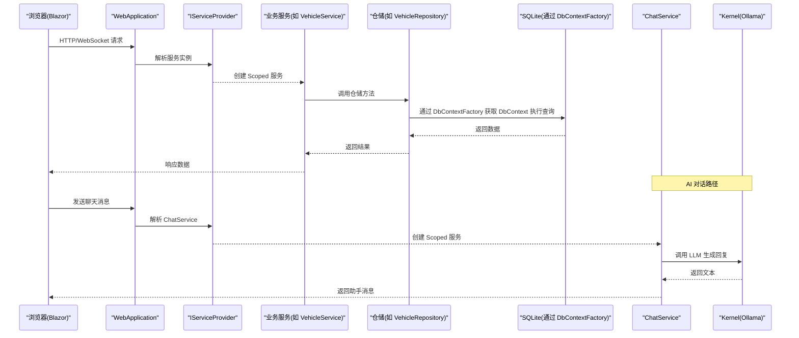
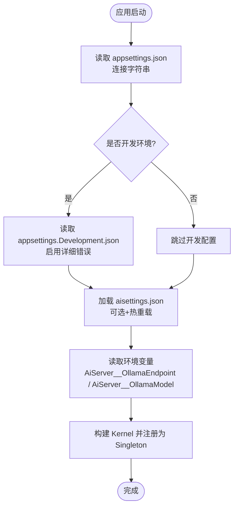
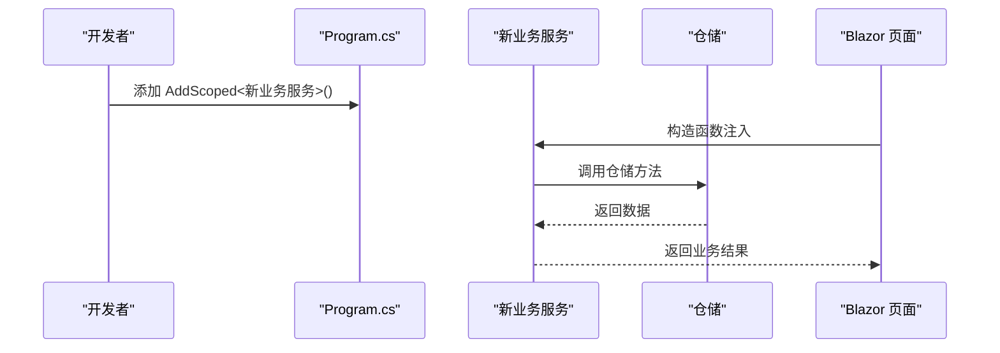
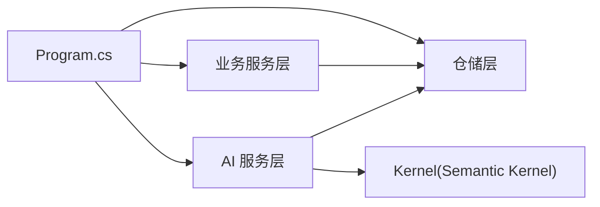

# 依赖注入与服务注册

<cite>
**本文引用的文件**   
- [Program.cs](file://Program.cs)
- [appsettings.json](file://appsettings.json)
- [appsettings.Development.json](file://appsettings.Development.json)
- [aisettings.example.json](file://aisettings.example.json)
- [README.md](file://README.md)
- [FileUploadService.cs](file://BLL/Common/FileUploadService.cs)
- [QrCodeService.cs](file://BLL/Common/QrCodeService.cs)
- [ChatService.cs](file://aiServer/BLL/ChatService.cs)
- [LocationService.cs](file://BLL/Location/LocationService.cs)
- [MaintenanceRecordService.cs](file://BLL/Maintenance/MaintenanceRecordService.cs)
</cite>

## 目录
1. [引言](#引言)
2. [项目结构](#项目结构)
3. [核心组件](#核心组件)
4. [架构总览](#架构总览)
5. [详细组件分析](#详细组件分析)
6. [依赖关系分析](#依赖关系分析)
7. [性能考虑](#性能考虑)
8. [故障排查指南](#故障排查指南)
9. [结论](#结论)
10. [附录：服务生命周期选择原则与扩展清单](#附录服务生命周期选择原则与扩展清单)

## 引言
本文面向 vehicleManagement 系统，系统性梳理 ASP.NET Core 依赖注入（DI）容器的使用方式、服务注册模式、配置注入机制、中间件配置，以及自定义服务扩展点。重点说明 Singleton、Scoped、Transient 的生命周期选择原则，并给出性能优化与内存泄漏预防建议。

## 项目结构
vehicleManagement 采用分层架构：
- DAL（数据访问层）：仓储与 DbContext
- BLL（业务逻辑层）：领域服务
- AI Server：AI 对话、意图识别、记忆等能力
- Pages/Components：Blazor 页面与组件
- Program.cs：应用启动、DI 容器配置、中间件管线



图表来源
- [Program.cs:48-102](file://Program.cs#L48-L102)

章节来源
- [Program.cs:48-102](file://Program.cs#L48-L102)

## 核心组件
本节聚焦 DI 容器中的关键服务及其职责：
- 数据库上下文工厂：IDbContextFactory<VehicleDbContext>、IDbContextFactory<AiServerDbContext>
- 仓储层：VehicleRepository、DepartmentRepository、PersonnelRepository、LocationRepository、UsageRecordRepository、MaintenanceRecordRepository、ChatSessionRepository、ChatMessageRepository、ChatMemoryRepository
- 业务服务：VehicleService、DepartmentService、PersonnelService、LocationService、UsageRecordService、DashboardService、ExecuteService、MaintenanceRecordService、VehicleExportService、MemoryService、DataQuerier、ChatService
- 通用服务：FileUploadService、QrCodeService
- AI 内核：Semantic Kernel Kernel（连接 Ollama）

生命周期现状：
- 所有仓储与业务服务均注册为 Scoped
- QrCodeService 与 Semantic Kernel Kernel 注册为 Singleton
- FileUploadService 注册为 Scoped

章节来源
- [Program.cs:52-102](file://Program.cs#L52-L102)
- [Program.cs:94-102](file://Program.cs#L94-L102)

## 架构总览
下图展示从请求进入 Blazor Hub 到业务服务调用仓储与数据库的完整流程，以及 AI 对话链路中 ChatService 对 Kernel 的依赖。



图表来源
- [Program.cs:48-102](file://Program.cs#L48-L102)
- [ChatService.cs:94-139](file://aiServer/BLL/ChatService.cs#L94-L139)

## 详细组件分析

### 服务注册与生命周期管理
- 数据库上下文工厂：
  - VehicleDbContext 与 AiServerDbContext 均通过 AddDbContextFactory 注册，避免 Blazor Server 并发冲突。
- 仓储层：
  - 全部仓储以 AddScoped 注册，确保每个请求作用域内共享同一仓储实例，减少重复对象创建开销。
- 业务服务：
  - 全部业务服务以 AddScoped 注册，符合“一次请求一个工作单元”的原则。
- 通用服务：
  - FileUploadService：Scoped，持有 IWebHostEnvironment 与上传根目录信息，适合按请求隔离。
  - QrCodeService：Singleton，无状态且计算轻量，适合作为全局单例复用。
- AI 内核：
  - Semantic Kernel Kernel：Singleton，封装 Ollama 连接与模型配置，避免重复初始化。

```mermaid
classDiagram
class Program {
+注册服务()
}
class VehicleRepository
class DepartmentRepository
class PersonnelRepository
class LocationRepository
class UsageRecordRepository
class MaintenanceRecordRepository
class ChatSessionRepository
class ChatMessageRepository
class ChatMemoryRepository
class VehicleService
class DepartmentService
class PersonnelService
class LocationService
class UsageRecordService
class DashboardService
class ExecuteService
class MaintenanceRecordService
class VehicleExportService
class MemoryService
class DataQuerier
class ChatService
class FileUploadService
class QrCodeService
class Kernel
Program --> VehicleRepository : "AddScoped"
Program --> DepartmentRepository : "AddScoped"
Program --> PersonnelRepository : "AddScoped"
Program --> LocationRepository : "AddScoped"
Program --> UsageRecordRepository : "AddScoped"
Program --> MaintenanceRecordRepository : "AddScoped"
Program --> ChatSessionRepository : "AddScoped"
Program --> ChatMessageRepository : "AddScoped"
Program --> ChatMemoryRepository : "AddScoped"
Program --> VehicleService : "AddScoped"
Program --> DepartmentService : "AddScoped"
Program --> PersonnelService : "AddScoped"
Program --> LocationService : "AddScoped"
Program --> UsageRecordService : "AddScoped"
Program --> DashboardService : "AddScoped"
Program --> ExecuteService : "AddScoped"
Program --> MaintenanceRecordService : "AddScoped"
Program --> VehicleExportService : "AddScoped"
Program --> MemoryService : "AddScoped"
Program --> DataQuerier : "AddScoped"
Program --> ChatService : "AddScoped"
Program --> FileUploadService : "AddScoped"
Program --> QrCodeService : "AddSingleton"
Program --> Kernel : "AddSingleton"
```



图表来源
- [Program.cs:61-102](file://Program.cs#L61-L102)

章节来源
- [Program.cs:52-102](file://Program.cs#L52-L102)

### 配置注入：appsettings、外部配置与环境变量
- 基础连接字符串：
  - appsettings.json 定义 DefaultConnection 与 AiServerConnection。
- 开发环境覆盖：
  - appsettings.Development.json 启用 DetailedErrors。
- 外部 AI 配置：
  - aisettings.example.json 提供 AiServer.OllamaEndpoint 与 AiServer.OllamaModel 示例。
  - Program.cs 在启动时加载 aisettings.json（可选、支持热重载）。
  - 环境变量优先级更高；Docker 部署通过 -e 传入 AiServer__OllamaEndpoint 与 AiServer__OllamaModel。



图表来源
- [appsettings.json:1-7](file://appsettings.json#L1-L7)
- [appsettings.Development.json:1-4](file://appsettings.Development.json#L1-L4)
- [aisettings.example.json:1-7](file://aisettings.example.json#L1-L7)
- [Program.cs:45-102](file://Program.cs#L45-L102)
- [README.md:321-340](file://README.md#L321-L340)

章节来源
- [appsettings.json:1-7](file://appsettings.json#L1-L7)
- [appsettings.Development.json:1-4](file://appsettings.Development.json#L1-L4)
- [aisettings.example.json:1-7](file://aisettings.example.json#L1-L7)
- [Program.cs:45-102](file://Program.cs#L45-L102)
- [README.md:321-340](file://README.md#L321-L340)

### 中间件配置：Serilog、静态资源、Blazor Hub
- Serilog：
  - 控制台输出与按日滚动文件输出，默认级别 Information，抑制 Microsoft 与 EF Core SQL 日志。
  - 使用 builder.Host.UseSerilog() 集成。
- 静态资源：
  - UseStaticFiles() 启用 wwwroot。
  - 额外映射 Folder 目录用于上传附件，RequestPath 为 /Folder。
- Blazor Hub：
  - MapBlazorHub() 暴露 Blazor Server 通信端点。
  - MapFallbackToPage("/_Host") 作为回退路由。

```mermaid
flowchart TD
A["UseDeveloperExceptionPage / UseExceptionHandler"] --> B["UseStaticFiles()"]
B --> C["UseStaticFiles(Folder)"]
C --> D["UseRouting()"]
D --> E["MapBlazorHub()"]
E --> F["MapGet(\"/health\")"]
F --> G["MapFallbackToPage(\"/_Host\")"]
```

图表来源
- [Program.cs:127-148](file://Program.cs#L127-L148)

章节来源
- [Program.cs:28-43](file://Program.cs#L28-L43)
- [Program.cs:127-148](file://Program.cs#L127-L148)

### 自定义服务扩展：新增业务服务与 AI 扩展点
- 新增业务服务步骤：
  1) 在 BLL 下新建服务类，依赖仓储与 IDbContextFactory<TDbContext>。
  2) 在 Program.cs 中以 AddScoped 注册该服务。
  3) 在 Blazor 页面或组件中通过构造函数注入使用。
- AI 服务扩展点：
  - ChatService 已封装意图识别、数据查询、记忆提取与 LLM 调用。
  - 可通过扩展 IntentDetector、DataQuerier、MemoryService 来增强 AI 能力。
  - Kernel 作为 Singleton 注入，便于统一管理与复用 Ollama 连接。



图表来源
- [Program.cs:75-95](file://Program.cs#L75-L95)
- [LocationService.cs:17-37](file://BLL/Location/LocationService.cs#L17-L37)
- [MaintenanceRecordService.cs:14-28](file://BLL/Maintenance/MaintenanceRecordService.cs#L14-L28)

章节来源
- [Program.cs:75-95](file://Program.cs#L75-L95)
- [LocationService.cs:17-37](file://BLL/Location/LocationService.cs#L17-L37)
- [MaintenanceRecordService.cs:14-28](file://BLL/Maintenance/MaintenanceRecordService.cs#L14-L28)

## 依赖关系分析
- 耦合与内聚：
  - 业务服务仅依赖仓储与 DbContextFactory，保持高内聚低耦合。
  - AI 服务通过 ChatService 聚合意图识别、数据查询与记忆模块，降低上层复杂度。
- 直接依赖：
  - Program.cs 集中注册所有服务，形成单一装配点，便于维护。
- 间接依赖：
  - 仓储依赖 EF Core 与 SQLite；AI 服务依赖 Semantic Kernel 与 Ollama。
- 循环依赖：
  - 未发现循环引用；仓储与业务服务单向依赖。



图表来源
- [Program.cs:61-102](file://Program.cs#L61-L102)

章节来源
- [Program.cs:61-102](file://Program.cs#L61-L102)

## 性能考虑
- 服务生命周期选择的影响：
  - Singleton：适用于无状态、昂贵初始化的服务（如 Kernel、QrCodeService），避免重复创建与连接建立。
  - Scoped：适用于与请求相关的服务（仓储、业务服务、FileUploadService），保证线程安全与资源隔离。
  - Transient：当前未使用；若引入短生命周期、无状态工具类可考虑。
- 内存泄漏预防：
  - 避免将 Scoped 服务注入到 Singleton 服务中（构造时捕获），防止意外延长作用域。
  - 使用 IDbContextFactory 按需创建 DbContext，避免长生命周期持有数据库连接。
  - 文件上传服务按请求作用域创建，避免跨请求共享临时流与路径缓存。
- 性能优化建议：
  - 保持仓储与业务服务为 Scoped，减少对象分配与锁竞争。
  - 对频繁调用的无状态工具（如二维码生成）使用 Singleton。
  - 控制日志级别与输出目标，避免生产环境过度写入磁盘。

[本节为通用指导，不直接分析具体文件]

## 故障排查指南
- 启动失败：
  - 检查 Program.cs 顶层 try/catch 与 Log.Fatal 输出，确认日志文件是否存在。
- 数据库问题：
  - 确认 appsettings.json 连接字符串正确；data 目录存在且可写。
  - 首次启动会 EnsureCreatedAsync，必要时清理旧库重新初始化种子数据。
- AI 服务不可用：
  - 检查 aisettings.json 或环境变量 AiServer__OllamaEndpoint/AiServer__OllamaModel。
  - 确认 Ollama 服务可达；Kernel 为 Singleton，连接异常会在 ChatService 中返回友好提示。
- 静态资源无法访问：
  - 确认 UseStaticFiles 与 Folder 映射顺序正确；Folder 目录存在且有读写权限。

章节来源
- [Program.cs:28-43](file://Program.cs#L28-L43)
- [Program.cs:106-125](file://Program.cs#L106-L125)
- [Program.cs:127-148](file://Program.cs#L127-L148)
- [ChatService.cs:188-199](file://aiServer/BLL/ChatService.cs#L188-L199)

## 结论
vehicleManagement 通过 Program.cs 集中管理 DI 容器与服务注册，遵循“仓储与业务服务 Scoped、无状态工具与内核 Singleton”的生命周期策略。配置体系结合 appsettings、外部 aisettings.json 与环境变量，满足开发与生产环境的差异化需求。中间件管线清晰，涵盖日志、静态资源与 Blazor Hub。建议在新增服务时严格遵循生命周期原则，避免 Singleton 捕获 Scoped 导致的内存泄漏，并通过 IDbContextFactory 保障数据库访问的正确性与性能。

[本节为总结性内容，不直接分析具体文件]

## 附录：服务生命周期选择原则与扩展清单
- 生命周期选择原则：
  - Singleton：无状态、昂贵初始化、全局共享（Kernel、QrCodeService）。
  - Scoped：与请求相关、需线程安全隔离（仓储、业务服务、FileUploadService）。
  - Transient：短生命周期、无状态工具（当前未使用，可按需引入）。
- 服务注册位置：
  - 所有服务均在 Program.cs 中集中注册，便于统一管理与审计。
- 配置注入清单：
  - appsettings.json：连接字符串
  - appsettings.Development.json：开发环境开关
  - aisettings.example.json：AI 端点与模型示例
  - 环境变量：AiServer__OllamaEndpoint、AiServer__OllamaModel
- 中间件清单：
  - Serilog：控制台与文件输出
  - StaticFiles：wwwroot 与 Folder 目录
  - Blazor Hub：MapBlazorHub 与回退路由

章节来源
- [Program.cs:48-102](file://Program.cs#L48-L102)
- [Program.cs:127-148](file://Program.cs#L127-L148)
- [appsettings.json:1-7](file://appsettings.json#L1-L7)
- [appsettings.Development.json:1-4](file://appsettings.Development.json#L1-L4)
- [aisettings.example.json:1-7](file://aisettings.example.json#L1-L7)