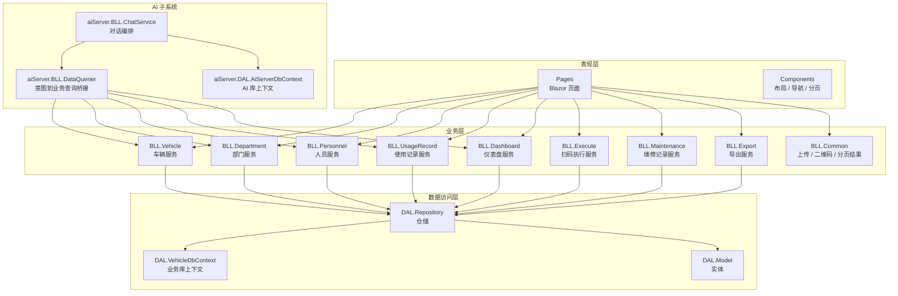
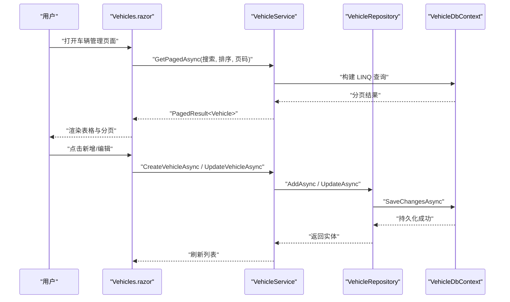
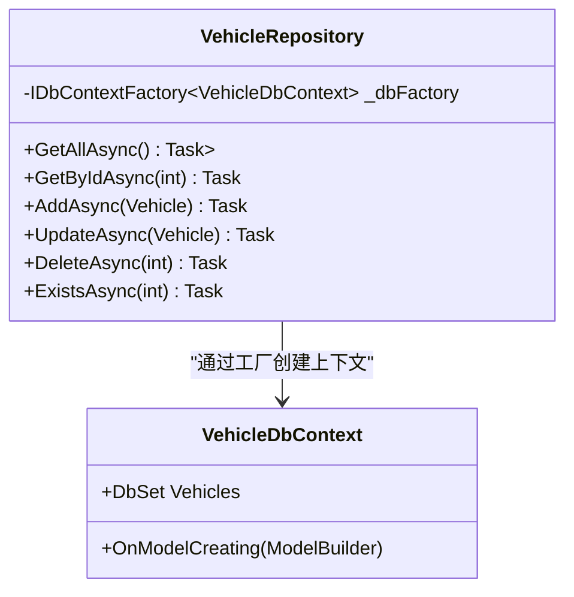
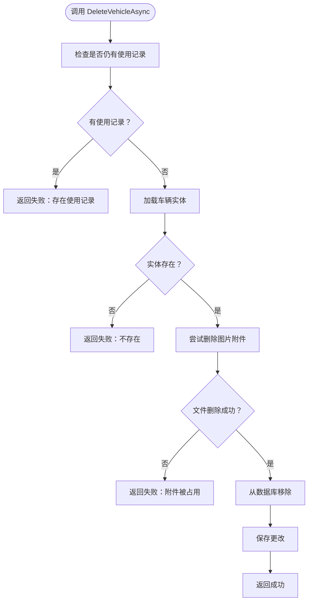
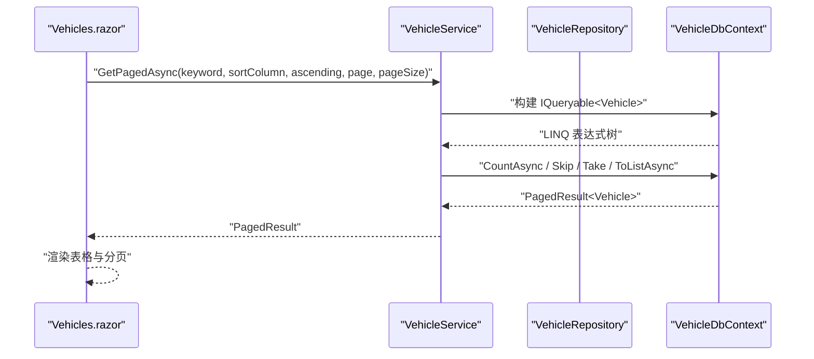
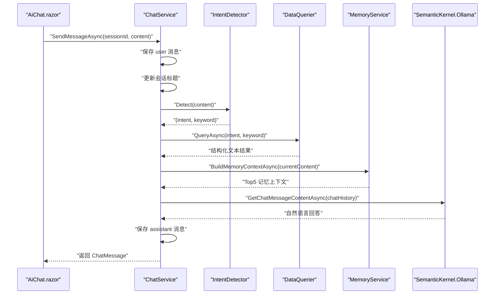
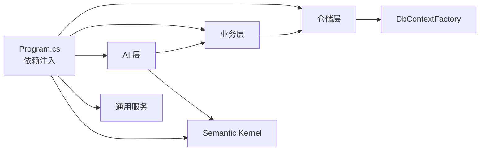

# 开发工作流程

<cite>
**本文引用的文件**   
- [README.md](file://README.md)
- [Program.cs](file://Program.cs)
- [appsettings.json](file://appsettings.json)
- [launchSettings.json](file://Properties/launchSettings.json)
- [VehicleDbContext.cs](file://DAL/VehicleDbContext.cs)
- [AiServerDbContext.cs](file://aiServer/DAL/AiServerDbContext.cs)
- [VehicleRepository.cs](file://DAL/Repository/VehicleRepository.cs)
- [VehicleService.cs](file://BLL/Vehicle/VehicleService.cs)
- [Vehicles.razor](file://Pages/Vehicles.razor)
- [ChatService.cs](file://aiServer/BLL/ChatService.cs)
- [DataQuerier.cs](file://aiServer/BLL/DataQuerier.cs)
</cite>

## 目录
1. [引言](#引言)
2. [项目结构](#项目结构)
3. [核心组件](#核心组件)
4. [架构总览](#架构总览)
5. [详细组件分析](#详细组件分析)
6. [依赖关系分析](#依赖关系分析)
7. [性能与稳定性考虑](#性能与稳定性考虑)
8. [测试策略](#测试策略)
9. [版本控制流程](#版本控制流程)
10. [开发环境与调试配置](#开发环境与调试配置)
11. [常见问题排查](#常见问题排查)
12. [结论](#结论)

## 引言
本指南面向 vehicleManagement 项目的开发与维护人员，目标是建立一套可复用的开发工作流程。内容覆盖需求分析、设计模式选择、从数据访问层到业务逻辑层再到页面的实现步骤、测试策略、版本控制规范，以及开发环境搭建与调试配置。该项目采用 Blazor Server + EF Core + SQLite 的三层架构，并内嵌一个独立的 AI 子系统，用于通过本地 Ollama 模型对真实数据库进行自然语言取数与回答。

## 项目结构
vehicleManagement 采用分层组织：
- DAL：EF Core 实体、数据库上下文、仓储实现。
- BLL：按领域划分的业务服务，封装查询、校验、事务性操作。
- Pages：Blazor 页面，负责用户交互与状态展示。
- Components：通用 UI 组件，如布局、导航、分页。
- aiServer：AI 子系统，包含意图识别、数据查询桥接、记忆管理、会话存储等。
- wwwroot：静态资源，包括 CSS、JS、字体等。

**图示来源**
- [Program.cs:60-102](file://Program.cs#L60-L102)
- [VehicleDbContext.cs:13-19](file://DAL/VehicleDbContext.cs#L13-L19)
- [AiServerDbContext.cs:16-18](file://aiServer/DAL/AiServerDbContext.cs#L16-L18)
- [ChatService.cs:20-41](file://aiServer/BLL/ChatService.cs#L20-L41)
- [DataQuerier.cs:23-43](file://aiServer/BLL/DataQuerier.cs#L23-L43)

**章节来源**
- [README.md:122-139](file://README.md#L122-L139)
- [Program.cs:48-102](file://Program.cs#L48-L102)

## 核心组件
- 应用启动与依赖注入：Program.cs 注册 Blazor、Serilog、两个 DbContextFactory、仓储、业务服务、AI 服务、Semantic Kernel 单例，并在启动时创建数据库表与种子数据。
- 业务仓储：以 VehicleRepository 为代表，封装增删改查，使用 IDbContextFactory 避免并发冲突。
- 业务服务：以 VehicleService 为代表，封装分页、排序、搜索、删除校验、二维码 Token 生成等业务规则。
- Blazor 页面：以 Vehicles.razor 为代表，负责表单、列表、分页、搜索、排序、删除确认、二维码下载与 Excel 导出。
- AI 对话服务：ChatService 编排消息保存、意图识别、数据查询、上下文构建、模型调用与回复保存。
- 意图到业务查询桥接：DataQuerier 将 UserIntent 映射到具体 BLL 服务方法，输出人类可读文本供模型归纳。

**章节来源**
- [Program.cs:28-102](file://Program.cs#L28-L102)
- [VehicleRepository.cs:10-64](file://DAL/Repository/VehicleRepository.cs#L10-L64)
- [VehicleService.cs:18-239](file://BLL/Vehicle/VehicleService.cs#L18-L239)
- [Vehicles.razor:1-410](file://Pages/Vehicles.razor#L1-L410)
- [ChatService.cs:18-200](file://aiServer/BLL/ChatService.cs#L18-L200)
- [DataQuerier.cs:21-331](file://aiServer/BLL/DataQuerier.cs#L21-L331)

## 架构总览
系统分为两条主线：
- 业务主线：Pages → BLL → DAL → SQLite 业务库。
- AI 主线：Blazor 页面 /ai-chat → ChatService → IntentDetector → DataQuerier → BLL → SQLite 业务库；同时 ChatService 通过 Semantic Kernel 调用 Ollama，并将结果落库到 AI 库。

**图示来源**
- [Vehicles.razor:220-227](file://Pages/Vehicles.razor#L220-L227)
- [VehicleService.cs:67-108](file://BLL/Vehicle/VehicleService.cs#L67-L108)
- [VehicleRepository.cs:19-46](file://DAL/Repository/VehicleRepository.cs#L19-L46)
- [VehicleDbContext.cs:13-19](file://DAL/VehicleDbContext.cs#L13-L19)

## 详细组件分析

### 仓储模式（DAL）
仓储模式在 DAL 中体现为每个实体对应一个 Repository，统一封装数据库访问细节，向上暴露异步方法。VehicleRepository 是典型实现：
- 使用 IDbContextFactory 创建 DbContext，避免 Blazor Server 共享上下文导致的并发问题。
- 提供 GetAllAsync、GetByIdAsync、AddAsync、UpdateAsync、DeleteAsync、ExistsAsync 等基础能力。
- 更新时设置更新时间字段，保证审计信息完整。

适用场景：
- 需要隔离 EF Core 细节，便于单元测试替换仓储。
- 需要统一处理时间戳、软删除、索引等跨实体的关注点。

**图示来源**
- [VehicleRepository.cs:10-64](file://DAL/Repository/VehicleRepository.cs#L10-L64)
- [VehicleDbContext.cs:6-19](file://DAL/VehicleDbContext.cs#L6-L19)

**章节来源**
- [VehicleRepository.cs:10-64](file://DAL/Repository/VehicleRepository.cs#L10-L64)
- [VehicleDbContext.cs:6-19](file://DAL/VehicleDbContext.cs#L6-L19)

### 服务层模式（BLL）
服务层封装业务规则与跨仓储协作。VehicleService 展示了以下职责：
- 分页、搜索、排序组合查询。
- 删除前的业务校验（是否存在使用记录）。
- 附件清理与异常日志记录。
- 二维码 Token 生成与校验。
- 根据部门获取在职人员。

适用场景：
- 页面不应直接写复杂 LINQ 或业务判断。
- 需要统一错误提示、审计日志、权限校验入口。

**图示来源**
- [VehicleService.cs:171-201](file://BLL/Vehicle/VehicleService.cs#L171-L201)

**章节来源**
- [VehicleService.cs:40-239](file://BLL/Vehicle/VehicleService.cs#L40-L239)

### 工厂模式（可选扩展）
当前代码未显式使用工厂类，但可通过工厂模式扩展：
- 当需要根据配置动态创建不同导出器（Excel、PDF）、不同二维码生成器、不同通知渠道时，引入 Factory 类集中管理实例化逻辑。
- 工厂可与依赖注入结合，注册多种实现并通过接口解析。

建议何时使用：
- 对象创建逻辑复杂且随配置变化。
- 需要屏蔽第三方 SDK 初始化差异。
- 需要统一生命周期管理与资源释放。

[本节为概念性说明，不直接分析具体文件]

### 页面到服务到仓储的实现流程
以车辆管理为例，完整链路如下：
- 页面加载：Vehicles.razor 调用 VehicleService.GetPagedAsync，传入搜索关键词、排序列、页码。
- 服务层：VehicleService 构建 LINQ，计算总数、页码边界，返回 PagedResult。
- 仓储层：VehicleRepository 通过 DbContextFactory 创建上下文，执行异步查询。
- 页面渲染：根据返回结果渲染表格、分页控件。

**图示来源**
- [Vehicles.razor:220-227](file://Pages/Vehicles.razor#L220-L227)
- [VehicleService.cs:67-108](file://BLL/Vehicle/VehicleService.cs#L67-L108)
- [VehicleRepository.cs:19-23](file://DAL/Repository/VehicleRepository.cs#L19-L23)
- [VehicleDbContext.cs:13-19](file://DAL/VehicleDbContext.cs#L13-L19)

**章节来源**
- [Vehicles.razor:186-227](file://Pages/Vehicles.razor#L186-L227)
- [VehicleService.cs:67-108](file://BLL/Vehicle/VehicleService.cs#L67-L108)
- [VehicleRepository.cs:19-23](file://DAL/Repository/VehicleRepository.cs#L19-L23)

### AI 对话流程
AI 子系统的核心流程由 ChatService 编排：
- 保存用户消息。
- 自动更新会话标题。
- 意图识别。
- 数据查询。
- 构建聊天历史（系统提示词、数据注入、记忆、最近消息）。
- 调用 Ollama 模型。
- 保存助手回复。
- 异步提取记忆。

**图示来源**
- [ChatService.cs:94-139](file://aiServer/BLL/ChatService.cs#L94-L139)
- [ChatService.cs:161-183](file://aiServer/BLL/ChatService.cs#L161-L183)
- [ChatService.cs:188-199](file://aiServer/BLL/ChatService.cs#L188-L199)
- [DataQuerier.cs:48-67](file://aiServer/BLL/DataQuerier.cs#L48-L67)

**章节来源**
- [ChatService.cs:18-200](file://aiServer/BLL/ChatService.cs#L18-L200)
- [DataQuerier.cs:21-331](file://aiServer/BLL/DataQuerier.cs#L21-L331)

## 依赖关系分析
依赖注入在 Program.cs 中集中注册：
- 仓储层：VehicleRepository、DepartmentRepository、PersonnelRepository、LocationRepository、UsageRecordRepository、MaintenanceRecordRepository。
- 业务层：VehicleService、DepartmentService、PersonnelService、LocationService、UsageRecordService、DashboardService、ExecuteService、MaintenanceRecordService、VehicleExportService。
- AI 层：MemoryService、DataQuerier、ChatService。
- 通用服务：FileUploadService、QrCodeService（单例）。
- Semantic Kernel：Kernel 单例，连接 Ollama。

**图示来源**
- [Program.cs:60-102](file://Program.cs#L60-L102)

**章节来源**
- [Program.cs:60-102](file://Program.cs#L60-L102)

## 性能与稳定性考虑
- 使用 IDbContextFactory 避免 Blazor Server 并发共享上下文冲突。
- Serilog 抑制框架与 EF SQL 日志噪声，保留业务关键日志。
- AI 子系统独立数据库，避免清对话影响业务数据。
- 模型调用失败时返回友好提示，不影响页面可用性。
- 记忆抽取异步执行，失败不影响主流程。
- 分页查询限制最大结果集，防止大响应拖慢模型。

**章节来源**
- [Program.cs:28-37](file://Program.cs#L28-L37)
- [Program.cs:52-58](file://Program.cs#L52-L58)
- [ChatService.cs:131-136](file://aiServer/BLL/ChatService.cs#L131-L136)
- [ChatService.cs:188-199](file://aiServer/BLL/ChatService.cs#L188-L199)

## 测试策略
建议采用分层测试策略：

- 单元测试
  - 仓储层：使用内存数据库或 Mock DbContextFactory，验证增删改查、分页、排序、时间戳设置。
  - 业务层：Mock 仓储与外部依赖（文件上传、二维码），验证业务规则（删除前校验、附件清理、Token 生成）。
  - AI 层：Mock IntentDetector、DataQuerier、MemoryService、Kernel，验证消息编排、上下文构建、异常兜底。

- 集成测试
  - 使用 Testcontainers 或 SQLite In-Memory 数据库，端到端验证 DAL 到 BLL 的数据流。
  - 验证 SeedDataInitializer 在 Development 环境是否正确写入初始数据。
  - 验证 AI 子系统两个数据库分别 EnsureCreated。

- 端到端测试
  - 使用 Playwright 或 Selenium 驱动 Blazor Server 页面，模拟用户操作：新增车辆、编辑、删除、二维码下载、Excel 导出。
  - 模拟 /ai-chat 对话：发送中文问题，断言返回的自然语言回答包含预期关键字段。

- 回归与冒烟
  - 每次变更运行核心用例：车辆 CRUD、使用记录查询、部门人员查询、AI 问答。
  - 自动化流水线中集成单元测试与集成测试，失败阻断合并。

[本节为通用测试指导，不直接分析具体文件]

## 版本控制流程
建议采用 Git Flow 或简化分支策略：

- 分支命名
  - feature/功能名：新功能开发。
  - fix/修复名：缺陷修复。
  - refactor/重构名：代码重构。
  - docs/文档名：文档更新。
  - hotfix/紧急修复：线上紧急修复。

- 提交规范
  - 类型：feat、fix、refactor、docs、style、test、chore。
  - 主题：简短描述变更目的。
  - 正文：说明动机、影响范围、注意事项。
  - 关联：引用任务编号或 Issue。

- 合并流程
  - 功能分支合并到 develop，需至少一名 Reviewer 批准。
  - 发布候选合并到 main，触发 CI/CD 构建与部署。
  - 禁止直接推送 main，所有变更走 Pull Request。

- 代码审查要点
  - 分层清晰：页面不写复杂 LINQ，业务规则在 BLL。
  - 依赖注入正确：仓储与服务生命周期合理。
  - 异常处理：用户可见错误提示，内部日志完整。
  - 安全与性能：分页、索引、敏感信息不入库。

[本节为通用流程指导，不直接分析具体文件]

## 开发环境与调试配置
- 本地运行
  - 安装 .NET 10 SDK。
  - 拉取本地 Ollama 模型并启动服务。
  - 复制 aisettings.example.json 为 aisettings.json，修改 OllamaModel。
  - 执行 dotnet restore 与 dotnet run。

- 环境变量与配置优先级
  - 环境变量 AiServer__OllamaEndpoint / AiServer__OllamaModel 优先级最高。
  - aisettings.json 支持热重载。
  - 代码兜底默认 localhost:11434。

- 数据库与种子数据
  - 启动时确保 data 目录存在。
  - 业务库与 AI 库分别 EnsureCreated。
  - Development 环境自动写入种子数据。

- 调试配置
  - launchSettings.json 定义 Project 与 Docker 启动配置。
  - 启用 DeveloperExceptionPage 便于本地调试。
  - Serilog 输出控制台与滚动日志文件。

**章节来源**
- [README.md:87-100](file://README.md#L87-L100)
- [README.md:163-185](file://README.md#L163-L185)
- [Program.cs:45-46](file://Program.cs#L45-L46)
- [Program.cs:97-102](file://Program.cs#L97-L102)
- [Program.cs:106-125](file://Program.cs#L106-L125)
- [Properties/launchSettings.json:10-17](file://Properties/launchSettings.json#L10-L17)
- [appsettings.json:1-7](file://appsettings.json#L1-L7)

## 常见问题排查
- Ollama 不可达
  - 先验证 Ollama API 是否返回 200。
  - 容器内 localhost 不等于宿主机，应使用宿主机 IP 或 host.docker.internal。
  - 检查 aisettings.json 与变量 AiServer__OllamaEndpoint 是否一致。
  - 确认 OllamaModel tag 与 ollama list 完全匹配。

- 数据库未创建或无数据
  - 确认 data 目录存在且有写权限。
  - 确认 DefaultConnection 与 AiServerConnection 指向正确路径。
  - 确认 Development 环境已执行 SeedDataInitializer。

- 页面报错或空白
  - 查看浏览器控制台与服务器日志。
  - 确认 Blazor Hub 路由已映射。
  - 确认静态文件与 Folder 挂载正常。

- AI 回答异常
  - 检查 MemoryService 抽取是否抛出异常（非关键路径，不影响主流程）。
  - 检查 DataQuerier 查询分支是否返回空或错误文案。
  - 检查 ChatService 调用 LLM 的异常兜底。

**章节来源**
- [README.md:106-118](file://README.md#L106-L118)
- [README.md:291-306](file://README.md#L291-L306)
- [Program.cs:106-125](file://Program.cs#L106-L125)
- [ChatService.cs:188-199](file://aiServer/BLL/ChatService.cs#L188-L199)
- [DataQuerier.cs:48-67](file://aiServer/BLL/DataQuerier.cs#L48-L67)

## 结论
vehicleManagement 项目通过清晰的三层架构与独立的 AI 子系统，实现了公车台账管理与自然语言取数的闭环。开发时应遵循仓储模式隔离数据访问、服务层封装业务规则、页面专注交互呈现的原则；测试应覆盖单元、集成与端到端；版本控制应规范分支、提交与合并流程；开发环境应明确配置优先级与数据库初始化步骤。按照本指南执行，可有效提升团队协作效率与系统稳定性。