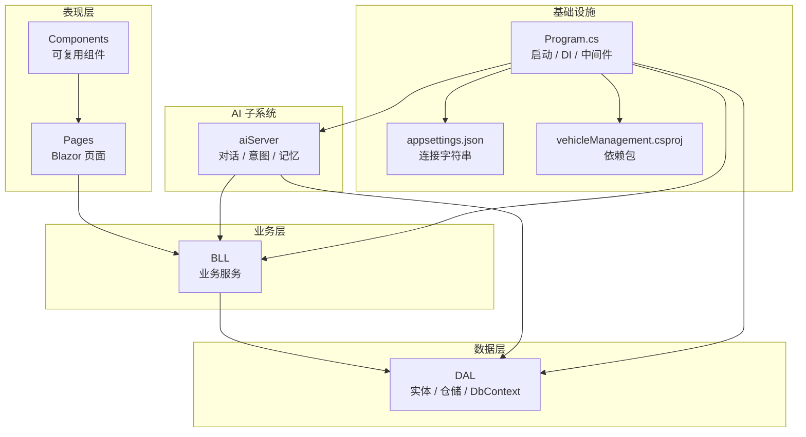
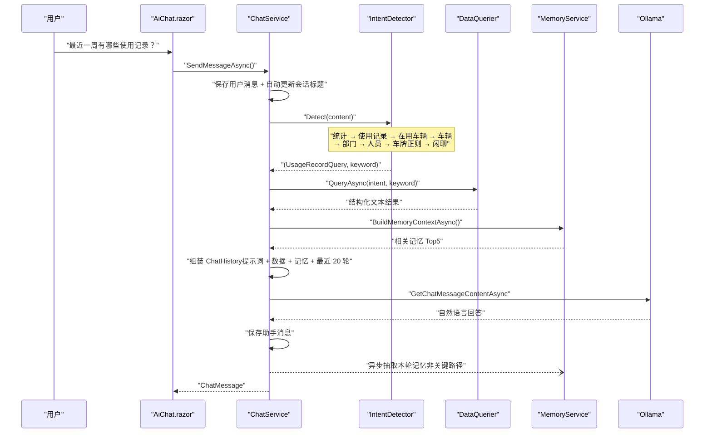
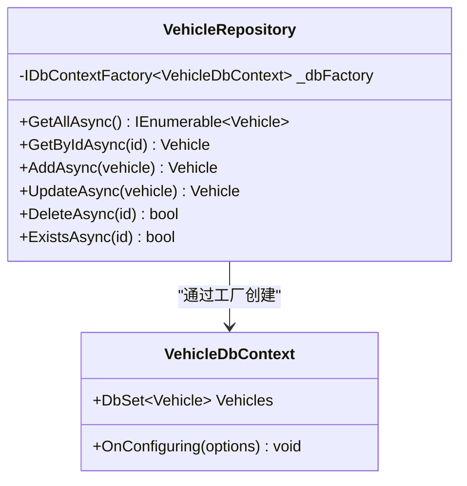
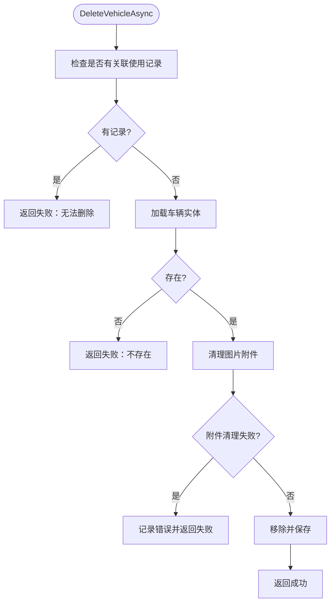
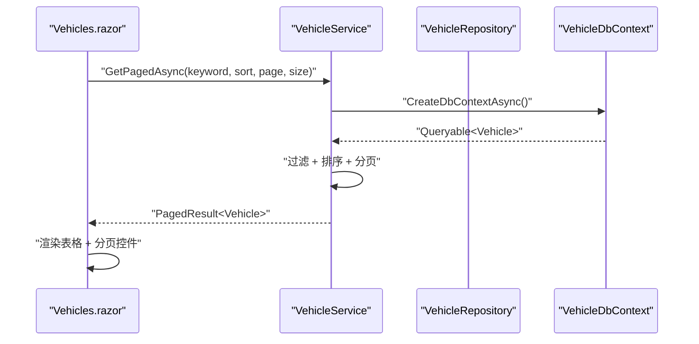
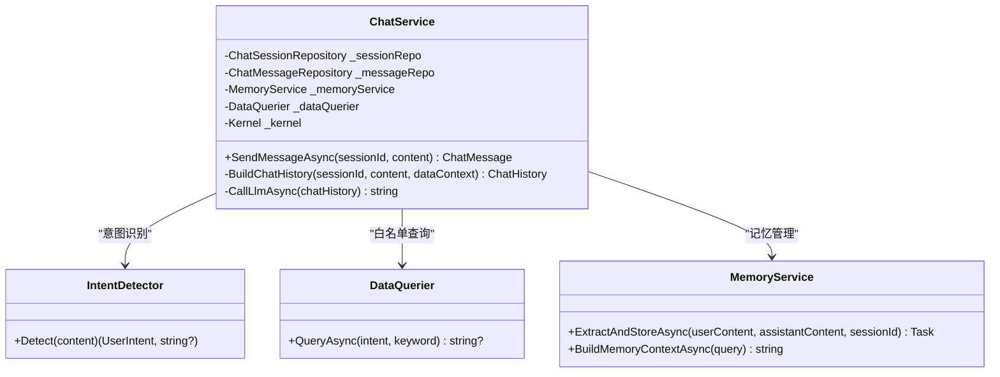
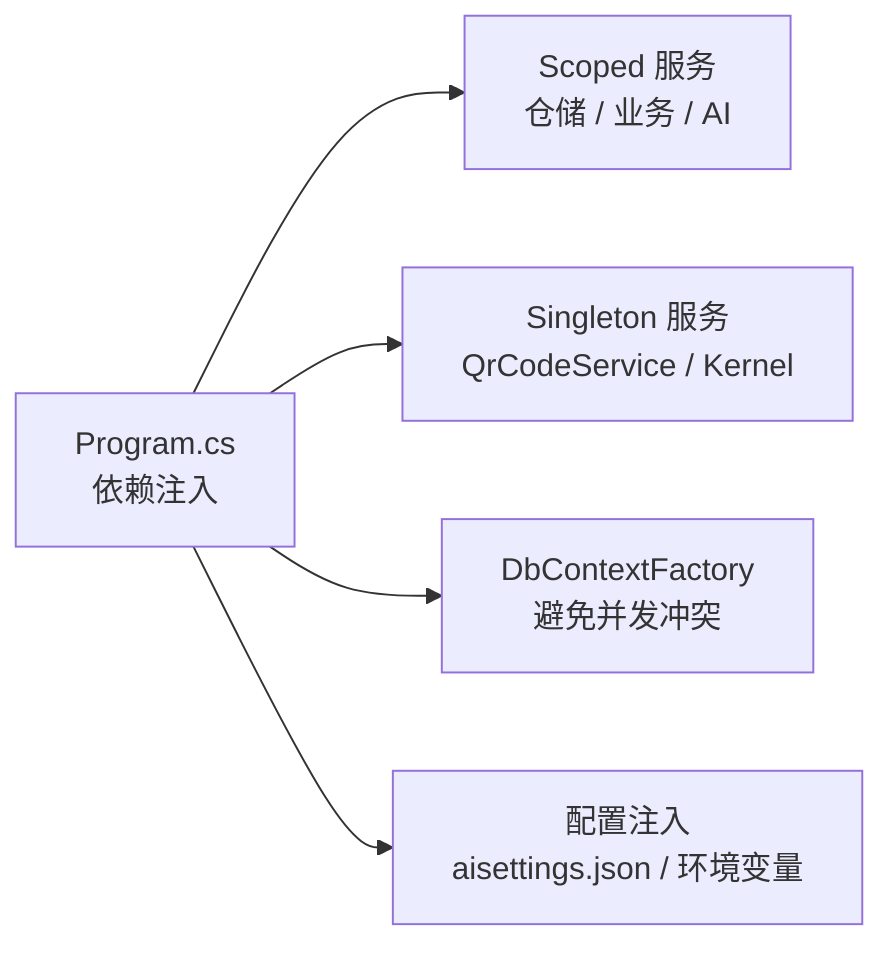

# 开发指南

<cite>
**本文引用的文件**   
- [README.md](file://README.md)
- [Program.cs](file://Program.cs)
- [appsettings.json](file://appsettings.json)
- [vehicleManagement.csproj](file://vehicleManagement.csproj)
- [launchSettings.json](file://Properties/launchSettings.json)
- [VehicleDbContext.cs](file://DAL/VehicleDbContext.cs)
- [SeedDataInitializer.cs](file://DAL/SeedDataInitializer.cs)
- [VehicleRepository.cs](file://DAL/Repository/VehicleRepository.cs)
- [VehicleService.cs](file://BLL/Vehicle/VehicleService.cs)
- [Vehicles.razor](file://Pages/Vehicles.razor)
- [Pagination.razor](file://Components/Common/Pagination.razor)
- [ChatService.cs](file://aiServer/BLL/ChatService.cs)
- [IntentDetector.cs](file://aiServer/BLL/IntentDetector.cs)
- [DataQuerier.cs](file://aiServer/BLL/DataQuerier.cs)
- [AiChat.razor](file://aiServer/Pages/AiChat.razor)
- [Error.cshtml](file://Pages/Error.cshtml)
</cite>

## 目录
1. [引言](#引言)
2. [项目结构](#项目结构)
3. [核心组件](#核心组件)
4. [架构总览](#架构总览)
5. [详细组件分析](#详细组件分析)
6. [依赖关系分析](#依赖关系分析)
7. [性能与稳定性](#性能与稳定性)
8. [调试与排错](#调试与排错)
9. [代码质量保障](#代码质量保障)
10. [扩展开发指南](#扩展开发指南)
11. [结论](#结论)

## 引言
本指南面向 vehicleManagement 系统的开发者，目标是建立统一的 C# 编码规范、Blazor 组件开发规范、命名约定与注释标准，并给出从需求到上线的完整开发流程。系统采用分层架构：DAL 仓储实现数据访问，BLL 业务服务封装领域逻辑，Pages 与 Components 承载 Blazor UI；同时包含 aiServer AI 子系统，通过规则意图识别 + 白名单查询 + 结果注入的方式调用本地 Ollama 模型，保证业务数据不出环境。

## 项目结构
仓库采用按职责分层的目录组织方式：
- DAL：EF Core 实体、DbContext、仓储实现、种子数据初始化。
- BLL：按业务域划分的 Service，如 Vehicle、Department、Personnel、UsageRecord、Dashboard、Maintenance、Export、Common。
- Pages：Blazor 页面路由，对应车辆台账、部门、人员、地点、使用记录、维修、扫码执行等。
- Components：可复用 UI 组件，如分页、布局、导航。
- aiServer：AI 子系统，包含对话服务、意图识别、数据查询器、记忆服务、独立 DbContext 与仓储。
- wwwroot：静态资源，包括 CSS、JS、字体与 Chart.js。
- Program.cs：应用启动、配置加载、依赖注入、中间件、数据库初始化与健康探针。

**图表来源**
- [Program.cs:41-102](file://Program.cs#L41-L102)
- [appsettings.json:1-8](file://appsettings.json#L1-L8)
- [vehicleManagement.csproj:1-37](file://vehicleManagement.csproj#L1-L37)

**章节来源**
- [README.md:122-153](file://README.md#L122-L153)
- [Program.cs:41-102](file://Program.cs#L41-L102)
- [appsettings.json:1-8](file://appsettings.json#L1-L8)
- [vehicleManagement.csproj:1-37](file://vehicleManagement.csproj#L1-L37)

## 核心组件
- 应用启动与依赖注入：Program.cs 统一注册 Razor、Blazor Server、HttpContextAccessor、DbContextFactory、仓储、业务服务、通用服务与 Semantic Kernel。
- 数据访问层：VehicleDbContext 定义 EF Core 上下文；各 Repository 提供基础 CRUD；SeedDataInitializer 在开发环境写入种子数据。
- 业务服务层：VehicleService 等 Service 组合仓储、文件上传、二维码生成与日志，封装分页、排序、校验与删除等业务规则。
- 页面组件层：Vehicles.razor 负责列表展示、新增编辑弹窗、删除确认、二维码下载与 Excel 导出；Pagination.razor 提供通用分页交互。
- AI 子系统：ChatService 协调会话、消息、记忆、意图识别与 LLM 推理；IntentDetector 基于关键词与正则做意图路由；DataQuerier 将意图映射到白名单查询方法。

**章节来源**
- [Program.cs:48-102](file://Program.cs#L48-L102)
- [VehicleRepository.cs:1-66](file://DAL/Repository/VehicleRepository.cs#L1-L66)
- [VehicleService.cs:15-239](file://BLL/Vehicle/VehicleService.cs#L15-L239)
- [Vehicles.razor:1-410](file://Pages/Vehicles.razor#L1-L410)
- [Pagination.razor:1-42](file://Components/Common/Pagination.razor#L1-L42)
- [ChatService.cs:15-200](file://aiServer/BLL/ChatService.cs#L15-L200)
- [IntentDetector.cs:9-34](file://aiServer/BLL/IntentDetector.cs#L9-L34)
- [DataQuerier.cs:45-67](file://aiServer/BLL/DataQuerier.cs#L45-L67)

## 架构总览
系统以 ASP.NET Core Blazor Server 为宿主，UI 通过 SignalR 与服务器保持长连接；数据访问通过 EF Core + SQLite；AI 子系统通过 Semantic Kernel 接入本地 Ollama。关键特性：
- 双库隔离：业务库 vehicleManagement.db 与 AI 库 aiServer.db 物理分离。
- 三层 DI：环境变量 > aisettings.json（可选 + 热重载）> 代码默认值。
- 规则意图识别：避免让模型写 SQL，降低幻觉与注入风险。
- 稳定兜底：模型不可达、查询异常、结果为空、记忆写失败均不影响主流程。

**图表来源**
- [README.md:187-219](file://README.md#L187-L219)
- [ChatService.cs:94-139](file://aiServer/BLL/ChatService.cs#L94-L139)
- [IntentDetector.cs:17-34](file://aiServer/BLL/IntentDetector.cs#L17-L34)
- [DataQuerier.cs:48-67](file://aiServer/BLL/DataQuerier.cs#L48-L67)

**章节来源**
- [README.md:55-83](file://README.md#L55-L83)
- [README.md:187-219](file://README.md#L187-L219)
- [Program.cs:97-102](file://Program.cs#L97-L102)

## 详细组件分析

### DAL 仓储实现
仓储层通过 IDbContextFactory 创建 DbContext，避免 Blazor Server 并发共享上下文冲突。典型模式：
- 所有方法 await using 包裹 DbContext，确保及时释放。
- Update 时设置更新时间 ChinaTime.Now。
- Delete 前检查是否存在，返回布尔或实体。

**图表来源**
- [VehicleRepository.cs:10-64](file://DAL/Repository/VehicleRepository.cs#L10-L64)
- [VehicleDbContext.cs](file://DAL/VehicleDbContext.cs)

**章节来源**
- [VehicleRepository.cs:1-66](file://DAL/Repository/VehicleRepository.cs#L1-L66)
- [Program.cs:52-58](file://Program.cs#L52-L58)

### BLL 业务服务
业务服务组合仓储、文件上传、二维码生成与日志，封装复杂业务规则：
- 分页查询支持搜索关键字、多列排序与页码边界处理。
- 删除操作先校验关联数据，再清理附件，最后持久化。
- 二维码下载需校验部门绑定与在职人员存在性。

**图表来源**
- [VehicleService.cs:171-201](file://BLL/Vehicle/VehicleService.cs#L171-L201)

**章节来源**
- [VehicleService.cs:67-109](file://BLL/Vehicle/VehicleService.cs#L67-L109)
- [VehicleService.cs:171-201](file://BLL/Vehicle/VehicleService.cs#L171-L201)
- [VehicleService.cs:207-238](file://BLL/Vehicle/VehicleService.cs#L207-L238)

### Pages 页面组件
页面组件遵循“状态驱动 + 委托服务”的模式：
- 使用 @inject 注入服务，避免直接访问数据库。
- 表单提交前进行前端校验，成功后刷新列表。
- 错误信息通过模态框展示，不中断用户操作。
- 分页组件 Pagination.razor 提供统一交互。

**图表来源**
- [Vehicles.razor:220-227](file://Pages/Vehicles.razor#L220-L227)
- [VehicleService.cs:67-109](file://BLL/Vehicle/VehicleService.cs#L67-L109)
- [Pagination.razor:20-40](file://Components/Common/Pagination.razor#L20-L40)

**章节来源**
- [Vehicles.razor:1-410](file://Pages/Vehicles.razor#L1-L410)
- [Pagination.razor:1-42](file://Components/Common/Pagination.razor#L1-L42)

### AI 子系统组件
AI 子系统通过 ChatService 编排意图识别、数据查询、记忆管理与 LLM 推理：
- IntentDetector 基于关键词与正则匹配，固定优先级避免歧义。
- DataQuerier 将意图映射到白名单查询方法，参数仅 keyword 与分页。
- MemoryService 抽取车牌、品牌、偏好等记忆，Top5 注入上下文。
- ChatService 构建 ChatHistory，调用 Semantic Kernel 获取回复。

**图表来源**
- [ChatService.cs:15-200](file://aiServer/BLL/ChatService.cs#L15-L200)
- [IntentDetector.cs:9-34](file://aiServer/BLL/IntentDetector.cs#L9-L34)
- [DataQuerier.cs:45-67](file://aiServer/BLL/DataQuerier.cs#L45-L67)

**章节来源**
- [ChatService.cs:94-139](file://aiServer/BLL/ChatService.cs#L94-L139)
- [IntentDetector.cs:17-34](file://aiServer/BLL/IntentDetector.cs#L17-L34)
- [DataQuerier.cs:48-67](file://aiServer/BLL/DataQuerier.cs#L48-L67)

## 依赖关系分析
依赖注入与服务生命周期：
- Scoped：仓储、业务服务、AI 服务（每个请求/会话一个实例）。
- Singleton：QrCodeService、Semantic Kernel（无状态，全局共享）。
- DbContextFactory：避免 Blazor Server 并发共享 DbContext。
- 配置注入：aisettings.json 可选 + 热重载，环境变量覆盖。

**图表来源**
- [Program.cs:48-102](file://Program.cs#L48-L102)
- [Program.cs:97-102](file://Program.cs#L97-L102)

**章节来源**
- [Program.cs:48-102](file://Program.cs#L48-L102)
- [appsettings.json:1-8](file://appsettings.json#L1-L8)

## 性能与稳定性
- 日志降噪：Serilog 抑制 Microsoft 与 EF Core SQL 日志，避免噪声淹没业务日志。
- 数据库初始化：EnsureCreatedAsync 在启动时创建表，开发环境写入种子数据。
- 静态文件：Folder 目录挂载为静态文件，用于上传附件。
- AI 稳定性：模型不可达返回友好提示；查询异常返回错误文案；记忆抽取失败仅警告。

**章节来源**
- [Program.cs:28-37](file://Program.cs#L28-L37)
- [Program.cs:106-125](file://Program.cs#L106-L125)
- [Program.cs:132-140](file://Program.cs#L132-L140)
- [README.md:291-300](file://README.md#L291-L300)

## 调试与排错
- 断点调试：Visual Studio 中设置断点，运行 vehicleManagement 配置文件中的 applicationUrl。
- 日志分析：查看 logs/log-.log 文件，关注 Serilog 输出模板与异常堆栈。
- 健康探针：访问 /health 检查服务可用性。
- 错误页面：生产环境显示 Error.cshtml，开发环境启用 DetailedErrors。
- AI 诊断：AiChat.razor 支持 F12 触发诊断脚本，检查布局填充与空白区域。

**章节来源**
- [launchSettings.json:10-17](file://Properties/launchSettings.json#L10-L17)
- [Program.cs:127-130](file://Program.cs#L127-L130)
- [Error.cshtml:1-13](file://Pages/Error.cshtml#L1-L13)
- [AiChat.razor:429-458](file://aiServer/Pages/AiChat.razor#L429-L458)

## 代码质量保障
- 静态分析：启用 .NET 内置 analyzers，结合 IDE 实时提示。
- 代码审查：Pull Request 要求至少一名 reviewer，关注分层职责与异常处理。
- 持续集成：CI 流水线执行 dotnet build、dotnet test、dotnet publish。
- 自动化测试：单元测试覆盖 IntentDetector 规则分支；集成测试验证 VehicleService 分页与删除逻辑。

[本节为通用指导，未直接分析具体文件]

## 扩展开发指南
新功能开发流程：
1. 需求分析：明确业务实体、字段、关系与权限。
2. 设计模式：选择仓储 + 服务 + 页面组件的分层实现。
3. 代码实现：DAL 定义实体与仓储，BLL 封装业务规则，Pages 实现 UI。
4. 单元测试：覆盖关键分支与异常路径。
5. 集成测试：验证端到端流程，如新增车辆后二维码下载。
6. 部署：更新 appsettings.json 或环境变量，重启服务。

插件机制与第三方集成：
- 新业务模块：在 BLL 下新建文件夹与 Service，在 DAL 下新增 Model 与 Repository，在 Pages 下新增 .razor 页面。
- 第三方库：在 vehicleManagement.csproj 中添加 PackageReference，在 Program.cs 中注册服务。
- AI 扩展：在 aiServer/BLL 下新增 Intent 与 Query 分支，更新 IntentDetector 与 DataQuerier。

**章节来源**
- [vehicleManagement.csproj:14-30](file://vehicleManagement.csproj#L14-L30)
- [Program.cs:60-95](file://Program.cs#L60-L95)
- [IntentDetector.cs:17-34](file://aiServer/BLL/IntentDetector.cs#L17-L34)
- [DataQuerier.cs:48-67](file://aiServer/BLL/DataQuerier.cs#L48-L67)

## 结论
vehicleManagement 系统通过清晰的分层架构、严格的依赖注入与稳定的 AI 子系统设计，实现了公车管理台账与自然语言取数助手的闭环。开发者应遵循本指南的编码规范、开发流程与最佳实践，确保代码质量、可维护性与可扩展性。

[本节为总结性内容，未直接分析具体文件]