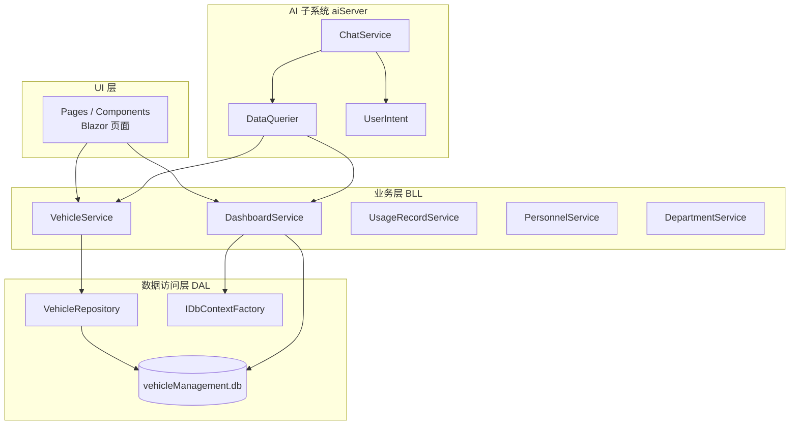
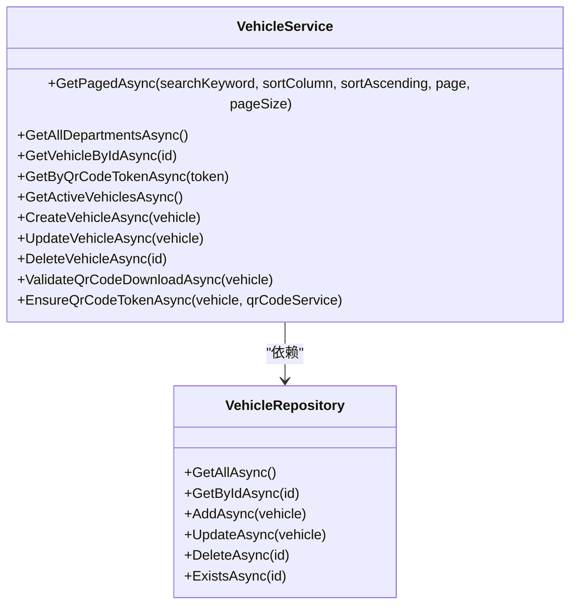
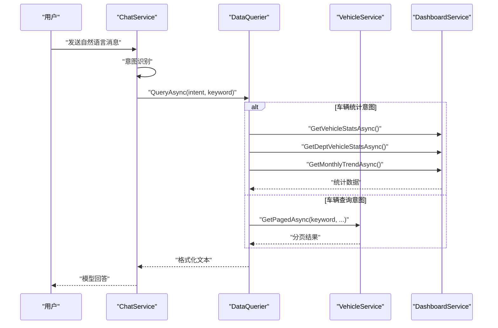
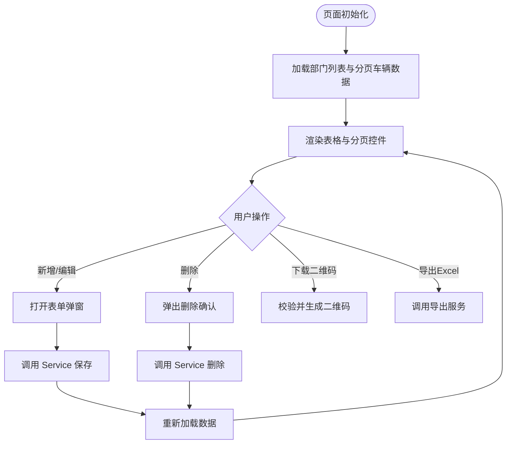
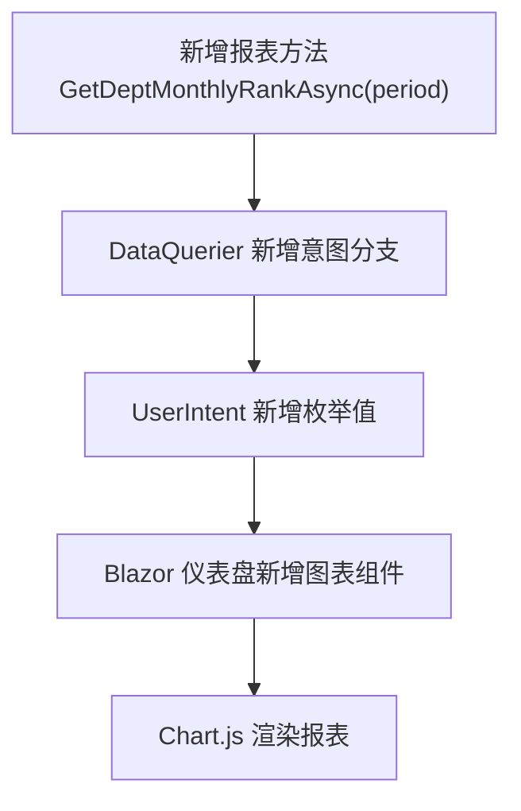
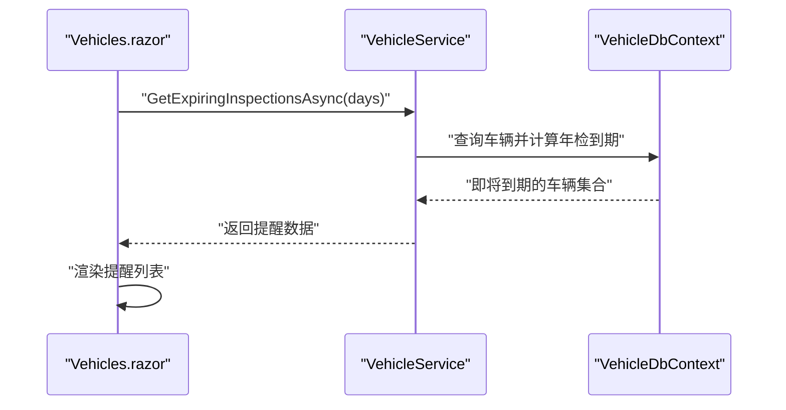
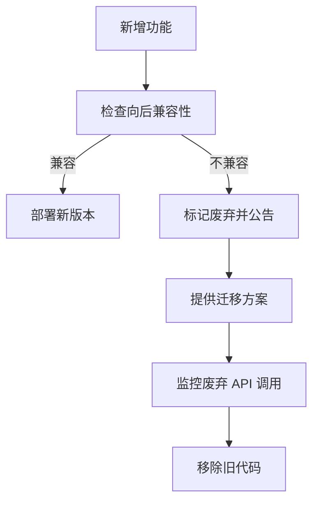
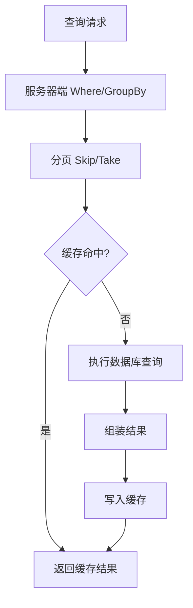
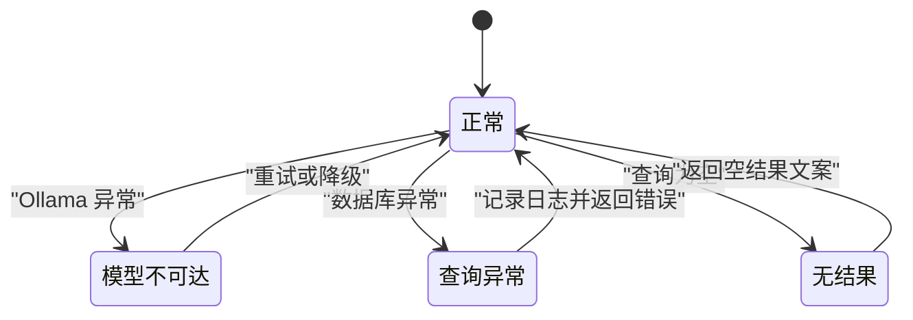

# API 扩展

<cite>
**本文引用的文件**   
- [Program.cs](file://Program.cs)
- [vehicleManagement.csproj](file://vehicleManagement.csproj)
- [README.md](file://README.md)
- [BLL\Vehicle\VehicleService.cs](file://BLL/Vehicle/VehicleService.cs)
- [DAL\Repository\VehicleRepository.cs](file://DAL/Repository/VehicleRepository.cs)
- [BLL\Dashboard\DashboardService.cs](file://BLL/Dashboard/DashboardService.cs)
- [aiServer\BLL\DataQuerier.cs](file://aiServer/BLL/DataQuerier.cs)
- [aiServer\BLL\ChatService.cs](file://aiServer/BLL/ChatService.cs)
- [aiServer\BLL\Enums\UserIntent.cs](file://aiServer/BLL/Enums/UserIntent.cs)
- [Pages\Vehicles.razor](file://Pages/Vehicles.razor)
- [Pages\_Host.cshtml](file://Pages/_Host.cshtml)
</cite>

## 目录
1. [引言](#引言)
2. [项目结构与分层约定](#项目结构与分层约定)
3. [API 扩展总览](#api-扩展总览)
4. [Service-Repository 扩展示例：新增业务接口](#service-repository-扩展示例新增业务接口)
5. [数据查询扩展：在 DataQuerier 中添加新意图](#数据查询扩展在-dataquerier-中添加新意图)
6. [Blazor 页面扩展：新增 CRUD 界面](#blazor-页面扩展新增-crud-界面)
7. [扩展示例一：新增报表类型](#扩展示例一新增报表类型)
8. [扩展示例二：扩展车辆管理功能](#扩展示例二扩展车辆管理功能)
9. [API 版本管理与向后兼容策略](#api-版本管理与向后兼容策略)
10. [测试策略：单元测试与集成测试](#测试策略单元测试与集成测试)
11. [性能优化建议](#性能优化建议)
12. [故障排查与稳定性要点](#故障排查与稳定性要点)
13. [结论](#结论)

## 引言
本指南面向需要在 vehicleManagement 系统中扩展 API 的开发者。系统采用 DAL（数据访问层）→ BLL（业务逻辑层）→ Pages/Components（Blazor UI）→ aiServer（AI 子系统）的分层架构，并通过规则型意图识别将自然语言映射到现有 Service 查询方法。本文说明如何在不破坏现有行为的前提下，添加新的业务接口、新的 AI 查询意图和新的 Blazor 页面，并给出报表扩展、车辆功能扩展、版本管理、测试与性能优化的完整实践路径。

## 项目结构与分层约定
- DAL：EF Core 实体、DbContext、仓储实现，负责数据库访问。
- BLL：业务服务，组合仓储、上下文工厂、通用服务，封装业务规则。
- Pages/Components：Blazor Server 页面与组件，负责用户交互与表单操作。
- aiServer：独立命名空间下的 AI 子系统，包含意图识别、数据查询桥接、记忆、对话编排，以及独立的 SQLite 会话库。
- Program.cs：应用启动装配，注册 DbContextFactory、仓储、服务、AI Kernel、静态文件、路由与健康检查。

**图表来源**
- [Program.cs:52-102](file://Program.cs#L52-L102)
- [BLL\Vehicle\VehicleService.cs:18-38](file://BLL/Vehicle/VehicleService.cs#L18-L38)
- [DAL\Repository\VehicleRepository.cs:10-17](file://DAL/Repository/VehicleRepository.cs#L10-L17)
- [aiServer\BLL\DataQuerier.cs:21-43](file://aiServer/BLL/DataQuerier.cs#L21-L43)
- [aiServer\BLL\ChatService.cs:18-42](file://aiServer/BLL/ChatService.cs#L18-L42)

**章节来源**
- [Program.cs:41-148](file://Program.cs#L41-L148)
- [README.md:122-139](file://README.md#L122-L139)

## API 扩展总览
扩展 API 应遵循以下原则：
- 新增业务接口优先放在 BLL，通过 Service 暴露；DAL 只保留仓储基础能力。
- 若需要支持自然语言查询，则在 aiServer 的 DataQuerier 中增加对应分支，调用已有 Service。
- 若需要前端界面，新建 Blazor 页面，注入对应 Service，复用分页、排序、弹窗等模式。
- 所有数据库访问使用 IDbContextFactory，避免 Blazor Server 并发共享上下文问题。
- 对外暴露方式以 Blazor 页面为主；如需 REST API，应在 Program.cs 中新增 MapGet/MapPost，并保持与现有健康检查 `/health` 一致的中间件顺序。

**章节来源**
- [Program.cs:142-148](file://Program.cs#L142-L148)
- [README.md:139-139](file://README.md#L139-L139)

## Service-Repository 扩展示例：新增业务接口
以车辆领域为例，现有 VehicleService 已提供分页查询、部门列表、按二维码 Token 获取车辆、在用车辆列表、创建/更新/删除、二维码校验与生成等方法；VehicleRepository 提供基础增删改查。

新增业务接口的推荐步骤：
1. 在 BLL 下新增或扩展 Service，例如新增“车辆统计扩展”或“车辆导出扩展”。
2. 在 DAL.Repository 中按需扩展 Repository，或直接使用 IDbContextFactory 在 Service 内构造查询。
3. 在 Program.cs 中注册新 Service（AddScoped）。
4. 在 Blazor 页面中注入该 Service，调用新方法完成 UI 交互。
5. 如果该能力需要被 AI 助手调用，则在 DataQuerier 中新增意图分支，调用新 Service。

**图表来源**
- [BLL\Vehicle\VehicleService.cs:18-239](file://BLL/Vehicle/VehicleService.cs#L18-L239)
- [DAL\Repository\VehicleRepository.cs:10-63](file://DAL/Repository/VehicleRepository.cs#L10-L63)

**章节来源**
- [BLL\Vehicle\VehicleService.cs:64-109](file://BLL/Vehicle/VehicleService.cs#L64-L109)
- [DAL\Repository\VehicleRepository.cs:19-63](file://DAL/Repository/VehicleRepository.cs#L19-L63)
- [Program.cs:60-86](file://Program.cs#L60-L86)

## 数据查询扩展：在 DataQuerier 中添加新意图
DataQuerier 是 AI 子系统与业务 Service 之间的白名单桥接器。当前支持的意图包括车辆查询、在用车辆查询、车辆统计、部门查询、人员查询、使用记录查询、通用问答。

新增自然语言查询意图的步骤：
1. 在 aiServer/BLL/Enums/UserIntent.cs 中新增枚举值。
2. 在 IntentDetector 中增加关键词或正则匹配（仓库未直接展示该文件，但 README 说明了固定优先级与清洗逻辑）。
3. 在 DataQuerier.QueryAsync 中新增 switch 分支，调用已有 Service 或新增 Service。
4. 返回结构化文本，供 ChatService 注入到 LLM 上下文。

**图表来源**
- [aiServer\BLL\ChatService.cs:94-139](file://aiServer/BLL/ChatService.cs#L94-L139)
- [aiServer\BLL\DataQuerier.cs:48-67](file://aiServer/BLL/DataQuerier.cs#L48-L67)
- [BLL\Dashboard\DashboardService.cs:28-94](file://BLL/Dashboard/DashboardService.cs#L28-L94)
- [BLL\Vehicle\VehicleService.cs:67-109](file://BLL/Vehicle/VehicleService.cs#L67-L109)

**章节来源**
- [aiServer\BLL\Enums\UserIntent.cs:6-22](file://aiServer/BLL/Enums/UserIntent.cs#L6-L22)
- [aiServer\BLL\DataQuerier.cs:48-67](file://aiServer/BLL/DataQuerier.cs#L48-L67)
- [README.md:221-239](file://README.md#L221-L239)

## Blazor 页面扩展：新增 CRUD 界面
以 Vehicles.razor 为参考模板，新增页面的典型结构如下：
- 页面顶部：标题、搜索框、新增按钮。
- 表单弹窗：新增/编辑字段绑定，保存时调用 Service。
- 表格区域：分页、排序、状态显示、操作列。
- 删除确认弹窗：二次确认后调用 Service 删除。
- 错误提示弹窗：统一展示异常信息。

**图表来源**
- [Pages\Vehicles.razor:215-227](file://Pages/Vehicles.razor#L215-L227)
- [Pages\Vehicles.razor:281-331](file://Pages/Vehicles.razor#L281-L331)
- [Pages\Vehicles.razor:333-358](file://Pages/Vehicles.razor#L333-L358)
- [Pages\Vehicles.razor:379-408](file://Pages/Vehicles.razor#L379-L408)

**章节来源**
- [Pages\Vehicles.razor:1-184](file://Pages/Vehicles.razor#L1-L184)
- [Pages\Vehicles.razor:186-410](file://Pages/Vehicles.razor#L186-L410)

## 扩展示例一：新增报表类型
目标：新增一个“部门月度用车排行报表”，既可在仪表盘展示，也可通过 AI 助手查询。

实施步骤：
1. 在 BLL.Dashboard 中新增报表计算方法，例如 GetDeptMonthlyRankAsync(period)，复用 DashboardService 的时间过滤与分组聚合模式。
2. 在 DataQuerier 中新增意图分支，例如 DepartmentMonthlyRankQuery，调用新报表方法并格式化为可读文本。
3. 在 aiServer/BLL/Enums/UserIntent.cs 中新增对应枚举值。
4. 在 Blazor 仪表盘页面中新增图表组件，调用 DashboardService 的新方法，使用 Chart.js 绘制柱状图或折线图。
5. 在 Program.cs 中确保 DashboardService 已注册（已存在），无需重复注册。

**图表来源**
- [BLL\Dashboard\DashboardService.cs:96-140](file://BLL/Dashboard/DashboardService.cs#L96-L140)
- [aiServer\BLL\DataQuerier.cs:48-67](file://aiServer/BLL/DataQuerier.cs#L48-L67)
- [aiServer\BLL\Enums\UserIntent.cs:6-22](file://aiServer/BLL/Enums/UserIntent.cs#L6-L22)
- [Pages\_Host.cshtml:98-170](file://Pages/_Host.cshtml#L98-L170)

**章节来源**
- [BLL\Dashboard\DashboardService.cs:96-140](file://BLL/Dashboard/DashboardService.cs#L96-L140)
- [aiServer\BLL\DataQuerier.cs:114-143](file://aiServer/BLL/DataQuerier.cs#L114-L143)
- [Pages\_Host.cshtml:98-170](file://Pages/_Host.cshtml#L98-L170)

## 扩展示例二：扩展车辆管理功能
目标：在车辆管理中新增“车辆年检到期提醒”能力，包括后端计算、前端展示与 AI 查询。

实施步骤：
1. 在 BLL.Vehicle 中新增 Service 方法，例如 GetExpiringInspectionsAsync(days)，基于 Vehicle 实体字段计算即将到期的车辆。
2. 在 DAL.Model 中确认是否存在年检相关字段；若无，需先扩展实体并在 EF Core 迁移中同步数据库。
3. 在 Pages/Vehicles.razor 中新增“年检到期”筛选与提醒展示区。
4. 在 DataQuerier 中新增意图分支，例如 ExpiringInspectionQuery，调用新 Service 并返回结构化文本。
5. 在 Program.cs 中确保 VehicleService 已注册（已存在）。

**图表来源**
- [BLL\Vehicle\VehicleService.cs:67-109](file://BLL/Vehicle/VehicleService.cs#L67-L109)
- [DAL\Repository\VehicleRepository.cs:19-63](file://DAL/Repository/VehicleRepository.cs#L19-L63)
- [Pages\Vehicles.razor:215-227](file://Pages/Vehicles.razor#L215-L227)

**章节来源**
- [BLL\Vehicle\VehicleService.cs:151-166](file://BLL/Vehicle/VehicleService.cs#L151-L166)
- [Pages\Vehicles.razor:281-331](file://Pages/Vehicles.razor#L281-L331)

## API 版本管理与向后兼容策略
当前系统以 Blazor 页面为主要入口，REST API 较少。为保证向后兼容与可演进性，建议：
- 对新增的 Service 方法保持参数向后兼容：新增可选参数，默认值不改变原有行为。
- 对 DataQuerier 新增意图分支时，旧意图保持不变，避免影响既有 AI 问答。
- 对 Blazor 页面新增功能时，不修改现有页面核心流程，仅扩展局部区域。
- 如未来引入 REST API，建议使用 URL 前缀或请求头进行版本控制，例如 `/api/v1/...`，并在 Program.cs 中集中注册。
- 废弃 API 的处理：保留旧分支一段时间，返回明确废弃提示，并提供迁移指引；日志记录废弃 API 调用量，逐步下线。

**图表来源**
- [Program.cs:142-148](file://Program.cs#L142-L148)
- [aiServer\BLL\DataQuerier.cs:48-67](file://aiServer/BLL/DataQuerier.cs#L48-L67)

**章节来源**
- [README.md:310-319](file://README.md#L310-L319)

## 测试策略：单元测试与集成测试
建议覆盖以下层次：
- 单元测试：
  - DataQuerier 意图分支：验证不同 keyword 是否路由到正确分支。
  - DashboardService 统计方法：验证分组、排序、时间范围过滤。
  - VehicleService 业务规则：验证删除前是否有使用记录、二维码校验逻辑。
- 集成测试：
  - 使用内存 SQLite 或临时文件 SQLite，验证 EF Core 查询与仓储行为。
  - 验证 Blazor 页面与服务交互：新增/编辑/删除后数据刷新。
  - 验证 AI 链路：从自然语言到结构化文本再到模型回答的端到端流程。

测试设计要点：
- 使用 xUnit 或 MSTest 编写用例。
- 使用 Moq 或 NSubstitute 模拟外部依赖（如 Ollama、文件系统）。
- 对数据库访问使用 IDbContextFactory 的测试配置，避免共享上下文。
- 对 AI 链路，可断言 DataQuerier 输出文本是否符合预期格式。

**章节来源**
- [BLL\Dashboard\DashboardService.cs:28-94](file://BLL/Dashboard/DashboardService.cs#L28-L94)
- [BLL\Vehicle\VehicleService.cs:168-202](file://BLL/Vehicle/VehicleService.cs#L168-L202)
- [aiServer\BLL\DataQuerier.cs:69-93](file://aiServer/BLL/DataQuerier.cs#L69-L93)

## 性能优化建议
现有代码已有一些性能优化实践，可扩展方向如下：
- 数据库查询优化：
  - 使用 CountAsync、GroupBy、Where 等服务器端聚合，避免 ToList 后再内存处理。
  - 分页查询时使用 Skip/Take，限制 MaxQueryResults。
  - 对高频查询字段建立索引（SQLite 场景需谨慎评估写入开销）。
- 缓存策略：
  - 对静态主数据（部门、地点）使用内存缓存（IMemoryCache），设置合理过期时间。
  - 对仪表盘统计结果做短期缓存，减少频繁重算。
- I/O 与文件操作：
  - 附件删除失败时记录日志并阻止数据库删除，避免不一致。
  - 导出 Excel 使用流式处理，避免大对象驻留内存。
- AI 链路优化：
  - 控制最近消息窗口大小，避免过长上下文。
  - 记忆抽取异步执行，不影响主流程。

**图表来源**
- [BLL\Dashboard\DashboardService.cs:28-94](file://BLL/Dashboard/DashboardService.cs#L28-L94)
- [BLL\Vehicle\VehicleService.cs:67-109](file://BLL/Vehicle/VehicleService.cs#L67-L109)
- [aiServer\BLL\DataQuerier.cs:269-330](file://aiServer/BLL/DataQuerier.cs#L269-L330)

**章节来源**
- [BLL\Dashboard\DashboardService.cs:28-94](file://BLL/Dashboard/DashboardService.cs#L28-L94)
- [BLL\Vehicle\VehicleService.cs:67-109](file://BLL/Vehicle/VehicleService.cs#L67-L109)
- [aiServer\BLL\DataQuerier.cs:269-330](file://aiServer/BLL/DataQuerier.cs#L269-L330)

## 故障排查与稳定性要点
系统已在多处实现兜底与隔离：
- Ollama 不可达或返回空：返回明确错误文案，页面不崩溃。
- 业务查询抛异常：DataQuerier 捕获并返回错误文本。
- 查询结果为空：每个分支返回显式文案。
- 记忆抽取抛异常：异步执行，不影响主流程。
- 并发写库：使用 IDbContextFactory 避免 Blazor Circuit 共享上下文冲突。
- 日志噪声：Serilog 抑制框架与 EF SQL 日志。

**图表来源**
- [aiServer\BLL\ChatService.cs:188-199](file://aiServer/BLL/ChatService.cs#L188-L199)
- [aiServer\BLL\DataQuerier.cs:63-67](file://aiServer/BLL/DataQuerier.cs#L63-L67)
- [Program.cs:28-37](file://Program.cs#L28-L37)

**章节来源**
- [README.md:291-306](file://README.md#L291-L306)
- [aiServer\BLL\ChatService.cs:188-199](file://aiServer/BLL/ChatService.cs#L188-L199)
- [aiServer\BLL\DataQuerier.cs:63-67](file://aiServer/BLL/DataQuerier.cs#L63-L67)

## 结论
vehicleManagement 系统的 API 扩展应严格遵循 Service-Repository 分层与 Blazor 页面模式，新增业务接口集中在 BLL，数据查询桥接集中在 DataQuerier，UI 交互集中在 Pages。通过规则意图识别与结构化文本注入，AI 子系统能安全、可解释地驱动业务查询。扩展时应重视向后兼容、测试覆盖与性能优化，确保系统在演进过程中保持稳定与可维护。