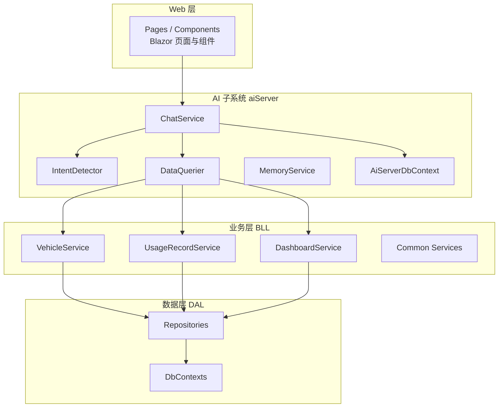
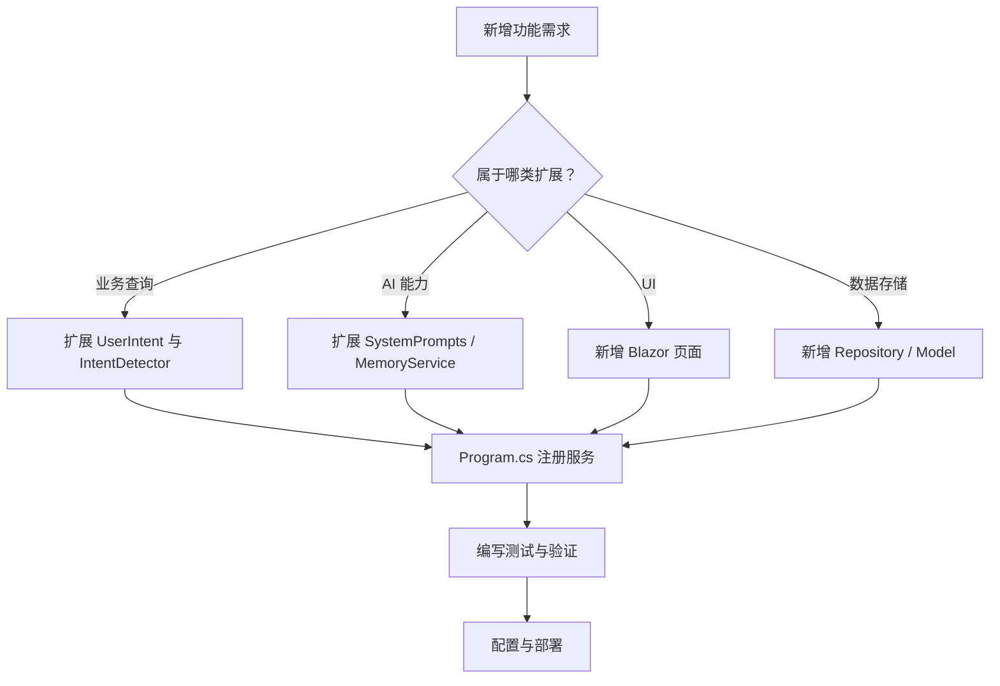
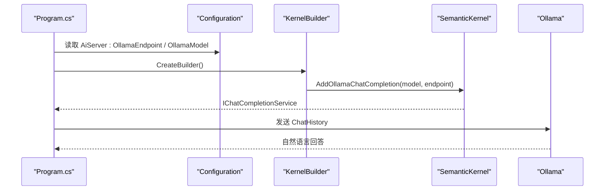
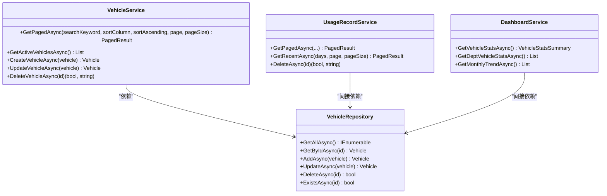
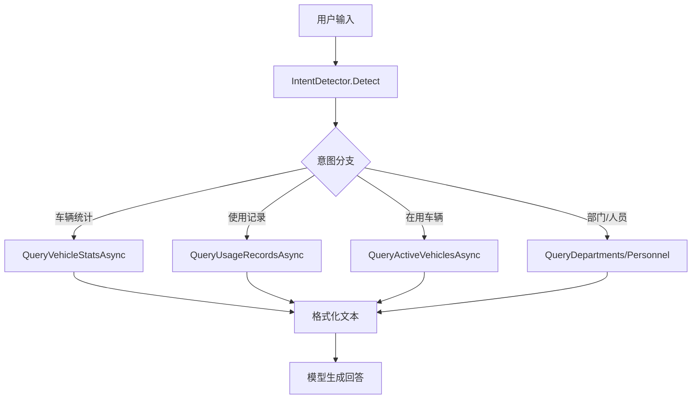
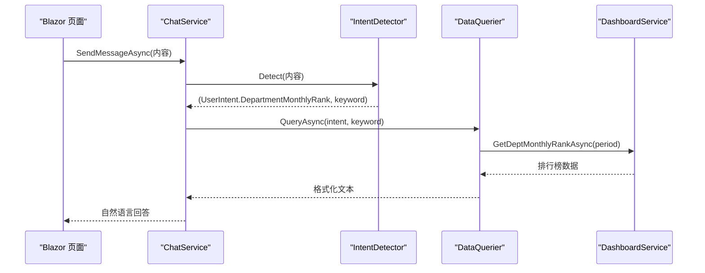
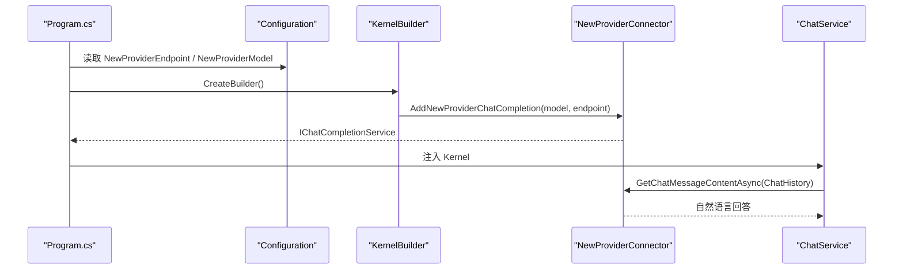
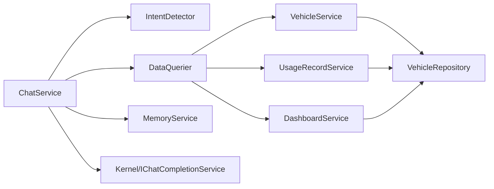

# 扩展开发指南

<cite>
**本文引用的文件**   
- [Program.cs](file://Program.cs)
- [appsettings.json](file://appsettings.json)
- [aisettings.example.json](file://aisettings.example.json)
- [README.md](file://README.md)
- [aiServer/BLL/ChatService.cs](file://aiServer/BLL/ChatService.cs)
- [aiServer/BLL/DataQuerier.cs](file://aiServer/BLL/DataQuerier.cs)
- [aiServer/BLL/IntentDetector.cs](file://aiServer/BLL/IntentDetector.cs)
- [aiServer/BLL/Enums/UserIntent.cs](file://aiServer/BLL/Enums/UserIntent.cs)
- [BLL/Vehicle/VehicleService.cs](file://BLL/Vehicle/VehicleService.cs)
- [BLL/UsageRecord/UsageRecordService.cs](file://BLL/UsageRecord/UsageRecordService.cs)
- [BLL/Dashboard/DashboardService.cs](file://BLL/Dashboard/DashboardService.cs)
- [DAL/Repository/VehicleRepository.cs](file://DAL/Repository/VehicleRepository.cs)
</cite>

## 目录
1. [引言](#引言)
2. [项目结构与扩展边界](#项目结构与扩展边界)
3. [新功能开发流程](#新功能开发流程)
4. [插件机制与扩展点识别](#插件机制与扩展点识别)
5. [第三方集成模式](#第三方集成模式)
6. [API 扩展与数据查询扩展](#api-扩展与数据查询扩展)
7. [向后兼容性与版本管理](#向后兼容性与版本管理)
8. [扩展开发示例：新增报表类型](#扩展开发示例新增报表类型)
9. [扩展开发示例：接入新的 AI 提供商](#扩展开发示例接入新的-ai-提供商)
10. [依赖关系分析](#依赖关系分析)
11. [性能与稳定性注意事项](#性能与稳定性注意事项)
12. [故障排查清单](#故障排查清单)
13. [结论](#结论)

## 引言
本指南面向需要在 vehicleManagement 系统中进行二次开发的工程师，目标是给出从需求分析到上线部署的完整扩展路径。系统采用分层架构：数据访问层（DAL）→ 业务逻辑层（BLL）→ Blazor 页面与组件 → aiServer 子系统；AI 能力通过规则意图识别、白名单查询、结果注入、本地模型归纳的方式实现，核心优势是“换模型不改代码”“查询不写 SQL”“失败可兜底”。

## 项目结构与扩展边界
- DAL：实体、仓储、数据库上下文、种子数据初始化。
- BLL：按领域划分的业务服务，如车辆、部门、人员、地点、使用记录、仪表盘、执行、维修、导出、通用工具。
- Pages + Components：Blazor Server 页面与布局、导航、分页等 UI 组件。
- aiServer：AI 子系统，包含对话服务、意图识别、数据查询器、记忆服务、会话消息记忆仓储、AI 聊天页面。
- Program.cs：应用启动装配、配置加载、依赖注入、数据库初始化、静态文件与路由。
- appsettings.json：连接字符串与基础配置。
- aisettings.example.json：AI 子系统的 Ollama 端点与模型模板。

**图示来源**   
- [Program.cs:41-102](file://Program.cs#L41-L102)
- [aiServer/BLL/ChatService.cs:18-42](file://aiServer/BLL/ChatService.cs#L18-L42)
- [aiServer/BLL/DataQuerier.cs:21-43](file://aiServer/BLL/DataQuerier.cs#L21-L43)

**章节来源**   
- [README.md:139-153](file://README.md#L139-L153)
- [Program.cs:41-102](file://Program.cs#L41-L102)

## 新功能开发流程
建议遵循以下阶段：

1. **需求分析与范围界定**
   - 明确功能属于业务域（车辆、部门、人员、使用记录、维修、导出）还是 AI 能力（意图、提示词、记忆、模型）。
   - 判断是否影响现有 API、页面、数据模型或 AI 问答链路。

2. **设计扩展点**
   - 若为业务功能：优先在 BLL 新增 Service，必要时扩展 DAL Repository 和 Model。
   - 若为 AI 能力：优先扩展 IntentDetector、DataQuerier、SystemPrompts、MemoryService。
   - 若为 UI：新增 Blazor 页面或复用现有 Layout/Components。

3. **实现与解耦**
   - 通过依赖注入注册新服务。
   - 保持查询走 BLL 白名单，避免直接拼接 SQL。
   - AI 侧只负责意图识别、数据组装、提示词编排与模型调用。

4. **测试与验证**
   - 单元测试意图识别分支。
   - 集成测试查询结果与格式化输出。
   - 端到端测试页面交互与 AI 问答。

5. **配置与部署**
   - 更新配置文件（连接字符串、AI 端点、环境变量）。
   - 构建镜像并挂载数据卷。
   - 健康检查与日志观察。

**章节来源**   
- [Program.cs:41-102](file://Program.cs#L41-L102)
- [README.md:321-340](file://README.md#L321-L340)

## 插件机制与扩展点识别
当前系统没有动态插件加载框架，但通过依赖注入与分层职责划分，形成了稳定的扩展点：

| 扩展方向 | 扩展点 | 说明 | 典型改动 |
|---|---|---|---|
| 业务查询扩展 | `DataQuerier.QueryAsync` | 意图分发入口，新增意图分支即可扩展 AI 可查的业务能力 | 新增枚举值、分支方法、格式化文本 |
| 意图识别扩展 | `IntentDetector.Detect` | 关键词与正则匹配决定意图 | 新增触发词、优先级、清洗规则 |
| 模型接入扩展 | `Program.cs` 中 Kernel 注册 | 通过 Semantic Kernel 替换推理后端 | 改配置或 connector |
| 记忆扩展 | `MemoryService` | 抽取、存储、检索用户偏好与上下文 | 新增抽取规则、索引策略 |
| 页面扩展 | Blazor Pages | 新增业务页面或 AI 聊天增强 | 新增 .razor 与路由 |
| 数据访问扩展 | DAL Repository | 封装 EF Core 查询 | 新增仓储方法与分页/排序 |
| 配置扩展 | `appsettings.json`、`aisettings.example.json` | 连接字符串、AI 端点、模型 tag | 新增键值与环境变量映射 |

**图示来源**   
- [aiServer/BLL/IntentDetector.cs:17-111](file://aiServer/BLL/IntentDetector.cs#L17-L111)
- [aiServer/BLL/DataQuerier.cs:48-67](file://aiServer/BLL/DataQuerier.cs#L48-L67)
- [aiServer/BLL/Enums/UserIntent.cs:6-22](file://aiServer/BLL/Enums/UserIntent.cs#L6-L22)
- [Program.cs:75-102](file://Program.cs#L75-L102)

**章节来源**   
- [aiServer/BLL/IntentDetector.cs:17-152](file://aiServer/BLL/IntentDetector.cs#L17-L152)
- [aiServer/BLL/DataQuerier.cs:48-333](file://aiServer/BLL/DataQuerier.cs#L48-L333)
- [aiServer/BLL/Enums/UserIntent.cs:6-22](file://aiServer/BLL/Enums/UserIntent.cs#L6-L22)
- [Program.cs:75-102](file://Program.cs#L75-L102)

## 第三方集成模式
### AI 模型替换
- 当前通过 Semantic Kernel 的 Ollama Chat Completion Connector 接入本地模型。
- 配置三级取值：环境变量 > `aisettings.json` > 代码默认值。
- 换模型只需修改配置，无需改业务代码。

**图示来源**   
- [Program.cs:97-102](file://Program.cs#L97-L102)
- [aisettings.example.json:1-7](file://aisettings.example.json#L1-L7)

**章节来源**   
- [README.md:163-185](file://README.md#L163-L185)
- [Program.cs:97-102](file://Program.cs#L97-L102)
- [aisettings.example.json:1-7](file://aisettings.example.json#L1-L7)

### 存储后端扩展
- 当前使用 EF Core + SQLite，业务库与 AI 库分离。
- 扩展存储后端需考虑：
  - 更换 DbContext 提供程序。
  - 迁移连接字符串。
  - 保证 SeedDataInitializer 与 EnsureCreatedAsync 行为一致。
  - 注意并发上下文隔离（已使用 IDbContextFactory）。

**章节来源**   
- [Program.cs:52-58](file://Program.cs#L52-L58)
- [Program.cs:109-125](file://Program.cs#L109-L125)
- [appsettings.json:1-8](file://appsettings.json#L1-L8)

### 认证系统集成
- 当前系统无鉴权，适合内网单工具场景。
- 如需公网暴露，应引入 ASP.NET Core 认证与授权中间件，并在路由与页面层增加权限校验。
- 建议以最小侵入方式接入：
  - 新增认证中间件。
  - 对敏感路由添加 `[Authorize]`。
  - 将用户身份注入 BLL 服务用于审计与权限控制。

**章节来源**   
- [README.md:369-370](file://README.md#L369-L370)
- [Program.cs:142-148](file://Program.cs#L142-L148)

## API 扩展与数据查询扩展
### 添加新的业务接口
推荐步骤：
1. 在 BLL 新增 Service 方法，封装查询与业务规则。
2. 在 DAL Repository 新增数据访问方法。
3. 在 Program.cs 注册服务。
4. 在 Blazor 页面或服务调用处消费新接口。
5. 如需 AI 可查，扩展 IntentDetector 与 DataQuerier。

**图示来源**   
- [BLL/Vehicle/VehicleService.cs:18-38](file://BLL/Vehicle/VehicleService.cs#L18-L38)
- [BLL/UsageRecord/UsageRecordService.cs:19-38](file://BLL/UsageRecord/UsageRecordService.cs#L19-L38)
- [BLL/Dashboard/DashboardService.cs:16-23](file://BLL/Dashboard/DashboardService.cs#L16-L23)
- [DAL/Repository/VehicleRepository.cs:10-17](file://DAL/Repository/VehicleRepository.cs#L10-L17)

**章节来源**   
- [BLL/Vehicle/VehicleService.cs:67-109](file://BLL/Vehicle/VehicleService.cs#L67-L109)
- [BLL/UsageRecord/UsageRecordService.cs:43-92](file://BLL/UsageRecord/UsageRecordService.cs#L43-L92)
- [BLL/Dashboard/DashboardService.cs:28-94](file://BLL/Dashboard/DashboardService.cs#L28-L94)
- [DAL/Repository/VehicleRepository.cs:19-63](file://DAL/Repository/VehicleRepository.cs#L19-L63)

### 数据查询扩展
- 在 DataQuerier 中新增意图分支，调用对应 BLL Service。
- 返回结构化文本供模型组织答案。
- 时间解析逻辑集中在 TryParseTimeRange，便于统一扩展中文时间表达。

**图示来源**   
- [aiServer/BLL/IntentDetector.cs:17-111](file://aiServer/BLL/IntentDetector.cs#L17-L111)
- [aiServer/BLL/DataQuerier.cs:48-67](file://aiServer/BLL/DataQuerier.cs#L48-L67)
- [aiServer/BLL/DataQuerier.cs:272-330](file://aiServer/BLL/DataQuerier.cs#L272-L330)

**章节来源**   
- [aiServer/BLL/DataQuerier.cs:48-333](file://aiServer/BLL/DataQuerier.cs#L48-L333)

## 向后兼容性与版本管理
- API 版本管理：
  - 新增查询分支时保留旧分支，避免破坏现有意图路由。
  - 对格式化输出字段保持稳定，避免下游模型理解异常。
- 配置迁移策略：
  - 新增配置项时提供默认值与热重载支持。
  - 环境变量覆盖配置文件，容器部署通过 `-e` 注入。
  - 连接字符串变更需同步 Program.cs 与 appsettings.json。

**章节来源**   
- [Program.cs:45-46](file://Program.cs#L45-L46)
- [Program.cs:97-102](file://Program.cs#L97-L102)
- [appsettings.json:1-8](file://appsettings.json#L1-L8)

## 扩展开发示例：新增报表类型
目标：新增一个“部门月度用车排行”报表，并通过 AI 问答可查。

步骤：
1. 在 DashboardService 新增方法，计算部门月度排行。
2. 在 DataQuerier 新增意图分支，调用新方法并格式化输出。
3. 在 IntentDetector 新增触发词，例如“部门月度排行”“本月部门用车排名”。
4. 在 UserIntent 新增枚举值。
5. 在 Blazor 页面新增报表展示组件。
6. 在 Program.cs 注册服务（如需要）。

**图示来源**   
- [aiServer/BLL/ChatService.cs:94-139](file://aiServer/BLL/ChatService.cs#L94-L139)
- [aiServer/BLL/IntentDetector.cs:17-111](file://aiServer/BLL/IntentDetector.cs#L17-L111)
- [aiServer/BLL/DataQuerier.cs:48-67](file://aiServer/BLL/DataQuerier.cs#L48-L67)
- [BLL/Dashboard/DashboardService.cs:99-117](file://BLL/Dashboard/DashboardService.cs#L99-L117)

**章节来源**   
- [BLL/Dashboard/DashboardService.cs:99-117](file://BLL/Dashboard/DashboardService.cs#L99-L117)
- [aiServer/BLL/DataQuerier.cs:48-67](file://aiServer/BLL/DataQuerier.cs#L48-L67)
- [aiServer/BLL/IntentDetector.cs:17-111](file://aiServer/BLL/IntentDetector.cs#L17-L111)
- [aiServer/BLL/Enums/UserIntent.cs:6-22](file://aiServer/BLL/Enums/UserIntent.cs#L6-L22)

## 扩展开发示例：接入新的 AI 提供商
目标：在不改业务代码的前提下，将推理后端从 Ollama 切换到其他提供商。

步骤：
1. 评估提供商 SDK 与 Semantic Kernel 兼容性。
2. 在 Program.cs 中替换 Kernel 注册逻辑。
3. 新增配置键，支持环境变量与配置文件热重载。
4. 在 ChatService 中保持 IChatCompletionService 调用不变。
5. 测试流式与非流式响应、错误兜底。

**图示来源**   
- [Program.cs:97-102](file://Program.cs#L97-L102)
- [aiServer/BLL/ChatService.cs:29-42](file://aiServer/BLL/ChatService.cs#L29-L42)

**章节来源**   
- [Program.cs:97-102](file://Program.cs#L97-L102)
- [aiServer/BLL/ChatService.cs:29-42](file://aiServer/BLL/ChatService.cs#L29-L42)

## 依赖关系分析
- ChatService 依赖会话、消息、记忆、数据查询与 Kernel。
- DataQuerier 依赖各 BLL Service，形成 AI 到业务的单向桥接。
- IntentDetector 纯函数式意图识别，无外部依赖。
- BLL Service 依赖 Repository 与 DbContextFactory，确保并发安全。

**图示来源**   
- [aiServer/BLL/ChatService.cs:18-42](file://aiServer/BLL/ChatService.cs#L18-L42)
- [aiServer/BLL/DataQuerier.cs:21-43](file://aiServer/BLL/DataQuerier.cs#L21-L43)
- [BLL/Vehicle/VehicleService.cs:18-38](file://BLL/Vehicle/VehicleService.cs#L18-L38)
- [BLL/UsageRecord/UsageRecordService.cs:19-38](file://BLL/UsageRecord/UsageRecordService.cs#L19-L38)
- [BLL/Dashboard/DashboardService.cs:16-23](file://BLL/Dashboard/DashboardService.cs#L16-L23)
- [DAL/Repository/VehicleRepository.cs:10-17](file://DAL/Repository/VehicleRepository.cs#L10-L17)

**章节来源**   
- [aiServer/BLL/ChatService.cs:18-42](file://aiServer/BLL/ChatService.cs#L18-L42)
- [aiServer/BLL/DataQuerier.cs:21-43](file://aiServer/BLL/DataQuerier.cs#L21-L43)
- [BLL/Vehicle/VehicleService.cs:18-38](file://BLL/Vehicle/VehicleService.cs#L18-L38)
- [BLL/UsageRecord/UsageRecordService.cs:19-38](file://BLL/UsageRecord/UsageRecordService.cs#L19-L38)
- [BLL/Dashboard/DashboardService.cs:16-23](file://BLL/Dashboard/DashboardService.cs#L16-L23)
- [DAL/Repository/VehicleRepository.cs:10-17](file://DAL/Repository/VehicleRepository.cs#L10-L17)

## 性能与稳定性注意事项
- 查询性能：
  - 使用 CountAsync 与 GroupBy 下推至数据库，避免全表加载。
  - 分页与排序在服务层集中处理。
- 并发安全：
  - 使用 IDbContextFactory 创建 DbContext，避免 Blazor Server 共享上下文冲突。
- 模型调用：
  - 一次问答仅调用一次模型，减少延迟与成本。
  - 长会话固定最近消息窗口，避免上下文爆炸。
- 错误兜底：
  - 模型不可达、查询异常、结果为空、记忆写失败均有独立兜底。

**章节来源**   
- [BLL/Dashboard/DashboardService.cs:28-94](file://BLL/Dashboard/DashboardService.cs#L28-L94)
- [Program.cs:52-58](file://Program.cs#L52-L58)
- [aiServer/BLL/ChatService.cs:188-199](file://aiServer/BLL/ChatService.cs#L188-L199)
- [README.md:291-300](file://README.md#L291-L300)

## 故障排查清单
- Ollama 不可达或返回空：
  - 检查健康检查与健康探针。
  - 确认环境变量与配置文件中的端点与模型 tag。
- 查询异常：
  - 查看 DataQuerier 的错误包裹逻辑。
  - 检查 BLL Service 的 EF Core 查询与关联加载。
- 结果为空：
  - 检查意图识别关键词与残留关键词清洗。
  - 检查时间解析与分页参数。
- 记忆写失败：
  - 非关键路径，不影响主流程，关注日志警告。
- 并发写库：
  - 确认使用 IDbContextFactory。
- 日志噪声：
  - Serilog 已抑制框架与 EF SQL 日志，关注业务日志。

**章节来源**   
- [aiServer/BLL/DataQuerier.cs:63-67](file://aiServer/BLL/DataQuerier.cs#L63-L67)
- [aiServer/BLL/ChatService.cs:188-199](file://aiServer/BLL/ChatService.cs#L188-L199)
- [Program.cs:28-37](file://Program.cs#L28-L37)
- [README.md:291-300](file://README.md#L291-L300)

## 结论
vehicleManagement 的扩展开发应以分层职责为基础：业务功能优先扩展 BLL 与 DAL，AI 能力优先扩展 IntentDetector、DataQuerier、SystemPrompts 与 MemoryService，UI 扩展通过 Blazor 页面完成。模型接入与存储后端可通过配置与依赖注入解耦，保证“换模型不改代码”“查询不写 SQL”“失败可兜底”。在新增功能时，务必保持向后兼容、稳定 API 输出、完善错误兜底，并通过容器化与日志观测保障上线质量。