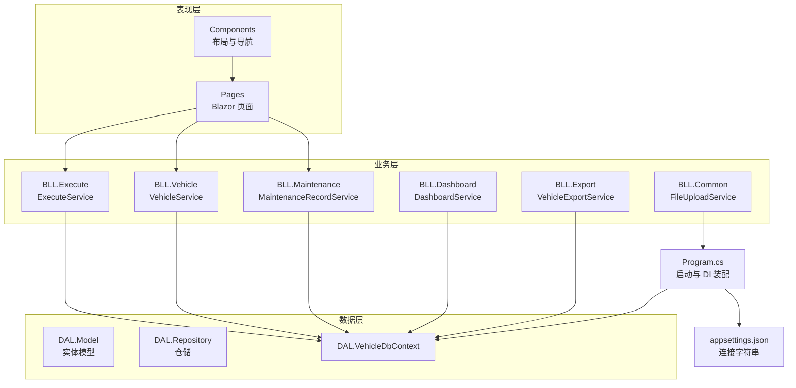
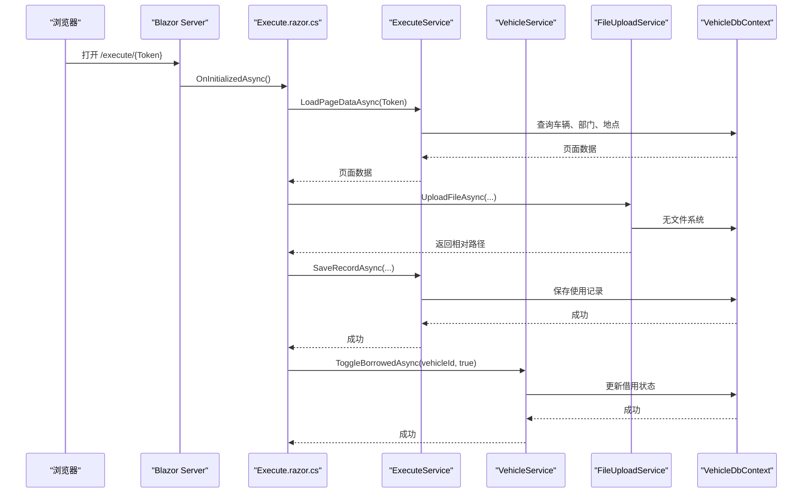
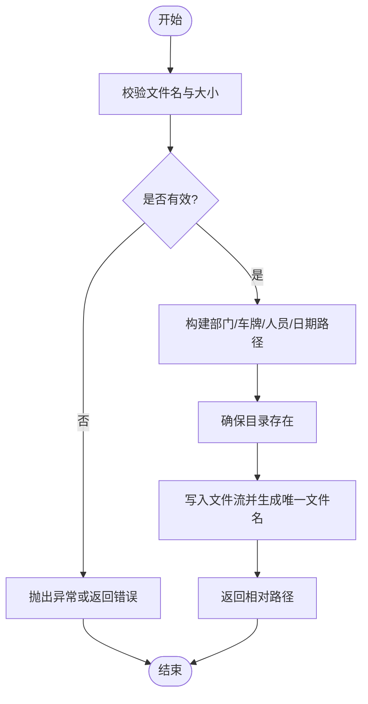
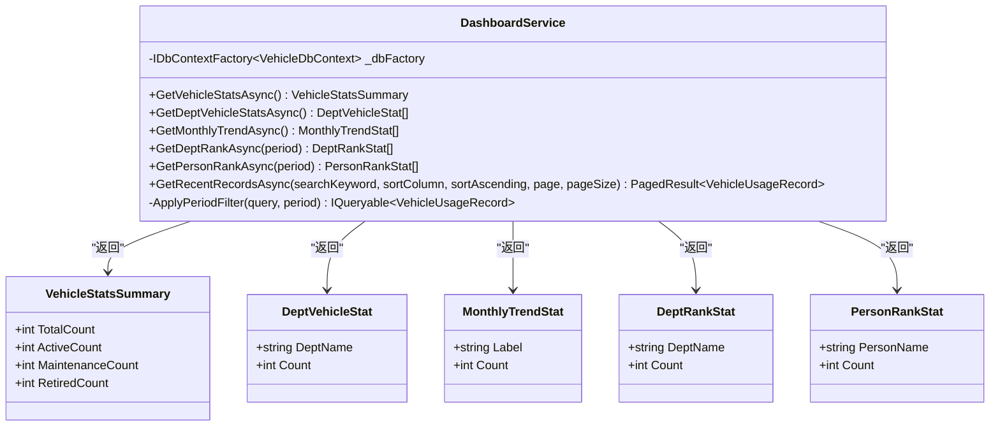
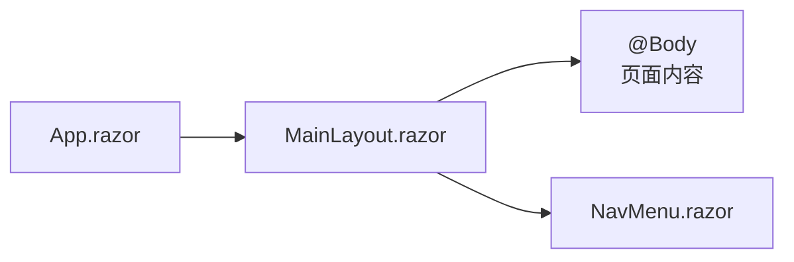
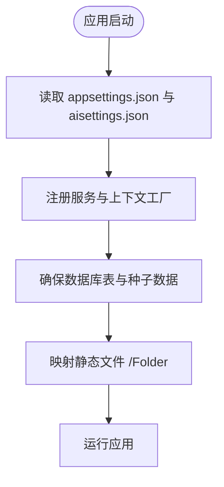
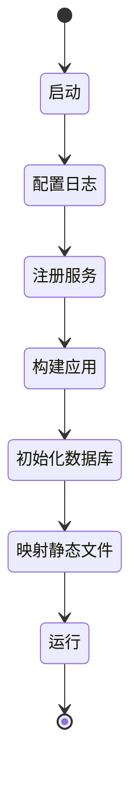

# 扩展点识别

<cite>
**本文引用的文件**   
- [Program.cs](file://Program.cs)
- [appsettings.json](file://appsettings.json)
- [FileUploadService.cs](file://BLL/Common/FileUploadService.cs)
- [DashboardService.cs](file://BLL/Dashboard/DashboardService.cs)
- [MainLayout.razor](file://Components/Layouts/MainLayout.razor)
- [Execute.razor.cs](file://Pages/Execute.razor.cs)
- [VehicleService.cs](file://BLL/Vehicle/VehicleService.cs)
- [VehicleDbContext.cs](file://DAL/VehicleDbContext.cs)
- [SeedDataInitializer.cs](file://DAL/SeedDataInitializer.cs)
- [README.md](file://README.md)
</cite>

## 目录
1. [引言](#引言)
2. [项目结构](#项目结构)
3. [核心扩展点总览](#核心扩展点总览)
4. [架构总览](#架构总览)
5. [详细扩展点分析](#详细扩展点分析)
6. [事件驱动与钩子现状](#事件驱动与钩子现状)
7. [配置扩展点](#配置扩展点)
8. [扩展点生命周期与依赖管理](#扩展点生命周期与依赖管理)
9. [扩展点测试方法](#扩展点测试方法)
10. [性能与可维护性建议](#性能与可维护性建议)
11. [故障排查指南](#故障排查指南)
12. [结论](#结论)

## 引言
本文件面向 vehicleManagement 系统的二次开发与集成人员，系统性识别并说明系统中的扩展点，重点覆盖：
- 文件上传服务的扩展点
- 仪表盘统计的扩展点
- 布局组件的扩展点
同时补充事件驱动架构现状、配置扩展方式、扩展点生命周期、测试方法与最佳实践。目标是帮助读者在不破坏现有稳定性的前提下，安全地扩展系统行为。

## 项目结构
vehicleManagement 采用分层架构：
- DAL：数据访问层，包含 DbContext、实体模型、仓储与种子数据初始化。
- BLL：业务逻辑层，包含车辆、部门、人员、位置、使用记录、仪表盘、执行页、维修、导出等服务。
- Pages：Blazor 页面，承载用户交互。
- Components：通用 Blazor 组件，包括布局与导航。
- Program.cs：应用启动、依赖注入、中间件、静态文件与数据库初始化。
- appsettings.json：连接字符串等基础配置。

图表来源
- [Program.cs:41-148](file://Program.cs#L41-L148)
- [VehicleDbContext.cs:6-19](file://DAL/VehicleDbContext.cs#L6-L19)
- [FileUploadService.cs:12-27](file://BLL/Common/FileUploadService.cs#L12-L27)
- [DashboardService.cs:16-23](file://BLL/Dashboard/DashboardService.cs#L16-L23)

章节来源
- [README.md:342-361](file://README.md#L342-L361)
- [Program.cs:41-148](file://Program.cs#L41-L148)

## 核心扩展点总览
当前代码库中已存在若干“可扩展”的设计点，但尚未提供统一的扩展接口或插件机制。以下是可直接用于扩展的关键位置：

| 扩展类别 | 扩展点位置 | 用途 | 当前扩展方式 | 推荐扩展方式 |
|---|---|---|---|---|
| 文件上传服务 | FileUploadService | 统一处理图片/视频上传、校验、存储路径生成与删除 | 直接调用 UploadFileAsync / DeleteFile | 通过策略模式扩展允许的文件类型、大小限制、存储路径规则；或通过装饰器扩展日志、审计、病毒扫描 |
| 仪表盘统计 | DashboardService | 提供车辆状态统计、部门分布、月度趋势、排行、分页最近使用记录 | 在 Service 内新增统计 DTO 与方法 | 定义统计扩展接口，注册自定义统计项；或在查询管道中增加过滤器 |
| 布局组件 | MainLayout.razor | 应用主布局，包含侧边栏、顶部栏、内容区 | 替换 Layout 或使用 @Body 插槽 | 通过继承 LayoutComponentBase 创建新布局，并在路由或 App.razor 中切换 |
| 配置扩展 | Program.cs + appsettings.json | 连接字符串、AI 端点与模型、静态文件映射、日志级别 | 修改配置文件与 Program 中的读取逻辑 | 新增配置段并通过 IConfiguration 注入，避免硬编码 |
| 页面流程钩子 | Execute.razor.cs | 扫码执行页，聚合使用登记、维修、借车登记与附件上传 | 在页面后置类中添加事件处理 | 抽取为可插拔的步骤处理器，支持顺序编排与结果回调 |

章节来源
- [FileUploadService.cs:12-110](file://BLL/Common/FileUploadService.cs#L12-L110)
- [DashboardService.cs:16-211](file://BLL/Dashboard/DashboardService.cs#L16-L211)
- [MainLayout.razor:1-40](file://Components/Layouts/MainLayout.razor#L1-L40)
- [Program.cs:41-148](file://Program.cs#L41-L148)
- [Execute.razor.cs:77-251](file://Pages/Execute.razor.cs#L77-L251)

## 架构总览
系统以 ASP.NET Core Blazor Server 为载体，使用 EF Core SQLite 作为数据存储，Serilog 输出日志，并通过 Program.cs 完成依赖注入与中间件装配。

图表来源
- [Execute.razor.cs:77-251](file://Pages/Execute.razor.cs#L77-L251)
- [VehicleService.cs:51-62](file://BLL/Vehicle/VehicleService.cs#L51-L62)
- [FileUploadService.cs:29-46](file://BLL/Common/FileUploadService.cs#L29-L46)
- [VehicleDbContext.cs:6-19](file://DAL/VehicleDbContext.cs#L6-L19)

## 详细扩展点分析

### 文件上传服务扩展点
FileUploadService 负责文件校验、大小限制、按部门/车牌/人员/日期组织目录、生成唯一文件名并返回相对路径。它被 Execute.razor.cs 和 VehicleService.cs 使用。

关键扩展维度：
- 允许的文件类型与大小限制：可通过策略对象注入替代硬编码数组与常量。
- 存储路径规则：可按业务域（如“维修”“借车”“使用登记”）生成不同根目录。
- 预处理与后处理：在保存前后插入审计日志、病毒扫描、缩略图生成、云存储同步。
- 删除策略：删除前检查引用计数或软删除标记。

图表来源
- [FileUploadService.cs:29-110](file://BLL/Common/FileUploadService.cs#L29-L110)

使用示例（概念性描述）：
- 自定义文件处理逻辑：在保存前对图片进行压缩或水印处理，或对视频进行转码。
- 扩展统计数据类型：将上传文件的元数据（如拍摄时间、GPS）写入扩展表，供仪表盘统计。

最佳实践：
- 将允许的文件类型与大小限制外置到配置或策略对象，便于环境差异化。
- 对异常进行分类：格式不支持、大小超限、磁盘不可用、权限不足。
- 删除失败时回滚业务事务，保证数据一致性。

章节来源
- [FileUploadService.cs:12-110](file://BLL/Common/FileUploadService.cs#L12-L110)
- [Execute.razor.cs:115-129](file://Pages/Execute.razor.cs#L115-L129)
- [VehicleService.cs:168-202](file://BLL/Vehicle/VehicleService.cs#L168-L202)

### 仪表盘统计扩展点
DashboardService 提供：
- 车辆状态统计：总数、在用、维修、报废。
- 部门车辆分布统计。
- 近 6 个月用车趋势。
- 部门与人员用车排行。
- 分页查询最近使用记录。

扩展方向：
- 新增统计指标：例如“平均里程”“部门人均使用次数”“设备利用率”。
- 新增统计维度：按颜色、品牌、车型分组。
- 新增时间粒度：周、季度、年度趋势。
- 新增排序与过滤：按状态、部门、人员组合筛选。

图表来源
- [DashboardService.cs:16-211](file://BLL/Dashboard/DashboardService.cs#L16-L211)
- [DashboardService.cs:215-245](file://BLL/Dashboard/DashboardService.cs#L215-L245)

使用示例（概念性描述）：
- 扩展统计数据类型：新增“按颜色统计”的方法，返回新的 DTO 列表。
- 在 Program.cs 中注册新的统计服务，供页面按需注入。

最佳实践：
- 保持查询下推至数据库，避免全表加载后再内存计算。
- 对分页参数做边界保护，防止越界。
- 对空数据月份进行补齐，保证图表连续性。

章节来源
- [DashboardService.cs:16-211](file://BLL/Dashboard/DashboardService.cs#L16-L211)
- [DashboardService.cs:215-245](file://BLL/Dashboard/DashboardService.cs#L215-L245)

### 布局组件扩展点
MainLayout.razor 定义了应用的主布局，包含侧边栏、顶部栏与内容区。Blazor 通过 @Body 渲染具体页面内容。

扩展方向：
- 创建新布局：继承 LayoutComponentBase，实现不同的导航与主题。
- 动态主题：根据用户角色或配置切换样式变量。
- 多区域布局：在 main-content 中嵌入多个 @Body 插槽，支持分屏视图。

图表来源
- [MainLayout.razor:1-40](file://Components/Layouts/MainLayout.razor#L1-L40)

最佳实践：
- 将布局相关状态（如侧边栏开关）封装在组件内部，避免污染页面。
- 使用 CSS 变量统一管理主题，便于扩展。
- 在移动端与桌面端分别提供布局，提升体验。

章节来源
- [MainLayout.razor:1-40](file://Components/Layouts/MainLayout.razor#L1-L40)

## 事件驱动与钩子现状
当前系统中没有显式的事件总线或事件订阅机制。业务流程主要通过方法调用与服务协作完成，属于命令式流程而非事件驱动。

现状总结：
- 未定义公共事件类型或事件中心。
- 页面与服务的交互通过异步方法返回值与异常传递。
- 文件上传、统计查询、页面导航均为同步调用链。

建议的扩展方案（概念性）：
- 引入轻量事件总线：定义领域事件（如“车辆使用记录已保存”“文件上传完成”），在服务完成后发布事件。
- 订阅者实现：日志审计、缓存刷新、通知推送、指标采集。
- 钩子点：在关键步骤（如保存前、保存后、删除前）预留虚方法或委托，供扩展点注入。

注意：以下为概念设计，当前代码未实现。

## 配置扩展点
Program.cs 与 appsettings.json 提供了以下配置扩展点：

- 连接字符串：DefaultConnection、AiServerConnection。
- AI 配置：aisettings.json（可选、热重载），以及 AiServer:OllamaEndpoint、AiServer:OllamaModel。
- 静态文件映射：Folder 目录映射为 /Folder。
- 日志级别：Serilog 默认信息与框架日志抑制。

图表来源
- [Program.cs:41-148](file://Program.cs#L41-L148)
- [appsettings.json:1-8](file://appsettings.json#L1-L8)

配置扩展建议：
- 新增配置段：如 FileStorage.MaxSize、AllowedExtensions、StorageRoot。
- 通过 IConfiguration 注入，避免硬编码。
- 对敏感配置使用环境变量或密钥管理服务。

章节来源
- [Program.cs:41-148](file://Program.cs#L41-L148)
- [appsettings.json:1-8](file://appsettings.json#L1-L8)

## 扩展点生命周期与依赖管理
依赖注入与初始化顺序：
- Program.cs 中先配置 Serilog，再添加 Razor 与 Blazor 服务。
- 注册 DbContextFactory，避免 Blazor Server 并发问题。
- 注册仓储与服务，作用域为 Scoped。
- 构建应用后，确保数据库表存在并初始化种子数据。
- 最后映射静态文件与路由。

图表来源
- [Program.cs:28-148](file://Program.cs#L28-L148)

依赖关系：
- VehicleService 依赖 VehicleRepository、DepartmentRepository、IDbContextFactory、FileUploadService、ILogger。
- DashboardService 依赖 IDbContextFactory。
- Execute.razor.cs 依赖多个服务，协调页面流程。

最佳实践：
- 使用构造函数注入，明确依赖。
- 对长生命周期服务使用 Singleton，短生命周期使用 Scoped。
- 避免循环依赖，必要时引入接口抽象。

章节来源
- [Program.cs:41-148](file://Program.cs#L41-L148)
- [VehicleService.cs:18-38](file://BLL/Vehicle/VehicleService.cs#L18-L38)
- [DashboardService.cs:16-23](file://BLL/Dashboard/DashboardService.cs#L16-L23)

## 扩展点测试方法
针对各扩展点的测试建议：

- 文件上传服务：
  - 单元测试：校验允许的文件类型、大小限制、路径生成、删除逻辑。
  - 集成测试：模拟 IFormFile 与 IBrowserFile，验证实际文件写入与相对路径返回。
  - 异常场景：空文件、非法扩展名、超大文件、磁盘不可用。

- 仪表盘统计：
  - 单元测试：构造最小数据集，验证统计结果与补齐逻辑。
  - 集成测试：使用内存数据库或测试上下文，验证 SQL 下推与分页。
  - 边界条件：空数据、跨月、跨年、排序字段为空。

- 布局组件：
  - 组件测试：验证侧边栏开关、@Body 渲染、移动端适配。
  - UI 测试：模拟点击按钮，检查 DOM 状态变化。

- 配置扩展：
  - 单元测试：验证配置读取默认值与覆盖值。
  - 集成测试：在不同环境下启动应用，确认连接字符串与 AI 端点生效。

章节来源
- [FileUploadService.cs:29-110](file://BLL/Common/FileUploadService.cs#L29-L110)
- [DashboardService.cs:28-211](file://BLL/Dashboard/DashboardService.cs#L28-L211)
- [MainLayout.razor:1-40](file://Components/Layouts/MainLayout.razor#L1-L40)
- [Program.cs:41-148](file://Program.cs#L41-L148)

## 性能与可维护性建议
- 查询优化：DashboardService 已使用 CountAsync、GroupBy、OrderByDescending，避免全表加载。
- 分页保护：对 page 与 pageSize 做边界校验，防止越界。
- 文件上传：对大文件设置合理超时与流式写入，避免内存溢出。
- 日志与监控：使用 Serilog 输出关键操作，结合指标采集。
- 配置外置：将可变参数放入配置，减少代码变更。

[本节为通用指导，不直接分析具体文件]

## 故障排查指南
常见问题与定位方法：
- 文件上传失败：检查文件格式与大小限制，查看 FileUploadService 抛出的异常信息。
- 仪表盘数据为空：检查数据库是否有使用记录，确认时间范围过滤逻辑。
- 布局显示异常：检查 MainLayout 的 CSS 与响应式样式，确认 @Body 渲染。
- 配置未生效：确认 appsettings.json 与 aisettings.json 的路径与键名正确。

章节来源
- [FileUploadService.cs:69-84](file://BLL/Common/FileUploadService.cs#L69-L84)
- [DashboardService.cs:197-211](file://BLL/Dashboard/DashboardService.cs#L197-L211)
- [MainLayout.razor:1-40](file://Components/Layouts/MainLayout.razor#L1-L40)
- [Program.cs:41-148](file://Program.cs#L41-L148)

## 结论
vehicleManagement 系统目前以分层架构与依赖注入为基础，具备明确的扩展点：
- 文件上传服务可通过策略与装饰器扩展。
- 仪表盘统计可通过新增 DTO 与方法扩展。
- 布局组件可通过继承与插槽扩展。
- 配置扩展通过 Program.cs 与配置文件实现。
虽然尚未实现统一的事件驱动架构，但可在关键步骤预留钩子，逐步演进为事件驱动。建议在扩展过程中遵循职责单一、依赖清晰、配置外置的原则，确保系统可维护性与可扩展性。

[本节为总结性内容，不直接分析具体文件]