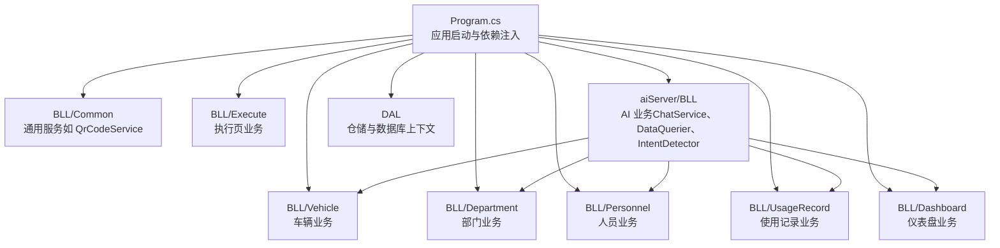
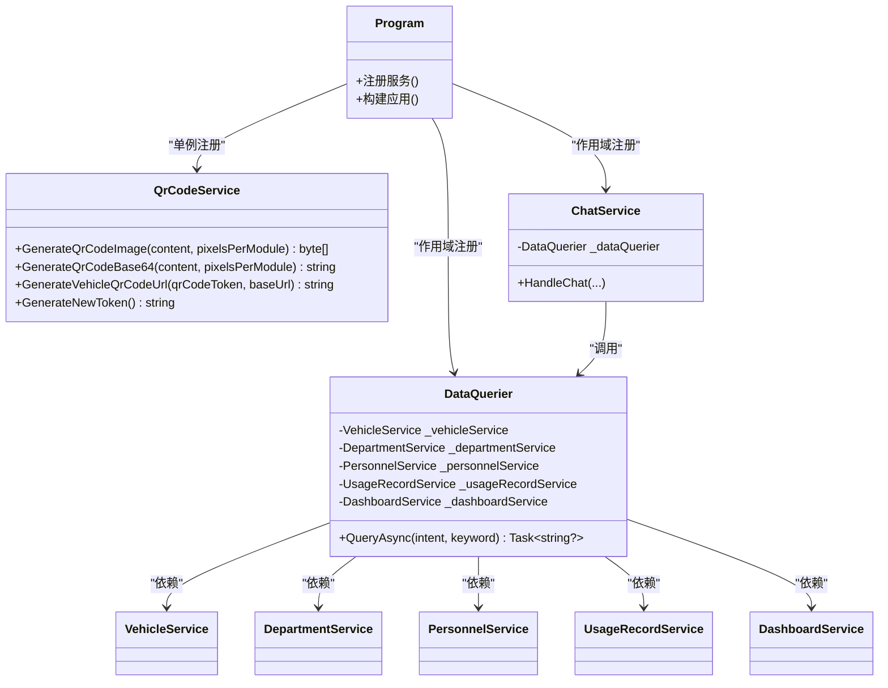
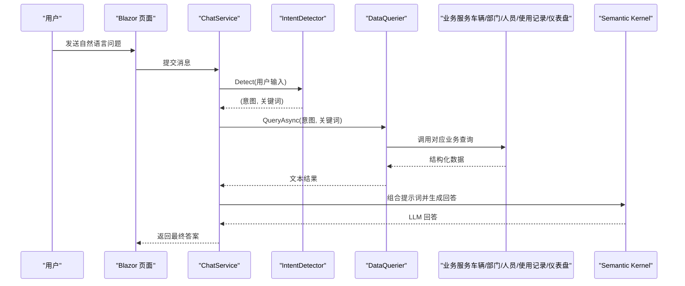
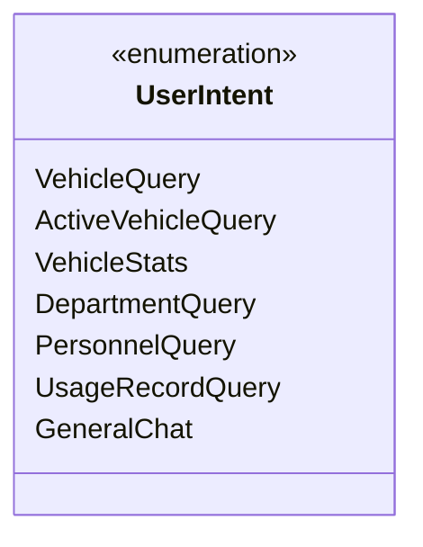
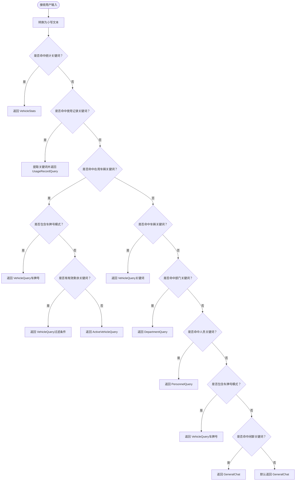
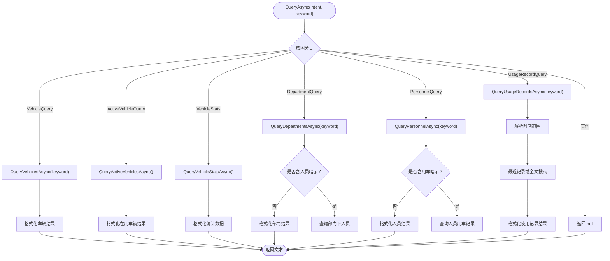
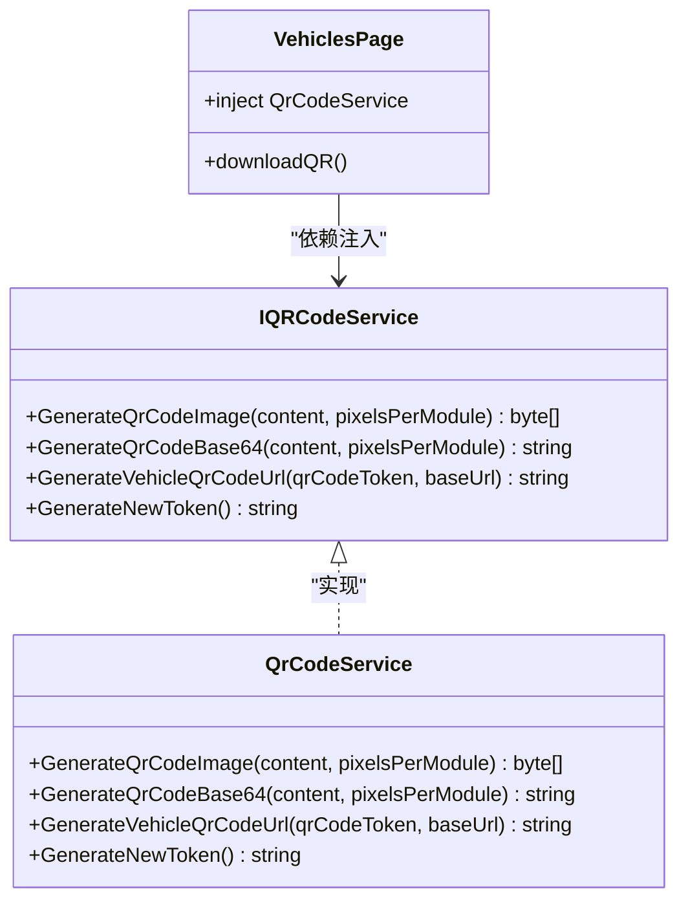
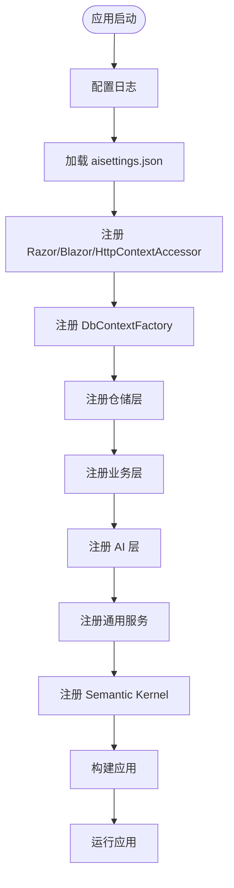
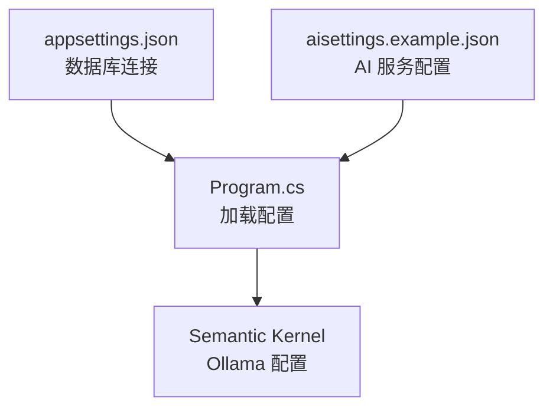
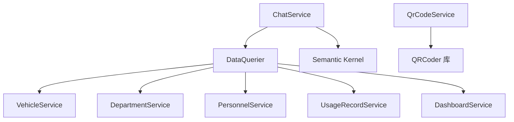

# 插件机制

<cite>
**本文引用的文件**   
- [Program.cs](file://Program.cs)
- [QrCodeService.cs](file://BLL/Common/QrCodeService.cs)
- [DataQuerier.cs](file://aiServer/BLL/DataQuerier.cs)
- [IntentDetector.cs](file://aiServer/BLL/IntentDetector.cs)
- [UserIntent.cs](file://aiServer/BLL/Enums/UserIntent.cs)
- [ChatService.cs](file://aiServer/BLL/ChatService.cs)
- [Vehicles.razor](file://Pages/Vehicles.razor)
- [ExecuteService.cs](file://BLL/Execute/ExecuteService.cs)
- [appsettings.json](file://appsettings.json)
- [aisettings.example.json](file://aisettings.example.json)
</cite>

## 目录
1. [引言](#引言)
2. [项目结构与插件边界](#项目结构与插件边界)
3. [核心组件与依赖注入设计](#核心组件与依赖注入设计)
4. [架构总览](#架构总览)
5. [意图路由与查询扩展机制](#意图路由与查询扩展机制)
6. [二维码服务可扩展性](#二维码服务可扩展性)
7. [插件生命周期管理](#插件生命周期管理)
8. [插件配置与环境变量](#插件配置与环境变量)
9. [插件开发示例](#插件开发示例)
10. [依赖关系分析](#依赖关系分析)
11. [性能与稳定性考虑](#性能与稳定性考虑)
12. [故障排查指南](#故障排查指南)
13. [结论](#结论)

## 引言
vehicleManagement 是一个基于 .NET Blazor Server 的车辆管理系统，并在同一后端内嵌 AI 助手能力。系统通过依赖注入注册业务服务、AI 服务和通用工具；其中：
- DataQuerier 承担“用户意图 → 数据查询”的意图路由职责。
- QrCodeService 提供二维码生成、URL 构造和 Token 生成等通用能力。
- Program.cs 是应用启动入口，负责数据库上下文、仓储层、业务层、AI 层以及通用服务的注册。

本插件机制文档聚焦以下目标：
- 解释如何通过依赖注入实现功能扩展。
- 说明如何注册和发现插件服务。
- 详细说明 DataQuerier 的意图路由机制以及如何添加新的查询意图类型。
- 说明 QrCodeService 的可扩展性以及如何替换二维码算法或集成第三方服务。
- 给出插件开发示例：新增业务查询类型、扩展二维码功能。
- 说明插件生命周期：加载顺序、依赖解析、错误处理。
- 说明插件配置方式：配置文件结构、环境变量支持。

## 项目结构与插件边界
从代码组织看，系统按领域分层：
- BLL：业务逻辑层，包含车辆、部门、人员、使用记录、仪表盘、执行页、导出、通用工具等。
- DAL：数据访问层，包含模型、仓储、数据库上下文和种子数据初始化。
- aiServer：AI 子模块，包含对话服务、意图识别、数据查询、记忆管理等。
- Pages：Blazor 页面，承载用户界面。
- Program.cs：应用启动、依赖注入、中间件、静态文件、健康检查等。

**图表来源** 
- [Program.cs:41-102](file://Program.cs#L41-L102)
- [DataQuerier.cs:23-43](file://aiServer/BLL/DataQuerier.cs#L23-L43)

**章节来源**
- [Program.cs:41-102](file://Program.cs#L41-L102)

## 核心组件与依赖注入设计
当前系统的“插件化”体现在：
- 所有可替换能力都通过依赖注入暴露为服务。
- 通用能力（如 QrCodeService）以单例形式注册，便于跨页面复用。
- AI 能力（如 ChatService、DataQuerier）作为独立服务被注入到对话流程中。
- 业务服务（VehicleService、DepartmentService 等）由 DataQuerier 通过构造函数注入，形成“意图 → 查询”的解耦。

关键注册点：
- Program.cs 中注册仓储、业务、AI 服务和通用服务。
- QrCodeService 以单例注册，供页面和服务共同使用。
- DataQuerier 在 AI 层被注入，用于根据意图调用具体业务查询。

**图表来源** 
- [Program.cs:75-95](file://Program.cs#L75-L95)
- [QrCodeService.cs:6-39](file://BLL/Common/QrCodeService.cs#L6-L39)
- [DataQuerier.cs:23-43](file://aiServer/BLL/DataQuerier.cs#L23-L43)
- [ChatService.cs:18-39](file://aiServer/BLL/ChatService.cs#L18-L39)

**章节来源**
- [Program.cs:75-95](file://Program.cs#L75-L95)
- [QrCodeService.cs:6-39](file://BLL/Common/QrCodeService.cs#L6-L39)
- [DataQuerier.cs:23-43](file://aiServer/BLL/DataQuerier.cs#L23-L43)
- [ChatService.cs:18-39](file://aiServer/BLL/ChatService.cs#L18-L39)

## 架构总览
下图展示从用户输入到 AI 回答的整体流程，包括意图识别、数据查询、结果格式化与 LLM 对话。

**图表来源** 
- [IntentDetector.cs:17-111](file://aiServer/BLL/IntentDetector.cs#L17-L111)
- [DataQuerier.cs:48-67](file://aiServer/BLL/DataQuerier.cs#L48-L67)
- [ChatService.cs:18-39](file://aiServer/BLL/ChatService.cs#L18-L39)

**章节来源**
- [IntentDetector.cs:17-111](file://aiServer/BLL/IntentDetector.cs#L17-L111)
- [DataQuerier.cs:48-67](file://aiServer/BLL/DataQuerier.cs#L48-L67)
- [ChatService.cs:18-39](file://aiServer/BLL/ChatService.cs#L18-L39)

## 意图路由与查询扩展机制
### 意图枚举
UserIntent 定义了当前支持的意图类型，包括车辆查询、在用车辆查询、车辆统计、部门查询、人员查询、使用记录查询和通用问答。

**图表来源** 
- [UserIntent.cs:6-22](file://aiServer/BLL/Enums/UserIntent.cs#L6-L22)

**章节来源**
- [UserIntent.cs:6-22](file://aiServer/BLL/Enums/UserIntent.cs#L6-L22)

### 意图识别
IntentDetector 基于关键词匹配判断用户意图，并提取搜索关键词。优先级规则如下：
- 统计类关键词优先（避免将统计问题误判为具体查询）。
- 使用记录关键词命中后进入 UsageRecordQuery。
- “在用车辆”关键词优先于普通车辆查询，同时排除车牌号模式。
- 车辆、部门、人员关键词分别进入对应查询。
- 若检测到车牌号模式，直接走车辆查询。
- 闲聊关键词仅在未命中任何数据查询意图时生效。
- 默认返回通用问答。

**图表来源** 
- [IntentDetector.cs:17-111](file://aiServer/BLL/IntentDetector.cs#L17-L111)

**章节来源**
- [IntentDetector.cs:17-111](file://aiServer/BLL/IntentDetector.cs#L17-L111)

### 意图分发与查询实现
DataQuerier.QueryAsync 根据 UserIntent 分派到具体查询方法：
- VehicleQuery → QueryVehiclesAsync
- ActiveVehicleQuery → QueryActiveVehiclesAsync
- VehicleStats → QueryVehicleStatsAsync
- DepartmentQuery → QueryDepartmentsAsync
- PersonnelQuery → QueryPersonnelAsync
- UsageRecordQuery → QueryUsageRecordsAsync
- 其他 → 返回 null

每个查询方法调用对应的业务服务，并将结果格式化为 LLM 可读文本。部分查询还包含交叉查询逻辑：
- 部门查询中检测“人员”相关关键词，进一步查询各部门人员。
- 人员查询中检测“用车”相关关键词，进一步查询人员用车记录。
- 使用记录查询中解析时间范围关键词（天、周、月、季度、年），并调用最近记录查询。

**图表来源** 
- [DataQuerier.cs:48-67](file://aiServer/BLL/DataQuerier.cs#L48-L67)
- [DataQuerier.cs:69-330](file://aiServer/BLL/DataQuerier.cs#L69-L330)

**章节来源**
- [DataQuerier.cs:48-67](file://aiServer/BLL/DataQuerier.cs#L48-L67)
- [DataQuerier.cs:69-330](file://aiServer/BLL/DataQuerier.cs#L69-L330)

### 添加新查询意图类型的步骤
要添加新的业务查询类型，建议遵循以下步骤：
1. 在 UserIntent 中添加新的枚举值。
2. 在 IntentDetector.Detect 中添加关键词匹配逻辑，确保新意图能被正确识别。
3. 在 DataQuerier.QueryAsync 中添加新的意图分支，调用新的查询方法。
4. 在 DataQuerier 中实现新的查询方法，调用相应业务服务并格式化结果。
5. 如需交叉查询，可在对应查询方法中加入关键词检测与二次查询逻辑。
6. 在 ChatService 中确保新查询结果能正确注入到提示词上下文。

注意：
- 保持意图优先级合理，避免新意图与已有意图冲突。
- 关键词清洗逻辑应保持一致，避免噪声干扰。
- 查询结果格式应统一，便于 LLM 理解。

**章节来源**
- [UserIntent.cs:6-22](file://aiServer/BLL/Enums/UserIntent.cs#L6-L22)
- [IntentDetector.cs:17-111](file://aiServer/BLL/IntentDetector.cs#L17-L111)
- [DataQuerier.cs:48-67](file://aiServer/BLL/DataQuerier.cs#L48-L67)
- [DataQuerier.cs:69-330](file://aiServer/BLL/DataQuerier.cs#L69-L330)

## 二维码服务可扩展性
QrCodeService 提供二维码生成、Base64 编码、URL 构造和 Token 生成功能。当前实现基于 QRCoder 库，但可通过依赖注入替换为自定义实现。

### 当前能力
- GenerateQrCodeImage：生成 PNG 字节数组。
- GenerateQrCodeBase64：生成 Base64 字符串。
- GenerateVehicleQrCodeUrl：根据 Token 和基础 URL 生成执行页链接。
- GenerateNewToken：生成唯一 Token。

### 扩展方式
由于 QrCodeService 通过依赖注入注册，可以：
- 定义接口 IQRCodeService（建议新增）。
- 实现自定义 QRCodeService（例如集成第三方二维码服务或更换算法）。
- 在 Program.cs 中将单例注册改为接口映射。
- 在页面和服务中通过接口注入，无需修改调用方。

**图表来源** 
- [QrCodeService.cs:6-39](file://BLL/Common/QrCodeService.cs#L6-L39)
- [Vehicles.razor:3-7](file://Pages/Vehicles.razor#L3-L7)
- [Program.cs:95](file://Program.cs#L95)

**章节来源**
- [QrCodeService.cs:6-39](file://BLL/Common/QrCodeService.cs#L6-L39)
- [Vehicles.razor:3-7](file://Pages/Vehicles.razor#L3-L7)
- [Program.cs:95](file://Program.cs#L95)

### 集成第三方二维码服务
若要集成第三方二维码服务（例如云端 API），建议：
1. 定义 IQRCodeService 接口。
2. 实现 ThirdPartyQRCodeService，封装 HTTP 调用、认证、重试等逻辑。
3. 在 Program.cs 中注册 IQRCodeService 为单例。
4. 在 Vehicles.razor 中注入 IQRCodeService 而非具体实现。
5. 保留 QrCodeService 作为本地实现，便于切换。

注意：
- 第三方服务需处理网络异常、超时、限流等问题。
- 二维码内容应加密或签名，防止伪造。
- Token 生成策略应与业务安全要求一致。

**章节来源**
- [QrCodeService.cs:6-39](file://BLL/Common/QrCodeService.cs#L6-L39)
- [Program.cs:95](file://Program.cs#L95)

## 插件生命周期管理
### 加载顺序
Program.cs 中的服务注册顺序决定了依赖解析的可见性，但 ASP.NET Core DI 容器会解析循环依赖（如果存在）。当前注册顺序大致为：
1. 日志配置（Serilog）。
2. 配置加载（aisettings.json）。
3. Razor Pages 与 Blazor Server。
4. DbContextFactory 注册（VehicleDbContext 与 AiServerDbContext）。
5. 仓储层注册。
6. 业务层注册。
7. AI 层注册。
8. 通用服务注册（FileUploadService、QrCodeService）。
9. Semantic Kernel 注册。
10. 应用构建与运行。

**图表来源** 
- [Program.cs:29-102](file://Program.cs#L29-L102)

**章节来源**
- [Program.cs:29-102](file://Program.cs#L29-L102)

### 依赖解析
- DataQuerier 通过构造函数注入多个业务服务，形成强耦合的查询编排器。
- QrCodeService 以单例注册，供页面和服务共享。
- ChatService 注入 DataQuerier 和 Kernel，负责对话流程编排。

潜在风险：
- DataQuerier 直接依赖具体业务类，不利于单元测试和替换。
- 若未来引入更多查询类型，DataQuerier 可能变得臃肿。

建议：
- 引入 IQueryHandler 接口，每个意图对应一个处理器。
- 使用服务集合扫描或配置表注册处理器。
- DataQuerier 仅负责路由，不关心具体实现。

**章节来源**
- [DataQuerier.cs:23-43](file://aiServer/BLL/DataQuerier.cs#L23-L43)
- [Program.cs:75-95](file://Program.cs#L75-L95)

### 错误处理
- DataQuerier.QueryAsync 捕获异常并返回错误信息字符串。
- QrCodeService 对空参数抛出 ArgumentException。
- Program.cs 捕获启动异常并记录日志。

建议：
- 统一错误响应格式，便于前端展示。
- 对第三方服务调用增加重试和熔断机制。
- 记录详细错误日志，便于排查。

**章节来源**
- [DataQuerier.cs:48-67](file://aiServer/BLL/DataQuerier.cs#L48-L67)
- [QrCodeService.cs:10-11](file://BLL/Common/QrCodeService.cs#L10-L11)
- [Program.cs:150-153](file://Program.cs#L150-L153)

## 插件配置与环境变量
### 配置文件结构
- appsettings.json：数据库连接字符串。
- aisettings.example.json：AI 服务配置（Ollama 端点和模型）。
- Program.cs 中加载 aisettings.json，支持热重载。

**图表来源** 
- [appsettings.json:1-8](file://appsettings.json#L1-L8)
- [aisettings.example.json:1-7](file://aisettings.example.json#L1-L7)
- [Program.cs:46-102](file://Program.cs#L46-L102)

**章节来源**
- [appsettings.json:1-8](file://appsettings.json#L1-L8)
- [aisettings.example.json:1-7](file://aisettings.example.json#L1-L7)
- [Program.cs:46-102](file://Program.cs#L46-L102)

### 环境变量支持
- Docker 部署时可通过环境变量覆盖 Ollama 端点和模型。
- 环境变量优先级高于配置文件。
- 建议在 production 环境中只使用环境变量，避免敏感信息打入镜像。

**章节来源**
- [Program.cs:98-102](file://Program.cs#L98-L102)

## 插件开发示例
### 示例一：添加新的业务查询类型
假设需要添加“维修记录查询”意图：
1. 在 UserIntent 中添加 MaintenanceRecordQuery。
2. 在 IntentDetector.Detect 中添加“维修”相关关键词匹配。
3. 在 DataQuerier.QueryAsync 中添加 MaintenanceRecordQuery 分支。
4. 在 DataQuerier 中实现 QueryMaintenanceRecordsAsync，调用 MaintenanceRecordService。
5. 格式化维修记录结果，包括车辆、部门、人员、时间等信息。
6. 在 ChatService 中确保新结果能注入上下文。

注意：
- 关键词应避免与现有意图冲突。
- 查询结果应简洁明了，便于 LLM 总结。
- 如需分页或过滤，应在业务服务中实现。

**章节来源**
- [UserIntent.cs:6-22](file://aiServer/BLL/Enums/UserIntent.cs#L6-L22)
- [IntentDetector.cs:17-111](file://aiServer/BLL/IntentDetector.cs#L17-L111)
- [DataQuerier.cs:48-67](file://aiServer/BLL/DataQuerier.cs#L48-L67)

### 示例二：扩展二维码功能
假设需要支持 SVG 二维码：
1. 在 IQRCodeService 中新增 GenerateQrCodeSvg 方法。
2. 在 QrCodeService 中实现该方法（或使用第三方库）。
3. 在 Vehicles.razor 中调用新方法生成 SVG。
4. 在 Program.cs 中确保接口注册正确。

注意：
- SVG 适合矢量显示，适合打印和缩放。
- 第三方库需评估许可证和性能。
- 保持向后兼容，不影响现有功能。

**章节来源**
- [QrCodeService.cs:6-39](file://BLL/Common/QrCodeService.cs#L6-L39)
- [Vehicles.razor:3-7](file://Pages/Vehicles.razor#L3-L7)
- [Program.cs:95](file://Program.cs#L95)

## 依赖关系分析
### 组件耦合度
- DataQuerier 与业务服务耦合度高，不利于扩展和测试。
- QrCodeService 与页面和服务耦合度低，易于替换。
- ChatService 与 DataQuerier 和 Kernel 耦合，负责对话编排。

### 外部依赖
- QRCoder：二维码生成。
- Microsoft.SemanticKernel：LLM 对话。
- EF Core：数据库访问。
- Serilog：日志记录。

**图表来源** 
- [DataQuerier.cs:23-43](file://aiServer/BLL/DataQuerier.cs#L23-L43)
- [ChatService.cs:18-39](file://aiServer/BLL/ChatService.cs#L18-L39)
- [QrCodeService.cs:1-2](file://BLL/Common/QrCodeService.cs#L1-L2)

**章节来源**
- [DataQuerier.cs:23-43](file://aiServer/BLL/DataQuerier.cs#L23-L43)
- [ChatService.cs:18-39](file://aiServer/BLL/ChatService.cs#L18-L39)
- [QrCodeService.cs:1-2](file://BLL/Common/QrCodeService.cs#L1-L2)

## 性能与稳定性考虑
- DataQuerier 限制最大查询结果为 20，避免返回过多数据。
- 使用 IDbContextFactory 避免 Blazor Server 并发冲突。
- QrCodeService 使用 using 语句释放资源，避免内存泄漏。
- Serilog 配置滚动日志，限制保留文件数量。

建议：
- 对频繁查询的数据增加缓存。
- 对第三方服务调用增加超时和重试。
- 对大数据量查询增加分页和索引优化。

**章节来源**
- [DataQuerier.cs:29](file://aiServer/BLL/DataQuerier.cs#L29)
- [Program.cs:52-58](file://Program.cs#L52-L58)
- [QrCodeService.cs:13-18](file://BLL/Common/QrCodeService.cs#L13-L18)
- [Program.cs:34-37](file://Program.cs#L34-L37)

## 故障排查指南
### 常见问题
- 二维码内容为空：检查 QrCodeService.GenerateQrCodeImage 的参数校验。
- 意图识别错误：检查 IntentDetector 的关键词列表和优先级。
- 查询结果为空：检查业务服务是否正确返回数据。
- AI 回答异常：检查 Semantic Kernel 配置和 Ollama 端点。

### 调试建议
- 启用开发环境异常页面。
- 查看 Serilog 日志文件。
- 在 DataQuerier 和 IntentDetector 中添加断点。
- 验证 aisettings.json 配置是否正确加载。

**章节来源**
- [QrCodeService.cs:10-11](file://BLL/Common/QrCodeService.cs#L10-L11)
- [IntentDetector.cs:17-111](file://aiServer/BLL/IntentDetector.cs#L17-L111)
- [DataQuerier.cs:48-67](file://aiServer/BLL/DataQuerier.cs#L48-L67)
- [Program.cs:127-130](file://Program.cs#L127-L130)

## 结论
vehicleManagement 的插件机制基于依赖注入和模块化设计，当前已具备较好的扩展基础。DataQuerier 负责意图路由，QrCodeService 提供通用二维码能力。未来可通过引入接口抽象、处理器模式和配置驱动注册进一步提升灵活性和可维护性。同时，应关注错误处理、性能优化和安全加固，确保系统在扩展过程中保持稳定和可靠。