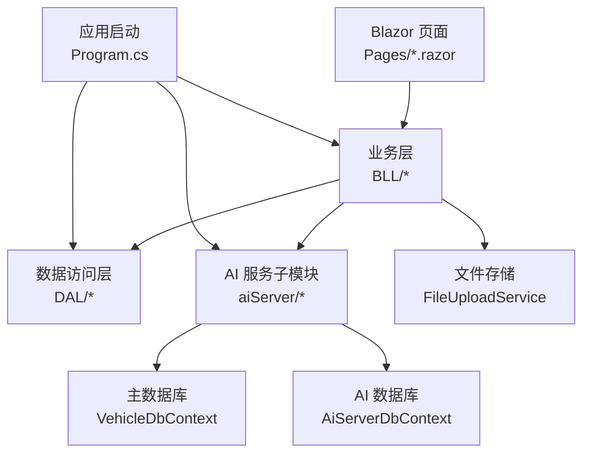
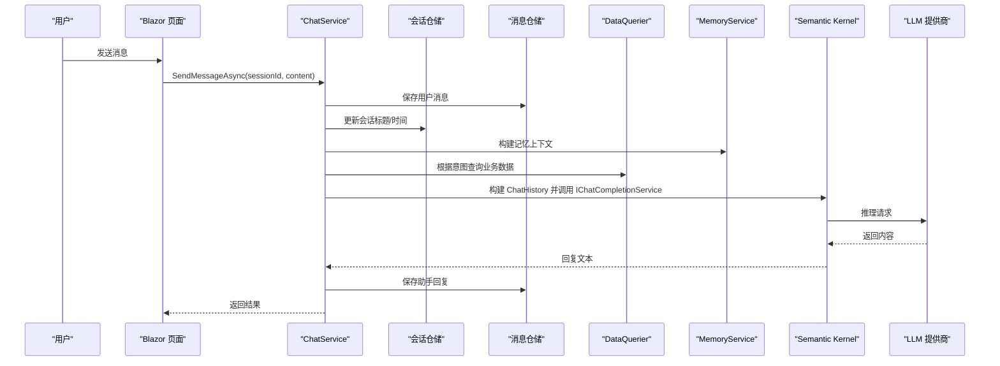
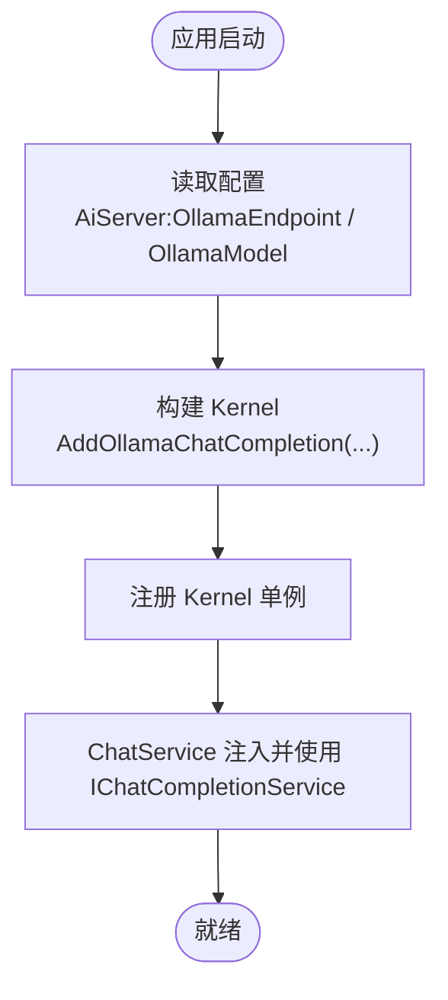
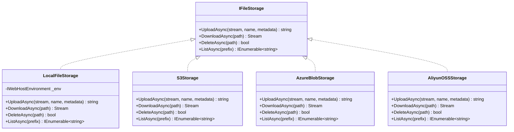
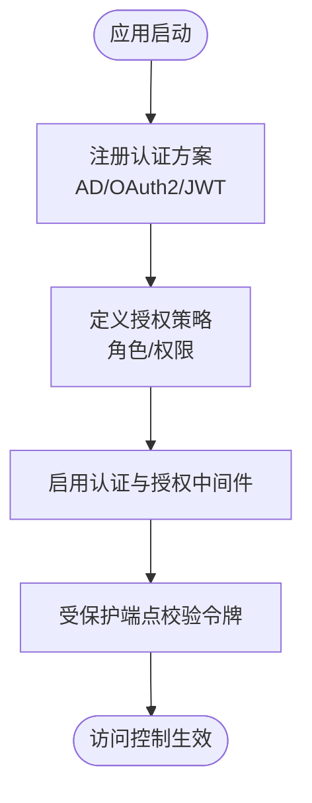
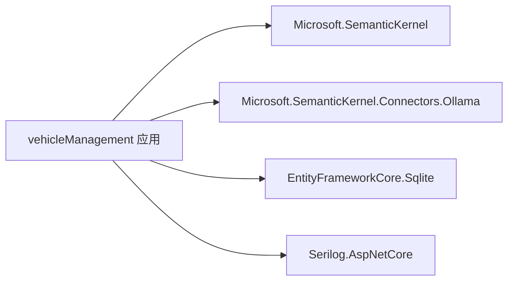

# 第三方集成

<cite>
**本文引用的文件**   
- [Program.cs](file://Program.cs)
- [appsettings.json](file://appsettings.json)
- [aisettings.example.json](file://aisettings.example.json)
- [vehicleManagement.csproj](file://vehicleManagement.csproj)
- [ChatService.cs](file://aiServer/BLL/ChatService.cs)
- [FileUploadService.cs](file://BLL/Common/FileUploadService.cs)
- [AiServerDbContext.cs](file://aiServer/DAL/AiServerDbContext.cs)
- [README.md](file://README.md)
</cite>

## 目录
1. [简介](#简介)
2. [项目结构](#项目结构)
3. [核心组件](#核心组件)
4. [架构总览](#架构总览)
5. [详细组件分析](#详细组件分析)
6. [依赖关系分析](#依赖关系分析)
7. [性能与可靠性](#性能与可靠性)
8. [故障排查指南](#故障排查指南)
9. [结论](#结论)
10. [附录：配置迁移与版本升级](#附录配置迁移与版本升级)

## 简介
本指南面向需要在 vehicleManagement 系统中接入第三方能力的团队，重点覆盖以下主题：
- AI 模型替换机制：通过配置切换不同 LLM 提供商（OpenAI、Azure OpenAI、本地 Ollama），以及 Semantic Kernel 的配置和使用模式。
- 存储后端扩展：如何替换当前基于本地磁盘的文件存储服务，支持云存储（AWS S3、Azure Blob、阿里云 OSS）。
- 认证系统集成：如何集成外部身份验证系统（Active Directory、OAuth2、JWT）。
- 具体集成示例：添加新的 AI 提供商配置、集成云存储服务。
- 连接池管理、错误重试机制、超时配置。
- 配置迁移策略：向后兼容性保证与版本升级指导。

## 项目结构
本项目采用分层架构：
- 表现层：Blazor Server 页面与服务端逻辑。
- 业务层（BLL）：车辆、部门、人员、位置、使用记录、仪表盘、执行、维修、导出等。
- 数据访问层（DAL）：仓储实现与 EF Core 上下文。
- AI 服务子模块（aiServer）：对话、意图识别、记忆、查询与独立数据库上下文。
- 通用能力：文件上传、二维码生成、日志等。

**图表来源**
- [Program.cs:41-102](file://Program.cs#L41-L102)
- [AiServerDbContext.cs:9-18](file://aiServer/DAL/AiServerDbContext.cs#L9-L18)
- [FileUploadService.cs:12-27](file://BLL/Common/FileUploadService.cs#L12-L27)

**章节来源**
- [Program.cs:41-102](file://Program.cs#L41-L102)
- [AiServerDbContext.cs:9-18](file://aiServer/DAL/AiServerDbContext.cs#L9-L18)
- [FileUploadService.cs:12-27](file://BLL/Common/FileUploadService.cs#L12-L27)

## 核心组件
- AI 对话服务 ChatService：封装会话、记忆、意图识别、数据查询与 LLM 调用。
- 文件上传服务 FileUploadService：负责本地磁盘文件的校验、保存与删除。
- 应用启动 Program.cs：注册服务、初始化数据库、构建并注入 Semantic Kernel。
- AI 数据库上下文 AiServerDbContext：维护聊天会话、消息与记忆实体。

**章节来源**
- [ChatService.cs:18-42](file://aiServer/BLL/ChatService.cs#L18-L42)
- [FileUploadService.cs:12-27](file://BLL/Common/FileUploadService.cs#L12-L27)
- [Program.cs:41-102](file://Program.cs#L41-L102)
- [AiServerDbContext.cs:9-18](file://aiServer/DAL/AiServerDbContext.cs#L9-L18)

## 架构总览
下图展示从用户发起对话到 LLM 返回结果的完整流程，包括语义内核的注入点与数据库交互。

**图表来源**
- [ChatService.cs:94-139](file://aiServer/BLL/ChatService.cs#L94-L139)
- [Program.cs:97-102](file://Program.cs#L97-L102)

**章节来源**
- [ChatService.cs:94-139](file://aiServer/BLL/ChatService.cs#L94-L139)
- [Program.cs:97-102](file://Program.cs#L97-L102)

## 详细组件分析

### AI 模型替换机制与 Semantic Kernel 配置
当前实现通过 Program.cs 中的 Kernel 构建器注入 Ollama 连接器，并在 ChatService 中通过 IChatCompletionService 进行推理调用。配置项来自 aisettings.json（可选且热重载），环境变量优先级更高。

- 配置键约定
  - AiServer:OllamaEndpoint：本地或远程 Ollama 服务地址。
  - AiServer:OllamaModel：要使用的模型名称。
- 运行时行为
  - 启动时读取配置，构建 Kernel 并注册为单例。
  - ChatService 通过 kernel.GetRequiredService<IChatCompletionService>() 获取推理接口。
  - 上层意图识别、取数、提示词与具体模型解耦，换模型只改配置。

**图表来源**
- [Program.cs:97-102](file://Program.cs#L97-L102)
- [ChatService.cs:29-42](file://aiServer/BLL/ChatService.cs#L29-L42)

**章节来源**
- [Program.cs:97-102](file://Program.cs#L97-L102)
- [ChatService.cs:29-42](file://aiServer/BLL/ChatService.cs#L29-L42)
- [aisettings.example.json:1-7](file://aisettings.example.json#L1-L7)
- [README.md:173-185](file://README.md#L173-L185)

#### 如何切换到其他 LLM 提供商
- 目标：在不改动业务代码的前提下，将 LLM 从 Ollama 切换到 OpenAI 或 Azure OpenAI。
- 步骤建议
  1. 在 csproj 中添加对应 Connector 包（例如 OpenAI 或 Azure OpenAI 的 Semantic Kernel Connector）。
  2. 在 Program.cs 中按配置选择 AddOpenAIChatCompletion 或 AddAzureOpenAIChatCompletion，替代 AddOllamaChatCompletion。
  3. 新增配置键（如 Provider、ApiKey、DeploymentName、Endpoint），保持 aisettings.json 的结构可扩展。
  4. 确保 ChatService 仅依赖 IChatCompletionService，不感知具体提供商。
- 注意事项
  - 各提供商的密钥、端点、部署名需安全存放（建议使用环境变量或机密管理）。
  - 若引入新 Connector，注意版本兼容性与依赖冲突。

**章节来源**
- [vehicleManagement.csproj:28-30](file://vehicleManagement.csproj#L28-L30)
- [Program.cs:97-102](file://Program.cs#L97-L102)
- [ChatService.cs:24-42](file://aiServer/BLL/ChatService.cs#L24-L42)

### 存储后端扩展：替换文件存储服务
当前 FileUploadService 将文件保存到应用根目录下的 Folder 子目录，并按部门、车牌、人员、日期组织。该实现耦合了本地文件系统。

- 现有行为
  - 校验文件类型与大小。
  - 生成唯一文件名并写入本地磁盘。
  - 返回相对路径供静态文件提供。
- 扩展建议
  - 定义抽象接口 IFileStorage（包含上传、下载、删除、列出等方法）。
  - 实现本地磁盘提供者 LocalFileStorage（封装现有 FileUploadService 逻辑）。
  - 实现云存储提供者（例如 AWS S3、Azure Blob、阿里云 OSS）。
  - 在 Program.cs 中根据配置选择具体实现并注入。
  - 修改 FileUploadService 委托给 IFileStorage，保持原有 API 不变。

**图表来源**
- [FileUploadService.cs:12-27](file://BLL/Common/FileUploadService.cs#L12-L27)

**章节来源**
- [FileUploadService.cs:29-110](file://BLL/Common/FileUploadService.cs#L29-L110)

#### 集成云存储服务的示例步骤
- 以 AWS S3 为例
  1. 安装 AWS SDK for .NET 与相关依赖。
  2. 实现 S3Storage，封装 PutObject、GetObject、DeleteObject 等操作。
  3. 在 Program.cs 中根据配置（如 Provider=S3、Bucket、Region、AccessKey、SecretKey）创建 S3Storage 实例并注册为 IFileStorage。
  4. 修改 FileUploadService 调用 IFileStorage 而非直接写盘。
- 以 Azure Blob 为例
  1. 安装 Azure.Storage.Blobs。
  2. 实现 AzureBlobStorage，封装上传、下载、删除。
  3. 在 Program.cs 中按配置创建 AzureBlobStorage 并注入。
- 以阿里云 OSS 为例
  1. 安装阿里云 OSS SDK。
  2. 实现 AliyunOSSStorage，封装上传、下载、删除。
  3. 在 Program.cs 中按配置创建 AliyunOSSStorage 并注入。

**章节来源**
- [Program.cs:41-102](file://Program.cs#L41-L102)
- [FileUploadService.cs:29-110](file://BLL/Common/FileUploadService.cs#L29-L110)

### 认证系统集成
当前 launchSettings.json 显示匿名访问启用，未配置任何身份认证中间件。若要集成外部身份验证系统，可按以下方式扩展：

- Active Directory（Windows 域）
  - 启用 Windows 身份验证或在反向代理后统一鉴权。
  - 在 Program.cs 中配置认证方案与授权策略。
- OAuth2 / OIDC
  - 使用 IdentityServer4、Auth0、Azure AD 等作为身份提供方。
  - 在 Program.cs 中注册 JwtBearer 或 OpenIdConnect 方案，配置客户端 ID、密钥、回调地址。
- JWT
  - 服务端签发 JWT，前端携带 Token 访问受保护资源。
  - 在 Program.cs 中配置 JwtBearer 验证签名与过期时间。

[此图为概念性流程图，不映射具体源码]

**章节来源**
- [Properties/launchSettings.json:1-37](file://Properties/launchSettings.json#L1-L37)

## 依赖关系分析
- 程序集与 NuGet 包
  - Microsoft.SemanticKernel 与 Connectors.Ollama 已引入。
  - 如需 OpenAI 或 Azure OpenAI，需额外引入对应 Connector 包。
- 运行时依赖
  - .NET 10.0 运行时。
  - SQLite 用于主库与 AI 库。
  - Serilog 用于结构化日志。

**图表来源**
- [vehicleManagement.csproj:14-30](file://vehicleManagement.csproj#L14-L30)

**章节来源**
- [vehicleManagement.csproj:14-30](file://vehicleManagement.csproj#L14-L30)

## 性能与可靠性
- 连接池管理
  - EF Core：使用 IDbContextFactory 避免 Blazor Server 并发问题；每个请求/作用域内创建 DbContext。
  - HTTP 客户端：若后续引入云存储 SDK，建议使用 HttpClient 工厂与 Polly 进行重试与退避。
- 错误重试机制
  - 对 LLM 调用与云存储操作增加指数退避重试（Polly）。
  - 区分可重试错误（网络超时、限流）与不可重试错误（参数非法、权限不足）。
- 超时配置
  - LLM 调用设置合理超时（例如 30-60 秒），避免长时间阻塞。
  - 文件上传/下载设置超时与最大文件大小限制。
- 内存与吞吐
  - ChatHistory 仅保留最近 N 条消息，降低上下文长度与成本。
  - 异步处理非关键路径（如记忆提取）以避免阻塞主流程。

**章节来源**
- [ChatService.cs:158-199](file://aiServer/BLL/ChatService.cs#L158-L199)
- [Program.cs:52-58](file://Program.cs#L52-L58)

## 故障排查指南
- AI 服务不可用
  - 现象：返回“AI 服务暂时不可用”或空响应。
  - 排查：检查 Ollama/OpenAI/Azure OpenAI 端点可达性、密钥与模型名称是否正确。
  - 参考：ChatService 中对异常的处理与默认回退文案。
- 配置文件未生效
  - 现象：更换模型或端点后未生效。
  - 排查：确认 aisetsettings.json 存在且格式正确；环境变量是否覆盖了文件配置；容器场景下是否挂载或传入环境变量。
- 文件上传失败
  - 现象：上传时报错或无法访问附件。
  - 排查：检查文件夹权限、静态文件提供路径、文件大小与类型限制。
- 数据库初始化问题
  - 现象：表不存在或种子数据未加载。
  - 排查：确认 EnsureCreatedAsync 执行成功；开发环境是否启用了种子数据初始化。

**章节来源**
- [ChatService.cs:188-199](file://aiServer/BLL/ChatService.cs#L188-L199)
- [Program.cs:109-125](file://Program.cs#L109-L125)
- [FileUploadService.cs:69-110](file://BLL/Common/FileUploadService.cs#L69-L110)

## 结论
- 本项目通过 Semantic Kernel 将 LLM 调用与业务逻辑解耦，便于切换不同提供商。
- 文件存储目前绑定本地磁盘，建议通过抽象接口扩展至云存储。
- 认证体系尚未启用，可按需集成 AD/OAuth2/JWT。
- 建议在基础设施层引入连接池、重试与超时控制，提升稳定性与可观测性。

## 附录：配置迁移与版本升级
- 向后兼容性
  - aisettings.json 为可选配置，缺失时仍可使用默认值启动。
  - 环境变量优先级高于文件配置，适合容器化部署。
- 版本升级指导
  - 升级 Semantic Kernel 或 Connector 包时，关注 API 变更与弃用方法。
  - 新增 Provider 时，保持配置键命名一致，避免破坏既有配置。
  - 升级 .NET 运行时（如 net10.0）时，检查依赖包的兼容性。
- Docker 部署注意事项
  - 容器内 localhost 不等于宿主机，务必传入真实 Ollama 地址。
  - data/logs/Folder 应使用卷挂载，避免镜像体积膨胀与数据丢失。

**章节来源**
- [README.md:321-340](file://README.md#L321-L340)
- [Program.cs:45-47](file://Program.cs#L45-L47)
- [appsettings.json:1-8](file://appsettings.json#L1-L8)