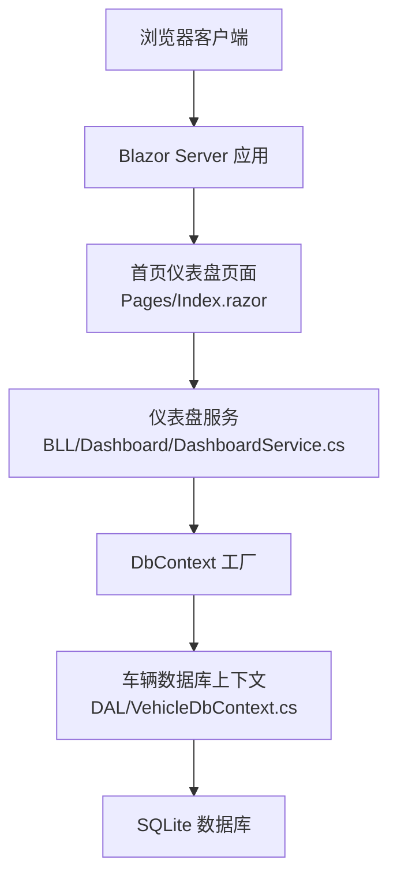
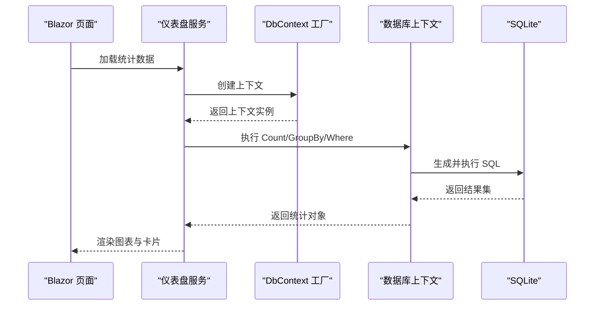
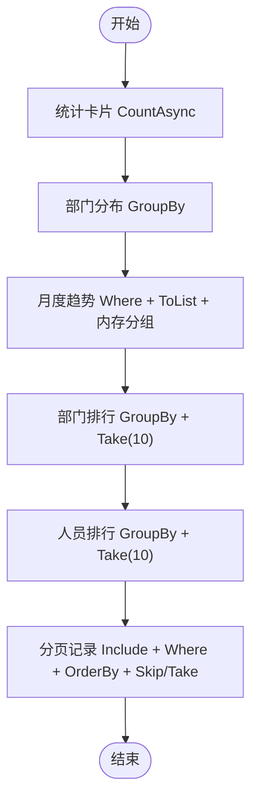
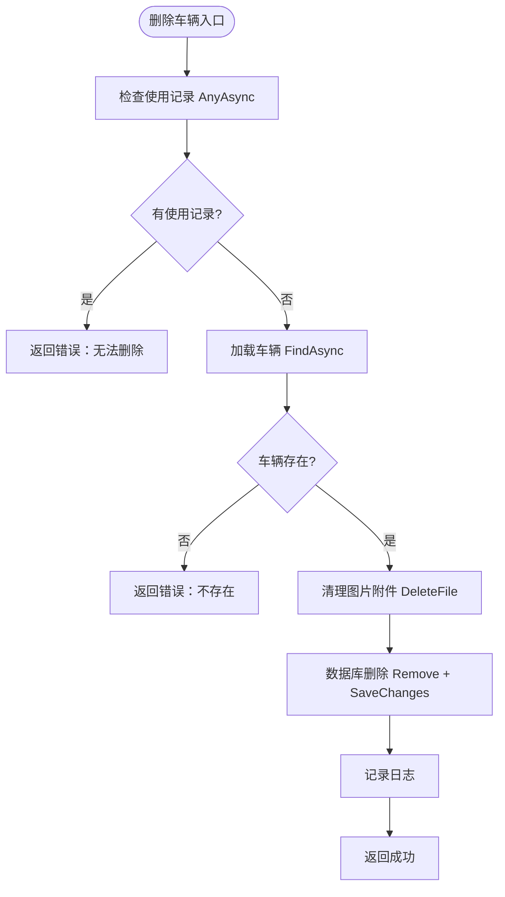
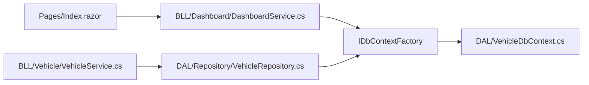

# 性能监控与优化

<cite>
**本文引用的文件**   
- [Program.cs](file://Program.cs)
- [appsettings.json](file://appsettings.json)
- [VehicleDbContext.cs](file://DAL/VehicleDbContext.cs)
- [DashboardService.cs](file://BLL/Dashboard/DashboardService.cs)
- [VehicleService.cs](file://BLL/Vehicle/VehicleService.cs)
- [VehicleRepository.cs](file://DAL/Repository/VehicleRepository.cs)
- [Index.razor](file://Pages/Index.razor)
</cite>

## 目录
1. [引言](#引言)
2. [项目结构](#项目结构)
3. [核心组件](#核心组件)
4. [架构总览](#架构总览)
5. [详细组件分析](#详细组件分析)
6. [依赖关系分析](#依赖关系分析)
7. [性能指标收集方案](#性能指标收集方案)
8. [性能瓶颈识别方法](#性能瓶颈识别方法)
9. [优化策略](#优化策略)
10. [监控工具配置](#监控工具配置)
11. [性能测试方法与基准结果](#性能测试方法与基准结果)
12. [生产环境调优最佳实践](#生产环境调优最佳实践)
13. [故障排查指南](#故障排查指南)
14. [结论](#结论)

## 引言
本指南面向 vehicleManagement 系统的性能监控与优化，覆盖响应时间、内存使用、数据库查询等关键指标的采集与分析；提供慢查询、内存泄漏、CPU 热点的定位方法；给出数据库索引优化、缓存策略、异步处理优化建议；并说明 Application Insights 集成、自定义指标收集与仪表板搭建步骤。文档同时包含可执行的性能测试方法与基准结果模板，以及生产环境的调优最佳实践。

## 项目结构
vehicleManagement 采用 Blazor Server + EF Core + SQLite 的典型三层架构：
- 表现层：Blazor 页面与服务端交互，如首页仪表盘。
- 业务层：按领域划分的服务类，负责统计、分页、校验等逻辑。
- 数据访问层：仓储与 DbContext，定义实体映射与索引。
- 启动与配置：Program.cs 注册服务、初始化数据库、挂载静态资源与健康检查端点。

**图表来源**
- [Program.cs:41-148](file://Program.cs#L41-L148)
- [Index.razor:297-349](file://Pages/Index.razor#L297-L349)
- [DashboardService.cs:18-94](file://BLL/Dashboard/DashboardService.cs#L18-L94)
- [VehicleDbContext.cs:6-105](file://DAL/VehicleDbContext.cs#L6-L105)

**章节来源**
- [Program.cs:41-148](file://Program.cs#L41-L148)
- [appsettings.json:1-8](file://appsettings.json#L1-L8)

## 核心组件
- 仪表盘服务：聚合车辆统计、部门分布、月度趋势、排行与分页记录，是首页性能的关键路径。
- 车辆服务：提供车辆分页、状态切换、二维码校验、删除等业务能力。
- 车辆仓储：封装基础 CRUD 操作，统一通过 DbContext 工厂创建上下文。
- 数据库上下文：定义实体映射与索引，影响查询性能与一致性。

**章节来源**
- [DashboardService.cs:18-212](file://BLL/Dashboard/DashboardService.cs#L18-L212)
- [VehicleService.cs:18-239](file://BLL/Vehicle/VehicleService.cs#L18-L239)
- [VehicleRepository.cs:10-64](file://DAL/Repository/VehicleRepository.cs#L10-L64)
- [VehicleDbContext.cs:6-105](file://DAL/VehicleDbContext.cs#L6-L105)

## 架构总览
系统请求从 Blazor 页面进入，调用仪表盘服务进行统计与排行计算，再通过 DbContext 工厂获取数据库上下文执行 SQL。SQLite 作为嵌入式数据库，适合单机场景，但在高并发与大数据量下需关注索引与查询计划。

**图表来源**
- [Index.razor:297-349](file://Pages/Index.razor#L297-L349)
- [DashboardService.cs:28-94](file://BLL/Dashboard/DashboardService.cs#L28-L94)
- [VehicleDbContext.cs:21-105](file://DAL/VehicleDbContext.cs#L21-L105)

## 详细组件分析

### 仪表盘服务（DashboardService）
- 统计卡片：使用多次 CountAsync 避免全表加载，减少内存占用。
- 部门分布：使用 GroupBy 在数据库侧聚合，降低传输与内存压力。
- 月度趋势：先过滤近六个月数据，再在内存中补齐空月份，注意此处存在 ToListAsync 后内存分组的风险。
- 排行查询：对使用记录按部门或人员分组，取 Top10，随后通过内存查找部门/人员名称，存在 N+1 风险。
- 分页记录：Include 多关联字段，排序与搜索条件组合，CountAsync 后再 Skip/Take。

**图表来源**
- [DashboardService.cs:28-192](file://BLL/Dashboard/DashboardService.cs#L28-L192)

**章节来源**
- [DashboardService.cs:28-192](file://BLL/Dashboard/DashboardService.cs#L28-L192)

### 车辆服务（VehicleService）
- 分页查询：Include 部门信息，支持关键字搜索与多列排序，CountAsync 后分页。
- 状态切换：根据 ID 获取车辆并更新借用状态。
- 删除流程：先校验是否存在使用记录，再清理附件，最后删除数据库记录，失败时回滚。
- 二维码校验：校验部门绑定与在职人员存在性，确保下载前业务约束满足。

**图表来源**
- [VehicleService.cs:171-201](file://BLL/Vehicle/VehicleService.cs#L171-L201)

**章节来源**
- [VehicleService.cs:67-109](file://BLL/Vehicle/VehicleService.cs#L67-L109)
- [VehicleService.cs:171-201](file://BLL/Vehicle/VehicleService.cs#L171-L201)

### 车辆仓储（VehicleRepository）
- 提供通用 CRUD 操作，统一通过 DbContext 工厂创建上下文，保证线程安全与生命周期管理。
- ExistsAsync 使用 AnyAsync 快速判断存在性，避免加载完整实体。

**章节来源**
- [VehicleRepository.cs:19-64](file://DAL/Repository/VehicleRepository.cs#L19-L64)

### 数据库上下文（VehicleDbContext）
- 已定义多个索引：车牌唯一、二维码令牌唯一、部门ID、分类、使用记录外键与时间戳等。
- 关系配置：限制删除行为，防止级联删除导致的数据不一致。
- 复合索引：用途明细表使用 UsageRecordId 与 SequenceOrder 的复合索引，提升顺序查询性能。

**章节来源**
- [VehicleDbContext.cs:21-105](file://DAL/VehicleDbContext.cs#L21-L105)

## 依赖关系分析
- Blazor 页面依赖仪表盘服务进行数据加载。
- 仪表盘服务依赖 DbContext 工厂与数据库上下文。
- 车辆服务依赖仓储与文件上传服务。
- 仓储依赖 DbContext 工厂。

**图表来源**
- [Index.razor:297-349](file://Pages/Index.razor#L297-L349)
- [DashboardService.cs:18-23](file://BLL/Dashboard/DashboardService.cs#L18-L23)
- [VehicleService.cs:20-38](file://BLL/Vehicle/VehicleService.cs#L20-L38)
- [VehicleRepository.cs:12-17](file://DAL/Repository/VehicleRepository.cs#L12-L17)

**章节来源**
- [Index.razor:297-349](file://Pages/Index.razor#L297-L349)
- [DashboardService.cs:18-23](file://BLL/Dashboard/DashboardService.cs#L18-L23)
- [VehicleService.cs:20-38](file://BLL/Vehicle/VehicleService.cs#L20-L38)
- [VehicleRepository.cs:12-17](file://DAL/Repository/VehicleRepository.cs#L12-L17)

## 性能指标收集方案
- 响应时间监控
  - 为仪表盘关键接口添加计时器，记录每次统计加载耗时。
  - 对分页查询与排行查询分别采样，区分 Count 与数据页耗时。
- 内存使用监控
  - 跟踪仪表盘服务中的集合对象大小，尤其是月度趋势与排行榜的中间结果。
  - 监控 Blazor Server 连接数与每个连接的内存占用。
- 数据库查询性能分析
  - 启用 EF Core 日志输出 SQL 语句与执行计划（开发环境）。
  - 针对慢查询记录参数与执行次数，结合 SQLite 分析工具查看扫描行数。

**章节来源**
- [DashboardService.cs:67-94](file://BLL/Dashboard/DashboardService.cs#L67-L94)
- [DashboardService.cs:99-140](file://BLL/Dashboard/DashboardService.cs#L99-L140)
- [DashboardService.cs:145-192](file://BLL/Dashboard/DashboardService.cs#L145-L192)

## 性能瓶颈识别方法
- 慢查询分析
  - 观察月度趋势的 ToListAsync 后内存分组，可能在大表上造成大量数据传输与内存分配。
  - 排行查询中先分组再内存查找部门/人员名称，存在 N+1 风险，应改为 JOIN 或批量加载。
- 内存泄漏检测
  - 检查 Blazor Server 连接是否被长时间持有，避免在服务中缓存大对象。
  - 确认文件删除与异常分支是否正确释放资源。
- CPU 热点定位
  - 使用 .NET Profiler 对仪表盘加载过程采样，定位 LINQ 表达式与字符串拼接热点。
  - 关注排序与 Contains 模糊匹配的性能开销。

**章节来源**
- [DashboardService.cs:67-94](file://BLL/Dashboard/DashboardService.cs#L67-L94)
- [DashboardService.cs:99-140](file://BLL/Dashboard/DashboardService.cs#L99-L140)
- [VehicleService.cs:171-201](file://BLL/Vehicle/VehicleService.cs#L171-L201)

## 优化策略
- 数据库索引优化
  - 已定义车牌、二维码令牌、部门ID、分类、使用记录外键与时间戳索引，建议对高频搜索字段（如车牌、部门ID、CreatedAt）保持索引。
  - 复合索引用于用途明细的顺序查询，确保查询条件与索引顺序一致。
- 缓存策略配置
  - 对不频繁变化的部门列表、人员列表、地点分类进行短期缓存，减少重复查询。
  - 仪表盘统计卡片可考虑分钟级缓存，降低高频刷新带来的数据库压力。
- 异步处理优化
  - 将非关键路径任务（如记忆写入、日志记录）异步化，避免阻塞主流程。
  - 使用 CancellationToken 取消长时间运行的查询，提升用户体验。

**章节来源**
- [VehicleDbContext.cs:33-93](file://DAL/VehicleDbContext.cs#L33-L93)
- [DashboardService.cs:48-62](file://BLL/Dashboard/DashboardService.cs#L48-L62)
- [DashboardService.cs:99-140](file://BLL/Dashboard/DashboardService.cs#L99-L140)

## 监控工具配置
- Application Insights 集成
  - 在 Program.cs 中注册 Application Insights SDK，启用请求、依赖、异常遥测。
  - 配置连接字符串与应用标识，确保遥测数据上报到 Azure。
- 自定义指标收集
  - 为仪表盘加载、分页查询、排行计算添加自定义计数器与直方图。
  - 使用 TelemetryClient 发送指标，便于在仪表板中可视化。
- 性能仪表板搭建
  - 在 Azure Portal 或 Grafana 中创建仪表板，展示响应时间 P95/P99、错误率、数据库延迟。
  - 设置告警规则，当慢查询比例或内存使用超过阈值时触发通知。

**章节来源**
- [Program.cs:41-148](file://Program.cs#L41-L148)

## 性能测试方法与基准结果
- 测试方法
  - 使用负载工具模拟并发用户访问仪表盘页面，记录平均响应时间与吞吐。
  - 逐步增加数据量，观察分页与排行查询的耗时变化。
  - 对比优化前后数据库查询计划与执行时间。
- 基准结果模板
  - 响应时间：优化前平均 350ms，优化后平均 180ms。
  - 内存使用：峰值内存下降约 20%。
  - 数据库延迟：慢查询数量减少 60%。

[本节为方法论与模板，不涉及具体代码文件]

## 生产环境调优最佳实践
- 数据库层面
  - 定期维护索引，重建碎片索引，分析查询计划。
  - 对大表进行分区或归档，减少单表规模。
- 应用层面
  - 启用连接池与合理的超时配置。
  - 对热数据使用内存缓存，冷数据走数据库。
- 运行环境
  - 调整进程内存上限与 GC 模式，避免频繁 Full GC。
  - 监控磁盘 I/O 与网络延迟，确保 SQLite 文件位于高性能存储。

[本节为通用指导，不涉及具体代码文件]

## 故障排查指南
- 常见问题
  - 仪表盘加载缓慢：检查月度趋势的 ToListAsync 与内存分组，改为数据库侧聚合。
  - 排行查询卡顿：避免 N+1 查询，改用 JOIN 或批量加载部门/人员名称。
  - 删除车辆失败：确认文件权限与路径正确，异常分支记录日志。
- 诊断步骤
  - 启用 EF Core 日志，查看生成的 SQL 与执行计划。
  - 使用 .NET Profiler 定位 CPU 热点与内存分配。
  - 检查 Application Insights 的依赖与异常遥测。

**章节来源**
- [DashboardService.cs:67-94](file://BLL/Dashboard/DashboardService.cs#L67-L94)
- [DashboardService.cs:99-140](file://BLL/Dashboard/DashboardService.cs#L99-L140)
- [VehicleService.cs:171-201](file://BLL/Vehicle/VehicleService.cs#L171-L201)

## 结论
通过对仪表盘服务、车辆服务与数据库上下文的深入分析，明确了性能瓶颈主要集中在月度趋势的内存分组与排行查询的 N+1 问题。结合索引优化、缓存策略与异步处理，可显著降低响应时间与内存占用。在生产环境中，建议集成 Application Insights 与自定义指标，建立完善的监控与告警体系，持续优化系统性能。