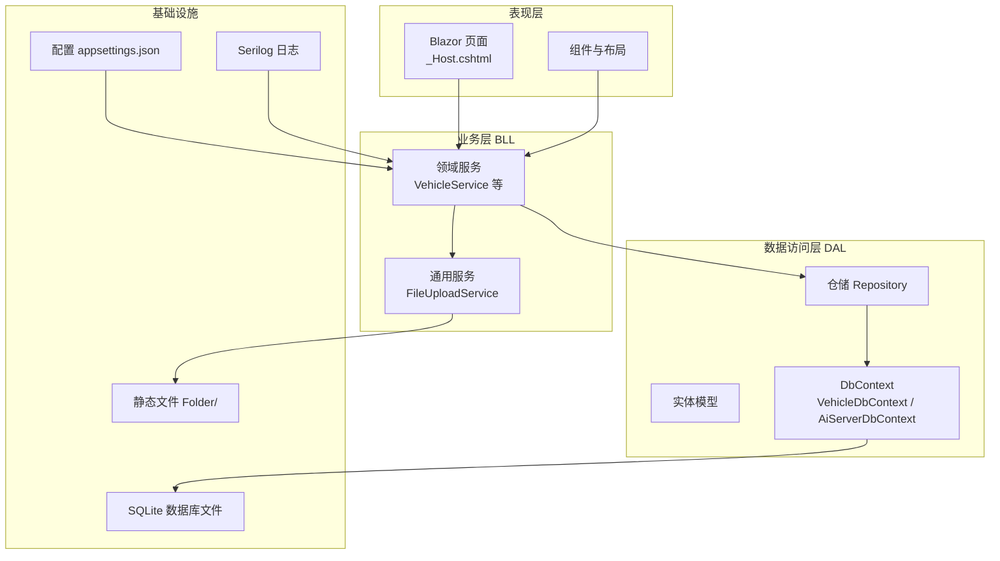
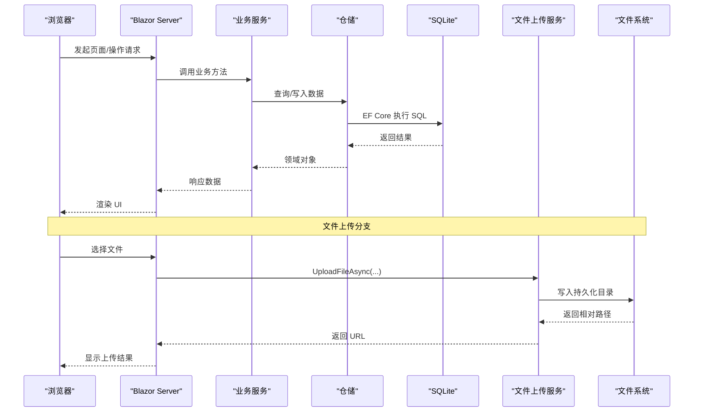
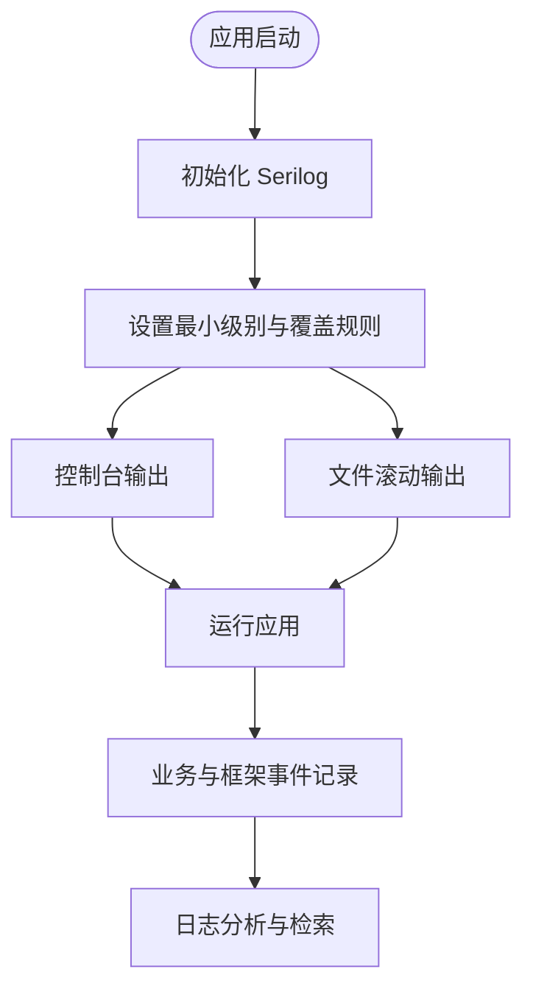
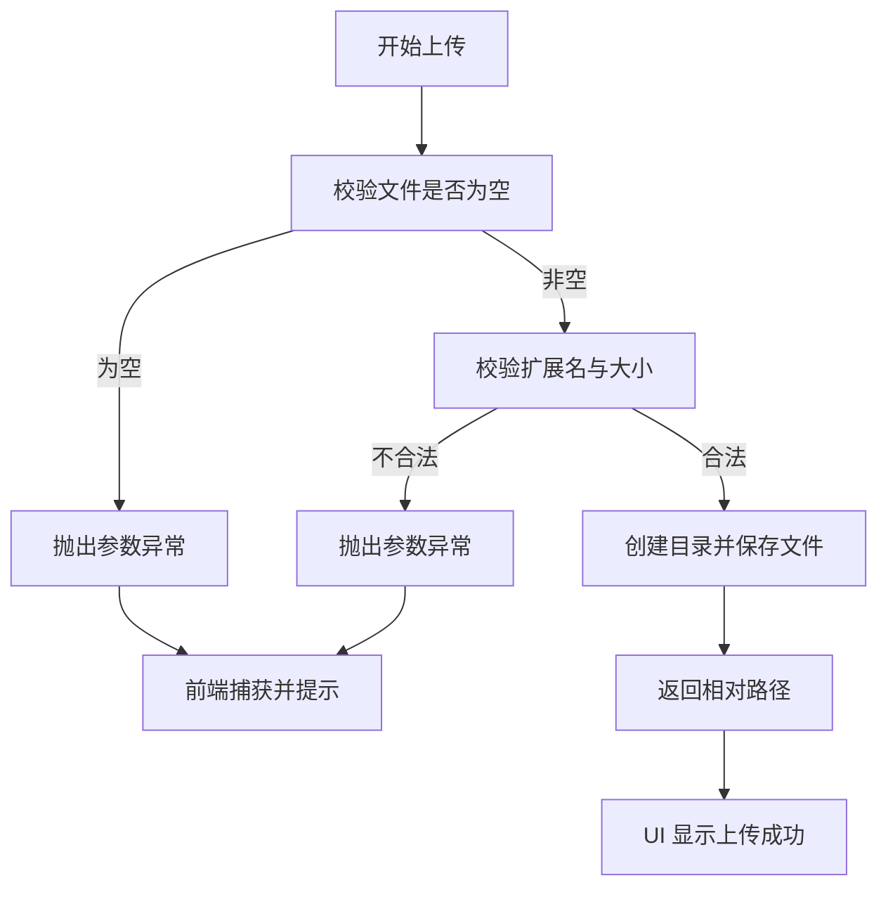
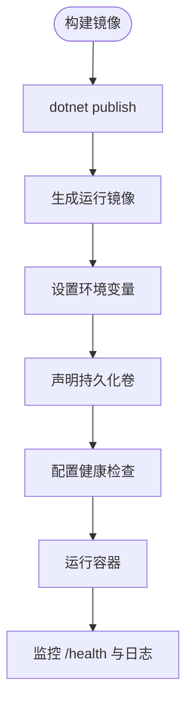
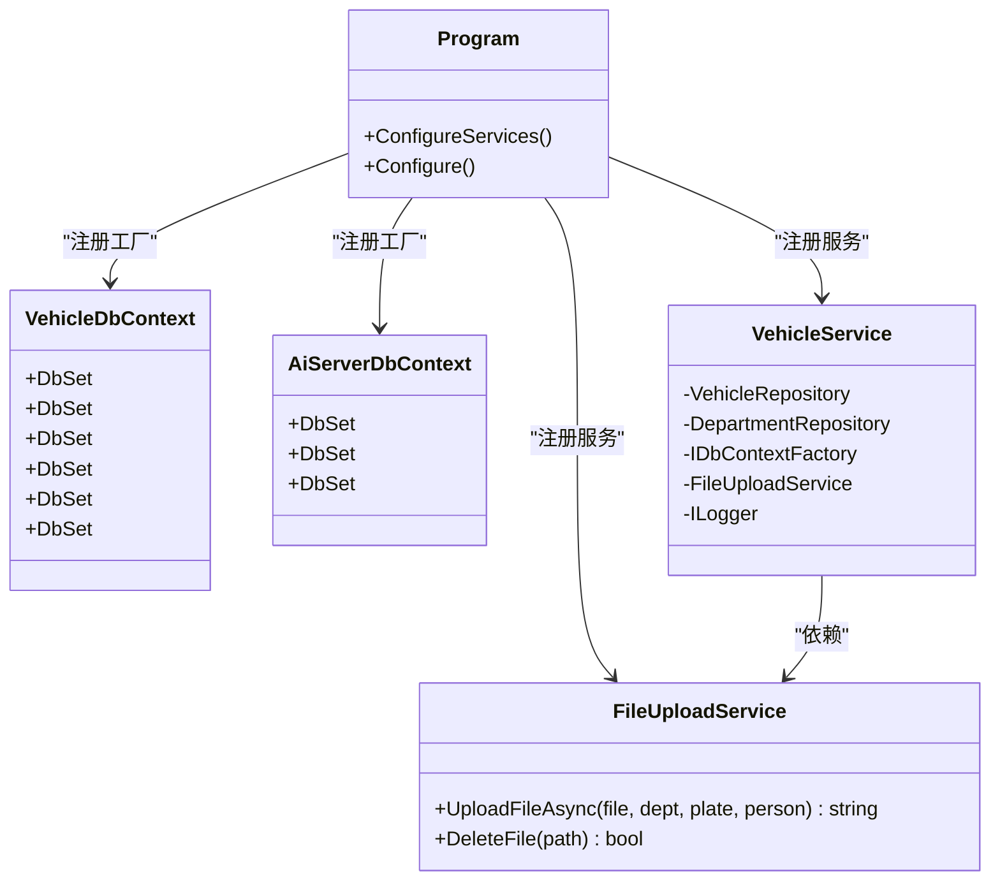

# 调试与故障排除

<cite>
**本文引用的文件**   
- [Program.cs](file://Program.cs)
- [appsettings.json](file://appsettings.json)
- [appsettings.Development.json](file://appsettings.Development.json)
- [Dockerfile](file://Dockerfile)
- [VehicleDbContext.cs](file://DAL/VehicleDbContext.cs)
- [AiServerDbContext.cs](file://aiServer/DAL/AiServerDbContext.cs)
- [FileUploadService.cs](file://BLL/Common/FileUploadService.cs)
- [_Host.cshtml](file://Pages/_Host.cshtml)
- [MaintenanceForm.razor](file://Pages/MaintenanceForm.razor)
- [BorrowForm.razor](file://Pages/BorrowForm.razor)
- [VehicleService.cs](file://BLL/Vehicle/VehicleService.cs)
- [SeedDataInitializer.cs](file://DAL/SeedDataInitializer.cs)
</cite>

## 目录
1. [简介](#简介)
2. [项目结构](#项目结构)
3. [核心组件](#核心组件)
4. [架构总览](#架构总览)
5. [详细组件分析](#详细组件分析)
6. [依赖关系分析](#依赖关系分析)
7. [性能考虑](#性能考虑)
8. [故障排除指南](#故障排除指南)
9. [结论](#结论)
10. [附录](#附录)

## 简介
本指南面向 vehicleManagement 系统的开发与运维人员，聚焦断点调试、日志分析、性能分析与常见问题定位。系统基于 ASP.NET Core + Blazor Server，使用 Serilog 进行结构化日志记录，EF Core + SQLite 作为数据访问层，并通过 Docker 部署。文档将结合代码级实现，提供可操作的排错步骤、可视化流程图与最佳实践。

## 项目结构
vehicleManagement 采用分层架构：
- 表现层：Blazor 页面与服务端组件（Pages、Components）
- 业务层（BLL）：领域服务与通用能力（如文件上传、导出）
- 数据访问层（DAL）：仓储、实体模型与 DbContext
- AI 子模块：独立的聊天会话、消息与记忆数据库上下文
- 配置与启动：Program.cs、appsettings.*、Dockerfile

图表来源
- [Program.cs:41-148](file://Program.cs#L41-L148)
- [VehicleDbContext.cs:6-19](file://DAL/VehicleDbContext.cs#L6-L19)
- [AiServerDbContext.cs:9-18](file://aiServer/DAL/AiServerDbContext.cs#L9-L18)
- [FileUploadService.cs:12-27](file://BLL/Common/FileUploadService.cs#L12-L27)

章节来源
- [Program.cs:41-148](file://Program.cs#L41-L148)
- [appsettings.json:1-8](file://appsettings.json#L1-L8)

## 核心组件
- 应用启动与中间件管线：Program.cs 中注册 Blazor、Serilog、DbContextFactory、仓储与服务、静态文件与路由，并暴露健康检查端点。
- 日志系统：Serilog 默认输出到控制台与按日滚动文件；抑制框架与 EF Core SQL 的冗余日志。
- 数据访问：通过 IDbContextFactory 避免 Blazor Server 并发冲突；两个独立 DbContext 分别管理车辆业务与 AI 会话。
- 文件上传：FileUploadService 校验格式与大小，按部门/车牌/人员/日期组织存储，并提供删除接口。
- 前端错误提示：_Host.cshtml 根据环境显示不同错误提示；页面组件捕获异常并展示用户友好信息。

章节来源
- [Program.cs:28-37](file://Program.cs#L28-L37)
- [Program.cs:52-58](file://Program.cs#L52-L58)
- [Program.cs:106-148](file://Program.cs#L106-L148)
- [FileUploadService.cs:29-46](file://BLL/Common/FileUploadService.cs#L29-L46)
- [_Host.cshtml:29-35](file://Pages/_Host.cshtml#L29-L35)

## 架构总览
下图展示了请求从浏览器进入服务器，经过 Blazor Hub、业务服务、仓储与数据库，以及文件上传路径的整体流程。

图表来源
- [Program.cs:142-148](file://Program.cs#L142-L148)
- [FileUploadService.cs:92-110](file://BLL/Common/FileUploadService.cs#L92-L110)

## 详细组件分析

### 断点调试技巧
- Visual Studio 调试器
  - 在 Program.cs 的启动阶段设置断点，观察依赖注入、数据库初始化与中间件注册过程。
  - 在仓储或服务的关键方法处设置条件断点，过滤特定车辆或部门的请求。
  - 使用“即时窗口”查看当前作用域内的 DbContext 状态与配置。
- Blazor 组件调试
  - 在 _Host.cshtml 中确认开发环境下会显示未处理异常的详细信息；生产环境则显示统一错误页。
  - 在页面的事件处理器（如 OnFileSelected、Save）设置断点，跟踪异步流与状态更新。
- 异步代码调试
  - 关注 await 链中的异常传播；在服务与仓储层添加 try/catch 并记录结构化日志。
  - 使用“任务监视器”查看长时间运行的任务与可能的死锁。

章节来源
- [Program.cs:127-130](file://Program.cs#L127-L130)
- [_Host.cshtml:29-35](file://Pages/_Host.cshtml#L29-L35)
- [MaintenanceForm.razor:129-143](file://Pages/MaintenanceForm.razor#L129-L143)
- [BorrowForm.razor:211-229](file://Pages/BorrowForm.razor#L211-L229)

### 日志分析：Serilog 配置、级别与结构化查询
- 日志配置要点
  - 默认最低级别为 Information；覆盖 Microsoft 与 EF Core 命名空间为 Warning，减少噪音。
  - 同时输出到控制台与按日滚动的文件，保留最近 7 天日志。
- 日志级别设置建议
  - 开发环境：Information 以获取更丰富的诊断信息。
  - 生产环境：Warning 或 Error，降低 I/O 开销。
- 结构化日志查询
  - 使用日志文件的行首时间戳与级别字段快速筛选。
  - 在种子数据初始化过程中，关键步骤均记录结构化日志，便于追踪数据准备情况。

图表来源
- [Program.cs:28-37](file://Program.cs#L28-L37)
- [SeedDataInitializer.cs:25-128](file://DAL/SeedDataInitializer.cs#L25-L128)

章节来源
- [Program.cs:28-37](file://Program.cs#L28-L37)
- [SeedDataInitializer.cs:25-128](file://DAL/SeedDataInitializer.cs#L25-L128)

### 性能分析：内存泄漏、CPU 与数据库优化
- 内存泄漏检测
  - 使用 .NET Memory Profiler 或 dotnet-counters 监控 RSS、GC 次数与堆大小。
  - 关注长生命周期单例对象（如 QrCodeService）是否持有大对象引用。
- CPU 性能分析
  - 使用 dotnet-trace 采集热点函数，重点检查文件复制与 Excel 导出过程中的 CPU 占用。
- 数据库查询优化
  - 使用 Include 按需加载关联数据，避免 N+1 问题。
  - 对高频查询字段建立索引（例如 Personnel.DepartmentId、Vehicle.LicensePlate）。
  - 在导出服务中确保一次性加载所需数据，减少多次往返。

章节来源
- [VehicleService.cs:20-38](file://BLL/Vehicle/VehicleService.cs#L20-L38)
- [VehicleExportService.cs:25-39](file://BLL/Export/VehicleExportService.cs#L25-L39)
- [VehicleDbContext.cs:21-39](file://DAL/VehicleDbContext.cs#L21-L39)

### 常见问题诊断：连接池、并发冲突与文件上传失败
- 连接池问题
  - SQLite 不支持高并发写；系统通过 IDbContextFactory 创建短生命周期 DbContext，避免共享连接导致的竞争。
  - 若出现“数据库已锁定”，请检查是否存在长事务或未释放的 DbContext。
- 并发冲突
  - Blazor Server 多客户端并发访问时，确保每个请求使用独立 DbContext 实例。
  - 对写操作增加重试逻辑与乐观并发控制（如版本号字段）。
- 文件上传失败
  - 常见原因：文件格式不支持、超过大小限制、目标目录无写权限、磁盘空间不足。
  - FileUploadService 对图片与视频分别设定上限，并在保存前校验扩展名与大小。

图表来源
- [FileUploadService.cs:29-46](file://BLL/Common/FileUploadService.cs#L29-L46)
- [FileUploadService.cs:69-84](file://BLL/Common/FileUploadService.cs#L69-L84)
- [FileUploadService.cs:92-110](file://BLL/Common/FileUploadService.cs#L92-L110)

章节来源
- [Program.cs:52-58](file://Program.cs#L52-L58)
- [FileUploadService.cs:29-46](file://BLL/Common/FileUploadService.cs#L29-L46)
- [FileUploadService.cs:69-84](file://BLL/Common/FileUploadService.cs#L69-L84)
- [FileUploadService.cs:92-110](file://BLL/Common/FileUploadService.cs#L92-L110)

### 远程调试配置：Docker 容器调试与生产环境问题排查
- Docker 镜像与健康检查
  - 镜像暴露 80 端口，安装 curl 用于健康检查。
  - HEALTHCHECK 定期访问 /health 端点，返回正常即认为服务可用。
- 环境变量与挂载卷
  - 通过环境变量配置 Ollama 端点与模型名称。
  - 持久化 data、logs、Folder 目录，便于在宿主机上查看数据库、日志与上传文件。
- 生产环境排查
  - 优先查看 logs 目录下的滚动日志，定位异常堆栈。
  - 检查 /health 端点是否可达，结合容器日志与资源使用情况进行判断。

图表来源
- [Dockerfile:1-44](file://Dockerfile#L1-L44)
- [Program.cs:145-148](file://Program.cs#L145-L148)

章节来源
- [Dockerfile:22-41](file://Dockerfile#L22-L41)
- [Program.cs:145-148](file://Program.cs#L145-L148)

### 监控告警：健康检查端点、性能指标与错误追踪
- 健康检查端点
  - /health 返回简单文本，供容器编排平台探测服务可用性。
- 性能指标收集
  - 在生产环境启用 dotnet-counters 或 Application Insights（如需），采集 CPU、内存、I/O 与请求延迟。
- 错误追踪
  - 使用 Serilog 的结构化日志记录异常与上下文信息；结合集中式日志平台（如 ELK、Seq）进行聚合与告警。

章节来源
- [Program.cs:145-148](file://Program.cs#L145-L148)
- [Program.cs:28-37](file://Program.cs#L28-L37)

## 依赖关系分析
- 服务注册与依赖注入
  - Program.cs 中注册 Blazor、DbContextFactory、仓储与服务、通用服务与 AI 相关服务。
- 数据上下文与模型
  - VehicleDbContext 与 AiServerDbContext 分别管理业务与 AI 数据，OnModelCreating 中定义索引与属性默认值。
- 外部依赖
  - Serilog 用于日志；Semantic Kernel 与 Ollama 集成用于 AI 对话。

图表来源
- [Program.cs:52-95](file://Program.cs#L52-L95)
- [VehicleDbContext.cs:6-19](file://DAL/VehicleDbContext.cs#L6-L19)
- [AiServerDbContext.cs:9-18](file://aiServer/DAL/AiServerDbContext.cs#L9-L18)
- [FileUploadService.cs:12-27](file://BLL/Common/FileUploadService.cs#L12-L27)
- [VehicleService.cs:20-38](file://BLL/Vehicle/VehicleService.cs#L20-L38)

章节来源
- [Program.cs:52-95](file://Program.cs#L52-L95)
- [VehicleDbContext.cs:6-19](file://DAL/VehicleDbContext.cs#L6-L19)
- [AiServerDbContext.cs:9-18](file://aiServer/DAL/AiServerDbContext.cs#L9-L18)
- [FileUploadService.cs:12-27](file://BLL/Common/FileUploadService.cs#L12-L27)
- [VehicleService.cs:20-38](file://BLL/Vehicle/VehicleService.cs#L20-L38)

## 性能考虑
- 数据库层面
  - 合理使用 Include 与 Select 投影，避免拉取多余字段。
  - 对高频查询字段建立索引，提升检索效率。
- 文件处理
  - 大文件上传建议使用分块上传与进度反馈，降低内存峰值。
  - 对视频等大体积文件进行转码或压缩后再存储。
- 日志与 I/O
  - 生产环境降低日志级别，避免频繁磁盘写入影响性能。
  - 使用异步 I/O 与缓冲策略，减少阻塞。

[本节为通用指导，不直接分析具体文件]

## 故障排除指南
- 启动失败
  - 现象：应用无法启动，控制台无响应。
  - 排查：检查 Program.cs 启动阶段的异常日志；确认数据库连接字符串与文件路径有效。
  - 参考：Program.cs 启动异常捕获与日志记录。
- 数据库锁定或并发错误
  - 现象：写入时报“数据库已锁定”。
  - 排查：确认使用 IDbContextFactory 创建短生命周期 DbContext；检查是否有长事务或并发写。
  - 参考：Program.cs 中 DbContextFactory 注册与使用。
- 文件上传失败
  - 现象：前端提示上传失败或文件未保存。
  - 排查：检查文件格式与大小限制；确认 Folder 目录存在且有写权限；查看日志中的异常信息。
  - 参考：FileUploadService 的校验与保存逻辑。
- 页面报错但无详细信息
  - 现象：生产环境仅显示通用错误提示。
  - 排查：查看服务器日志与容器日志；临时开启开发模式查看详细错误。
  - 参考：_Host.cshtml 的环境差异化错误提示。

章节来源
- [Program.cs:150-157](file://Program.cs#L150-L157)
- [Program.cs:52-58](file://Program.cs#L52-L58)
- [FileUploadService.cs:29-46](file://BLL/Common/FileUploadService.cs#L29-L46)
- [_Host.cshtml:29-35](file://Pages/_Host.cshtml#L29-L35)

## 结论
vehicleManagement 系统在调试与排错方面具备良好基础：Serilog 提供结构化日志，IDbContextFactory 缓解并发问题，Blazor 前端有清晰错误提示。通过合理的断点策略、日志分析与性能调优，可有效定位并解决常见问题。在生产环境中，建议结合容器健康检查与集中式日志平台，形成完整的监控与告警闭环。

[本节为总结性内容，不直接分析具体文件]

## 附录
- 常用命令
  - 本地运行：dotnet run
  - 发布：dotnet publish -c Release
  - 容器运行：docker build -t vehiclemanagement . && docker run -p 80:80 -v $(pwd)/data:/app/data -v $(pwd)/logs:/app/logs -v $(pwd)/Folder:/app/Folder vehiclemanagement
- 配置文件位置
  - 应用配置：appsettings.json
  - 开发配置：appsettings.Development.json

章节来源
- [appsettings.json:1-8](file://appsettings.json#L1-L8)
- [appsettings.Development.json:1-4](file://appsettings.Development.json#L1-L4)