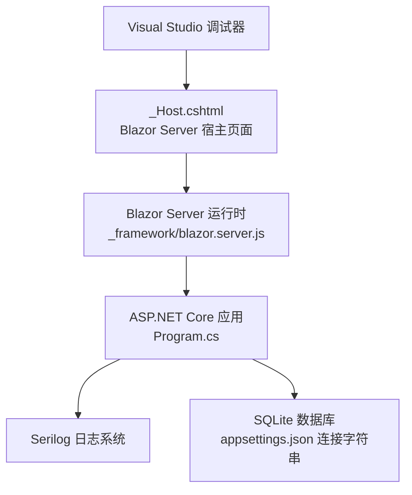
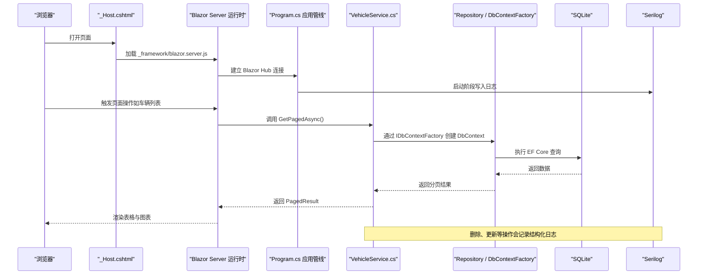
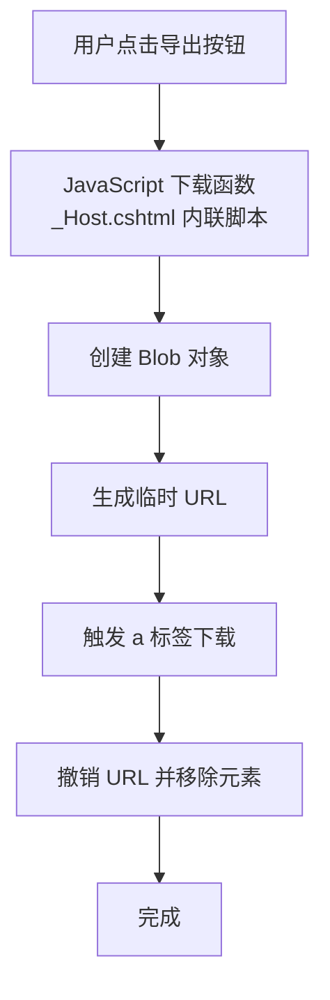
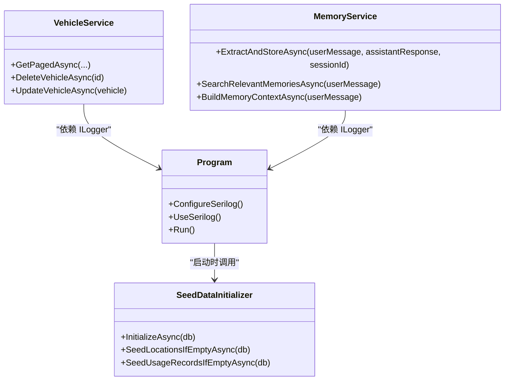
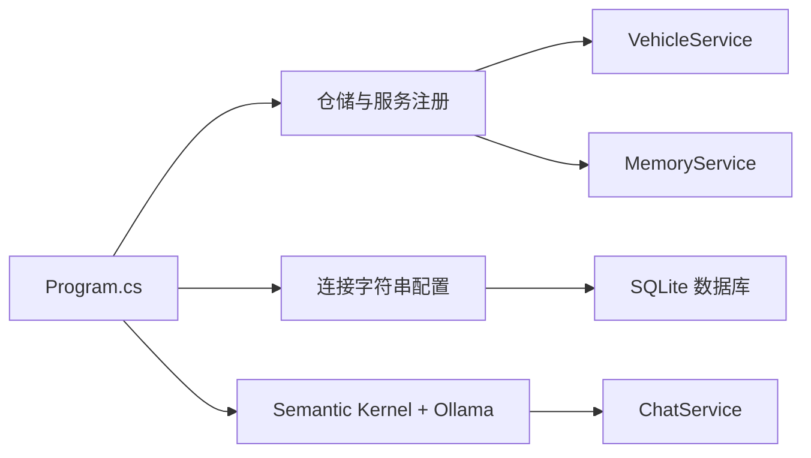

# 调试技巧与工具

<cite>
**本文引用的文件**   
- [Program.cs](file://Program.cs)
- [appsettings.json](file://appsettings.json)
- [appsettings.Development.json](file://appsettings.Development.json)
- [_Host.cshtml](file://Pages/_Host.cshtml)
- [vehicleManagement.csproj.user](file://vehicleManagement.csproj.user)
- [VehicleService.cs](file://BLL/Vehicle/VehicleService.cs)
- [SeedDataInitializer.cs](file://DAL/SeedDataInitializer.cs)
- [MemoryService.cs](file://aiServer/BLL/MemoryService.cs)
</cite>

## 目录
1. [引言](#引言)
2. [项目结构与调试入口](#项目结构与调试入口)
3. [核心调试能力总览](#核心调试能力总览)
4. [架构与调试视图](#架构与调试视图)
5. [详细组件调试指南](#详细组件调试指南)
6. [依赖关系与调试影响](#依赖关系与调试影响)
7. [性能分析与内存泄漏排查](#性能分析与内存泄漏排查)
8. [常见问题与排错清单](#常见问题与排错清单)
9. [结论](#结论)

## 引言
本指南面向 vehicleManagement 系统的开发者与维护者，目标是提供一套可落地的调试方法与工具使用流程。内容覆盖 Visual Studio 调试器、Blazor Server 前端调试、Serilog 日志调试、结构化日志查询、动态日志级别调整，以及性能分析、内存泄漏检测与 CPU 使用率监控。文档中的实践均基于当前代码库的实际实现，包括 Blazor Server 启动、Serilog 配置、数据库种子初始化、业务服务中的异步处理与异常记录等。

## 项目结构与调试入口
vehicleManagement 是一个 Blazor Server 应用，程序入口在 Program.cs，页面宿主在 Pages/_Host.cshtml。开发环境通过 appsettings.Development.json 启用更详细的错误信息；生产或预发布环境则关闭详细错误并返回统一错误页。

**图表来源** 
- [_Host.cshtml:25-27](file://Pages/_Host.cshtml#L25-L27)
- [_Host.cshtml:172-172](file://Pages/_Host.cshtml#L172-L172)
- [Program.cs:41-49](file://Program.cs#L41-L49)
- [Program.cs:104-148](file://Program.cs#L104-L148)
- [appsettings.json:3-6](file://appsettings.json#L3-L6)

**章节来源**
- [Program.cs:28-43](file://Program.cs#L28-L43)
- [Program.cs:104-148](file://Program.cs#L104-L148)
- [_Host.cshtml:25-27](file://Pages/_Host.cshtml#L25-L27)
- [_Host.cshtml:172-172](file://Pages/_Host.cshtml#L172-L172)
- [appsettings.json:3-6](file://appsettings.json#L3-L6)
- [appsettings.Development.json:1-4](file://appsettings.Development.json#L1-L4)
- [vehicleManagement.csproj.user:1-9](file://vehicleManagement.csproj.user#L1-L9)

## 核心调试能力总览
- Visual Studio 断点与条件断点：在服务方法、仓储调用、数据库上下文创建处设置断点，结合变量监视与条件表达式快速定位问题。
- 调用堆栈分析：从异常抛出点向上回溯，识别异步任务链路与 Blazor 组件生命周期。
- 监视窗口：观察 DbContextFactory 创建的 DbContext、实体状态、分页结果对象、AI 记忆上下文等关键数据结构。
- Blazor 前端调试：浏览器开发者工具中调试 JavaScript 下载逻辑与 Chart.js 渲染；Blazor Server 模式下通过 F12 网络面板查看 _framework/blazor.server.js 连接。
- Serilog 日志：控制台输出与滚动文件输出，按模块与级别过滤；开发环境抑制框架噪音日志，聚焦业务异常。
- 性能分析：CPU 采样、热点方法、异步等待时间；内存快照对比、对象分配热点、潜在泄漏路径。
- 动态日志级别：根据运行环境与问题复现场景调整最小级别与命名空间覆盖，避免日志风暴。

## 架构与调试视图
下图展示从浏览器到后端服务的请求链路，以及调试时关注的断点位置与日志输出点。

**图表来源** 
- [_Host.cshtml:25-27](file://Pages/_Host.cshtml#L25-L27)
- [_Host.cshtml:172-172](file://Pages/_Host.cshtml#L172-L172)
- [Program.cs:41-49](file://Program.cs#L41-L49)
- [Program.cs:104-148](file://Program.cs#L104-L148)
- [VehicleService.cs:67-109](file://BLL/Vehicle/VehicleService.cs#L67-L109)
- [VehicleService.cs:171-201](file://BLL/Vehicle/VehicleService.cs#L171-L201)

## 详细组件调试指南

### Visual Studio 调试器基础用法
- 断点设置
  - 在 VehicleService 的 GetPagedAsync、DeleteVehicleAsync 等方法入口设置断点，验证参数与返回值。
  - 在 SeedDataInitializer.InitializeAsync 中设置断点，确认开发环境是否执行种子数据初始化。
  - 在 MemoryService.ExtractAndStoreAsync 中设置断点，检查 AI 记忆提取逻辑。
- 条件断点
  - 对 DeleteVehicleAsync 的条件分支设置条件，例如仅当存在使用记录或图片附件清理失败时中断。
  - 对分页查询设置条件，例如 searchKeyword 不为空或排序列为特定字段时中断。
- 监视窗口
  - 监视 PagedResult<T> 的 Items、TotalCount、CurrentPage、PageSize。
  - 监视 DbContextFactory 创建的 DbContext 与实体集合状态。
  - 监视 AI 记忆上下文构建结果，确保历史记忆注入正确。
- 调用堆栈分析
  - 捕获异常后查看调用堆栈，区分 Blazor 组件事件、服务层方法、仓储层调用与 EF Core 执行。
  - 关注异步任务链：Task.Run、await 调用、I/O 阻塞点。

**章节来源**
- [VehicleService.cs:67-109](file://BLL/Vehicle/VehicleService.cs#L67-L109)
- [VehicleService.cs:171-201](file://BLL/Vehicle/VehicleService.cs#L171-L201)
- [SeedDataInitializer.cs:20-87](file://DAL/SeedDataInitializer.cs#L20-L87)
- [MemoryService.cs:45-113](file://aiServer/BLL/MemoryService.cs#L45-L113)

### Blazor 组件调试
- 前端 JavaScript 调试
  - 在 _Host.cshtml 中内联了下载 base64 图片与文件的脚本，可在浏览器开发者工具的 Sources 面板打断点，验证 Blob 创建与 URL 释放。
  - Chart.js 相关函数位于同一脚本块，可通过 window.charts 暴露的方法进行调试，观察图表实例销毁与重建。
- Blazor Server 连接调试
  - 使用 F12 网络面板查看 _framework/blazor.server.js 的连接与消息流，确认 Hub 连接成功。
  - 若出现“未处理的异常”，_Host.cshtml 的错误 UI 会在开发环境提示查看浏览器开发者工具。
- 异步代码调试技巧
  - 在服务层方法中使用 await 调用数据库与文件 I/O，注意在 Visual Studio 中启用“等待”选项以跟踪异步任务。
  - 对于长耗时操作（如文件上传、导出），建议在日志中记录开始与结束时间，便于前后端关联。

**图表来源** 
- [_Host.cshtml:41-67](file://Pages/_Host.cshtml#L41-L67)

**章节来源**
- [_Host.cshtml:29-38](file://Pages/_Host.cshtml#L29-L38)
- [_Host.cshtml:41-67](file://Pages/_Host.cshtml#L41-L67)
- [_Host.cshtml:172-172](file://Pages/_Host.cshtml#L172-L172)

### Serilog 日志调试
- 配置优化
  - Program.cs 中已配置 Serilog，默认最低级别为 Information，抑制 Microsoft 与 EF Core SQL 日志为 Warning，控制台模板包含时间戳、级别、消息与异常。
  - 日志同时输出到控制台与滚动文件 logs/log-.log，保留最近 7 天文件。
- 结构化日志查询
  - 在业务服务中记录结构化日志，例如删除车辆时记录 Id 与附件清理结果；种子数据初始化记录部门、人员、车辆数量。
  - 使用日志查看器（如 Seq、Kibana 或本地文件搜索）按级别、命名空间与属性过滤。
- 日志级别动态调整
  - 开发环境可临时提高 MinimumLevel 至 Debug 或 Trace，以便捕获更多细节；生产环境保持 Information 或 Warning。
  - 针对特定命名空间（如 vehicleManagement.BLL.Vehicle）设置覆盖级别，精准定位问题模块。

**图表来源** 
- [Program.cs:28-43](file://Program.cs#L28-L43)
- [SeedDataInitializer.cs:20-87](file://DAL/SeedDataInitializer.cs#L20-L87)
- [VehicleService.cs:171-201](file://BLL/Vehicle/VehicleService.cs#L171-L201)
- [MemoryService.cs:45-113](file://aiServer/BLL/MemoryService.cs#L45-L113)

**章节来源**
- [Program.cs:28-43](file://Program.cs#L28-L43)
- [Program.cs:150-157](file://Program.cs#L150-L157)
- [SeedDataInitializer.cs:20-87](file://DAL/SeedDataInitializer.cs#L20-L87)
- [SeedDataInitializer.cs:92-129](file://DAL/SeedDataInitializer.cs#L92-L129)
- [VehicleService.cs:171-201](file://BLL/Vehicle/VehicleService.cs#L171-L201)
- [MemoryService.cs:45-113](file://aiServer/BLL/MemoryService.cs#L45-L113)

### 性能分析与内存泄漏检测
- Visual Studio 性能分析器
  - 使用“CPU 使用情况”采样，定位热点方法（如分页查询、文件上传、AI 记忆提取）。
  - 使用“异步等待”视图，识别长时间等待的 I/O 操作与外部服务调用。
- 内存泄漏检测
  - 使用“内存使用情况”快照对比，观察对象分配热点与未释放引用。
  - 重点关注 Blazor 组件生命周期、Chart.js 实例销毁、文件句柄与临时 URL 释放。
- CPU 使用率监控
  - 在服务器端监控进程 CPU 使用率，结合日志时间戳定位高负载时段。
  - 对批量操作（如种子数据插入、导出 Excel）进行分片与进度日志记录。

[本节为通用指导，不直接分析具体文件]

## 依赖关系与调试影响
- 服务注册与生命周期
  - Program.cs 中通过 AddScoped 注册仓储与服务，DbContextFactory 用于避免 Blazor Server 并发冲突。
  - 调试时需关注 Scoped 服务实例的生命周期，确保每次请求获得独立上下文。
- 数据库连接
  - appsettings.json 定义 DefaultConnection 与 AiServerConnection，分别对应主业务与 AI 服务数据库。
  - 调试时可切换连接字符串指向不同 SQLite 文件，隔离测试数据。
- AI 服务集成
  - Semantic Kernel 与 Ollama 端点在 Program.cs 中注册，调试时需检查端点可达性与模型可用性。
  - MemoryService 的记忆提取与检索逻辑可能受输入文本质量影响，建议结合日志与浏览器输入记录进行分析。

**图表来源** 
- [Program.cs:48-102](file://Program.cs#L48-L102)
- [appsettings.json:3-6](file://appsettings.json#L3-L6)

**章节来源**
- [Program.cs:48-102](file://Program.cs#L48-L102)
- [appsettings.json:3-6](file://appsettings.json#L3-L6)

## 性能分析与内存泄漏排查
- 常见性能瓶颈
  - 分页查询中的 Include 与 Where 组合可能导致 N+1 查询，需检查 EF Core 生成的 SQL。
  - 文件上传与导出操作可能占用大量内存，建议使用流式处理与分批写入。
  - AI 记忆提取中的正则匹配与关键词搜索在高并发下可能成为热点。
- 内存泄漏排查步骤
  - 在浏览器中重复执行图表创建与销毁操作，确认 Chart.js 实例是否正确销毁。
  - 在服务器上执行多次导出与文件删除操作，观察临时文件与句柄释放情况。
  - 使用 Visual Studio 内存快照对比，查找未释放的组件实例、委托与静态缓存。
- CPU 使用率监控
  - 对高负载场景（如批量导入、统计计算）进行采样分析，识别 CPU 密集型循环与算法复杂度问题。
  - 结合日志时间戳与性能计数器，定位峰值时段与根因方法。

[本节为通用指导，不直接分析具体文件]

## 常见问题与排错清单
- Blazor Server 无法连接
  - 检查 _Host.cshtml 中 blazor.server.js 是否加载成功，F12 网络面板查看连接状态。
  - 确认 Program.cs 中 MapBlazorHub 已注册。
- 日志无输出或级别过低
  - 检查 Program.cs 中 Serilog 配置，确认 MinimumLevel 与命名空间覆盖。
  - 查看 logs/log-.log 文件是否存在，权限是否正确。
- 数据库种子数据未初始化
  - 确认 appsettings.Development.json 中 DetailedErrors 开启，Program.cs 中 IsDevelopment 判断正确。
  - 在 SeedDataInitializer.InitializeAsync 设置断点，检查幂等性逻辑。
- 文件删除失败
  - 在 VehicleService.DeleteVehicleAsync 中检查文件路径与权限，查看日志中的异常信息。
- AI 记忆提取不准确
  - 在 MemoryService.ExtractAndStoreAsync 设置断点，检查正则匹配与关键词提取逻辑。
  - 结合浏览器输入记录与日志输出，验证记忆上下文构建结果。

**章节来源**
- [_Host.cshtml:172-172](file://Pages/_Host.cshtml#L172-L172)
- [Program.cs:144-145](file://Program.cs#L144-L145)
- [Program.cs:28-43](file://Program.cs#L28-L43)
- [SeedDataInitializer.cs:20-87](file://DAL/SeedDataInitializer.cs#L20-L87)
- [VehicleService.cs:171-201](file://BLL/Vehicle/VehicleService.cs#L171-L201)
- [MemoryService.cs:45-113](file://aiServer/BLL/MemoryService.cs#L45-L113)

## 结论
vehicleManagement 系统的调试工作应围绕三个核心维度展开：服务端断点与调用堆栈分析、Blazor Server 前端与 JavaScript 调试、Serilog 结构化日志与性能分析。通过合理设置断点、条件断点与监视窗口，结合日志级别动态调整与性能采样，可以快速定位问题根因并优化系统稳定性。建议在日常开发中建立标准化的调试流程，将常见陷阱与最佳实践沉淀为团队规范，提升整体排错效率。