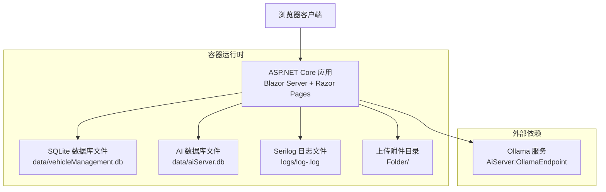
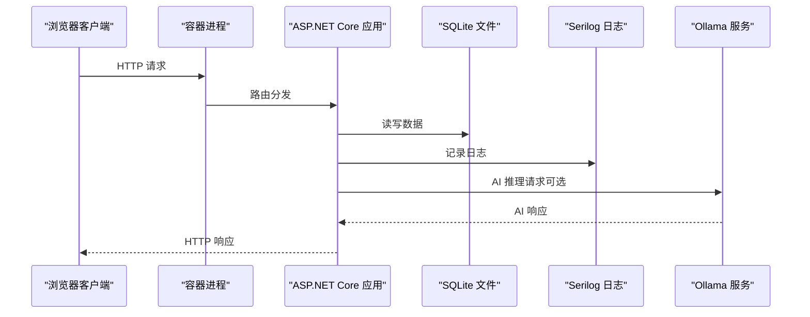
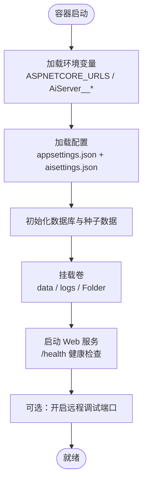
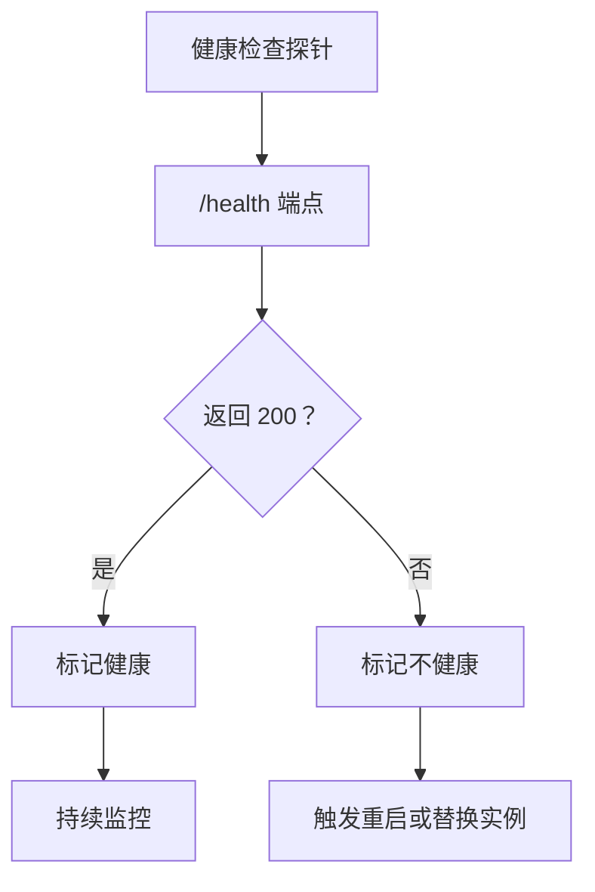
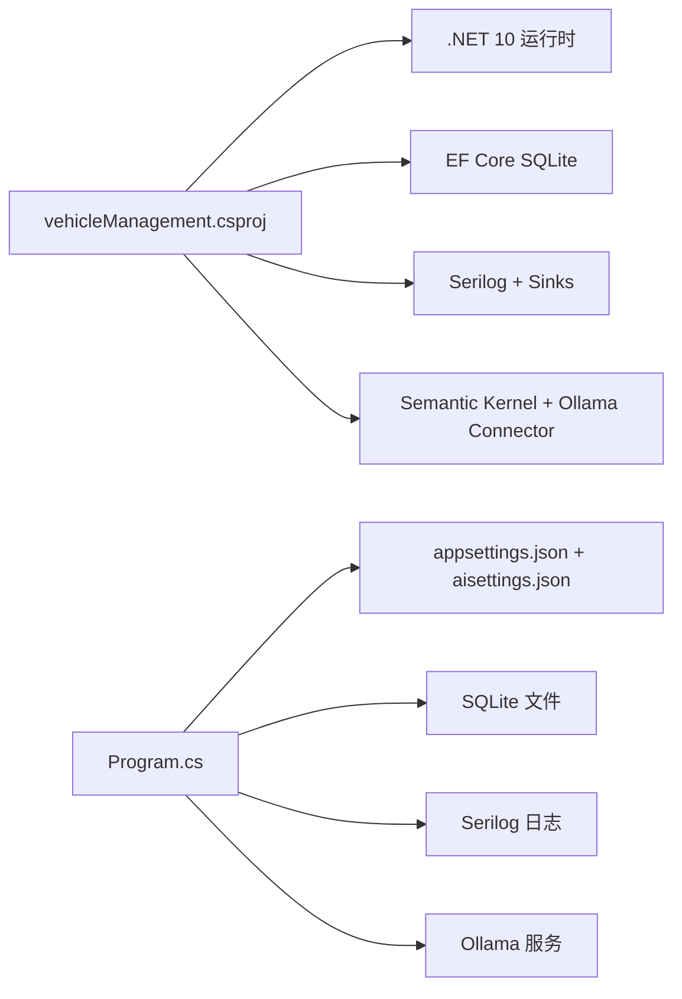

# 远程调试与部署

<cite>
**本文引用的文件**   
- [Dockerfile](file://Dockerfile)
- [Program.cs](file://Program.cs)
- [appsettings.json](file://appsettings.json)
- [appsettings.Development.json](file://appsettings.Development.json)
- [.dockerignore](file://.dockerignore)
- [vehicleManagement.csproj](file://vehicleManagement.csproj)
- [README.md](file://README.md)
</cite>

## 目录
1. [引言](#引言)
2. [项目结构与运行边界](#项目结构与运行边界)
3. [核心组件与运行时契约](#核心组件与运行时契约)
4. [架构总览](#架构总览)
5. [详细组件分析](#详细组件分析)
6. [依赖关系分析](#依赖关系分析)
7. [性能与资源特性](#性能与资源特性)
8. [故障排查指南](#故障排查指南)
9. [结论](#结论)
10. [附录：关键配置清单](#附录关键配置清单)

## 引言
本指南面向 vehicleManagement 系统的远程调试与生产部署，覆盖以下目标：
- Docker 容器内断点调试、环境变量注入、卷挂载调试。
- 生产环境问题排查：日志收集与分析、健康检查端点监控、错误追踪集成思路。
- 远程调试配置：.NET Remote Debugger 配置要点、Kubernetes 调试支持、云环境调试技巧。
- 部署后监控：应用状态监控、资源使用监控、自动重启策略。
- 灾难恢复流程与备份策略，确保系统可快速恢复。

## 项目结构与运行边界
vehicleManagement 是一个基于 .NET 10 的 ASP.NET Core Blazor Server 应用，包含车辆管理业务层、数据访问层以及 AI 聊天子模块。运行时通过 SQLite 持久化数据，并通过 Ollama 提供 AI 能力。

**图示来源**
- [Dockerfile:1-44](file://Dockerfile#L1-L44)
- [Program.cs:28-148](file://Program.cs#L28-L148)
- [appsettings.json:1-8](file://appsettings.json#L1-L8)

**章节来源**
- [Dockerfile:1-44](file://Dockerfile#L1-L44)
- [Program.cs:28-148](file://Program.cs#L28-L148)
- [appsettings.json:1-8](file://appsettings.json#L1-L8)

## 核心组件与运行时契约
- Web 服务器与路由
  - 监听端口由环境变量 `ASPNETCORE_URLS=http://+:80` 控制。
  - 暴露 `/health` 健康检查端点，供容器 HEALTHCHECK 调用。
  - 启用 Blazor Hub 和静态文件服务，并开放 `/Folder` 用于上传附件访问。
- 配置加载
  - 支持可选的 `aisettings.json` 热重载配置。
  - AI 相关配置可通过环境变量 `AiServer__OllamaEndpoint`、`AiServer__OllamaModel` 覆盖。
- 数据访问
  - 主库连接字符串 `DefaultConnection` 指向 `data/vehicleManagement.db`。
  - AI 库连接字符串 `AiServerConnection` 指向 `data/aiServer.db`。
  - 启动时创建数据库表，开发环境初始化种子数据。
- 日志
  - Serilog 输出到控制台与滚动文件 `logs/log-.log`，保留最近 7 天。
- 持久化卷
  - `/app/data`、`/app/logs`、`/app/Folder` 为推荐挂载卷。

**章节来源**
- [Dockerfile:29-43](file://Dockerfile#L29-L43)
- [Program.cs:28-148](file://Program.cs#L28-L148)
- [appsettings.json:1-8](file://appsettings.json#L1-L8)

## 架构总览
下图展示容器内外的关键交互：客户端请求进入 ASP.NET Core，应用读取配置、访问 SQLite、写入日志，并与 Ollama 进行 AI 推理。

**图示来源**
- [Program.cs:97-102](file://Program.cs#L97-L102)
- [Program.cs:144-148](file://Program.cs#L144-L148)
- [Dockerfile:29-43](file://Dockerfile#L29-L43)

## 详细组件分析

### Docker 容器调试
- 容器内断点调试
  - 构建镜像时使用 SDK 阶段编译发布；最终镜像仅包含运行时。
  - 若需容器内断点调试，建议在构建阶段引入调试符号或改用包含调试信息的运行时镜像，并在容器启动参数中启用远程调试监听端口。
  - 将宿主机的调试端口映射到容器，以便 IDE 连接。
- 环境变量配置
  - 通过 `-e` 传入 `AiServer__OllamaEndpoint`、`AiServer__OllamaModel` 等变量，覆盖默认值。
  - 注意容器内的 `localhost` 指容器自身，应使用宿主机 IP 或编排平台提供的网络地址。
- 卷挂载调试
  - 挂载 `/app/data` 以持久化数据库文件，便于本地查看与备份。
  - 挂载 `/app/logs` 以实时观察滚动日志。
  - 挂载 `/app/Folder` 以验证上传附件路径与权限。

**图示来源**
- [Dockerfile:29-43](file://Dockerfile#L29-L43)
- [Program.cs:45-125](file://Program.cs#L45-L125)

**章节来源**
- [Dockerfile:1-44](file://Dockerfile#L1-L44)
- [Program.cs:45-125](file://Program.cs#L45-L125)

### 生产环境问题排查
- 日志收集与分析
  - Serilog 已配置控制台与文件输出，日志按日滚动并保留 7 份。
  - 建议将 `/app/logs` 挂载到宿主机或集中式日志系统，配合日志采集工具进行分析。
- 健康检查端点监控
  - `/health` 返回成功状态，供容器 HEALTHCHECK 探测。
  - 在编排平台（如 Kubernetes）中可结合 Liveness/Readiness 探针进行存活与就绪检测。
- 错误追踪集成
  - 当前异常处理在非开发环境使用统一错误页；可在启动阶段接入第三方错误追踪服务（例如 Sentry、Application Insights），将未捕获异常上报。

**图示来源**
- [Dockerfile:40-41](file://Dockerfile#L40-L41)
- [Program.cs:145-148](file://Program.cs#L145-L148)

**章节来源**
- [Program.cs:28-37](file://Program.cs#L28-L37)
- [Program.cs:127-148](file://Program.cs#L127-L148)
- [Dockerfile:40-41](file://Dockerfile#L40-L41)

### 远程调试配置
- .NET Remote Debugger 配置
  - 在容器镜像中安装远程调试器组件，并在启动参数中启用调试监听端口。
  - 将宿主机的调试端口映射到容器，IDE 选择“附加到远程进程”进行断点调试。
  - 生产环境谨慎开启远程调试，避免泄露敏感信息。
- Kubernetes 调试支持
  - 使用 `kubectl debug` 或 `exec` 进入容器执行诊断命令。
  - 通过 Pod 注解或 Sidecar 注入调试代理，按需启用远程调试。
  - 结合 ServiceMonitor 或 Prometheus 抓取指标，辅助定位问题。
- 云环境调试技巧
  - 使用云厂商的日志服务与审计日志，聚合容器标准输出与文件日志。
  - 利用云平台的网络策略与安全组，限制调试端口仅对可信网段开放。
  - 在 CI/CD 流水线中注入调试密钥或证书，实现安全可控的远程调试。

[本节为通用指导，不直接分析具体源码文件]

### 部署后监控
- 应用状态监控
  - 通过 `/health` 端点判断应用是否可用。
  - 在编排平台设置 Liveness/Readiness 探针，确保自动重启与流量切换。
- 资源使用监控
  - 监控容器的 CPU、内存、磁盘 I/O 与网络带宽。
  - 关注 SQLite 文件大小增长与日志滚动情况，及时清理或归档。
- 自动重启配置
  - 容器编排平台根据健康检查结果自动重启失败实例。
  - 建议设置合理的重试次数与退避策略，避免频繁重启风暴。

[本节为通用指导，不直接分析具体源码文件]

### 灾难恢复流程与备份策略
- 备份范围
  - 数据库文件：`data/vehicleManagement.db`、`data/aiServer.db`。
  - 日志文件：`logs/log-*.log`。
  - 上传附件：`Folder/`。
- 备份频率
  - 数据库建议每小时增量备份，每日全量备份。
  - 日志建议按周归档，保留周期依据合规要求设定。
- 恢复步骤
  - 停止应用，复制备份文件到目标路径。
  - 校验文件完整性，启动应用并验证 `/health`。
  - 逐步恢复上传附件与日志归档，确认功能正常。
- 演练与验证
  - 定期执行恢复演练，验证备份可用性与恢复时间目标。

[本节为通用指导，不直接分析具体源码文件]

## 依赖关系分析
- 运行时依赖
  - .NET 10 运行时与 SDK。
  - EF Core SQLite 提供程序。
  - Serilog 及其控制台、文件 Sink。
  - Semantic Kernel 与 Ollama 连接器。
- 配置依赖
  - `appsettings.json` 定义连接字符串。
  - `aisettings.json` 可选热重载配置。
  - 环境变量覆盖 AI 端点与模型名称。

**图示来源**
- [vehicleManagement.csproj:1-37](file://vehicleManagement.csproj#L1-L37)
- [Program.cs:28-102](file://Program.cs#L28-L102)
- [appsettings.json:1-8](file://appsettings.json#L1-L8)

**章节来源**
- [vehicleManagement.csproj:1-37](file://vehicleManagement.csproj#L1-L37)
- [Program.cs:28-102](file://Program.cs#L28-L102)
- [appsettings.json:1-8](file://appsettings.json#L1-L8)

## 性能与资源特性
- 多阶段构建
  - 构建阶段使用 SDK 镜像，最终镜像仅包含运行时，减小体积。
- 健康检查
  - 容器 HEALTHCHECK 使用 curl 探测 `/health`，间隔与超时参数合理。
- 日志滚动
  - Serilog 按日滚动并限制保留数量，避免磁盘占用过大。
- 静态文件
  - 上传附件通过静态文件服务暴露，建议配合 CDN 或对象存储优化访问性能。

**章节来源**
- [Dockerfile:6-16](file://Dockerfile#L6-L16)
- [Dockerfile:40-41](file://Dockerfile#L40-L41)
- [Program.cs:28-37](file://Program.cs#L28-L37)
- [Program.cs:132-140](file://Program.cs#L132-L140)

## 故障排查指南
- 常见问题定位顺序
  - 检查 `/health` 是否返回 200。
  - 确认进程与容器能否解析到 Ollama 主机（Linux 容器中的 `localhost` 指容器自身）。
  - 检查 `aisettings.json` 是否被环境变量 `AiServer__OllamaEndpoint` 覆盖。
  - 核对 `OllamaModel` 的 tag 是否与 `ollama list` 完全一致。
- 日志分析
  - 查看控制台输出与 `logs/log-*.log`，关注启动失败与异常堆栈。
- 健康检查失败
  - 检查容器内部 curl 是否能访问 `/health`。
  - 检查网络策略与安全组是否放行 80 端口。
- 数据库问题
  - 检查 `data/` 目录权限与空间。
  - 确认连接字符串指向正确的数据库文件。
- 上传附件问题
  - 检查 `/app/Folder` 挂载与权限。
  - 确认静态文件服务路径 `/Folder` 可访问。

**章节来源**
- [README.md:116-153](file://README.md#L116-L153)
- [Program.cs:106-140](file://Program.cs#L106-L140)
- [Dockerfile:37-41](file://Dockerfile#L37-L41)

## 结论
vehicleManagement 系统具备清晰的容器化基础与可观测性起点：健康检查端点、Serilog 日志、SQLite 持久化与 Ollama 集成。通过完善远程调试配置、编排平台探针与日志采集，可实现从开发到生产的稳定运维。建议在生产环境中强化错误追踪、指标监控与备份演练，确保系统在出现问题时能够快速恢复。

[本节为总结性内容，不直接分析具体源码文件]

## 附录：关键配置清单
- 环境变量
  - `ASPNETCORE_URLS=http://+:80`
  - `AiServer__OllamaEndpoint`
  - `AiServer__OllamaModel`
- 持久化卷
  - `/app/data`
  - `/app/logs`
  - `/app/Folder`
- 健康检查
  - 容器 HEALTHCHECK 调用 `/health`
- 配置优先级
  - `appsettings.json` → `aisettings.json` → 环境变量

**章节来源**
- [Dockerfile:29-43](file://Dockerfile#L29-L43)
- [Program.cs:45-102](file://Program.cs#L45-L102)
- [appsettings.json:1-8](file://appsettings.json#L1-L8)