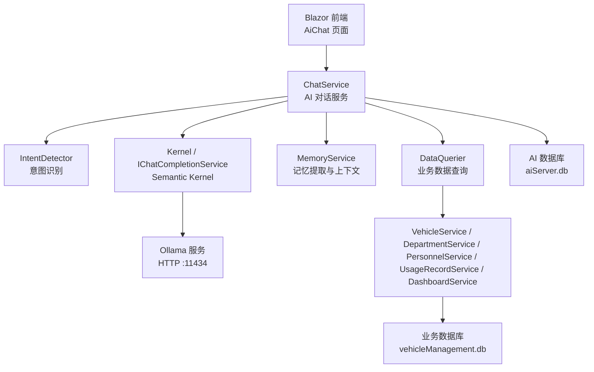
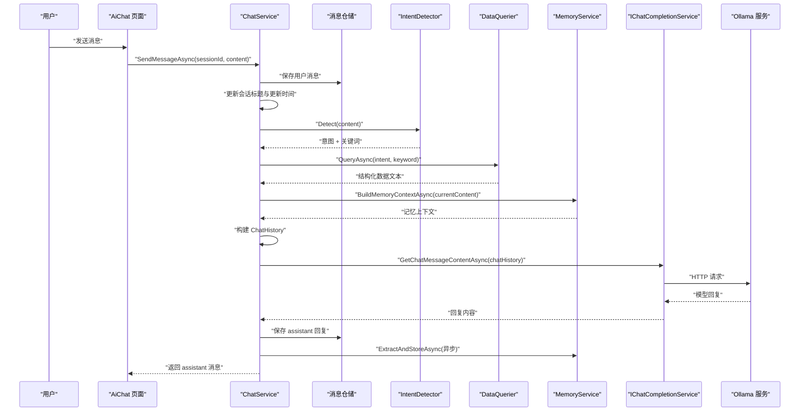
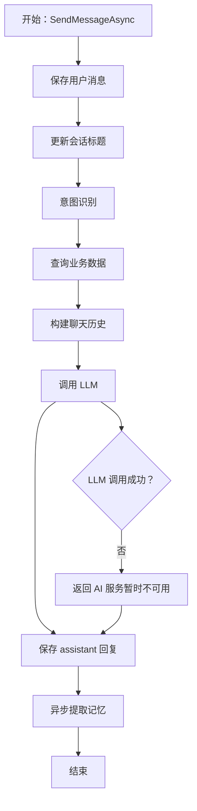
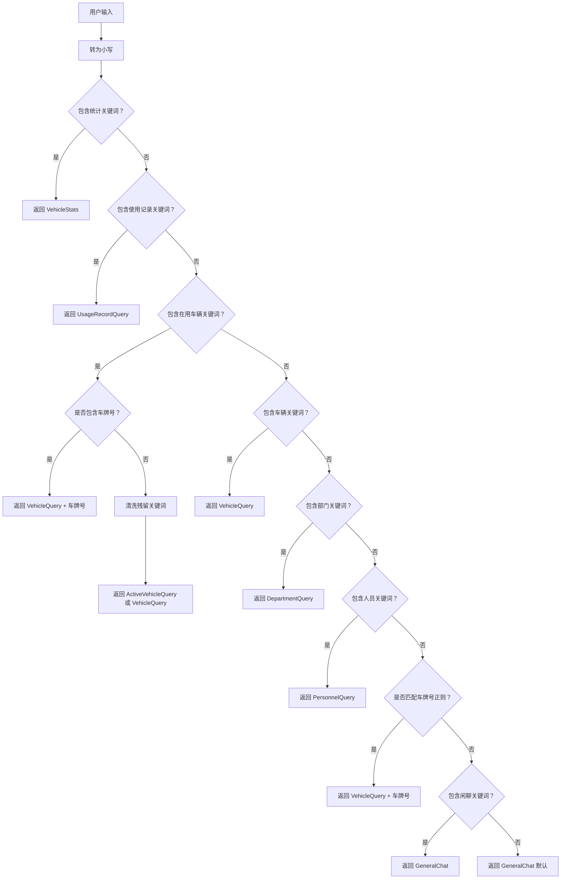
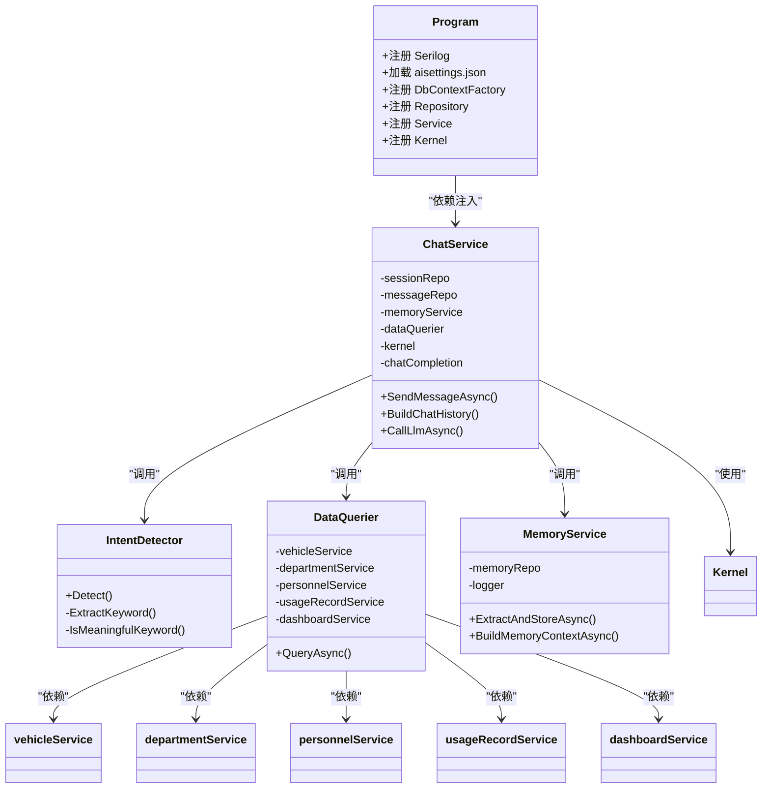

# AI 服务连接与调用错误

<cite>
**本文引用的文件**   
- [Program.cs](file://Program.cs)
- [ChatService.cs](file://aiServer/BLL/ChatService.cs)
- [IntentDetector.cs](file://aiServer/BLL/IntentDetector.cs)
- [DataQuerier.cs](file://aiServer/BLL/DataQuerier.cs)
- [MemoryService.cs](file://aiServer/BLL/MemoryService.cs)
- [aisettings.example.json](file://aisettings.example.json)
- [aisettings.json](file://aisettings.json)
- [appsettings.json](file://appsettings.json)
- [Dockerfile](file://Dockerfile)
- [README.md](file://README.md)
</cite>

## 目录
1. [引言](#引言)
2. [项目结构与 AI 服务定位](#项目结构与-ai-服务定位)
3. [核心组件与职责](#核心组件与职责)
4. [架构总览：一次 AI 对话的完整链路](#架构总览一次-ai-对话的完整链路)
5. [配置文件详解：aisettings.json 与相关配置](#配置文件详解aisettingsjson-与相关配置)
6. [常见错误场景与排查方法](#常见错误场景与排查方法)
7. [ChatService 工作流程与故障点](#chatservice-工作流程与故障点)
8. [IntentDetector 意图识别逻辑与常见问题](#intentdetector-意图识别逻辑与常见问题)
9. [依赖关系分析](#依赖关系分析)
10. [性能与稳定性考虑](#性能与稳定性考虑)
11. [监控与调试技巧](#监控与调试技巧)
12. [故障诊断清单](#故障诊断清单)
13. [结论](#结论)

## 引言
本指南面向 vehicleManagement 系统中的 AI 助手能力，重点解决以下问题：
- Ollama 服务连接失败
- Semantic Kernel 初始化异常
- 模型加载或推理失败
- aisettings.json 配置错误导致无法接入本地模型
- ChatService 与 IntentDetector 的工作流程及可能故障点
- 网络连接超时、模型版本不兼容、API 调用限流等具体场景的处理方法
- AI 服务的监控与调试技巧

该系统的 AI 能力采用“规则意图识别 + 业务数据查询 + 结构化结果注入 + 本地小模型回答”的设计：用户输入先由规则引擎判断意图，再从车辆、部门、人员、使用记录等业务服务中取数，最后把结构化文本交给 Semantic Kernel 调用的 Ollama 模型生成自然语言回复。

## 项目结构与 AI 服务定位
vehicleManagement 是一个 Blazor Server 应用，AI 功能集中在 `aiServer` 子模块中：
- `aiServer/BLL`：AI 业务逻辑，包括对话、意图识别、数据查询、记忆管理。
- `aiServer/DAL`：AI 会话、消息、记忆的数据库模型与仓储。
- `aiServer/Pages/AiChat.razor`：AI 聊天页面入口（当前文档聚焦后端）。
- 根目录 `Program.cs`：负责依赖注入、Serilog 日志、Semantic Kernel 注册、Ollama 端点与模型配置。



**图表来源**
- [Program.cs:97-102](file://Program.cs#L97-L102)
- [ChatService.cs:18-42](file://aiServer/BLL/ChatService.cs#L18-L42)
- [IntentDetector.cs:12-17](file://aiServer/BLL/IntentDetector.cs#L12-L17)
- [DataQuerier.cs:21-43](file://aiServer/BLL/DataQuerier.cs#L21-L43)
- [MemoryService.cs:15-40](file://aiServer/BLL/MemoryService.cs#L15-L40)

**章节来源**
- [Program.cs:41-102](file://Program.cs#L41-L102)
- [README.md:25-46](file://README.md#L25-L46)

## 核心组件与职责
| 组件 | 主要职责 | 关键行为 | 常见故障点 |
|---|---|---|---|
| Program.cs | 应用启动、依赖注入、日志、Semantic Kernel 注册 | 读取 `AiServer:OllamaEndpoint` 和 `AiServer:OllamaModel`，创建并注册单例 Kernel | 配置缺失、Ollama 地址不可达、模型 tag 不存在 |
| ChatService | 对话主流程：保存消息、意图识别、查库、构建上下文、调用 LLM、保存回复、异步记忆提取 | 控制整体时序；对 LLM 调用做兜底返回 | Ollama 不可用、历史消息过多、空响应 |
| IntentDetector | 基于关键词匹配判断用户意图，并提取搜索关键词 | 统计、在用车辆、车辆、部门、人员、使用记录、闲聊等分支 | 关键词优先级冲突、残留关键词清洗误判 |
| DataQuerier | 根据意图调用业务 Service，格式化结果为 LLM 可读文本 | 分页限制、时间范围解析、空结果文案 | 业务 Service 异常、数据库连接异常 |
| MemoryService | 从对话中提取车牌、品牌、偏好等记忆，并构建记忆上下文 | 正则提取、去重、Top5 记忆注入 | 正则匹配异常、记忆写库失败 |
| Dockerfile | 容器部署时注入 Ollama 环境变量 | 提供 `AiServer__OllamaEndpoint` 和 `AiServer__OllamaModel` 默认值 | 容器内 localhost 指向自身而非宿主机 |

**章节来源**
- [Program.cs:28-102](file://Program.cs#L28-L102)
- [ChatService.cs:15-42](file://aiServer/BLL/ChatService.cs#L15-L42)
- [IntentDetector.cs:9-17](file://aiServer/BLL/IntentDetector.cs#L9-L17)
- [DataQuerier.cs:18-43](file://aiServer/BLL/DataQuerier.cs#L18-L43)
- [MemoryService.cs:12-40](file://aiServer/BLL/MemoryService.cs#L12-L40)
- [Dockerfile:31-35](file://Dockerfile#L31-L35)

## 架构总览：一次 AI 对话的完整链路
一次用户发送消息到收到 AI 回复的典型流程如下：



**图表来源**
- [ChatService.cs:94-139](file://aiServer/BLL/ChatService.cs#L94-L139)
- [ChatService.cs:161-199](file://aiServer/BLL/ChatService.cs#L161-L199)
- [IntentDetector.cs:17-111](file://aiServer/BLL/IntentDetector.cs#L17-L111)
- [DataQuerier.cs:48-67](file://aiServer/BLL/DataQuerier.cs#L48-L67)
- [MemoryService.cs:45-113](file://aiServer/BLL/MemoryService.cs#L45-L113)

**章节来源**
- [ChatService.cs:90-139](file://aiServer/BLL/ChatService.cs#L90-L139)
- [README.md:240-252](file://README.md#L240-L252)

## 配置文件详解：aisettings.json 与相关配置
### aisettings.json 的作用
`aisettings.json` 是外部 AI 配置文件，用于指定 Ollama 的连接端点和模型名称。它被 `Program.cs` 以可选方式加载，并支持热重载，适合在 Docker 挂载后直接修改而不重启应用。

关键配置项：
- `AiServer.OllamaEndpoint`：Ollama HTTP 服务地址，例如 `http://localhost:11434` 或内网 IP。
- `AiServer.OllamaModel`：Ollama 上已拉取的模型 tag，例如 `gemma4:e2b` 或 `gemma4`。

示例参考：
- [aisettings.example.json](file://aisettings.example.json)
- [aisettings.json](file://aisettings.json)

### 配置读取优先级
代码中的读取顺序为：
1. 通过 `builder.Configuration["AiServer:OllamaEndpoint"]` 获取端点。
2. 通过 `builder.Configuration["AiServer:OllamaModel"]` 获取模型。
3. 如果未配置，则回退到默认值：
   - 端点默认：`http://localhost:11434`
   - 模型默认：`gemma4:e2b`

此外，Docker 部署时可通过环境变量覆盖：
- `AiServer__OllamaEndpoint`
- `AiServer__OllamaModel`

这意味着在容器中，即使 `aisettings.json` 存在，也可能被环境变量覆盖。

### appsettings.json 与 AI 的关系
`appsettings.json` 主要配置：
- `AllowedHosts`
- `ConnectionStrings.DefaultConnection`：业务数据库路径
- `ConnectionStrings.AiServerConnection`：AI 数据库路径

AI 服务本身不直接读取 `appsettings.json` 中的 Ollama 配置，而是通过 `Configuration["AiServer:..."]` 读取，来源包括 `aisettings.json`、环境变量、以及 .NET 配置体系的其他来源。

### 常见配置错误
| 错误类型 | 现象 | 原因 | 处理方法 |
|---|---|---|---|
| Ollama 地址错误 | 启动正常但 AI 对话失败 | `OllamaEndpoint` 指向不可达地址 | 检查网络连通性、容器内外 localhost 差异 |
| 模型 tag 不一致 | 模型加载失败或返回空 | `OllamaModel` 与 `ollama list` 不一致 | 使用 `ollama list` 确认 tag，修正配置 |
| 环境变量覆盖 | 修改 `aisettings.json` 不生效 | Docker 环境变量优先级更高 | 检查 `AiServer__OllamaEndpoint` 和 `AiServer__OllamaModel` |
| 端口不通 | 连接超时 | Ollama 未启动或端口未暴露 | 检查 Ollama 进程、防火墙、端口映射 |
| 配置键名错误 | 配置无效 | JSON 结构或键名不正确 | 对照 `AiServer.OllamaEndpoint` 和 `AiServer.OllamaModel` |

**章节来源**
- [Program.cs:45-46](file://Program.cs#L45-L46)
- [Program.cs:97-102](file://Program.cs#L97-L102)
- [aisettings.example.json:1-6](file://aisettings.example.json#L1-L6)
- [aisettings.json:1-6](file://aisettings.json#L1-L6)
- [appsettings.json:1-8](file://appsettings.json#L1-L8)
- [Dockerfile:31-35](file://Dockerfile#L31-L35)
- [README.md:107-118](file://README.md#L107-L118)

## 常见错误场景与排查方法
### 1. Ollama 服务连接失败
**现象**
- AI 对话返回“AI 服务暂时不可用”。
- 日志中出现连接失败、超时或 HTTP 错误。

**可能原因**
- Ollama 未启动。
- 端口 11434 不通。
- 容器内 `localhost` 指向容器自身，而不是宿主机。
- `aisettings.json` 中的端点被环境变量覆盖。
- 防火墙或代理阻止访问。

**排查步骤**
1. 检查 `/health` 是否返回 200，确认应用本身可运行。
2. 使用 curl 测试 Ollama：
   ```bash
   curl http://localhost:11434/api/chat -d '{
     "model": "gemma3:4b",
     "messages": [{"role": "user", "content": "你好"}]
   }'
   ```
3. 确认 `ollama list` 输出的模型 tag 与配置一致。
4. 检查 `AiServer:OllamaEndpoint` 是否被环境变量覆盖。
5. 在 Linux 容器中，不要直接使用 `localhost`，应使用宿主机 IP 或 `host.docker.internal`。

**章节来源**
- [README.md:107-118](file://README.md#L107-L118)
- [Program.cs:97-102](file://Program.cs#L97-L102)
- [Dockerfile:31-35](file://Dockerfile#L31-L35)

### 2. Semantic Kernel 初始化错误
**现象**
- 应用启动时报错。
- Kernel 注册失败。
- `AddOllamaChatCompletion` 抛出异常。

**可能原因**
- Ollama 端点格式非法。
- 模型 tag 不存在。
- Semantic Kernel 包版本与 Ollama Connector 不兼容。
- 依赖还原或发布不完整。

**排查步骤**
1. 检查 `Program.cs` 中 Kernel 注册逻辑。
2. 确认 `AiServer:OllamaEndpoint` 是合法 URI。
3. 确认 `AiServer:OllamaModel` 对应 Ollama 中存在的模型。
4. 检查依赖包版本，尤其是 `Microsoft.SemanticKernel.Connectors.Ollama`。
5. 重新 `dotnet restore` 和 `dotnet publish`。

**章节来源**
- [Program.cs:97-102](file://Program.cs#L97-L102)
- [README.md:173-183](file://README.md#L173-L183)

### 3. 模型加载异常
**现象**
- Ollama 返回模型不存在。
- 模型下载失败。
- 模型大小或显存不足导致加载失败。

**可能原因**
- 模型 tag 拼写错误。
- 本地磁盘空间不足。
- GPU 或内存不足。
- 使用了不支持的模型格式。

**排查步骤**
1. 执行 `ollama list` 确认模型是否存在。
2. 执行 `ollama pull <模型tag>` 手动拉取。
3. 检查 Ollama 日志，确认模型加载过程。
4. 调整模型大小，例如使用更小的 4B 级模型。
5. 检查系统资源占用情况。

**章节来源**
- [README.md:107-118](file://README.md#L107-L118)
- [aisettings.example.json:1-6](file://aisettings.example.json#L1-L6)

### 4. 网络连接超时
**现象**
- AI 调用长时间无响应。
- 日志中出现超时异常。

**可能原因**
- Ollama 服务负载过高。
- 网络延迟高。
- 并发请求过多。
- 防火墙或代理中断连接。

**排查步骤**
1. 单独测试 Ollama 接口响应时间。
2. 减少并发请求。
3. 检查网络策略和代理配置。
4. 观察 Ollama 服务 CPU、内存、GPU 使用情况。
5. 考虑增加重试机制或降级策略。

**章节来源**
- [ChatService.cs:188-199](file://aiServer/BLL/ChatService.cs#L188-L199)

### 5. 模型版本不兼容
**现象**
- 模型加载成功但推理结果异常。
- 提示词遵循度差。
- 输出格式不稳定。

**可能原因**
- 模型太小，无法理解复杂提示词。
- 模型版本过旧。
- 提示词设计不适合当前模型。

**排查步骤**
1. 更换为更合适的模型 tag。
2. 简化提示词，避免过于复杂的指令。
3. 使用 README 中提供的结构化数据注入方式。
4. 对比不同模型的输出质量。

**章节来源**
- [README.md:240-258](file://README.md#L240-L258)
- [ChatService.cs:161-183](file://aiServer/BLL/ChatService.cs#L161-L183)

### 6. API 调用限流
**现象**
- Ollama 返回限流错误。
- 请求被拒绝。
- 响应变慢。

**可能原因**
- Ollama 服务端限制并发。
- 单机资源不足。
- 请求频率过高。

**排查步骤**
1. 降低请求频率。
2. 增加 Ollama 实例或扩容资源。
3. 实现请求队列或令牌桶限流。
4. 监控 Ollama 服务状态。

**章节来源**
- [ChatService.cs:188-199](file://aiServer/BLL/ChatService.cs#L188-L199)

## ChatService 工作流程与故障点
### 核心流程
`ChatService.SendMessageAsync` 是 AI 对话的核心入口，主要步骤包括：
1. 保存用户消息。
2. 自动更新会话标题。
3. 调用 `IntentDetector.Detect` 识别意图。
4. 调用 `DataQuerier.QueryAsync` 查询业务数据。
5. 构建聊天历史上下文。
6. 调用 LLM 获取回复。
7. 保存 assistant 回复。
8. 异步提取记忆。

### 关键故障点
| 阶段 | 故障点 | 表现 | 处理 |
|---|---|---|---|
| 消息保存 | 数据库写入失败 | 用户消息未持久化 | 检查 AI 数据库连接 |
| 意图识别 | 关键词匹配错误 | 走错查询分支 | 检查 IntentDetector 关键词表 |
| 数据查询 | 业务 Service 异常 | 返回“查询数据库时发生错误” | 检查 DataQuerier 和业务 Service |
| 上下文构建 | 历史消息过多 | 模型上下文溢出 | 控制 MaxRecentMessages |
| LLM 调用 | Ollama 不可用 | 返回“AI 服务暂时不可用” | 检查 Ollama 连接和模型 |
| 记忆提取 | 异步任务失败 | 不影响对话，只记警告 | 检查 MemoryService 日志 |



**图表来源**
- [ChatService.cs:94-139](file://aiServer/BLL/ChatService.cs#L94-L139)
- [ChatService.cs:188-199](file://aiServer/BLL/ChatService.cs#L188-L199)

**章节来源**
- [ChatService.cs:90-199](file://aiServer/BLL/ChatService.cs#L90-L199)

## IntentDetector 意图识别逻辑与常见问题
### 意图优先级
IntentDetector 使用关键词匹配判断用户意图，优先级如下：
1. 统计类意图：统计、汇总、多少辆、占比、分布、趋势、排行等。
2. 使用记录：使用记录、出车、用车、行程等。
3. 在用车辆：在用车辆、当前可用、正在使用、有哪些车等。
4. 车辆查询：车辆、车牌、品牌、型号、状态等。
5. 部门查询：部门、单位、科室等。
6. 人员查询：人员、员工、司机、姓名、电话等。
7. 车牌号模式：如“京A12345”。
8. 通用闲聊：你好、谢谢、再见、帮助等。
9. 默认：通用问答。

### 关键词提取与清洗
- 去除触发词后的残留文本作为搜索关键词。
- 去除停用词：查询、查查、帮我、请、一下、所有的、全部等。
- 通过 `IsMeaningfulKeyword` 过滤噪声字符，如“辆”“在”“有”“哪”“的”等。

### 常见问题
| 问题 | 原因 | 解决方法 |
|---|---|---|
| “哪个部门用车最多”被误判为使用记录 | 统计关键词优先级低于“用车” | 确保统计类关键词优先匹配 |
| “有哪些车在用”被误判为模糊车辆查询 | 在用车辆关键词优先级低于普通车辆 | 确保在用车辆优先匹配 |
| 残留关键词为空 | 触发词和停用词覆盖过多 | 检查关键词表和停用词表 |
| 车牌号被误判为在用车辆 | 车牌号正则匹配优先级问题 | 优先检测车牌号模式 |



**图表来源**
- [IntentDetector.cs:17-111](file://aiServer/BLL/IntentDetector.cs#L17-L111)
- [IntentDetector.cs:116-149](file://aiServer/BLL/IntentDetector.cs#L116-L149)

**章节来源**
- [IntentDetector.cs:17-149](file://aiServer/BLL/IntentDetector.cs#L17-L149)
- [README.md:235-239](file://README.md#L235-L239)

## 依赖关系分析
### 组件依赖图


**图表来源**
- [Program.cs:70-102](file://Program.cs#L70-L102)
- [ChatService.cs:18-42](file://aiServer/BLL/ChatService.cs#L18-L42)
- [IntentDetector.cs:12-17](file://aiServer/BLL/IntentDetector.cs#L12-L17)
- [DataQuerier.cs:21-43](file://aiServer/BLL/DataQuerier.cs#L21-L43)
- [MemoryService.cs:15-40](file://aiServer/BLL/MemoryService.cs#L15-L40)

**章节来源**
- [Program.cs:70-102](file://Program.cs#L70-L102)
- [ChatService.cs:18-42](file://aiServer/BLL/ChatService.cs#L18-L42)
- [DataQuerier.cs:21-43](file://aiServer/BLL/DataQuerier.cs#L21-L43)

## 性能与稳定性考虑
### 性能优化
- **固定历史窗口**：`MaxRecentMessages = 20`，避免长会话导致上下文过大。
- **分页限制**：`MaxQueryResults = 20`，限制每次查询返回的数据量。
- **异步记忆提取**：记忆提取在独立任务中执行，不阻塞主对话流程。
- **单例 Kernel**：Kernel 注册为单例，避免重复创建开销。

### 稳定性设计
- **四类故障独立兜底**：
  - Ollama 不可达：返回“AI 服务暂时不可用”。
  - 业务查询异常：返回“查询数据库时发生错误”。
  - 查询结果为空：返回明确文案。
  - 记忆写失败：只记警告，不影响对话。
- **数据库隔离**：业务库与 AI 库物理分离，清对话记录不影响业务数据。
- **并发安全**：两个 DbContext 都注册为 `AddDbContextFactory`，避免 Blazor 并发冲突。
- **日志降噪**：Serilog 抑制框架和 EF Core SQL 日志，突出业务日志。

**章节来源**
- [ChatService.cs:27-27](file://aiServer/BLL/ChatService.cs#L27-L27)
- [DataQuerier.cs:29-29](file://aiServer/BLL/DataQuerier.cs#L29-L29)
- [ChatService.cs:131-136](file://aiServer/BLL/ChatService.cs#L131-L136)
- [Program.cs:102-102](file://Program.cs#L102-L102)
- [README.md:291-306](file://README.md#L291-L306)

## 监控与调试技巧
### 日志查看
- 应用日志位于 `logs/log-.log`，按天滚动，保留 7 天。
- 控制台输出包含时间戳、级别、消息和异常信息。
- 重点关注：
  - 应用程序启动失败
  - 记忆提取失败
  - 数据库查询异常
  - Ollama 连接异常

### 健康检查
- 使用 `/health` 接口检查应用是否正常运行。
- Docker 中使用 `HEALTHCHECK` 定期探测。

### 调试建议
1. 先验证 Ollama 是否可通。
2. 再验证应用 `/health` 是否正常。
3. 检查 `aisettings.json` 配置是否正确。
4. 查看 Serilog 日志文件。
5. 使用浏览器开发者工具查看前端请求。
6. 逐步缩小问题范围：前端 → 后端 → 数据库 → Ollama。

**章节来源**
- [Program.cs:28-37](file://Program.cs#L28-L37)
- [Program.cs:145-145](file://Program.cs#L145-L145)
- [Dockerfile:40-41](file://Dockerfile#L40-L41)
- [MemoryService.cs:109-112](file://aiServer/BLL/MemoryService.cs#L109-L112)

## 故障诊断清单
### 快速自检表
| 检查项 | 预期结果 | 异常处理 |
|---|---|---|
| `/health` 返回 200 | 应用正常运行 | 检查应用启动日志 |
| Ollama 端口 11434 可达 | curl 能返回响应 | 检查 Ollama 服务状态 |
| `ollama list` 显示模型 | 模型 tag 存在 | 重新拉取模型或修正配置 |
| `aisettings.json` 配置正确 | 端点和模型 tag 正确 | 对照示例文件修正 |
| 环境变量未覆盖 | 配置未被覆盖 | 检查 Docker 环境变量 |
| 日志中有异常 | 有明确错误信息 | 根据日志定位问题 |
| 意图识别正确 | 走正确的查询分支 | 检查关键词表 |
| 数据查询正常 | 返回结构化数据 | 检查业务 Service |
| LLM 调用成功 | 返回自然语言回复 | 检查 Ollama 连接 |

### 分场景处理
| 场景 | 第一步 | 第二步 | 第三步 |
|---|---|---|---|
| 启动失败 | 查看启动日志 | 检查依赖注入 | 检查 Kernel 注册 |
| 对话无响应 | 检查 Ollama 连接 | 检查网络 | 检查模型资源 |
| 意图识别错误 | 检查关键词 | 调整优先级 | 测试 IntentDetector |
| 数据为空 | 检查业务数据 | 检查查询条件 | 检查 DataQuerier |
| 记忆不生效 | 检查异步任务 | 查看警告日志 | 检查 MemoryService |

**章节来源**
- [Program.cs:145-153](file://Program.cs#L145-L153)
- [ChatService.cs:188-199](file://aiServer/BLL/ChatService.cs#L188-L199)
- [IntentDetector.cs:17-111](file://aiServer/BLL/IntentDetector.cs#L17-L111)
- [DataQuerier.cs:48-67](file://aiServer/BLL/DataQuerier.cs#L48-L67)
- [MemoryService.cs:109-112](file://aiServer/BLL/MemoryService.cs#L109-L112)

## 结论
vehicleManagement 的 AI 服务采用清晰的分层架构和明确的错误兜底机制，能够有效隔离 Ollama 连接失败、模型加载异常、业务查询错误等问题。通过合理配置 `aisettings.json`、监控 Serilog 日志、使用健康检查接口，可以快速定位和解决大多数 AI 服务问题。

对于生产环境，建议：
- 固定 Ollama 模型 tag，避免动态变更。
- 监控 Ollama 服务资源和可用性。
- 实现请求限流和重试机制。
- 定期清理 AI 数据库中的历史消息和记忆。
- 建立完整的监控告警体系。