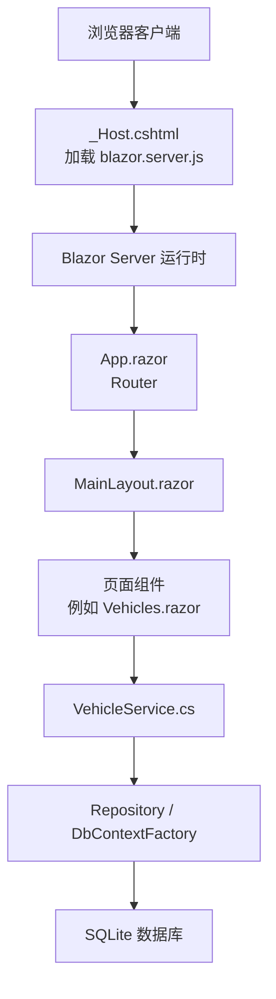
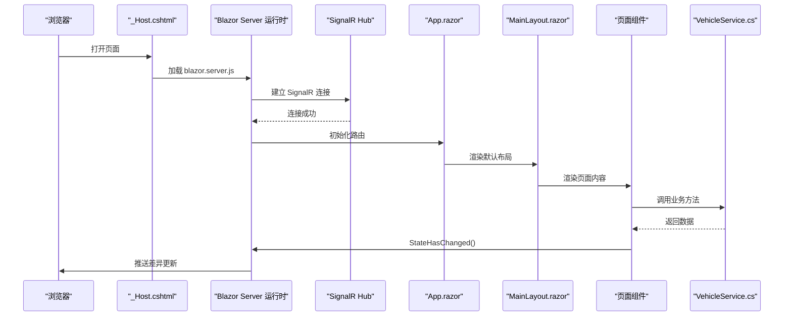
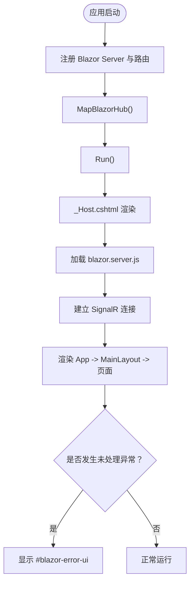
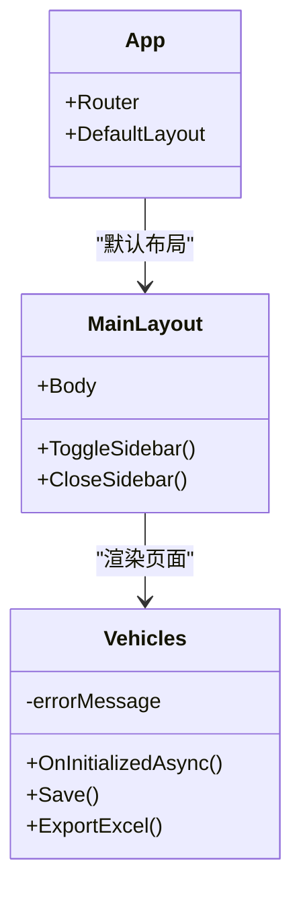
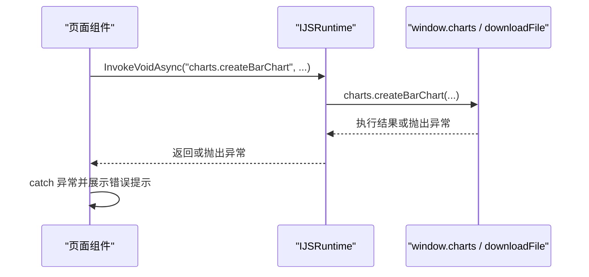
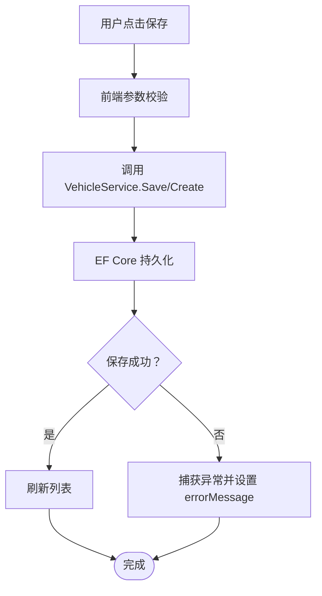
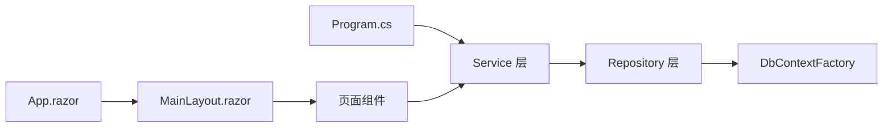

# Blazor 运行时错误

<cite>
**本文引用的文件**   
- [Program.cs](file://Program.cs)
- [App.razor](file://App.razor)
- [MainLayout.razor](file://Components/Layouts/MainLayout.razor)
- [_Host.cshtml](file://Pages/_Host.cshtml)
- [Vehicles.razor](file://Pages/Vehicles.razor)
- [VehicleService.cs](file://BLL/Vehicle/VehicleService.cs)
- [Index.razor](file://Pages/Index.razor)
- [Execute.razor.cs](file://Pages/Execute.razor.cs)
- [AiChat.razor](file://aiServer/Pages/AiChat.razor)
- [site.css](file://wwwroot/css/site.css)
</cite>

## 目录
1. [引言](#引言)
2. [项目结构](#项目结构)
3. [核心组件](#核心组件)
4. [架构总览](#架构总览)
5. [详细组件分析](#详细组件分析)
6. [依赖关系分析](#依赖关系分析)
7. [性能与内存注意事项](#性能与内存注意事项)
8. [故障排查指南](#故障排查指南)
9. [结论](#结论)

## 引言
本指南面向 vehicleManagement 系统的 Blazor Server 运行时问题诊断与解决，重点覆盖以下场景：
- Hub 连接断开、SignalR 连接失败与重连
- 组件渲染异常、异步操作异常
- JavaScript 互操作错误（JSRuntime）
- MainLayout 与页面组件的错误边界处理
- 内存泄漏与性能监控、调试工具使用

目标是帮助开发者快速定位问题根因，给出可操作的修复建议，并建立稳定的错误处理与恢复机制。

## 项目结构
vehicleManagement 采用典型的三层架构：
- 表现层：Blazor Server 页面与布局
- 业务层：各模块 Service
- 数据访问层：Repository + EF Core DbContext

关键入口与运行期配置集中在 Program.cs；页面宿主在 _Host.cshtml；路由与默认布局由 App.razor 管理；MainLayout 提供全局布局与交互。

**图示来源**
- [Program.cs:48-49](file://Program.cs#L48-L49)
- [Program.cs:144-146](file://Program.cs#L144-L146)
- [App.razor:2-10](file://App.razor#L2-L10)
- [MainLayout.razor:1-23](file://Components/Layouts/MainLayout.razor#L1-L23)
- [_Host.cshtml:24-27](file://Pages/_Host.cshtml#L24-L27)
- [_Host.cshtml:172-172](file://Pages/_Host.cshtml#L172-L172)

**章节来源**
- [Program.cs:48-49](file://Program.cs#L48-L49)
- [Program.cs:144-146](file://Program.cs#L144-L146)
- [App.razor:2-10](file://App.razor#L2-L10)
- [MainLayout.razor:1-23](file://Components/Layouts/MainLayout.razor#L1-L23)
- [_Host.cshtml:24-27](file://Pages/_Host.cshtml#L24-L27)
- [_Host.cshtml:172-172](file://Pages/_Host.cshtml#L172-L172)

## 核心组件
- Program.cs：应用启动、服务注册、Blazor Server 管道、异常处理中间件、静态资源与健康检查端点。
- App.razor：路由与默认布局绑定。
- MainLayout.razor：全局布局、侧边栏交互。
- _Host.cshtml：Blazor Server 宿主页，注入 JS 脚本与错误 UI。
- Vehicles.razor：车辆管理页面，包含表单、列表、分页、导出、二维码下载等逻辑。
- VehicleService.cs：车辆领域服务，封装查询、创建、更新、删除、校验等逻辑。

这些组件共同构成 Blazor Server 的渲染、通信与业务调用链路。

**章节来源**
- [Program.cs:28-37](file://Program.cs#L28-L37)
- [Program.cs:48-102](file://Program.cs#L48-L102)
- [Program.cs:127-146](file://Program.cs#L127-L146)
- [App.razor:2-10](file://App.razor#L2-L10)
- [MainLayout.razor:1-39](file://Components/Layouts/MainLayout.razor#L1-L39)
- [_Host.cshtml:24-38](file://Pages/_Host.cshtml#L24-L38)
- [Vehicles.razor:1-410](file://Pages/Vehicles.razor#L1-L410)
- [VehicleService.cs:15-239](file://BLL/Vehicle/VehicleService.cs#L15-L239)

## 架构总览
Blazor Server 通过 SignalR 维持长连接，服务端维护组件状态树，按需将差异同步到客户端。_Host.cshtml 引入 blazor.server.js，Program.cs 中 MapBlazorHub 暴露 Hub 端点。

**图示来源**
- [_Host.cshtml:172-172](file://Pages/_Host.cshtml#L172-L172)
- [Program.cs:144-146](file://Program.cs#L144-L146)
- [App.razor:2-10](file://App.razor#L2-L10)
- [MainLayout.razor:1-23](file://Components/Layouts/MainLayout.razor#L1-L23)
- [Vehicles.razor:215-227](file://Pages/Vehicles.razor#L215-L227)
- [VehicleService.cs:67-109](file://BLL/Vehicle/VehicleService.cs#L67-L109)

## 详细组件分析

### Blazor Server 连接与错误边界
- 宿主页 _Host.cshtml 引入 blazor.server.js，并在页面底部挂载错误提示 UI。
- Program.cs 在非开发环境启用 UseExceptionHandler("/Error")，用于捕获未处理异常。
- App.razor 将默认布局设置为 MainLayout，所有页面均受其包裹。

**图示来源**
- [Program.cs:48-49](file://Program.cs#L48-L49)
- [Program.cs:127-130](file://Program.cs#L127-L130)
- [Program.cs:144-146](file://Program.cs#L144-L146)
- [_Host.cshtml:24-38](file://Pages/_Host.cshtml#L24-L38)
- [_Host.cshtml:172-172](file://Pages/_Host.cshtml#L172-L172)
- [App.razor:2-10](file://App.razor#L2-L10)

**章节来源**
- [_Host.cshtml:24-38](file://Pages/_Host.cshtml#L24-L38)
- [_Host.cshtml:172-172](file://Pages/_Host.cshtml#L172-L172)
- [Program.cs:127-130](file://Program.cs#L127-L130)
- [App.razor:2-10](file://App.razor#L2-L10)

### MainLayout 与页面组件的错误边界
- MainLayout 目前仅负责布局与侧边栏交互，未实现全局 try/catch 或 OnError 钩子。
- 页面组件内部对关键异步操作进行 try/catch，并将错误信息展示为模态框。
- 建议在 App.razor 或 MainLayout 中增加统一错误边界，以捕获组件渲染异常，避免整页崩溃。

**图示来源**
- [App.razor:2-10](file://App.razor#L2-L10)
- [MainLayout.razor:1-39](file://Components/Layouts/MainLayout.razor#L1-L39)
- [Vehicles.razor:215-227](file://Pages/Vehicles.razor#L215-L227)
- [Vehicles.razor:284-331](file://Pages/Vehicles.razor#L284-L331)
- [Vehicles.razor:397-408](file://Pages/Vehicles.razor#L397-L408)

**章节来源**
- [MainLayout.razor:1-39](file://Components/Layouts/MainLayout.razor#L1-L39)
- [Vehicles.razor:284-331](file://Pages/Vehicles.razor#L284-L331)
- [Vehicles.razor:397-408](file://Pages/Vehicles.razor#L397-L408)

### JavaScript 互操作错误
- 页面通过 IJSRuntime 调用 window 上的图表与下载函数。
- 常见错误包括：
  - JS 函数不存在或命名不匹配
  - DOM 元素尚未就绪
  - Chart.js 实例未销毁导致重复渲染
- 建议在调用前检查元素存在性，并对 JS 调用进行 try/catch，同时记录日志。

**图示来源**
- [Index.razor:364-388](file://Pages/Index.razor#L364-L388)
- [_Host.cshtml:98-170](file://Pages/_Host.cshtml#L98-L170)
- [Vehicles.razor:357-357](file://Pages/Vehicles.razor#L357-L357)
- [Vehicles.razor:405-405](file://Pages/Vehicles.razor#L405-L405)

**章节来源**
- [Index.razor:364-388](file://Pages/Index.razor#L364-L388)
- [_Host.cshtml:98-170](file://Pages/_Host.cshtml#L98-L170)
- [Vehicles.razor:357-357](file://Pages/Vehicles.razor#L357-L357)
- [Vehicles.razor:405-405](file://Pages/Vehicles.razor#L405-L405)

### 异步操作异常与业务校验
- Vehicles.razor 在保存与导出 Excel 时进行 try/catch，并将错误信息写入 errorMessage。
- VehicleService.cs 在删除车辆时进行业务校验（是否存在使用记录、附件是否可删除），并返回 (Success, ErrorMessage)。
- 建议在 Service 层也记录结构化日志，便于定位数据库、文件系统等底层错误。

**图示来源**
- [Vehicles.razor:284-331](file://Pages/Vehicles.razor#L284-L331)
- [VehicleService.cs:171-202](file://BLL/Vehicle/VehicleService.cs#L171-L202)

**章节来源**
- [Vehicles.razor:284-331](file://Pages/Vehicles.razor#L284-L331)
- [VehicleService.cs:171-202](file://BLL/Vehicle/VehicleService.cs#L171-L202)

## 依赖关系分析
- Program.cs 注册 Blazor Server、DbContextFactory、仓储与服务。
- App.razor 绑定路由与默认布局。
- MainLayout 作为所有页面的容器。
- 页面组件通过依赖注入获取 Service，Service 再访问 Repository 与 DbContextFactory。

**图示来源**
- [Program.cs:48-102](file://Program.cs#L48-L102)
- [App.razor:2-10](file://App.razor#L2-L10)
- [MainLayout.razor:1-23](file://Components/Layouts/MainLayout.razor#L1-L23)
- [Vehicles.razor:1-7](file://Pages/Vehicles.razor#L1-L7)
- [VehicleService.cs:20-38](file://BLL/Vehicle/VehicleService.cs#L20-L38)

**章节来源**
- [Program.cs:48-102](file://Program.cs#L48-L102)
- [App.razor:2-10](file://App.razor#L2-L10)
- [MainLayout.razor:1-23](file://Components/Layouts/MainLayout.razor#L1-L23)
- [Vehicles.razor:1-7](file://Pages/Vehicles.razor#L1-L7)
- [VehicleService.cs:20-38](file://BLL/Vehicle/VehicleService.cs#L20-L38)

## 性能与内存注意事项
- 图表实例管理：_Host.cshtml 中的 window.charts 提供了 destroyChart 方法，应在组件卸载或重新渲染前调用，避免内存泄漏。
- 延迟渲染：Index.razor 在渲染图表前使用 Task.Delay(100) 确保 DOM 已更新，减少 JS 调用失败概率。
- 大对象与频繁 StateHasChanged：避免在循环中频繁触发 StateHasChanged，尽量批量更新状态后一次性刷新。
- 日志与监控：Serilog 已配置控制台与文件输出，建议在生产环境开启结构化日志，并结合外部 APM 工具（如 Application Insights）进行性能监控。

**章节来源**
- [_Host.cshtml:98-170](file://Pages/_Host.cshtml#L98-L170)
- [Index.razor:364-388](file://Pages/Index.razor#L364-L388)
- [Program.cs:28-37](file://Program.cs#L28-L37)

## 故障排查指南

### SignalR 连接失败与 Hub 断开
- 现象：
  - 页面无法加载或频繁闪烁
  - 控制台出现 WebSocket 连接错误或重连日志
  - 用户操作无响应
- 可能原因：
  - 反向代理未正确转发 WebSocket
  - 负载均衡会话粘性未配置
  - 网络中断或超时
- 排查步骤：
  - 检查浏览器 Network 面板中 _blazor/hub 请求状态码与消息
  - 确认 Program.cs 中 MapBlazorHub 已启用
  - 验证反向代理（Nginx/IIS）WebSocket 支持
  - 在服务端日志中搜索连接建立与断开事件
- 建议措施：
  - 配置负载均衡会话粘性
  - 增加连接重试与退避策略（可在自定义 JS 中扩展）
  - 添加健康检查端点 /health 供探针检测

**章节来源**
- [Program.cs:144-146](file://Program.cs#L144-L146)
- [_Host.cshtml:172-172](file://Pages/_Host.cshtml#L172-L172)

### 组件渲染异常
- 现象：
  - 页面部分区域空白或报错
  - 控制台抛出组件渲染异常
- 可能原因：
  - 组件内异步操作未正确处理异常
  - 依赖的服务不可用或返回空引用
  - 布局未正确渲染 Body
- 排查步骤：
  - 查看浏览器控制台与服务器日志
  - 在组件关键方法中添加 try/catch 并记录异常
  - 检查 App.razor 与 MainLayout 是否正确绑定
- 建议措施：
  - 在 App.razor 或 MainLayout 中增加全局错误边界
  - 对 Service 调用进行空值与状态校验
  - 使用 Serilog 记录结构化异常信息

**章节来源**
- [App.razor:2-10](file://App.razor#L2-L10)
- [MainLayout.razor:1-23](file://Components/Layouts/MainLayout.razor#L1-L23)
- [Vehicles.razor:284-331](file://Pages/Vehicles.razor#L284-L331)

### JavaScript 互操作错误
- 现象：
  - 图表不显示或重复渲染
  - 下载功能无效
  - 控制台报 JSRuntime 异常
- 可能原因：
  - JS 函数名不匹配或脚本未加载
  - DOM 元素不存在
  - Chart.js 实例未销毁
- 排查步骤：
  - 检查 _Host.cshtml 中脚本加载顺序与函数定义
  - 在页面组件中对 JS 调用进行 try/catch
  - 使用 window.charts.destroyChart 清理旧实例
- 建议措施：
  - 封装统一的 JS 调用辅助方法，统一错误处理
  - 在组件 Dispose 或卸载时清理图表实例
  - 对 chart 初始化进行存在性检查

**章节来源**
- [_Host.cshtml:98-170](file://Pages/_Host.cshtml#L98-L170)
- [Index.razor:364-388](file://Pages/Index.razor#L364-L388)
- [Vehicles.razor:357-357](file://Pages/Vehicles.razor#L357-L357)
- [Vehicles.razor:405-405](file://Pages/Vehicles.razor#L405-L405)

### 内存泄漏
- 现象：
  - 长时间使用后内存持续增长
  - 图表实例堆积
  - 页面切换后仍有后台任务或监听器
- 可能原因：
  - Chart.js 实例未销毁
  - 未在组件生命周期中释放资源
  - 频繁 StateHasChanged 导致大量差异同步
- 排查步骤：
  - 使用浏览器性能面板观察内存快照
  - 检查 window.charts._instances 是否增长
  - 审查组件的 OnAfterRenderAsync 与 JS 调用
- 建议措施：
  - 在组件卸载时调用 destroyChart
  - 避免在循环中调用 StateHasChanged
  - 使用 Serilog 记录关键生命周期事件

**章节来源**
- [_Host.cshtml:98-170](file://Pages/_Host.cshtml#L98-L170)
- [Index.razor:364-388](file://Pages/Index.razor#L364-L388)

### 异步操作异常
- 现象：
  - 保存或导出失败
  - 页面弹出错误提示
- 可能原因：
  - 数据库约束冲突
  - 文件路径不可访问
  - 业务校验失败
- 排查步骤：
  - 查看页面 errorMessage 与服务端日志
  - 检查 VehicleService 的业务校验逻辑
  - 验证文件系统与数据库权限
- 建议措施：
  - 在 Service 层返回明确错误信息
  - 在前端展示友好提示
  - 对 IO 与数据库操作进行重试与降级

**章节来源**
- [Vehicles.razor:284-331](file://Pages/Vehicles.razor#L284-L331)
- [VehicleService.cs:171-202](file://BLL/Vehicle/VehicleService.cs#L171-L202)

## 结论
vehicleManagement 的 Blazor Server 架构清晰，但当前在错误边界、JS 互操作健壮性与内存管理方面仍有改进空间。建议：
- 在 App.razor 或 MainLayout 中增加全局错误边界
- 统一 JS 调用封装与错误处理
- 完善图表实例清理与组件生命周期管理
- 增强日志与监控，结合外部 APM 工具提升可观测性

通过这些改进，可显著提升系统在 Hub 连接、组件渲染与 JS 互操作方面的稳定性与可维护性。